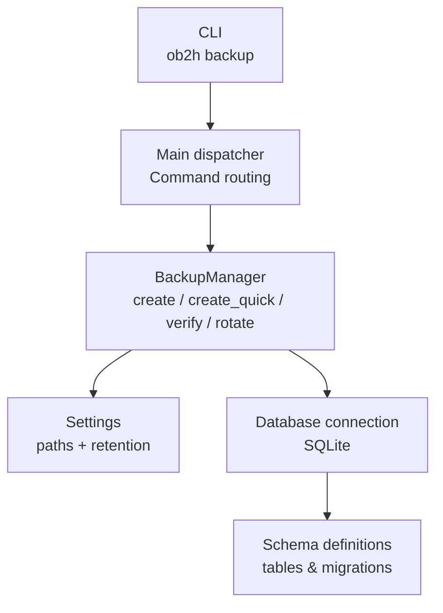
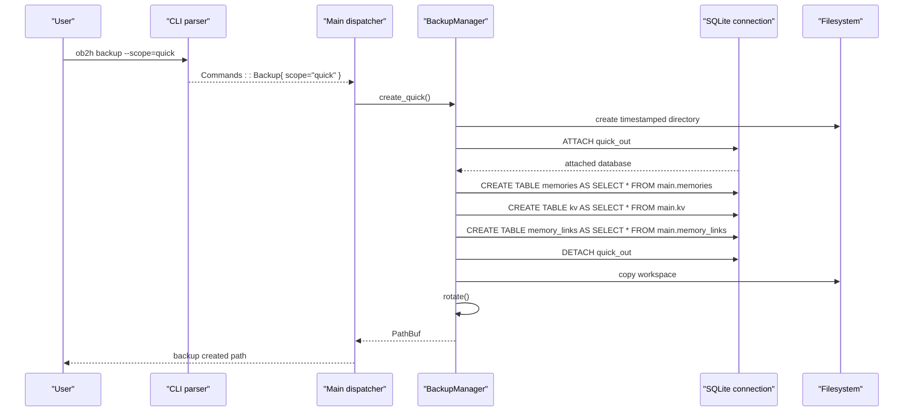
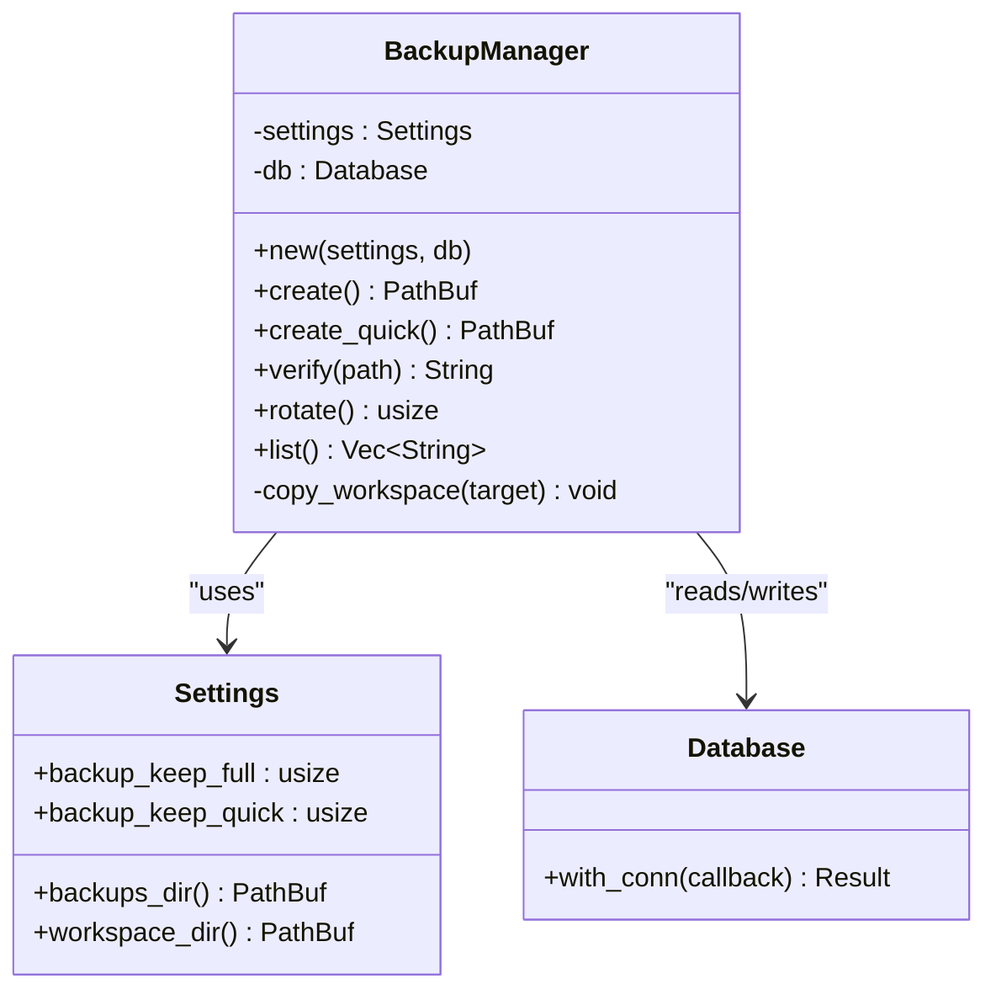
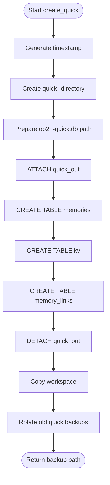
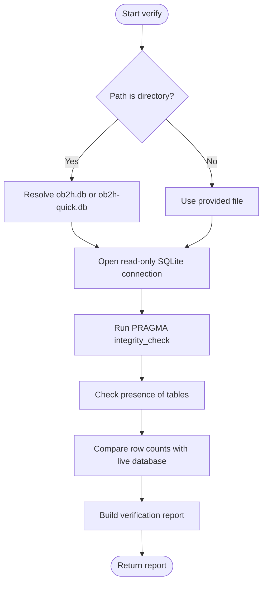
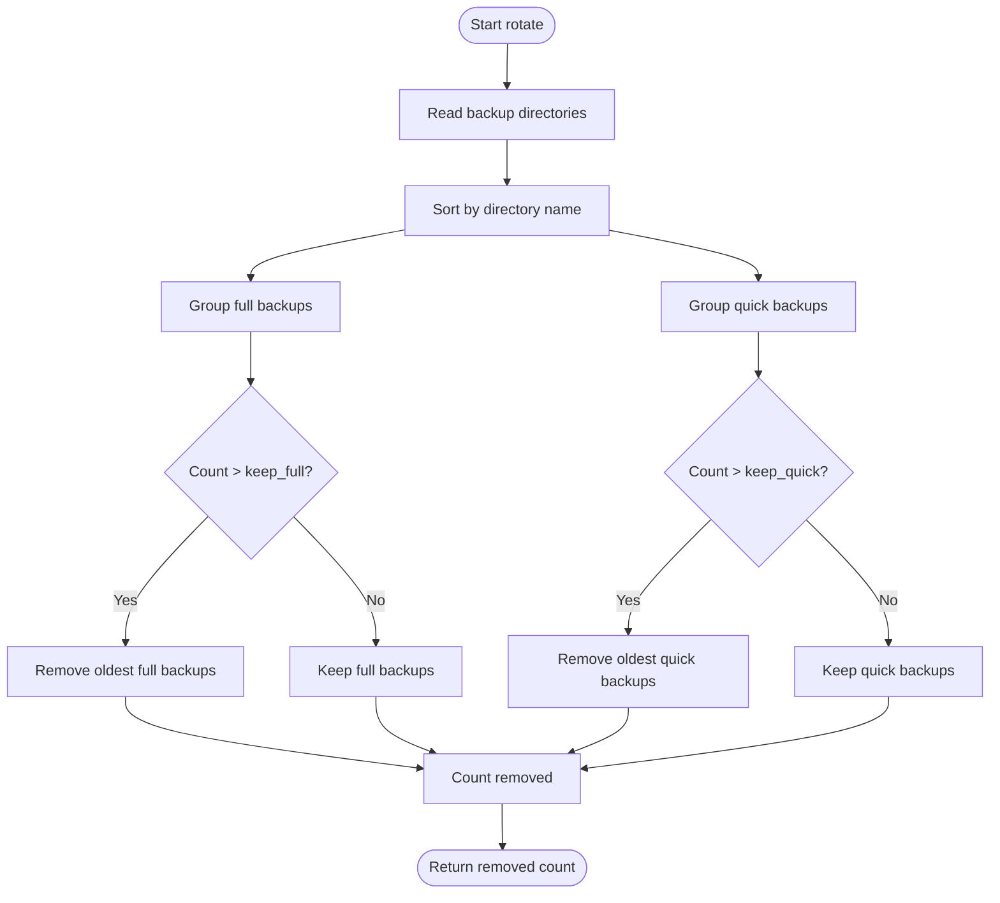
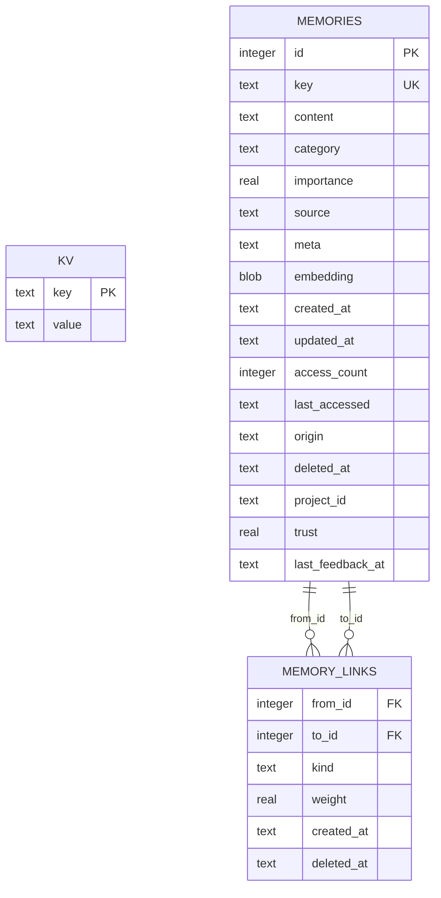
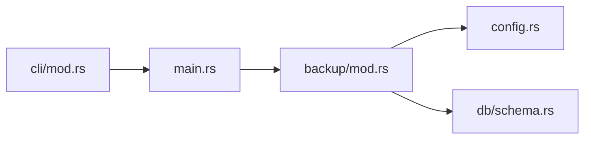

# Quick Backups

<cite>
**Referenced Files in This Document**
- [backup/mod.rs](file://src/backup/mod.rs)
- [config.rs](file://src/config.rs)
- [main.rs](file://src/main.rs)
- [cli/mod.rs](file://src/cli/mod.rs)
- [db/schema.rs](file://src/db/schema.rs)
</cite>

## Table of Contents
1. [Introduction](#introduction)
2. [Project Structure](#project-structure)
3. [Core Components](#core-components)
4. [Architecture Overview](#architecture-overview)
5. [Detailed Component Analysis](#detailed-component-analysis)
6. [Dependency Analysis](#dependency-analysis)
7. [Performance Considerations](#performance-considerations)
8. [Troubleshooting Guide](#troubleshooting-guide)
9. [Conclusion](#conclusion)
10. [Appendices](#appendices)

## Introduction
Quick backups are lightweight snapshots designed to protect the most critical application data without copying the full database. Instead of duplicating the entire SQLite database, a quick backup copies only:
- `memories`
- `kv`
- `memory_links`

It also copies the workspace directory. The graph tables (`graph_nodes`, `graph_edges`) and other large structures are intentionally excluded. This makes quick backups much smaller than full backups, typically around 10–30 MB compared with full backups that can be close to 1 GB.

The main use case is frequent incremental protection of memory-related state, while full backups remain responsible for complete recovery including graph data.

## Project Structure
Quick backup functionality lives under the backup module and is exposed through the CLI and main entry point. Configuration for retention and storage paths is centralized in the settings layer.

**Diagram sources**
- [cli/mod.rs:38-46](file://src/cli/mod.rs#L38-L46)
- [main.rs:146-158](file://src/main.rs#L146-L158)
- [backup/mod.rs:13-70](file://src/backup/mod.rs#L13-L70)
- [config.rs:425-427](file://src/config.rs#L425-L427)
- [db/schema.rs:222-334](file://src/db/schema.rs#L222-L334)

**Section sources**
- [backup/mod.rs:1-70](file://src/backup/mod.rs#L1-L70)
- [cli/mod.rs:38-46](file://src/cli/mod.rs#L38-L46)
- [main.rs:146-158](file://src/main.rs#L146-L158)
- [config.rs:425-427](file://src/config.rs#L425-L427)

## Core Components
The quick backup feature is implemented by `BackupManager`. It provides:
- Full backup creation using an atomic SQLite vacuum into a new file.
- Quick backup creation using ATTACH/DETACH to copy only selected tables.
- Verification of backup integrity and row counts.
- Rotation of old backups based on separate limits for full and quick backups.
- Workspace copying into each backup directory.

Key responsibilities:
- Selecting the correct target directory under the configured backups directory.
- Creating timestamped backup folders.
- Using SQLite operations to avoid locking or inconsistent reads.
- Keeping full and quick backups logically separated by folder naming.

**Section sources**
- [backup/mod.rs:13-70](file://src/backup/mod.rs#L13-L70)
- [backup/mod.rs:124-159](file://src/backup/mod.rs#L124-L159)
- [backup/mod.rs:179-186](file://src/backup/mod.rs#L179-L186)

## Architecture Overview
The quick backup flow starts from the CLI, routes through the main command handler, and delegates to `BackupManager::create_quick`. The implementation attaches a temporary output database, creates only the selected tables, detaches it, copies the workspace, rotates old backups, and returns the created path.

**Diagram sources**
- [cli/mod.rs:38-46](file://src/cli/mod.rs#L38-L46)
- [main.rs:146-158](file://src/main.rs#L146-L158)
- [backup/mod.rs:48-70](file://src/backup/mod.rs#L48-L70)

## Detailed Component Analysis

### BackupManager
`BackupManager` encapsulates all backup logic. It holds configuration and a live database connection, and exposes methods for creating, verifying, rotating, and listing backups.

Important behaviors:
- Full backup uses `VACUUM INTO` to produce an atomic snapshot of the live database.
- Quick backup uses `ATTACH` and `DETACH` to write only `memories`, `kv`, and `memory_links`.
- Verification opens the backup read-only, runs `PRAGMA integrity_check`, and compares row counts for present tables against the live database.
- Rotation separates full and quick backups by directory prefix and applies independent retention limits.
- Workspace copying excludes lock files such as `autodream.lock`.

**Diagram sources**
- [backup/mod.rs:13-70](file://src/backup/mod.rs#L13-L70)
- [backup/mod.rs:72-186](file://src/backup/mod.rs#L72-L186)
- [config.rs:425-427](file://src/config.rs#L425-L427)

**Section sources**
- [backup/mod.rs:13-70](file://src/backup/mod.rs#L13-L70)
- [backup/mod.rs:72-186](file://src/backup/mod.rs#L72-L186)

### Quick Backup Creation Flow
Quick backup creation follows a strict sequence:
1. Generate a timestamp.
2. Create a `quick-<timestamp>` directory under the configured backups directory.
3. Prepare the destination database file name `ob2h-quick.db`.
4. Attach the destination as a separate SQLite database.
5. Copy only the selected tables.
6. Detach the temporary database.
7. Copy the workspace.
8. Rotate old quick backups.
9. Return the backup directory path.

**Diagram sources**
- [backup/mod.rs:48-70](file://src/backup/mod.rs#L48-L70)

**Section sources**
- [backup/mod.rs:48-70](file://src/backup/mod.rs#L48-L70)

### Verification Logic
Verification ensures that a backup is usable. It:
- Accepts either a backup directory or a direct database file path.
- Chooses `ob2h.db` if present; otherwise `ob2h-quick.db`; otherwise reports missing files.
- Opens the backup read-only.
- Runs `PRAGMA integrity_check`.
- Iterates over known tables and compares row counts between backup and live database.
- Reports mismatches with a warning marker.

**Diagram sources**
- [backup/mod.rs:72-122](file://src/backup/mod.rs#L72-L122)

**Section sources**
- [backup/mod.rs:72-122](file://src/backup/mod.rs#L72-L122)

### Retention and Rotation
Retention is split between full and quick backups:
- Full backups are identified by directories not starting with `quick-`.
- Quick backups are identified by directories starting with `quick-`.
- Each group has its own keep limit.
- Older backups beyond the limit are removed.

**Diagram sources**
- [backup/mod.rs:124-159](file://src/backup/mod.rs#L124-L159)

**Section sources**
- [backup/mod.rs:124-159](file://src/backup/mod.rs#L124-L159)

### Data Model Context
Quick backups focus on memory-centric tables. The schema defines:
- `kv`: key-value store used for application metadata.
- `memories`: core memory records with fields like content, embedding, trust, project association, and lifecycle columns.
- `memory_links`: deterministic links between memories, including kind, weight, timestamps, and soft-delete support.

Graph tables such as `graph_nodes` and `graph_edges` are intentionally excluded from quick backups because they represent code structure and relationships rather than memory state.

**Diagram sources**
- [db/schema.rs:222-334](file://src/db/schema.rs#L222-L334)
- [db/schema.rs:83-109](file://src/db/schema.rs#L83-L109)

**Section sources**
- [db/schema.rs:222-334](file://src/db/schema.rs#L222-L334)
- [db/schema.rs:83-109](file://src/db/schema.rs#L83-L109)

## Dependency Analysis
Quick backups depend on several layers:

- CLI defines the `backup` subcommand and accepts `full` or `quick` scope.
- Main dispatches the command and calls `create_quick` when scope is `quick`.
- `BackupManager` depends on `Settings` for paths and retention.
- `BackupManager` depends on `Database` for executing SQL.
- Schema definitions provide table structure but are not directly imported by backup logic; backup logic assumes table names exist.

**Diagram sources**
- [cli/mod.rs:38-46](file://src/cli/mod.rs#L38-L46)
- [main.rs:146-158](file://src/main.rs#L146-L158)
- [backup/mod.rs:13-70](file://src/backup/mod.rs#L13-L70)
- [config.rs:425-427](file://src/config.rs#L425-L427)
- [db/schema.rs:222-334](file://src/db/schema.rs#L222-L334)

**Section sources**
- [cli/mod.rs:38-46](file://src/cli/mod.rs#L38-L46)
- [main.rs:146-158](file://src/main.rs#L146-L158)
- [backup/mod.rs:13-70](file://src/backup/mod.rs#L13-L70)
- [config.rs:425-427](file://src/config.rs#L425-L427)
- [db/schema.rs:222-334](file://src/db/schema.rs#L222-L334)

## Performance Considerations
Quick backups are optimized for speed and small size:
- They avoid copying the entire database.
- They only copy three tables plus the workspace.
- They use SQLite’s `ATTACH`/`DETACH` mechanism instead of full database duplication.
- Full backups still use `VACUUM INTO`, which is atomic but more expensive.

Recommended usage:
- Run quick backups frequently to protect recent memory changes.
- Run full backups less frequently to preserve graph data and full database consistency.
- Use verification after backup creation to ensure recoverability.

[No sources needed since this section provides general guidance]

## Troubleshooting Guide
Common issues and how to address them:

- Missing backup files: If verification is run against a directory without `ob2h.db` or `ob2h-quick.db`, it reports that neither file exists.
- Integrity errors: `PRAGMA integrity_check` may return an error string indicating corruption or unsupported state.
- Row count mismatch: If a table exists in the backup but has a different row count than the live database, verification marks it as a discrepancy.
- Invalid scope: Passing a scope other than `full` or `quick` results in an error.
- Workspace lock file: The workspace copy skips `autodream.lock` to avoid locking issues.

Operational checks:
- Use `ob2h backup verify <path>` to validate a backup directory or database file.
- Inspect logs for backup creation messages.
- Confirm retention settings via environment variables.

**Section sources**
- [backup/mod.rs:72-122](file://src/backup/mod.rs#L72-L122)
- [backup/mod.rs:179-207](file://src/backup/mod.rs#L179-L207)
- [main.rs:146-158](file://src/main.rs#L146-L158)

## Conclusion
Quick backups provide a fast, lightweight way to protect critical memory state without duplicating the entire database. By selectively copying `memories`, `kv`, and `memory_links`, and excluding graph data, they offer frequent incremental protection at a fraction of the size of full backups. Full backups remain necessary for complete recovery, especially when graph data is required. Proper configuration of retention, scheduling, and verification ensures reliable protection and recovery.

[No sources needed since this section summarizes without analyzing specific files]

## Appendices

### When to Use Quick Backups vs Full Backups
- Use quick backups for:
  - Frequent protection of memory state.
  - Fast recovery of memories, key-value metadata, and memory links.
  - Low-cost incremental snapshots during active development or agent usage.
- Use full backups for:
  - Complete recovery including graph nodes and edges.
  - Periodic snapshots scheduled by the owner or system.
  - Long-term archival where full database fidelity matters.

**Section sources**
- [backup/mod.rs:45-47](file://src/backup/mod.rs#L45-L47)

### Configuration Options for Quick Backup Retention
Retention is controlled by environment variables:
- `OB2H_BACKUP_KEEP_QUICK`: Number of quick backups to retain. Default is 14.
- `OB2H_BACKUP_KEEP_FULL`: Number of full backups to retain. Default is 3.
- `OB2H_DATA_DIR`: Base directory containing `data/backups`.

These values are loaded into `Settings` and used by rotation logic.

**Section sources**
- [config.rs:303-310](file://src/config.rs#L303-L310)
- [config.rs:399-400](file://src/config.rs#L399-L400)
- [config.rs:425-427](file://src/config.rs#L425-L427)

### Scheduling Recommendations
- Schedule quick backups frequently, for example every few hours or after significant memory updates.
- Schedule full backups less frequently, for example daily or weekly, depending on storage constraints.
- Always run verification after backup creation to confirm integrity.
- Monitor retention to prevent uncontrolled growth of backup directories.

[No sources needed since this section provides general guidance]

### Recovery Procedures Using Quick Backup Data
Recovery steps:
1. Identify the latest verified quick backup directory.
2. Locate `ob2h-quick.db` inside the backup directory.
3. Verify the backup using the built-in verification command.
4. Restore by replacing the live database with the backup database if appropriate.
5. Restore the workspace directory from the backup’s `workspace` folder.
6. Rebuild derived structures if needed, since quick backups do not include graph data.

Note: Because quick backups exclude graph data, restoring from a quick backup alone may require rebuilding graph structures or combining with a full backup.

**Section sources**
- [backup/mod.rs:72-122](file://src/backup/mod.rs#L72-L122)
- [backup/mod.rs:45-70](file://src/backup/mod.rs#L45-L70)