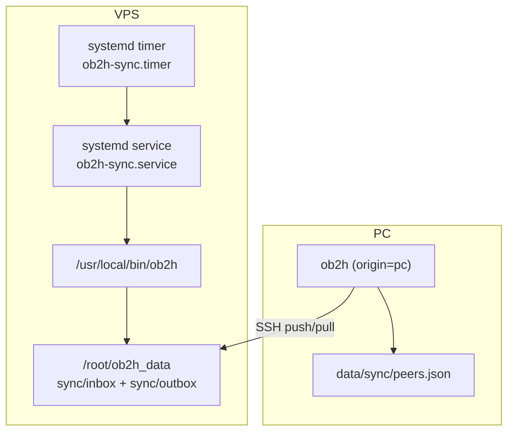
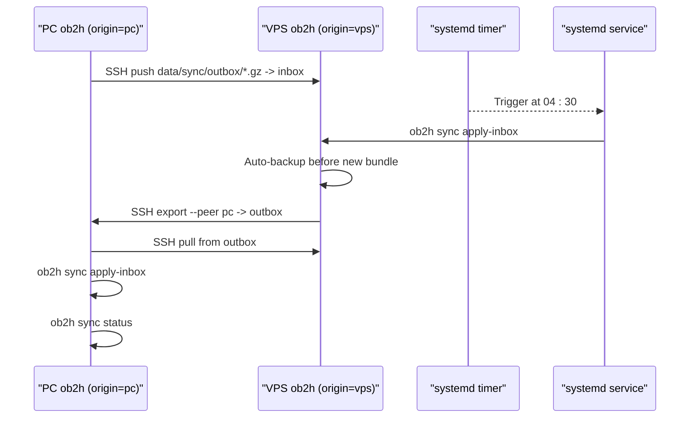
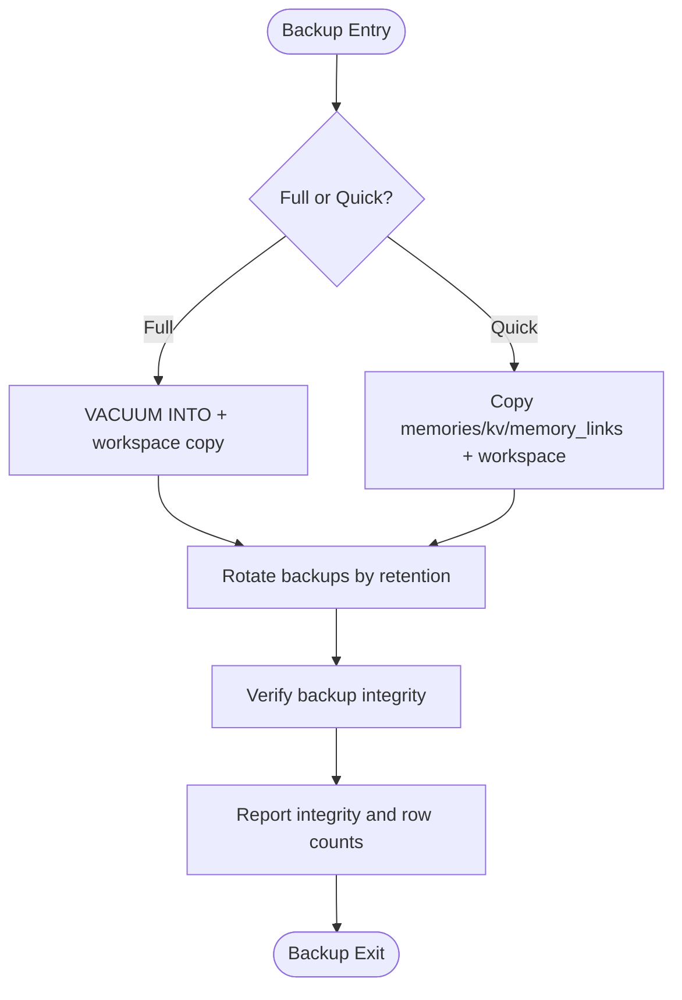
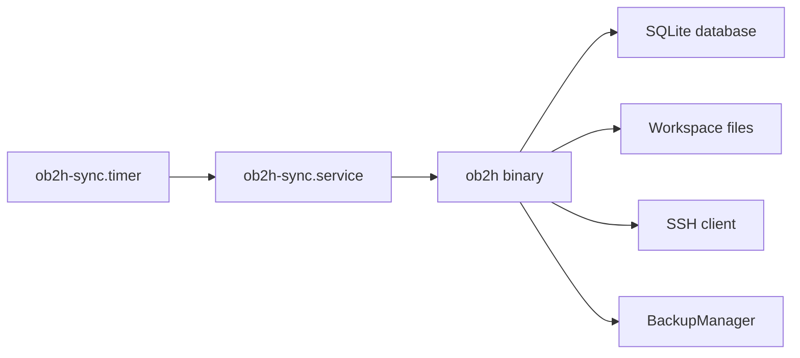

# Deployment and Operations

<cite>
**Referenced Files in This Document**
- [README.md](file://README.md)
- [SYNC.md](file://docs/SYNC.md)
- [scripts/vps/README.md](file://scripts/vps/README.md)
- [scripts/vps/ob2h-sync.service](file://scripts/vps/ob2h-sync.service)
- [scripts/vps/ob2h-sync.timer](file://scripts/vps/ob2h-sync.timer)
- [scripts/pc/update_vps_ob2h.sh](file://scripts/pc/update_vps_ob2h.sh)
- [src/backup/mod.rs](file://src/backup/mod.rs)
</cite>

## Table of Contents
1. [Introduction](#introduction)
2. [Project Structure](#project-structure)
3. [Core Components](#core-components)
4. [Architecture Overview](#architecture-overview)
5. [Detailed Component Analysis](#detailed-component-analysis)
6. [Dependency Analysis](#dependency-analysis)
7. [Performance Considerations](#performance-considerations)
8. [Troubleshooting Guide](#troubleshooting-guide)
9. [Conclusion](#conclusion)
10. [Appendices](#appendices)

## Introduction
This document provides production-oriented deployment and operations guidance for OB2H, focusing on VPS setup, systemd service configuration, automated synchronization scheduling, backup and recovery strategies, monitoring and logging, scaling and performance tuning, update procedures with rollback support, security hardening, and operational runbooks for common maintenance tasks and incident response. It is intended for operators managing OB2H alongside AI agents such as Hermes, Claude Code, Cursor, Windsurf, ZCode, Gemini CLI, Qwen Code, OpenCode, and DSH.

OB2H is a Rust-based local memory and knowledge graph system that integrates with multiple agent harnesses via MCP tools and plugins. It supports incremental peer-to-peer synchronization over SSH, encrypted bundle exchange, secrets vaulting, automatic updates, and robust backup utilities.

## Project Structure
The repository includes:
- Production-ready systemd units for VPS synchronization under `scripts/vps/`.
- A comprehensive synchronization guide under `docs/SYNC.md`.
- Backup implementation in `src/backup/mod.rs`.
- Environment variables and operational commands documented in the root README.

**Diagram sources**
- [scripts/vps/ob2h-sync.timer:1-10](file://scripts/vps/ob2h-sync.timer#L1-L10)
- [scripts/vps/ob2h-sync.service:1-10](file://scripts/vps/ob2h-sync.service#L1-L10)
- [scripts/vps/README.md:1-34](file://scripts/vps/README.md#L1-L34)
- [docs/SYNC.md:32-57](file://docs/SYNC.md#L32-L57)

**Section sources**
- [scripts/vps/README.md:1-34](file://scripts/vps/README.md#L1-L34)
- [docs/SYNC.md:32-57](file://docs/SYNC.md#L32-L57)

## Core Components
- VPS systemd timer and service: schedule and execute inbox import and outbox export.
- Synchronization engine: incremental delta bundles over SSH or manual transfer; conflict resolution with LWW and field-level merge; tombstones for deletions; idempotent imports.
- Backup manager: full atomic snapshots using SQLite VACUUM INTO, quick backups of core memory tables, integrity verification, and rotation policies.
- Operational commands: backup, doctor, plugin/skill installation, agent integration, secret management, update checks and application.

Key operational capabilities:
- Automated daily synchronization after auto-dream on VPS.
- Automatic pre-import snapshot creation during sync apply.
- Full and quick backup modes with configurable retention.
- Self-update mechanism with version checking and binary replacement.

**Section sources**
- [scripts/vps/ob2h-sync.timer:1-10](file://scripts/vps/ob2h-sync.timer#L1-L10)
- [scripts/vps/ob2h-sync.service:1-10](file://scripts/vps/ob2h-sync.service#L1-L10)
- [docs/SYNC.md:58-68](file://docs/SYNC.md#L58-L68)
- [src/backup/mod.rs:23-70](file://src/backup/mod.rs#L23-L70)
- [README.md:288-296](file://README.md#L288-L296)

## Architecture Overview
The production architecture centers around two nodes:
- PC (Windows, behind NAT): initiates push/pull to VPS; can also trigger sync after auto-dream.
- VPS (Linux, public IP): runs systemd timer/service to apply incoming bundles and prepare outgoing bundles.

Data flows:
- PC exports delta bundles to VPS inbox via SSH.
- VPS applies inbox bundles and exports its own deltas to outbox.
- PC pulls VPS outbox and applies bundles.
- Sync state tracks watermarks per peer and applied bundles.

**Diagram sources**
- [docs/SYNC.md:32-57](file://docs/SYNC.md#L32-L57)
- [docs/SYNC.md:143-175](file://docs/SYNC.md#L143-L175)
- [scripts/vps/ob2h-sync.timer:1-10](file://scripts/vps/ob2h-sync.timer#L1-L10)
- [scripts/vps/ob2h-sync.service:1-10](file://scripts/vps/ob2h-sync.service#L1-L10)

## Detailed Component Analysis

### VPS Deployment Configuration
- Install systemd units into `/etc/systemd/system/`, reload daemon, enable and start the timer.
- Configure peers.json on VPS with origin set to vps; priority order influences conflict resolution.
- Ensure directories exist: `/root/ob2h_data/sync/inbox` and `/root/ob2h_data/sync/outbox`.
- Manual execution and diagnostics are supported via systemctl and journalctl.

Operational notes:
- The service runs as a oneshot unit, applying inbox bundles and exporting to peer pc.
- The timer triggers daily at 04:30 with persistence enabled.

**Section sources**
- [scripts/vps/README.md:6-12](file://scripts/vps/README.md#L6-L12)
- [scripts/vps/README.md:14-25](file://scripts/vps/README.md#L14-L25)
- [scripts/vps/README.md:27-34](file://scripts/vps/README.md#L27-L34)
- [scripts/vps/ob2h-sync.service:1-10](file://scripts/vps/ob2h-sync.service#L1-L10)
- [scripts/vps/ob2h-sync.timer:1-10](file://scripts/vps/ob2h-sync.timer#L1-L10)

### Systemd Service and Timer Setup
- Service definition sets environment variable `OB2H_DATA_DIR=/root/ob2h_data` and executes sync apply-inbox followed by export to peer pc.
- Timer definition schedules daily execution at 04:30 and persists missed runs.

Best practices:
- Use persistent timers to recover missed executions.
- Monitor service logs with journalctl for troubleshooting.
- Validate peer connectivity and directory permissions before enabling.

**Section sources**
- [scripts/vps/ob2h-sync.service:1-10](file://scripts/vps/ob2h-sync.service#L1-L10)
- [scripts/vps/ob2h-sync.timer:1-10](file://scripts/vps/ob2h-sync.timer#L1-L10)

### Automated Synchronization Scheduling
- VPS relies on systemd timer to apply inbox and prepare outbox.
- PC can use Windows Task Scheduler script `scripts/pc/sync-task.ps1` or rely on `after_dream: true` in peers.json.
- Manual mode allows offline transfer of bundles via Syncthing, private git, or removable media.

Scheduling options:
- After auto-dream on PC.
- Daily scheduled task on PC.
- Daily systemd timer on VPS.

**Section sources**
- [docs/SYNC.md:143-175](file://docs/SYNC.md#L143-L175)
- [docs/SYNC.md:177-188](file://docs/SYNC.md#L177-L188)

### Backup and Recovery Strategies
BackupManager supports:
- Full atomic snapshot using SQLite VACUUM INTO plus workspace copy.
- Quick backup capturing only memories, kv, and memory_links tables plus workspace.
- Integrity verification opening backup read-only, running PRAGMA integrity_check, and comparing table counts with live database.
- Rotation policy maintaining separate retention limits for full and quick backups.

Recovery workflow:
- Identify backup type (full vs quick).
- Verify backup integrity.
- Restore workspace and database files to target path.
- Validate restored state with `ob2h doctor` and `ob2h stats`.

**Diagram sources**
- [src/backup/mod.rs:23-70](file://src/backup/mod.rs#L23-L70)
- [src/backup/mod.rs:72-122](file://src/backup/mod.rs#L72-L122)
- [src/backup/mod.rs:124-159](file://src/backup/mod.rs#L124-L159)

**Section sources**
- [src/backup/mod.rs:23-70](file://src/backup/mod.rs#L23-L70)
- [src/backup/mod.rs:72-122](file://src/backup/mod.rs#L72-L122)
- [src/backup/mod.rs:124-159](file://src/backup/mod.rs#L124-L159)

### Disaster Recovery Procedures
- Pre-import snapshots: each new bundle triggers an automatic backup before apply-inbox.
- Conflict journaling: conflicts are recorded in `data/sync/conflicts.jsonl`; optional preservation of losing versions via `OB2H_SYNC_KEEP_LOSERS=1`.
- Rollback strategy: restore from latest verified backup prior to problematic import; re-run apply-inbox if needed.
- Drift verification: use `ob2h sync verify [--peer <name>]` to compare counts, trust averages, and checksums without transferring data.

**Section sources**
- [docs/SYNC.md:58-68](file://docs/SYNC.md#L58-L68)
- [docs/SYNC.md:202-210](file://docs/SYNC.md#L202-L210)
- [docs/SYNC.md:274-276](file://docs/SYNC.md#L274-L276)

### Monitoring and Logging Setup
- Systemd integration: monitor service status and logs via `systemctl` and `journalctl`.
- Application logs: tracing is used across components; inspect logs for sync, backup, dream, and embedding activities.
- Health checks: use `ob2h doctor`, `ob2h stats`, and `ob2h sync status` to validate system health and synchronization state.
- Metrics collection: bench history and nightly gate provide quality metrics for dream consolidation; review trends and verdicts.

Recommended practices:
- Centralize logs with journald forwarding or log aggregation.
- Set up alerts for service failures, sync errors, and backup verification warnings.
- Track bench history trends to detect regression in search quality.

**Section sources**
- [scripts/vps/README.md:27-34](file://scripts/vps/README.md#L27-L34)
- [README.md:220-296](file://README.md#L220-L296)

### Scaling Considerations and Performance Tuning
- Resource allocation: OB2H binaries are lightweight (~15 MB), fast startup (<15 ms), and low memory usage (15–30 MB).
- Embeddings: local Candle-based embeddings are built-in; external API provider can be configured via `OB2H_EMBED_PROVIDER`.
- Dreaming: local mini-model fallback ensures dreaming continues without API keys; model download is lazy.
- Search optimization: Personalized PageRank damping and hybrid FTS+vector search improve relevance.

Tuning knobs:
- `OB2H_PREFETCH_MAX_CHARS`: control prefetch block budget.
- `OB2H_HALF_LIFE_DAYS`: freshness decay in scoring.
- `OB2H_VEC0`: experimental sqlite-vec rescore toggle.
- `OB2H_OFFLINE`: disable HF Hub downloads for fully offline environments.

**Section sources**
- [README.md:61-70](file://README.md#L61-L70)
- [README.md:300-329](file://README.md#L300-L329)

### Update Procedures, Version Management, and Rollback
- Self-update: check for new versions and apply updates automatically; serve checks daily for notifications.
- Binary replacement: update process replaces the binary and reinstalls plugin/skill.
- Rollback: revert to previous binary if needed; maintain old binary copies and test upgrades in staging.

Manual VPS update flow:
- Stop running server processes.
- Install new binary to `/usr/local/bin/ob2h`.
- Verify installed version and success marker.

**Section sources**
- [README.md:288-296](file://README.md#L288-L296)
- [scripts/pc/update_vps_ob2h.sh:1-20](file://scripts/pc/update_vps_ob2h.sh#L1-L20)

### Security Hardening, Firewall Configuration, and Access Control
- Secrets Vault: XChaCha20-Poly1305 encryption with Argon2id master key held in memory; PIN-based unlock; TTL-based key wiping.
- Isolation: secrets are isolated from memory, graph, dreaming, and sync bundles.
- Sync security: transport over SSH; optional E2EE for bundles via `OB2H_SYNC_KEY`.
- Firewall: no open ports required; outbound SSH only.

Access control policies:
- Restrict SSH access to trusted hosts and keys.
- Limit file permissions on `/root/ob2h_data` and sync directories.
- Avoid exposing sync bundles to untrusted networks.

**Section sources**
- [README.md:188-217](file://README.md#L188-L217)
- [docs/SYNC.md:202-210](file://docs/SYNC.md#L202-L210)

### Operational Runbooks

#### Routine Maintenance Tasks
- Verify sync status: `ob2h sync status` on both PC and VPS.
- Check service health: `systemctl status ob2h-sync.service` and `journalctl -u ob2h-sync.service -n 30`.
- Inspect backup list and verify recent backups: `ob2h backup verify <path>`.
- Review dream status and logs: `ob2h dream status` and `ob2h dream log`.
- Run doctor diagnostics: `ob2h doctor --fix`.

#### Incident Response Procedures
- Sync failure:
  - Confirm SSH connectivity and peer configuration.
  - Check inbox/outbox permissions and existence.
  - Re-run manual push/pull and inspect conflicts journal.
- Backup corruption:
  - Run `ob2h backup verify` on candidate backups.
  - Restore from last verified full backup.
  - Reapply sync bundles if necessary.
- Service not starting:
  - Validate systemd unit files and environment variables.
  - Check journal logs for errors.
  - Restart service and timer.

**Section sources**
- [docs/SYNC.md:211-222](file://docs/SYNC.md#L211-L222)
- [scripts/vps/README.md:27-34](file://scripts/vps/README.md#L27-L34)
- [src/backup/mod.rs:72-122](file://src/backup/mod.rs#L72-L122)

## Dependency Analysis
Systemd units depend on network availability and correct environment variables. The sync worker depends on SSH connectivity and peer configuration. Backup manager depends on SQLite database integrity and workspace accessibility.

**Diagram sources**
- [scripts/vps/ob2h-sync.timer:1-10](file://scripts/vps/ob2h-sync.timer#L1-L10)
- [scripts/vps/ob2h-sync.service:1-10](file://scripts/vps/ob2h-sync.service#L1-L10)
- [src/backup/mod.rs:13-21](file://src/backup/mod.rs#L13-L21)

**Section sources**
- [scripts/vps/ob2h-sync.timer:1-10](file://scripts/vps/ob2h-sync.timer#L1-L10)
- [scripts/vps/ob2h-sync.service:1-10](file://scripts/vps/ob2h-sync.service#L1-L10)
- [src/backup/mod.rs:13-21](file://src/backup/mod.rs#L13-L21)

## Performance Considerations
- Prefer quick backups for frequent snapshots; use full backups periodically for complete recovery points.
- Tune dream parameters and embed providers based on available resources and latency requirements.
- Monitor bench history to ensure search quality remains stable after updates or configuration changes.
- Keep time synchronized across machines to avoid timestamp-related sync issues.

[No sources needed since this section provides general guidance]

## Troubleshooting Guide
Common issues and resolutions:
- SCP destination open failure: create missing directories on peer.
- Peer not found: verify peers.json naming and existence.
- Silent sync: ensure scheduler or after_dream is enabled.
- Conflicts counter increasing: expected behavior under LWW; review conflicts journal.
- Bundle not applied again: idempotent by design; bundle_id already applied.
- Sync disabled due to config error: fix JSON syntax in peers.json.

**Section sources**
- [docs/SYNC.md:211-222](file://docs/SYNC.md#L211-L222)

## Conclusion
OB2H provides a robust, secure, and efficient platform for long-term memory and knowledge graphs integrated with multiple AI agents. Production deployments benefit from systemd-managed synchronization, comprehensive backup and verification, self-updating mechanisms, and strong isolation of secrets. Operators should adopt the provided runbooks, monitor system health regularly, and follow the security and performance recommendations outlined here to maintain reliable operations at scale.

[No sources needed since this section summarizes without analyzing specific files]

## Appendices

### Environment Variables Reference
Key variables for production configuration:
- `OB2H_DATA_DIR`: data directory for database, memory files, and logs.
- `OB2H_LLM_*`: LLM provider settings and model selection.
- `OB2H_LOCAL_LLM*`: local mini-model toggles and repository.
- `OB2H_EMBED_PROVIDER`: embedding backend selection.
- `OB2H_AUTODREAM_ENABLED`: background dreaming toggle.
- `OB2H_BACKUP_KEEP_FULL` / `OB2H_BACKUP_KEEP_QUICK`: backup retention counts.
- `OB2H_SYNC_KEY`: E2EE key for sync bundles.
- `OB2H_SECRETS_TTL_MIN`: secrets vault TTL in minutes.
- `OB2H_UPDATE_ENABLED` / `OB2H_UPDATE_INTERVAL_HOURS`: update check configuration.
- `OB2H_OFFLINE`: disable remote model downloads.

**Section sources**
- [README.md:300-329](file://README.md#L300-L329)