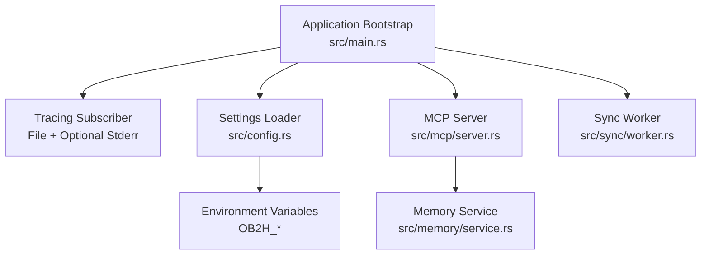
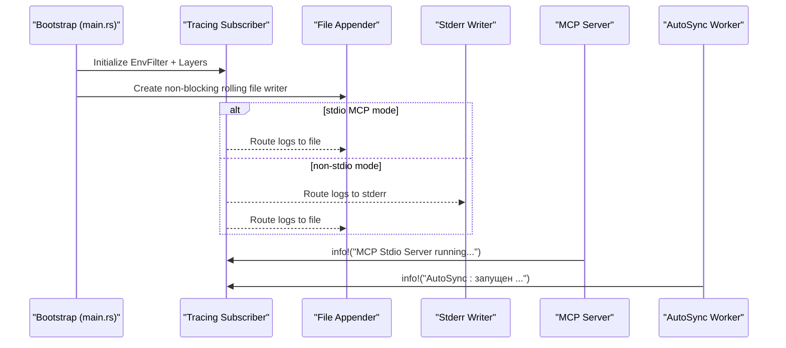
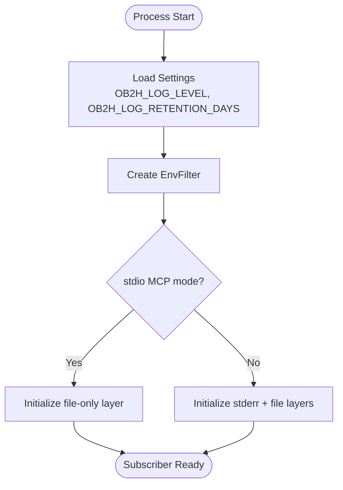
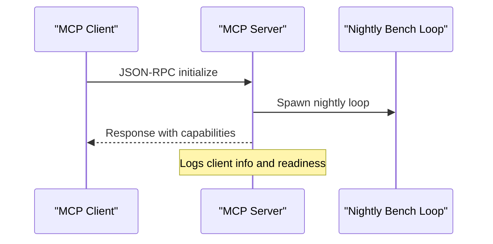
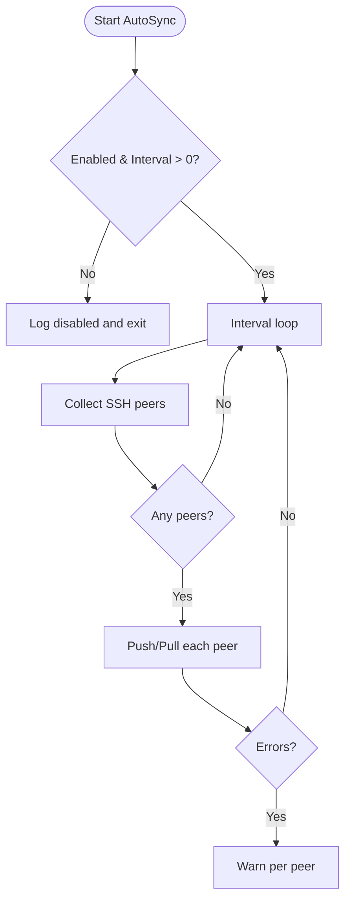
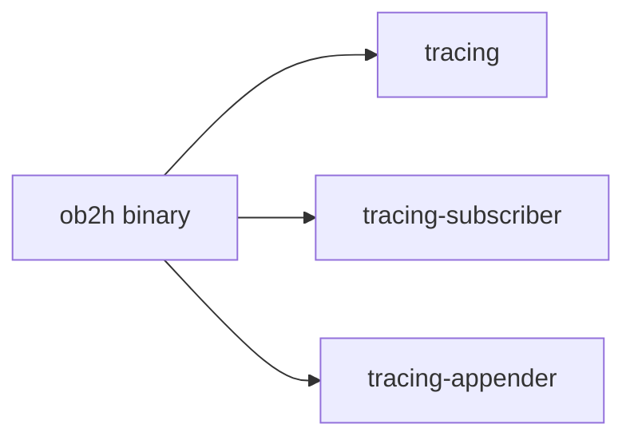

# Monitoring and Logging

<cite>
**Referenced Files in This Document**
- [main.rs](file://src/main.rs)
- [config.rs](file://src/config.rs)
- [server.rs](file://src/mcp/server.rs)
- [worker.rs](file://src/sync/worker.rs)
- [service.rs](file://src/memory/service.rs)
- [Cargo.toml](file://Cargo.toml)
</cite>

## Table of Contents
1. [Introduction](#introduction)
2. [Project Structure](#project-structure)
3. [Core Components](#core-components)
4. [Architecture Overview](#architecture-overview)
5. [Detailed Component Analysis](#detailed-component-analysis)
6. [Dependency Analysis](#dependency-analysis)
7. [Performance Considerations](#performance-considerations)
8. [Troubleshooting Guide](#troubleshooting-guide)
9. [Conclusion](#conclusion)

## Introduction
This document describes the observability, logging, metrics collection, and alerting posture for the system. It focuses on:
- Structured logging via the tracing framework
- Log levels and categories for MCP server, sync worker, and memory service
- Performance metrics collection and system resource monitoring
- Integration points with external monitoring tools
- Alerting rules for critical failures, performance degradation, and security events
- Debugging procedures and log analysis techniques

The implementation uses structured logs emitted through `tracing`, with a file-based rolling writer and optional stderr output depending on transport mode. Configuration is driven by environment variables, including log level and retention policy.

## Project Structure
Observability-related code spans application bootstrap, configuration, and core services:
- Application bootstrap initializes tracing subscriber, sets up log rotation, and selects writers based on transport mode.
- Configuration centralizes all runtime settings, including log level and retention.
- MCP server emits operational and diagnostic logs during request handling and tool execution.
- Sync worker emits periodic synchronization status and error logs.
- Memory service provides domain operations; it does not emit logs directly but participates in workflows that are observable via upstream components.

**Diagram sources**
- [main.rs:17-58](file://src/main.rs#L17-L58)
- [config.rs:176-415](file://src/config.rs#L176-L415)
- [server.rs:138-206](file://src/mcp/server.rs#L138-L206)
- [worker.rs:24-63](file://src/sync/worker.rs#L24-L63)
- [service.rs:30-38](file://src/memory/service.rs#L30-L38)

**Section sources**
- [main.rs:17-58](file://src/main.rs#L17-L58)
- [config.rs:176-415](file://src/config.rs#L176-L415)

## Core Components
- Tracing setup and log routing:
  - Initializes a non-blocking file appender under the configured logs directory.
  - Uses an environment filter to control verbosity.
  - Writes to stderr only when not in stdio MCP mode; otherwise writes to file only.
- Settings and environment:
  - Provides `log_level` and `log_retention_days`.
  - Ensures directories exist, including the logs directory.
- MCP server:
  - Emits structured logs for client connections, initialization, and background tasks.
- Sync worker:
  - Emits periodic logs for scheduled sync runs and errors per peer.
- Memory service:
  - Implements core memory operations; observability is primarily via upstream calls and database state.

**Section sources**
- [main.rs:17-58](file://src/main.rs#L17-L58)
- [config.rs:417-454](file://src/config.rs#L417-L454)
- [server.rs:138-206](file://src/mcp/server.rs#L138-L206)
- [worker.rs:24-63](file://src/sync/worker.rs#L24-L63)
- [service.rs:30-38](file://src/memory/service.rs#L30-L38)

## Architecture Overview
The observability architecture centers on a single tracing subscriber initialized at process start. Logs flow from all modules into a non-blocking file writer, with optional stderr output for interactive modes.

**Diagram sources**
- [main.rs:40-58](file://src/main.rs#L40-L58)
- [server.rs:146-146](file://src/mcp/server.rs#L146-L146)
- [worker.rs:30-31](file://src/sync/worker.rs#L30-L31)

## Detailed Component Analysis

### Structured Logging Implementation
- Framework: `tracing` with `tracing-subscriber` and `tracing-appender`.
- Filter: Environment-driven via `EnvFilter`; falls back to configured `log_level`.
- Writers:
  - Non-blocking file writer under `data_dir/logs`.
  - Stderr writer enabled when not in stdio MCP mode.
- Retention: Configurable via `log_retention_days`; daily logs older than N days are archived.

**Diagram sources**
- [main.rs:40-58](file://src/main.rs#L40-L58)
- [config.rs:312-317](file://src/config.rs#L312-L317)
- [config.rs:275-279](file://src/config.rs#L275-L279)

**Section sources**
- [main.rs:40-58](file://src/main.rs#L40-L58)
- [config.rs:312-317](file://src/config.rs#L312-L317)
- [config.rs:275-279](file://src/config.rs#L275-L279)

### Log Levels and Categories
- Global level: Controlled by `OB2H_LOG_LEVEL` and environment filter.
- Categories observed:
  - MCP server: connection, initialization, client info, background tasks.
  - Sync worker: auto-sync enablement, interval, scheduled runs, push/pull errors.
  - Memory service: no direct logs; behavior observable via upstream components and data state.

Operational guidance:
- Use `INFO` for production baselines.
- Increase to `DEBUG` for detailed diagnostics during investigations.
- Keep `WARN` and `ERROR` for actionable issues.

**Section sources**
- [main.rs:40-58](file://src/main.rs#L40-L58)
- [server.rs:146-146](file://src/mcp/server.rs#L146-L146)
- [worker.rs:24-63](file://src/sync/worker.rs#L24-L63)

### MCP Server Observability
Key observable behaviors:
- Server startup message indicating readiness.
- Client connection details logged during initialization.
- Background nightly benchmark loop started at server start.

**Diagram sources**
- [server.rs:138-146](file://src/mcp/server.rs#L138-L146)

**Section sources**
- [server.rs:138-146](file://src/mcp/server.rs#L138-L146)

### Sync Worker Observability
Key observable behaviors:
- Auto-sync disabled or enabled messages.
- Scheduled sync runs with peer lists.
- Per-peer push/pull error warnings.

**Diagram sources**
- [worker.rs:24-63](file://src/sync/worker.rs#L24-L63)

**Section sources**
- [worker.rs:24-63](file://src/sync/worker.rs#L24-L63)

### Memory Service Observability
- The memory service itself does not emit logs.
- Observability is achieved via:
  - Upstream MCP tool calls that surface results and errors.
  - Database state changes (e.g., trust updates, access counters).
  - Audit records written by other components.

Recommendation:
- Monitor database metrics (row counts, latency) and audit tables for behavioral insights.

**Section sources**
- [service.rs:30-38](file://src/memory/service.rs#L30-L38)

## Dependency Analysis
External dependencies relevant to observability:
- `tracing`: Structured logging API used across modules.
- `tracing-subscriber`: Subscriber with env-filter and formatting layers.
- `tracing-appender`: Non-blocking file appender for log rotation.

**Diagram sources**
- [Cargo.toml:15-17](file://Cargo.toml#L15-L17)

**Section sources**
- [Cargo.toml:15-17](file://Cargo.toml#L15-L17)

## Performance Considerations
- Logging overhead:
  - Non-blocking file writer minimizes I/O contention.
  - Avoid excessive `DEBUG` logs in high-throughput paths.
- Metrics collection:
  - No built-in metrics exporter is present; rely on log-derived signals and database metrics.
- Resource monitoring:
  - External process monitors should track CPU, memory, disk usage, and DB latency.
- Retention:
  - Configure `log_retention_days` to balance storage and forensic needs.

[No sources needed since this section provides general guidance]

## Troubleshooting Guide

### Common Issues and Diagnostics
- No logs appearing:
  - Verify `OB2H_DATA_DIR` and ensure `logs` directory exists.
  - Confirm `OB2H_LOG_LEVEL` is set appropriately.
  - In stdio MCP mode, logs go to file only; check stderr only in non-stdio mode.
- High log volume:
  - Reduce verbosity by setting a stricter `OB2H_LOG_LEVEL`.
  - Temporarily disable background tasks if they generate excessive logs.
- Sync failures:
  - Inspect per-peer warnings for push/pull errors.
  - Validate peer configuration and network connectivity.

### Log Analysis Techniques
- Filter by level:
  - Use environment filter to focus on `WARN`/`ERROR` for incidents.
- Search patterns:
  - Look for “AutoSync” entries to identify sync scheduling and failures.
  - Look for MCP initialization and client connection logs to validate handshake.
- Time-bounded analysis:
  - Use daily log files under `data_dir/logs` and archive structure for historical review.

### Alerting Rules
Recommended alerts based on observed log patterns:
- Critical failures:
  - Any `ERROR` logs from MCP server or sync worker.
  - Repeated push/pull failures for any peer within a short window.
- Performance degradation:
  - Excessive `WARN` logs indicating fallbacks or retries.
  - Nightly benchmark loops reporting failures or panics.
- Security events:
  - Warnings about missing or misconfigured LLM keys.
  - Unexpected harness detection or model swaps.

Operational tips:
- Set up log aggregation to parse structured fields and trigger alerts on specific keywords.
- Correlate log spikes with system resource utilization.

**Section sources**
- [main.rs:40-58](file://src/main.rs#L40-L58)
- [worker.rs:24-63](file://src/sync/worker.rs#L24-L63)
- [config.rs:312-317](file://src/config.rs#L312-L317)

## Conclusion
The system implements robust structured logging using `tracing`, with configurable log levels and retention. The MCP server and sync worker provide clear operational signals, while the memory service’s behavior is observable through upstream interactions and database state. For comprehensive observability, combine these logs with external metrics and resource monitoring, and implement alerting rules around critical failures, performance regressions, and security-related warnings.

[No sources needed since this section summarizes without analyzing specific files]