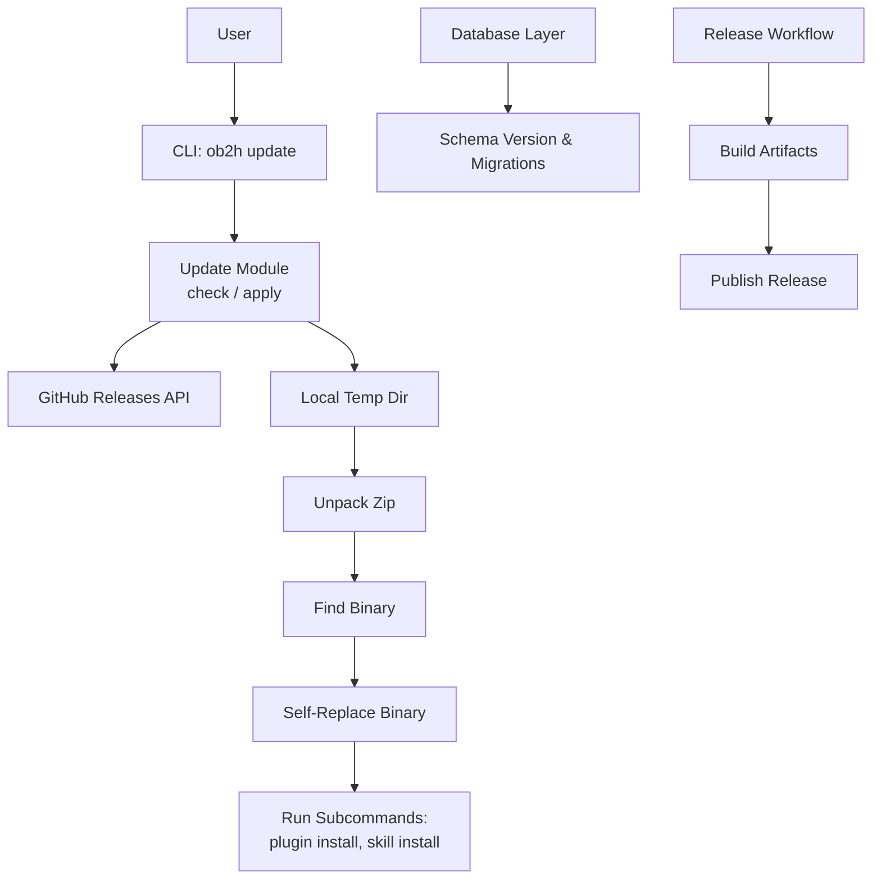
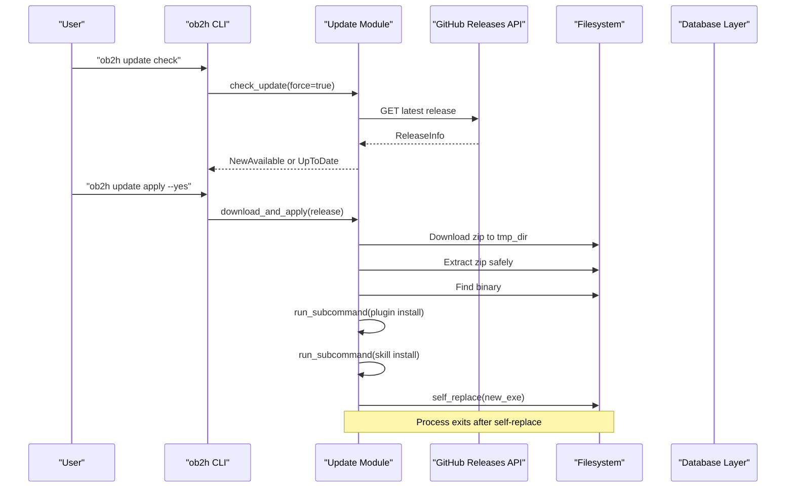
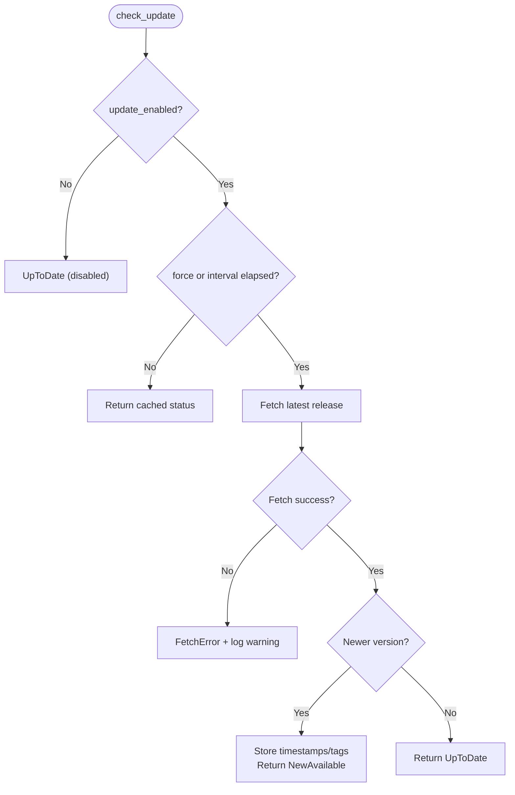
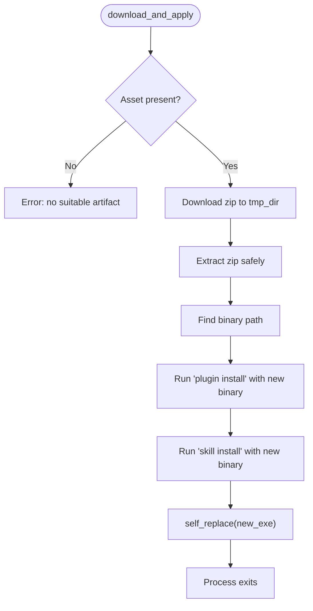
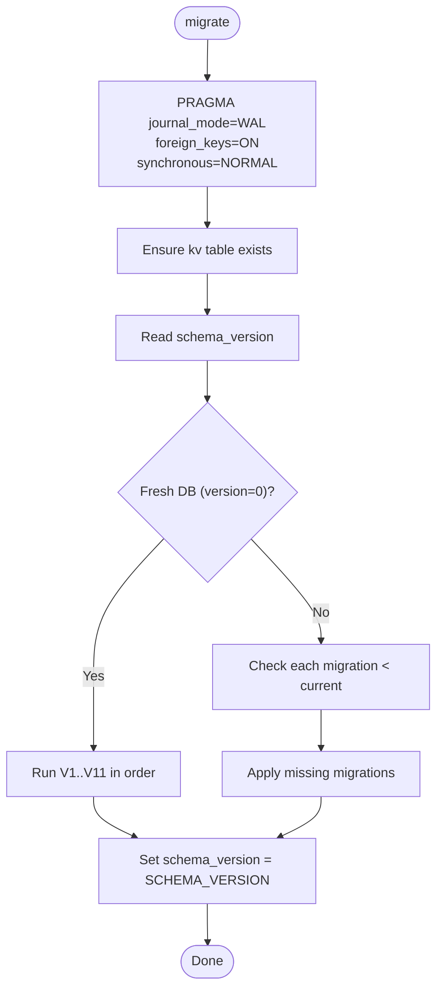
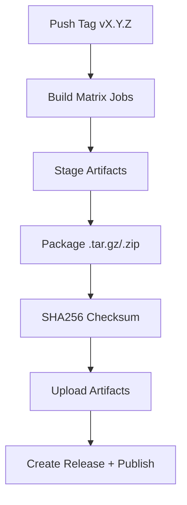
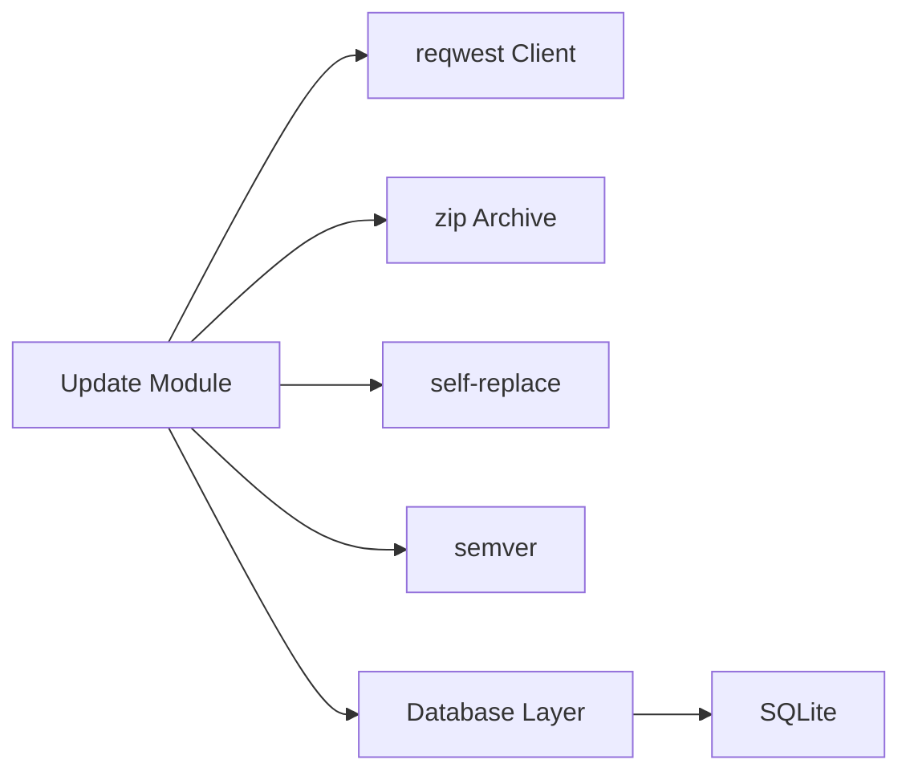

# Updates and Maintenance

<cite>
**Referenced Files in This Document**
- [README.md](file://README.md)
- [Cargo.toml](file://Cargo.toml)
- [src/update/mod.rs](file://src/update/mod.rs)
- [.github/workflows/release.yml](file://.github/workflows/release.yml)
- [scripts/vps/README.md](file://scripts/vps/README.md)
- [src/db/schema.rs](file://src/db/schema.rs)
- [src/db/mod.rs](file://src/db/mod.rs)
</cite>

## Table of Contents
1. [Introduction](#introduction)
2. [Project Structure](#project-structure)
3. [Core Components](#core-components)
4. [Architecture Overview](#architecture-overview)
5. [Detailed Component Analysis](#detailed-component-analysis)
6. [Dependency Analysis](#dependency-analysis)
7. [Performance Considerations](#performance-considerations)
8. [Troubleshooting Guide](#troubleshooting-guide)
9. [Conclusion](#conclusion)
10. [Appendices](#appendices)

## Introduction
This document provides updates and maintenance guidance for OB2H, focusing on version management, automatic and manual update procedures, rollback strategies, database migration handling, schema evolution, backward compatibility, and routine maintenance tasks such as database optimization and cleanup. It also includes upgrade guides from previous versions, deprecation notices, and migration procedures for breaking changes.

OB2H supports:
- Automatic update checks with daily gating and user notifications.
- Manual update application that downloads a release artifact, unpacks it, self-replaces the binary, and reinstalls plugin/skill components.
- Database migrations with pre-migration backups for very old schemas.
- Release automation via GitHub Actions producing cross-platform artifacts.
- Routine maintenance through CLI commands and system-level synchronization scripts.

## Project Structure
The update and maintenance capabilities are implemented across several areas:
- Update module: automatic check, notification, download, extraction, self-replace, and subcommand execution.
- Database layer: schema versioning, migration orchestration, and pre-migration backup for legacy databases.
- Release pipeline: GitHub Actions workflow building and publishing platform-specific artifacts.
- VPS synchronization helpers: systemd service/timer setup and operational notes.
- User-facing documentation: README usage examples for update and maintenance commands.

**Diagram sources**
- [src/update/mod.rs:151-381](file://src/update/mod.rs#L151-L381)
- [src/db/schema.rs:452-518](file://src/db/schema.rs#L452-L518)
- [.github/workflows/release.yml:22-151](file://.github/workflows/release.yml#L22-L151)

**Section sources**
- [README.md:288-296](file://README.md#L288-L296)
- [src/update/mod.rs:1-10](file://src/update/mod.rs#L1-L10)
- [src/db/schema.rs:1-6](file://src/db/schema.rs#L1-L6)
- [.github/workflows/release.yml:1-21](file://.github/workflows/release.yml#L1-L21)

## Core Components
- Update module (automatic/manual):
  - Checks for new releases using GitHub Releases API with stable or nightly channels.
  - Stores last check timestamp and last seen tag/version in key-value store to avoid frequent network calls.
  - Notifies users when a newer version is available.
  - Downloads the appropriate artifact for the current platform, extracts it safely, finds the binary, runs plugin/skill installation with the new binary, and self-replaces the running binary.
- Database schema and migrations:
  - Tracks schema version and applies incremental migrations.
  - Creates pre-migration backups for very old schemas before migrating.
  - Supports multiple feature-related tables and indexes (e.g., projects, AST references, secrets, lessons, slots, audit log).
- Release automation:
  - Builds binaries for Windows, Linux, and macOS.
  - Packages artifacts and publishes them to GitHub Releases.
- VPS synchronization helpers:
  - Provides systemd service/timer configuration and operational notes for background sync.

**Section sources**
- [src/update/mod.rs:61-96](file://src/update/mod.rs#L61-L96)
- [src/update/mod.rs:205-287](file://src/update/mod.rs#L205-L287)
- [src/update/mod.rs:321-381](file://src/update/mod.rs#L321-L381)
- [src/db/schema.rs:209-220](file://src/db/schema.rs#L209-L220)
- [src/db/schema.rs:452-518](file://src/db/schema.rs#L452-L518)
- [.github/workflows/release.yml:22-151](file://.github/workflows/release.yml#L22-L151)
- [scripts/vps/README.md:1-34](file://scripts/vps/README.md#L1-L34)

## Architecture Overview
The update and maintenance architecture integrates the CLI, update module, GitHub Releases, local filesystem operations, and the database layer. The release workflow produces artifacts consumed by the update module during manual application.

**Diagram sources**
- [src/update/mod.rs:151-381](file://src/update/mod.rs#L151-L381)

## Detailed Component Analysis

### Update Module: Automatic Check and Notification
- Channel selection:
  - Stable channel uses `/releases/latest`.
  - Nightly channel lists recent releases and selects the first non-draft.
- Version comparison:
  - Parses tags like "v1.7.1" into semver and compares with current version.
- Daily gating:
  - Uses key-value store keys for last check timestamp and last seen tag/version.
  - Respects configured interval hours; force bypasses gating.
- Notification:
  - Prints user-friendly message with asset info and instructions to apply update.

**Diagram sources**
- [src/update/mod.rs:205-287](file://src/update/mod.rs#L205-L287)

**Section sources**
- [src/update/mod.rs:151-199](file://src/update/mod.rs#L151-L199)
- [src/update/mod.rs:205-287](file://src/update/mod.rs#L205-L287)
- [src/update/mod.rs:298-319](file://src/update/mod.rs#L298-L319)

### Update Module: Manual Apply and Self-Replace
- Artifact selection:
  - Picks platform-appropriate artifact (Windows x86_64 zip, Linux tar.gz/zip, macOS tar.gz/zip).
- Download and extraction:
  - Downloads zip to temporary directory.
  - Extracts with Zip Slip protection and preserves Unix permissions where applicable.
- Binary discovery:
  - Looks for known paths and falls back to scanning for executable name.
- Plugin and skill reinstallation:
  - Runs plugin install and skill install using the new binary before self-replace.
- Self-replace:
  - Replaces the running binary and exits; new process continues with updated code.

**Diagram sources**
- [src/update/mod.rs:321-381](file://src/update/mod.rs#L321-L381)
- [src/update/mod.rs:407-451](file://src/update/mod.rs#L407-L451)
- [src/update/mod.rs:453-480](file://src/update/mod.rs#L453-L480)
- [src/update/mod.rs:495-510](file://src/update/mod.rs#L495-L510)

**Section sources**
- [src/update/mod.rs:98-134](file://src/update/mod.rs#L98-L134)
- [src/update/mod.rs:321-381](file://src/update/mod.rs#L321-L381)
- [src/update/mod.rs:383-405](file://src/update/mod.rs#L383-L405)
- [src/update/mod.rs:407-451](file://src/update/mod.rs#L407-L451)
- [src/update/mod.rs:453-480](file://src/update/mod.rs#L453-L480)
- [src/update/mod.rs:495-510](file://src/update/mod.rs#L495-L510)

### Database Migration Handling and Schema Evolution
- Schema versioning:
  - Current schema version is tracked and stored in kv table.
  - Migration function ensures WAL mode, foreign keys enabled, and synchronous=NORMAL.
- Pre-migration backup:
  - For very old schemas (version < 3), creates a backup under backups/ before migration.
- Incremental migrations:
  - Applies missing migrations in order (V2..V11), creating tables, indexes, and FTS virtual tables.
  - Adds features like projects, AST refs, secrets, lessons, slots, audit log, and graph search FTS.

**Diagram sources**
- [src/db/schema.rs:452-518](file://src/db/schema.rs#L452-L518)

**Section sources**
- [src/db/schema.rs:209-220](file://src/db/schema.rs#L209-L220)
- [src/db/schema.rs:452-518](file://src/db/schema.rs#L452-L518)
- [src/db/mod.rs:22-57](file://src/db/mod.rs#L22-L57)

### Release Automation and Version Management
- Build matrix:
  - Targets Windows x86_64 MSVC, Linux x86_64 GNU, macOS aarch64/x86_64.
  - GUI feature included for Windows builds.
- Packaging:
  - Stages binary plus plugin/skills directories and docs.
  - Produces .tar.gz for non-Windows and .zip for Windows.
- Checksums and publishing:
  - Generates SHA256 checksum files.
  - Uploads artifacts and publishes GitHub Release with generated notes.

**Diagram sources**
- [.github/workflows/release.yml:22-151](file://.github/workflows/release.yml#L22-L151)

**Section sources**
- [.github/workflows/release.yml:22-151](file://.github/workflows/release.yml#L22-L151)
- [Cargo.toml:1-6](file://Cargo.toml#L1-L6)

### Routine Maintenance Tasks
- Database optimization:
  - Use `ob2h db quantize-embeddings --dry-run` to evaluate int8 embedding quantization.
  - SQLite WAL mode is enabled during migration; consider periodic `VACUUM` if needed.
- Index rebuilding:
  - FTS indexes are maintained via triggers; rebuild by re-running migrations or recreating FTS virtual tables if necessary.
- Cleanup of temporary files:
  - Update module writes to `tmp_dir`; ensure cleanup after failed updates or manually remove leftover archives/unpack directories.
- Backup verification:
  - Use `ob2h backup verify <path>` to validate integrity of backups.

**Section sources**
- [README.md:275-296](file://README.md#L275-L296)
- [src/db/schema.rs:452-455](file://src/db/schema.rs#L452-L455)
- [src/update/mod.rs:333-347](file://src/update/mod.rs#L333-L347)

### Upgrade Guides, Deprecation Notices, and Breaking Changes
- Upgrade from older versions:
  - Very old schemas (< v3) are automatically backed up before migration.
  - Review changelog in release notes for breaking changes.
- Deprecations:
  - Legacy memory relations table was replaced by memory_links with tombstone support; ensure tools use new fields.
- Breaking changes:
  - Graph nodes and edges gained project_id, provenance, confidence, and other fields; clients must handle optional fields.
  - Secrets storage introduced; ensure secrets vault initialization and PIN setup are performed.

**Section sources**
- [src/db/schema.rs:104-127](file://src/db/schema.rs#L104-L127)
- [src/db/schema.rs:337-348](file://src/db/schema.rs#L337-L348)
- [src/db/schema.rs:350-374](file://src/db/schema.rs#L350-L374)
- [src/db/schema.rs:376-450](file://src/db/schema.rs#L376-L450)

## Dependency Analysis
The update module depends on:
- Network client for GitHub Releases API.
- Filesystem operations for downloading, extracting, and replacing binaries.
- Database layer for storing update metadata and schema version.
- External dependencies: reqwest, zip, self-replace, semver.

**Diagram sources**
- [src/update/mod.rs:151-381](file://src/update/mod.rs#L151-L381)
- [src/db/mod.rs:17-57](file://src/db/mod.rs#L17-L57)

**Section sources**
- [src/update/mod.rs:151-381](file://src/update/mod.rs#L151-L381)
- [src/db/mod.rs:17-57](file://src/db/mod.rs#L17-L57)

## Performance Considerations
- Update checks are gated by interval to minimize network overhead.
- Artifact download loads entire file into memory; acceptable for ~10–20 MB binaries.
- Extraction validates paths to prevent Zip Slip attacks; performance impact is minimal.
- Database migrations run once per startup; WAL mode improves concurrency.

[No sources needed since this section provides general guidance]

## Troubleshooting Guide
- Update check fails:
  - Verify network connectivity and GitHub API availability.
  - Check logs for fetch errors; update_last_check_ts is still recorded to throttle retries.
- Apply update fails:
  - Ensure sufficient disk space in tmp_dir.
  - Validate zip integrity; extract_zip returns error on corruption.
  - Confirm plugin/skill installation succeeds; failures abort the update flow.
- Self-replace issues:
  - On some systems, permission restrictions may block replacement; run with appropriate privileges.
- Database migration errors:
  - Inspect pre-migration backups created under backups/.
  - Re-run migrations by restarting the application; ensure schema_version is consistent.

**Section sources**
- [src/update/mod.rs:279-287](file://src/update/mod.rs#L279-L287)
- [src/update/mod.rs:383-405](file://src/update/mod.rs#L383-L405)
- [src/update/mod.rs:407-451](file://src/update/mod.rs#L407-L451)
- [src/db/mod.rs:36-51](file://src/db/mod.rs#L36-L51)

## Conclusion
OB2H’s update and maintenance system provides robust mechanisms for version management, automated checks, safe manual updates, and reliable database migrations. The release pipeline ensures cross-platform artifacts, while routine maintenance commands help keep the system optimized and clean. Operators should monitor update logs, verify backups, and follow upgrade guides for breaking changes.

[No sources needed since this section summarizes without analyzing specific files]

## Appendices

### Environment Variables for Updates
- `OB2H_UPDATE_ENABLED`: Enable/disable automatic update checks.
- `OB2H_UPDATE_INTERVAL_HOURS`: Interval between update checks.
- `OB2H_UPDATE_REPO`: Repository used for release checks.
- `OB2H_UPDATE_CHANNEL`: Channel ("stable" or "nightly").

**Section sources**
- [README.md:300-329](file://README.md#L300-L329)

### VPS Synchronization Notes
- Systemd service/timer setup for background sync.
- peers.json configuration for origin and priority.
- Manual start/status commands for troubleshooting.

**Section sources**
- [scripts/vps/README.md:1-34](file://scripts/vps/README.md#L1-L34)