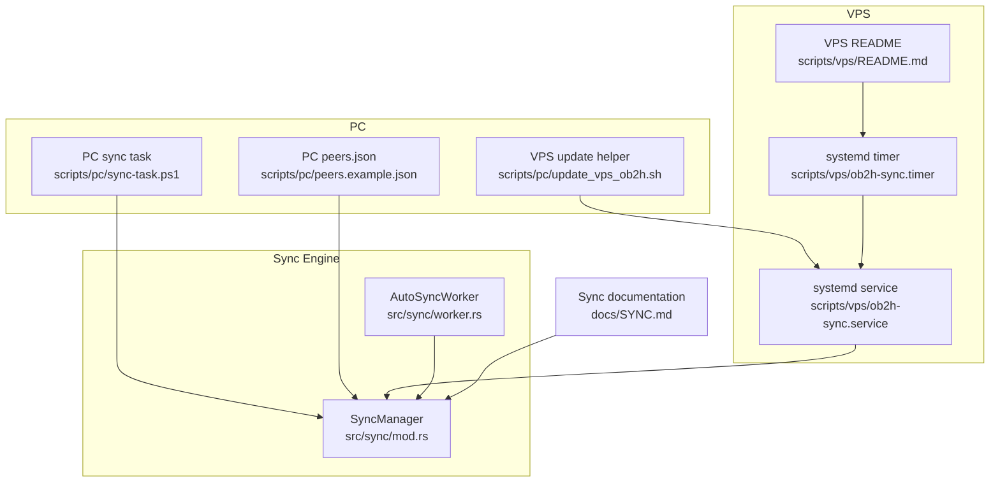
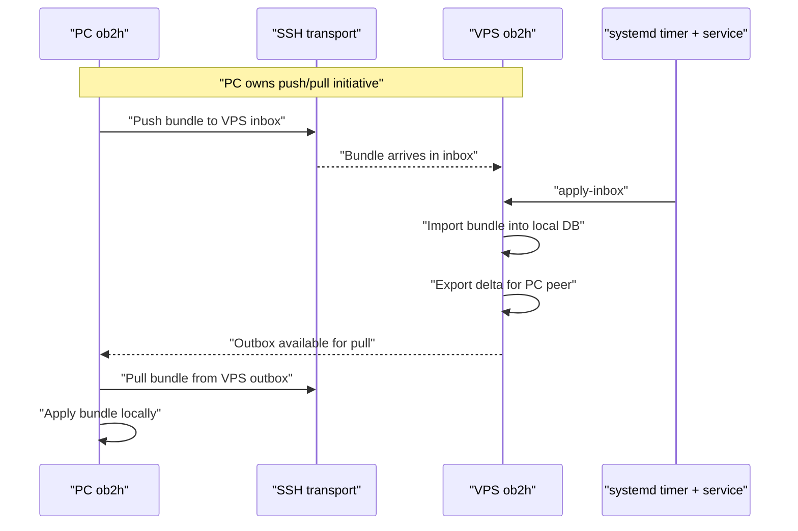
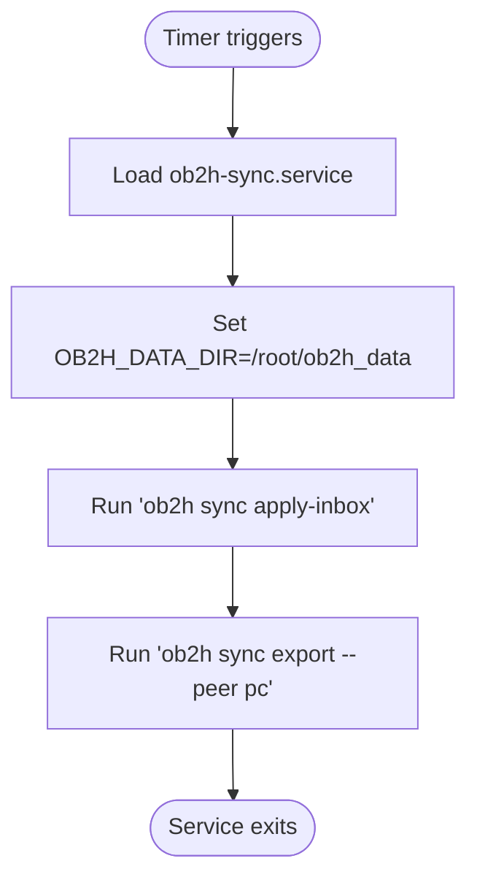
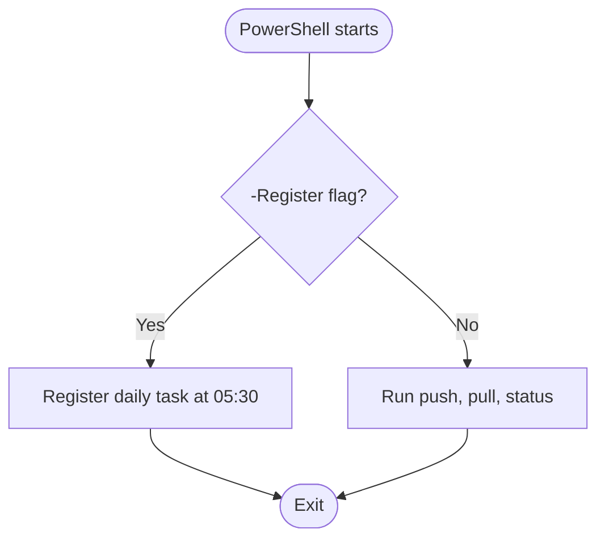
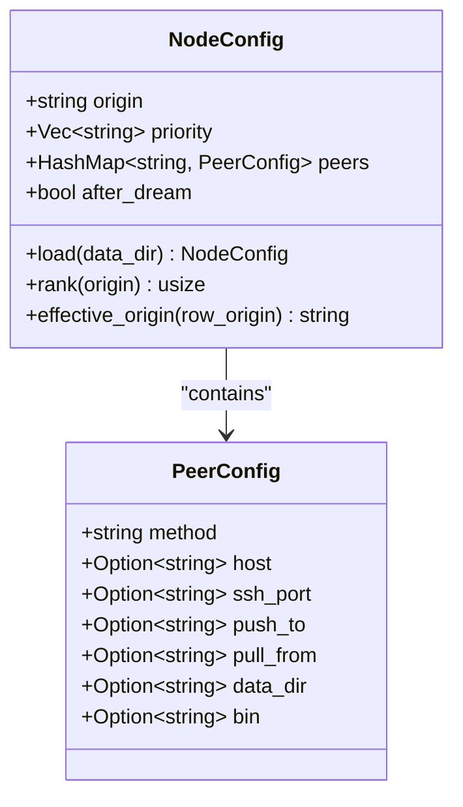
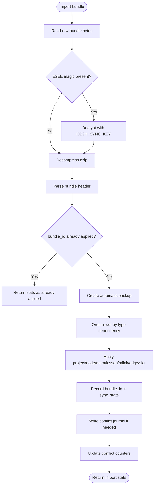
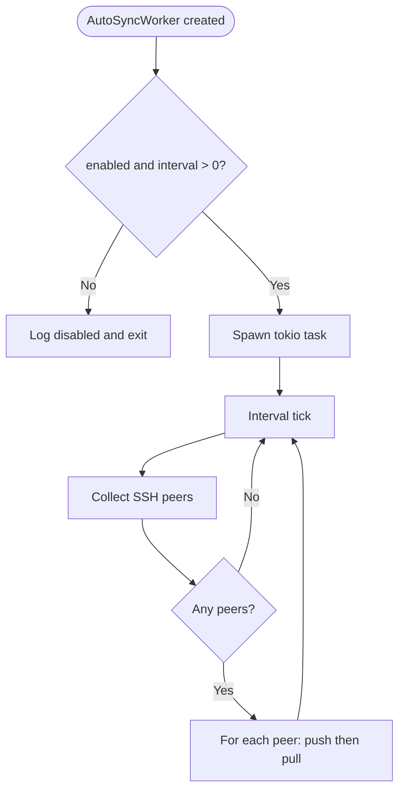
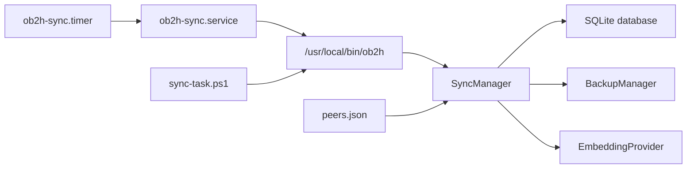
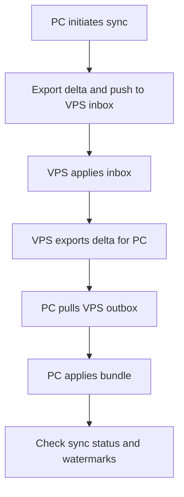

# VPS Deployment

<cite>
**Referenced Files in This Document**
- [SYNC.md](file://docs/SYNC.md)
- [README.md (VPS)](file://scripts/vps/README.md)
- [ob2h-sync.service](file://scripts/vps/ob2h-sync.service)
- [ob2h-sync.timer](file://scripts/vps/ob2h-sync.timer)
- [sync-task.ps1](file://scripts/pc/sync-task.ps1)
- [update_vps_ob2h.sh](file://scripts/pc/update_vps_ob2h.sh)
- [peers.example.json](file://scripts/pc/peers.example.json)
- [mod.rs (sync)](file://src/sync/mod.rs)
- [worker.rs (sync)](file://src/sync/worker.rs)
</cite>

## Table of Contents
1. [Introduction](#introduction)
2. [Project Structure](#project-structure)
3. [Core Components](#core-components)
4. [Architecture Overview](#architecture-overview)
5. [Detailed Component Analysis](#detailed-component-analysis)
6. [Dependency Analysis](#dependency-analysis)
7. [Performance Considerations](#performance-considerations)
8. [Troubleshooting Guide](#troubleshooting-guide)
9. [Conclusion](#conclusion)
10. [Appendices](#appendices)

## Introduction
This document explains how to deploy ob2h on a Linux VPS and integrate it with a local PC using the built-in synchronization mechanism. The topology is intentionally asymmetric: the PC initiates push/pull over SSH, while the VPS only receives bundles into its inbox and prepares its own outbox. Systemd runs the VPS workflow automatically, and the PC can run scheduled tasks or rely on automatic sync after agent dreams.

The synchronization layer uses file-based bundles rather than live database replication. Bundles are incremental JSONL snapshots that include memory facts, knowledge graph nodes and edges, memory links, lessons, slots, and related metadata. Conflicts are resolved with a later-write-wins strategy plus priority tie-breaking based on `peers.json`.

## Project Structure
The deployment artifacts relevant to VPS and PC-to-VPS sync are split between documentation, systemd units, Windows scheduling scripts, and the Rust synchronization implementation.

**Diagram sources**
- [sync-task.ps1:1-26](file://scripts/pc/sync-task.ps1#L1-L26)
- [peers.example.json:1-14](file://scripts/pc/peers.example.json#L1-L14)
- [update_vps_ob2h.sh:1-20](file://scripts/pc/update_vps_ob2h.sh#L1-L20)
- [README.md (VPS):1-34](file://scripts/vps/README.md#L1-L34)
- [ob2h-sync.service:1-10](file://scripts/vps/ob2h-sync.service#L1-L10)
- [ob2h-sync.timer:1-10](file://scripts/vps/ob2h-sync.timer#L1-L10)
- [mod.rs (sync):1-800](file://src/sync/mod.rs#L1-L800)
- [worker.rs (sync):1-65](file://src/sync/worker.rs#L1-L65)
- [SYNC.md:1-296](file://docs/SYNC.md#L1-L296)

**Section sources**
- [README.md (VPS):1-34](file://scripts/vps/README.md#L1-L34)
- [SYNC.md:32-56](file://docs/SYNC.md#L32-L56)

## Core Components
- **Systemd service**: Runs on the VPS as a one-shot unit. It applies any bundles waiting in the inbox and then exports the VPS’s own changes for the PC peer.
- **Systemd timer**: Triggers the service daily at a fixed time. Persistence ensures missed runs are caught up.
- **PC scheduled task**: Registers a Windows Task Scheduler job that pushes VPS-bound bundles and pulls VPS-generated bundles.
- **VPS update helper**: A convenience script used from the PC to install a freshly built ob2h binary on the VPS through an existing bridge.
- **peers.json**: Defines node identity, LWW priority, automatic sync behavior, and remote endpoints.
- **Sync engine**: Implements bundle export/import, watermark management, conflict resolution, optional E2EE bundling, and background auto-sync.

Key responsibilities:
- PC owns network initiative because it may be behind NAT.
- VPS does not initiate outbound connections to the PC; it only processes incoming bundles and prepares outgoing ones.
- Watermarks ensure incremental deltas instead of full database transfers.
- Conflict handling is deterministic and auditable.

**Section sources**
- [ob2h-sync.service:1-10](file://scripts/vps/ob2h-sync.service#L1-L10)
- [ob2h-sync.timer:1-10](file://scripts/vps/ob2h-sync.timer#L1-L10)
- [sync-task.ps1:1-26](file://scripts/pc/sync-task.ps1#L1-L26)
- [update_vps_ob2h.sh:1-20](file://scripts/pc/update_vps_ob2h.sh#L1-L20)
- [peers.example.json:1-14](file://scripts/pc/peers.example.json#L1-L14)
- [mod.rs (sync):196-245](file://src/sync/mod.rs#L196-L245)
- [worker.rs (sync):9-65](file://src/sync/worker.rs#L9-L65)

## Architecture Overview
The PC-to-VPS synchronization architecture is designed around file-based bundles and SSH transport. The PC pushes its delta bundles to the VPS inbox. The VPS applies those bundles and exports its own delta bundles into its outbox. The PC then pulls the VPS outbox and applies it locally.

**Diagram sources**
- [SYNC.md:32-56](file://docs/SYNC.md#L32-L56)
- [ob2h-sync.service:5-9](file://scripts/vps/ob2h-sync.service#L5-L9)
- [ob2h-sync.timer:4-6](file://scripts/vps/ob2h-sync.timer#L4-L6)
- [mod.rs (sync):247-469](file://src/sync/mod.rs#L247-L469)

## Detailed Component Analysis

### VPS Systemd Service and Timer
The VPS deployment relies on two systemd units:
- `ob2h-sync.service` is a one-shot service that sets the data directory environment variable and runs two commands: apply inbox bundles, then export bundles for the PC peer.
- `ob2h-sync.timer` schedules the service daily at a fixed time and enables persistence so missed runs are executed when the system comes back online.

Installation steps for root on the VPS:
1. Copy the service and timer files into `/etc/systemd/system/`.
2. Reload systemd.
3. Enable and start the timer.

After installation, you can manually start the service, inspect logs, and check sync status.

**Diagram sources**
- [ob2h-sync.timer:4-6](file://scripts/vps/ob2h-sync.timer#L4-L6)
- [ob2h-sync.service:5-9](file://scripts/vps/ob2h-sync.service#L5-L9)

**Section sources**
- [README.md (VPS):6-12](file://scripts/vps/README.md#L6-L12)
- [README.md (VPS):27-34](file://scripts/vps/README.md#L27-L34)
- [ob2h-sync.service:1-10](file://scripts/vps/ob2h-sync.service#L1-L10)
- [ob2h-sync.timer:1-10](file://scripts/vps/ob2h-sync.timer#L1-L10)

### PC Scheduled Sync Task
On the PC, synchronization can be triggered by:
- Automatic sync after each agent dream if configured in `peers.json`.
- A Windows Task Scheduler job registered by `sync-task.ps1`.

The PowerShell script:
- Sets the ob2h data directory.
- Supports registration of a daily scheduled task.
- Executes push, pull, and status commands against the configured VPS peer.

**Diagram sources**
- [sync-task.ps1:6-25](file://scripts/pc/sync-task.ps1#L6-L25)

**Section sources**
- [sync-task.ps1:1-26](file://scripts/pc/sync-task.ps1#L1-L26)
- [SYNC.md:143-161](file://docs/SYNC.md#L143-L161)

### VPS Binary Update Helper
The update helper script is intended for use from the PC to install a newly built ob2h binary onto the VPS. It:
- Stops the running ob2h server process via a bridge.
- Installs the new binary to `/usr/local/bin/ob2h`.
- Verifies the installed version.

This script assumes an existing Hermes bridge and a prebuilt binary path on the VPS.

**Section sources**
- [update_vps_ob2h.sh:1-20](file://scripts/pc/update_vps_ob2h.sh#L1-L20)

### peers.json Configuration
The synchronization configuration lives under `data/sync/peers.json`. On the PC, it defines the VPS peer with SSH transport, host alias, and remote inbox/outbox paths. On the VPS, it declares the node origin and priority but leaves the peers map empty because the VPS does not initiate connections.

Important fields:
- `origin`: machine identity used for watermark naming and LWW tie-breaking.
- `priority`: order used to resolve conflicts when timestamps are equal.
- `after_dream`: whether to trigger push/pull automatically after agent dreams.
- `peers.<name>.method`: transport method; `ssh` uses SCP-like transfer.
- `host`, `push_to`, `pull_from`: SSH alias and remote directories.

**Diagram sources**
- [mod.rs (sync):31-105](file://src/sync/mod.rs#L31-L105)

**Section sources**
- [peers.example.json:1-14](file://scripts/pc/peers.example.json#L1-L14)
- [SYNC.md:100-137](file://docs/SYNC.md#L100-L137)
- [mod.rs (sync):31-105](file://src/sync/mod.rs#L31-L105)

### Synchronization Engine: Export, Import, Watermarks, and Conflicts
The sync engine implements:
- Incremental export per peer using a watermark stored in `sync_state.last_export_at`.
- Bundle creation as gzip JSONL with a header containing bundle identity, origin, peer, version, and counts.
- Optional end-to-end encryption of bundles when a passphrase is provided through an environment variable.
- Idempotent import keyed by `bundle_id`.
- Automatic backup before applying a new bundle.
- Field-level merge for metadata and later-write-wins for content.
- Tombstone support for deletions.
- Conflict journaling and optional preservation of losing versions.

Watermark management:
- Export computes the maximum timestamp across changed rows and stores it as the watermark for the peer.
- Full exports ignore the watermark for selection but still advance the watermark afterward.
- Imports track applied bundles globally to prevent duplicate application.

Conflict handling:
- Content conflicts are decided by comparing `updated_at`; ties are broken by `priority` from `peers.json`.
- Metadata merges deeply, taking incoming keys where applicable and aggregating metrics like access count and trust.
- Deleted rows are represented as tombstones and propagated consistently.

**Diagram sources**
- [mod.rs (sync):508-733](file://src/sync/mod.rs#L508-L733)
- [mod.rs (sync):747-754](file://src/sync/mod.rs#L747-L754)

**Section sources**
- [mod.rs (sync):247-469](file://src/sync/mod.rs#L247-L469)
- [mod.rs (sync):508-733](file://src/sync/mod.rs#L508-L733)
- [mod.rs (sync):747-754](file://src/sync/mod.rs#L747-L754)
- [SYNC.md:58-68](file://docs/SYNC.md#L58-L68)
- [SYNC.md:257-276](file://docs/SYNC.md#L257-L276)

### Background Auto-Sync Worker
The background worker periodically performs push and pull operations for all SSH-configured peers. It respects configuration flags and skips execution when disabled or when no SSH peers exist.

**Diagram sources**
- [worker.rs (sync):9-65](file://src/sync/worker.rs#L9-L65)

**Section sources**
- [worker.rs (sync):1-65](file://src/sync/worker.rs#L1-L65)

## Dependency Analysis
The deployment components depend on each other in a clear chain:
- The VPS timer depends on the service.
- The service depends on the ob2h binary and the sync engine.
- The PC task depends on the ob2h binary and SSH connectivity.
- Both sides depend on `peers.json` for topology and conflict policy.
- The sync engine depends on the database, embedding provider, backup manager, and settings.

**Diagram sources**
- [ob2h-sync.timer:1-10](file://scripts/vps/ob2h-sync.timer#L1-L10)
- [ob2h-sync.service:1-10](file://scripts/vps/ob2h-sync.service#L1-L10)
- [sync-task.ps1:1-26](file://scripts/pc/sync-task.ps1#L1-L26)
- [mod.rs (sync):196-245](file://src/sync/mod.rs#L196-L245)

**Section sources**
- [mod.rs (sync):196-245](file://src/sync/mod.rs#L196-L245)
- [README.md (VPS):1-34](file://scripts/vps/README.md#L1-L34)

## Performance Considerations
- Use incremental deltas rather than full database transfers. The default export mode sends only rows changed since the last watermark.
- Schedule sync during low-activity windows. The VPS timer defaults to early morning; adjust if necessary.
- Avoid frequent manual full exports unless required for recovery or verification.
- Keep timestamps synchronized across machines to avoid unnecessary conflict churn.
- If bandwidth is constrained, prefer manual transfer mode with compression and selective syncing.

[No sources needed since this section provides general guidance]

## Troubleshooting Guide
Common issues and resolutions:
- Remote directory missing: create the target inbox/outbox directories on the VPS.
- Peer not found: verify `peers.json` exists and contains the expected peer name.
- Silent sync: ensure either `after_dream` is enabled or a scheduler is configured.
- Conflict counter increases: this is expected when local edits are older than incoming edits.
- Bundle not re-applied: idempotency prevents duplicate imports.
- Sync disabled due to config error: fix JSON syntax in `peers.json`.

Operational checks:
- Manually start the VPS service and inspect logs.
- Run sync status to review origins, priorities, watermarks, and conflict totals.
- Verify SSH connectivity from the PC to the VPS alias.

**Section sources**
- [README.md (VPS):27-34](file://scripts/vps/README.md#L27-L34)
- [SYNC.md:211-222](file://docs/SYNC.md#L211-L222)
- [SYNC.md:190-201](file://docs/SYNC.md#L190-L201)

## Conclusion
The VPS deployment model keeps the VPS passive: it receives bundles, applies them, and prepares its own deltas without initiating connections to the PC. Systemd automates the VPS workflow, while the PC controls the network flow. Watermarks and bundle IDs provide efficient, idempotent synchronization, and LWW with priority ordering ensures deterministic conflict resolution. With proper SSH setup, correct `peers.json`, and systemd units in place, the PC and VPS stay consistent with minimal operational overhead.

[No sources needed since this section summarizes without analyzing specific files]

## Appendices

### Step-by-Step Installation for root@vps
1. Prepare directories:
   - Create `/root/ob2h_data/sync/inbox` and `/root/ob2h_data/sync/outbox`.
2. Install systemd units:
   - Copy `ob2h-sync.service` and `ob2h-sync.timer` into `/etc/systemd/system/`.
   - Reload systemd and enable/start the timer.
3. Configure `peers.json` on the VPS:
   - Place `/root/ob2h_data/sync/peers.json` with origin set to `vps`, priority including both sides, and an empty peers map.
4. Test manually:
   - Start the service.
   - Inspect logs.
   - Check sync status.

**Section sources**
- [README.md (VPS):6-12](file://scripts/vps/README.md#L6-L12)
- [README.md (VPS):14-25](file://scripts/vps/README.md#L14-L25)
- [README.md (VPS):27-34](file://scripts/vps/README.md#L27-L34)

### Manual Testing Procedures
End-to-end test sequence:
1. From the PC:
   - Push bundles to the VPS.
2. From the VPS:
   - Apply inbox bundles.
   - Export bundles for the PC peer.
3. From the PC:
   - Pull bundles from the VPS.
   - Apply them locally.
4. Verify state:
   - Run sync status on both machines.
   - Optionally run verification to compare counts and checksums without transferring data.

**Section sources**
- [SYNC.md:163-175](file://docs/SYNC.md#L163-L175)
- [SYNC.md:190-201](file://docs/SYNC.md#L190-L201)

### Synchronization Architecture Summary
- Data moves as bundles, not live database files.
- PC initiates push/pull over SSH.
- VPS applies inbox and exports outbox on schedule.
- Watermarks track per-peer progress.
- Conflicts are resolved deterministically and logged.

**Diagram sources**
- [SYNC.md:32-56](file://docs/SYNC.md#L32-L56)
- [mod.rs (sync):247-469](file://src/sync/mod.rs#L247-L469)