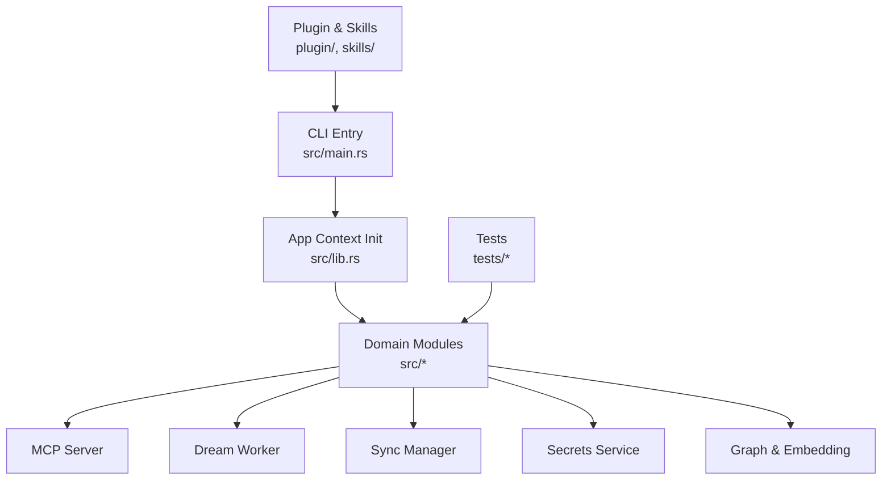
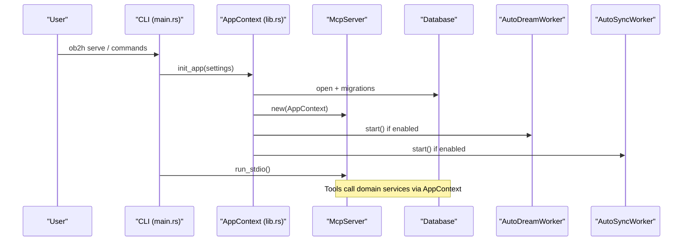
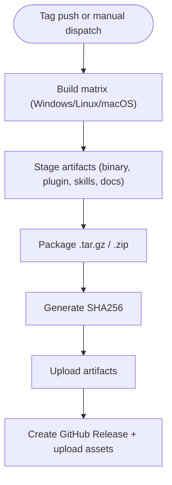
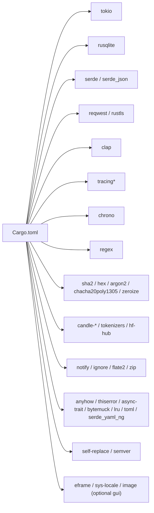

# Contribution Guidelines

<cite>
**Referenced Files in This Document**
- [README.md](file://README.md)
- [AGENTS.md](file://AGENTS.md)
- [Cargo.toml](file://Cargo.toml)
- [release.yml](file://.github/workflows/release.yml)
- [main.rs](file://src/main.rs)
- [lib.rs](file://src/lib.rs)
- [test_db.rs](file://tests/test_db.rs)
</cite>

## Table of Contents
1. [Introduction](#introduction)
2. [Project Structure](#project-structure)
3. [Core Components](#core-components)
4. [Architecture Overview](#architecture-overview)
5. [Detailed Component Analysis](#detailed-component-analysis)
6. [Dependency Analysis](#dependency-analysis)
7. [Performance Considerations](#performance-considerations)
8. [Troubleshooting Guide](#troubleshooting-guide)
9. [Conclusion](#conclusion)
10. [Appendices](#appendices)

## Introduction
This document defines contribution guidelines for OB2H development. It covers code standards, development workflows, release processes, commit conventions, branch strategy, pull request workflow, continuous integration, automated testing, quality gates, documentation standards, changelog maintenance, version management, issue reporting, feature requests, community interaction, and the release process including versioning, deployment, and rollback plans.

OB2H is a Rust-based local knowledge store with memory, AST graph, dream processing, MCP server, sync, secrets vault, and viewer components. The repository includes Rust sources under `src/`, tests under `tests/`, Python plugin under `plugin/ob2h`, skills under `skills/`, scripts under `scripts/`, and CI under `.github/workflows`.

## Project Structure
The project follows a layered architecture:
- CLI entrypoint and command routing
- Application context initialization and background workers
- Domain modules (memory, graph, embedding, dream, sync, secrets, lifecycle, etc.)
- Tests for core functionality
- Plugin and skill assets packaged into releases
- Documentation and plans

**Diagram sources**
- [main.rs:17-90](file://src/main.rs#L17-L90)
- [lib.rs:46-135](file://src/lib.rs#L46-L135)

**Section sources**
- [README.md:1-58](file://README.md#L1-L58)
- [AGENTS.md:39-66](file://AGENTS.md#L39-L66)

## Core Components
- CLI commands: serve, bench, doctor, dream, backup, db, memory, lessons, audit, ralph, stats, vec0, skill install, update, agent, project, secrets.
- App initialization: creates database, embedder, memory, workspace, gitstore, LLM client, consolidator, graph, project, ralph, secrets, dream, backup, sync, lessons, slots, watcher, scan jobs.
- Background workers: AutoDream and AutoSync are started conditionally based on settings.
- MCP server: stdio JSON-RPC server exposing tools to agents.
- Viewer: read-only GUI process launched before app init.

Key responsibilities:
- Configuration and environment variables are loaded from environment and used across services.
- Logging uses tracing with file and stderr outputs depending on mode.
- Update checks run asynchronously at startup when enabled.

**Section sources**
- [main.rs:17-90](file://src/main.rs#L17-L90)
- [main.rs:92-583](file://src/main.rs#L92-L583)
- [lib.rs:46-135](file://src/lib.rs#L46-L135)
- [lib.rs:137-161](file://src/lib.rs#L137-L161)

## Architecture Overview
The runtime architecture centers around a single binary that can operate as an MCP server or execute CLI commands. Initialization constructs shared services and optionally starts background workers. The MCP server exposes tools for memory, graph, dream, lessons, secrets, and more.

**Diagram sources**
- [main.rs:17-90](file://src/main.rs#L17-L90)
- [lib.rs:46-135](file://src/lib.rs#L46-L135)

## Detailed Component Analysis

### Code Standards and Conventions
- Language versions:
  - Rust 1.80+ for main code.
  - Python only for `plugin/ob2h`, stdlib-only, no pip dependencies.
- Naming:
  - English names, snake_case for identifiers.
  - Comments and docstrings in Russian; keep them brief and only where code is not obvious.
- Typing and serialization:
  - Type annotations on public functions/methods.
  - Use serde for schemas.
- Async and concurrency:
  - MCP layer async; SQLite access synchronous through a single-threaded lock wrapper.
- Error handling:
  - MCP tool errors returned as strings `[Error] ... [Hint]`; exceptions inside should be logged.
- Secrets:
  - Only via environment variables (`OB2H_*`). Never hardcode keys in code/tests.
  - `.env` excluded from git; examples use variable names.
- Dependencies:
  - Add dependencies only when justified; record in plan decisions.
- MCP contract changes:
  - Any change to tool name/arguments/semantics must be recorded in changelog.

**Section sources**
- [AGENTS.md:87-107](file://AGENTS.md#L87-L107)

### Development Workflow
- Build and test:
  - `cargo build --release`
  - `cargo test`
  - `cargo clippy --all-targets`
  - Python plugin tests: `python -m unittest discover -s plugin/tests`
- Runtime:
  - Manual server: `./target/release/ob2h.exe serve`
  - Deploy plugin/skill: `./target/release/ob2h.exe plugin install && ./target/release/ob2h.exe skill install`
- Paths:
  - Windows Git Bash; paths via `pathlib.Path` in Python; do not hardcode Windows paths.
  - Runtime paths come from config/env; defaults under `data/`.

**Section sources**
- [AGENTS.md:71-86](file://AGENTS.md#L71-L86)

### Commit Message Format and Branch Strategy
- Commit messages follow conventional prefixes:
  - `feat(...)`, `fix(...)`, `docs:`, `test:`, `refactor:`
  - Include task reference when applicable.
- Branch strategy:
  - Local development on `main`; pushing not required for local project.
  - Do not modify `.gitignore` without reason.
  - Workspace repo under `data/.git` is separate from this repo.

**Section sources**
- [AGENTS.md:119-125](file://AGENTS.md#L119-L125)

### Pull Request Workflow
- PRs should include:
  - Tests for new logic.
  - Clean linting (`ruff check` for Python).
  - Updated plan decisions if deviating from plan.
  - Changelog updates for public MCP contract changes.
- Ensure all DoD items for tasks/phases are completed.

**Section sources**
- [AGENTS.md:135-142](file://AGENTS.md#L135-L142)

### Continuous Integration Pipeline
- Trigger:
  - Push of semver tags matching `v[0-9]+.[0-9]+.[0-9]+`.
  - Manual dispatch with version input.
- Matrix builds:
  - Windows x86_64 MSVC with GUI features.
  - Linux x86_64 GNU headless.
  - macOS aarch64 and x86_64 headless.
- Steps:
  - Checkout, install Rust stable + targets, cache.
  - Install system deps on Linux.
  - Build release per target with features.
  - Stage artifacts: binary, plugin, skills, README, CHANGELOG, AGENTS.
  - Package tar.gz/zip per platform.
  - Generate SHA256 checksums.
  - Upload artifacts.
  - Create GitHub Release with generated notes and upload assets.

**Diagram sources**
- [release.yml:1-151](file://.github/workflows/release.yml#L1-L151)

**Section sources**
- [release.yml:1-151](file://.github/workflows/release.yml#L1-L151)

### Automated Testing Requirements and Quality Gates
- Rust tests:
  - Run `cargo test` before commits.
  - In-memory DB usage for tests; never touch production data.
  - Deterministic embeddings/fakes for external dependencies.
- Python plugin tests:
  - Run `python -m unittest discover -s plugin/tests`.
- Quality gates:
  - All tests green.
  - Linting clean (`ruff check` for Python).
  - No network calls in unit tests; replace LLM/embeddings with fakes.

**Section sources**
- [AGENTS.md:109-118](file://AGENTS.md#L109-L118)
- [test_db.rs:1-47](file://tests/test_db.rs#L1-L47)

### Documentation Standards
- Keep documentation in `docs/` and root-level files like `README.md`.
- Maintain plans and decisions in `PLAN.md` and related files.
- When changing MCP contracts, update `CHANGELOG.md`.

**Section sources**
- [AGENTS.md:101-107](file://AGENTS.md#L101-L107)

### Changelog Maintenance
- Record any changes to public MCP tool contracts in `CHANGELOG.md`.
- Align changelog entries with feature/fix commits.

**Section sources**
- [AGENTS.md:101-107](file://AGENTS.md#L101-L107)

### Version Management
- Version defined in `Cargo.toml` package metadata.
- Release tags follow semver format `vX.Y.Z`.
- CI builds and publishes releases for multiple platforms.

**Section sources**
- [Cargo.toml:1-6](file://Cargo.toml#L1-L6)
- [release.yml:3-12](file://.github/workflows/release.yml#L3-L12)

### Issue Reporting, Feature Requests, and Community Interaction
- Use GitHub Issues for bugs, ideas, questions, and integration help.
- Provide clear reproduction steps and environment details.
- Engage respectfully and collaboratively.

**Section sources**
- [README.md:347-353](file://README.md#L347-L353)

### Security and Privacy Guidelines
- Personal data stays local; only configured LLM/embedding APIs and optional SSH between user servers receive traffic.
- No telemetry, analytics, or automatic updates beyond explicit update checks.
- Backup files contain personal data; do not publish.

**Section sources**
- [AGENTS.md:127-133](file://AGENTS.md#L127-L133)

## Dependency Analysis
Top-level dependencies include async runtime, SQLite, HTTP client, CLI parsing, tracing, chrono, regex, crypto primitives, Candle ML, tokenizer, file watching, sqlite-vec, TOML/YAML parsers, self-replace, semver, zip, argon2, chacha20poly1305, zeroize, getrandom, rpassword, LRU cache, and optional GUI stack.

**Diagram sources**
- [Cargo.toml:7-69](file://Cargo.toml#L7-L69)

**Section sources**
- [Cargo.toml:1-72](file://Cargo.toml#L1-L72)

## Performance Considerations
- Prefer deterministic, in-memory operations in tests to avoid network and heavy I/O.
- Use vectorized search and indexing where available (e.g., vec0 index) and validate recall thresholds.
- Avoid unnecessary allocations and ensure proper resource cleanup (zeroize for secrets).
- Leverage background workers judiciously; enable only when needed.

[No sources needed since this section provides general guidance]

## Troubleshooting Guide
- If MCP tool errors occur, inspect logs and ensure error strings follow the expected format.
- For database issues, verify schema version and FTS configuration using tests and diagnostics.
- For update checks, confirm network access and repository/channel settings.
- For secrets vault, ensure PIN flow works and TTL behavior matches expectations.

**Section sources**
- [AGENTS.md:94-96](file://AGENTS.md#L94-L96)
- [test_db.rs:1-47](file://tests/test_db.rs#L1-L47)

## Conclusion
Contributors should adhere to the coding standards, maintain test coverage, follow commit conventions, and align changes with plans and contracts. Releases are built and published via CI for multiple platforms, with versioning managed through Cargo and semver tags. Community engagement is encouraged through GitHub Issues, and security/privacy must remain a top priority.

[No sources needed since this section summarizes without analyzing specific files]

## Appendices

### Quick Commands Reference
- Build: `cargo build --release`
- Test: `cargo test`
- Lint: `cargo clippy --all-targets`
- Plugin tests: `python -m unittest discover -s plugin/tests`
- Run server: `./target/release/ob2h.exe serve`
- Deploy plugin/skill: `./target/release/ob2h.exe plugin install && ./target/release/ob2h.exe skill install`

**Section sources**
- [AGENTS.md:71-81](file://AGENTS.md#L71-L81)