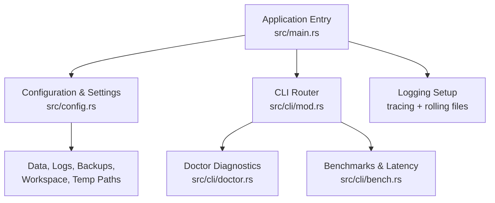
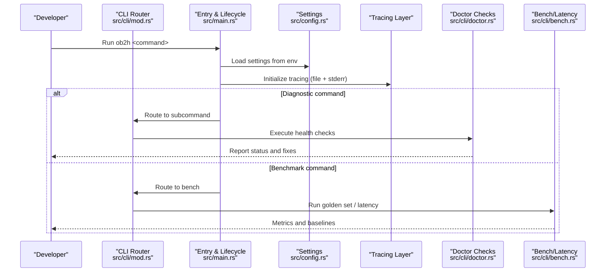
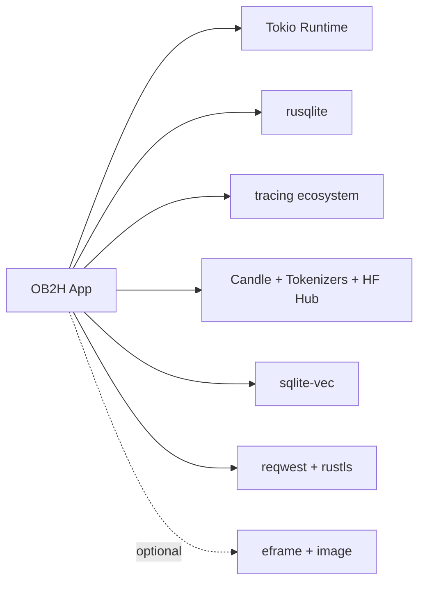

# Debugging and Profiling

<cite>
**Referenced Files in This Document**
- [main.rs](file://src/main.rs)
- [config.rs](file://src/config.rs)
- [cli/mod.rs](file://src/cli/mod.rs)
- [cli/doctor.rs](file://src/cli/doctor.rs)
- [cli/bench.rs](file://src/cli/bench.rs)
- [Cargo.toml](file://Cargo.toml)
</cite>

## Table of Contents
1. [Introduction](#introduction)
2. [Project Structure](#project-structure)
3. [Core Components](#core-components)
4. [Architecture Overview](#architecture-overview)
5. [Detailed Component Analysis](#detailed-component-analysis)
6. [Dependency Analysis](#dependency-analysis)
7. [Performance Considerations](#performance-considerations)
8. [Troubleshooting Guide](#troubleshooting-guide)
9. [Conclusion](#conclusion)

## Introduction
This document provides a comprehensive debugging and profiling guide for OB2H development. It focuses on:
- Debugging Rust applications with debugger setup, breakpoint strategies, and log analysis.
- Profiling tools and methods for memory operations, graph processing, and vector search.
- Diagnostic commands available through the CLI.
- Guidance for analyzing memory leaks, CPU usage patterns, and I/O performance.
- Distributed debugging techniques for cross-machine synchronization issues.
- Common debugging scenarios and resolution strategies.

OB2H is a Rust-based MCP knowledge store and long-term memory system for AI agents. The application uses Tokio for async runtime, SQLite for persistence, tracing for structured logging, and includes built-in diagnostic and benchmarking utilities.

## Project Structure
The debugging surface centers around:
- Application entry point and lifecycle initialization.
- Configuration and environment-driven behavior.
- CLI command routing and diagnostics.
- Built-in benchmarks and recall/latency measurement.
- Logging infrastructure and file rotation.

**Diagram sources**
- [main.rs:17-60](file://src/main.rs#L17-L60)
- [config.rs:176-454](file://src/config.rs#L176-L454)
- [cli/mod.rs:16-147](file://src/cli/mod.rs#L16-L147)
- [cli/doctor.rs:61-167](file://src/cli/doctor.rs#L61-L167)
- [cli/bench.rs:122-255](file://src/cli/bench.rs#L122-L255)

**Section sources**
- [main.rs:17-60](file://src/main.rs#L17-L60)
- [config.rs:176-454](file://src/config.rs#L176-L454)
- [cli/mod.rs:16-147](file://src/cli/mod.rs#L16-L147)

## Core Components
- Application entrypoint initializes settings, ensures directories, configures tracing (file and stderr), starts background workers, and routes CLI commands.
- Configuration reads environment variables, resolves LLM keys, sets paths, and controls features like update checks, offline mode, secrets TTL, and log retention.
- CLI exposes diagnostic and operational commands including doctor, bench, sync, vec0, secrets, project, and more.
- Doctor performs deep checks across filesystem, SQLite integrity, embeddings backend, agent integrations, Git hooks, and sync configuration.
- Bench measures retrieval quality (recall@k, MRR), latency percentiles (p50/p95), and records history for regression tracking.

Key responsibilities:
- Logging: Structured logs via tracing; non-blocking file appender under data/logs.
- Paths: Centralized path helpers for DB, workspace, backups, logs, tmp.
- Diagnostics: Health checks and auto-fix suggestions.
- Performance: Golden-set based benchmarks and latency profiling.

**Section sources**
- [main.rs:17-60](file://src/main.rs#L17-L60)
- [config.rs:176-454](file://src/config.rs#L176-L454)
- [cli/mod.rs:16-147](file://src/cli/mod.rs#L16-L147)
- [cli/doctor.rs:61-167](file://src/cli/doctor.rs#L61-L167)
- [cli/bench.rs:122-255](file://src/cli/bench.rs#L122-L255)

## Architecture Overview
The runtime architecture relevant to debugging and profiling:

**Diagram sources**
- [main.rs:17-60](file://src/main.rs#L17-L60)
- [config.rs:176-454](file://src/config.rs#L176-L454)
- [cli/mod.rs:16-147](file://src/cli/mod.rs#L16-L147)
- [cli/doctor.rs:61-167](file://src/cli/doctor.rs#L61-L167)
- [cli/bench.rs:122-255](file://src/cli/bench.rs#L122-L255)

## Detailed Component Analysis

### Logging and Tracing
- Tracing is initialized early in the entrypoint with an environment filter and a non-blocking file appender under the configured logs directory.
- In stdio MCP mode, logs go to the file only; otherwise, both stderr and file receive logs.
- Log level can be controlled via environment variable; log retention days are configurable.

Debugging tips:
- Use `OB2H_LOG_LEVEL` to adjust verbosity (e.g., DEBUG for detailed traces).
- Inspect rotating logs under `<data_dir>/logs`.
- Correlate trace spans with CLI commands and MCP tool calls.

**Section sources**
- [main.rs:38-58](file://src/main.rs#L38-L58)
- [config.rs:312-317](file://src/config.rs#L312-L317)
- [config.rs:429-454](file://src/config.rs#L429-L454)

### Configuration and Environment
- Settings derive from environment variables prefixed with `OB2H_`, including LLM, embedding, dream, PPR, backup, watcher, autosync, update, offline, secrets TTL, and log retention.
- Key resolution supports literal API keys or environment variable names, with fallbacks to `.env` files.
- Path helpers centralize data, workspace, backups, logs, and temp directories.

Debugging tips:
- Validate environment by printing effective settings or running `ob2h doctor`.
- Check key resolution warnings when LLM calls fail unexpectedly.
- Confirm paths exist and have correct permissions.

**Section sources**
- [config.rs:8-106](file://src/config.rs#L8-L106)
- [config.rs:108-174](file://src/config.rs#L108-L174)
- [config.rs:176-454](file://src/config.rs#L176-L454)

### CLI Command Routing and Diagnostics
- CLI defines subcommands for serve, doctor, dream, backup, db, memory, lessons, audit, stats, viewer, plugin, sync, update, vec0, agent, project, secrets, ralph, and bench.
- Doctor runs comprehensive checks: directories, SQLite integrity/WAL/FTS5, embeddings backend, agent integrations, Git hooks, sync peers.

Debugging tips:
- Use `ob2h doctor --fix` to auto-correct common misconfigurations.
- Review per-category results and symbols (OK/Warn/Error).
- For sync issues, inspect peers.json validity and peer counts.

**Section sources**
- [cli/mod.rs:16-147](file://src/cli/mod.rs#L16-L147)
- [cli/doctor.rs:61-167](file://src/cli/doctor.rs#L61-L167)
- [cli/doctor.rs:170-326](file://src/cli/doctor.rs#L170-L326)
- [cli/doctor.rs:328-388](file://src/cli/doctor.rs#L328-L388)
- [cli/doctor.rs:390-653](file://src/cli/doctor.rs#L390-L653)

### Benchmarks and Latency Profiling
- Bench supports modes: search, context, code, latency, history.
- Golden-set evaluation computes recall@k, MRR, recall-all@k, any-hit@k, empty result ratio, p50/p95 latency.
- Latency mode measures embed(query), memories.search_hybrid, and graph_nodes.search separately.
- History mode aggregates nightly runs and gate decisions.

Debugging tips:
- Use `ob2h bench --mode latency` to identify bottlenecks in embedding vs storage queries.
- Track trends with `ob2h bench --mode history`.
- Save baselines to compare changes over time.

**Section sources**
- [cli/bench.rs:122-255](file://src/cli/bench.rs#L122-L255)
- [cli/bench.rs:276-322](file://src/cli/bench.rs#L276-L322)
- [cli/bench.rs:328-556](file://src/cli/bench.rs#L328-L556)
- [cli/bench.rs:714-774](file://src/cli/bench.rs#L714-L774)

### Vector Search and Vec0 Index
- Vec0 commands allow building, inspecting stats, and evaluating recall@k against brute-force baseline.
- Recall evaluation compares approximate index results with full-scan ground truth and prints average latencies.

Debugging tips:
- Build index before recall tests.
- Monitor indexed vs nodes_with_embedding counts.
- Compare vec0+rescore latency vs brute force.

**Section sources**
- [main.rs:320-349](file://src/main.rs#L320-L349)
- [main.rs:600-700](file://src/main.rs#L600-L700)

### Secrets Vault and Security Diagnostics
- Doctor reports whether secrets vault is initialized and how many records exist.
- Secrets TTL and GUI PIN behavior are configurable via environment.

Debugging tips:
- Ensure secrets vault is initialized before using secret-related tools.
- Verify unlock state and TTL behavior during interactive sessions.

**Section sources**
- [cli/doctor.rs:108-137](file://src/cli/doctor.rs#L108-L137)
- [config.rs:349-352](file://src/config.rs#L349-L352)

### Sync and Distributed Debugging
- Doctor validates peers.json structure and peer count.
- CLI exposes sync status, export/import, push/pull, verify, and local stats.

Debugging tips:
- Use `ob2h sync status` and `ob2h sync verify` to detect drift without transferring data.
- Inspect inbox/outbox bundles and watermark consistency.
- For E2EE, ensure shared key is configured consistently across machines.

**Section sources**
- [cli/mod.rs:287-327](file://src/cli/mod.rs#L287-L327)
- [cli/doctor.rs:620-653](file://src/cli/doctor.rs#L620-L653)

## Dependency Analysis
OB2H’s debuggable dependencies include:
- Async runtime: Tokio (full features).
- Database: rusqlite (bundled, hooks, chrono, load_extension).
- Logging: tracing, tracing-subscriber, tracing-appender.
- HTTP/TLS: reqwest, rustls.
- Embeddings: candle-core/nn/transformers, tokenizers, hf-hub.
- Vector search: sqlite-vec.
- UI (optional): eframe, image, sys-locale.

These dependencies influence debugging strategy:
- Tokio tasks and channels require careful tracing and backtrace capture.
- SQLite WAL and FTS5 indexing affect query performance and integrity checks.
- Candle models may cold-start and impact latency measurements.

**Diagram sources**
- [Cargo.toml:7-53](file://Cargo.toml#L7-L53)

**Section sources**
- [Cargo.toml:7-53](file://Cargo.toml#L7-L53)

## Performance Considerations
- Memory operations:
  - Prefer streaming and bounded buffers for large embeddings and graph traversals.
  - Use vec0 index for approximate nearest neighbor search when recall thresholds are met.
- Graph processing:
  - Profile graph.search and analytics routines; consider batching and pruning.
  - Use bench mode=code to evaluate PPR-based retrieval on code graphs.
- Vector search:
  - Measure embed(query) latency separately from storage scans.
  - Tune oversample and rescore parameters; validate recall@k ≥ 0.99.
- I/O performance:
  - Monitor SQLite WAL mode and quick_check results.
  - Avoid unnecessary migrations or schema changes during hot paths.
- CPU usage:
  - Identify hotspots in embedding model loading and inference.
  - Use OS-level profilers (perf, Instruments, Windows ETW) alongside tracing.

[No sources needed since this section provides general guidance]

## Troubleshooting Guide

### Debugger Setup (Rust)
- Use Cargo with debug builds for symbol-rich binaries.
- Attach IDE debuggers (VS Code, CLion, IntelliJ) to the running process.
- Set breakpoints at:
  - CLI command handlers.
  - MCP tool invocations.
  - Embedding provider calls.
  - SQLite read/write paths.
  - Vec0 build/search/recall flows.

Breakpoint strategies:
- Conditional breakpoints on error paths and retries.
- Break on first call to external APIs (LLM, HF Hub).
- Break on file I/O for logs, backups, and sync bundles.

Log analysis:
- Filter by level (`DEBUG`, `INFO`, `WARN`, `ERROR`).
- Correlate timestamps with user actions and MCP requests.
- Use structured fields to trace request IDs and session contexts.

**Section sources**
- [main.rs:38-58](file://src/main.rs#L38-L58)
- [cli/mod.rs:16-147](file://src/cli/mod.rs#L16-L147)

### Memory Leaks and Allocation Hotspots
- Enable memory profiling with OS tools (valgrind on Linux/macOS, Visual Studio Profiler on Windows).
- Capture heap snapshots during long-running serve processes.
- Focus on:
  - Embedding model caches.
  - Graph node/edge structures.
  - Large JSON payloads in MCP responses.
  - Vec0 index construction.

Mitigation:
- Reuse allocations where possible.
- Limit cache sizes and implement eviction policies.
- Stream large outputs instead of buffering fully.

[No sources needed since this section provides general guidance]

### CPU Usage Patterns
- Profile CPU hotspots with perf, Instruments, or Windows ETW.
- Look for:
  - Embedding inference loops.
  - Graph traversal algorithms.
  - Vector similarity computations.
  - Frequent GC pressure (if applicable to host language bindings).

Optimization:
- Batch embedding queries.
- Parallelize independent graph operations carefully.
- Reduce redundant computations in recall and rescore phases.

[No sources needed since this section provides general guidance]

### I/O Performance
- Verify SQLite journal_mode=WAL and quick_check passes.
- Monitor disk throughput during index builds and backups.
- Use `ob2h doctor` to confirm FTS5 trigram index health.

Diagnostics:
- Check logs for slow queries or timeouts.
- Use `ob2h bench --mode latency` to isolate storage vs embedding costs.

**Section sources**
- [cli/doctor.rs:222-276](file://src/cli/doctor.rs#L222-L276)
- [cli/bench.rs:276-322](file://src/cli/bench.rs#L276-L322)

### Distributed Debugging (Sync Issues)
- Use `ob2h sync status` to inspect peer configuration and watermarks.
- Use `ob2h sync verify` to detect drift without transferring data.
- Validate peers.json syntax and peer counts.
- For E2EE, ensure consistent `OB2H_SYNC_KEY` across machines.

Resolution strategies:
- Re-export full bundle if delta sync fails repeatedly.
- Apply inbox bundles explicitly and review conflict journals.
- Restart sync workers after correcting configuration.

**Section sources**
- [cli/mod.rs:287-327](file://src/cli/mod.rs#L287-L327)
- [cli/doctor.rs:620-653](file://src/cli/doctor.rs#L620-L653)

### Common Scenarios and Resolutions
- LLM calls fail with 401:
  - Check key resolution warnings and ensure `OB2H_LLM_API_KEY` points to a valid environment variable or literal key.
  - Validate harness detection and local model fallback.
- Vector search returns poor recall:
  - Ensure vec0 index is built and enabled.
  - Run recall evaluation and compare with brute-force baseline.
- Slow search latency:
  - Run latency mode to separate embed/query cost from storage scan.
  - Consider vec0 rescore if p95 exceeds threshold.
- Viewer not available:
  - Confirm GUI feature is enabled in build; otherwise use CLI stats.
- Secrets vault not initialized:
  - Initialize vault and unlock with PIN; verify TTL behavior.

**Section sources**
- [config.rs:108-174](file://src/config.rs#L108-L174)
- [main.rs:320-349](file://src/main.rs#L320-L349)
- [main.rs:600-700](file://src/main.rs#L600-L700)
- [cli/doctor.rs:139-153](file://src/cli/doctor.rs#L139-L153)
- [cli/doctor.rs:108-137](file://src/cli/doctor.rs#L108-L137)

## Conclusion
OB2H provides robust debugging and profiling capabilities through structured logging, comprehensive diagnostics, and built-in benchmarks. Developers should:
- Configure tracing levels and inspect logs under data/logs.
- Use `ob2h doctor` for environment and subsystem health checks.
- Employ `ob2h bench` for retrieval quality and latency profiling.
- Validate vec0 index and recall thresholds for vector search.
- Diagnose sync issues with status, verify, and bundle inspection.
- Apply OS-level profilers for memory and CPU analysis.

By combining CLI diagnostics, tracing, and targeted profiling, teams can efficiently locate and resolve performance bottlenecks and runtime issues across memory operations, graph processing, and distributed synchronization.