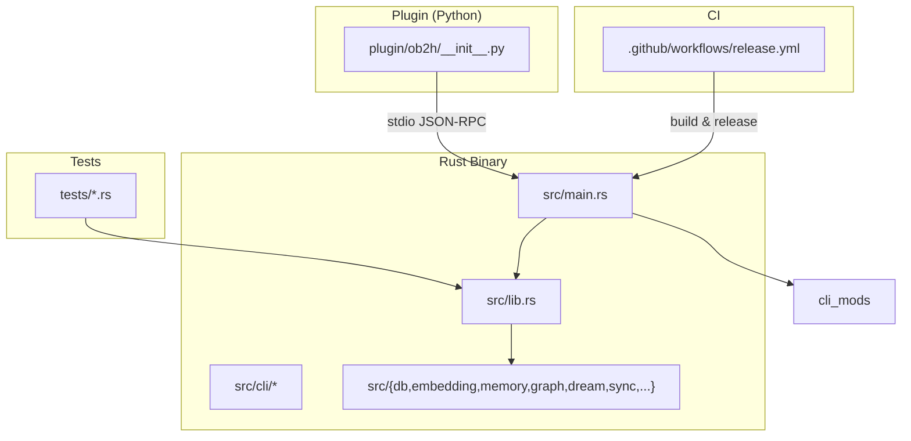
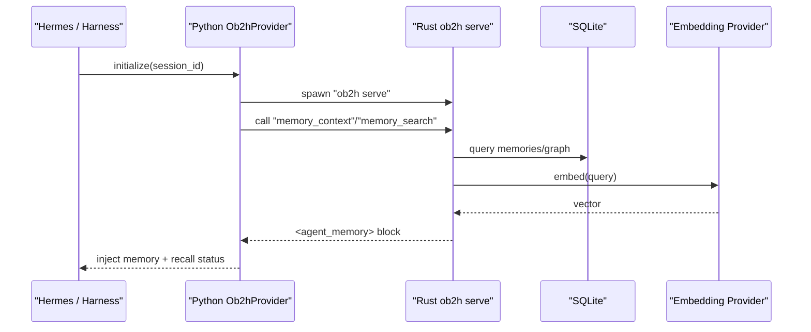
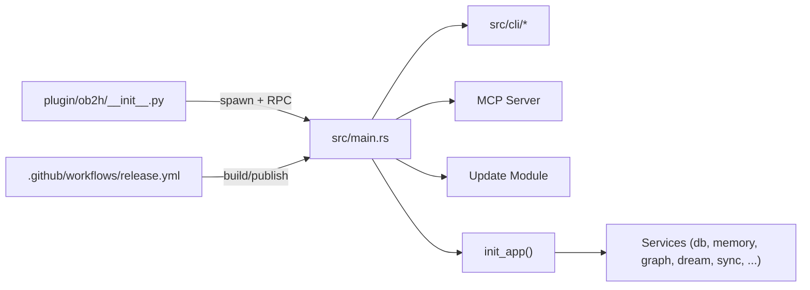

# Development Guide

<cite>
**Referenced Files in This Document**
- [Cargo.toml](file://Cargo.toml)
- [README.md](file://README.md)
- [AGENTS.md](file://AGENTS.md)
- [ARCHITECTURE.md](file://docs/ARCHITECTURE.md)
- [release.yml](file://.github/workflows/release.yml)
- [main.rs](file://src/main.rs)
- [lib.rs](file://src/lib.rs)
- [test_db.rs](file://tests/test_db.rs)
- [test_memory.rs](file://tests/test_memory.rs)
- [__init__.py](file://plugin/ob2h/__init__.py)
</cite>

## Table of Contents
1. [Introduction](#introduction)
2. [Project Structure](#project-structure)
3. [Core Components](#core-components)
4. [Architecture Overview](#architecture-overview)
5. [Detailed Component Analysis](#detailed-component-analysis)
6. [Dependency Analysis](#dependency-analysis)
7. [Performance Considerations](#performance-considerations)
8. [Troubleshooting Guide](#troubleshooting-guide)
9. [Conclusion](#conclusion)
10. [Appendices](#appendices)

## Introduction
This guide explains how to build, test, debug, and extend OB2H as a Rust project with an optional Python plugin for Hermes. It covers the development environment, dependency management, compilation options, testing organization, debugging and profiling techniques, contribution guidelines, extension points for parsers and providers, continuous integration, release procedures, and troubleshooting.

## Project Structure
OB2H is a Rust workspace with:
- A single binary `ob2h` driven by CLI commands.
- Core libraries under `src/`.
- Integration tests under `tests/`.
- A Python MemoryProvider plugin under `plugin/ob2h/`.
- CI workflow for cross-platform releases under `.github/workflows/`.

**Diagram sources**
- [main.rs:1-120](file://src/main.rs#L1-L120)
- [lib.rs:1-162](file://src/lib.rs#L1-L162)
- [__init__.py:1-120](file://plugin/ob2h/__init__.py#L1-L120)
- [release.yml:1-151](file://.github/workflows/release.yml#L1-L151)

**Section sources**
- [README.md:1-120](file://README.md#L1-L120)
- [AGENTS.md:39-86](file://AGENTS.md#L39-L86)

## Core Components
- CLI entrypoint and command routing: parses arguments, initializes app context, dispatches commands like serve, bench, dream, sync, secrets, project, update, agent, viewer.
- Application context initialization: creates database, embedder, memory, workspace, graph, project, ralph, secrets, dream, backup, sync, lessons, slots, watcher, scan jobs; starts background workers.
- MCP server: stdio-based JSON-RPC server exposing tools/resources/prompts.
- Python plugin: MemoryProvider that spawns `ob2h serve`, manages lifecycle, prefetches memory, and proxies tool calls.

Key responsibilities:
- `src/main.rs`: CLI parsing, logging setup, command dispatch, update checks, plugin installers.
- `src/lib.rs`: AppContext assembly and background worker startup.
- `plugin/ob2h/__init__.py`: Hermes integration, subprocess lifecycle, RPC client, prefetch cache, health loop.

**Section sources**
- [main.rs:17-120](file://src/main.rs#L17-L120)
- [lib.rs:45-162](file://src/lib.rs#L45-L162)
- [__init__.py:126-260](file://plugin/ob2h/__init__.py#L126-L260)

## Architecture Overview
The runtime consists of:
- Hermes or another harness invoking either the Python plugin or direct MCP stdio.
- The Rust binary running an MCP server over stdio.
- Services for memory, graph, AST scanning, dreams, sync, secrets, backups, and updates.
- SQLite as the single data store with FTS5 and vector BLOBs.

**Diagram sources**
- [__init__.py:209-260](file://plugin/ob2h/__init__.py#L209-L260)
- [main.rs:62-90](file://src/main.rs#L62-L90)
- [ARCHITECTURE.md:11-58](file://docs/ARCHITECTURE.md#L11-L58)

## Detailed Component Analysis

### Build Setup and Compilation Options
- Toolchain: Rust stable (CI uses `dtolnay/rust-toolchain@stable`).
- Dependencies are declared in `Cargo.toml`; optional GUI feature toggles native UI dependencies.
- Target-specific dependencies exist for Windows and Unix.

Recommended local commands:
- Build release: `cargo build --release`
- Build with GUI: `cargo build --release --features gui`
- Run tests: `cargo test`
- Lint: `cargo clippy --all-targets`

Compilation notes:
- Feature `gui` enables eframe/sys-locale for PIN GUI; without it, headless terminal PIN input is used.
- Linux/macOS release builds omit GUI features; Windows release includes GUI where applicable.

**Section sources**
- [Cargo.toml:1-69](file://Cargo.toml#L1-L69)
- [release.yml:53-74](file://.github/workflows/release.yml#L53-L74)
- [AGENTS.md:74-81](file://AGENTS.md#L74-L81)

### Dependency Management
- Runtime dependencies include async runtime, SQLite, HTTP/TLS, CLI, tracing, time, regex, crypto, Candle embeddings, file watching, TOML/YAML, self-update, semver, zip, and more.
- Dev dependencies are minimal (`tempfile`).
- Optional GUI dependencies are gated behind `gui` feature.
- Platform-specific crates are isolated via `[target.'cfg(...)'.dependencies]`.

Best practices:
- Prefer lightweight, well-scoped crates.
- Gate platform/UI features behind Cargo features.
- Avoid adding network-heavy or large transitive dependencies unless justified.

**Section sources**
- [Cargo.toml:7-69](file://Cargo.toml#L7-L69)

### Testing Procedures
Test categories:
- Unit tests: small, deterministic, no network. Examples cover DB schema/FTS and memory CRUD/search.
- Integration tests: exercise services through in-memory DBs and fakes.
- End-to-end scenarios: MCP tool contracts, plugin behavior, vec0 recall benchmarks.

Running tests:
- All Rust tests: `cargo test`
- Specific test file: `cargo test --test test_memory`
- With GUI feature: `cargo test --features gui`

Test patterns:
- Use in-memory SQLite for fast, isolated tests.
- Replace external LLM/embeddings with fakes when needed.
- Keep golden datasets under `data/bench/golden.jsonl` for regression metrics.

Example references:
- DB initialization and trigram FTS verification.
- Memory service save/search/decay/context/forget flow.

**Section sources**
- [test_db.rs:1-47](file://tests/test_db.rs#L1-L47)
- [test_memory.rs:1-48](file://tests/test_memory.rs#L1-L48)
- [AGENTS.md:109-118](file://AGENTS.md#L109-L118)

### Debugging Techniques
- Logging: structured logs via tracing; file appender writes to `data/logs/ob2h.log`; stderr only outside stdio mode.
- Environment-driven log level: configure via env filter.
- Viewer process: read-only process launched separately; lockfile ensures single instance.
- Secrets PIN fallback: if GUI unavailable, falls back to terminal input.

Useful commands:
- Start MCP server: `./target/release/ob2h serve`
- Open viewer: `./target/release/ob2h viewer`
- Doctor diagnostics: `ob2h doctor [--fix]`

**Section sources**
- [main.rs:36-60](file://src/main.rs#L36-L60)
- [main.rs:22-34](file://src/main.rs#L22-L34)
- [README.md:254-256](file://README.md#L254-L256)

### Profiling and Performance Analysis
- Benchmarks:
  - General benchmarking: `ob2h bench`
  - History trend: `ob2h bench --mode history`
  - Code-graph benchmarks: `ob2h bench --mode code --project <id>`
- Vec0 index recall:
  - Build index: `ob2h vec0 build`
  - Stats: `ob2h vec0 stats`
  - Recall evaluation: `ob2h vec0 recall --k ...`
- Quantization:
  - Estimate int8 quantization: `ob2h db quantize-embeddings --dry-run`

Metrics tracked:
- Recall@k against golden set.
- Latency comparisons between brute-force and vec0+rescoring.
- Nightly bench gate can revert regressions automatically.

**Section sources**
- [main.rs:92-114](file://src/main.rs#L92-L114)
- [main.rs:320-349](file://src/main.rs#L320-L349)
- [main.rs:600-700](file://src/main.rs#L600-L700)
- [ARCHITECTURE.md:351-355](file://docs/ARCHITECTURE.md#L351-L355)

### Contribution Guidelines
Code style and conventions:
- Rust 1.80+; Python plugin must be stdlib-only.
- Public APIs typed; serde for schemas.
- Async for MCP layer; synchronous SQLite access via single-threaded lock.
- MCP tool errors returned as strings, not exceptions.
- Comments/docstrings in Russian; identifiers in English snake_case.
- Secrets via environment variables; never hardcode keys.
- New dependencies require justification and documentation.

Commit and PR process:
- Small commits per task following conventional prefixes: `feat`, `fix`, `docs`, `test`, `refactor`.
- Branch from `main`; avoid pushing unneeded branches locally.
- Ensure tests pass and linters clean before committing.
- Changes to MCP contracts must be documented in changelog.

**Section sources**
- [AGENTS.md:87-143](file://AGENTS.md#L87-L143)

### Extension Points

#### Adding a New Language Parser
- Maintain a single registry of language specs and matchers.
- Add entries for name, matcher, node/edge dictionaries, size cap, parser tag, and fixture.
- Implement a dedicated parser function.
- Tests enforce consistency across file collection, watcher, and dispatcher.

Steps:
1. Register new format in the central language registry.
2. Implement parser logic and emit nodes/edges.
3. Add fixtures and ensure existing consistency tests pass.
4. Validate with AST scanner and incremental scan workflows.

**Section sources**
- [ARCHITECTURE.md:367-399](file://docs/ARCHITECTURE.md#L367-L399)

#### Adding an Embedding Provider
- Providers are selected based on configuration.
- Supported modes include local Candle models and external API endpoints.
- For tests, use fake embedding provider returning fixed vectors.

Steps:
1. Configure provider via environment variables.
2. If using API, set base URL and key.
3. In tests, switch to fake provider to avoid network.

**Section sources**
- [ARCHITECTURE.md:280-305](file://docs/ARCHITECTURE.md#L280-L305)
- [test_memory.rs:1-48](file://tests/test_memory.rs#L1-L48)

#### Adding an Agent Integration
- Use the agent installer to configure supported agents.
- Skills under `skills/<agent>/SKILL.md` document integration specifics.
- For DSH, both MCP client plugin and cordis plugin are supported.

Steps:
1. Run agent installer for target agent(s).
2. Verify status and run doctor diagnostics.
3. Install skills and plugins as required.

**Section sources**
- [README.md:108-127](file://README.md#L108-L127)
- [README.md:332-343](file://README.md#L332-L343)

### Continuous Integration and Releases
CI triggers:
- On semantic version tags matching `vX.Y.Z`.
- Manual workflow dispatch with a specified version.

Jobs:
- Cross-platform builds: Windows, Linux, macOS (aarch64/x86_64).
- Artifacts packaged as `.zip` (Windows) or `.tar.gz` (Unix).
- SHA256 checksums generated.
- GitHub Release created with assets.

Release matrix highlights:
- Windows builds include GUI features.
- Linux/macOS remain headless.

**Section sources**
- [release.yml:1-151](file://.github/workflows/release.yml#L1-L151)

## Dependency Analysis
High-level relationships:
- `main.rs` depends on CLI modules, config, MCP server, update module, and app initialization.
- `lib.rs` composes services and background workers.
- Python plugin orchestrates `ob2h serve` via stdio JSON-RPC.
- CI builds and packages artifacts for multiple targets.

**Diagram sources**
- [main.rs:1-120](file://src/main.rs#L1-L120)
- [lib.rs:45-162](file://src/lib.rs#L45-L162)
- [__init__.py:126-260](file://plugin/ob2h/__init__.py#L126-L260)
- [release.yml:22-74](file://.github/workflows/release.yml#L22-L74)

**Section sources**
- [main.rs:1-120](file://src/main.rs#L1-L120)
- [lib.rs:1-162](file://src/lib.rs#L1-L162)
- [__init__.py:1-120](file://plugin/ob2h/__init__.py#L1-L120)
- [release.yml:1-151](file://.github/workflows/release.yml#L1-L151)

## Performance Considerations
- Use vec0 index for approximate nearest neighbor search to improve recall latency.
- Quantize embeddings to reduce storage and potentially speed up comparisons.
- Tune PPR damping and weights for personalized ranking.
- Monitor nightly bench gates to catch regressions early.
- Keep daily logs archived to control workspace growth.

[No sources needed since this section provides general guidance]

## Troubleshooting Guide
Common issues and resolutions:
- Missing binary path in plugin: ensure `ob2h` is discoverable via PATH, `OB2H_BIN`, or `ob2h.json`.
- No LLM key in plugin mode: verify environment propagation; plugin auto-injects harness keys when available.
- GUI unavailable: fall back to terminal PIN input; disable GUI via environment if needed.
- Database locked or busy: WAL mode and busy timeout allow concurrent readers/writers; check locks and ensure single-instance viewer.
- Update check failures: inspect network connectivity and repository/channel settings.

Commands:
- `ob2h doctor --fix` to auto-correct common configuration issues.
- `ob2h update check` to force a version check.
- `ob2h secrets unlock` to manage secrets TTL.

**Section sources**
- [__init__.py:61-72](file://plugin/ob2h/__init__.py#L61-L72)
- [__init__.py:89-123](file://plugin/ob2h/__init__.py#L89-L123)
- [main.rs:354-454](file://src/main.rs#L354-L454)
- [README.md:254-291](file://README.md#L254-L291)

## Conclusion
OB2H provides a robust, extensible Rust-based knowledge store and AST analysis engine with a Python plugin for seamless harness integration. By following the build, testing, debugging, and contribution guidelines here, contributors can confidently develop features, add parsers and providers, and maintain high quality through automated CI and performance gates.

[No sources needed since this section summarizes without analyzing specific files]

## Appendices

### Quick Commands Reference
- Build: `cargo build --release`
- Build with GUI: `cargo build --release --features gui`
- Test: `cargo test`
- Lint: `cargo clippy --all-targets`
- Serve: `./target/release/ob2h serve`
- Plugin/Skill install: `ob2h plugin install && ob2h skill install`
- Agent install: `ob2h agent install --agent all`
- Doctor: `ob2h doctor [--fix]`

**Section sources**
- [AGENTS.md:74-81](file://AGENTS.md#L74-L81)
- [README.md:220-296](file://README.md#L220-L296)