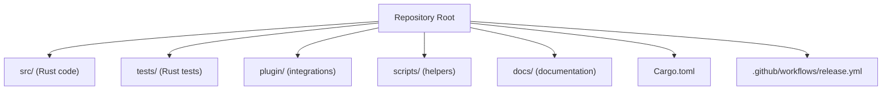
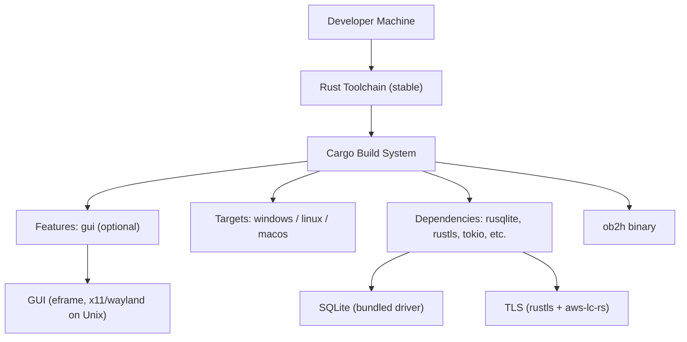
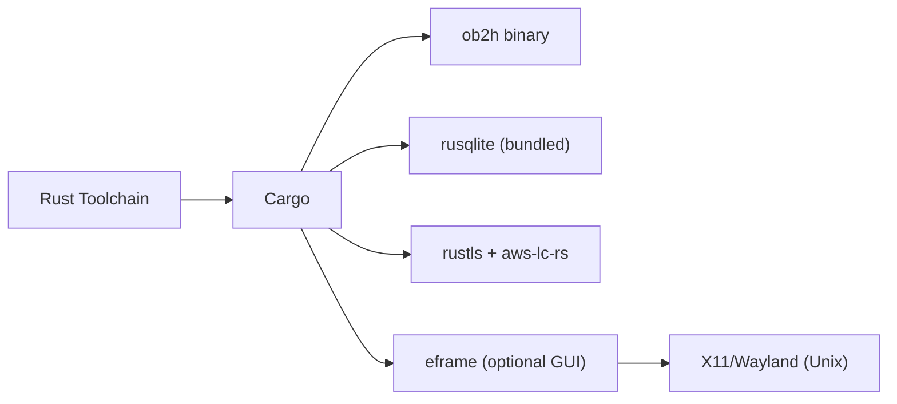

# Environment Setup

<cite>
**Referenced Files in This Document**
- [Cargo.toml](file://Cargo.toml)
- [README.md](file://README.md)
- [release.yml](file://.github/workflows/release.yml)
- [install.bat](file://install.bat)
</cite>

## Table of Contents
1. [Introduction](#introduction)
2. [Project Structure](#project-structure)
3. [Core Components](#core-components)
4. [Architecture Overview](#architecture-overview)
5. [Detailed Component Analysis](#detailed-component-analysis)
6. [Dependency Analysis](#dependency-analysis)
7. [Performance Considerations](#performance-considerations)
8. [Troubleshooting Guide](#troubleshooting-guide)
9. [Conclusion](#conclusion)
10. [Appendices](#appendices)

## Introduction
This document explains how to set up a development environment for OB2H, a Rust-based autonomous knowledge and memory system for AI agents. It covers the required Rust toolchain, Cargo build configuration, dependency management, platform-specific setup steps for Windows, macOS, and Linux, native dependencies such as SQLite and OpenSSL, IDE recommendations, debugging configuration, common issues, and verification steps.

OB2H is a Rust project with:
- A single binary built via Cargo.
- Optional GUI features controlled by a Cargo feature flag.
- Cross-platform builds for Windows, Linux, and macOS.
- Native integration with SQLite (bundled driver), TLS via rustls, and optional GUI components.

The goal is to get you from zero to a working local build and development workflow on your machine.

## Project Structure
At a high level, the repository contains:
- `src/`: Rust source code for CLI, database, graph, embedding, secrets, sync, viewer, and other modules.
- `tests/`: Rust tests.
- `plugin/`: Integration plugins for external tools.
- `scripts/`: Helper scripts for installation and automation.
- `docs/`: Documentation and architecture notes.
- `Cargo.toml`: Package metadata, dependencies, and build features.
- `.github/workflows/release.yml`: CI matrix that defines supported targets and build flags.

**Diagram sources**
- [Cargo.toml:1-69](file://Cargo.toml#L1-L69)
- [release.yml:1-151](file://.github/workflows/release.yml#L1-L151)

**Section sources**
- [Cargo.toml:1-69](file://Cargo.toml#L1-L69)
- [release.yml:1-151](file://.github/workflows/release.yml#L1-L151)

## Core Components
For environment setup, focus on these core areas:
- Rust toolchain and target triples.
- Cargo features and optional GUI.
- Native dependencies (SQLite, TLS).
- Platform-specific requirements.
- Build commands and options.
- Verification and troubleshooting.

Key facts:
- The package uses Rust edition 2021.
- The project enables SQLite via a bundled driver and loads extensions.
- TLS is implemented with rustls using aws-lc-rs; no system OpenSSL is required.
- The optional GUI feature requires X11/Wayland support on Unix-like systems and is enabled only on Windows in CI.
- CI builds use stable Rust and install minimal system dependencies on Ubuntu.

**Section sources**
- [Cargo.toml:1-69](file://Cargo.toml#L1-L69)
- [release.yml:56-73](file://.github/workflows/release.yml#L56-L73)

## Architecture Overview
The development environment revolves around Cargo and the Rust toolchain. The build process compiles the Rust code into a native binary, optionally including GUI components depending on the feature flag.

**Diagram sources**
- [Cargo.toml:8-13](file://Cargo.toml#L8-L13)
- [Cargo.toml:49-66](file://Cargo.toml#L49-L66)
- [release.yml:56-73](file://.github/workflows/release.yml#L56-L73)

## Detailed Component Analysis

### Rust Toolchain Requirements
- Use the stable Rust toolchain.
- Edition: 2021.
- Target triples used by CI:
  - Windows: `x86_64-pc-windows-msvc`
  - Linux: `x86_64-unknown-linux-gnu`
  - macOS: `aarch64-apple-darwin`, `x86_64-apple-darwin`

Recommended setup:
- Install Rust stable via rustup.
- Add the target triples you plan to build for.
- Ensure your PATH includes cargo and rustc.

Verification:
- Check Rust version and edition compatibility.
- Confirm target triples are installed.

**Section sources**
- [Cargo.toml:1-5](file://Cargo.toml#L1-L5)
- [release.yml:28-51](file://.github/workflows/release.yml#L28-L51)
- [release.yml:56-59](file://.github/workflows/release.yml#L56-L59)

### Build System Configuration Using Cargo
- Package name: ob2h
- Edition: 2021
- Dependencies include async runtime, SQLite, serde, HTTP client, logging, embeddings, vector search, and more.
- Optional GUI feature: `gui` enables eframe and sys-locale.
- Conditional dependencies:
  - Windows: `windows-sys`
  - Unix: `libc`

Build commands:
- Development build: `cargo build`
- Release build: `cargo build --release`
- With GUI: `cargo build --features gui`
- For a specific target: `cargo build --target <triple>`

Notes:
- The GUI feature is optional and not enabled by default.
- On Unix-like systems, building the GUI may require X11/Wayland libraries.

**Section sources**
- [Cargo.toml:1-66](file://Cargo.toml#L1-L66)

### Dependency Management
- SQLite: Uses a bundled driver, so you do not need to install system SQLite libraries for compilation.
- TLS: Uses rustls with aws-lc-rs; no system OpenSSL is required.
- Vector search extension: sqlite-vec is included as a dependency.
- Embeddings and models: Local model download is handled at runtime; offline mode can be configured via environment variables.

Implications:
- Fewer native library headaches compared to system-linked SQLite or OpenSSL.
- If you enable the GUI feature, ensure your OS provides the necessary windowing libraries.

**Section sources**
- [Cargo.toml:9-13](file://Cargo.toml#L9-L13)
- [Cargo.toml:37-37](file://Cargo.toml#L37-L37)
- [README.md:300-329](file://README.md#L300-L329)

### Platform-Specific Setup Procedures

#### Windows
- Toolchain: Stable Rust with MSVC target.
- GUI: Enabled in CI for Windows; requires appropriate windowing support.
- Installer: The repository includes a Windows installer script that invokes PowerShell.

Steps:
1. Install Rust stable with MSVC toolchain.
2. Add target: `rustup target add x86_64-pc-windows-msvc`.
3. Build:
   - Headless: `cargo build --release`
   - With GUI: `cargo build --release --features gui`
4. Optionally run the provided installer script to automate agent integration.

Verification:
- Run the built binary to confirm it starts.
- Test agent integration if applicable.

**Section sources**
- [release.yml:30-36](file://.github/workflows/release.yml#L30-L36)
- [install.bat:1-6](file://install.bat#L1-L6)

#### macOS
- Toolchain: Stable Rust.
- Targets: `aarch64-apple-darwin` (Apple Silicon) and `x86_64-apple-darwin` (Intel).
- GUI: Not enabled in CI; headless builds are standard.

Steps:
1. Install Rust stable.
2. Add targets:
   - `rustup target add aarch64-apple-darwin`
   - `rustup target add x86_64-apple-darwin`
3. Build:
   - Headless: `cargo build --release --target <triple>`
   - With GUI (if needed): `cargo build --release --target <triple> --features gui`

Verification:
- Execute the binary for the target triple.
- Confirm no missing dynamic libraries.

**Section sources**
- [release.yml:42-51](file://.github/workflows/release.yml#L42-L51)

#### Linux
- Toolchain: Stable Rust.
- Target: `x86_64-unknown-linux-gnu`
- System dependencies: CI installs `build-essential` on Ubuntu.

Steps:
1. Install Rust stable.
2. Add target: `rustup target add x86_64-unknown-linux-gnu`.
3. Install minimal build tools:
   - Ubuntu/Debian: `sudo apt-get update && sudo apt-get install -y build-essential`
4. Build:
   - Headless: `cargo build --release --target x86_64-unknown-linux-gnu`
   - With GUI (if needed): `cargo build --release --target x86_64-unknown-linux-gnu --features gui`

Verification:
- Run the binary and check for missing shared libraries.
- If GUI is enabled, ensure X11/Wayland libraries are present.

**Section sources**
- [release.yml:37-41](file://.github/workflows/release.yml#L37-L41)
- [release.yml:65-67](file://.github/workflows/release.yml#L65-L67)

### Native Dependencies
- SQLite: Bundled driver is used; no system SQLite dev libraries are required.
- TLS: rustls with aws-lc-rs; no system OpenSSL is required.
- GUI (optional): Requires X11/Wayland on Unix-like systems when the `gui` feature is enabled.

Recommendations:
- Prefer headless builds unless you need the GUI.
- If enabling GUI on Linux/macOS, install the relevant windowing libraries for your distribution.

**Section sources**
- [Cargo.toml:9-13](file://Cargo.toml#L9-L13)
- [Cargo.toml:49-50](file://Cargo.toml#L49-L50)
- [release.yml:34-36](file://.github/workflows/release.yml#L34-L36)

### IDE Setup Recommendations
- Rust Analyzer: Enable language server and diagnostics.
- Cargo tasks: Configure tasks for build, test, and run with features.
- Debugging:
  - Use VS Code or CLion with Rust support.
  - Set launch configurations to run the binary with environment variables.
- Environment variables:
  - Configure LLM endpoints, API keys, data directory, and feature toggles as needed.

Tips:
- Keep workspace root at the repository root.
- Use separate profiles for headless and GUI builds if needed.

[No sources needed since this section provides general guidance]

### Development Workflow Tools
- Cargo: Primary build and dependency manager.
- rustup: Toolchain and target management.
- Git hooks and file watchers: Used by the application to react to changes.
- CI matrix: Mirrors supported platforms and targets.

Practices:
- Pin toolchain versions in CI but allow local flexibility.
- Use release builds for performance-sensitive testing.
- Validate cross-compilation targets regularly.

**Section sources**
- [release.yml:22-73](file://.github/workflows/release.yml#L22-L73)

## Dependency Analysis
The build depends on:
- Rust toolchain (stable).
- Cargo for dependency resolution and compilation.
- Optional GUI libraries (X11/Wayland) when the `gui` feature is enabled.
- No system OpenSSL or SQLite dev libraries due to bundled drivers.

**Diagram sources**
- [Cargo.toml:8-13](file://Cargo.toml#L8-L13)
- [Cargo.toml:49-50](file://Cargo.toml#L49-L50)

**Section sources**
- [Cargo.toml:8-13](file://Cargo.toml#L8-L13)
- [Cargo.toml:49-50](file://Cargo.toml#L49-L50)

## Performance Considerations
- Use release builds for production and performance testing.
- Avoid enabling the GUI feature unless necessary; it adds dependencies and potential platform-specific overhead.
- Prefer headless operation on servers and CI environments.
- Tune environment variables related to embeddings, prefetch budgets, and model usage to balance performance and resource consumption.

[No sources needed since this section provides general guidance]

## Troubleshooting Guide
Common issues and resolutions:
- Missing target triple:
  - Symptom: Compilation fails due to unknown target.
  - Resolution: Install the required target with rustup.
- GUI build failures on Linux/macOS:
  - Symptom: Linker errors for X11/Wayland.
  - Resolution: Install windowing libraries or disable the GUI feature.
- TLS or networking issues:
  - Symptom: Failures connecting to remote APIs.
  - Resolution: Verify environment variables and network access; rustls should work without system OpenSSL.
- SQLite extension loading:
  - Symptom: Errors loading sqlite-vec.
  - Resolution: Ensure the extension is available; the project includes sqlite-vec as a dependency.
- Agent integration problems:
  - Symptom: MCP tools not available in agents.
  - Resolution: Use provided scripts to install and configure integrations.

Verification steps:
- Build successfully in headless mode.
- Run the binary and check basic commands.
- If GUI is enabled, open the viewer and confirm UI elements load.
- Test agent integration where applicable.

**Section sources**
- [release.yml:65-73](file://.github/workflows/release.yml#L65-L73)
- [Cargo.toml:49-50](file://Cargo.toml#L49-L50)
- [README.md:300-329](file://README.md#L300-L329)

## Conclusion
You now have a complete guide to setting up the OB2H development environment. Use stable Rust, configure Cargo features appropriately, and rely on bundled SQLite and rustls to minimize native dependency complexity. Follow platform-specific steps for Windows, macOS, and Linux, verify your setup, and leverage IDE tools for an efficient workflow.

[No sources needed since this section summarizes without analyzing specific files]

## Appendices

### Quick Reference: Build Commands
- Headless:
  - `cargo build --release`
  - `cargo build --release --target <triple>`
- With GUI:
  - `cargo build --release --features gui`
  - `cargo build --release --target <triple> --features gui`

**Section sources**
- [Cargo.toml:63-66](file://Cargo.toml#L63-L66)
- [release.yml:69-73](file://.github/workflows/release.yml#L69-L73)

### Environment Variables Overview
Key variables for development and runtime behavior include data directory, LLM configuration, embedding provider, dream settings, backup retention, sync encryption key, secrets TTL, PIN GUI toggle, UI language, update checks, and offline mode.

**Section sources**
- [README.md:300-329](file://README.md#L300-L329)