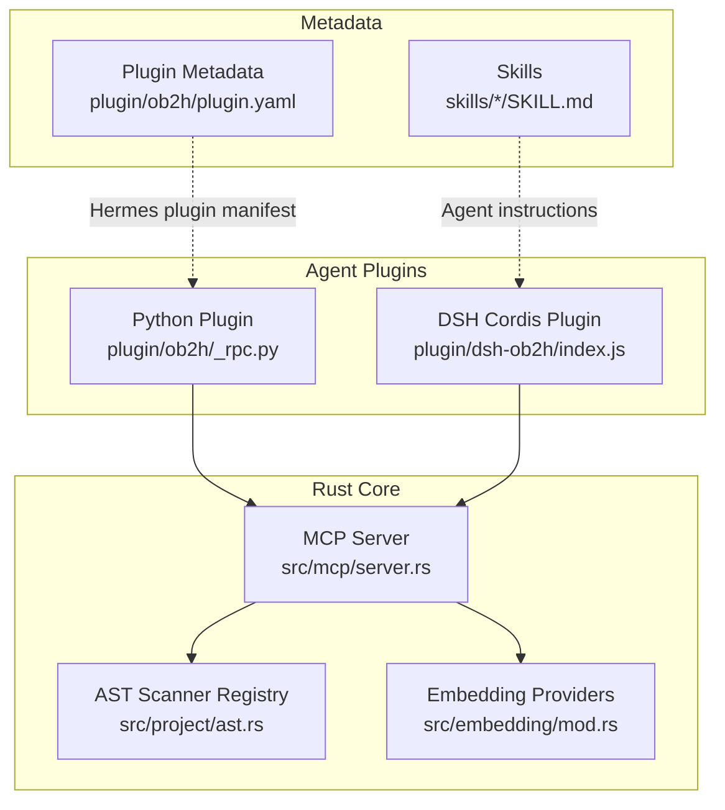
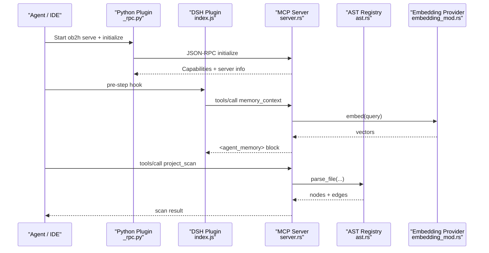
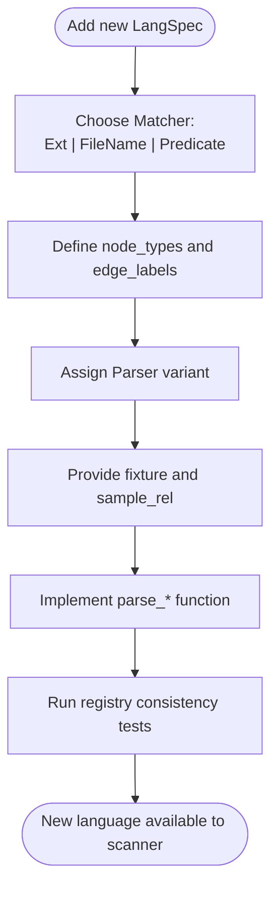
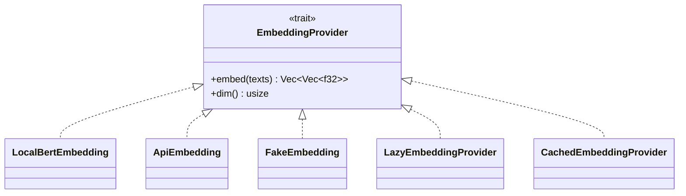
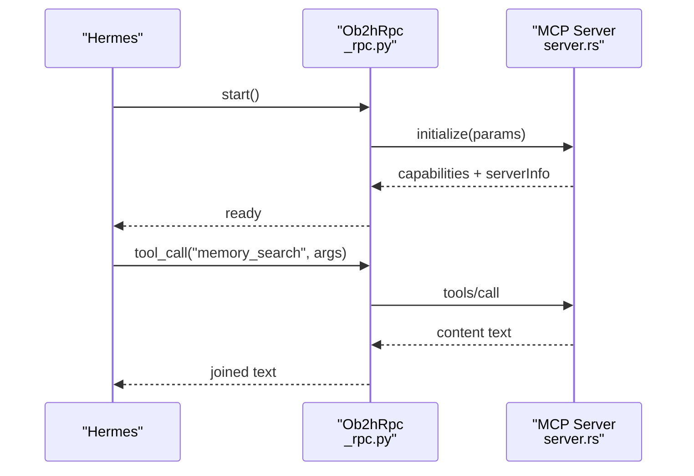
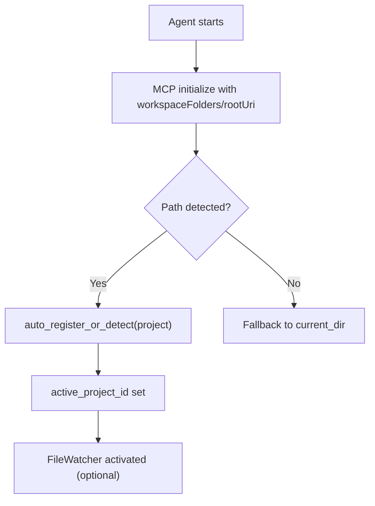
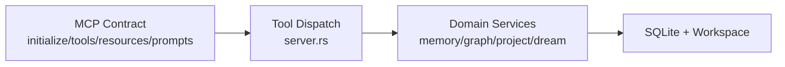
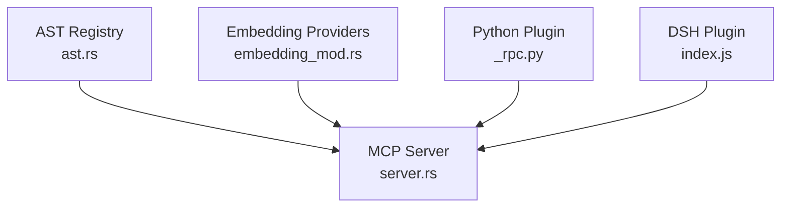

# Extension Development

<cite>
**Referenced Files in This Document**
- [README.md](file://README.md)
- [ARCHITECTURE.md](file://docs/ARCHITECTURE.md)
- [ast.rs](file://src/project/ast.rs)
- [embedding_mod.rs](file://src/embedding/mod.rs)
- [mcp_mod.rs](file://src/mcp/mod.rs)
- [server.rs](file://src/mcp/server.rs)
- [_rpc.py](file://plugin/ob2h/_rpc.py)
- [dsh_index.js](file://plugin/dsh-ob2h/index.js)
- [plugin_yaml](file://plugin/ob2h/plugin.yaml)
</cite>

## Table of Contents
1. [Introduction](#introduction)
2. [Project Structure](#project-structure)
3. [Core Components](#core-components)
4. [Architecture Overview](#architecture-overview)
5. [Detailed Component Analysis](#detailed-component-analysis)
6. [Dependency Analysis](#dependency-analysis)
7. [Performance Considerations](#performance-considerations)
8. [Troubleshooting Guide](#troubleshooting-guide)
9. [Conclusion](#conclusion)
10. [Appendices](#appendices)

## Introduction
This document explains how to extend OB2H with new capabilities. It focuses on four extension types:
- New language parsers for AST scanning, including registration and symbol extraction.
- Embedding provider implementations for different vector backends.
- Agent integration following the MCP protocol specification.
- Skill definition creation and auto-detection mechanisms.

It also provides plugin architecture guidelines, interface contracts, backward compatibility considerations, step-by-step examples, testing strategies, and integration notes with the main application.

OB2H exposes a Rust-based MCP server that agents can call over stdio JSON-RPC. The repository includes Python and JavaScript plugins that wrap this server for Hermes and DeepSeek Harness respectively. Skills are Markdown-driven agent instructions under `skills/`.

**Section sources**
- [README.md:15-53](file://README.md#L15-L53)
- [ARCHITECTURE.md:11-53](file://docs/ARCHITECTURE.md#L11-L53)

## Project Structure
The extension points relevant to this guide live in:
- `src/project/ast.rs`: AST scanner registry and per-language parsing.
- `src/embedding/mod.rs`: Embedding provider abstraction and factory.
- `src/mcp/`: MCP server, protocol, and tool dispatch.
- `plugin/ob2h/_rpc.py`: Python stdio client for `ob2h serve`.
- `plugin/dsh-ob2h/index.js`: Cordis plugin wiring memory recall and capture for DSH.
- `plugin/ob2h/plugin.yaml`: Hermes plugin metadata.
- `skills/<agent>/SKILL.md`: Agent skill definitions.

**Diagram sources**
- [server.rs:138-206](file://src/mcp/server.rs#L138-L206)
- [ast.rs:121-233](file://src/project/ast.rs#L121-L233)
- [embedding_mod.rs:31-107](file://src/embedding/mod.rs#L31-L107)
- [_rpc.py:28-125](file://plugin/ob2h/_rpc.py#L28-L125)
- [dsh_index.js:161-184](file://plugin/dsh-ob2h/index.js#L161-L184)
- [plugin_yaml:1-4](file://plugin/ob2h/plugin.yaml#L1-L4)

**Section sources**
- [README.md:332-343](file://README.md#L332-L343)
- [ARCHITECTURE.md:203-253](file://docs/ARCHITECTURE.md#L203-L253)

## Core Components
- AST Scanner Registry (`LANGS`): Central whitelist of supported languages/formats; each entry defines matcher, node types, edge labels, parser tag, size cap, fixture, and sample path.
- Embedding Provider Abstraction: Trait with `embed` and `dim`; built-in providers include local Candle model, API-backed provider, and fake provider; lazy initialization and LRU caching are provided.
- MCP Server: Stdio JSON-RPC server handling initialize, tools/list, tools/call, resources, prompts, and automatic project detection.
- Python Plugin Client: Long-lived stdio client wrapping `ob2h serve`, with handshake, error handling, and helper methods like `tools_list` and `tool_call`.
- DSH Cordis Plugin: Integrates memory recall before turns and captures completed turns into OB2H via MCP tools.

**Section sources**
- [ast.rs:15-119](file://src/project/ast.rs#L15-L119)
- [ast.rs:121-233](file://src/project/ast.rs#L121-L233)
- [embedding_mod.rs:31-107](file://src/embedding/mod.rs#L31-L107)
- [embedding_mod.rs:210-239](file://src/embedding/mod.rs#L210-L239)
- [server.rs:138-206](file://src/mcp/server.rs#L138-L206)
- [_rpc.py:28-125](file://plugin/ob2h/_rpc.py#L28-L125)
- [dsh_index.js:196-349](file://plugin/dsh-ob2h/index.js#L196-L349)

## Architecture Overview
The extension surface is layered:
- Agents or IDEs connect to OB2H through MCP (stdio JSON-RPC).
- The server dispatches tools to domain services (memory, graph, project, dream, etc.).
- AST scanning is driven by the central registry; embedding backends are pluggable behind a trait.
- Plugins (Python/JS) orchestrate lifecycle, context injection, and turn capture.

**Diagram sources**
- [_rpc.py:111-125](file://plugin/ob2h/_rpc.py#L111-L125)
- [server.rs:208-323](file://src/mcp/server.rs#L208-L323)
- [embedding_mod.rs:93-107](file://src/embedding/mod.rs#L93-L107)
- [ast.rs:121-233](file://src/project/ast.rs#L121-L233)
- [dsh_index.js:225-264](file://plugin/dsh-ob2h/index.js#L225-L264)

## Detailed Component Analysis

### Language Parser Registration and Symbol Extraction
Adding a new language requires updating the central registry and providing a parser implementation.

Key concepts:
- `LangSpec` describes name, matcher, node types, edge labels, max file size, parser tag, test fixture, and sample relative path.
- `Matcher` supports extension lists, exact filenames, or predicates.
- `Parser` enum maps to per-language parsing functions.
- `LANGS` is the single source of truth used by file collection, watcher filtering, and file parsing dispatch.

Steps to add a new language:
1. Add a new `LangSpec` entry to `LANGS` with:
   - `name`: human-readable identifier.
   - `matcher`: choose `Ext`, `FileName`, or `Predicate`.
   - `node_types`: list of AST node types your parser emits.
   - `edge_labels`: list of edge labels your parser emits.
   - `max_bytes`: file size cap (use `NO_CAP` for unlimited or a defined cap for large formats).
   - `parser`: assign a new `Parser` variant if needed.
   - `fixture`: minimal code snippet for consistency tests.
   - `sample_rel`: optional sample path for tests.
2. Implement the corresponding `parse_*` function for the new `Parser` variant.
3. Ensure the new parser produces valid `AstNode` and `AstEdge` structures.
4. Add or update fixtures/tests so the registry consistency check passes.

**Diagram sources**
- [ast.rs:152-233](file://src/project/ast.rs#L152-L233)
- [ast.rs:233-800](file://src/project/ast.rs#L233-L800)

Backward compatibility:
- Keep existing entries unchanged.
- Do not alter shared constants like `SKIP_DIRS` unless necessary.
- Avoid changing global node_type or edge_label semantics without coordination across callers.

Testing strategy:
- Use the existing registry consistency test pattern referenced in comments.
- Provide a small fixture that exercises key constructs expected by your parser.
- Validate that files matching your matcher are included by the collector and excluded by watchers where appropriate.

**Section sources**
- [ast.rs:15-119](file://src/project/ast.rs#L15-L119)
- [ast.rs:121-233](file://src/project/ast.rs#L121-L233)
- [ast.rs:233-800](file://src/project/ast.rs#L233-L800)

### Embedding Provider Implementation
To integrate a new vector embedding backend:
1. Implement the `EmbeddingProvider` trait with `embed` and `dim`.
2. Optionally wrap it with caching or lazy initialization similar to existing providers.
3. Wire it into the provider factory based on configuration.

**Diagram sources**
- [embedding_mod.rs:31-107](file://src/embedding/mod.rs#L31-L107)
- [embedding_mod.rs:116-208](file://src/embedding/mod.rs#L116-L208)
- [embedding_mod.rs:210-239](file://src/embedding/mod.rs#L210-L239)

Implementation checklist:
- Return consistent dimensionality from `dim()` across all calls.
- Handle batched inputs efficiently.
- Surface errors clearly; do not panic.
- If using an external API, respect offline mode and fallback behavior.

Integration:
- Update `provider_for` to recognize your provider name.
- Ensure environment variables and settings are consumed consistently.

**Section sources**
- [embedding_mod.rs:31-107](file://src/embedding/mod.rs#L31-L107)
- [embedding_mod.rs:116-208](file://src/embedding/mod.rs#L116-L208)
- [embedding_mod.rs:210-239](file://src/embedding/mod.rs#L210-L239)

### Agent Integration Following the MCP Protocol
There are two primary integration patterns:
- Python plugin for Hermes: long-lived stdio client with handshake and tool helpers.
- DSH Cordis plugin: hooks into agent lifecycle to inject memory and capture turns.

Python plugin essentials:
- Starts `ob2h serve` subprocess, performs MCP `initialize`, and handles responses/errors.
- Provides `ping`, `tools_list`, and `tool_call` helpers.
- Manages process lifecycle and restart backoff.

DSH plugin essentials:
- Injects a static note into the system prompt.
- On `pre-step`, calls `memory_context` and prepends `<agent_memory>` to messages.
- Captures user and assistant messages during a turn and writes them via `session_ingest`.
- Ensures fail-open behavior so memory issues do not break the conversation.

**Diagram sources**
- [_rpc.py:53-125](file://plugin/ob2h/_rpc.py#L53-L125)
- [_rpc.py:175-225](file://plugin/ob2h/_rpc.py#L175-L225)
- [server.rs:208-323](file://src/mcp/server.rs#L208-L323)

Best practices:
- Always perform MCP handshake before calling tools.
- Respect timeouts and handle dead processes gracefully.
- For DSH, ensure recall and capture are optional and fail-open.

**Section sources**
- [_rpc.py:28-125](file://plugin/ob2h/_rpc.py#L28-L125)
- [_rpc.py:175-225](file://plugin/ob2h/_rpc.py#L175-L225)
- [dsh_index.js:196-349](file://plugin/dsh-ob2h/index.js#L196-L349)

### Skill Definition Creation and Auto-Detection
Skills are Markdown documents describing how OB2H is connected and configured for a given agent or IDE. They live under `skills/<agent>/SKILL.md`.

Guidelines:
- Describe the connection method (MCP config path, version, commands).
- Include key commands and pitfalls.
- Keep skills up-to-date when adding new agents or changing defaults.

Auto-detection:
- The MCP server detects workspace roots and registers projects automatically during `initialize`.
- Zero-config behavior binds sessions to detected projects and activates watchers when enabled.

**Diagram sources**
- [server.rs:208-323](file://src/mcp/server.rs#L208-L323)

**Section sources**
- [README.md:332-343](file://README.md#L332-L343)
- [server.rs:208-323](file://src/mcp/server.rs#L208-L323)

### Plugin Architecture, Interface Contracts, and Backward Compatibility
Plugin architecture:
- Python plugin: stdio client over subprocess; robust error handling and lifecycle management.
- DSH plugin: Cordis integration with lifecycle hooks and logging.
- Hermes plugin metadata: `plugin.yaml` declares name, version, and description.

Interface contracts:
- MCP JSON-RPC contract: initialize, tools/list, tools/call, resources, prompts.
- Tool names follow domain prefixes; outputs are compact strings; errors prefixed with `[Error]`.
- Parameters may be extended additively; read-only hints and destructive hints are annotated.

Backward compatibility:
- Additive changes only: new parameters, new tools, new resource URIs.
- Existing tool behaviors must remain stable; deprecations should be gradual.
- Schema migrations are additive and downgrade-safe.

**Diagram sources**
- [ARCHITECTURE.md:203-253](file://docs/ARCHITECTURE.md#L203-L253)
- [server.rs:479-558](file://src/mcp/server.rs#L479-L558)

**Section sources**
- [_rpc.py:28-125](file://plugin/ob2h/_rpc.py#L28-L125)
- [dsh_index.js:196-349](file://plugin/dsh-ob2h/index.js#L196-L349)
- [plugin_yaml:1-4](file://plugin/ob2h/plugin.yaml#L1-L4)
- [ARCHITECTURE.md:203-253](file://docs/ARCHITECTURE.md#L203-L253)

## Dependency Analysis
High-level dependencies among extension components:

**Diagram sources**
- [ast.rs:121-233](file://src/project/ast.rs#L121-L233)
- [embedding_mod.rs:210-239](file://src/embedding/mod.rs#L210-L239)
- [server.rs:138-206](file://src/mcp/server.rs#L138-L206)
- [_rpc.py:28-125](file://plugin/ob2h/_rpc.py#L28-L125)
- [dsh_index.js:161-184](file://plugin/dsh-ob2h/index.js#L161-L184)

Coupling and cohesion:
- The MCP server depends on domain services but remains decoupled from embedding and AST specifics.
- Embedding providers are isolated behind a trait; caching and lazy loading are composable.
- AST registry centralizes format support, reducing duplication across collectors and watchers.

Potential circular dependencies:
- None observed between extension modules; MCP orchestrates services without tight coupling.

External dependencies:
- SQLite for persistence.
- Optional external LLM/embedding APIs.
- OS-specific subprocess handling in Python plugin.

**Section sources**
- [server.rs:138-206](file://src/mcp/server.rs#L138-L206)
- [embedding_mod.rs:31-107](file://src/embedding/mod.rs#L31-L107)
- [ast.rs:121-233](file://src/project/ast.rs#L121-L233)

## Performance Considerations
- Embedding caching: LRU cache reduces repeated model calls; monitor hit/miss stats.
- Lazy embedding initialization: avoids blocking startup; weights loaded on first use.
- MCP concurrency: requests handled concurrently; keepalive maintained to avoid client disconnects.
- AST scanning: centralized registry avoids redundant checks; consider file size caps for heavy formats.

Recommendations:
- Tune cache capacity based on workload.
- Monitor active backend and degrade gracefully when models fail.
- Limit AST parsing for large non-code assets.

[No sources needed since this section provides general guidance]

## Troubleshooting Guide
Common issues and resolutions:
- MCP handshake failures: verify `initialize` payload and client info; ensure `ob2h serve` is reachable.
- Dead process errors: Python plugin detects EOF and raises explicit errors; restart with backoff.
- Timeouts: adjust call and startup timeouts in plugin configuration.
- Embedding provider errors: check offline mode and fallback to fake provider; validate API keys and URLs.
- AST parsing errors: confirm file matches a registered `LangSpec`; ensure parser returns valid nodes/edges.

Operational tips:
- Use `ping` to verify connectivity.
- Inspect logs in data directories.
- Validate tool schemas and parameter names.

**Section sources**
- [_rpc.py:53-125](file://plugin/ob2h/_rpc.py#L53-L125)
- [_rpc.py:175-225](file://plugin/ob2h/_rpc.py#L175-L225)
- [embedding_mod.rs:40-64](file://src/embedding/mod.rs#L40-L64)

## Conclusion
OB2H’s extension model centers on three pillars:
- A central AST registry for deterministic code analysis.
- A pluggable embedding provider interface with caching and lazy initialization.
- An MCP-based integration surface for agents, with concrete Python and JavaScript plugins.

By adhering to additive contracts, maintaining backward compatibility, and following the provided patterns, you can safely introduce new parsers, backends, and agent integrations.

[No sources needed since this section summarizes without analyzing specific files]

## Appendices

### Step-by-Step Examples

#### Example: Add a New Language Parser
- Define a new `LangSpec` in `LANGS` with matcher, node types, edge labels, parser tag, fixture, and sample path.
- Implement the corresponding `parse_*` function.
- Run registry consistency tests to validate inclusion and parsing.

References:
- [ast.rs:152-233](file://src/project/ast.rs#L152-L233)
- [ast.rs:233-800](file://src/project/ast.rs#L233-L800)

#### Example: Implement a New Embedding Provider
- Implement `EmbeddingProvider` trait with `embed` and `dim`.
- Wrap with caching or lazy initialization if needed.
- Register provider name in `provider_for` and consume settings/env consistently.

References:
- [embedding_mod.rs:31-107](file://src/embedding/mod.rs#L31-L107)
- [embedding_mod.rs:210-239](file://src/embedding/mod.rs#L210-L239)

#### Example: Integrate an Agent via MCP
- Use Python plugin to start `ob2h serve`, perform handshake, and call tools.
- For DSH, implement recall and capture hooks, ensuring fail-open behavior.

References:
- [_rpc.py:53-125](file://plugin/ob2h/_rpc.py#L53-L125)
- [_rpc.py:175-225](file://plugin/ob2h/_rpc.py#L175-L225)
- [dsh_index.js:196-349](file://plugin/dsh-ob2h/index.js#L196-L349)

#### Example: Create a Skill Definition
- Add or update `skills/<agent>/SKILL.md` with connection details, commands, and pitfalls.
- Keep it aligned with current MCP toolset and zero-config behavior.

References:
- [README.md:332-343](file://README.md#L332-L343)