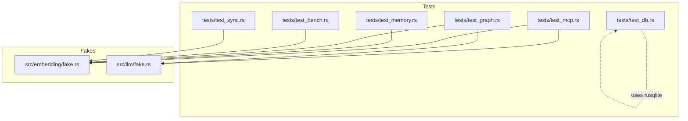
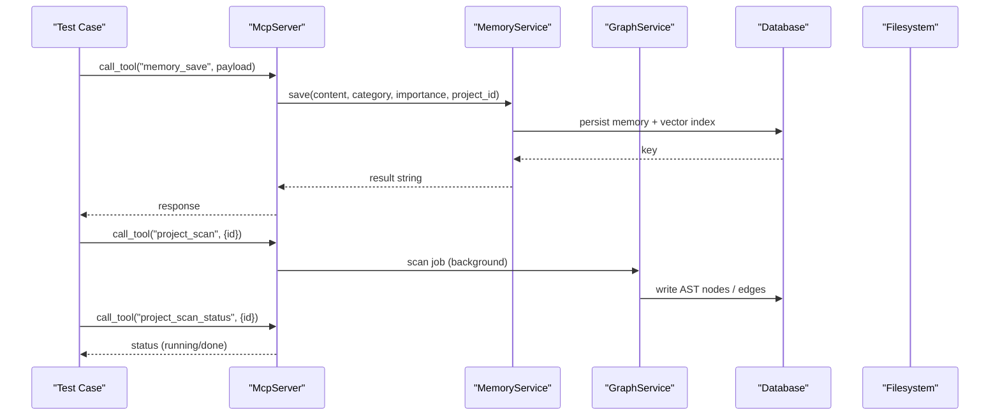
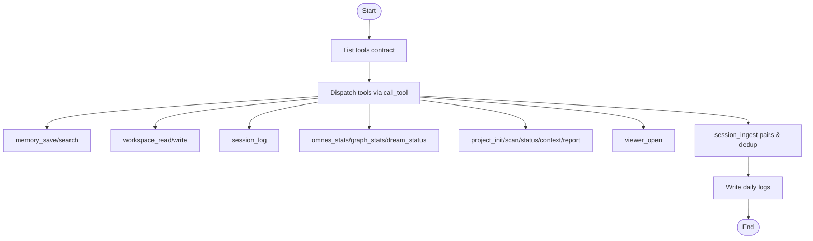
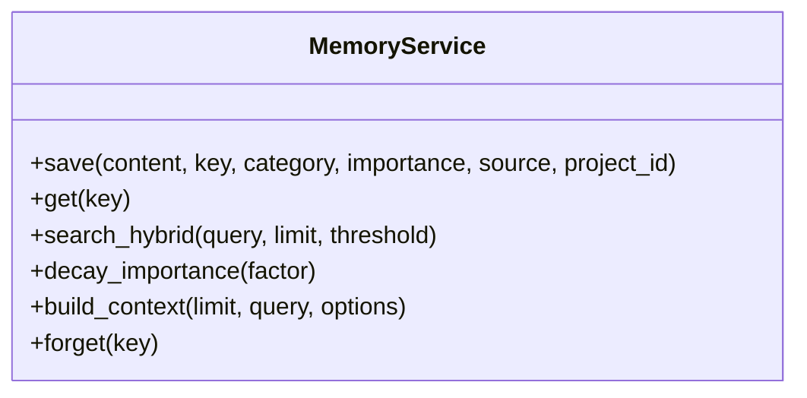
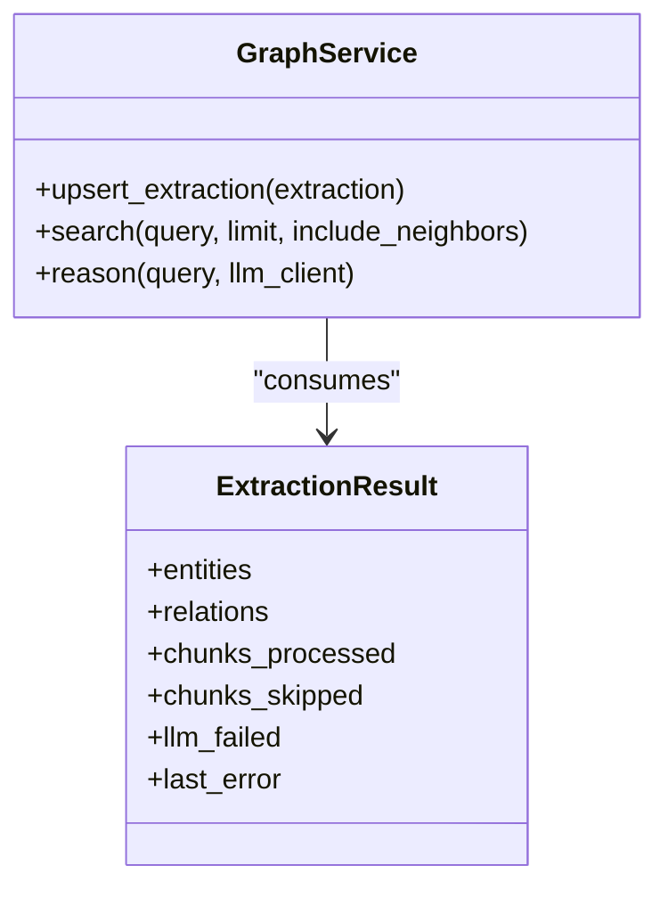
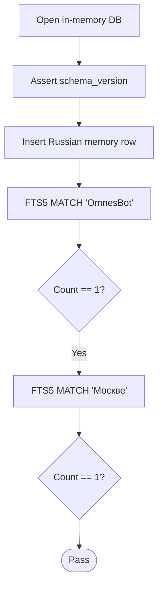
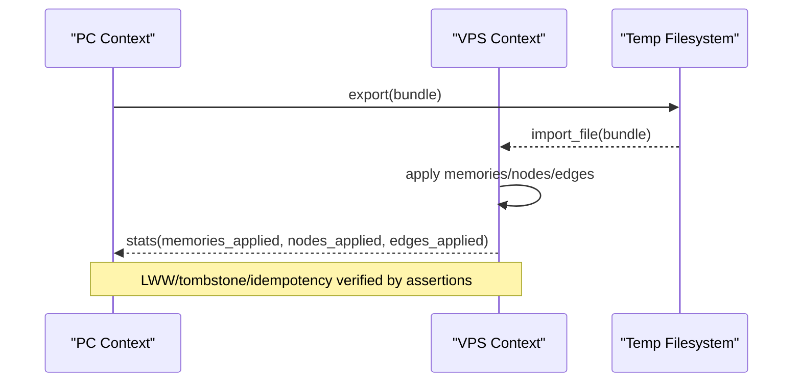
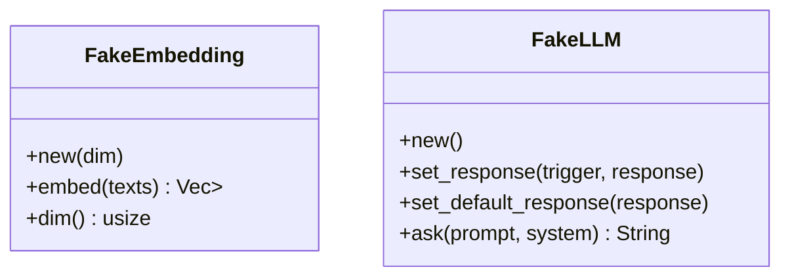
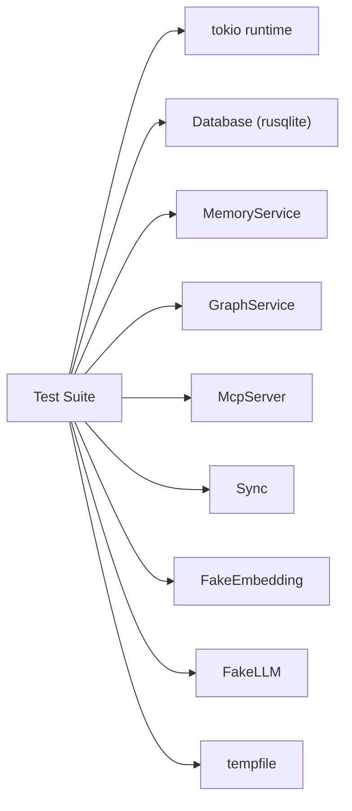
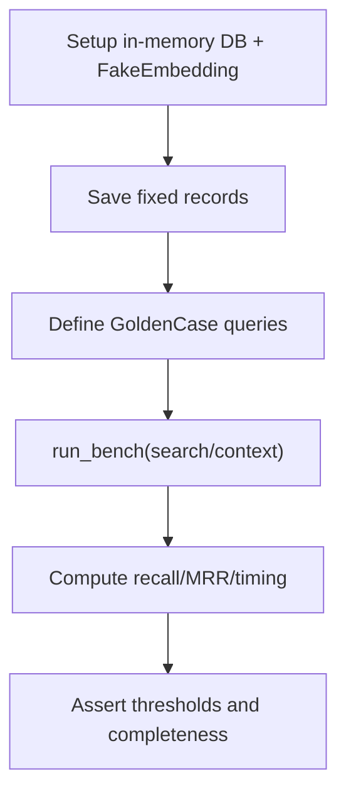

# Testing Framework

<cite>
**Referenced Files in This Document**
- [Cargo.toml](file://Cargo.toml)
- [tests/test_mcp.rs](file://tests/test_mcp.rs)
- [tests/test_memory.rs](file://tests/test_memory.rs)
- [tests/test_graph.rs](file://tests/test_graph.rs)
- [tests/test_db.rs](file://tests/test_db.rs)
- [tests/test_bench.rs](file://tests/test_bench.rs)
- [tests/test_sync.rs](file://tests/test_sync.rs)
- [src/llm/fake.rs](file://src/llm/fake.rs)
- [src/embedding/fake.rs](file://src/embedding/fake.rs)
</cite>

## Table of Contents
1. [Introduction](#introduction)
2. [Project Structure](#project-structure)
3. [Core Components](#core-components)
4. [Architecture Overview](#architecture-overview)
5. [Detailed Component Analysis](#detailed-component-analysis)
6. [Dependency Analysis](#dependency-analysis)
7. [Performance Considerations](#performance-considerations)
8. [Troubleshooting Guide](#troubleshooting-guide)
9. [Conclusion](#conclusion)

## Introduction
This document explains the testing framework and methodology for OB2H, focusing on how tests are organized and executed across unit, integration, and end-to-end scenarios. It covers MCP protocol handlers, memory services, graph operations, database interactions, async code patterns, file system operations, external service integrations (via fakes), test execution, coverage reporting, and performance benchmarking. The guidance is grounded in the repository’s actual test suite and supporting utilities.

## Project Structure
OB2H uses a flat Rust test layout under tests/ with one test file per feature area. Internal modules also include inline unit tests where appropriate. Key characteristics:
- Tests use tokio runtime via #[tokio::test] for async code.
- Temporary directories from tempfile provide isolated environments for DBs and workspace files.
- Deterministic behavior is achieved through FakeEmbedding and FakeLLM.
- Integration tests exercise real components (Database, MemoryService, GraphService, McpServer) against in-memory or temporary storage.

**Diagram sources**
- [tests/test_mcp.rs:1-368](file://tests/test_mcp.rs#L1-L368)
- [tests/test_memory.rs:1-48](file://tests/test_memory.rs#L1-L48)
- [tests/test_graph.rs:1-68](file://tests/test_graph.rs#L1-L68)
- [tests/test_db.rs:1-47](file://tests/test_db.rs#L1-L47)
- [tests/test_bench.rs:1-78](file://tests/test_bench.rs#L1-L78)
- [tests/test_sync.rs:1-334](file://tests/test_sync.rs#L1-L334)
- [src/embedding/fake.rs:1-67](file://src/embedding/fake.rs#L1-L67)
- [src/llm/fake.rs:1-46](file://src/llm/fake.rs#L1-L46)

**Section sources**
- [Cargo.toml:55-57](file://Cargo.toml#L55-L57)
- [tests/test_mcp.rs:1-368](file://tests/test_mcp.rs#L1-L368)
- [tests/test_memory.rs:1-48](file://tests/test_memory.rs#L1-L48)
- [tests/test_graph.rs:1-68](file://tests/test_graph.rs#L1-L68)
- [tests/test_db.rs:1-47](file://tests/test_db.rs#L1-L47)
- [tests/test_bench.rs:1-78](file://tests/test_bench.rs#L1-L78)
- [tests/test_sync.rs:1-334](file://tests/test_sync.rs#L1-L334)

## Core Components
- Test harness and runtime:
  - Tokio runtime is used for async tests via #[tokio::test].
  - tempfile provides isolated temp directories for DBs and workspace artifacts.
- Deterministic fakes:
  - FakeEmbedding generates deterministic vectors based on input text hashing.
  - FakeLLM returns preconfigured responses to simulate LLM calls without network.
- Services under test:
  - MemoryService: CRUD, hybrid search, decay/purge, context building, forget.
  - GraphService: upsert entities/relations, search neighbors, KAG reasoning.
  - Database: schema version checks, FTS5 trigram queries.
  - McpServer: tool dispatch, session ingestion, project scanning status polling.
  - Sync: migrations, roundtrip bundles, LWW conflict resolution, tombstones, idempotent imports, broken bundle handling.

**Section sources**
- [tests/test_memory.rs:1-48](file://tests/test_memory.rs#L1-L48)
- [tests/test_graph.rs:1-68](file://tests/test_graph.rs#L1-L68)
- [tests/test_db.rs:1-47](file://tests/test_db.rs#L1-L47)
- [tests/test_mcp.rs:1-368](file://tests/test_mcp.rs#L1-L368)
- [tests/test_sync.rs:1-334](file://tests/test_sync.rs#L1-L334)
- [src/embedding/fake.rs:1-67](file://src/embedding/fake.rs#L1-L67)
- [src/llm/fake.rs:1-46](file://src/llm/fake.rs#L1-L46)

## Architecture Overview
The test architecture layers isolate concerns:
- Unit tests validate pure logic and small components.
- Integration tests assemble services with in-memory DBs and fakes.
- End-to-end tests drive MCP tools and sync workflows over temporary filesystems.

**Diagram sources**
- [tests/test_mcp.rs:88-270](file://tests/test_mcp.rs#L88-L270)
- [tests/test_memory.rs:1-48](file://tests/test_memory.rs#L1-L48)
- [tests/test_graph.rs:1-68](file://tests/test_graph.rs#L1-L68)
- [tests/test_db.rs:1-47](file://tests/test_db.rs#L1-L47)

## Detailed Component Analysis

### MCP Protocol Handlers
- Contract snapshot: validates the complete list of available tools remains stable across versions.
- Tool dispatch: exercises core tools like memory_save/search, workspace_read/write, session_log, omnes_stats, graph_stats, dream_status, project_init/scan/status/context/report, viewer_open.
- Session ingestion: verifies pair extraction, deduplication by session_id, incremental updates, daily log persistence, and contract validation for empty messages.

**Diagram sources**
- [tests/test_mcp.rs:7-86](file://tests/test_mcp.rs#L7-L86)
- [tests/test_mcp.rs:88-270](file://tests/test_mcp.rs#L88-L270)
- [tests/test_mcp.rs:272-368](file://tests/test_mcp.rs#L272-L368)

**Section sources**
- [tests/test_mcp.rs:7-86](file://tests/test_mcp.rs#L7-L86)
- [tests/test_mcp.rs:88-270](file://tests/test_mcp.rs#L88-L270)
- [tests/test_mcp.rs:272-368](file://tests/test_mcp.rs#L272-L368)

### Memory Service
- CRUD: save records with optional keys, categories, importance, and project scope; retrieve by key.
- Hybrid search: semantic + lexical retrieval; assertions ensure expected hits.
- Decay and purge: reduce importance over time; verify updated values.
- Context building: assemble agent context blocks with relevant memories.
- Forget: soft-delete records and confirm absence.

**Diagram sources**
- [tests/test_memory.rs:1-48](file://tests/test_memory.rs#L1-L48)

**Section sources**
- [tests/test_memory.rs:1-48](file://tests/test_memory.rs#L1-L48)

### Graph Operations
- Upsert extraction: insert/update entities and relations; assert counts for new vs updated.
- Search: neighbor discovery within hop limits; verify node/edge counts.
- Reasoning: KAG-style reasoning using FakeLLM to return structured answers; assert confidence and answer content.

**Diagram sources**
- [tests/test_graph.rs:1-68](file://tests/test_graph.rs#L1-L68)

**Section sources**
- [tests/test_graph.rs:1-68](file://tests/test_graph.rs#L1-L68)

### Database Interactions
- Initialization and schema version: ensures correct migration state.
- FTS5 trigram tokenization: validates Russian-language search indexing and matching.

**Diagram sources**
- [tests/test_db.rs:1-47](file://tests/test_db.rs#L1-L47)

**Section sources**
- [tests/test_db.rs:1-47](file://tests/test_db.rs#L1-L47)

### Synchronization and File System Operations
- Migration M2: validates column additions, backfilling, backup creation, and downgrade-safe inserts.
- Roundtrip: export/import bundles between two contexts; verify applied stats and data availability including vector search.
- LWW conflict resolution: newer timestamp wins; tie-break by origin priority.
- Tombstone replication: forget propagates deletion; re-save revives record.
- Idempotent import: repeated import is no-op.
- Broken bundle handling: errors do not mutate DB; status remains consistent.

**Diagram sources**
- [tests/test_sync.rs:48-134](file://tests/test_sync.rs#L48-L134)
- [tests/test_sync.rs:136-198](file://tests/test_sync.rs#L136-L198)
- [tests/test_sync.rs:200-236](file://tests/test_sync.rs#L200-L236)
- [tests/test_sync.rs:238-278](file://tests/test_sync.rs#L238-L278)
- [tests/test_sync.rs:280-296](file://tests/test_sync.rs#L280-L296)
- [tests/test_sync.rs:298-325](file://tests/test_sync.rs#L298-L325)

**Section sources**
- [tests/test_sync.rs:48-134](file://tests/test_sync.rs#L48-L134)
- [tests/test_sync.rs:136-198](file://tests/test_sync.rs#L136-L198)
- [tests/test_sync.rs:200-236](file://tests/test_sync.rs#L200-L236)
- [tests/test_sync.rs:238-278](file://tests/test_sync.rs#L238-L278)
- [tests/test_sync.rs:280-296](file://tests/test_sync.rs#L280-L296)
- [tests/test_sync.rs:298-325](file://tests/test_sync.rs#L298-L325)

### Testing Utilities and Mock Implementations
- FakeEmbedding:
  - Deterministic vector generation based on SHA-256 of input text; normalized outputs.
  - Useful for reproducible semantic search and vector indexing tests.
- FakeLLM:
  - Configurable default or trigger-based responses.
  - Enables testing reasoning flows without external LLM dependencies.

**Diagram sources**
- [src/embedding/fake.rs:1-67](file://src/embedding/fake.rs#L1-L67)
- [src/llm/fake.rs:1-46](file://src/llm/fake.rs#L1-L46)

**Section sources**
- [src/embedding/fake.rs:1-67](file://src/embedding/fake.rs#L1-L67)
- [src/llm/fake.rs:1-46](file://src/llm/fake.rs#L1-L46)

### Writing Effective Tests
- MCP protocol handlers:
  - Validate tool contracts and dispatch paths.
  - Use tempdir for isolated app initialization and workspace files.
  - For background jobs (e.g., project_scan), poll status endpoints with short sleeps until completion.
- Memory services:
  - Compose save/get/search/decay/build_context/forget sequences.
  - Verify both exact matches and fuzzy/hybrid results.
- Graph operations:
  - Build minimal entity/relation sets; assert upsert counts and neighbor search results.
  - Inject FakeLLM with structured JSON responses to validate reasoning outputs.
- Database interactions:
  - Open in-memory DB; assert schema version and FTS5 behavior for non-English text.
- Async code:
  - Use #[tokio::test]; avoid blocking waits; prefer polling with bounded retries for background tasks.
- File system operations:
  - Isolate all writes under tempdir; assert presence/absence of files and directories.
- External service integrations:
  - Replace with FakeEmbedding/FakeLLM to eliminate network and model loading.

**Section sources**
- [tests/test_mcp.rs:88-270](file://tests/test_mcp.rs#L88-L270)
- [tests/test_memory.rs:1-48](file://tests/test_memory.rs#L1-L48)
- [tests/test_graph.rs:1-68](file://tests/test_graph.rs#L1-L68)
- [tests/test_db.rs:1-47](file://tests/test_db.rs#L1-L47)
- [tests/test_sync.rs:136-198](file://tests/test_sync.rs#L136-L198)

## Dependency Analysis
Tests depend on:
- Runtime: tokio for async execution.
- Storage: rusqlite-backed Database abstraction.
- Embeddings: FakeEmbedding for deterministic vectors.
- LLM: FakeLLM for controlled reasoning responses.
- Filesystem: tempfile for isolation.

**Diagram sources**
- [Cargo.toml:8-10](file://Cargo.toml#L8-L10)
- [Cargo.toml:55-57](file://Cargo.toml#L55-L57)
- [tests/test_mcp.rs:1-368](file://tests/test_mcp.rs#L1-L368)
- [tests/test_memory.rs:1-48](file://tests/test_memory.rs#L1-L48)
- [tests/test_graph.rs:1-68](file://tests/test_graph.rs#L1-L68)
- [tests/test_sync.rs:1-334](file://tests/test_sync.rs#L1-L334)

**Section sources**
- [Cargo.toml:8-10](file://Cargo.toml#L8-L10)
- [Cargo.toml:55-57](file://Cargo.toml#L55-L57)

## Performance Considerations
- Benchmarking:
  - Fixed-vector benchmarks run against MemoryService using FakeEmbedding to avoid network and model loading.
  - Metrics include recall@k, MRR, timing percentiles, missing keys, and empty case counts.
- Best practices:
  - Keep datasets small and deterministic for fast CI runs.
  - Use in-memory DBs and tempdirs to minimize I/O variance.
  - Avoid heavy embedding models in benchmarks; rely on FakeEmbedding.

**Diagram sources**
- [tests/test_bench.rs:1-78](file://tests/test_bench.rs#L1-L78)

**Section sources**
- [tests/test_bench.rs:1-78](file://tests/test_bench.rs#L1-L78)

## Troubleshooting Guide
- MCP tool dispatch failures:
  - Ensure init_app is called with a tempdir and Settings configured.
  - For GUI-related tools (viewer_open), handle cfg(feature = "gui") branches and lockfile conditions.
- Background job timeouts:
  - Poll status endpoints with bounded retries and short sleeps; assert final “done” state.
- Vector search nondeterminism:
  - FakeEmbedding guarantees determinism; if switching providers, adjust expectations accordingly.
- Sync conflicts:
  - Verify timestamps and origin priorities; check tombstone propagation and revival semantics.
- Broken bundles:
  - Import should fail without mutating DB; inspect status output for consistency.

**Section sources**
- [tests/test_mcp.rs:247-269](file://tests/test_mcp.rs#L247-L269)
- [tests/test_mcp.rs:176-210](file://tests/test_mcp.rs#L176-L210)
- [tests/test_sync.rs:298-325](file://tests/test_sync.rs#L298-L325)

## Conclusion
OB2H’s test suite combines focused unit tests, robust integration tests, and end-to-end scenarios that cover MCP tooling, memory and graph services, database behaviors, and synchronization workflows. Deterministic fakes and isolated filesystems enable reliable, fast, and maintainable tests. The provided patterns and diagrams serve as a guide for writing effective tests aligned with OB2H’s architecture and domain concepts.