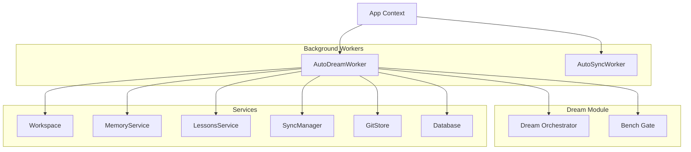
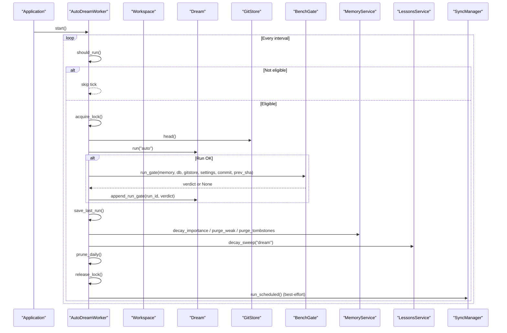
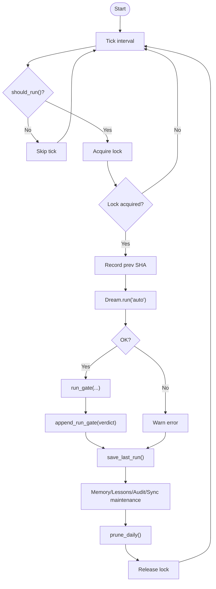
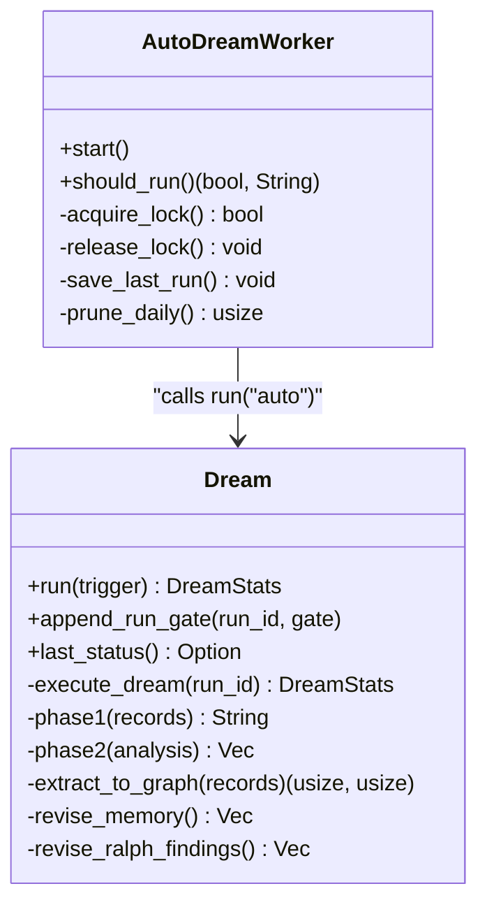
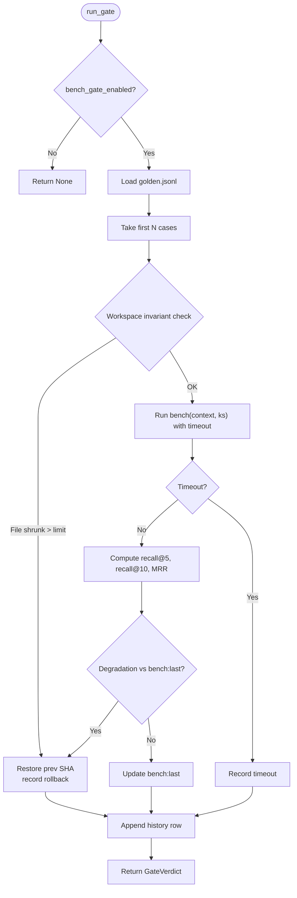
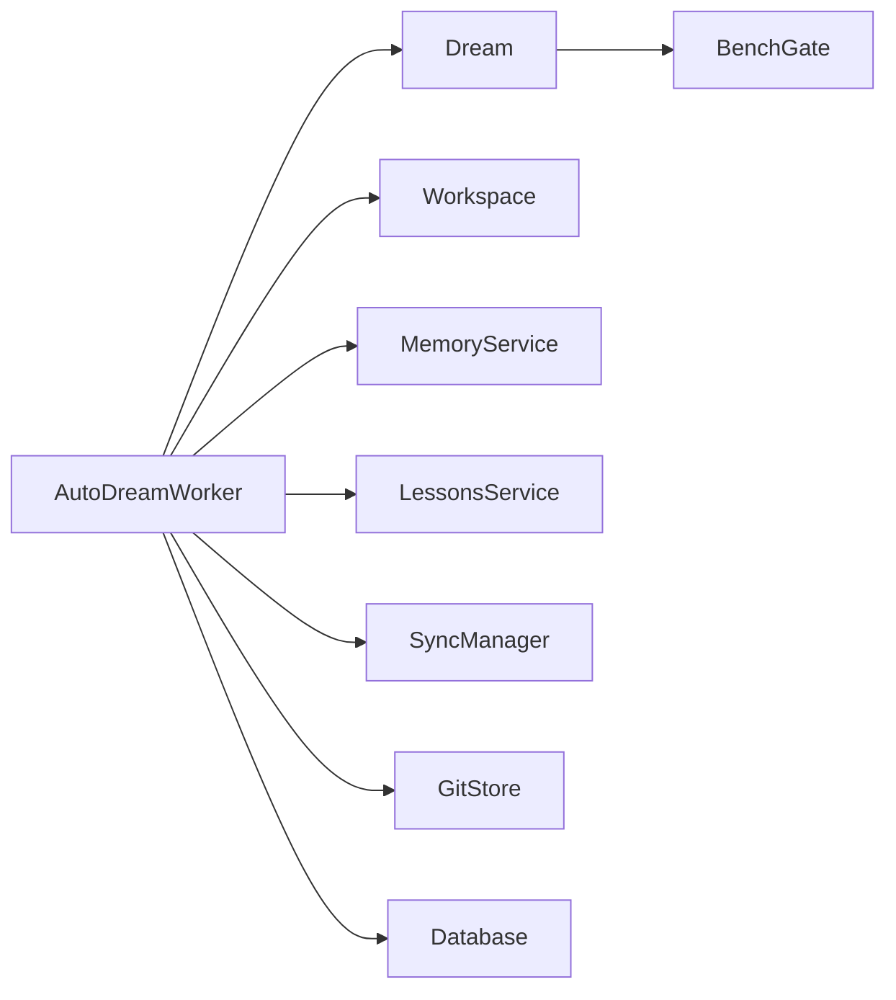

# AutoDream System

<cite>
**Referenced Files in This Document**
- [autodream.rs](file://src/dream/autodream.rs)
- [dream_mod.rs](file://src/dream/mod.rs)
- [bench_gate.rs](file://src/dream/bench_gate.rs)
- [config.rs](file://src/config.rs)
- [lib.rs](file://src/lib.rs)
- [workspace_mod.rs](file://src/workspace/mod.rs)
</cite>

## Table of Contents
1. [Introduction](#introduction)
2. [Project Structure](#project-structure)
3. [Core Components](#core-components)
4. [Architecture Overview](#architecture-overview)
5. [Detailed Component Analysis](#detailed-component-analysis)
6. [Dependency Analysis](#dependency-analysis)
7. [Performance Considerations](#performance-considerations)
8. [Troubleshooting Guide](#troubleshooting-guide)
9. [Conclusion](#conclusion)

## Introduction
AutoDream is the automated background processing subsystem that monitors system idle periods and triggers dream processing automatically. It runs a long-lived worker that periodically checks whether enough new activity has occurred, safely acquires an exclusive lock, executes a Dream run, performs post-run maintenance (memory decay/purge, lessons decay, audit pruning, optional slot reflection), and optionally synchronizes with peers. AutoDream integrates tightly with the main application context, coordinates with the core Dream orchestrator, and can trigger a nightly benchmark gate to detect regressions and roll back workspace changes when needed.

## Project Structure
AutoDream lives under the dream module and is launched by the application’s background worker initializer. The key files are:
- AutoDreamWorker implementation and scheduling logic
- Core Dream orchestrator and run lifecycle
- Benchmark gate for regression detection
- Configuration fields and environment variables
- Application integration point
- Workspace utilities used for event counting and history reading

**Diagram sources**
- [lib.rs:137-160](file://src/lib.rs#L137-L160)
- [autodream.rs:20-59](file://src/dream/autodream.rs#L20-L59)
- [dream_mod.rs:110-143](file://src/dream/mod.rs#L110-L143)
- [bench_gate.rs:160-170](file://src/dream/bench_gate.rs#L160-L170)

**Section sources**
- [lib.rs:137-160](file://src/lib.rs#L137-L160)
- [autodream.rs:1-59](file://src/dream/autodream.rs#L1-L59)
- [dream_mod.rs:1-22](file://src/dream/mod.rs#L1-L22)

## Core Components
- AutoDreamWorker: Long-running Tokio task that schedules dream runs based on configured intervals and event thresholds. It manages file-based locking, last-run state, daily log pruning, memory maintenance, lessons decay, audit pruning, optional slot reflection, and post-dream sync.
- Dream Orchestrator: Executes a multi-phase dream pipeline (analysis, edits, graph extraction, memory revision, consolidation, Ralph findings revision), persists run metadata, and commits workspace changes.
- Bench Gate: Optional regression detector that runs a quick benchmark after successful dream runs and can roll back workspace changes if metrics degrade beyond thresholds.
- Configuration: Environment-driven settings controlling AutoDream enablement, interval, minimum hours between runs, minimum events, batch size, feature toggles, and bench gate behavior.
- Workspace Integration: Provides daily directory scanning for event counts, history cursor management, and file operations used by both AutoDream and Dream.

**Section sources**
- [autodream.rs:20-59](file://src/dream/autodream.rs#L20-L59)
- [dream_mod.rs:110-143](file://src/dream/mod.rs#L110-L143)
- [bench_gate.rs:40-57](file://src/dream/bench_gate.rs#L40-L57)
- [config.rs:36-58](file://src/config.rs#L36-L58)
- [workspace_mod.rs:29-52](file://src/workspace/mod.rs#L29-L52)

## Architecture Overview
AutoDreamWorker starts as a Tokio task when enabled. On each tick:
1. Check should_run using last-run timestamp and daily event count.
2. Acquire a file-based lock (with stale-lock handling).
3. Record previous Git HEAD.
4. Execute Dream.run("auto").
5. If successful, run bench gate and append verdict to the run stats.
6. Persist last-run timestamp.
7. Perform scheduled maintenance: memory decay/purge/tombstone cleanup, lessons decay sweep, weekly audit pruning, optional slot reflection.
8. Prune daily logs older than retention.
9. Release lock.
10. Optionally run peer sync (best-effort).

**Diagram sources**
- [autodream.rs:61-145](file://src/dream/autodream.rs#L61-L145)
- [dream_mod.rs:145-181](file://src/dream/mod.rs#L145-L181)
- [bench_gate.rs:160-170](file://src/dream/bench_gate.rs#L160-L170)

## Detailed Component Analysis

### AutoDreamWorker Lifecycle and Scheduling
- Initialization: Accepts Arc references to Dream, Workspace, MemoryService, LessonsService, Settings, optional SyncManager, GitStore, and Database. Creates a running flag for internal use.
- Start: Spawns a Tokio task. Computes interval from settings (minimum 60 seconds). Ticks at that interval.
- Eligibility: should_run checks:
  - Minimum elapsed time since last run (hours).
  - Minimum number of new daily events since last run.
- Locking: Uses a file lock with staleness detection; reclaims stale locks after a threshold.
- Execution: Records previous Git HEAD, calls Dream.run("auto"), handles success/error, appends bench gate result if applicable.
- Maintenance: Performs memory decay/purge/tombstone cleanup, lessons decay sweep, weekly audit pruning, optional slot reflection controlled by environment variable, and daily log pruning.
- Post-run: Releases lock and attempts peer sync (best-effort).

**Diagram sources**
- [autodream.rs:61-145](file://src/dream/autodream.rs#L61-L145)
- [autodream.rs:169-247](file://src/dream/autodream.rs#L169-L247)

**Section sources**
- [autodream.rs:20-59](file://src/dream/autodream.rs#L20-L59)
- [autodream.rs:61-145](file://src/dream/autodream.rs#L61-L145)
- [autodream.rs:169-247](file://src/dream/autodream.rs#L169-L247)
- [autodream.rs:249-271](file://src/dream/autodream.rs#L249-L271)

### Dream Orchestrator Integration
- Dream.run creates a database record for the run, executes execute_dream, and finishes with status and stats.
- execute_dream reads new history entries via workspace cursor, performs phases:
  - Phase 1: LLM analysis of recent history against current memory files.
  - Phase 2: Iterative agent loop applying minimal edits to memory files.
  - Graph extraction: Extract session facts into the graph service (optional).
  - Memory revision: Trust-based review of low-trust records (optional).
  - Consolidation: Offline consolidation decisions (optional).
  - Ralph findings revision: Re-evaluate stale findings (optional).
  - Updates dream cursor, compacts history, auto-commits workspace changes.
- last_status provides the latest run metadata for monitoring.

**Diagram sources**
- [dream_mod.rs:145-288](file://src/dream/mod.rs#L145-L288)
- [dream_mod.rs:290-395](file://src/dream/mod.rs#L290-L395)
- [dream_mod.rs:397-543](file://src/dream/mod.rs#L397-L543)
- [dream_mod.rs:545-646](file://src/dream/mod.rs#L545-L646)
- [autodream.rs:61-145](file://src/dream/autodream.rs#L61-L145)

**Section sources**
- [dream_mod.rs:145-288](file://src/dream/mod.rs#L145-L288)
- [dream_mod.rs:290-395](file://src/dream/mod.rs#L290-L395)
- [dream_mod.rs:397-543](file://src/dream/mod.rs#L397-L543)
- [dream_mod.rs:545-646](file://src/dream/mod.rs#L545-L646)

### Bench Gate (Regression Detection)
- Triggered only when Dream.run returns ok.
- Reads a golden set of cases and runs a quick benchmark within a timeout budget.
- Compares recall@5 and MRR against bench:last stored in kv.
- If degradation exceeds thresholds, restores workspace to previous commit and records alert.
- Writes results to history and updates bench:last on pass/first_run.

**Diagram sources**
- [bench_gate.rs:160-332](file://src/dream/bench_gate.rs#L160-L332)
- [bench_gate.rs:334-365](file://src/dream/bench_gate.rs#L334-L365)

**Section sources**
- [bench_gate.rs:1-39](file://src/dream/bench_gate.rs#L1-L39)
- [bench_gate.rs:160-332](file://src/dream/bench_gate.rs#L160-L332)

### Configuration and Environment Variables
Key AutoDream-related configuration options:
- OB2H_AUTODREAM_ENABLED: Enable/disable AutoDream (default true).
- OB2H_AUTODREAM_INTERVAL_MIN: Interval between ticks in minutes (default 5).
- OB2H_AUTODREAM_MIN_INTERVAL_H: Minimum hours between runs (default 4).
- OB2H_AUTODREAM_MIN_EVENTS: Minimum daily events to trigger a run (default 10).
- OB2H_DREAM_BATCH: Number of history records per dream run (default 20).
- OB2H_DREAM_EXTRACT_ENABLED: Enable graph extraction during dream (default true).
- OB2H_DREAM_MEMORY_REVISION: Enable memory trust revision (default true).
- OB2H_DREAM_BELIEF: Create causes edges between memory records (default false).
- OB2H_DREAM_RALPH: Enable Ralph findings revision (default true).
- OB2H_BENCH_GATE: Enable bench gate (default false).
- OB2H_BENCH_GATE_TIMEOUT_MS: Bench gate timeout in milliseconds (default 3000).

These values are parsed in Settings::from_env and exposed through Settings fields consumed by AutoDreamWorker and Dream.

**Section sources**
- [config.rs:36-58](file://src/config.rs#L36-L58)
- [config.rs:225-273](file://src/config.rs#L225-L273)
- [config.rs:365-414](file://src/config.rs#L365-L414)

### Application Integration
- Background workers are started via start_background_workers(ctx), which constructs AutoDreamWorker with the full AppContext (Dream, Workspace, MemoryService, LessonsService, Settings, SyncManager, GitStore, Database) and invokes worker.start().
- AutoSyncWorker is also started conditionally based on autosync settings.

**Section sources**
- [lib.rs:137-160](file://src/lib.rs#L137-L160)

### Event Counting and Daily Logs
- AutoDreamWorker counts daily events by scanning daily/*.jsonl files and parsing timestamps to compare against last_run ISO string.
- Workspace provides daily_dir(), log_daily_session(), archive_old_logs(), and history cursor methods used by Dream and AutoDream.

**Section sources**
- [autodream.rs:194-224](file://src/dream/autodream.rs#L194-L224)
- [workspace_mod.rs:50-52](file://src/workspace/mod.rs#L50-L52)
- [workspace_mod.rs:81-105](file://src/workspace/mod.rs#L81-L105)
- [workspace_mod.rs:107-171](file://src/workspace/mod.rs#L107-L171)
- [workspace_mod.rs:173-200](file://src/workspace/mod.rs#L173-L200)

## Dependency Analysis
AutoDreamWorker depends on multiple services:
- Dream orchestrator for executing dream runs.
- Workspace for daily event scanning and history access.
- MemoryService for decay/purge operations.
- LessonsService for weekly decay sweep.
- SyncManager for best-effort peer synchronization.
- GitStore for recording HEAD and potential rollback.
- Database for persisting last-run state and appending bench gate results.

**Diagram sources**
- [autodream.rs:20-59](file://src/dream/autodream.rs#L20-L59)
- [dream_mod.rs:110-143](file://src/dream/mod.rs#L110-L143)
- [bench_gate.rs:160-170](file://src/dream/bench_gate.rs#L160-L170)

**Section sources**
- [autodream.rs:20-59](file://src/dream/autodream.rs#L20-L59)
- [dream_mod.rs:110-143](file://src/dream/mod.rs#L110-L143)

## Performance Considerations
- Interval tuning: Ensure autodream_interval_min balances responsiveness with resource usage; minimum enforced to 60 seconds.
- Event threshold: Set autodream_min_events appropriately to avoid frequent runs on low-activity systems.
- Batch size: Adjust dream_batch to control how many history records are processed per run.
- Bench gate timeout: Tune bench_gate_timeout_ms to fit your environment; timeouts do not trigger rollback.
- Retention policies: Configure retention_days and log_retention_days to manage disk usage for daily logs and archives.
- Feature toggles: Disable heavy features like dream_extract_enabled, dream_memory_revision, dream_belief, and dream_ralph_revision if resources are constrained.

[No sources needed since this section provides general guidance]

## Troubleshooting Guide
Common issues and resolutions:
- AutoDream not starting:
  - Verify OB2H_AUTODREAM_ENABLED is not disabled.
  - Confirm start_background_workers is invoked during application startup.
- Runs not triggering:
  - Check last-run timestamp and ensure minimum hours have passed.
  - Ensure sufficient daily events exist (OB2H_AUTODREAM_MIN_EVENTS).
- Stale lock preventing runs:
  - Delete autodream.lock if process crashed; AutoDreamWorker will reclaim stale locks after threshold.
- Frequent skips due to low events:
  - Increase autodream_min_events threshold or verify daily logging is active.
- Bench gate rollback:
  - Inspect bench history and alerts; ensure golden.jsonl exists and contains valid cases.
  - Review workspace integrity; large deletions in tracked files can trigger rollback even before benchmark.
- Memory/Lessons maintenance failures:
  - Check permissions and disk space for data directories.
  - Review logs for warnings from decay/purge operations.

**Section sources**
- [autodream.rs:61-145](file://src/dream/autodream.rs#L61-L145)
- [autodream.rs:169-247](file://src/dream/autodream.rs#L169-L247)
- [bench_gate.rs:160-332](file://src/dream/bench_gate.rs#L160-L332)

## Conclusion
AutoDream provides robust automated background processing for dream workflows. It intelligently schedules runs based on idle periods and event thresholds, ensures safe execution with file-based locking, and integrates deeply with the Dream orchestrator, memory services, lessons, and sync components. The optional bench gate adds a safety net by detecting regressions and rolling back workspace changes when necessary. Proper configuration of environment variables allows fine-tuning behavior for different environments and workloads. Monitoring last-run state, daily events, and bench gate history helps maintain reliable operation and quickly diagnose issues.

[No sources needed since this section summarizes without analyzing specific files]