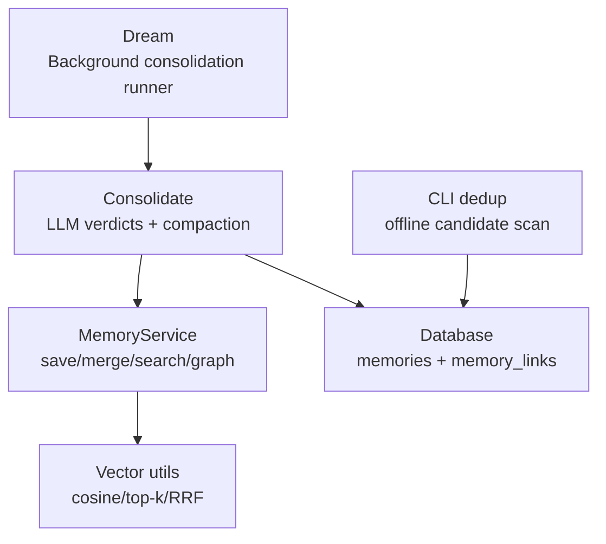
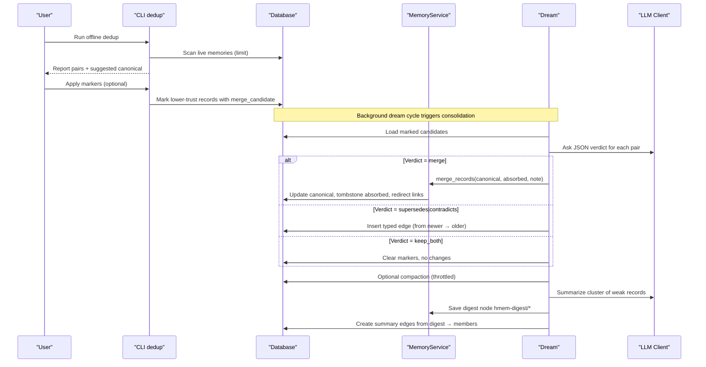
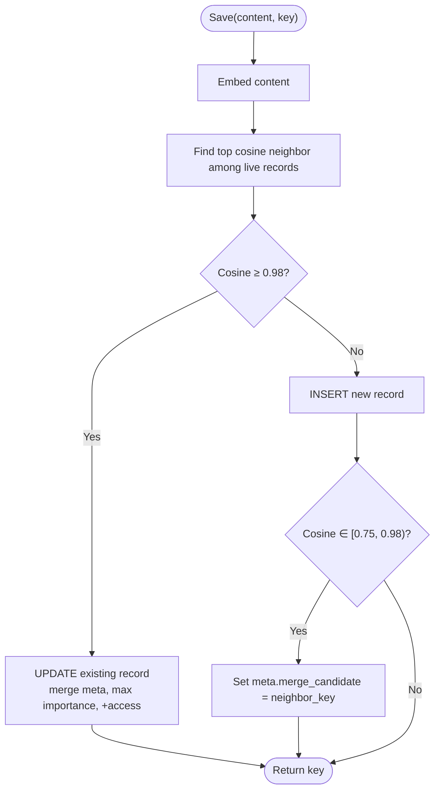
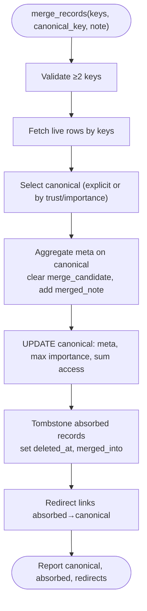
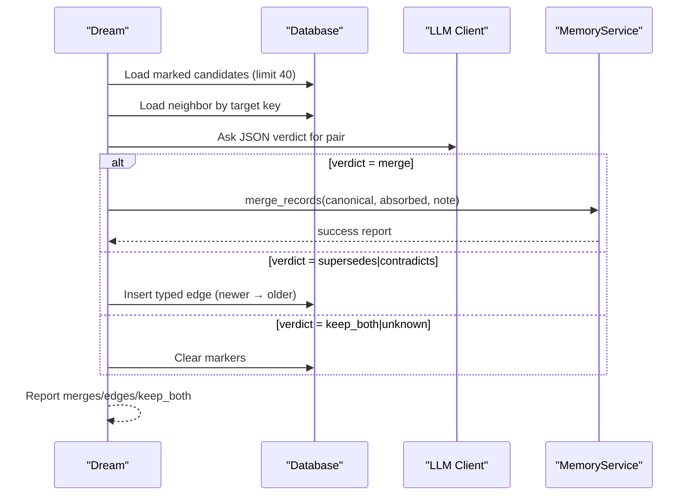
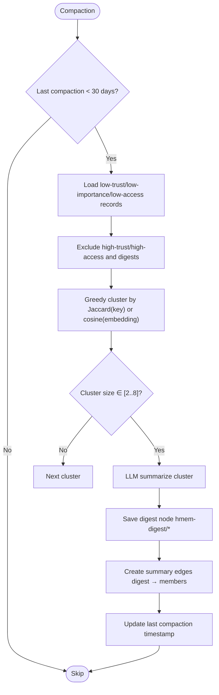
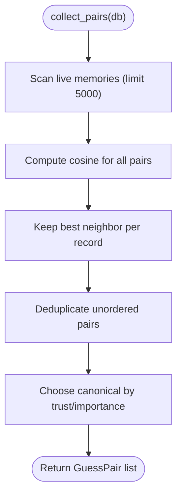
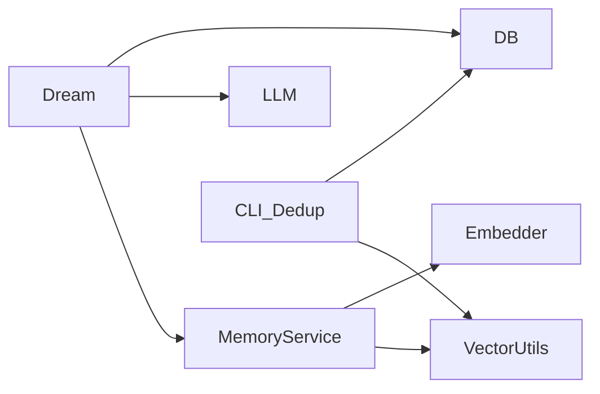

# Consolidation Engine

<cite>
**Referenced Files in This Document**
- [consolidate.rs](file://src/dream/consolidate.rs)
- [mod.rs (Dream)](file://src/dream/mod.rs)
- [service.rs (MemoryService)](file://src/memory/service.rs)
- [dedup.rs](file://src/cli/dedup.rs)
- [test_consolidation.rs](file://tests/test_consolidation.rs)
- [mod.rs (vector)](file://src/vector/mod.rs)
</cite>

## Table of Contents
1. [Introduction](#introduction)
2. [Project Structure](#project-structure)
3. [Core Components](#core-components)
4. [Architecture Overview](#architecture-overview)
5. [Detailed Component Analysis](#detailed-component-analysis)
6. [Dependency Analysis](#dependency-analysis)
7. [Performance Considerations](#performance-considerations)
8. [Troubleshooting Guide](#troubleshooting-guide)
9. [Conclusion](#conclusion)

## Introduction
This document explains the consolidation engine that keeps personal memory compact, semantically coherent, and query-friendly. It covers:
- Offline consolidation algorithms that analyze memory entries for merging opportunities, duplicate detection, and structural optimization.
- The LLM-powered verdict system that evaluates merge candidates and decides whether to merge, keep both, or record contradictions/supersession.
- Compaction that reorganizes low-value memories into summary nodes while preserving semantic relationships.
- Integration with vector search and how consolidation affects query performance and accuracy.
- Concrete rules, metrics, and before/after states validated by tests.

## Project Structure
The consolidation engine spans several modules:
- Dream orchestrates offline consolidation runs during background “dream” cycles.
- MemoryService implements save-time duplicate pre-checks, explicit merges, typed edges, and hybrid search.
- CLI dedup provides an offline scanner and marker tooling.
- Vector utilities provide cosine similarity, serialization, and top-k helpers used across components.

**Diagram sources**
- [mod.rs (Dream):145-288](file://src/dream/mod.rs#L145-L288)
- [consolidate.rs:68-85](file://src/dream/consolidate.rs#L68-L85)
- [service.rs:49-167](file://src/memory/service.rs#L49-L167)
- [dedup.rs:44-135](file://src/cli/dedup.rs#L44-L135)
- [mod.rs (vector):1-9](file://src/vector/mod.rs#L1-L9)

**Section sources**
- [mod.rs (Dream):145-288](file://src/dream/mod.rs#L145-L288)
- [consolidate.rs:68-85](file://src/dream/consolidate.rs#L68-L85)
- [service.rs:49-167](file://src/memory/service.rs#L49-L167)
- [dedup.rs:44-135](file://src/cli/dedup.rs#L44-L135)
- [mod.rs (vector):1-9](file://src/vector/mod.rs#L1-L9)

## Core Components
- Save-time duplicate pre-check:
  - Computes cosine similarity against existing live records.
  - Identity duplicates (cos ≥ 0.98) silently update the existing record.
  - Suspect duplicates (cos ∈ [0.75, 0.98)) mark the new record with `meta.merge_candidate` pointing to the neighbor.
- Explicit merge engine:
  - Merges multiple keys into a canonical record.
  - Aggregates metadata, importance, and access counts; tombstones absorbed records with `merged_into`.
  - Redirects links from absorbed to canonical; tombstoned edges are preserved as soft-deleted.
- LLM-powered verdict system:
  - Processes pairs marked as merge candidates.
  - Returns one of: merge, keep_both, supersedes, contradicts.
  - For merge: delegates to MemoryService merge_records.
  - For supersedes/contradicts: inserts typed edges between records.
- Compaction:
  - Clusters low-trust, low-importance, low-access records using Jaccard on key tokens and cosine on embeddings.
  - Generates LLM summaries stored as `hmem-digest/*` nodes linked via `kind=summary`.
  - Throttled to once per 30 days; originals remain untouched.

**Section sources**
- [service.rs:17-22](file://src/memory/service.rs#L17-L22)
- [service.rs:86-167](file://src/memory/service.rs#L86-L167)
- [service.rs:218-383](file://src/memory/service.rs#L218-L383)
- [consolidate.rs:40-46](file://src/dream/consolidate.rs#L40-L46)
- [consolidate.rs:89-190](file://src/dream/consolidate.rs#L89-L190)
- [consolidate.rs:252-336](file://src/dream/consolidate.rs#L252-L336)
- [dedup.rs:16-21](file://src/cli/dedup.rs#L16-L21)

## Architecture Overview
The consolidation pipeline integrates Dream, MemoryService, and CLI tools around a shared database schema for memories and typed links.

**Diagram sources**
- [dedup.rs:44-176](file://src/cli/dedup.rs#L44-L176)
- [consolidate.rs:89-190](file://src/dream/consolidate.rs#L89-L190)
- [service.rs:218-383](file://src/memory/service.rs#L218-L383)
- [consolidate.rs:252-336](file://src/dream/consolidate.rs#L252-L336)

## Detailed Component Analysis

### Save-Time Duplicate Pre-Check and Merge Candidate Marking
- Thresholds:
  - Identity duplicate threshold: cosine ≥ 0.98 → silent UPDATE of existing record.
  - Suspect duplicate range: cosine ∈ [0.75, 0.98) → mark new record with `meta.merge_candidate`.
- Behavior:
  - On identity match, updates content, merges meta objects, takes max importance, increments access count, and returns the existing key.
  - On suspect match, inserts a new record and sets `meta.merge_candidate` to the neighbor’s key for later LLM review.

**Diagram sources**
- [service.rs:86-167](file://src/memory/service.rs#L86-L167)

**Section sources**
- [service.rs:17-22](file://src/memory/service.rs#L17-L22)
- [service.rs:86-167](file://src/memory/service.rs#L86-L167)

### Explicit Merge Engine (MemoryService::merge_records)
- Canonical selection:
  - If provided, uses the specified canonical key.
  - Otherwise selects the record with highest trust, then highest importance.
- Metadata aggregation:
  - Canonical gets union of meta fields; clears `merge_candidate`; stores merged note if provided.
  - Absorbed records get `merged_into` and optional merged note; tombstoned via `deleted_at`.
- Link redirection:
  - All live edges involving absorbed records are redirected to canonical.
  - Tombstoned edges are preserved as soft-deleted (M7).

**Diagram sources**
- [service.rs:218-383](file://src/memory/service.rs#L218-L383)

**Section sources**
- [service.rs:218-383](file://src/memory/service.rs#L218-L383)

### LLM-Powered Verdict System (Dream Consolidation)
- Candidate loading:
  - Loads up to 40 records with `meta.merge_candidate`, ordered by id.
  - Pairs each candidate with its target neighbor; deduplicates unordered pairs.
- Verdict prompt:
  - Sends two records with keys, trust, and content to LLM.
  - Expects strict JSON with fields: verdict, canonical_key (for merge), note.
- Actions:
  - merge: delegates to MemoryService::merge_records; reports canonical and absorbed.
  - supersedes/contradicts: inserts typed edge from newer to older; clears markers.
  - keep_both or unrecognized: clears markers; reports kept pairs.

**Diagram sources**
- [consolidate.rs:89-190](file://src/dream/consolidate.rs#L89-L190)

**Section sources**
- [consolidate.rs:89-190](file://src/dream/consolidate.rs#L89-L190)

### Compaction (Summary Nodes)
- Eligibility:
  - Low trust (< 0.35), low importance (< 0.35), low access (< 20), not high-trust/high-access exclusions.
  - Excludes existing digest nodes (`hmem-digest/%`).
- Clustering:
  - Greedy clustering using Jaccard on key tokens (≥ 0.5) OR cosine on embeddings (≥ 0.75).
  - Cluster size capped at 8.
- Digest creation:
  - LLM generates a concise 2–4 sentence summary preserving specifics.
  - Saves as `hmem-digest/<date>` with sequence suffix if needed.
  - Creates `kind=summary` edges from digest to members.
- Throttling:
  - Runs at most once every 30 days.

**Diagram sources**
- [consolidate.rs:252-336](file://src/dream/consolidate.rs#L252-L336)

**Section sources**
- [consolidate.rs:252-336](file://src/dream/consolidate.rs#L252-L336)

### CLI Dedup Tool
- Scans up to 5000 live records.
- Computes pairwise cosine similarities; identifies identity duplicates (≥ 0.98) and suspects (≥ 0.75).
- Suggests canonical key based on higher trust, then importance.
- Applies markers to less-trusted records unless dry-run.

**Diagram sources**
- [dedup.rs:44-135](file://src/cli/dedup.rs#L44-L135)

**Section sources**
- [dedup.rs:44-176](file://src/cli/dedup.rs#L44-L176)

## Dependency Analysis
- Dream depends on:
  - Database for reading/writing memories and links.
  - LLM client for verdicts and digest generation.
  - MemoryService for explicit merges and typed edges.
- MemoryService depends on:
  - Embedding provider for vectorization.
  - Vector utilities for cosine, serialization, and top-k.
  - Database for persistence and link management.
- CLI dedup depends on:
  - Database for scanning and marking.
  - Vector utilities for cosine computation.

**Diagram sources**
- [mod.rs (Dream):145-288](file://src/dream/mod.rs#L145-L288)
- [service.rs:49-167](file://src/memory/service.rs#L49-L167)
- [dedup.rs:44-135](file://src/cli/dedup.rs#L44-L135)
- [mod.rs (vector):1-9](file://src/vector/mod.rs#L1-L9)

**Section sources**
- [mod.rs (Dream):145-288](file://src/dream/mod.rs#L145-L288)
- [service.rs:49-167](file://src/memory/service.rs#L49-L167)
- [dedup.rs:44-135](file://src/cli/dedup.rs#L44-L135)
- [mod.rs (vector):1-9](file://src/vector/mod.rs#L1-L9)

## Performance Considerations
- Save-time pre-check:
  - O(N) scan of live records to find top cosine neighbor; thresholds avoid LLM calls.
  - Identity duplicates avoid extra storage and reduce query load.
- Merge operations:
  - Single transactional updates for canonical and absorbed records.
  - Link redirection avoids stale references; tombstoned edges preserved for auditability.
- Compaction:
  - Greedy clustering is O(C^2) within clusters; capped at 8 members.
  - Throttled to 30-day intervals prevents frequent LLM usage.
- Vector search integration:
  - Hybrid search combines FTS5 and vector results via RRF.
  - Consolidation reduces noise and improves precision by removing duplicates and adding structured summaries.

[No sources needed since this section provides general guidance]

## Troubleshooting Guide
- LLM verdict failures:
  - If LLM call fails, markers remain for next dream cycle; warnings logged.
- Missing neighbors:
  - If target neighbor is tombstoned or forgotten, marker is cleared.
- Idempotency:
  - Typed edges use INSERT OR IGNORE to prevent duplicates on reruns.
- Merge errors:
  - Requires at least two keys; missing or tombstoned records cause errors.
- Compaction throttling:
  - Repeated runs within 30 days skip compaction; check last compaction timestamp.

**Section sources**
- [consolidate.rs:125-136](file://src/dream/consolidate.rs#L125-L136)
- [consolidate.rs:192-213](file://src/dream/consolidate.rs#L192-L213)
- [consolidate.rs:219-231](file://src/dream/consolidate.rs#L219-L231)
- [service.rs:224-226](file://src/memory/service.rs#L224-L226)
- [consolidate.rs:252-261](file://src/dream/consolidate.rs#L252-L261)

## Conclusion
The consolidation engine provides a robust, multi-layered approach to memory maintenance:
- Fast, deterministic save-time checks prevent redundant storage.
- LLM-driven verdicts ensure human-aligned decisions for merges and relationships.
- Compaction organizes low-value memories into digest nodes without losing original data.
- Tight integration with vector search enhances query relevance and performance.
- Comprehensive tests validate behavior across identity duplicates, suspect pairs, merges, typed edges, and compaction.

[No sources needed since this section summarizes without analyzing specific files]