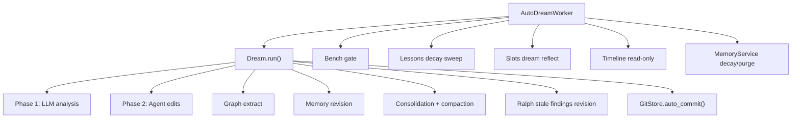
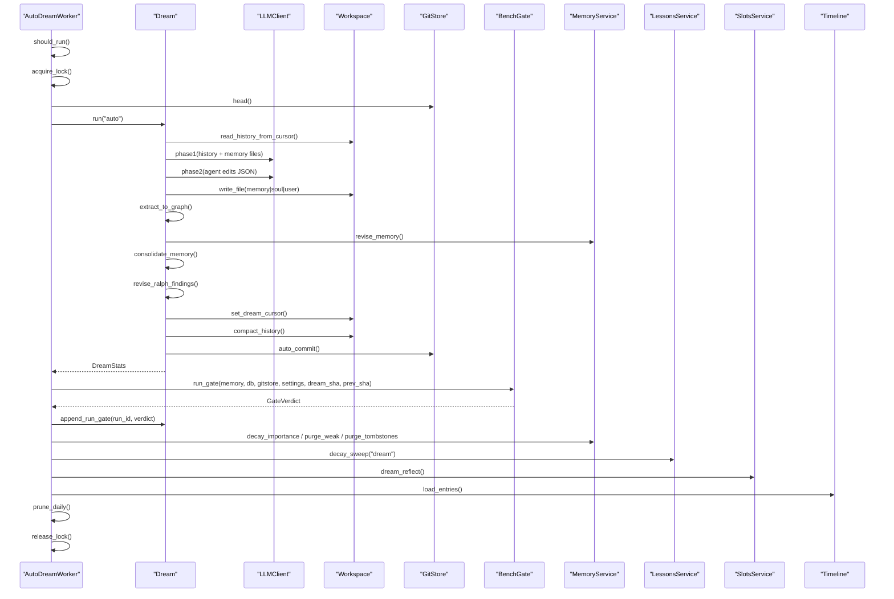
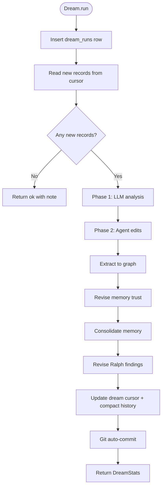
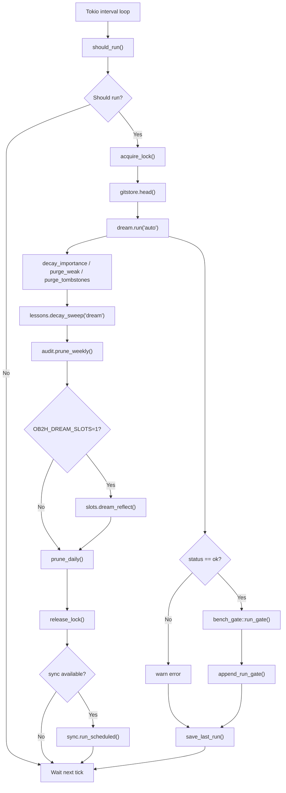
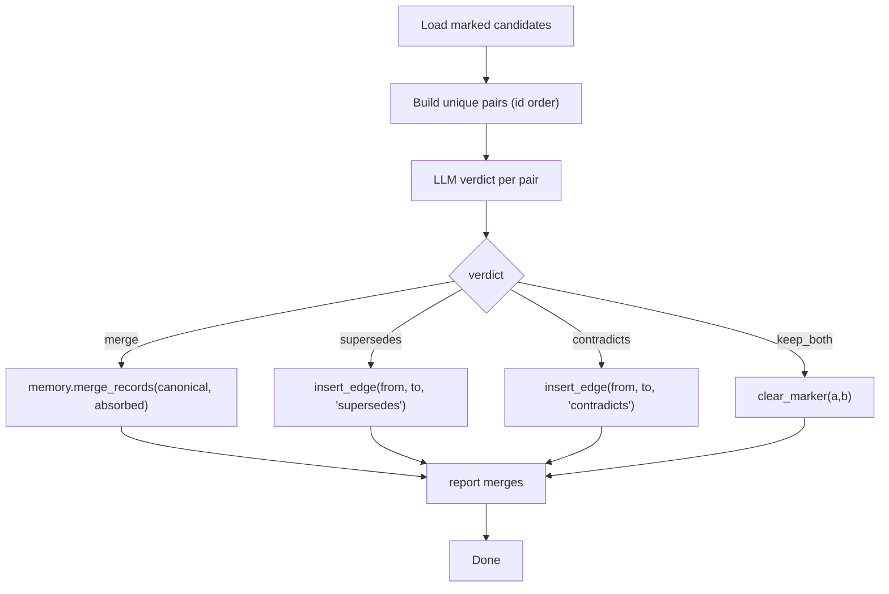
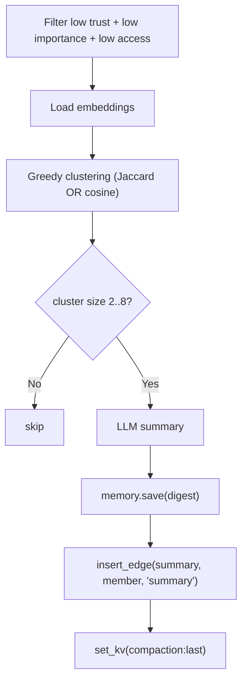
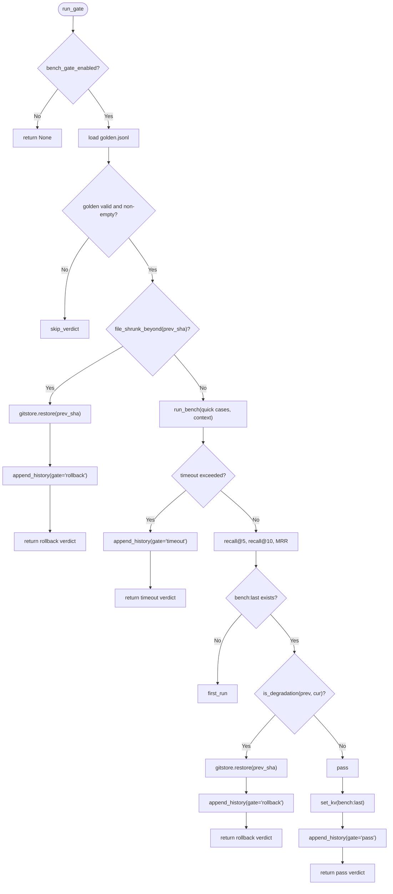
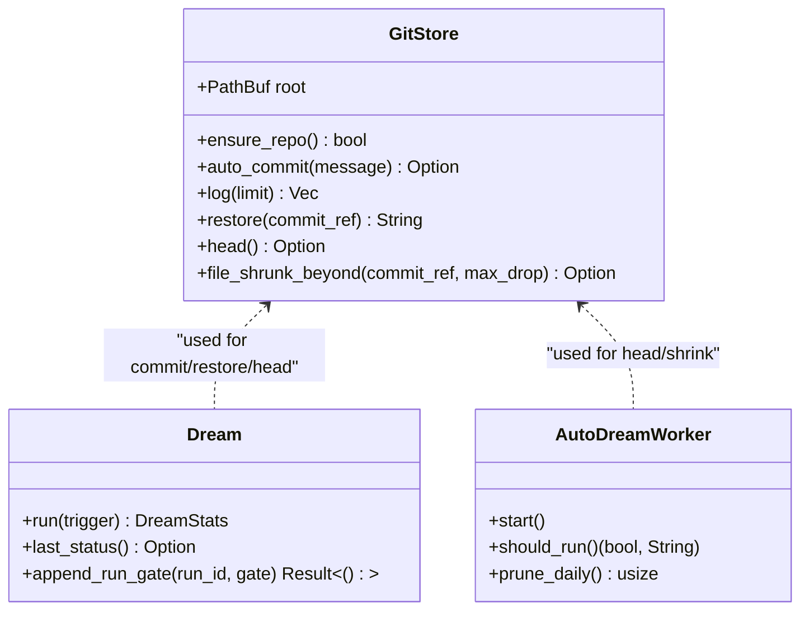
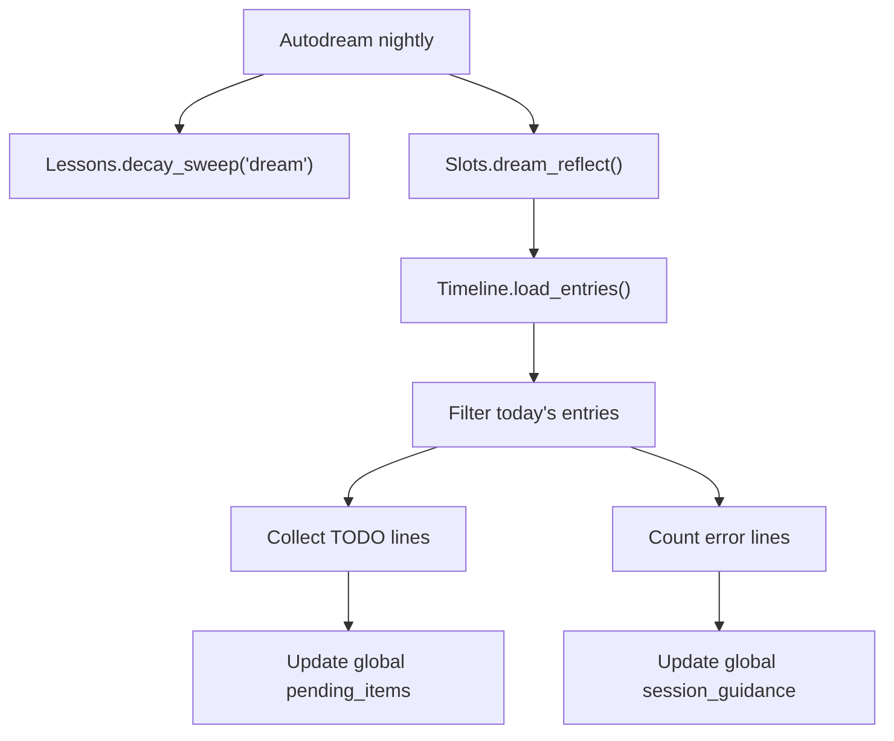
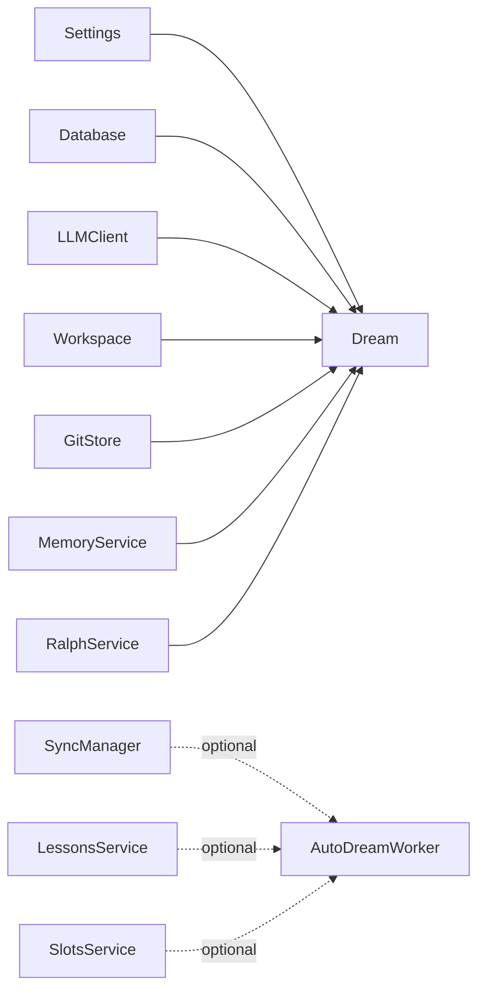

# Dream Processing

<cite>
**Referenced Files in This Document**   
- [README.md](file://README.md)
- [src/dream/mod.rs](file://src/dream/mod.rs)
- [src/dream/autodream.rs](file://src/dream/autodream.rs)
- [src/dream/consolidate.rs](file://src/dream/consolidate.rs)
- [src/dream/bench_gate.rs](file://src/dream/bench_gate.rs)
- [src/lifecycle/mod.rs](file://src/lifecycle/mod.rs)
- [src/lifecycle/lessons.rs](file://src/lifecycle/lessons.rs)
- [src/lifecycle/slots.rs](file://src/lifecycle/slots.rs)
- [src/lifecycle/timeline.rs](file://src/lifecycle/timeline.rs)
- [src/workspace/git.rs](file://src/workspace/git.rs)
</cite>

## Table of Contents
1. [Introduction](#introduction)
2. [Project Structure](#project-structure)
3. [Core Components](#core-components)
4. [Architecture Overview](#architecture-overview)
5. [Detailed Component Analysis](#detailed-component-analysis)
6. [Dependency Analysis](#dependency-analysis)
7. [Performance Considerations](#performance-considerations)
8. [Troubleshooting Guide](#troubleshooting-guide)
9. [Conclusion](#conclusion)

## Introduction
Dream processing is the automated nightly consolidation and quality-assurance subsystem that runs while the system is idle. It analyzes recent conversation history, updates long-term memory files (`SOUL.md`, `USER.md`, `MEMORY.md`), extracts structured knowledge into the project graph, revises low-trust memory entries, consolidates duplicate or conflicting facts, optionally summarizes weak memories, and then validates the result with a benchmark-driven regression gate. All changes are committed to Git so dream operations can be audited and rolled back automatically if recall or MRR degrades.

The feature integrates with:
- The lifecycle layer for lessons (procedural experience), slots (editable context units), and timeline (session chronology).
- The workspace Git store for versioned memory files.
- The memory service for trust-based revision and merging.
- The LLM client for analysis, editing, and summarization.
- The sync manager for optional post-dream peer exchange.

**Section sources**
- [README.md:41-51](file://README.md#L41-L51)

## Project Structure
Dream processing lives under `src/dream` and is coordinated by an auto-scheduler worker. Supporting logic is split across:
- `dream/mod.rs`: orchestration, phases, stats, and run lifecycle.
- `dream/autodream.rs`: background scheduler, lock, event gating, maintenance tasks.
- `dream/consolidate.rs`: merge candidates, typed edges, compaction digests.
- `dream/bench_gate.rs`: quick benchmark, degradation detection, rollback.
- `lifecycle/*`: lessons decay, slot reflection, timeline recap.
- `workspace/git.rs`: tracked memory file commits and restore.

**Diagram sources**
- [src/dream/autodream.rs:61-145](file://src/dream/autodream.rs#L61-L145)
- [src/dream/mod.rs:145-288](file://src/dream/mod.rs#L145-L288)
- [src/dream/consolidate.rs:70-85](file://src/dream/consolidate.rs#L70-L85)
- [src/dream/bench_gate.rs:163-332](file://src/dream/bench_gate.rs#L163-L332)
- [src/workspace/git.rs:53-82](file://src/workspace/git.rs#L53-L82)

**Section sources**
- [src/dream/mod.rs:1-23](file://src/dream/mod.rs#L1-L23)
- [src/dream/autodream.rs:1-34](file://src/dream/autodream.rs#L1-L34)
- [src/dream/consolidate.rs:1-39](file://src/dream/consolidate.rs#L1-L39)
- [src/dream/bench_gate.rs:1-16](file://src/dream/bench_gate.rs#L1-L16)
- [src/lifecycle/mod.rs:1-12](file://src/lifecycle/mod.rs#L1-L12)
- [src/workspace/git.rs:1-8](file://src/workspace/git.rs#L1-L8)

## Core Components
- **Dream**: main orchestrator for a single dream run. It records a database run, reads new history from the workspace cursor, performs phase 1 analysis, phase 2 agent edits, graph extraction, memory revision, consolidation, Ralph revision, cursor update, history compaction, and Git commit. It also exposes last status and bench-gate attachment.
- **AutoDreamWorker**: Tokio background loop that decides whether to run based on elapsed time and daily event count, acquires a file lock, captures Git HEAD before the run, executes Dream, runs the bench gate, persists last-run state, performs memory hygiene, lesson decay, audit pruning, optional slot reflection, daily pruning, and optional sync.
- **Consolidation**: offline consolidation of memory records. It loads merge candidates marked by save-time pre-checks, asks the LLM to decide between merge, keep both, contradicts, or supersedes, applies merges through the memory service, inserts typed edges, and periodically clusters low-trust records into summary nodes.
- **Bench Gate**: quick benchmark over a golden set after a successful dream. It checks workspace integrity first, runs a bounded benchmark, compares recall@5 and MRR against stored baselines, rolls back on degradation, and logs results.
- **Lifecycle Integration**: lessons decay sweep, slots dream reflection, and timeline reading are invoked as part of the nightly routine.
- **Workspace Git Store**: tracks `SOUL.md`, `USER.md`, and `memory/MEMORY.md`; supports auto-commit, log, restore, HEAD capture, and shrink detection.

**Section sources**
- [src/dream/mod.rs:110-143](file://src/dream/mod.rs#L110-L143)
- [src/dream/mod.rs:145-288](file://src/dream/mod.rs#L145-L288)
- [src/dream/autodream.rs:20-59](file://src/dream/autodream.rs#L20-L59)
- [src/dream/autodream.rs:61-145](file://src/dream/autodream.rs#L61-L145)
- [src/dream/consolidate.rs:47-85](file://src/dream/consolidate.rs#L47-L85)
- [src/dream/bench_gate.rs:40-87](file://src/dream/bench_gate.rs#L40-L87)
- [src/workspace/git.rs:16-82](file://src/workspace/git.rs#L16-L82)

## Architecture Overview
The dream pipeline is a multi-phase process with safety gates and auditability.

**Diagram sources**
- [src/dream/autodream.rs:61-145](file://src/dream/autodream.rs#L61-L145)
- [src/dream/mod.rs:145-288](file://src/dream/mod.rs#L145-L288)
- [src/dream/bench_gate.rs:163-332](file://src/dream/bench_gate.rs#L163-L332)
- [src/workspace/git.rs:53-82](file://src/workspace/git.rs#L53-L82)

## Detailed Component Analysis

### Dream Orchestration and Phases
Dream.run initializes a database record, reads new history since the last dream cursor, and proceeds through:
- Phase 1: LLM analysis of new history plus current memory files.
- Phase 2: Iterative agent edits returning strict JSON actions (read/edit/done). Edits are applied only when old/new match and exist in the target file.
- Graph extraction: optional extraction of session facts into the project graph.
- Memory revision: LLM verdicts on low-trust records; supported outcomes include confirmed, outdated, contradicted, with optional typed edges and belief proposals.
- Consolidation: offline merge candidate evaluation and compaction.
- Ralph revision: re-verifying stale findings using fresh history.
- Cursor advancement and history compaction.
- Git commit with a descriptive message including edits and revisions.

**Diagram sources**
- [src/dream/mod.rs:145-288](file://src/dream/mod.rs#L145-L288)

**Section sources**
- [src/dream/mod.rs:145-288](file://src/dream/mod.rs#L145-L288)
- [src/dream/mod.rs:290-395](file://src/dream/mod.rs#L290-L395)
- [src/dream/mod.rs:397-416](file://src/dream/mod.rs#L397-L416)
- [src/dream/mod.rs:418-543](file://src/dream/mod.rs#L418-L543)
- [src/dream/mod.rs:568-616](file://src/dream/mod.rs#L568-L616)

### Autodream Background Worker
AutoDreamWorker manages scheduling and resource management:
- Interval control via settings and minimum interval enforcement.
- Daily event threshold check by scanning daily JSONL files since last run.
- File-based lock with staleness detection.
- Captures Git HEAD before running Dream.
- Runs bench gate after successful Dream.
- Performs memory hygiene: decay importance, purge weak records, purge tombstones.
- Weekly lessons decay sweep.
- Weekly audit ledger pruning.
- Optional slots dream reflection controlled by environment variable.
- Daily file pruning based on retention policy.
- Optional sync after dream.

**Diagram sources**
- [src/dream/autodream.rs:61-145](file://src/dream/autodream.rs#L61-L145)
- [src/dream/autodream.rs:169-224](file://src/dream/autodream.rs#L169-L224)
- [src/dream/autodream.rs:226-271](file://src/dream/autodream.rs#L226-L271)

**Section sources**
- [src/dream/autodream.rs:61-145](file://src/dream/autodream.rs#L61-L145)
- [src/dream/autodream.rs:169-224](file://src/dream/autodream.rs#L169-L224)
- [src/dream/autodream.rs:226-271](file://src/dream/autodream.rs#L226-L271)

### Consolidation Algorithms
Consolidation has two major parts:
- Merge candidate evaluation: loads records marked as merge candidates, pairs them with neighbors, asks the LLM for a verdict (merge, keep_both, contradicts, supersedes), applies merges via memory service, inserts typed edges, and clears markers.
- Compaction: every 30 days, clusters low-trust, low-importance, low-access records using Jaccard token similarity on keys and cosine embedding similarity, generates a summary node per cluster, and links members to the digest.

**Diagram sources**
- [src/dream/consolidate.rs:89-190](file://src/dream/consolidate.rs#L89-L190)

Compaction clustering uses thresholds and constraints:
- Excludes high-trust and high-access records.
- Caps cluster size.
- Uses Jaccard on key tokens or cosine on embeddings.
- Creates summary nodes linked with kind `summary`.

**Diagram sources**
- [src/dream/consolidate.rs:252-336](file://src/dream/consolidate.rs#L252-L336)
- [src/dream/consolidate.rs:339-380](file://src/dream/consolidate.rs#L339-L380)

**Section sources**
- [src/dream/consolidate.rs:47-85](file://src/dream/consolidate.rs#L47-L85)
- [src/dream/consolidate.rs:89-190](file://src/dream/consolidate.rs#L89-L190)
- [src/dream/consolidate.rs:252-380](file://src/dream/consolidate.rs#L252-L380)

### Quality Gates and Regression Prevention
The bench gate protects against dream-induced regressions:
- Workspace integrity check: if any tracked memory file shrinks beyond a threshold relative to the captured HEAD, it triggers an immediate rollback.
- Quick benchmark: runs a limited golden set in context mode within a timeout budget.
- Degradation detection: compares recall@5 and MRR against stored baselines; relative drops trigger rollback.
- History logging: appends gate outcomes to a JSONL history file.
- Baseline update: only on pass or first run.

**Diagram sources**
- [src/dream/bench_gate.rs:163-332](file://src/dream/bench_gate.rs#L163-L332)
- [src/workspace/git.rs:143-166](file://src/workspace/git.rs#L143-L166)

**Section sources**
- [src/dream/bench_gate.rs:40-87](file://src/dream/bench_gate.rs#L40-L87)
- [src/dream/bench_gate.rs:163-332](file://src/dream/bench_gate.rs#L163-L332)
- [src/workspace/git.rs:143-166](file://src/workspace/git.rs#L143-L166)

### Git-Backed Workspace Versioning and Audit Logging
Git integration ensures all dream-edited memory files are versioned:
- Tracked files: `SOUL.md`, `USER.md`, `memory/MEMORY.md`.
- Auto-commit: adds existing tracked files, checks for changes, commits with a descriptive message, returns short SHA.
- Restore: checks out tracked files from a specified commit reference.
- HEAD capture: used by autodream to record pre-dream state.
- Shrink detection: compares line counts between commit and working tree to detect severe content loss.

Audit logging is integrated with lifecycle operations:
- Lesson save/strengthen/delete operations are recorded.
- Slot create/append/replace/delete operations are recorded.
- Weekly audit pruning keeps metadata for a bounded period.

**Diagram sources**
- [src/workspace/git.rs:16-166](file://src/workspace/git.rs#L16-L166)
- [src/dream/mod.rs:145-288](file://src/dream/mod.rs#L145-L288)
- [src/dream/autodream.rs:61-145](file://src/dream/autodream.rs#L61-L145)

**Section sources**
- [src/workspace/git.rs:1-82](file://src/workspace/git.rs#L1-L82)
- [src/workspace/git.rs:111-166](file://src/workspace/git.rs#L111-L166)
- [src/lifecycle/lessons.rs:163-278](file://src/lifecycle/lessons.rs#L163-L278)
- [src/lifecycle/slots.rs:311-448](file://src/lifecycle/slots.rs#L311-L448)

### Lifecycle Integration: Lessons, Slots, Timeline
- Lessons: weekly decay sweep reduces confidence for lessons in quiet periods without deleting them; reports candidates for forget.
- Slots: dream reflection scans today’s timeline entries, aggregates TODOs and error mentions, updates global pending items and session guidance slots.
- Timeline: read-only loading of daily logs, windowing around anchors, incremental recap caching, provenance verification linking memory records to daily citations.

**Diagram sources**
- [src/lifecycle/lessons.rs:457-543](file://src/lifecycle/lessons.rs#L457-L543)
- [src/lifecycle/slots.rs:452-553](file://src/lifecycle/slots.rs#L452-L553)
- [src/lifecycle/timeline.rs:57-115](file://src/lifecycle/timeline.rs#L57-L115)

**Section sources**
- [src/lifecycle/lessons.rs:457-543](file://src/lifecycle/lessons.rs#L457-L543)
- [src/lifecycle/slots.rs:452-553](file://src/lifecycle/slots.rs#L452-L553)
- [src/lifecycle/timeline.rs:57-115](file://src/lifecycle/timeline.rs#L57-L115)
- [src/lifecycle/timeline.rs:270-389](file://src/lifecycle/timeline.rs#L270-L389)

## Dependency Analysis
Dream depends on multiple subsystems:
- Configuration: settings control enabling intervals, thresholds, and features.
- Database: stores dream runs, KV metrics, and interacts with memory/Ralph services.
- LLM: provides prompts for analysis, editing, revision, consolidation, and summaries.
- Workspace: provides history cursor, file reads/writes, daily directory, and compaction.
- Git: version control for memory files and rollback capability.
- Memory: trust revision, merging, and persistence.
- Ralph: stale findings revision.
- Sync: optional post-dream synchronization.

**Diagram sources**
- [src/dream/mod.rs:110-143](file://src/dream/mod.rs#L110-L143)
- [src/dream/autodream.rs:20-59](file://src/dream/autodream.rs#L20-L59)

**Section sources**
- [src/dream/mod.rs:110-143](file://src/dream/mod.rs#L110-L143)
- [src/dream/autodream.rs:20-59](file://src/dream/autodream.rs#L20-L59)

## Performance Considerations
- Scheduling: interval is clamped to at least 60 seconds; minimum interval enforced via last-run timestamp.
- Event gating: daily event count prevents unnecessary runs when activity is low.
- Locking: file-based lock with staleness detection avoids concurrent dreams.
- Batch processing: history is read in configurable batches; cursor advances incrementally.
- LLM budgets: phase 1 truncates previews; phase 2 iterates up to a fixed maximum; consolidation caps groups and cluster sizes; compaction runs infrequently.
- Benchmark timeout: bench gate respects a timeout budget and does not roll back on incomplete data.
- Maintenance: memory decay/purge and tombstone cleanup are performed after each run; lessons decay is weekly; audit pruning is weekly; daily file pruning removes old daily logs.
- Resource isolation: secrets vault is isolated from dream; dream never writes secrets into context.

[No sources needed since this section provides general guidance]

## Troubleshooting Guide
Common issues and diagnostics:
- Dream skipped due to insufficient events: check daily event count and last-run timestamp.
- Bench gate skipped: ensure golden set exists and is valid; check environment variables enabling the gate.
- Rollback triggered: inspect bench history and alert messages; verify workspace integrity and compare tracked file line counts.
- Consolidation failures: review warnings about LLM verdict failures; check merge markers and neighbor availability.
- Memory revision failures: check low-trust records and related keys; verify memory service availability.
- Git issues: ensure repository initialization and tracked files exist; verify Git commands succeed.

Useful CLI commands:
- `ob2h dream status`: view last dream run status and stats.
- `ob2h dream run`: manually trigger a dream run.
- `ob2h dream log`: view dream-related logs and Git commits.
- `ob2h bench --mode history`: inspect bench history and gate outcomes.

**Section sources**
- [src/dream/autodream.rs:169-224](file://src/dream/autodream.rs#L169-L224)
- [src/dream/bench_gate.rs:176-190](file://src/dream/bench_gate.rs#L176-L190)
- [src/dream/bench_gate.rs:223-259](file://src/dream/bench_gate.rs#L223-L259)
- [src/dream/consolidate.rs:125-136](file://src/dream/consolidate.rs#L125-L136)
- [src/dream/mod.rs:227-246](file://src/dream/mod.rs#L227-L246)
- [src/workspace/git.rs:43-82](file://src/workspace/git.rs#L43-L82)
- [README.md:220-236](file://README.md#L220-L236)

## Conclusion
Dream processing provides a robust, automated nightly workflow that consolidates memory, revises trust, extracts knowledge, and validates quality. Its design emphasizes safety through Git-backed versioning, benchmark-driven rollback, and careful resource management. Integration with lifecycle components ensures procedural lessons decay, contextual slots reflect daily patterns, and timeline data remains readable and provable. Operators can monitor status, interpret logs, and rely on automatic safeguards to maintain system reliability.

[No sources needed since this section summarizes without analyzing specific files]