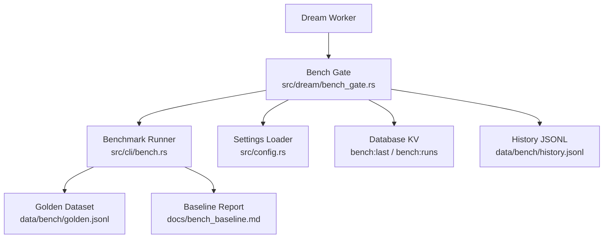
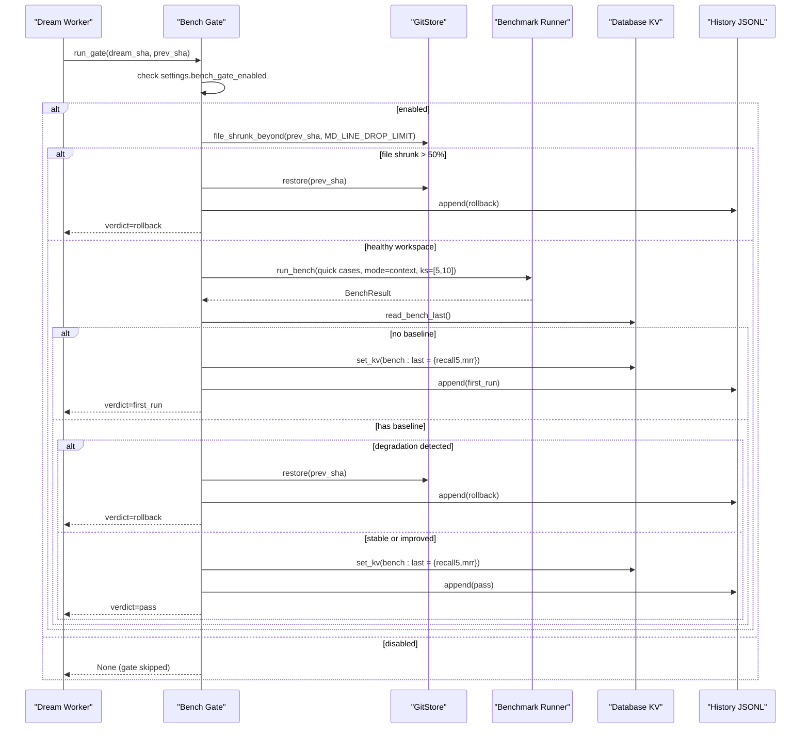
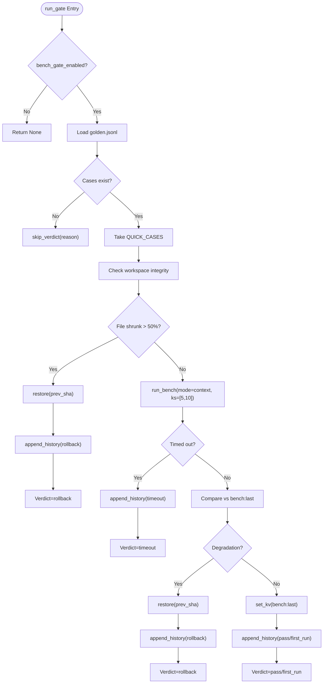
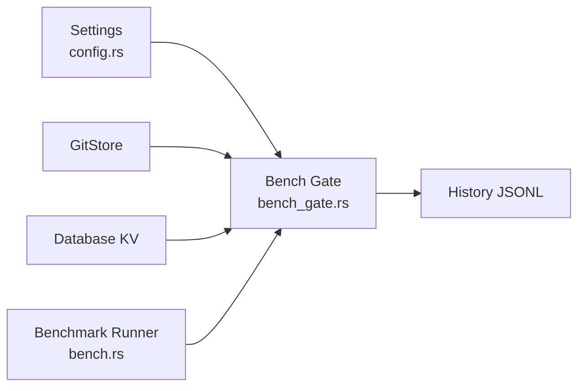

# Quality Gates & Benchmarking

<cite>
**Referenced Files in This Document**
- [bench_gate.rs](file://src/dream/bench_gate.rs)
- [bench.rs](file://src/cli/bench.rs)
- [config.rs](file://src/config.rs)
- [test_bench_gate.rs](file://tests/test_bench_gate.rs)
- [bench_baseline.md](file://docs/bench_baseline.md)
</cite>

## Table of Contents
1. [Introduction](#introduction)
2. [Project Structure](#project-structure)
3. [Core Components](#core-components)
4. [Architecture Overview](#architecture-overview)
5. [Detailed Component Analysis](#detailed-component-analysis)
6. [Dependency Analysis](#dependency-analysis)
7. [Performance Considerations](#performance-considerations)
8. [Troubleshooting Guide](#troubleshooting-guide)
9. [Conclusion](#conclusion)

## Introduction
This document explains the quality gates and benchmarking system that prevents regression and validates performance before changes are accepted. The system uses a benchmark-driven approach: after an automated memory evolution step, it runs a quick golden-set evaluation and compares recall@k and MRR against an established baseline stored in the database. If metrics degrade beyond configured thresholds, the system automatically rolls back the workspace to the previous commit.

The design separates three concerns:
- Benchmark execution and metrics computation over a golden dataset.
- Gate logic that enforces thresholds, timeouts, and rollback behavior.
- Configuration and history tracking for operators to tune and inspect results.

## Project Structure
The quality gate is implemented as part of the dream subsystem and integrates with the CLI benchmark runner, configuration loader, and test suite.

**Diagram sources**
- [bench_gate.rs:160-332](file://src/dream/bench_gate.rs#L160-L332)
- [bench.rs:120-255](file://src/cli/bench.rs#L120-L255)
- [config.rs:266-273](file://src/config.rs#L266-L273)
- [bench_baseline.md:1-116](file://docs/bench_baseline.md#L1-L116)

**Section sources**
- [bench_gate.rs:1-366](file://src/dream/bench_gate.rs#L1-L366)
- [bench.rs:1-961](file://src/cli/bench.rs#L1-L961)
- [config.rs:1-523](file://src/config.rs#L1-L523)
- [bench_baseline.md:1-116](file://docs/bench_baseline.md#L1-L116)

## Core Components
- Bench Gate: evaluates a quick subset of the golden set, checks workspace integrity, applies timeout budget, compares metrics against the last baseline, and decides pass/rollback/skip/timeout.
- Benchmark Runner: loads the golden dataset, executes retrieval or context-building queries, computes recall@k, MRR, latency percentiles, and writes baselines and history records.
- Settings Loader: exposes environment variables for enabling the gate, configuring its timeout, and tuning related behaviors.
- Test Suite: verifies threshold logic, workspace integrity detection, rollback behavior, timeout handling, and disabled-gate semantics.

Key responsibilities:
- Prevent regression by comparing current metrics with `bench:last`.
- Protect workspace state by detecting severe file shrinkage.
- Provide observability through structured history and human-readable reports.

**Section sources**
- [bench_gate.rs:31-57](file://src/dream/bench_gate.rs#L31-L57)
- [bench.rs:16-23](file://src/cli/bench.rs#L16-L23)
- [config.rs:53-57](file://src/config.rs#L53-L57)
- [test_bench_gate.rs:95-111](file://tests/test_bench_gate.rs#L95-L111)

## Architecture Overview
The gate workflow is triggered after a successful dream run. It performs workspace integrity checks first, then runs a quick benchmark under a time budget, compares metrics, and either updates the baseline or rolls back the workspace.

**Diagram sources**
- [bench_gate.rs:160-332](file://src/dream/bench_gate.rs#L160-L332)
- [bench.rs:120-255](file://src/cli/bench.rs#L120-L255)

## Detailed Component Analysis

### Bench Gate Evaluation Process
The gate performs these steps:
1. Check if the gate is enabled via settings.
2. Validate presence and readability of the golden dataset; skip if missing or empty.
3. Select a quick subset of cases for fast evaluation.
4. Verify workspace integrity by checking tracked files for severe shrinkage relative to the previous commit.
5. Run the benchmark under a configurable timeout.
6. Compare current recall@5 and MRR against the last baseline.
7. Decide outcome: pass, first_run, rollback, timeout, or skipped.
8. Persist history and update baseline only on healthy outcomes.

**Diagram sources**
- [bench_gate.rs:160-332](file://src/dream/bench_gate.rs#L160-L332)

**Section sources**
- [bench_gate.rs:160-332](file://src/dream/bench_gate.rs#L160-L332)

### Threshold Configuration
Thresholds are defined as constants and can be tuned through environment variables:
- Recall drop limit: relative decrease greater than 10% triggers degradation.
- MRR drop limit: relative decrease greater than 15% triggers degradation.
- Workspace integrity threshold: tracked file shrinkage greater than 50% triggers rollback.
- Gate enablement: controlled by `OB2H_BENCH_GATE`.
- Timeout budget: controlled by `OB2H_BENCH_GATE_TIMEOUT_MS` (default 3000 ms).

These values ensure dual-signal protection: both recall and MRR must remain stable. A drop in either metric beyond its threshold indicates degradation.

**Section sources**
- [bench_gate.rs:31-38](file://src/dream/bench_gate.rs#L31-L38)
- [bench_gate.rs:78-87](file://src/dream/bench_gate.rs#L78-L87)
- [config.rs:266-273](file://src/config.rs#L266-L273)

### Automatic Rollback Mechanisms
Two rollback paths exist:
- Workspace integrity rollback: if any tracked file loses more than 50% of lines compared to the previous commit, the system restores the workspace to the previous commit and records a rollback verdict.
- Metric degradation rollback: if recall@5 drops more than 10% or MRR drops more than 15% relative to `bench:last`, the system restores the workspace to the previous commit and does not update the baseline.

Timeouts do not trigger rollback; they result in a skipped gate with a warning and no baseline update.

**Section sources**
- [bench_gate.rs:193-220](file://src/dream/bench_gate.rs#L193-L220)
- [bench_gate.rs:265-302](file://src/dream/bench_gate.rs#L265-L302)
- [bench_gate.rs:223-254](file://src/dream/bench_gate.rs#L223-L254)

### Benchmark Suite and Validation Criteria
The benchmark suite centers on a golden dataset:
- Format: JSONL where each line contains a query and expected keys.
- Modes: search (hybrid retrieval) and context (build_context).
- Metrics: recall@k, recall-all@k, any-hit@k, MRR, p50/p95 latency, empty result count.
- Baseline persistence: `docs/bench_baseline.md` aggregates results and documents decisions.

The gate uses a quick subset of the golden set in context mode with k levels 5 and 10. The runner also supports latency measurement across memories and graph nodes.

**Section sources**
- [bench.rs:16-23](file://src/cli/bench.rs#L16-L23)
- [bench.rs:47-93](file://src/cli/bench.rs#L47-L93)
- [bench.rs:103-118](file://src/cli/bench.rs#L103-L118)
- [bench.rs:120-255](file://src/cli/bench.rs#L120-L255)
- [bench_baseline.md:1-116](file://docs/bench_baseline.md#L1-L116)

### Interpreting Benchmark Results
Operators should interpret results as follows:
- recall@k: proportion of expected keys found in top-k ranked results.
- MRR: inverse rank of the first expected key; higher is better.
- recall-all@k: strict completeness — all expected keys must appear in top-k.
- any-hit@k: at least one expected key appears in top-k.
- Latency percentiles: p50 and p95 indicate typical and tail performance.
- Empty count: number of cases returning no results.

The baseline document provides historical context and decision notes, including when experiments like vector rescore are triggered due to latency thresholds.

**Section sources**
- [bench.rs:47-93](file://src/cli/bench.rs#L47-L93)
- [bench.rs:558-601](file://src/cli/bench.rs#L558-L601)
- [bench_baseline.md:21-36](file://docs/bench_baseline.md#L21-L36)
- [bench_baseline.md:73-88](file://docs/bench_baseline.md#L73-L88)

### Backward Compatibility and Controlled Memory Evolution
The system maintains backward compatibility by:
- Keeping the gate disabled by default until sufficient statistics are collected.
- Using conservative thresholds to avoid false positives during early adoption.
- Preserving the previous baseline (`bench:last`) when degradation occurs, ensuring future comparisons remain anchored.
- Allowing memory evolution through validated changes: only passes that improve or maintain metrics update the baseline.

This approach enables incremental improvements while preventing regressions from being committed.

**Section sources**
- [config.rs:53-57](file://src/config.rs#L53-L57)
- [bench_gate.rs:291-302](file://src/dream/bench_gate.rs#L291-L302)
- [test_bench_gate.rs:154-181](file://tests/test_bench_gate.rs#L154-L181)

## Dependency Analysis
The gate depends on several components:
- Settings: controls gate enablement and timeout.
- GitStore: provides workspace integrity checks and rollback restoration.
- Database KV: stores baseline metrics and run counters.
- Benchmark Runner: executes retrieval/context building and computes metrics.
- History JSONL: accumulates gate outcomes for trend analysis.

**Diagram sources**
- [config.rs:266-273](file://src/config.rs#L266-L273)
- [bench_gate.rs:160-332](file://src/dream/bench_gate.rs#L160-L332)
- [bench.rs:120-255](file://src/cli/bench.rs#L120-L255)

**Section sources**
- [bench_gate.rs:160-332](file://src/dream/bench_gate.rs#L160-L332)
- [bench.rs:120-255](file://src/cli/bench.rs#L120-L255)
- [config.rs:266-273](file://src/config.rs#L266-L273)

## Performance Considerations
- Quick subset: using the first 15 cases reduces runtime while still providing meaningful signal.
- Timeout budget: prevents long-running benchmarks from blocking operations; timeouts are non-punitive and do not alter baselines.
- Warm-up: the benchmark runner performs a warm-up call to load local embedding models and caches, excluding initialization costs from metrics.
- Latency gating: separate latency measurements track embed/query, memories, and graph nodes; thresholds guide experimental optimizations.

Recommendations:
- Tune `OB2H_BENCH_GATE_TIMEOUT_MS` based on environment performance characteristics.
- Monitor p95 latency trends in the baseline document to decide when to adopt experimental optimizations.
- Use `ob2h bench --mode history` to review accumulated gate outcomes and detect slow drifts.

**Section sources**
- [bench_gate.rs:31-32](file://src/dream/bench_gate.rs#L31-L32)
- [bench_gate.rs:223-254](file://src/dream/bench_gate.rs#L223-L254)
- [bench.rs:152-169](file://src/cli/bench.rs#L152-L169)
- [bench.rs:257-322](file://src/cli/bench.rs#L257-L322)
- [bench_baseline.md:73-88](file://docs/bench_baseline.md#L73-L88)

## Troubleshooting Guide
Common issues and resolutions:
- Golden dataset missing or empty: gate skips with a reason indicating golden path issues. Create `data/bench/golden.jsonl` with valid entries.
- Timeout exceeded: gate logs a warning and returns timeout without rollback. Increase `OB2H_BENCH_GATE_TIMEOUT_MS` or optimize the environment.
- Workspace integrity failure: tracked file shrunk beyond threshold triggers rollback. Inspect recent changes and restore manually if needed.
- Degradation detected: recall@5 or MRR dropped beyond thresholds; workspace rolled back. Review changes affecting retrieval or memory content.
- Gate disabled: returns None; enable via `OB2H_BENCH_GATE=1` to activate.

Diagnostic commands:
- View gate history: `ob2h bench history [--last N]`.
- Save baseline report: `ob2h bench --save-baseline`.
- Inspect latency metrics: `ob2h bench --mode latency`.

**Section sources**
- [bench_gate.rs:176-190](file://src/dream/bench_gate.rs#L176-L190)
- [bench_gate.rs:223-254](file://src/dream/bench_gate.rs#L223-L254)
- [bench_gate.rs:193-220](file://src/dream/bench_gate.rs#L193-L220)
- [bench_gate.rs:265-302](file://src/dream/bench_gate.rs#L265-L302)
- [bench.rs:713-774](file://src/cli/bench.rs#L713-L774)

## Conclusion
The quality gates and benchmarking system provide a robust defense against regression while enabling controlled evolution of memory and retrieval behavior. By combining golden-set validation, dual-metric thresholds, workspace integrity checks, and automatic rollback, the system ensures that changes are safe and measurable. Operators can configure thresholds, interpret results, and troubleshoot issues using the provided tools and documentation.