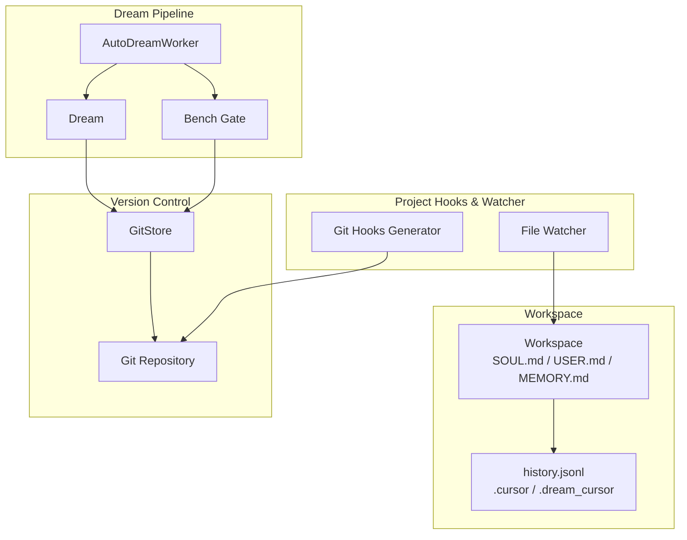
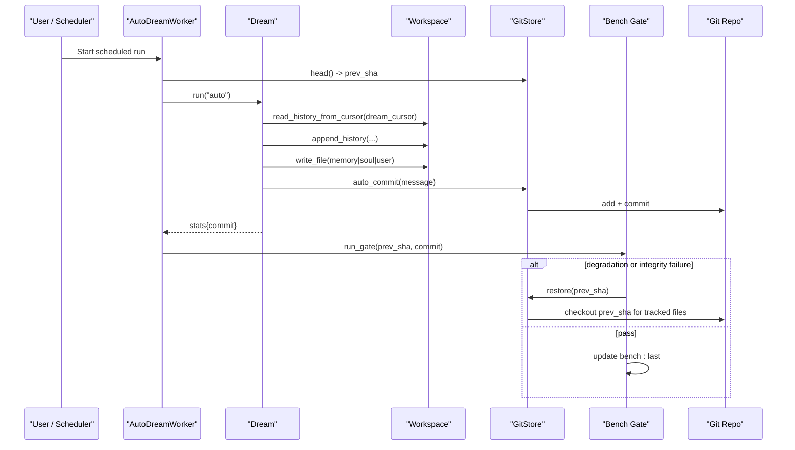
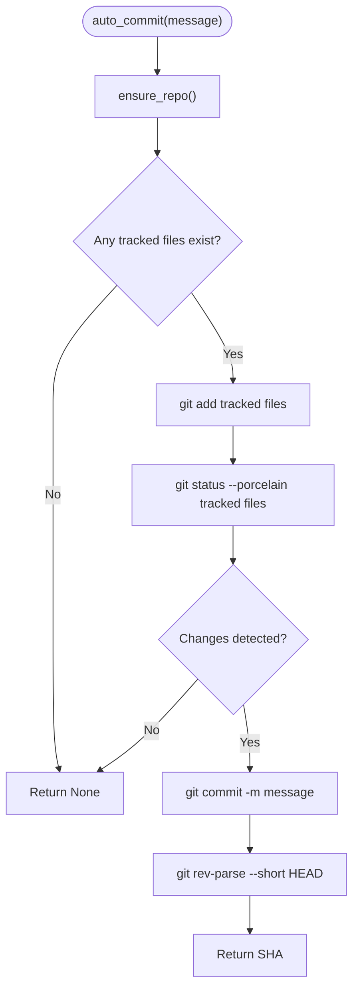
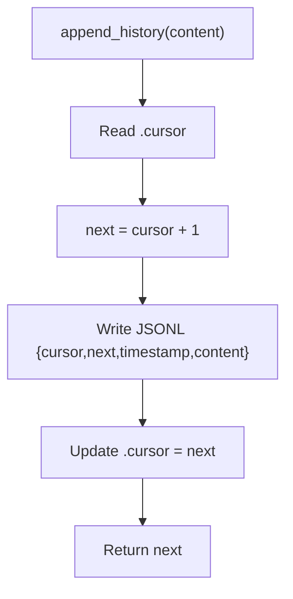
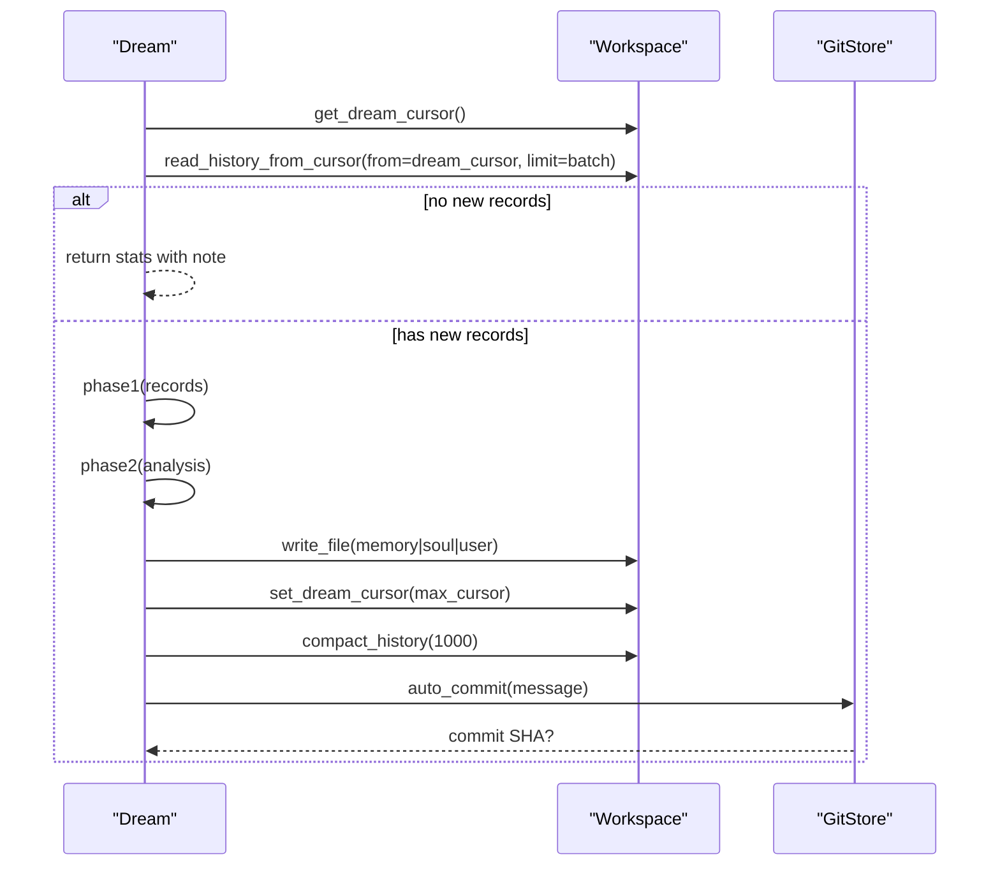
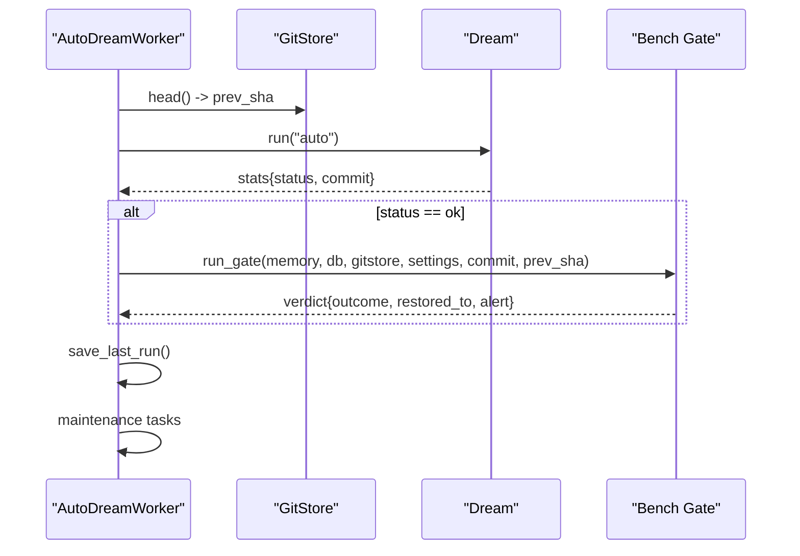
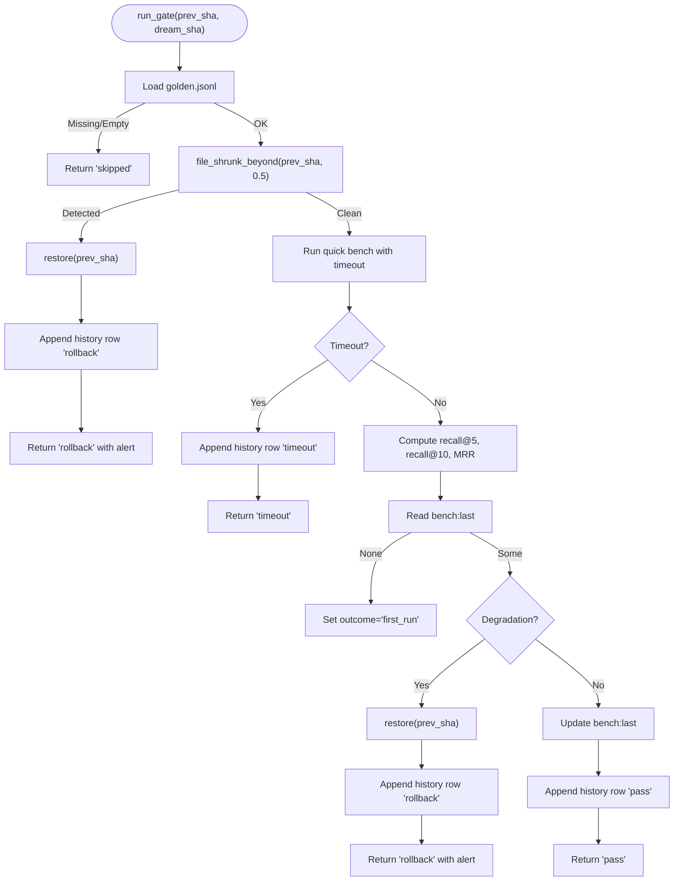
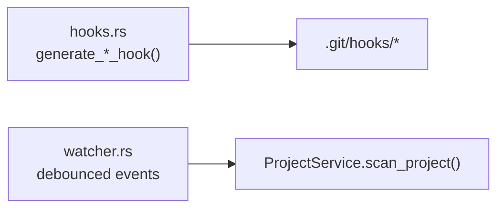
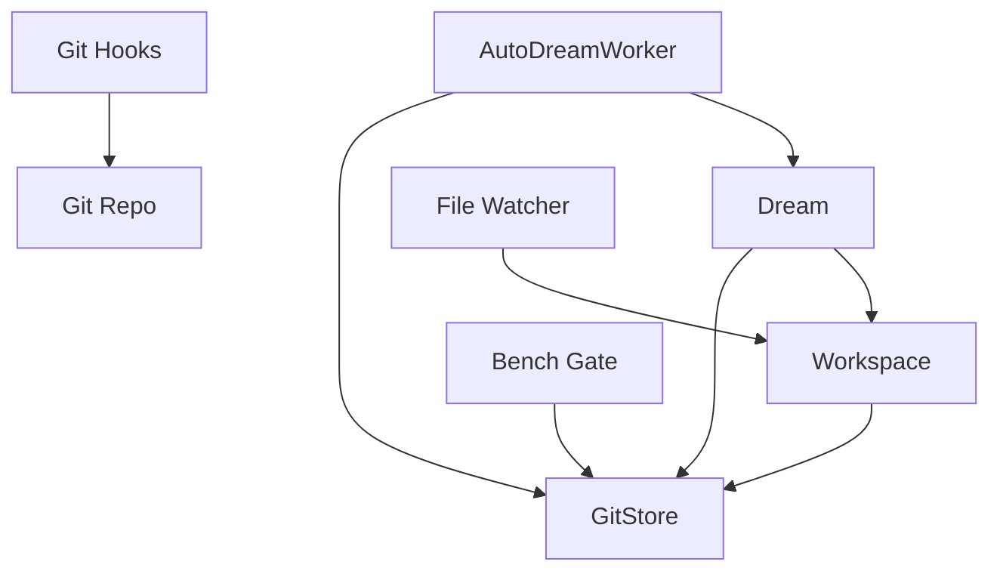

# Workspace Versioning

<cite>
**Referenced Files in This Document**
- [git.rs](file://src/workspace/git.rs)
- [mod.rs (workspace)](file://src/workspace/mod.rs)
- [mod.rs (dream)](file://src/dream/mod.rs)
- [autodream.rs](file://src/dream/autodream.rs)
- [bench_gate.rs](file://src/dream/bench_gate.rs)
- [hooks.rs](file://src/project/hooks.rs)
- [watcher.rs](file://src/project/watcher.rs)
- [test_workspace.rs](file://tests/test_workspace.rs)
</cite>

## Table of Contents
1. [Introduction](#introduction)
2. [Project Structure](#project-structure)
3. [Core Components](#core-components)
4. [Architecture Overview](#architecture-overview)
5. [Detailed Component Analysis](#detailed-component-analysis)
6. [Dependency Analysis](#dependency-analysis)
7. [Performance Considerations](#performance-considerations)
8. [Troubleshooting Guide](#troubleshooting-guide)
9. [Conclusion](#conclusion)

## Introduction
This document explains the workspace versioning system that backs dream operations with Git. It focuses on how GitStore manages snapshots and commit history for memory files, how automatic commits are generated after dream processing, how conflicts and regressions are handled, and how cursor-based history tracking enables incremental analysis without duplicates. It also covers integration points with Git hooks and file watchers that trigger appropriate version control and graph updates during project changes.

## Project Structure
The versioning system spans three main areas:
- Workspace storage and history cursors
- Git-backed snapshotting and rollback
- Dream orchestration and automated regression gating

**Diagram sources**
- [mod.rs (workspace):1-373](file://src/workspace/mod.rs#L1-L373)
- [git.rs:1-168](file://src/workspace/git.rs#L1-L168)
- [mod.rs (dream):1-647](file://src/dream/mod.rs#L1-L647)
- [autodream.rs:1-273](file://src/dream/autodream.rs#L1-L273)
- [bench_gate.rs:1-366](file://src/dream/bench_gate.rs#L1-L366)
- [hooks.rs:1-103](file://src/project/hooks.rs#L1-L103)
- [watcher.rs:1-167](file://src/project/watcher.rs#L1-L167)

**Section sources**
- [mod.rs (workspace):1-373](file://src/workspace/mod.rs#L1-L373)
- [git.rs:1-168](file://src/workspace/git.rs#L1-L168)
- [mod.rs (dream):1-647](file://src/dream/mod.rs#L1-L647)
- [autodream.rs:1-273](file://src/dream/autodream.rs#L1-L273)
- [bench_gate.rs:1-366](file://src/dream/bench_gate.rs#L1-L366)
- [hooks.rs:1-103](file://src/project/hooks.rs#L1-L103)
- [watcher.rs:1-167](file://src/project/watcher.rs#L1-L167)

## Core Components
- GitStore: Git-backed snapshotter for tracked memory files. Provides auto-commit, log, restore, HEAD capture, and integrity checks.
- Workspace: Filesystem manager for SOUL.md, USER.md, MEMORY.md, daily logs, and JSONL history with cursor management.
- Dream: Orchestrates analysis, edits, extraction, revision, consolidation, and final Git commit.
- AutoDreamWorker: Background scheduler that triggers Dream runs, captures HEAD before execution, and invokes bench gate.
- Bench Gate: Post-dream regression check that can roll back to a previous commit if metrics or workspace integrity degrade.
- Git Hooks Generator: Creates post-commit/post-merge/post-checkout scripts to keep project graphs in sync.
- File Watcher: Debounced file change detection that triggers incremental project scans.

**Section sources**
- [git.rs:1-168](file://src/workspace/git.rs#L1-L168)
- [mod.rs (workspace):1-373](file://src/workspace/mod.rs#L1-L373)
- [mod.rs (dream):1-647](file://src/dream/mod.rs#L1-L647)
- [autodream.rs:1-273](file://src/dream/autodream.rs#L1-L273)
- [bench_gate.rs:1-366](file://src/dream/bench_gate.rs#L1-L366)
- [hooks.rs:1-103](file://src/project/hooks.rs#L1-L103)
- [watcher.rs:1-167](file://src/project/watcher.rs#L1-L167)

## Architecture Overview
The versioning flow integrates workspace persistence, Git snapshots, and automated quality gates:

**Diagram sources**
- [autodream.rs:61-145](file://src/dream/autodream.rs#L61-L145)
- [mod.rs (dream):196-287](file://src/dream/mod.rs#L196-L287)
- [git.rs:53-82](file://src/workspace/git.rs#L53-L82)
- [bench_gate.rs:160-332](file://src/dream/bench_gate.rs#L160-L332)

## Detailed Component Analysis

### GitStore: Snapshots, History, Integrity, Restore
Responsibilities:
- Ensure a Git repository exists under the workspace root.
- Track only memory files: SOUL.md, USER.md, memory/MEMORY.md.
- Auto-commit changed tracked files with a descriptive message.
- Provide commit log entries (sha, date, message).
- Restore tracked files from a specific commit reference.
- Capture current HEAD short SHA.
- Detect severe file shrinkage relative to a commit reference.

Key behaviors:
- ensure_repo initializes a repo if missing and sets author metadata.
- auto_commit adds existing tracked files, checks status, and commits only when there are changes.
- log returns recent commits with formatted timestamps.
- restore performs a selective checkout of tracked files from a given commit.
- head returns the current short SHA.
- file_shrunk_beyond compares non-empty line counts between a commit’s version and the working tree; returns the first file exceeding a configured drop threshold.

**Diagram sources**
- [git.rs:53-82](file://src/workspace/git.rs#L53-L82)

**Section sources**
- [git.rs:1-168](file://src/workspace/git.rs#L1-L168)

### Workspace: Memory Files, Daily Logs, Cursor-Based History
Responsibilities:
- Manage directories and aliases for SOUL.md, USER.md, MEMORY.md, history.jsonl, and daily/*.jsonl.
- Append structured history entries with monotonically increasing cursors.
- Read new history entries starting after a given cursor.
- Persist and manage two cursors:
  - .cursor: general history position
  - .dream_cursor: last processed entry for dream runs
- Compact history to a bounded size.
- Archive old daily logs into monthly compressed archives.

Cursor mechanics:
- append_history increments the next cursor, writes a JSONL record, and updates .cursor.
- read_history_from_cursor filters entries by cursor > from_cursor and respects limit.
- get_dream_cursor/set_dream_cursor isolate dream processing progress.

**Diagram sources**
- [mod.rs (workspace):173-239](file://src/workspace/mod.rs#L173-L239)

**Section sources**
- [mod.rs (workspace):1-373](file://src/workspace/mod.rs#L1-L373)

### Dream Orchestration: Incremental Processing and Automatic Commits
Responsibilities:
- Load new history entries since .dream_cursor.
- Phase 1: LLM analysis of new records against current memory files.
- Phase 2: Iterative LLM-driven edits to memory files with strict validation.
- Extract session facts into the code graph.
- Revise memory trust and optionally create belief edges.
- Consolidate memory offline.
- Update .dream_cursor and compact history.
- Generate a descriptive commit message and call GitStore.auto_commit.

Integration points:
- Uses Workspace for reading/writing memory files and history.
- Uses GitStore for capturing HEAD and committing changes.
- Returns DreamStats including commit SHA and optional revisions.

**Diagram sources**
- [mod.rs (dream):196-287](file://src/dream/mod.rs#L196-L287)
- [mod.rs (workspace):173-239](file://src/workspace/mod.rs#L173-L239)
- [git.rs:53-82](file://src/workspace/git.rs#L53-L82)

**Section sources**
- [mod.rs (dream):1-647](file://src/dream/mod.rs#L1-L647)
- [mod.rs (workspace):173-239](file://src/workspace/mod.rs#L173-L239)
- [git.rs:53-82](file://src/workspace/git.rs#L53-L82)

### AutoDreamWorker: Scheduling, HEAD Capture, and Post-Dream Gating
Responsibilities:
- Periodic scheduling based on settings and event thresholds.
- Acquire a lock to avoid concurrent runs.
- Capture HEAD before Dream execution.
- Run Dream and persist last-run state.
- Invoke bench gate after successful Dream runs.
- Perform maintenance tasks (decay, purge, lessons sweep, audit pruning, slots reflection, daily pruning, sync).

**Diagram sources**
- [autodream.rs:61-145](file://src/dream/autodream.rs#L61-L145)
- [bench_gate.rs:160-332](file://src/dream/bench_gate.rs#L160-L332)

**Section sources**
- [autodream.rs:1-273](file://src/dream/autodream.rs#L1-L273)

### Bench Gate: Regression Detection and Rollback Strategy
Responsibilities:
- Validate golden dataset presence and load quick cases.
- Enforce workspace integrity: detect tracked file shrinkage beyond threshold using GitStore.file_shrunk_beyond.
- Run a quick benchmark against a golden set within a timeout budget.
- Compare recall@5 and MRR against bench:last; if degradation exceeds thresholds, rollback to prev_sha.
- Persist bench:last on success; append gate history row.

Conflict resolution strategies:
- Immediate rollback if workspace integrity fails (tracked file lost >50% lines vs prev_sha).
- Metric-based rollback if recall@5 drops >10% or MRR drops >15% compared to bench:last.
- Timeout does not trigger rollback; it is recorded as skipped with a warning.

**Diagram sources**
- [bench_gate.rs:160-332](file://src/dream/bench_gate.rs#L160-L332)
- [git.rs:146-166](file://src/workspace/git.rs#L146-L166)

**Section sources**
- [bench_gate.rs:1-366](file://src/dream/bench_gate.rs#L1-L366)
- [git.rs:146-166](file://src/workspace/git.rs#L146-L166)

### Git Hooks and File Watchers: Triggering Version Control and Graph Updates
Git hooks:
- generate_post_commit_hook, generate_post_merge_hook, generate_post_checkout_hook produce shell scripts that invoke ob2h project scan asynchronously.
- install_git_hooks writes these scripts into .git/hooks and sets executable permissions on Unix.

File watcher:
- Debounces filesystem events and filters relevant code files.
- Triggers incremental project scanning and embedding updates.

While these hooks primarily target project AST graph updates, they complement workspace versioning by ensuring codebase context remains consistent with committed changes.

**Diagram sources**
- [hooks.rs:10-102](file://src/project/hooks.rs#L10-L102)
- [watcher.rs:44-165](file://src/project/watcher.rs#L44-L165)

**Section sources**
- [hooks.rs:1-103](file://src/project/hooks.rs#L1-L103)
- [watcher.rs:1-167](file://src/project/watcher.rs#L1-L167)

## Dependency Analysis
High-level dependencies among components:

**Diagram sources**
- [mod.rs (workspace):1-373](file://src/workspace/mod.rs#L1-L373)
- [git.rs:1-168](file://src/workspace/git.rs#L1-L168)
- [mod.rs (dream):1-647](file://src/dream/mod.rs#L1-L647)
- [autodream.rs:1-273](file://src/dream/autodream.rs#L1-L273)
- [bench_gate.rs:1-366](file://src/dream/bench_gate.rs#L1-L366)
- [hooks.rs:1-103](file://src/project/hooks.rs#L1-L103)
- [watcher.rs:1-167](file://src/project/watcher.rs#L1-L167)

**Section sources**
- [mod.rs (workspace):1-373](file://src/workspace/mod.rs#L1-L373)
- [git.rs:1-168](file://src/workspace/git.rs#L1-L168)
- [mod.rs (dream):1-647](file://src/dream/mod.rs#L1-L647)
- [autodream.rs:1-273](file://src/dream/autodream.rs#L1-L273)
- [bench_gate.rs:1-366](file://src/dream/bench_gate.rs#L1-L366)
- [hooks.rs:1-103](file://src/project/hooks.rs#L1-L103)
- [watcher.rs:1-167](file://src/project/watcher.rs#L1-L167)

## Performance Considerations
- GitStore.run_git spawns external git processes; batch operations (add/status/commit) minimize process overhead.
- Workspace.history.jsonl uses append-only JSONL with cursor indexing to avoid full scans for incremental reads.
- Bench gate uses a quick subset of golden cases and a configurable timeout to bound cost.
- File watcher debounces events to prevent excessive rescans.
- History compaction keeps history bounded while preserving recency.

[No sources needed since this section provides general guidance]

## Troubleshooting Guide
Common issues and resolutions:
- No commits created:
  - Verify at least one tracked file exists and has changes before auto_commit.
  - Check GitStore.ensure_repo and repository initialization.
- Rollbacks occur unexpectedly:
  - Inspect bench gate history for “rollback” outcomes and alerts.
  - Confirm workspace integrity via file_shrunk_beyond and review tracked file sizes.
- Dream does not process new data:
  - Ensure .dream_cursor advances correctly and history entries have increasing cursors.
  - Validate read_history_from_cursor behavior and limit parameters.
- Hooks not triggering:
  - Confirm install_git_hooks executed successfully and scripts are executable.
  - Verify ob2h binary path resolution in generated hook scripts.

**Section sources**
- [git.rs:53-82](file://src/workspace/git.rs#L53-L82)
- [bench_gate.rs:160-332](file://src/dream/bench_gate.rs#L160-L332)
- [mod.rs (workspace):173-239](file://src/workspace/mod.rs#L173-L239)
- [hooks.rs:67-102](file://src/project/hooks.rs#L67-L102)

## Conclusion
The workspace versioning system combines Git-backed snapshots, cursor-based incremental processing, and automated regression gating to ensure safe evolution of memory files during dream operations. GitStore provides reliable snapshotting and rollback capabilities, while Workspace ensures efficient history tracking. Dream orchestrates analysis and edits, and AutoDreamWorker coordinates scheduling and post-run quality checks. Bench Gate enforces stability through metric comparisons and workspace integrity checks, rolling back when necessary. Git hooks and file watchers keep project context synchronized with repository state. Together, these components deliver a robust, auditable, and recoverable versioning workflow for dream-induced changes.