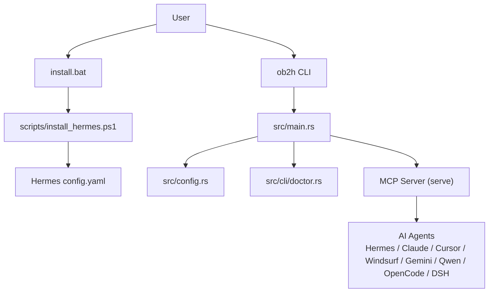
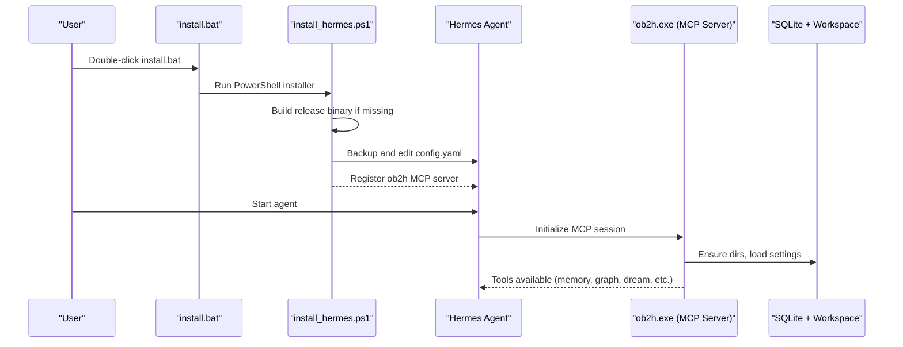
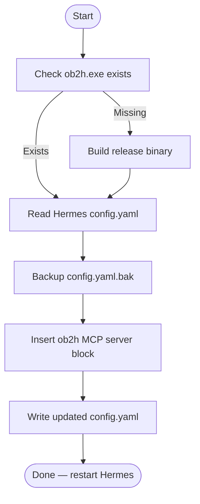
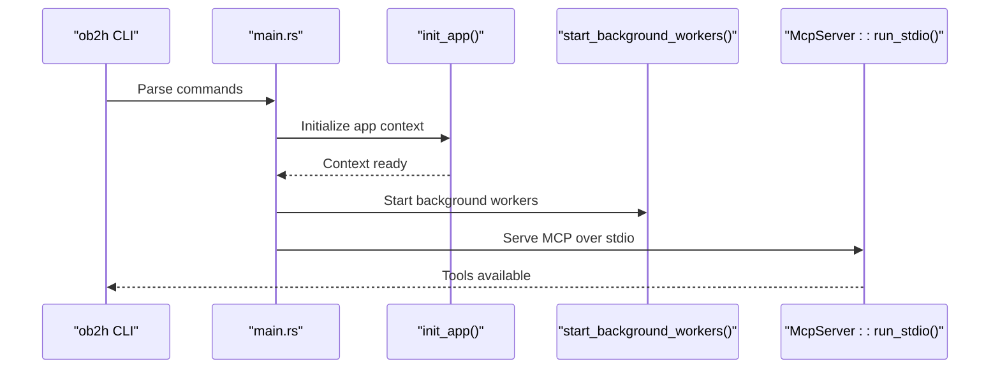
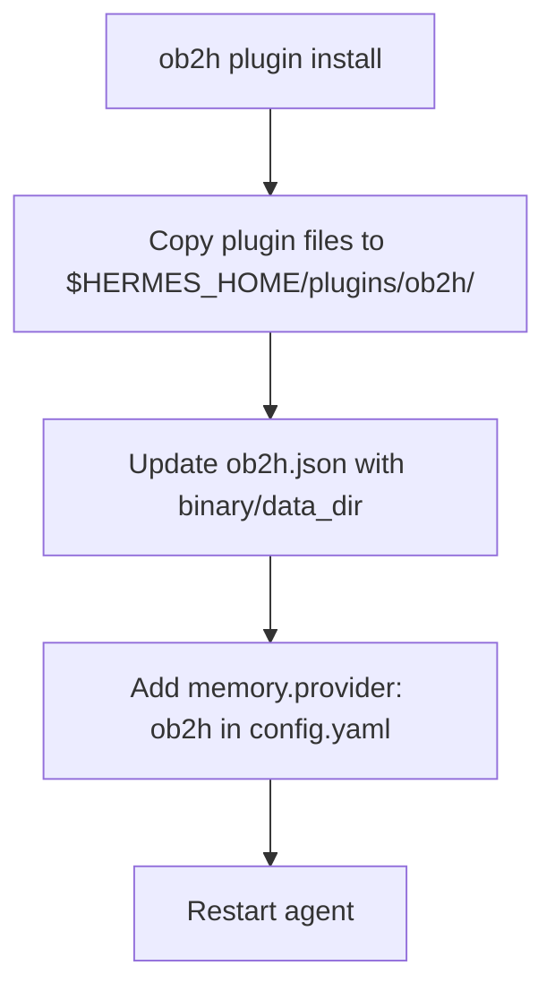
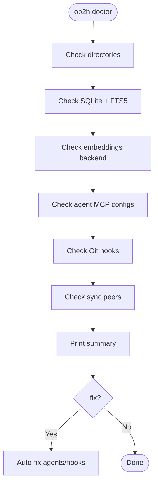
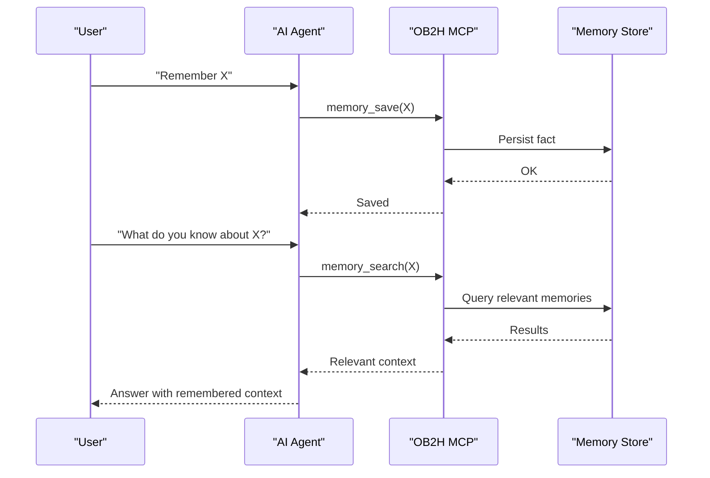
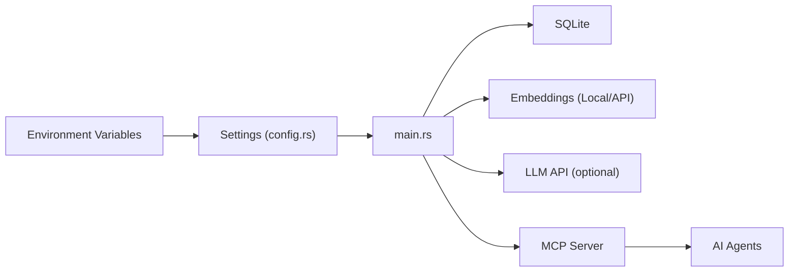

# Getting Started

<cite>
**Referenced Files in This Document**
- [README.md](file://README.md)
- [install.bat](file://install.bat)
- [scripts/install_hermes.ps1](file://scripts/install_hermes.ps1)
- [src/main.rs](file://src/main.rs)
- [src/config.rs](file://src/config.rs)
- [src/cli/doctor.rs](file://src/cli/doctor.rs)
- [docs/HERMES_INTEGRATION.md](file://docs/HERMES_INTEGRATION.md)
</cite>

## Table of Contents
1. [Introduction](#introduction)
2. [Project Structure](#project-structure)
3. [Core Components](#core-components)
4. [Architecture Overview](#architecture-overview)
5. [Detailed Component Analysis](#detailed-component-analysis)
6. [Dependency Analysis](#dependency-analysis)
7. [Performance Considerations](#performance-considerations)
8. [Troubleshooting Guide](#troubleshooting-guide)
9. [Conclusion](#conclusion)
10. [Appendices](#appendices)

## Introduction
OB2H is an autonomous long-term memory and knowledge-graph system for AI agents. It remembers your preferences, project context, code structure, and conversation history so that tools like Hermes, Claude Code, Cursor, Windsurf, ZCode, Gemini CLI, Qwen Code, OpenCode, and DSH can work with persistent, searchable, and evolving context.

At its core, OB2H:
- Stores facts, lessons, slots, sessions, and a code AST graph.
- Provides 56 MCP tools for memory search, graph reasoning, dream processing, Ralph development cycles, secrets management, and more.
- Runs as a single Rust binary with embedded embeddings, fast startup, low memory usage, and optional local LLM fallback.
- Integrates with popular agents through MCP servers, plugins, skills, and one-click installers.

This guide focuses on quick installation, basic configuration, connecting agents, enabling persistent memory, verifying the setup with `ob2h doctor`, and understanding why the Rust implementation matters.

**Section sources**
- [README.md:27-57](file://README.md#L27-L57)
- [README.md:61-70](file://README.md#L61-L70)
- [README.md:73-127](file://README.md#L73-L127)
- [README.md:130-149](file://README.md#L130-L149)

## Project Structure
The repository is organized around a Rust application with clear separation between CLI entry points, configuration, MCP server logic, and agent integration documentation.

**Diagram sources**
- [install.bat:1-6](file://install.bat#L1-L6)
- [scripts/install_hermes.ps1:1-100](file://scripts/install_hermes.ps1#L1-L100)
- [src/main.rs:17-90](file://src/main.rs#L17-L90)
- [src/config.rs:176-415](file://src/config.rs#L176-L415)
- [src/cli/doctor.rs:61-167](file://src/cli/doctor.rs#L61-L167)

**Section sources**
- [install.bat:1-6](file://install.bat#L1-L6)
- [scripts/install_hermes.ps1:1-100](file://scripts/install_hermes.ps1#L1-L100)
- [src/main.rs:17-90](file://src/main.rs#L17-L90)

## Core Components
- **CLI Entry Point**: The main binary parses commands, initializes settings, sets up logging, starts background workers, and runs the MCP server or specific commands like `doctor`, `plugin`, `skill`, `agent`, `dream`, `sync`, and `update`.
- **Configuration**: Settings are loaded from environment variables prefixed with `OB2H_`, including data directory, LLM endpoints, embedding provider, autodream behavior, update checks, secrets TTL, and offline mode.
- **Doctor Diagnostics**: A comprehensive health check for directories, SQLite database, FTS5 full-text index, vector embeddings, agent MCP configurations, Git hooks, sync peers, and viewer availability.
- **Agent Integration**: One-click installer registers the MCP server in Hermes; other agents are detected and configured by `ob2h agent install --agent all` and verified by `ob2h doctor`.

Key responsibilities:
- `main.rs`: command routing, MCP server lifecycle, plugin/skill/agent utilities.
- `config.rs`: environment-driven settings, path helpers, directory creation.
- `doctor.rs`: validation and auto-fix for agents, databases, embeddings, hooks, and sync.

**Section sources**
- [src/main.rs:17-90](file://src/main.rs#L17-L90)
- [src/main.rs:116-119](file://src/main.rs#L116-L119)
- [src/config.rs:176-415](file://src/config.rs#L176-L415)
- [src/cli/doctor.rs:61-167](file://src/cli/doctor.rs#L61-L167)

## Architecture Overview
OB2H exposes an MCP server that AI agents call to access memory, graph, dreams, lessons, slots, secrets, and project analysis. The installer configures the agent’s MCP client to point at the OB2H binary, which then serves tools over stdio.

**Diagram sources**
- [install.bat:1-6](file://install.bat#L1-L6)
- [scripts/install_hermes.ps1:13-100](file://scripts/install_hermes.ps1#L13-L100)
- [src/main.rs:62-90](file://src/main.rs#L62-L90)
- [src/config.rs:440-454](file://src/config.rs#L440-L454)

## Detailed Component Analysis

### One-Click Installation with install.bat
The Windows installer automates building the release binary, backing up the Hermes configuration, and registering the OB2H MCP server.

Steps:
1. Clone the repository or download the release.
2. Double-click `install.bat`.
3. The script builds `target/release/ob2h.exe` if missing.
4. It backs up `config.yaml` and inserts the `ob2h` MCP server block.
5. Restart Hermes to activate the MCP tools.

**Diagram sources**
- [scripts/install_hermes.ps1:13-100](file://scripts/install_hermes.ps1#L13-L100)
- [install.bat:1-6](file://install.bat#L1-L6)

**Section sources**
- [install.bat:1-6](file://install.bat#L1-L6)
- [scripts/install_hermes.ps1:13-100](file://scripts/install_hermes.ps1#L13-L100)

### Basic Configuration Options
OB2H reads configuration primarily from environment variables. Important options include:
- `OB2H_DATA_DIR`: Data directory for SQLite, workspace, logs, backups.
- `OB2H_LLM_BASE_URL`, `OB2H_LLM_API_KEY`, `OB2H_LLM_MODEL`: LLM endpoint and credentials.
- `OB2H_EMBED_PROVIDER`: Local Candle embeddings or external API.
- `OB2H_AUTODREAM_ENABLED`: Background dream processing.
- `OB2H_PREFETCH_MAX_CHARS`: Budget for injected memory blocks.
- `OB2H_SECRETS_TTL_MIN`: Secrets vault unlock TTL.
- `OB2H_OFFLINE`: Disable network downloads.

The installer also writes defaults into Hermes’ MCP server block, such as base URL, model, embed provider, and autodream flag.

**Section sources**
- [src/config.rs:176-415](file://src/config.rs#L176-L415)
- [scripts/install_hermes.ps1:68-80](file://scripts/install_hermes.ps1#L68-L80)
- [README.md:300-329](file://README.md#L300-L329)

### Connecting Popular AI Agents
After installation:
- For Hermes, use `ob2h plugin install` and add `provider: ob2h` under `memory:` in `config.yaml`.
- For other agents, run `ob2h agent install --agent all` and verify with `ob2h doctor --fix`.
- Supported agents include Claude Code, Cursor, Windsurf, ZCode, Gemini/Antigravity, Qwen Code, OpenCode, and DSH.

Verification steps:
- Check agent status: `ob2h agent status`.
- Run diagnostics: `ob2h doctor`.
- Confirm MCP tools are available in the agent.

**Section sources**
- [README.md:97-127](file://README.md#L97-L127)
- [docs/HERMES_INTEGRATION.md:15-49](file://docs/HERMES_INTEGRATION.md#L15-L49)
- [src/cli/doctor.rs:390-563](file://src/cli/doctor.rs#L390-L563)

### Setting Up the MCP Server
The MCP server is started via `ob2h serve`. The main entry point:
- Parses CLI arguments.
- Initializes app context and settings.
- Starts IPC for secrets.
- Launches background workers.
- Runs the MCP server over stdio.

**Diagram sources**
- [src/main.rs:17-90](file://src/main.rs#L17-L90)

**Section sources**
- [src/main.rs:17-90](file://src/main.rs#L17-L90)

### Installing Plugins and Skills
- Plugin installation copies Python files into Hermes’ plugin directory and updates `ob2h.json` with binary and data paths.
- Skill installation deploys agent-specific SKILL.md files.
- After installing the plugin, enable it in Hermes by setting `memory.provider: ob2h`.

**Diagram sources**
- [src/main.rs:733-784](file://src/main.rs#L733-L784)
- [docs/HERMES_INTEGRATION.md:15-36](file://docs/HERMES_INTEGRATION.md#L15-L36)

**Section sources**
- [src/main.rs:733-784](file://src/main.rs#L733-L784)
- [docs/HERMES_INTEGRATION.md:15-49](file://docs/HERMES_INTEGRATION.md#L15-L49)

### Verifying Installation with ob2h doctor
Run `ob2h doctor` to validate:
- Data directory and workspace existence.
- SQLite database integrity, WAL mode, FTS5 index.
- Embedding provider functionality.
- Agent MCP configurations (Claude, Cursor, Windsurf, Gemini, Hermes, Qwen, OpenCode, DSH).
- Git hooks in registered projects.
- Sync peers configuration.
- Viewer availability.

Use `ob2h doctor --fix` to automatically repair agent configurations and Git hooks.

**Diagram sources**
- [src/cli/doctor.rs:61-167](file://src/cli/doctor.rs#L61-L167)
- [src/cli/doctor.rs:668-702](file://src/cli/doctor.rs#L668-L702)

**Section sources**
- [src/cli/doctor.rs:61-167](file://src/cli/doctor.rs#L61-L167)
- [src/cli/doctor.rs:668-702](file://src/cli/doctor.rs#L668-L702)

### First Conversations with Persistent Memory Enabled
Once the plugin is enabled and the agent restarted:
- Save facts naturally: “Remember I prefer coffee without sugar.”
- Ask questions later: “What do you know about my preferences?”
- Use tools like `memory_save`, `memory_search`, `knowledge_extract`, and `graph_reason` through the agent interface.
- Look for the 🧠 indicator showing memory injection.

**Diagram sources**
- [README.md:130-149](file://README.md#L130-L149)
- [docs/HERMES_INTEGRATION.md:108-115](file://docs/HERMES_INTEGRATION.md#L108-L115)

**Section sources**
- [README.md:130-149](file://README.md#L130-L149)
- [docs/HERMES_INTEGRATION.md:108-115](file://docs/HERMES_INTEGRATION.md#L108-L115)

## Dependency Analysis
OB2H depends on:
- Environment variables for configuration.
- SQLite for structured storage.
- Optional local embeddings via Candle.
- External LLM APIs when configured.
- Agent-specific MCP clients (Hermes, Claude, Cursor, etc.).

**Diagram sources**
- [src/config.rs:176-415](file://src/config.rs#L176-L415)
- [src/main.rs:17-90](file://src/main.rs#L17-L90)

**Section sources**
- [src/config.rs:176-415](file://src/config.rs#L176-L415)
- [src/main.rs:17-90](file://src/main.rs#L17-L90)

## Performance Considerations
Rust-based OB2H offers significant performance advantages over Python alternatives:
- Single binary distribution (~15 MB).
- Sub-15ms startup time.
- Low memory footprint (15–30 MB).
- Built-in embeddings without external dependencies.
- Fast CLI and MCP tool execution.

These benefits make OB2H suitable for frequent, low-latency interactions with AI agents.

**Section sources**
- [README.md:61-70](file://README.md#L61-L70)

## Troubleshooting Guide
Common issues and resolutions:
- **Hermes config not found**: Ensure `config.yaml` exists at the expected path or set `HERMES_HOME`.
- **Binary build fails**: Verify Cargo and Rust toolchain are installed.
- **MCP tools not appearing**: Restart the agent after installation; verify `ob2h plugin status`.
- **Embeddings failing**: Check `OB2H_EMBED_PROVIDER` and local model availability; use `ob2h doctor` to diagnose.
- **Database integrity errors**: Run `ob2h doctor` and fix WAL/FTS5 issues.
- **Agent configuration missing**: Use `ob2h doctor --fix` to auto-install MCP entries.
- **Secrets vault not initialized**: Run `ob2h secrets init` and unlock with PIN.

Logs are stored in `data/logs/ob2h.log`.

**Section sources**
- [scripts/install_hermes.ps1:26-29](file://scripts/install_hermes.ps1#L26-L29)
- [src/cli/doctor.rs:197-325](file://src/cli/doctor.rs#L197-L325)
- [src/cli/doctor.rs:328-387](file://src/cli/doctor.rs#L328-L387)
- [docs/HERMES_INTEGRATION.md:108-115](file://docs/HERMES_INTEGRATION.md#L108-L115)

## Conclusion
OB2H provides a fast, private, and powerful long-term memory layer for AI agents. With one-click installation, robust diagnostics, and broad agent support, it enables persistent context, code-aware reasoning, and autonomous maintenance. The Rust architecture ensures speed, reliability, and minimal resource consumption, making it a strong alternative to Python-based solutions.

## Appendices

### Quick Commands Reference
- Install: `install.bat` or `ob2h install`
- Plugin: `ob2h plugin install`
- Skill: `ob2h skill install`
- Agent setup: `ob2h agent install --agent all`
- Diagnostics: `ob2h doctor`, `ob2h doctor --fix`
- Stats: `ob2h stats`
- Dream: `ob2h dream run`, `ob2h dream status`
- Backup: `ob2h backup`
- Secrets: `ob2h secrets init`, `ob2h secrets unlock`
- Update: `ob2h update check`, `ob2h update apply`

**Section sources**
- [README.md:220-296](file://README.md#L220-L296)