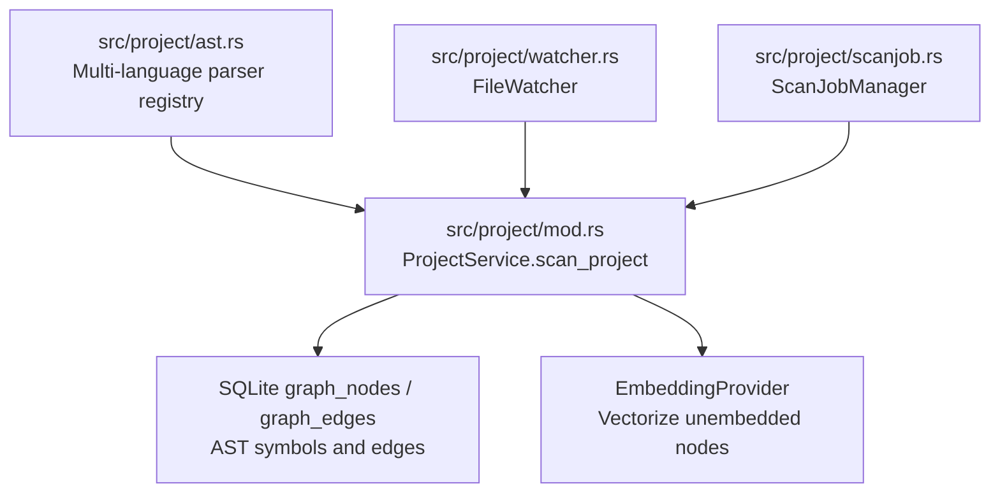
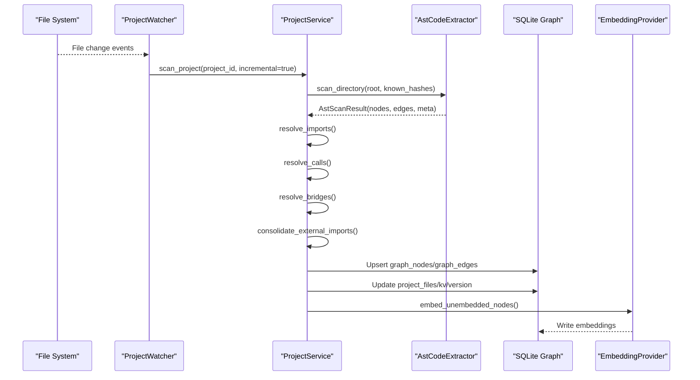
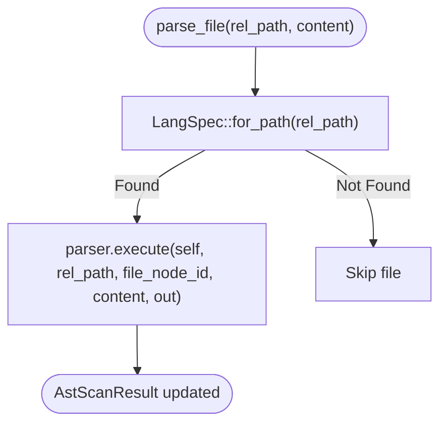
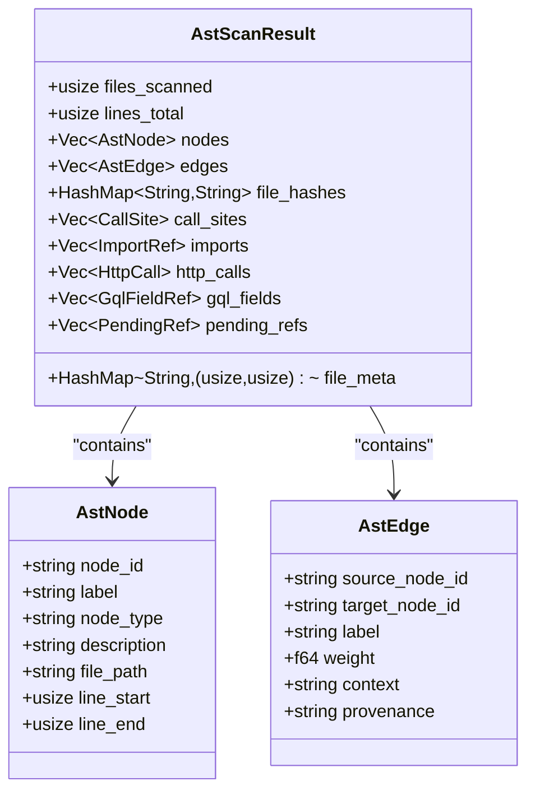
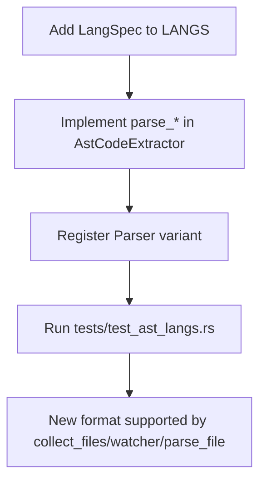
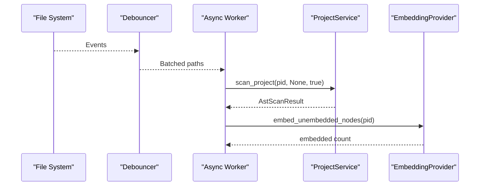
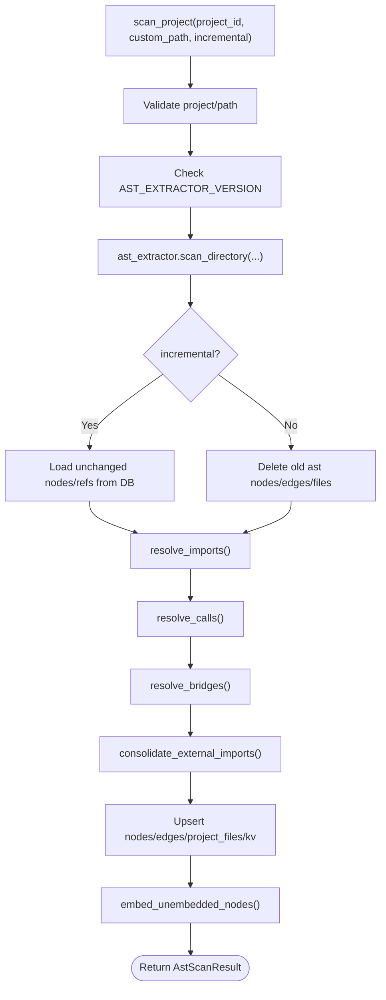
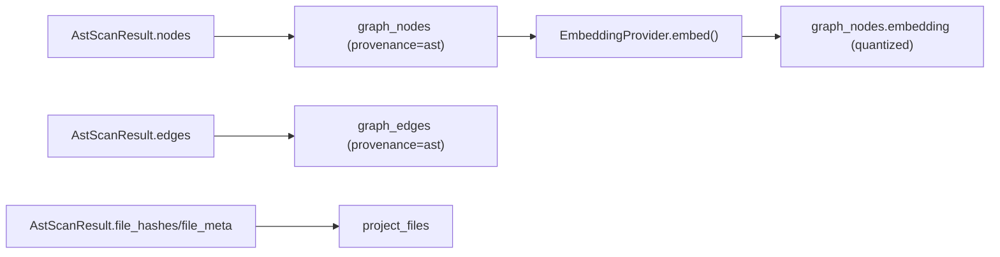
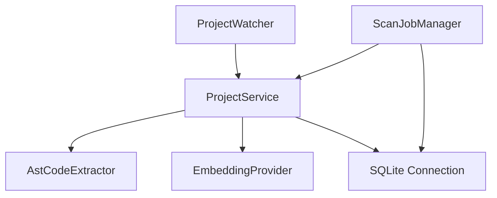

# AST Parsing Engine

<cite>
**Referenced Files in This Document**
- [README.md](file://README.md)
- [ARCHITECTURE.md](file://docs/ARCHITECTURE.md)
- [ast.rs](file://src/project/ast.rs)
- [mod.rs](file://src/project/mod.rs)
- [watcher.rs](file://src/project/watcher.rs)
- [scanjob.rs](file://src/project/scanjob.rs)
</cite>

## Table of Contents
1. [Introduction](#introduction)
2. [Project Structure](#project-structure)
3. [Core Components](#core-components)
4. [Architecture Overview](#architecture-overview)
5. [Detailed Component Analysis](#detailed-component-analysis)
6. [Dependency Analysis](#dependency-analysis)
7. [Performance Considerations](#performance-considerations)
8. [Troubleshooting Guide](#troubleshooting-guide)
9. [Conclusion](#conclusion)

## Introduction
This document explains the AST parsing engine that powers deterministic, token-free code symbol extraction for 31+ programming languages and web technologies. It covers the multi-language parser architecture, language-specific implementations, extension points for new formats, the file watching system that triggers incremental AST updates, and how parsed symbols flow into the project scanning pipeline and knowledge graph construction.

The engine is designed to:
- Extract classes, functions, interfaces, traits, modules, tables, routes, services, endpoints, schemas, resources, images, CSS selectors, and more.
- Produce stable node IDs and typed edges with provenance (EXTRACTED, RESOLVED, INFERRED).
- Run fully locally without LLM calls or token consumption.
- Support incremental scans on file changes via a debounced file watcher.
- Persist results into the shared SQLite knowledge graph and optionally vectorize nodes for semantic search.

**Section sources**
- [README.md:27-50](file://README.md#L27-L50)
- [ARCHITECTURE.md:367-399](file://docs/ARCHITECTURE.md#L367-L399)

## Project Structure
The AST parsing engine lives under `src/project` and integrates with the broader OB2H system:
- `ast.rs`: Multi-language parser registry, dispatchers, and per-language extractors.
- `mod.rs`: Project service orchestrating registration, scanning, embedding, and persistence.
- `watcher.rs`: File watcher using `notify` + debouncer to trigger incremental scans.
- `scanjob.rs`: Background scan job manager exposing status and completion metrics.

**Diagram sources**
- [ast.rs:1845-1949](file://src/project/ast.rs#L1845-L1949)
- [mod.rs:419-847](file://src/project/mod.rs#L419-L847)
- [watcher.rs:1-167](file://src/project/watcher.rs#L1-L167)
- [scanjob.rs:1-205](file://src/project/scanjob.rs#L1-L205)

**Section sources**
- [ast.rs:1-120](file://src/project/ast.rs#L1-L120)
- [mod.rs:1-67](file://src/project/mod.rs#L1-L67)
- [watcher.rs:1-33](file://src/project/watcher.rs#L1-L33)
- [scanjob.rs:1-51](file://src/project/scanjob.rs#L1-L51)

## Core Components
- **LangSpec Registry**: Centralized whitelist of supported languages/formats with matchers, node types, edge labels, size caps, parser tags, and fixtures.
- **AstCodeExtractor**: Regex-based parsers for each language; produces AstNode/AstEdge plus auxiliary data (call sites, imports, HTTP calls, GraphQL fields, pending refs).
- **ProjectService**: Orchestrates project registration, directory scanning, incremental diffing, type-pass resolution, bridge inference, manifest consolidation, persistence, and embedding.
- **ProjectWatcher**: Debounced file watcher that filters code files by LANGS and triggers incremental scans.
- **ScanJobManager**: Manages background AST scans, God Node recalculation, and batched embedding rounds.

Key data structures:
- `AstNode`: Stable node ID, label, type, description, file path, line range.
- `AstEdge`: Source/target node IDs, label, weight, context, provenance.
- `AstScanResult`: Aggregated scan output including nodes, edges, file hashes/meta, call sites, imports, HTTP calls, GraphQL field references, and pending references.

**Section sources**
- [ast.rs:15-119](file://src/project/ast.rs#L15-L119)
- [ast.rs:152-230](file://src/project/ast.rs#L152-L230)
- [mod.rs:39-67](file://src/project/mod.rs#L39-L67)

## Architecture Overview
The AST parsing engine follows a layered architecture:

**Diagram sources**
- [watcher.rs:44-167](file://src/project/watcher.rs#L44-L167)
- [mod.rs:419-847](file://src/project/mod.rs#L419-L847)
- [ast.rs:1845-1949](file://src/project/ast.rs#L1845-L1949)

## Detailed Component Analysis

### Multi-Language Parser Registry and Dispatch
- The registry `LANGS` defines all supported formats with:
  - Matcher: extension, exact filename, or predicate.
  - Node types and edge labels allowed by each parser.
  - Size cap (`NO_CAP`, `DEFAULT_CAP_BYTES`, `NOTEBOOK_CAP_BYTES`).
  - Parser tag used by the dispatcher.
  - Fixture and sample path for consistency tests.
- Dispatcher `parse_file` maps a file path to a LangSpec and invokes the corresponding parser method.

**Diagram sources**
- [ast.rs:1931-1949](file://src/project/ast.rs#L1845-L1949)
- [ast.rs:1191-1222](file://src/project/ast.rs#L1191-L1222)

**Section sources**
- [ast.rs:232-1189](file://src/project/ast.rs#L232-L1189)
- [ast.rs:1191-1222](file://src/project/ast.rs#L1191-L1222)
- [ast.rs:1931-1949](file://src/project/ast.rs#L1931-L1949)

### Language-Specific Implementations
Each language has a dedicated parser method inside `AstCodeExtractor`. Examples include:
- Rust: structs, traits, functions, route attributes, use imports, call sites.
- Python: classes, functions, imports, HTTP calls, GraphQL string fields.
- TS/JS: classes, interfaces, functions, imports, class binding.
- Go: structs, functions, imports.
- SQL: tables, foreign keys.
- PHP/Dart/Java/C#/C++/Kotlin/Swift/Ruby/Scala/Lua/Elixir/Shell: classes, interfaces, traits/mixins, functions, imports.
- HTML/Blade: elements, styles, bindings, routes.
- CSS/SCSS: classes, IDs, variables, imports.
- Jupyter notebooks: cells, classes, functions.
- Solidity/Zig: contracts/interfaces/functions/types.
- Protocol Buffers/GraphQL/OpenAPI: services, RPCs, messages, schemas, endpoints.
- Terraform/Dockerfile/Compose/Kubernetes: resources, images, env vars, ports, volumes, networks.
- Manifests (Cargo.toml, package.json, pyproject.toml, requirements.txt, go.mod, pubspec.yaml, composer.json): external packages and dependencies.

These parsers emit:
- Nodes with stable IDs like `struct:path:Name`, `fn:path:func`, `table:name`, `route:METHOD /path`, `pkg:ecosystem:name`.
- Edges with labels such as IMPORTS, DEFINES, INHERITS, IMPLEMENTS, DEPENDS_ON, FOREIGN_KEY_TO, ROUTE, STYLES, BINDS_CLASS, SERVES_ENDPOINT, QUERIES_FIELD, PROVIDES_RPC, USES_SCHEMA, MOUNTS, BINDS_SELECTOR.
- Provenance: EXTRACTED (direct parse), RESOLVED (type-pass), INFERRED (heuristics).

**Section sources**
- [ast.rs:1952-2118](file://src/project/ast.rs#L1952-L2118)
- [ast.rs:2120-2200](file://src/project/ast.rs#L2120-L2200)
- [ast.rs:2371-2519](file://src/project/ast.rs#L2371-L2519)
- [ast.rs:2519-2581](file://src/project/ast.rs#L2519-L2581)
- [ast.rs:2581-2637](file://src/project/ast.rs#L2581-L2637)
- [ast.rs:2637-2810](file://src/project/ast.rs#L2637-L2810)
- [ast.rs:2810-2963](file://src/project/ast.rs#L2810-L2963)
- [ast.rs:2963-3128](file://src/project/ast.rs#L2963-L3128)
- [ast.rs:3128-3279](file://src/project/ast.rs#L3128-L3279)
- [ast.rs:3279-3416](file://src/project/ast.rs#L3279-L3416)
- [ast.rs:3416-3560](file://src/project/ast.rs#L3416-L3560)
- [ast.rs:3560-3758](file://src/project/ast.rs#L3560-L3758)
- [ast.rs:3758-3874](file://src/project/ast.rs#L3758-L3874)
- [ast.rs:3874-3923](file://src/project/ast.rs#L3874-L3923)
- [ast.rs:3923-4050](file://src/project/ast.rs#L3923-L4050)
- [ast.rs:4050-4095](file://src/project/ast.rs#L4050-L4095)
- [ast.rs:4095-4219](file://src/project/ast.rs#L4095-L4219)
- [ast.rs:4219-4291](file://src/project/ast.rs#L4219-L4291)
- [ast.rs:4291-4508](file://src/project/ast.rs#L4291-L4508)
- [ast.rs:4508-4664](file://src/project/ast.rs#L4508-L4664)
- [ast.rs:4664-4780](file://src/project/ast.rs#L4664-L4780)

### Deterministic Symbol Extraction and Relationships
- Symbols are extracted deterministically using regex patterns and simple heuristics.
- Relationship types include:
  - Code relationships: IMPORTS, CALLS, DEFINES, IMPLEMENTS, INHERITS, DEPENDS_ON, FOREIGN_KEY_TO.
  - Framework heuristics: ROUTE, QUERIES_TABLE.
  - v1.7 additions: STYLES, BINDS_CLASS, SERVES_ENDPOINT, QUERIES_FIELD, PROVIDES_RPC, USES_SCHEMA, MOUNTS, BINDS_SELECTOR.
- Auto-target nodes are created from prefixes like `route:`, `table:`, `service:`, `endpoint:`, `schema:`, `pkg:`, `cssclass:`, `cssid:`, `cssvar:`, `resource:`, `k8s:`, `image:`, `el:`.

**Diagram sources**
- [ast.rs:15-119](file://src/project/ast.rs#L15-L119)

**Section sources**
- [ast.rs:15-119](file://src/project/ast.rs#L15-L119)
- [ast.rs:1235-1260](file://src/project/ast.rs#L1235-L1260)
- [ARCHITECTURE.md:376-399](file://docs/ARCHITECTURE.md#L376-L399)

### Extension Points for New Languages
To add a new language/format:
1. Add a `LangSpec` entry to `LANGS` with matcher, node types, edge labels, size cap, parser tag, fixture, and sample path.
2. Implement a `parse_*` method on `AstCodeExtractor` and register it via the `Parser` enum.
3. Ensure consistency tests pass (registry test validates fixtures).

**Diagram sources**
- [ast.rs:232-1189](file://src/project/ast.rs#L232-L1189)
- [ast.rs:162-209](file://src/project/ast.rs#L162-L209)

**Section sources**
- [ast.rs:232-1189](file://src/project/ast.rs#L232-L1189)
- [ast.rs:162-209](file://src/project/ast.rs#L162-L209)

### File Watching and Incremental Updates
The file watcher:
- Uses `notify` and a debouncer to batch file events.
- Filters events through `is_code_file`, which relies on the same `LANGS` registry and `SKIP_DIRS` list.
- Triggers `ProjectService.scan_project(..., incremental=true)` in a blocking task.
- After successful scan, calls `embed_unembedded_nodes` to vectorize newly added nodes.

**Diagram sources**
- [watcher.rs:1-167](file://src/project/watcher.rs#L1-L167)
- [mod.rs:69-146](file://src/project/mod.rs#L69-L146)

**Section sources**
- [watcher.rs:13-24](file://src/project/watcher.rs#L13-L24)
- [watcher.rs:44-167](file://src/project/watcher.rs#L44-L167)

### Integration with Project Scanning Pipeline
`ProjectService.scan_project` performs:
- Project validation and path normalization.
- Version check for AST extractor; forces full scan if version changed.
- Directory scanning via `AstCodeExtractor.scan_directory`, respecting `SKIP_DIRS` and `LANGS`.
- Incremental logic: loads unchanged symbols and ast_refs from DB to preserve cross-file relationships.
- Type-pass resolution: resolves imports and calls, producing RESOLVED edges.
- Bridge inference: connects client HTTP calls and GraphQL fields to server endpoints/services.
- External import consolidation: normalizes module imports to `pkg:<ecosystem>:name` and merges with manifest-defined packages.
- Persistence: upserts nodes and edges, updates `project_files`, stores extractor version, and refreshes project timestamps.
- Optional embedding: batches vectorization of unembedded nodes.

**Diagram sources**
- [mod.rs:419-847](file://src/project/mod.rs#L419-L847)
- [ast.rs:1845-1949](file://src/project/ast.rs#L1845-L1949)

**Section sources**
- [mod.rs:419-847](file://src/project/mod.rs#L419-L847)

### Knowledge Graph Construction Flow
Parsed AST symbols become graph nodes and edges:
- Nodes: `graph_nodes` with `provenance='ast'`, project-scoped, with optional embeddings.
- Edges: `graph_edges` with typed labels, weights, contexts, and provenance.
- Additional metadata: `project_files` tracks file hashes, sizes, and line counts for incremental diffs.
- Vectorization: `embed_unembedded_nodes` writes quantized vectors into `graph_nodes.embedding`.

**Diagram sources**
- [mod.rs:630-752](file://src/project/mod.rs#L630-L752)
- [mod.rs:802-847](file://src/project/mod.rs#L802-L847)
- [mod.rs:69-146](file://src/project/mod.rs#L69-L146)

**Section sources**
- [mod.rs:630-752](file://src/project/mod.rs#L630-L752)
- [mod.rs:802-847](file://src/project/mod.rs#L802-L847)
- [mod.rs:69-146](file://src/project/mod.rs#L69-L146)

## Dependency Analysis
- `ProjectService` depends on:
  - `AstCodeExtractor` for parsing.
  - `EmbeddingProvider` for vectorization.
  - SQLite connection for persistence.
- `ProjectWatcher` depends on `ProjectService` and uses `LANGS`/`SKIP_DIRS` from `ast.rs`.
- `ScanJobManager` depends on `ProjectService` and the shared SQLite connection for God Node analytics.

**Diagram sources**
- [mod.rs:39-67](file://src/project/mod.rs#L39-L67)
- [watcher.rs:1-33](file://src/project/watcher.rs#L1-L33)
- [scanjob.rs:46-60](file://src/project/scanjob.rs#L46-L60)

**Section sources**
- [mod.rs:39-67](file://src/project/mod.rs#L39-L67)
- [watcher.rs:1-33](file://src/project/watcher.rs#L1-L33)
- [scanjob.rs:46-60](file://src/project/scanjob.rs#L46-L60)

## Performance Considerations
- Deterministic regex-based parsing avoids LLM calls and token costs.
- Incremental scans minimize work by comparing file hashes and reusing unchanged symbols/refs.
- File size caps prevent heavy formats (HTML/CSS/Jupyter) from dominating scans.
- Batched embedding rounds limit memory pressure and ensure completion within bounded iterations.
- God Node analytics are recalculated post-scan but errors are non-fatal.

[No sources needed since this section provides general guidance]

## Troubleshooting Guide
Common issues and resolutions:
- No symbols after save: verify `is_code_file` includes the extension via `LANGS`; ensure the file is not in `SKIP_DIRS`.
- Missing cross-file relationships: confirm incremental mode loads unchanged nodes/refs; check type-pass resolution logs.
- Stale AST after extractor changes: version mismatch forces full rescan automatically.
- Embeddings not appearing: ensure `EmbeddingProvider` is configured; check `pending_embeddings` and background job status.

**Section sources**
- [watcher.rs:13-24](file://src/project/watcher.rs#L13-L24)
- [mod.rs:445-465](file://src/project/mod.rs#L445-L465)
- [scanjob.rs:110-176](file://src/project/scanjob.rs#L110-L176)

## Conclusion
The AST parsing engine delivers fast, deterministic, and extensible code symbol extraction across a broad set of languages and formats. Its centralized registry, robust incremental scanning, and integration with the knowledge graph enable accurate architectural insights and efficient semantic search without consuming LLM tokens. The file watcher ensures real-time updates, while background jobs and batching keep performance predictable at scale.

[No sources needed since this section summarizes without analyzing specific files]