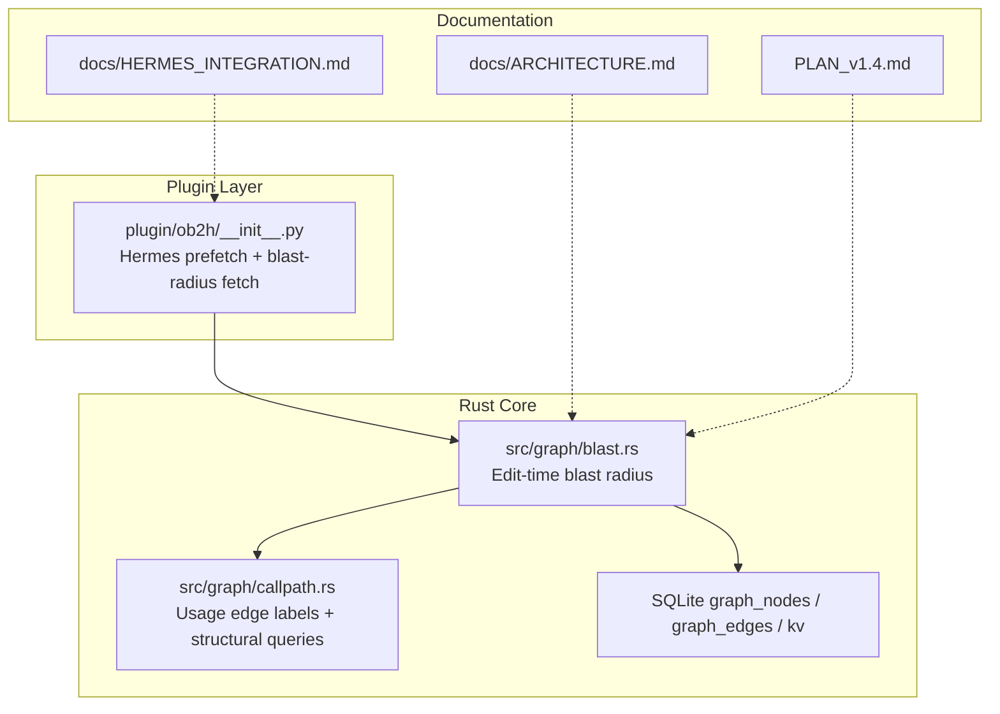
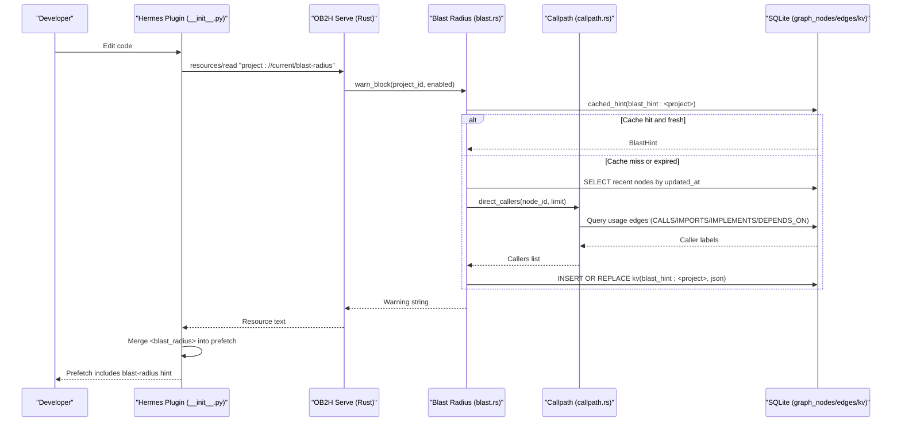
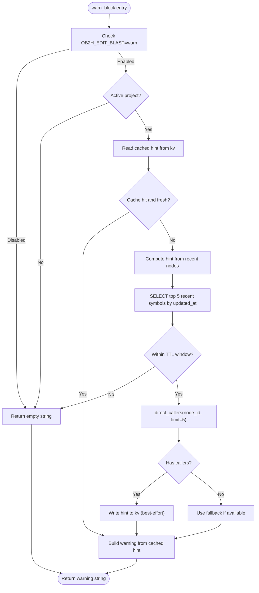
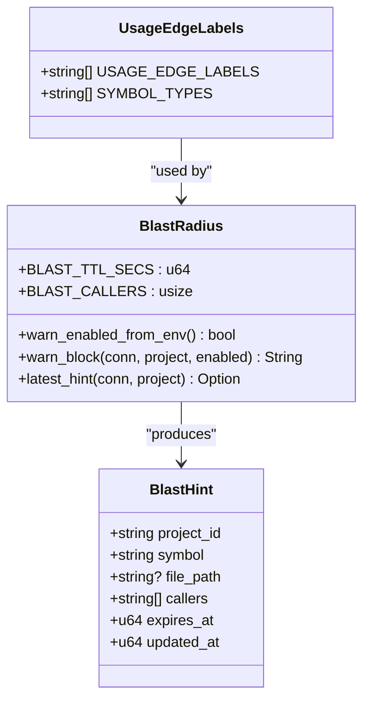
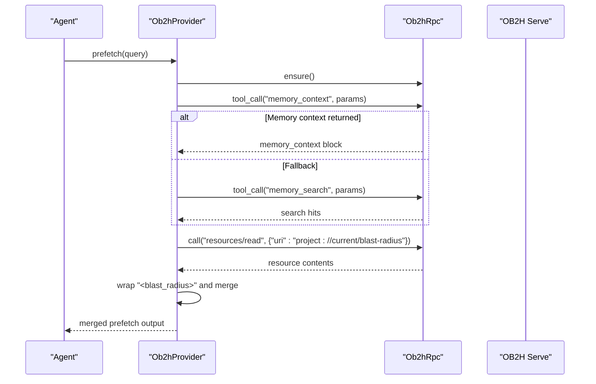
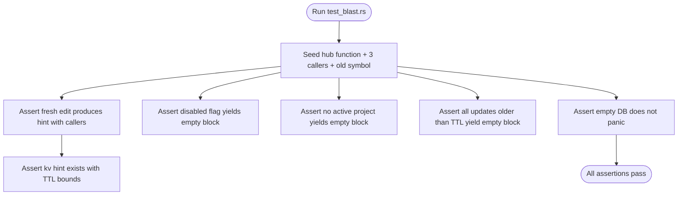
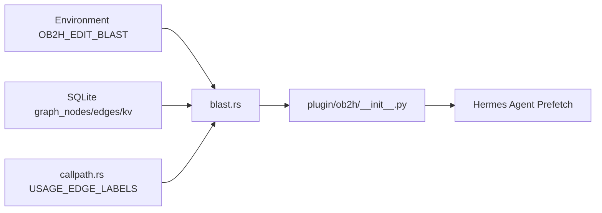

# Blast Radius Analysis

<cite>
**Referenced Files in This Document**
- [blast.rs](file://src/graph/blast.rs)
- [callpath.rs](file://src/graph/callpath.rs)
- [test_blast.rs](file://tests/test_blast.rs)
- [__init__.py](file://plugin/ob2h/__init__.py)
- [ARCHITECTURE.md](file://docs/ARCHITECTURE.md)
- [HERMES_INTEGRATION.md](file://docs/HERMES_INTEGRATION.md)
- [PLAN_v1.4.md](file://PLAN_v1.4.md)
</cite>

## Table of Contents
1. [Introduction](#introduction)
2. [Project Structure](#project-structure)
3. [Core Components](#core-components)
4. [Architecture Overview](#architecture-overview)
5. [Detailed Component Analysis](#detailed-component-analysis)
6. [Dependency Analysis](#dependency-analysis)
7. [Performance Considerations](#performance-considerations)
8. [Troubleshooting Guide](#troubleshooting-guide)
9. [Conclusion](#conclusion)
10. [Appendices](#appendices)

## Introduction
This document explains the blast radius analysis system that evaluates the potential impact of code changes. The system is designed as an edit-time, warn-only feature: when a developer edits code, it identifies the most recently changed symbol and reports its direct callers. It does not perform full risk scoring or multi-hop propagation; instead, it provides a lightweight, fail-open hint to help developers understand immediate dependencies before refactoring or deploying.

The core idea is simple:
- Track the most recently updated symbols in the project graph.
- For each candidate symbol, find direct callers using usage edges.
- Cache a short-lived hint with TTL.
- Expose the result through an MCP resource and integrate it into the Hermes prefetch pipeline.

This approach supports safer refactoring by surfacing immediate callers at edit time, while keeping overhead low and avoiding blocking user workflows.

## Project Structure
The blast radius functionality lives primarily in the Rust graph module and integrates with the Python plugin layer for agent-facing prefetch injection.

**Diagram sources**
- [blast.rs:1-202](file://src/graph/blast.rs#L1-L202)
- [callpath.rs:1-504](file://src/graph/callpath.rs#L1-L504)
- [__init__.py:279-335](file://plugin/ob2h/__init__.py#L279-L335)
- [ARCHITECTURE.md:359-359](file://docs/ARCHITECTURE.md#L359-L359)
- [HERMES_INTEGRATION.md:137-137](file://docs/HERMES_INTEGRATION.md#L137-L137)
- [PLAN_v1.4.md:395-416](file://PLAN_v1.4.md#L395-L416)

**Section sources**
- [blast.rs:1-202](file://src/graph/blast.rs#L1-L202)
- [callpath.rs:1-504](file://src/graph/callpath.rs#L1-L504)
- [__init__.py:279-335](file://plugin/ob2h/__init__.py#L279-L335)
- [ARCHITECTURE.md:359-359](file://docs/ARCHITECTURE.md#L359-L359)
- [HERMES_INTEGRATION.md:137-137](file://docs/HERMES_INTEGRATION.md#L137-L137)
- [PLAN_v1.4.md:395-416](file://PLAN_v1.4.md#L395-L416)

## Core Components
The blast radius system consists of:
- Edit-time hint computation over the latest changed symbols.
- Direct caller resolution via usage edges.
- TTL-based caching in a key-value store.
- A gated environment flag to enable warnings.
- Integration with the Hermes prefetch pipeline through an MCP resource.

Key responsibilities:
- `blast.rs`: Hint structure, TTL, cache lookup, compute logic, warning block generation.
- `callpath.rs`: Usage edge labels and structural query helpers used by blast radius.
- `plugin/ob2h/__init__.py`: Fetching the MCP resource and injecting `<blast_radius>` into prefetch output.

**Section sources**
- [blast.rs:14-52](file://src/graph/blast.rs#L14-L52)
- [blast.rs:61-81](file://src/graph/blast.rs#L61-L81)
- [blast.rs:83-144](file://src/graph/blast.rs#L83-L144)
- [blast.rs:146-196](file://src/graph/blast.rs#L146-L196)
- [callpath.rs:12-21](file://src/graph/callpath.rs#L12-L21)
- [__init__.py:279-335](file://plugin/ob2h/__init__.py#L279-L335)

## Architecture Overview
The architecture is layered:
- Data layer: SQLite stores the code graph (`graph_nodes`, `graph_edges`) and a small KV table for hints.
- Graph layer: Structural queries resolve usage relationships based on edge labels.
- Analysis layer: Blast radius computes a short-lived hint about recent edits and their direct callers.
- Integration layer: The Python plugin reads the MCP resource and merges the warning into agent memory prefetch.

**Diagram sources**
- [__init__.py:279-335](file://plugin/ob2h/__init__.py#L279-L335)
- [blast.rs:146-196](file://src/graph/blast.rs#L146-L196)
- [blast.rs:83-144](file://src/graph/blast.rs#L83-L144)
- [blast.rs:61-81](file://src/graph/blast.rs#L61-L81)
- [callpath.rs:12-21](file://src/graph/callpath.rs#L12-L21)

## Detailed Component Analysis

### Edit-Time Blast Radius Engine
The engine computes a short-lived hint for the most recently changed symbol and lists up to five direct callers. It uses:
- A TTL of 30 minutes for hint freshness.
- An environment gate `OB2H_EDIT_BLAST=warn` to enable warnings.
- A best-effort KV cache keyed by `blast_hint:<project>`.
- Fail-open behavior: database errors return empty strings rather than panicking.

**Diagram sources**
- [blast.rs:146-196](file://src/graph/blast.rs#L146-L196)
- [blast.rs:83-144](file://src/graph/blast.rs#L83-L144)
- [blast.rs:61-81](file://src/graph/blast.rs#L61-L81)

**Section sources**
- [blast.rs:14-52](file://src/graph/blast.rs#L14-L52)
- [blast.rs:83-144](file://src/graph/blast.rs#L83-L144)
- [blast.rs:146-196](file://src/graph/blast.rs#L146-L196)

### Usage Edge Labels and Structural Queries
Blast radius relies on usage edge labels to determine which relationships count as “uses” of a symbol. These labels are defined centrally and also influence dead-code detection and call-path traversal.

Important constraints:
- Only `CALLS`, `IMPORTS`, `IMPLEMENTS`, `DEPENDS_ON` are considered usage edges.
- Service edges like `ROUTE`, `QUERIES_TABLE`, `STYLES`, `BINDS_CLASS`, etc., are intentionally excluded to avoid false positives in blast radius and dead-code analysis.
- Symbol types include functions, structs, classes, interfaces, traits, and methods.

**Diagram sources**
- [callpath.rs:12-36](file://src/graph/callpath.rs#L12-L36)
- [blast.rs:14-52](file://src/graph/blast.rs#L14-L52)
- [blast.rs:146-196](file://src/graph/blast.rs#L146-L196)

**Section sources**
- [callpath.rs:12-36](file://src/graph/callpath.rs#L12-L36)
- [blast.rs:14-52](file://src/graph/blast.rs#L14-L52)

### Hermes Plugin Integration
The Python plugin integrates blast radius into the agent’s prefetch flow:
- It calls the MCP resource `project://current/blast-radius`.
- If the server returns text, it wraps it in `<blast_radius>` tags.
- It merges this block with memory context or search results.
- Errors are logged and ignored to keep prefetch resilient.

**Diagram sources**
- [__init__.py:279-335](file://plugin/ob2h/__init__.py#L279-L335)

**Section sources**
- [__init__.py:279-335](file://plugin/ob2h/__init__.py#L279-L335)

### Test Coverage and Behavior Validation
Tests validate:
- Fresh edits produce a hint with callers.
- Disabled flag produces no warning.
- No active project produces no warning.
- Expired or stale updates produce no warning.
- Empty databases or missing tables do not panic (fail-open).

**Diagram sources**
- [test_blast.rs:9-38](file://tests/test_blast.rs#L9-L38)
- [test_blast.rs:40-68](file://tests/test_blast.rs#L40-L68)
- [test_blast.rs:70-104](file://tests/test_blast.rs#L70-L104)
- [test_blast.rs:106-118](file://tests/test_blast.rs#L106-L118)

**Section sources**
- [test_blast.rs:9-38](file://tests/test_blast.rs#L9-L38)
- [test_blast.rs:40-68](file://tests/test_blast.rs#L40-L68)
- [test_blast.rs:70-104](file://tests/test_blast.rs#L70-L104)
- [test_blast.rs:106-118](file://tests/test_blast.rs#L106-L118)

## Dependency Analysis
The blast radius module depends on:
- SQLite for graph data and KV cache.
- Callpath module for usage edge labels and structural queries.
- Environment variables for enabling warnings.
- Hermes plugin for exposing the MCP resource and merging warnings into prefetch.

**Diagram sources**
- [blast.rs:22-25](file://src/graph/blast.rs#L22-L25)
- [blast.rs:14-52](file://src/graph/blast.rs#L14-L52)
- [callpath.rs:12-21](file://src/graph/callpath.rs#L12-L21)
- [__init__.py:279-335](file://plugin/ob2h/__init__.py#L279-L335)

**Section sources**
- [blast.rs:22-25](file://src/graph/blast.rs#L22-L25)
- [blast.rs:14-52](file://src/graph/blast.rs#L14-L52)
- [callpath.rs:12-21](file://src/graph/callpath.rs#L12-L21)
- [__init__.py:279-335](file://plugin/ob2h/__init__.py#L279-L335)

## Performance Considerations
- TTL caching reduces repeated computation; hints expire after 30 minutes.
- Direct callers are limited to five per symbol to keep output concise.
- Fail-open design ensures database errors do not block user workflows.
- The feature is warn-only and gated by an environment variable, minimizing default overhead.

[No sources needed since this section provides general guidance]

## Troubleshooting Guide
Common issues and resolutions:
- No blast radius warning appears:
  - Check that `OB2H_EDIT_BLAST=warn` is set.
  - Ensure an active project is selected.
  - Verify that recent edits fall within the TTL window.
- Prefetch does not include `<blast_radius>`:
  - Confirm the MCP resource `project://current/blast-radius` is accessible.
  - Check logs for RPC errors; they are suppressed but logged.
- Unexpected callers or missing callers:
  - Validate that usage edges exist between symbols.
  - Review whether edge labels match `USAGE_EDGE_LABELS`.

**Section sources**
- [blast.rs:22-25](file://src/graph/blast.rs#L22-L25)
- [blast.rs:146-196](file://src/graph/blast.rs#L146-L196)
- [__init__.py:279-335](file://plugin/ob2h/__init__.py#L279-L335)

## Conclusion
The blast radius analysis system provides a lightweight, edit-time warning mechanism that highlights direct callers of recently modified symbols. It is designed to be safe, fast, and non-blocking, integrating seamlessly with the Hermes prefetch pipeline. While it does not implement full risk scoring or multi-hop propagation, it offers practical value for developers performing refactors or preparing deployments by surfacing immediate dependency impacts.

[No sources needed since this section summarizes without analyzing specific files]

## Appendices

### Practical Examples
- Scenario: Editing a hub function that is called by three other functions.
  - Expected output: A warning listing the three callers.
  - Cache: Hint stored in KV with TTL 30 minutes.
- Scenario: Editing a legacy function with no recent updates.
  - Expected output: No warning if outside TTL or no callers found.
- Scenario: Disabling the feature.
  - Expected output: Empty warning regardless of edits.

**Section sources**
- [test_blast.rs:40-68](file://tests/test_blast.rs#L40-L68)
- [test_blast.rs:70-104](file://tests/test_blast.rs#L70-L104)

### Risk Assessment and Mitigation Strategies
- Current implementation does not calculate numeric risk levels.
- Mitigation strategies should focus on reviewing listed callers and updating tests accordingly.
- Use dead-code analysis alongside blast radius to identify unused symbols and reduce maintenance burden.

**Section sources**
- [callpath.rs:396-446](file://src/graph/callpath.rs#L396-L446)

### Version Control Integration
- The system relies on incremental rescans and timestamps (`updated_at`) to detect recent changes.
- Git hooks and project watchers update node timestamps, enabling the blast radius engine to identify recent edits.
- Documentation references confirm integration points with version control workflows.

**Section sources**
- [blast.rs:1-10](file://src/graph/blast.rs#L1-L10)
- [ARCHITECTURE.md:359-359](file://docs/ARCHITECTURE.md#L359-L359)
- [HERMES_INTEGRATION.md:137-137](file://docs/HERMES_INTEGRATION.md#L137-L137)
- [PLAN_v1.4.md:395-416](file://PLAN_v1.4.md#L395-L416)