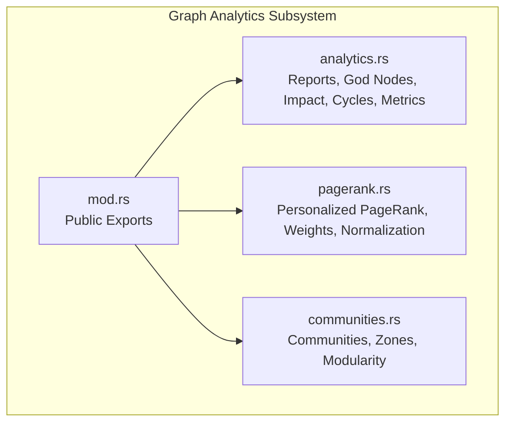
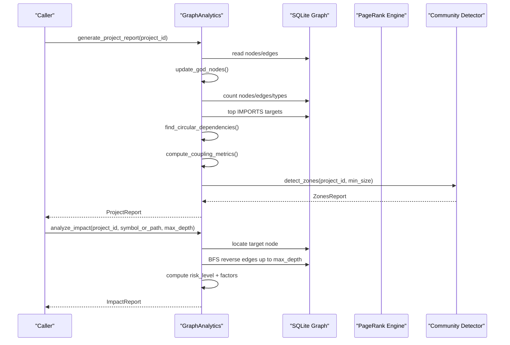
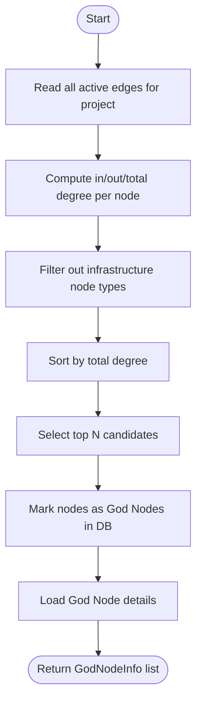
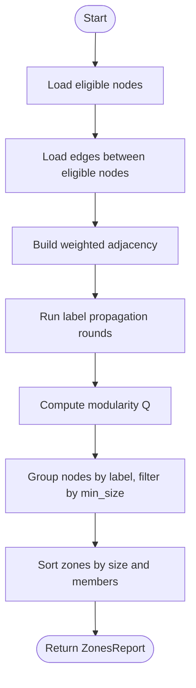
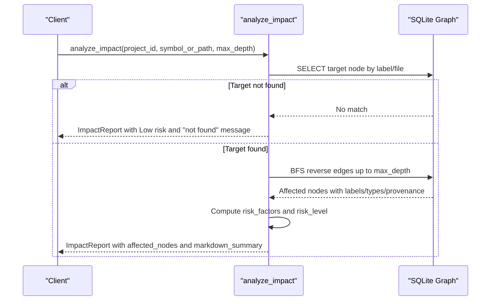
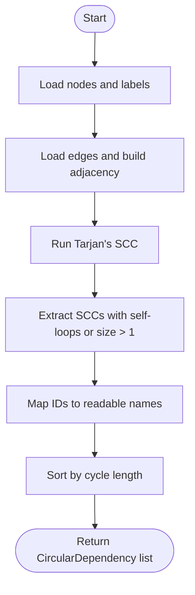
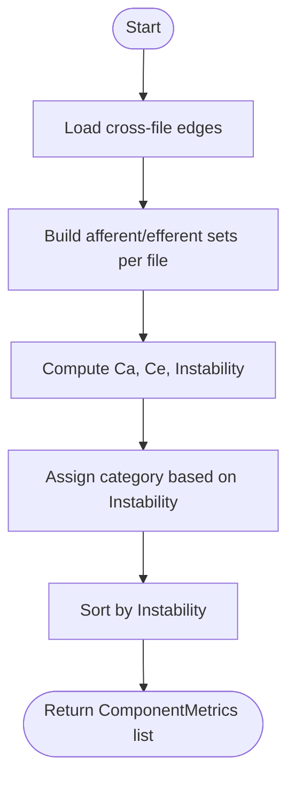
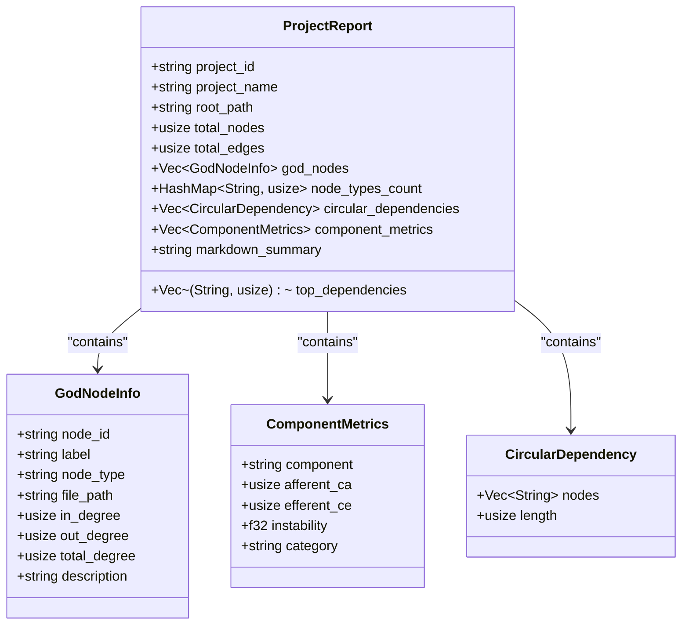
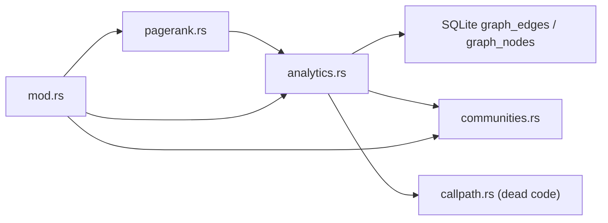

# Graph Analytics & Metrics

<cite>
**Referenced Files in This Document**
- [analytics.rs](file://src/graph/analytics.rs)
- [pagerank.rs](file://src/graph/pagerank.rs)
- [communities.rs](file://src/graph/communities.rs)
- [mod.rs](file://src/graph/mod.rs)
</cite>

## Table of Contents
1. [Introduction](#introduction)
2. [Project Structure](#project-structure)
3. [Core Components](#core-components)
4. [Architecture Overview](#architecture-overview)
5. [Detailed Component Analysis](#detailed-component-analysis)
6. [Dependency Analysis](#dependency-analysis)
7. [Performance Considerations](#performance-considerations)
8. [Troubleshooting Guide](#troubleshooting-guide)
9. [Conclusion](#conclusion)
10. [Appendices](#appendices)

## Introduction
This document explains the graph analytics and metrics subsystem used to analyze code structure, identify architectural hotspots, detect cohesive code clusters, assess refactoring risks, and evaluate change propagation. It focuses on:

- PageRank-based scoring for identifying God Nodes and architectural hubs.
- Community detection that finds cohesive code zones.
- Impact assessment tools that estimate blast radius and risk levels.
- Circular dependency detection using strongly connected components.
- Component-level coupling and stability metrics.
- Practical guidance for interpreting results and making architectural decisions.

The subsystem is implemented in Rust and operates over a SQLite-backed knowledge graph where nodes represent code entities (functions, methods, structs, classes, modules, files, etc.) and edges represent relationships such as imports, calls, or semantic links.

## Project Structure
The relevant implementation lives under `src/graph`:

- `analytics.rs` — project reports, God Node marking, impact analysis, circular dependency detection, component metrics, and context building.
- `pagerank.rs` — Personalized PageRank algorithm, edge weighting, entity normalization, and graph utilities.
- `communities.rs` — label-propagation community detection, modularity calculation, zone formatting, and symbol mention helpers.
- `mod.rs` — module exports exposing key types and functions to the rest of the system.

**Diagram sources**
- [mod.rs:3-14](file://src/graph/mod.rs#L3-L14)

**Section sources**
- [analytics.rs:1-893](file://src/graph/analytics.rs#L1-L893)
- [pagerank.rs:1-408](file://src/graph/pagerank.rs#L1-L408)
- [communities.rs:1-238](file://src/graph/communities.rs#L1-L238)
- [mod.rs:1-23](file://src/graph/mod.rs#L1-L23)

## Core Components
The subsystem exposes several core data structures and algorithms:

- **GodNodeInfo**: Represents a high-degree node identified as an architectural hub.
- **AffectedNode**: Represents a node affected by a change, including depth, edge label, provenance, and whether it is a God Node.
- **RiskLevel**: Enumerates Low, Medium, High risk with display labels.
- **ImpactReport**: Summarizes blast radius analysis, affected nodes, risk level, factors, and markdown summary.
- **CircularDependency**: Captures cycles found via Tarjan’s SCC.
- **ComponentMetrics**: Per-file afferent/efferent counts, instability, and category.
- **ProjectReport**: Aggregates project metadata, God Nodes, type distribution, top dependencies, cycles, component metrics, and markdown summary.
- **PprGraph / PprEdge**: Lightweight graph representation for PageRank computations.
- **Zone / ZonesReport**: Community detection output with modularity score and member lists.

These types are primarily defined in `analytics.rs`, while PageRank-specific structures live in `pagerank.rs`. Community-related structures live in `communities.rs`.

**Section sources**
- [analytics.rs:5-88](file://src/graph/analytics.rs#L5-L88)
- [pagerank.rs:51-67](file://src/graph/pagerank.rs#L51-L67)
- [communities.rs:13-24](file://src/graph/communities.rs#L13-L24)

## Architecture Overview
At a high level, the analytics pipeline reads from the SQLite graph database, computes structural metrics, and produces human-readable reports and machine-consumable structures.

**Diagram sources**
- [analytics.rs:201-375](file://src/graph/analytics.rs#L201-L375)
- [analytics.rs:378-616](file://src/graph/analytics.rs#L378-L616)
- [communities.rs:27-180](file://src/graph/communities.rs#L27-L180)

## Detailed Component Analysis

### PageRank Algorithm and God Node Identification
The PageRank engine provides Personalized PageRank with degree-normalization to avoid hub flooding. It supports:

- Configurable damping clamped to a safe range.
- Iteration limits and L1 convergence tolerance.
- Edge weights parsed from JSON configuration with fallback defaults.
- Entity normalization to reduce noise when constructing edges.

God Node identification uses degree centrality computed directly from the graph edges:

- Compute in-degree and out-degree per node.
- Exclude infrastructure-heavy node types from God Node candidates.
- Select top candidates by total degree (percentile-based with bounds).
- Mark selected nodes in the database and return enriched info.

**Diagram sources**
- [analytics.rs:94-198](file://src/graph/analytics.rs#L94-L198)

Key behaviors:

- Degree normalization in PageRank prevents hubs from dominating rankings.
- Dangling nodes return mass to personalization, preserving probability mass.
- Default edge weights are fixed and validated by tests; unknown kinds fall back to a default weight.
- Entity normalization collapses variants like initials and punctuation differences.

Practical interpretation:

- High PageRank scores indicate nodes reachable through meaningful paths from seeds.
- God Nodes highlight central architectural hubs likely to be risky to modify.
- Use both signals together: PageRank for relevance to queries/seeds, God Nodes for structural importance.

**Section sources**
- [pagerank.rs:1-47](file://src/graph/pagerank.rs#L1-L47)
- [pagerank.rs:112-185](file://src/graph/pagerank.rs#L112-L185)
- [pagerank.rs:187-214](file://src/graph/pagerank.rs#L187-L214)
- [pagerank.rs:216-241](file://src/graph/pagerank.rs#L216-L241)
- [analytics.rs:94-198](file://src/graph/analytics.rs#L94-L198)

### Community Detection and Cohesive Code Clusters
Community detection uses label propagation over the project graph:

- Build adjacency from edges between relevant node types.
- Iterate label updates weighted by neighbor edge weights.
- Break ties deterministically by minimum label ID.
- Compute modularity Q to quantify cluster quality.
- Produce zones filtered by minimum size and sorted by size then lexicographically.

**Diagram sources**
- [communities.rs:27-180](file://src/graph/communities.rs#L27-L180)

Interpretation:

- Higher modularity indicates stronger intra-zone cohesion relative to inter-zone connections.
- Zones help identify cohesive modules or subsystems that should ideally align with architectural boundaries.
- Small zones may be noise; use min_size to focus on meaningful clusters.

**Section sources**
- [communities.rs:1-8](file://src/graph/communities.rs#L1-L8)
- [communities.rs:27-180](file://src/graph/communities.rs#L27-L180)
- [communities.rs:218-237](file://src/graph/communities.rs#L218-L237)

### Impact Assessment Tools: Blast Radius and Risk Levels
Impact assessment evaluates how changes to a symbol or file propagate through the graph:

- Locate the target node by exact label match, prefix pattern, or file path.
- Perform BFS over incoming edges up to a bounded depth.
- Collect affected nodes with depth, edge label, provenance, and God Node status.
- Compute risk factors based on God Node involvement and breadth of impact.
- Assign RiskLevel: Low, Medium, High.
- Generate a structured ImpactReport and markdown summary with recommendations.

**Diagram sources**
- [analytics.rs:378-616](file://src/graph/analytics.rs#L378-L616)

Risk assessment rules:

- High risk if the target is a God Node, any affected node is a God Node, or the number of affected nodes exceeds a threshold.
- Medium risk if there are a moderate number of affected nodes.
- Low risk otherwise.

Recommendations embedded in the report vary by risk level, guiding interface alignment, test coverage, and compatibility checks.

**Section sources**
- [analytics.rs:378-616](file://src/graph/analytics.rs#L378-L616)

### Circular Dependency Detection
Circular dependencies are detected using Tarjan’s Strongly Connected Components algorithm:

- Load all nodes and edges for the project.
- Build adjacency list.
- Run Tarjan’s SCC to find cycles.
- Map SCCs to readable node names and lengths.
- Sort cycles by length descending.

**Diagram sources**
- [analytics.rs:619-761](file://src/graph/analytics.rs#L619-L761)

Interpretation:

- Longer cycles often indicate deeper architectural entanglement.
- Self-loops and multi-node SCCs both signal potential design issues.
- Use cycle information to plan decoupling and refactorings.

**Section sources**
- [analytics.rs:619-761](file://src/graph/analytics.rs#L619-L761)

### Component Metrics Calculation
Component metrics follow Robert Martin’s coupling measures:

- For each file, compute afferent coupling (Ca) and efferent coupling (Ce).
- Calculate instability I = Ce / (Ca + Ce).
- Categorize files as Stable (Core), Balanced, or Unstable (Leaf).
- Sort metrics by instability.

**Diagram sources**
- [analytics.rs:764-835](file://src/graph/analytics.rs#L764-L835)

Interpretation:

- Stable components have low instability and are good candidates for core abstractions.
- Unstable components are leaf-like and may be more volatile; they should depend on stable layers.
- Balanced components sit in the middle and may need boundary refinement.

**Section sources**
- [analytics.rs:764-835](file://src/graph/analytics.rs#L764-L835)

### Project Report and Context Building
The project report aggregates multiple analyses into a single view:

- Project metadata (name, root path, tech stack).
- Total nodes and edges.
- God Nodes with degrees and file locations.
- Node type distribution.
- Top imported dependencies.
- Circular dependencies.
- Component metrics highlighting most stable/unstable components.
- Zones (communities) with modularity score.
- Optional dead code candidates.
- Markdown summary for consumption by humans or agents.

Additionally, a compact `<project_context>` block can be built for agent prompts, summarizing God Nodes and relevant subsystems via FTS search.

**Diagram sources**
- [analytics.rs:6-88](file://src/graph/analytics.rs#L6-L88)
- [analytics.rs:201-375](file://src/graph/analytics.rs#L201-L375)
- [analytics.rs:837-891](file://src/graph/analytics.rs#L837-L891)

**Section sources**
- [analytics.rs:201-375](file://src/graph/analytics.rs#L201-L375)
- [analytics.rs:837-891](file://src/graph/analytics.rs#L837-L891)

## Dependency Analysis
The analytics module depends on the underlying SQLite schema for nodes and edges. It also integrates with community detection and callpath utilities for additional insights like dead code candidates. The public API is exposed through `mod.rs`.

**Diagram sources**
- [analytics.rs:201-375](file://src/graph/analytics.rs#L201-L375)
- [mod.rs:3-14](file://src/graph/mod.rs#L3-L14)

**Section sources**
- [analytics.rs:201-375](file://src/graph/analytics.rs#L201-L375)
- [mod.rs:1-23](file://src/graph/mod.rs#L1-L23)

## Performance Considerations
- PageRank iteration limit and tolerance control runtime and convergence behavior.
- Degree normalization prevents hub flooding and improves ranking stability.
- Community detection runs a fixed number of label propagation rounds and filters small zones.
- Impact analysis bounds BFS depth to prevent excessive traversal.
- Coupling metrics computation scans cross-file edges once and builds sets per file.

Best practices:

- Tune damping and tolerance for PageRank based on dataset size and query patterns.
- Use min_size for community detection to avoid noisy micro-zones.
- Cap max_depth in impact analysis to balance thoroughness and performance.
- Monitor God Node thresholds and exclude infrastructure types to keep reports actionable.

[No sources needed since this section provides general guidance]

## Troubleshooting Guide
Common issues and resolutions:

- Symbol not found in impact analysis:
  - Ensure the symbol exists in the graph and matches label or file path patterns.
  - Check deleted nodes or soft-deleted edges filtering conditions.
- Empty God Nodes list:
  - Verify edges exist and node types are not excluded by infrastructure filters.
  - Confirm degree computation includes active edges only.
- No communities detected:
  - Increase min_size or verify eligible node types are present.
  - Check edge weights and connectivity among eligible nodes.
- Unexpected high instability:
  - Review efferent vs afferent coupling; consider refactoring to reduce outgoing dependencies.
- Cycle detection false positives:
  - Inspect SCCs for self-loops and multi-node cycles; validate edge semantics.

Operational tips:

- Use the markdown summaries for quick visual inspection.
- Leverage risk factors to prioritize refactoring efforts.
- Combine God Node and PageRank signals to distinguish structural importance from query relevance.

**Section sources**
- [analytics.rs:378-616](file://src/graph/analytics.rs#L378-L616)
- [analytics.rs:94-198](file://src/graph/analytics.rs#L94-L198)
- [communities.rs:27-180](file://src/graph/communities.rs#L27-L180)

## Conclusion
The graph analytics and metrics subsystem provides a comprehensive toolkit for understanding and improving software architecture:

- PageRank identifies relevant nodes based on graph topology and seed preferences.
- God Node detection highlights central architectural hubs at risk during refactoring.
- Community detection reveals cohesive code clusters and helps align code organization with architectural intent.
- Impact assessment quantifies change propagation and assigns actionable risk levels.
- Circular dependency detection surfaces design problems requiring decoupling.
- Component metrics guide layering and dependency direction.

Use these tools iteratively: start with project reports to understand structure, refine boundaries via communities and metrics, mitigate risks with impact assessments, and continuously monitor cycles and God Nodes to maintain architectural health.

[No sources needed since this section summarizes without analyzing specific files]

## Appendices

### Example Analytics Queries and Interpretation
- Identify God Nodes:
  - Query: Update God Nodes for a project and retrieve top candidates by degree.
  - Interpretation: Focus refactoring on high-degree nodes; check file locations and descriptions.
- Assess impact of changing a function:
  - Query: Analyze blast radius for a symbol with depth 3.
  - Interpretation: Review affected nodes by depth; pay attention to God Nodes in the impact tree.
- Detect cycles:
  - Query: Find SCCs and map them to readable names.
  - Interpretation: Prioritize longer cycles for architectural cleanup.
- Evaluate component stability:
  - Query: Compute coupling metrics across files.
  - Interpretation: Move unstable dependencies toward stable layers; reduce efferent coupling.

[No sources needed since this section provides general guidance]