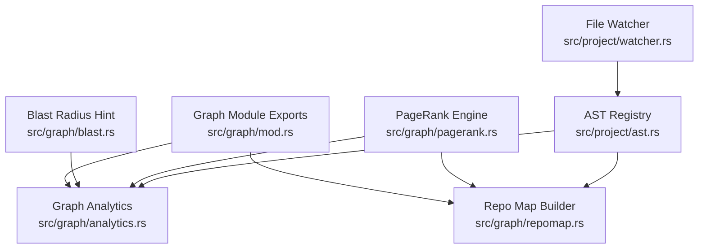
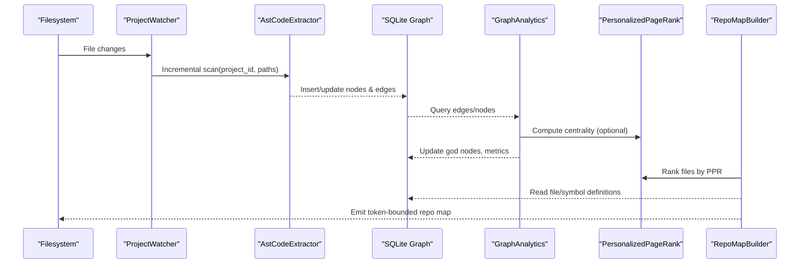
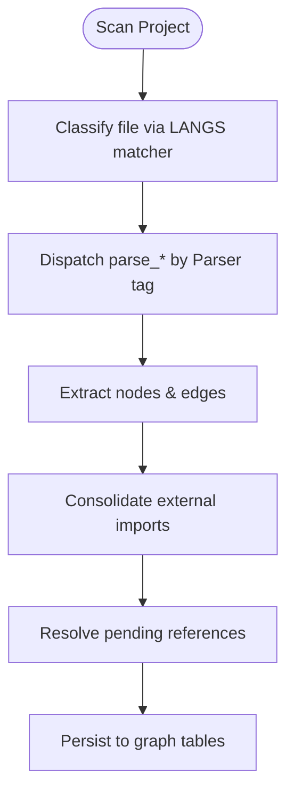
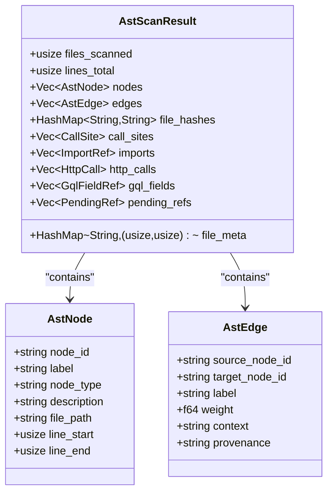
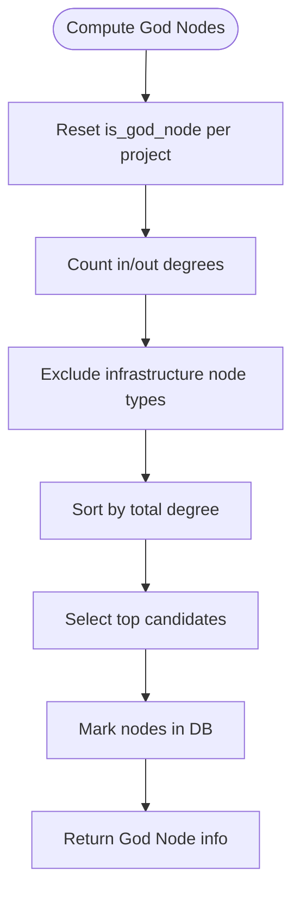
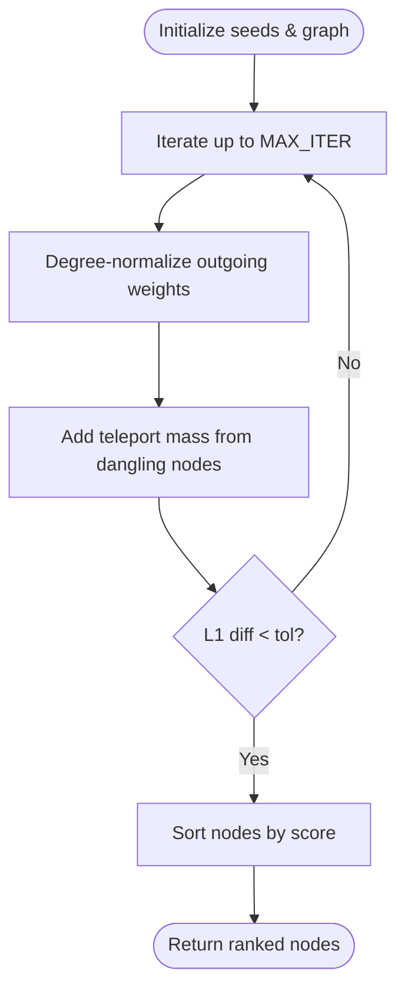
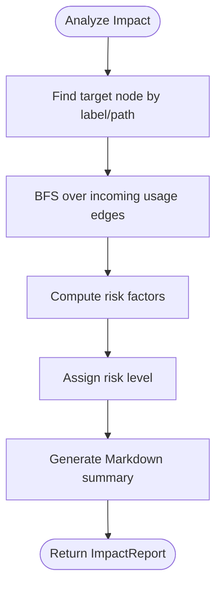
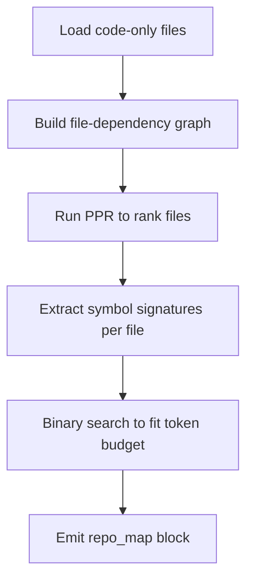
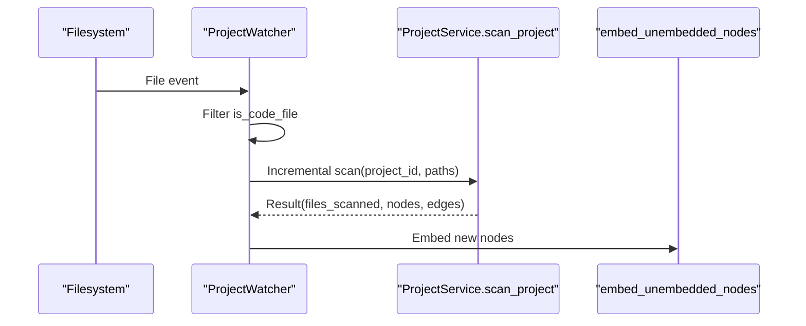
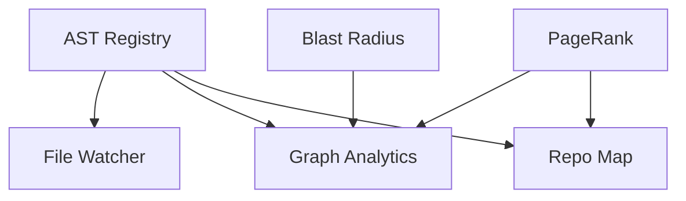

# Knowledge Graph

<cite>
**Referenced Files in This Document**   
- [README.md](file://README.md)
- [src/graph/mod.rs](file://src/graph/mod.rs)
- [src/project/ast.rs](file://src/project/ast.rs)
- [src/graph/analytics.rs](file://src/graph/analytics.rs)
- [src/graph/pagerank.rs](file://src/graph/pagerank.rs)
- [src/graph/blast.rs](file://src/graph/blast.rs)
- [src/graph/repomap.rs](file://src/graph/repomap.rs)
- [src/project/watcher.rs](file://src/project/watcher.rs)
</cite>

## Table of Contents
1. [Introduction](#introduction)
2. [Project Structure](#project-structure)
3. [Core Components](#core-components)
4. [Architecture Overview](#architecture-overview)
5. [Detailed Component Analysis](#detailed-component-analysis)
6. [Dependency Analysis](#dependency-analysis)
7. [Performance Considerations](#performance-considerations)
8. [Troubleshooting Guide](#troubleshooting-guide)
9. [Conclusion](#conclusion)

## Introduction
This document explains the knowledge graph sub-feature that turns a codebase into a deterministic, queryable graph of symbols and relationships. It focuses on:
- Multi-language AST parsing for 31+ programming languages and web technologies.
- Deterministic symbol extraction without LLM token consumption.
- Graph building algorithms that create nodes and edges representing code relationships.
- PageRank analytics for identifying God Nodes and architectural hotspots.
- Blast radius assessment for evaluating refactoring risks.
- File watcher integration for incremental updates.
- Repo-map generation for token-efficient context.
- Concrete examples of graph queries, architecture reports, and dependency analysis.
- Performance considerations for large codebases.

The system is implemented in Rust and integrates with SQLite for persistence, with optional embedding and agent-facing MCP tools exposed elsewhere in the project.

**Section sources**
- [README.md:27-57](file://README.md#L27-L57)

## Project Structure
The knowledge graph feature spans several modules:
- `src/project/ast.rs`: multi-language AST registry, file classification, and deterministic symbol extraction.
- `src/project/watcher.rs`: file watcher triggering incremental rescans.
- `src/graph/mod.rs`: public exports for analytics, blast radius, pagerank, repomap, and service types.
- `src/graph/analytics.rs`: God Node detection, impact analysis, circular dependency detection, coupling metrics, and project report generation.
- `src/graph/pagerank.rs`: Personalized PageRank engine used by analytics and repo-map.
- `src/graph/blast.rs`: edit-time blast radius hint computation and caching.
- `src/graph/repomap.rs**: repository map generation under token budget using PPR-ranked files.

**Diagram sources**
- [src/project/ast.rs:1-10](file://src/project/ast.rs#L1-L10)
- [src/graph/analytics.rs:90-120](file://src/graph/analytics.rs#L90-L120)
- [src/graph/pagerank.rs:1-20](file://src/graph/pagerank.rs#L1-L20)
- [src/graph/repomap.rs:1-20](file://src/graph/repomap.rs#L1-L20)
- [src/project/watcher.rs:1-20](file://src/project/watcher.rs#L1-L20)
- [src/graph/blast.rs:1-20](file://src/graph/blast.rs#L1-L20)
- [src/graph/mod.rs:1-23](file://src/graph/mod.rs#L1-L23)

**Section sources**
- [src/graph/mod.rs:1-23](file://src/graph/mod.rs#L1-L23)

## Core Components
- Multi-language AST parser registry: defines supported languages/formats, matchers (extension, filename, predicate), node types, edge labels, size caps, and per-format fixtures.
- Deterministic symbol extractor: extracts classes, functions, interfaces, traits, modules, tables, routes, styles, infrastructure resources, and more; produces AstNode/AstEdge structures plus call sites, imports, HTTP calls, GraphQL field refs, and pending references.
- Graph analytics: computes God Nodes, impact reports, circular dependencies, coupling metrics, and generates markdown architecture summaries.
- Personalized PageRank: iterative algorithm with degree normalization, damping clamping, convergence tolerance, and configurable edge weights.
- Repo map builder: builds a compact file-to-symbol map ranked by PPR over file-dependency graphs, bounded by token budget.
- Edit-time blast radius: caches hints about recently changed symbols and their direct callers to provide lightweight warnings during edits.
- File watcher: debounced file change detection triggers incremental rescans and embeds new nodes.

**Section sources**
- [src/project/ast.rs:15-119](file://src/project/ast.rs#L15-L119)
- [src/graph/analytics.rs:90-120](file://src/graph/analytics.rs#L90-L120)
- [src/graph/pagerank.rs:105-185](file://src/graph/pagerank.rs#L105-L185)
- [src/graph/repomap.rs:126-145](file://src/graph/repomap.rs#L126-L145)
- [src/graph/blast.rs:146-196](file://src/graph/blast.rs#L146-L196)
- [src/project/watcher.rs:43-165](file://src/project/watcher.rs#L43-L165)

## Architecture Overview
The knowledge graph pipeline consists of:
1. File discovery and language classification via the AST registry.
2. Deterministic parsing producing nodes and edges.
3. Post-processing consolidating external imports and resolving pending references.
4. Persistence into SQLite-backed graph tables.
5. Analytics computing centrality, impact, cycles, and coupling.
6. Optional PPR-based ranking for search expansion and repo maps.
7. Incremental updates driven by file watchers.

**Diagram sources**
- [src/project/watcher.rs:100-155](file://src/project/watcher.rs#L100-L155)
- [src/project/ast.rs:121-150](file://src/project/ast.rs#L121-L150)
- [src/graph/analytics.rs:92-198](file://src/graph/analytics.rs#L92-L198)
- [src/graph/pagerank.rs:112-185](file://src/graph/pagerank.rs#L112-L185)
- [src/graph/repomap.rs:205-256](file://src/graph/repomap.rs#L205-L256)

## Detailed Component Analysis

### Multi-Language AST Parsing Engine
The AST engine maintains a single registry of language specifications (`LANGS`) that unifies file scanning, watching, and parsing dispatch. Each entry includes:
- Human-readable name.
- Matcher: extension list, exact filename list, or predicate function.
- Node types produced by the parser.
- Edge labels produced by the parser.
- Max bytes cap for parsing.
- Parser tag.
- Fixture and sample path for tests.

Supported formats include Rust, Python, TS/JS, Go, SQL, PHP, Dart, Java, C#, C/C++, Kotlin, Swift, Ruby, Vue/Svelte SFC, Scala, Lua, Elixir, Shell, HTML, CSS/SCSS, Jupyter notebooks, Solidity, Zig, Protocol Buffers, GraphQL, OpenAPI/Swagger, Terraform/OpenTofu, Dockerfile, docker-compose, Kubernetes/Helm YAML, and package manifests (Cargo.toml, package.json, pyproject.toml, requirements.txt, go.mod, pubspec.yaml, composer.json).

Key behaviors:
- Unified whitelist avoids drift between scanner and watcher.
- Skip directories are centralized.
- Auto-created target nodes for routes, tables, services, endpoints, contracts, schemas, packages, CSS selectors, K8s resources, base images, elements, etc., enable cross-format linking.
- External import consolidation normalizes module references into package IDs per ecosystem.
- Pending references allow deferred resolution across scans (e.g., Terraform depends_on, K8s configMapRef/secretRef).

**Diagram sources**
- [src/project/ast.rs:121-150](file://src/project/ast.rs#L121-L150)
- [src/project/ast.rs:1191-1222](file://src/project/ast.rs#L1191-L1222)
- [src/project/ast.rs:1231-1260](file://src/project/ast.rs#L1231-L1260)
- [src/project/ast.rs:1324-1348](file://src/project/ast.rs#L1324-L1348)

**Section sources**
- [src/project/ast.rs:1-10](file://src/project/ast.rs#L1-L10)
- [src/project/ast.rs:121-150](file://src/project/ast.rs#L121-L150)
- [src/project/ast.rs:232-1189](file://src/project/ast.rs#L232-L1189)
- [src/project/ast.rs:1191-1222](file://src/project/ast.rs#L1191-L1222)
- [src/project/ast.rs:1231-1260](file://src/project/ast.rs#L1231-L1260)
- [src/project/ast.rs:1324-1348](file://src/project/ast.rs#L1324-L1348)

### Deterministic Symbol Extraction
The extractor produces deterministic nodes and edges without calling LLMs:
- Node types include code constructs (Module, Struct, Class, Interface, Trait, Function, Table, File) and auto-generated targets (Route, Service, Endpoint, Contract, Schema, ExternalPackage, CssClass, CssId, CssVar, Element, Resource, K8sResource, BaseImage).
- Edge labels include IMPORTS, CALLS, DEFINES, IMPLEMENTS, INHERITS, DEPENDS_ON, FOREIGN_KEY_TO, ROUTE, QUERIES_TABLE, STYLES, BINDS_CLASS, PROVIDES_RPC, SERVES_ENDPOINT, QUERIES_FIELD, USES_SCHEMA, MOUNTS, BINDS_SELECTOR.
- Provenance indicates EXTRACTED, RESOLVED, or INFERRED origins.
- Additional metadata includes call sites, imports with aliases, HTTP calls, GraphQL field references, and pending references resolvable after full scan.

This ensures 100% deterministic extraction and no token consumption.

**Section sources**
- [src/project/ast.rs:15-52](file://src/project/ast.rs#L15-L52)
- [src/project/ast.rs:100-119](file://src/project/ast.rs#L100-L119)
- [src/project/ast.rs:1231-1260](file://src/project/ast.rs#L1231-L1260)

### Graph Building Algorithms
Graph building transforms AST results into persistent nodes and edges:
- Nodes are created from parsed symbols and auto-targets.
- Edges encode relationships such as imports, calls, inheritance, implementation, schema usage, route binding, style binding, RPC provision, endpoint serving, field querying, mounting, and selector binding.
- External imports are consolidated into package IDs per ecosystem for stable cross-file linking.
- Pending references are resolved post-scan to avoid dangling nodes.

**Diagram sources**
- [src/project/ast.rs:15-52](file://src/project/ast.rs#L15-L52)
- [src/project/ast.rs:100-119](file://src/project/ast.rs#L100-L119)

**Section sources**
- [src/project/ast.rs:15-52](file://src/project/ast.rs#L15-L52)
- [src/project/ast.rs:100-119](file://src/project/ast.rs#L100-L119)
- [src/project/ast.rs:1324-1348](file://src/project/ast.rs#L1324-L1348)

### PageRank Analytics for God Nodes and Hotspots
God Node detection identifies highly connected symbols while excluding infrastructure hubs like external packages, base images, and CSS classes to keep focus on meaningful code hubs. The process:
- Resets previous God Node flags per project.
- Computes in-degree and out-degree for each node.
- Filters out infrastructure node types.
- Selects top candidates by total degree (top percentile with bounds).
- Marks nodes in the database and returns detailed info.

Coupling metrics compute afferent/efferent counts and instability per file, categorizing components as stable core, balanced, or unstable leaf. Circular dependency detection uses Tarjan’s SCC algorithm to find strongly connected components indicating cycles.

**Diagram sources**
- [src/graph/analytics.rs:92-198](file://src/graph/analytics.rs#L92-L198)

**Section sources**
- [src/graph/analytics.rs:92-198](file://src/graph/analytics.rs#L92-L198)
- [src/graph/analytics.rs:618-761](file://src/graph/analytics.rs#L618-L761)
- [src/graph/analytics.rs:763-835](file://src/graph/analytics.rs#L763-L835)

### Personalized PageRank Engine
The PPR engine implements an iterative algorithm with:
- Degree normalization to prevent hub flooding.
- Damping clamped to [0.5, 0.85].
- Convergence by L1 norm within tolerance.
- Configurable edge weights via JSON environment variable.
- Entity normalization utilities for consistent labeling.

It powers both analytics and repo-map ranking.

**Diagram sources**
- [src/graph/pagerank.rs:112-185](file://src/graph/pagerank.rs#L112-L185)

**Section sources**
- [src/graph/pagerank.rs:1-20](file://src/graph/pagerank.rs#L1-L20)
- [src/graph/pagerank.rs:105-185](file://src/graph/pagerank.rs#L105-L185)
- [src/graph/pagerank.rs:187-241](file://src/graph/pagerank.rs#L187-L241)

### Blast Radius Assessment
Blast radius assessment evaluates refactoring risk by:
- Finding the target symbol or file.
- Performing BFS over incoming usage edges to identify affected nodes.
- Computing risk factors including God Node involvement and breadth of impact.
- Assigning Low/Medium/High risk levels.
- Generating a Markdown summary with recommendations.

Edit-time blast hints provide lightweight warnings based on recent changes and direct callers, cached with TTL.

**Diagram sources**
- [src/graph/analytics.rs:377-616](file://src/graph/analytics.rs#L377-L616)
- [src/graph/blast.rs:96-144](file://src/graph/blast.rs#L96-L144)

**Section sources**
- [src/graph/analytics.rs:377-616](file://src/graph/analytics.rs#L377-L616)
- [src/graph/blast.rs:1-20](file://src/graph/blast.rs#L1-L20)
- [src/graph/blast.rs:96-144](file://src/graph/blast.rs#L96-L144)
- [src/graph/blast.rs:146-196](file://src/graph/blast.rs#L146-L196)

### Repo Map Generation for Token-Efficient Context
Repo map generation builds a compact file-to-symbol map under a token budget:
- Loads code-only files and filters out non-code manifests/styles.
- Builds a file-dependency graph using direct IMPORTS edges and co-import signals.
- Runs PPR to rank files by centrality.
- Extracts symbol signatures per file.
- Uses binary search to fit maximum prefix of blocks within budget.
- Optionally prepends high-trust project memory.

**Diagram sources**
- [src/graph/repomap.rs:70-94](file://src/graph/repomap.rs#L70-L94)
- [src/graph/repomap.rs:144-228](file://src/graph/repomap.rs#L144-L228)
- [src/graph/repomap.rs:258-325](file://src/graph/repomap.rs#L258-L325)

**Section sources**
- [src/graph/repomap.rs:1-20](file://src/graph/repomap.rs#L1-L20)
- [src/graph/repomap.rs:70-94](file://src/graph/repomap.rs#L70-L94)
- [src/graph/repomap.rs:126-145](file://src/graph/repomap.rs#L126-L145)
- [src/graph/repomap.rs:144-228](file://src/graph/repomap.rs#L144-L228)
- [src/graph/repomap.rs:258-325](file://src/graph/repomap.rs#L258-L325)

### File Watcher Integration for Incremental Updates
The file watcher:
- Detects relevant code files using the unified AST registry.
- Debounces events to batch changes.
- Triggers incremental rescans for changed files.
- Embeds newly scanned nodes.
- Integrates with blast hint caching by updating updated_at timestamps.

**Diagram sources**
- [src/project/watcher.rs:16-24](file://src/project/watcher.rs#L16-L24)
- [src/project/watcher.rs:100-155](file://src/project/watcher.rs#L100-L155)

**Section sources**
- [src/project/watcher.rs:1-20](file://src/project/watcher.rs#L1-L20)
- [src/project/watcher.rs:43-165](file://src/project/watcher.rs#L43-L165)

## Dependency Analysis
The knowledge graph components have clear dependencies:
- AST registry drives file classification and parsing.
- Analytics depends on graph edges/nodes and optionally PPR.
- Repo map depends on PPR and graph edges.
- Blast radius depends on usage edges and updated_at timestamps.
- File watcher depends on AST registry and project service.

**Diagram sources**
- [src/project/ast.rs:121-150](file://src/project/ast.rs#L121-L150)
- [src/graph/analytics.rs:92-198](file://src/graph/analytics.rs#L92-L198)
- [src/graph/pagerank.rs:112-185](file://src/graph/pagerank.rs#L112-L185)
- [src/graph/repomap.rs:205-256](file://src/graph/repomap.rs#L205-L256)
- [src/graph/blast.rs:96-144](file://src/graph/blast.rs#L96-L144)
- [src/project/watcher.rs:16-24](file://src/project/watcher.rs#L16-L24)

**Section sources**
- [src/graph/mod.rs:1-23](file://src/graph/mod.rs#L1-L23)

## Performance Considerations
- Deterministic parsing avoids LLM calls, reducing latency and cost.
- Centralized language registry prevents redundant checks and drift.
- Degree normalization in PPR prevents hub flooding and improves convergence.
- Token-budgeted repo map uses binary search to efficiently fit content.
- File watcher debouncing reduces excessive rescans.
- Size caps for certain formats (e.g., notebooks) prevent oversized parses.
- Infrastructure node exclusion in God Node detection keeps analytics focused.

[No sources needed since this section provides general guidance]

## Troubleshooting Guide
Common issues and resolutions:
- Missing symbols in graph: ensure project scan completed and incremental updates ran.
- Incorrect language classification: verify file extension or filename matches LANGS registry.
- Stale blast hints: check TTL and updated_at timestamps; clear kv cache if needed.
- PPR not converging: adjust damping and tolerance; verify edge weights configuration.
- Repo map too small: increase max_tokens or reduce symbol limits per file.

**Section sources**
- [src/project/ast.rs:1191-1222](file://src/project/ast.rs#L1191-L1222)
- [src/graph/blast.rs:83-94](file://src/graph/blast.rs#L83-L94)
- [src/graph/pagerank.rs:187-206](file://src/graph/pagerank.rs#L187-L206)
- [src/graph/repomap.rs:299-325](file://src/graph/repomap.rs#L299-L325)

## Conclusion
The knowledge graph sub-feature delivers a robust, deterministic, and scalable foundation for understanding code structure and relationships. By combining multi-language AST parsing, precise graph analytics, and efficient PPR-based ranking, it enables powerful queries, architecture insights, and safe refactoring decisions. Integration with file watchers ensures the graph stays current, while repo maps provide token-efficient context for agents.

[No sources needed since this section summarizes without analyzing specific files]