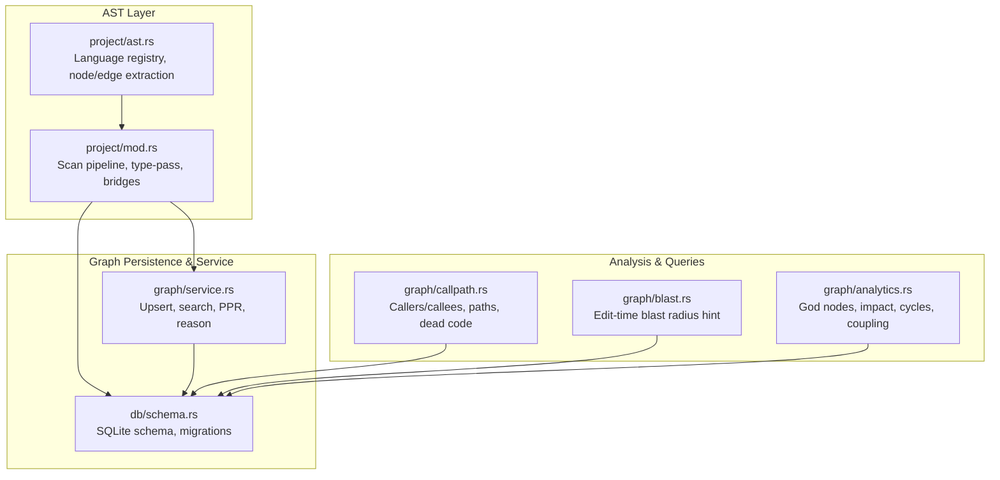
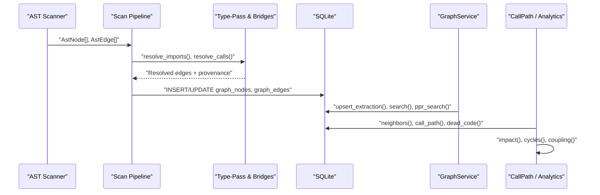
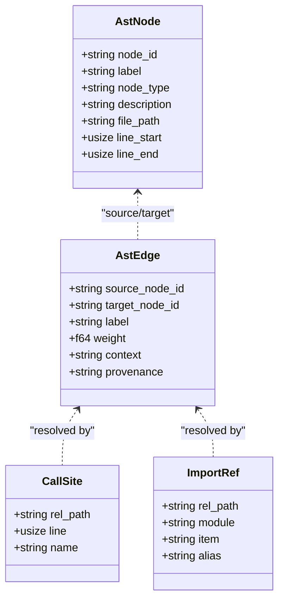
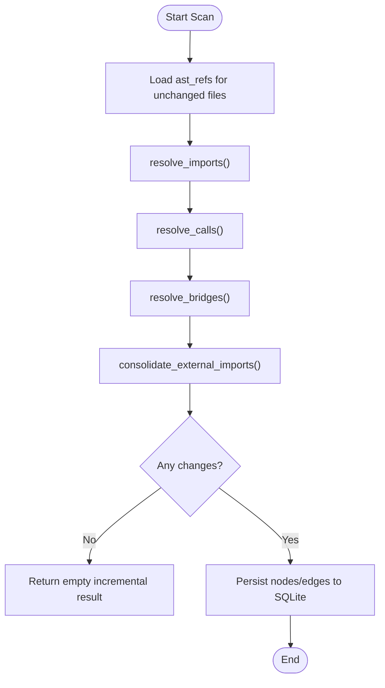
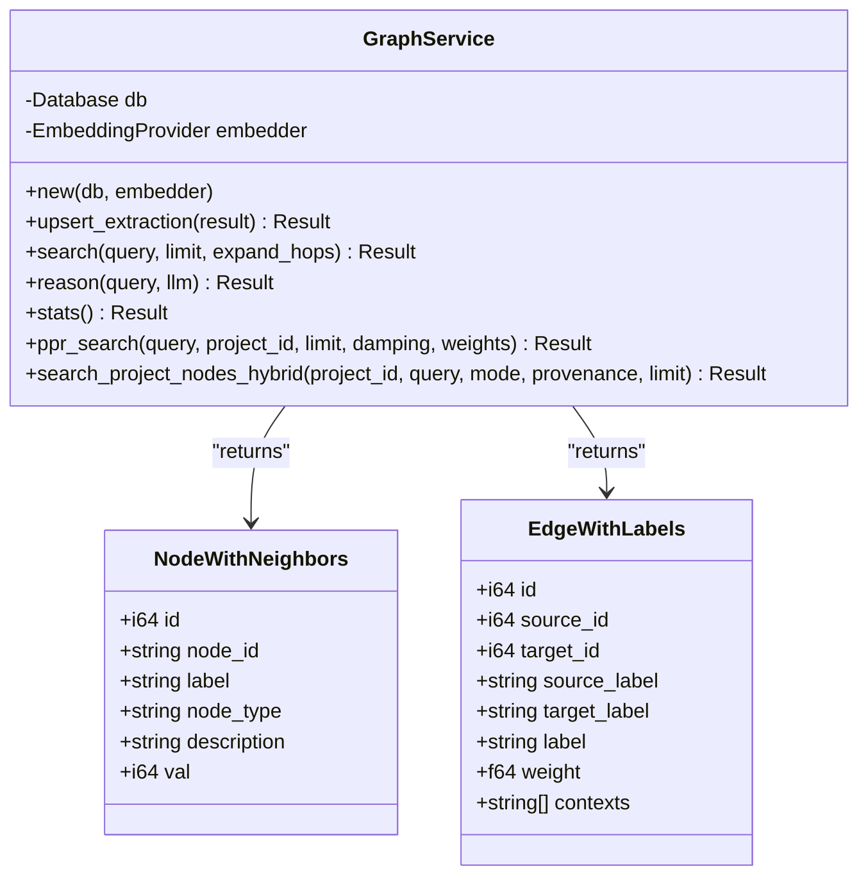
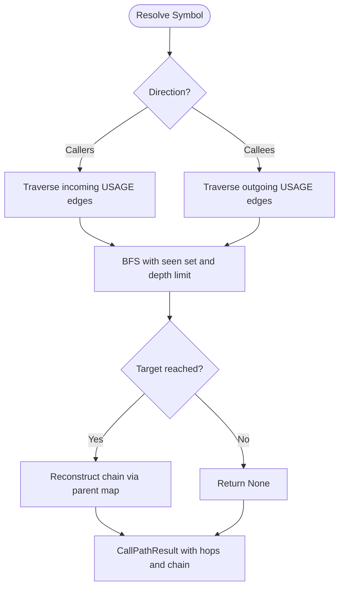
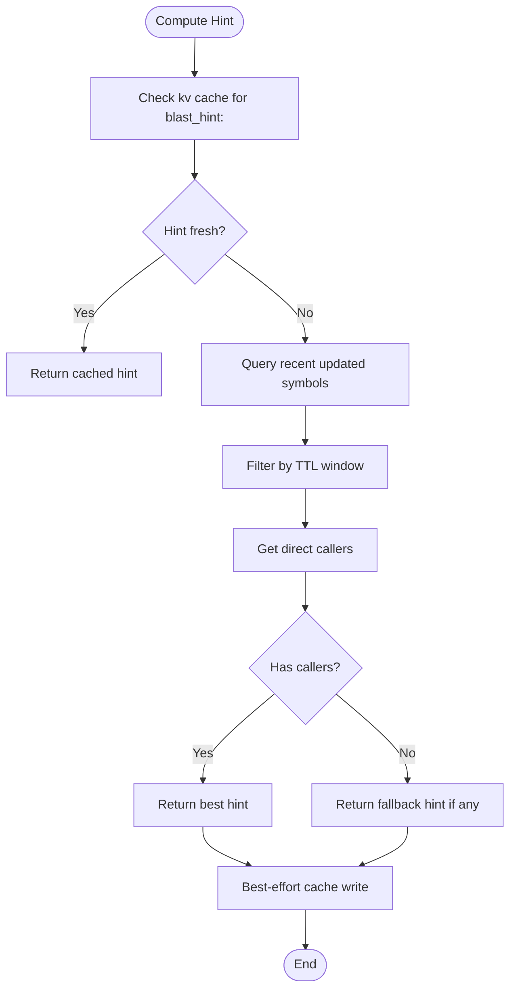
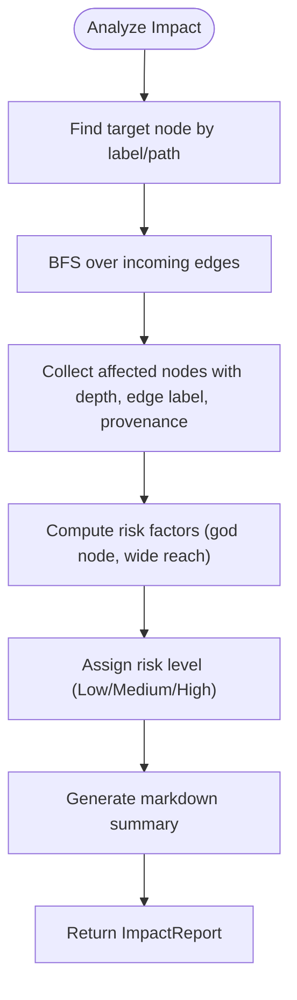
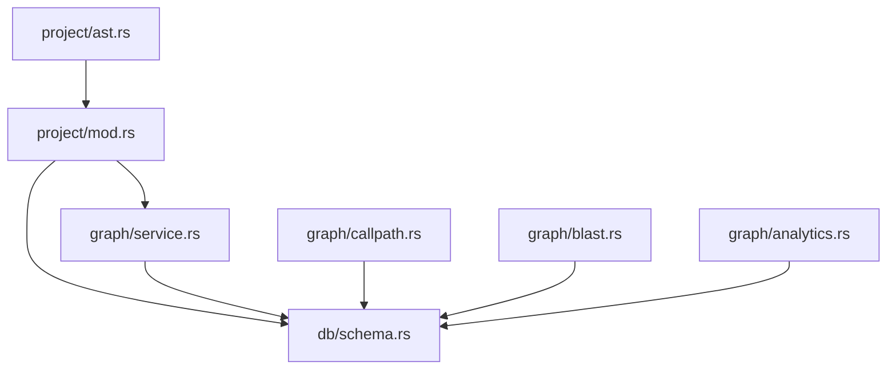

# Relationship Extraction

<cite>
**Referenced Files in This Document**   
- [mod.rs](file://src/graph/mod.rs)
- [service.rs](file://src/graph/service.rs)
- [callpath.rs](file://src/graph/callpath.rs)
- [blast.rs](file://src/graph/blast.rs)
- [analytics.rs](file://src/graph/analytics.rs)
- [ast.rs](file://src/project/ast.rs)
- [mod.rs](file://src/project/mod.rs)
- [schema.rs](file://src/db/schema.rs)
</cite>

## Table of Contents
1. [Introduction](#introduction)
2. [Project Structure](#project-structure)
3. [Core Components](#core-components)
4. [Architecture Overview](#architecture-overview)
5. [Detailed Component Analysis](#detailed-component-analysis)
6. [Dependency Analysis](#dependency-analysis)
7. [Performance Considerations](#performance-considerations)
8. [Troubleshooting Guide](#troubleshooting-guide)
9. [Conclusion](#conclusion)

## Introduction
This document explains the relationship extraction subsystem that builds edges between graph nodes representing code relationships. It covers how call paths are traced, dependency relationships are identified, and semantic connections are established between code elements. It documents edge creation algorithms, relationship types such as calls, imports, extends, implements, and dependencies, the graph service interface for managing relationships, examples of relationship queries and path analysis, dependency visualization, incremental update mechanisms, and how relationships are maintained as code evolves.

The subsystem is built on a SQLite-backed knowledge graph where:
- Nodes represent code entities such as files, functions, classes, interfaces, tables, routes, services, and infrastructure resources.
- Edges represent relationships such as imports, calls, inheritance, implementation, schema usage, deployment dependencies, and framework-level bridges.
- A project-scoped AST scanner produces deterministic nodes and edges, which are then persisted into `graph_nodes` and `graph_edges`.
- Graph analytics, blast radius, call-path traversal, and personalized PageRank operate over these structures to provide structural queries, impact analysis, and ranking.

## Project Structure
The relationship extraction subsystem spans three main layers:

1. **AST layer**: language-aware parsing that extracts nodes and edges from source code and configuration formats.
2. **Graph persistence and service layer**: upserts nodes and edges, provides search, reasoning, PPR ranking, and hybrid project search.
3. **Analysis and query layer**: call-path traversal, dead-code detection, blast radius hints, architectural analytics, and coupling metrics.

**Diagram sources**
- [ast.rs:15-52](file://src/project/ast.rs#L15-L52)
- [mod.rs:500-580](file://src/project/mod.rs#L500-L580)
- [schema.rs:268-293](file://src/db/schema.rs#L268-L293)
- [service.rs:96-115](file://src/graph/service.rs#L96-L115)
- [callpath.rs:12-36](file://src/graph/callpath.rs#L12-L36)
- [blast.rs:34-52](file://src/graph/blast.rs#L34-L52)
- [analytics.rs:90-120](file://src/graph/analytics.rs#L90-L120)

**Section sources**
- [ast.rs:15-52](file://src/project/ast.rs#L15-L52)
- [mod.rs:500-580](file://src/project/mod.rs#L500-L580)
- [schema.rs:268-293](file://src/db/schema.rs#L268-L293)
- [service.rs:96-115](file://src/graph/service.rs#L96-L115)
- [callpath.rs:12-36](file://src/graph/callpath.rs#L12-L36)
- [blast.rs:34-52](file://src/graph/blast.rs#L34-L52)
- [analytics.rs:90-120](file://src/graph/analytics.rs#L90-L120)

## Core Components
- **AST node and edge models**: define code entities and relationship labels with provenance metadata.
- **Graph service**: manages upserting extracted relationships, searching nodes and edges, reasoning over facts, and running personalized PageRank.
- **Call path analyzer**: traverses usage edges to find callers, callees, explicit call chains, and dead symbols.
- **Blast radius hint**: caches recent edit-time impact using updated timestamps and direct callers.
- **Analytics**: computes god nodes, impact reports, circular dependencies, and component coupling metrics.

Key responsibilities:
- Extracting relationships from multiple languages and formats.
- Resolving cross-file imports and calls via type-pass and bridge heuristics.
- Persisting deterministic AST-derived nodes and edges with project scoping and provenance.
- Providing structural queries and analytical insights over the resulting graph.

**Section sources**
- [ast.rs:15-52](file://src/project/ast.rs#L15-L52)
- [service.rs:96-115](file://src/graph/service.rs#L96-L115)
- [callpath.rs:12-36](file://src/graph/callpath.rs#L12-L36)
- [blast.rs:34-52](file://src/graph/blast.rs#L34-L52)
- [analytics.rs:90-120](file://src/graph/analytics.rs#L90-L120)

## Architecture Overview
The relationship extraction architecture follows a pipeline:

1. **File discovery and language matching**: the AST registry determines which files to parse and which parsers to use.
2. **AST scanning**: each parser emits nodes and edges with labels like IMPORTS, DEFINES, INHERITS, IMPLEMENTS, DEPENDS_ON, ROUTE, QUERIES_TABLE, STYLES, BINDS_CLASS, PROVIDES_RPC, SERVES_ENDPOINT, QUERIES_FIELD, USES_SCHEMA, MOUNTS, BINDS_SELECTOR.
3. **Type-pass resolution**: simple calls and internal imports are resolved across files; CALLS edges receive RESOLVED provenance.
4. **Bridge heuristics**: contract-to-code links (HTTP calls, GraphQL fields, RPC definitions) are bridged with INFERRED provenance.
5. **Persistence**: nodes and edges are inserted or updated in SQLite under a project scope, with soft deletes and timestamps.
6. **Query and analysis**: call-path traversal, blast radius hints, analytics, and PPR ranking operate over the persisted graph.

**Diagram sources**
- [ast.rs:100-119](file://src/project/ast.rs#L100-L119)
- [mod.rs:555-580](file://src/project/mod.rs#L555-L580)
- [schema.rs:268-293](file://src/db/schema.rs#L268-L293)
- [service.rs:106-216](file://src/graph/service.rs#L106-L216)
- [callpath.rs:151-219](file://src/graph/callpath.rs#L151-L219)
- [analytics.rs:377-616](file://src/graph/analytics.rs#L377-L616)

## Detailed Component Analysis

### AST Node and Edge Models
The AST layer defines the fundamental data structures for code relationships:
- `AstNode`: represents a code entity with label, node_type, description, file path, and line range.
- `AstEdge`: represents a relationship with source/target node IDs, label, weight, context, and provenance.

Relationship labels include:
- Code relationships: IMPORTS, CALLS, DEFINES, INHERITS, IMPLEMENTS, DEPENDS_ON, FOREIGN_KEY_TO.
- Framework heuristics: ROUTE, QUERIES_TABLE.
- v1.7 additions: STYLES, BINDS_CLASS, PROVIDES_RPC, SERVES_ENDPOINT, QUERIES_FIELD, USES_SCHEMA, MOUNTS, BINDS_SELECTOR.

Provenance indicates how an edge was derived:
- EXTRACTED: normal scan.
- RESOLVED: type-pass resolution.
- INFERRED: heuristic bridges.

**Diagram sources**
- [ast.rs:15-52](file://src/project/ast.rs#L15-L52)
- [ast.rs:54-69](file://src/project/ast.rs#L54-L69)

**Section sources**
- [ast.rs:15-52](file://src/project/ast.rs#L15-L52)
- [ast.rs:54-69](file://src/project/ast.rs#L54-L69)

### Scan Pipeline and Type-Pass Resolution
The scan pipeline coordinates AST scanning, import resolution, call resolution, bridge construction, and external import consolidation. Key steps:
- Load previously saved AST references for unchanged files to avoid re-parsing.
- Resolve internal imports and same-file calls to produce RESOLVED provenance edges.
- Build INFERRED bridges between contracts and code (e.g., HTTP calls to endpoints).
- Merge external imports into package nodes defined by manifests.

**Diagram sources**
- [mod.rs:500-580](file://src/project/mod.rs#L500-L580)

**Section sources**
- [mod.rs:500-580](file://src/project/mod.rs#L500-L580)

### Graph Service Interface
The graph service provides:
- Upserting extraction results (nodes and edges) with deduplication and embedding updates.
- Hybrid search combining lexical FTS/LIKE scoring and vector cosine similarity.
- Reasoning over retrieved facts using an LLM.
- Personalized PageRank ranking with seed nodes from search results.
- Stats and project-scoped queries.

**Diagram sources**
- [service.rs:33-59](file://src/graph/service.rs#L33-L59)
- [service.rs:96-115](file://src/graph/service.rs#L96-L115)

**Section sources**
- [service.rs:106-216](file://src/graph/service.rs#L106-L216)
- [service.rs:236-460](file://src/graph/service.rs#L236-L460)
- [service.rs:546-674](file://src/graph/service.rs#L546-L674)

### Call Path Traversal and Dead Code Detection
The call path subsystem focuses on structural queries over usage edges:
- Usage edge labels: CALLS, IMPORTS, IMPLEMENTS, DEPENDS_ON.
- Symbol types considered for dead-code analysis: Function, Struct, Class, Interface, Trait, Method.
- BFS traversal to find callers and callees up to a bounded depth.
- Explicit path reconstruction from a source symbol to a target symbol.
- Dead code detection excluding entrypoints based on naming, path patterns, public API markers, and framework decorators.

**Diagram sources**
- [callpath.rs:151-219](file://src/graph/callpath.rs#L151-L219)
- [callpath.rs:221-311](file://src/graph/callpath.rs#L221-L311)

**Section sources**
- [callpath.rs:12-36](file://src/graph/callpath.rs#L12-L36)
- [callpath.rs:105-141](file://src/graph/callpath.rs#L105-L141)
- [callpath.rs:151-219](file://src/graph/callpath.rs#L151-L219)
- [callpath.rs:221-311](file://src/graph/callpath.rs#L221-L311)
- [callpath.rs:313-394](file://src/graph/callpath.rs#L313-L394)
- [callpath.rs:396-446](file://src/graph/callpath.rs#L396-L446)

### Blast Radius Hints
The blast radius hint system provides lightweight edit-time warnings:
- TTL-based caching of the most recently changed symbol and its top callers.
- Direct caller lookup via usage edges.
- Environment-gated output (`OB2H_EDIT_BLAST=warn`).
- Fail-open behavior: database errors return empty warning blocks.

**Diagram sources**
- [blast.rs:61-81](file://src/graph/blast.rs#L61-L81)
- [blast.rs:96-144](file://src/graph/blast.rs#L96-L144)
- [blast.rs:146-196](file://src/graph/blast.rs#L146-L196)

**Section sources**
- [blast.rs:16-25](file://src/graph/blast.rs#L16-L25)
- [blast.rs:34-52](file://src/graph/blast.rs#L34-L52)
- [blast.rs:61-81](file://src/graph/blast.rs#L61-L81)
- [blast.rs:96-144](file://src/graph/blast.rs#L96-L144)
- [blast.rs:146-196](file://src/graph/blast.rs#L146-L196)

### Analytics: God Nodes, Impact Reports, Cycles, Coupling
Analytics provides architectural insights:
- God node detection based on degree centrality with infrastructure exclusions.
- Impact report generation via BFS over reverse edges, risk factor computation, and markdown summaries.
- Circular dependency detection using Tarjan’s strongly connected components algorithm.
- Coupling metrics per component (afferent/efferent counts and instability index).

**Diagram sources**
- [analytics.rs:92-198](file://src/graph/analytics.rs#L92-L198)
- [analytics.rs:377-616](file://src/graph/analytics.rs#L377-L616)
- [analytics.rs:618-761](file://src/graph/analytics.rs#L618-L761)
- [analytics.rs:763-800](file://src/graph/analytics.rs#L763-L800)

**Section sources**
- [analytics.rs:92-198](file://src/graph/analytics.rs#L92-L198)
- [analytics.rs:377-616](file://src/graph/analytics.rs#L377-L616)
- [analytics.rs:618-761](file://src/graph/analytics.rs#L618-L761)
- [analytics.rs:763-800](file://src/graph/analytics.rs#L763-L800)

## Dependency Analysis
The relationship extraction subsystem has clear dependency boundaries:
- The AST layer depends on language-specific parsers and the unified language registry.
- The scan pipeline orchestrates resolution steps and persists results to SQLite.
- The graph service depends on the database and embedding provider for search and reasoning.
- Analysis modules depend on the persisted graph and may reference callpath constants for usage edge filtering.

**Diagram sources**
- [ast.rs:100-119](file://src/project/ast.rs#L100-L119)
- [mod.rs:500-580](file://src/project/mod.rs#L500-L580)
- [schema.rs:268-293](file://src/db/schema.rs#L268-L293)
- [service.rs:96-115](file://src/graph/service.rs#L96-L115)
- [callpath.rs:12-36](file://src/graph/callpath.rs#L12-L36)
- [blast.rs:34-52](file://src/graph/blast.rs#L34-L52)
- [analytics.rs:90-120](file://src/graph/analytics.rs#L90-L120)

**Section sources**
- [ast.rs:100-119](file://src/project/ast.rs#L100-L119)
- [mod.rs:500-580](file://src/project/mod.rs#L500-L580)
- [schema.rs:268-293](file://src/db/schema.rs#L268-L293)
- [service.rs:96-115](file://src/graph/service.rs#L96-L115)
- [callpath.rs:12-36](file://src/graph/callpath.rs#L12-L36)
- [blast.rs:34-52](file://src/graph/blast.rs#L34-L52)
- [analytics.rs:90-120](file://src/graph/analytics.rs#L90-L120)

## Performance Considerations
- **Incremental scanning**: unchanged files reuse stored AST references, reducing parsing overhead.
- **FTS5 indexing**: lexical search uses trigram tokenization for fast BM25-like queries over node labels and descriptions.
- **Vector search optimization**: optional vec0 oversampling and rescore with real vectors when enabled.
- **Deduplication**: nodes and edges are upserted with unique constraints, avoiding redundant writes.
- **Bounded traversal**: call-path and blast radius computations clamp depths and limits to prevent runaway graphs.
- **Fail-open warnings**: blast radius hints do not block operations on database errors.

[No sources needed since this section provides general guidance]

## Troubleshooting Guide
Common issues and resolutions:
- **Missing relationships**: verify that the relevant edge labels are included in the AST language registry and that type-pass resolution is enabled.
- **Incorrect provenance**: ensure RESOLVED edges are produced by `resolve_calls()` and INFERRED edges by `resolve_bridges()`.
- **Dead code false positives**: check entrypoint rules and framework decorator filters; adjust symbol types and usage edge labels if necessary.
- **Slow searches**: confirm FTS5 indexes exist and vec0 is configured appropriately; consider limiting limit and expand_hops parameters.
- **Stale blast hints**: ensure TTL expiration logic is functioning and environment flag is set correctly.

**Section sources**
- [ast.rs:39-52](file://src/project/ast.rs#L39-L52)
- [mod.rs:555-580](file://src/project/mod.rs#L555-L580)
- [callpath.rs:313-394](file://src/graph/callpath.rs#L313-L394)
- [service.rs:236-460](file://src/graph/service.rs#L236-L460)
- [blast.rs:22-25](file://src/graph/blast.rs#L22-L25)

## Conclusion
The relationship extraction subsystem integrates AST parsing, type-pass resolution, bridge heuristics, and SQLite persistence to build a rich code graph. It supports structural queries, path analysis, impact assessment, and architectural analytics. Incremental updates and caching strategies keep the graph current as code evolves, while the graph service interface provides robust search and reasoning capabilities. The design emphasizes determinism, provenance tracking, and extensibility across languages and frameworks.

[No sources needed since this section summarizes without analyzing specific files]