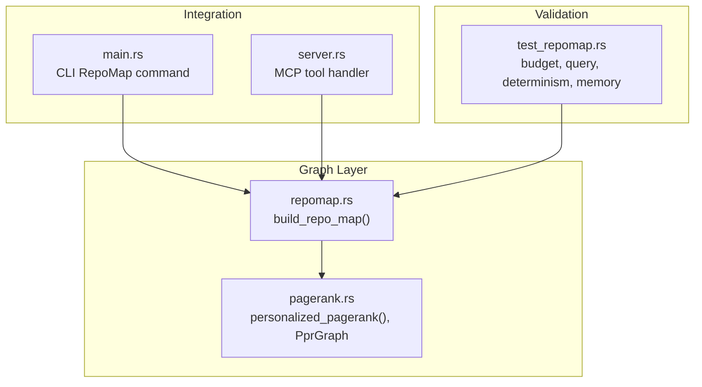
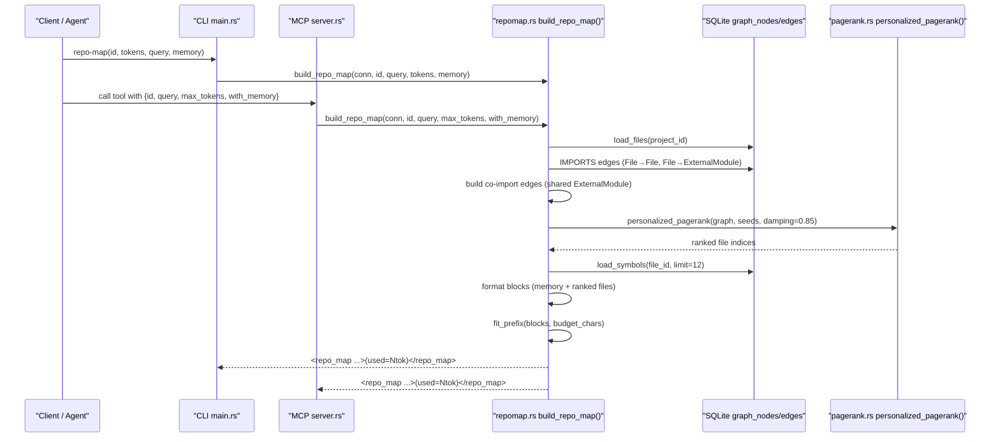
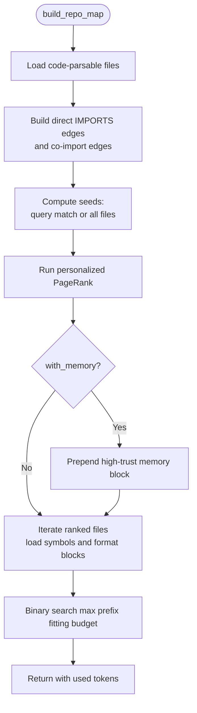
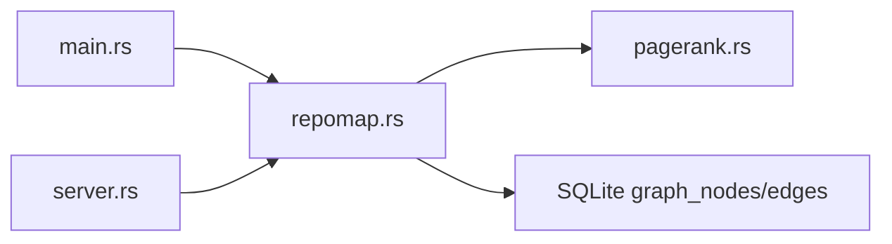

# Repomap Generation

<cite>
**Referenced Files in This Document**
- [repomap.rs](file://src/graph/repomap.rs)
- [pagerank.rs](file://src/graph/pagerank.rs)
- [test_repomap.rs](file://tests/test_repomap.rs)
- [main.rs](file://src/main.rs)
- [server.rs](file://src/mcp/server.rs)
</cite>

## Table of Contents
1. [Introduction](#introduction)
2. [Project Structure](#project-structure)
3. [Core Components](#core-components)
4. [Architecture Overview](#architecture-overview)
5. [Detailed Component Analysis](#detailed-component-analysis)
6. [Dependency Analysis](#dependency-analysis)
7. [Performance Considerations](#performance-considerations)
8. [Troubleshooting Guide](#troubleshooting-guide)
9. [Conclusion](#conclusion)
10. [Appendices](#appendices)

## Introduction
The repomap generation system produces compact, token-efficient summaries of a code repository. Instead of passing full source files into an LLM context window, it builds a structured “repository map” that lists ranked files and their extracted symbol signatures while staying within a configurable token budget. The algorithm uses the project’s dependency graph to rank files by relevance, optionally focuses on query-matched files, and can prepend high-trust project memories for AI agents.

Key goals:
- Token efficiency: output is constrained to a maximum number of tokens.
- Hierarchy preservation: files are ordered by importance; symbols per file are listed as compact signatures.
- Information density: only code-parsable files and meaningful symbols are included.
- Determinism: ranking and formatting are stable across runs for the same database state.
- Agent integration: exposed via CLI and MCP tools so AI agents can request focused or global repo maps.

## Project Structure
The repomap feature lives under the graph module and integrates with both the CLI entry point and the MCP server. Tests validate behavior such as budget enforcement, query-based focusing, determinism, empty projects, and optional memory inclusion.

**Diagram sources**
- [repomap.rs:126-325](file://src/graph/repomap.rs#L126-L325)
- [pagerank.rs:105-185](file://src/graph/pagerank.rs#L105-L185)
- [main.rs:530-546](file://src/main.rs#L530-L546)
- [server.rs:1840-1858](file://src/mcp/server.rs#L1840-L1858)
- [test_repomap.rs:70-170](file://tests/test_repomap.rs#L70-L170)

**Section sources**
- [repomap.rs:1-345](file://src/graph/repomap.rs#L1-L345)
- [main.rs:530-546](file://src/main.rs#L530-L546)
- [server.rs:1840-1858](file://src/mcp/server.rs#L1840-L1858)
- [test_repomap.rs:1-171](file://tests/test_repomap.rs#L1-L171)

## Core Components
- Repository map builder: constructs the final text representation under a token budget.
- File loader: selects code-parsable files and orders them deterministically.
- Symbol extractor: pulls compact function/struct signatures from AST-derived descriptions.
- Dependency graph builder: creates direct file-to-file edges and co-import edges between files sharing external modules.
- Personalized PageRank (PPR): ranks files based on seeds (query matches or all files).
- Budget allocator: binary-searches the maximum prefix of blocks that fits the token budget.
- Optional memory block: prepends high-trust project memories when requested.

**Section sources**
- [repomap.rs:25-29](file://src/graph/repomap.rs#L25-L29)
- [repomap.rs:42-68](file://src/graph/repomap.rs#L42-L68)
- [repomap.rs:70-94](file://src/graph/repomap.rs#L70-L94)
- [repomap.rs:96-124](file://src/graph/repomap.rs#L96-L124)
- [repomap.rs:144-228](file://src/graph/repomap.rs#L144-L228)
- [repomap.rs:230-256](file://src/graph/repomap.rs#L230-L256)
- [repomap.rs:258-325](file://src/graph/repomap.rs#L258-L325)
- [repomap.rs:327-344](file://src/graph/repomap.rs#L327-L344)

## Architecture Overview
The repomap pipeline transforms project graph data into a compact textual summary suitable for LLMs. It combines structural signals (imports, co-imports), personalization (query seeds), and ranking (PPR) to prioritize important files, then formats them into blocks constrained by a token budget.

**Diagram sources**
- [main.rs:530-546](file://src/main.rs#L530-L546)
- [server.rs:1840-1858](file://src/mcp/server.rs#L1840-L1858)
- [repomap.rs:126-325](file://src/graph/repomap.rs#L126-L325)
- [pagerank.rs:105-185](file://src/graph/pagerank.rs#L105-L185)

## Detailed Component Analysis

### Repository Map Builder
The builder orchestrates loading files, building the dependency graph, ranking files, assembling blocks, and enforcing the token budget. It also supports an optional high-trust memory block at the beginning.

Key behaviors:
- Filters out non-code files (manifests, styles, infrastructure) to keep information density high.
- Builds direct import edges and co-import edges between files importing the same external module.
- Uses PPR with either query-matched seeds or global seeds to rank files.
- Formats each file as a header with its path and PPR score, followed by symbol signatures.
- Enforces a token budget using a binary search over the prefix of blocks.

**Diagram sources**
- [repomap.rs:126-325](file://src/graph/repomap.rs#L126-L325)

**Section sources**
- [repomap.rs:126-325](file://src/graph/repomap.rs#L126-L325)

### File Loader
The file loader retrieves files from the graph, filters to code-parsable languages, sorts deterministically, and prepares IDs for indexing.

Important details:
- Only nodes labeled as `File` are considered.
- Non-code files are excluded based on language parser classification.
- Sorting ensures deterministic ordering before ranking.

**Section sources**
- [repomap.rs:70-94](file://src/graph/repomap.rs#L70-L94)

### Symbol Extractor
Symbols are loaded via `DEFINES` edges and converted into compact signature lines. Signatures are extracted from AST scanner descriptions to include function/struct definitions without full bodies.

Highlights:
- Truncates symbol list per file to a fixed limit to control size.
- Extracts concise signatures like function declarations and struct definitions.

**Section sources**
- [repomap.rs:96-124](file://src/graph/repomap.rs#L96-L124)
- [repomap.rs:42-68](file://src/graph/repomap.rs#L42-L68)

### Dependency Graph and Co-import Edges
The dependency graph includes:
- Direct file-to-file imports (`IMPORTS` where both ends are `File`).
- Co-import edges between files that import the same external module, weighted by inverse module size to emphasize rare shared dependencies.

This approach compensates for missing call-graph edges by leveraging import structure.

**Section sources**
- [repomap.rs:144-228](file://src/graph/repomap.rs#L144-L228)

### Personalized PageRank Ranking
PPR ranks files based on:
- Seeds: matched files from a query or all files for global centrality.
- Damping factor: clamped to a safe range.
- Degree normalization: prevents hub files from dominating rankings.
- Convergence tolerance and iteration limits.

Output is a sorted list of `(file_index, score)` pairs.

**Section sources**
- [repomap.rs:230-256](file://src/graph/repomap.rs#L230-L256)
- [pagerank.rs:105-185](file://src/graph/pagerank.rs#L105-L185)

### Budget Allocator
The budget allocator converts the token budget into character budget using an empirical constant and finds the largest prefix of blocks that fits. It reserves space for metadata and usage reporting.

Algorithm characteristics:
- Binary search over prefix length.
- Independent blocks allow optimal prefix selection.
- Reports used tokens and remaining capacity.

**Section sources**
- [repomap.rs:299-344](file://src/graph/repomap.rs#L299-L344)

### Optional High-Trust Memory Block
When enabled, the builder prepends a section summarizing high-trust project memories (trust/importance thresholds) before file blocks. This helps AI agents prioritize critical architectural decisions or constraints.

**Section sources**
- [repomap.rs:258-283](file://src/graph/repomap.rs#L258-L283)

## Dependency Analysis
Repomap depends on:
- SQLite graph schema for files, symbols, and edges.
- Pagerank module for ranking.
- CLI and MCP layers for invocation.

**Diagram sources**
- [repomap.rs:19-23](file://src/graph/repomap.rs#L19-L23)
- [main.rs:530-546](file://src/main.rs#L530-L546)
- [server.rs:1840-1858](file://src/mcp/server.rs#L1840-L1858)

**Section sources**
- [repomap.rs:19-23](file://src/graph/repomap.rs#L19-L23)
- [main.rs:530-546](file://src/main.rs#L530-L546)
- [server.rs:1840-1858](file://src/mcp/server.rs#L1840-L1858)

## Performance Considerations
- Token estimation: uses an empirical characters-per-token ratio to approximate LLM token consumption.
- File filtering: excludes non-code files to reduce noise and improve signal density.
- Symbol truncation: limits symbols per file to prevent oversized blocks.
- PPR convergence: bounded iterations and degree normalization avoid excessive computation and hub dominance.
- Budget allocation: binary search minimizes repeated summation checks.

Recommendations:
- Tune `max_tokens` based on target LLM context windows.
- Use query-focused mode to reduce irrelevant files.
- Enable memory block for agents needing architectural context.

[No sources needed since this section provides general guidance]

## Troubleshooting Guide
Common issues and resolutions:
- Empty project: returns a message indicating no scanned files; run project scanning first.
- Budget exceeded: adjust `max_tokens` upward; the output reports used tokens and how many files were omitted.
- Missing symbols: ensure AST scanning populated `DEFINES` edges; otherwise files may be skipped.
- Query yields no results: falls back to global centrality; verify query patterns match file paths or labels.
- Memory not included: ensure `with_memory` flag is set and high-trust memories exist.

**Section sources**
- [repomap.rs:137-142](file://src/graph/repomap.rs#L137-L142)
- [repomap.rs:285-297](file://src/graph/repomap.rs#L285-L297)
- [repomap.rs:315-324](file://src/graph/repomap.rs#L315-L324)
- [test_repomap.rs:125-142](file://tests/test_repomap.rs#L125-L142)
- [test_repomap.rs:144-170](file://tests/test_repomap.rs#L144-L170)

## Conclusion
The repomap generation system delivers a compact, token-aware representation of code repositories by combining import structure, co-import signals, and personalized PageRank to prioritize relevant files. It preserves hierarchy through ranked file blocks and symbol signatures, enforces strict token budgets, and integrates seamlessly with CLI and MCP interfaces for AI agents. By tuning parameters like token budget, query focus, and memory inclusion, users can balance information retention against context window constraints effectively.

[No sources needed since this section summarizes without analyzing specific files]

## Appendices

### API and Integration Patterns
- CLI command: invokes `build_repo_map` with project ID, token budget, optional query, and memory flag.
- MCP tool: exposes similar parameters to AI agents, returning the generated repo map string.

**Section sources**
- [main.rs:530-546](file://src/main.rs#L530-L546)
- [server.rs:1840-1858](file://src/mcp/server.rs#L1840-L1858)

### Example Outputs and Size Comparisons
- Generated outputs include a header with project ID, number of ranked files, and budget; footer includes used token count.
- Tests assert budget compliance and presence of key sections like memory and file headers.

**Section sources**
- [repomap.rs:301-324](file://src/graph/repomap.rs#L301-L324)
- [test_repomap.rs:70-97](file://tests/test_repomap.rs#L70-L97)

### Customization Guidelines
- Adjust `TOKEN_CHARS` for different token estimators if needed.
- Modify `MAX_FILE_BLOCK_CHARS` to cap per-file content.
- Change PPR parameters (damping, iterations, tolerance) via pagerank module defaults.
- Toggle `with_memory` to include high-trust project memories.

**Section sources**
- [repomap.rs:25-29](file://src/graph/repomap.rs#L25-L29)
- [pagerank.rs:19-26](file://src/graph/pagerank.rs#L19-L26)