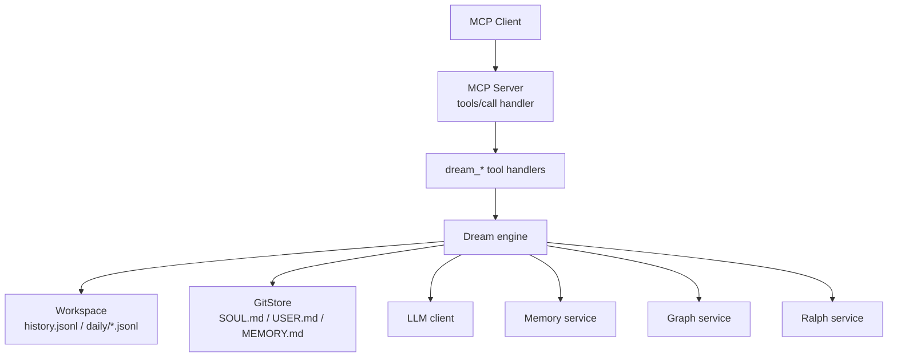
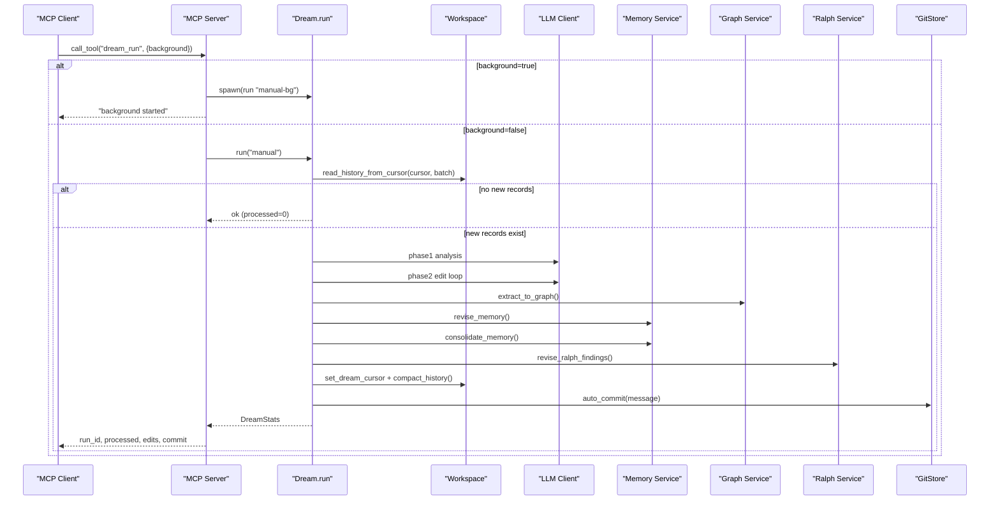
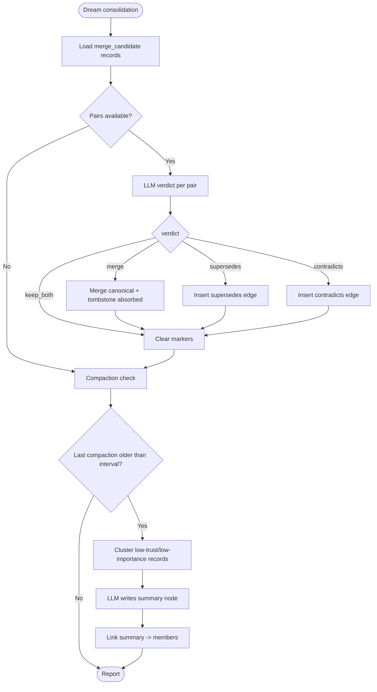
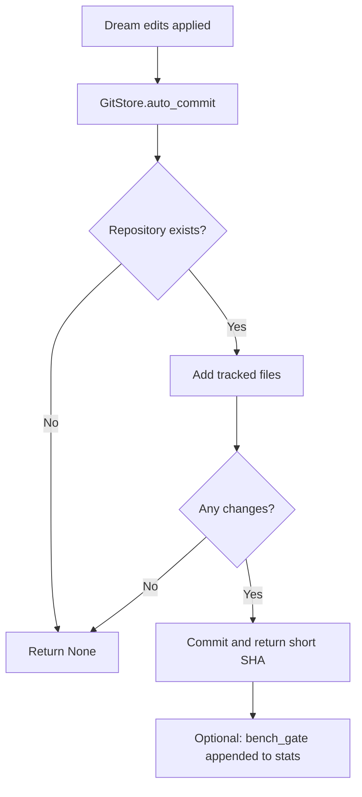
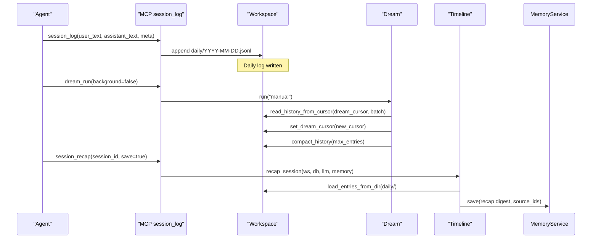
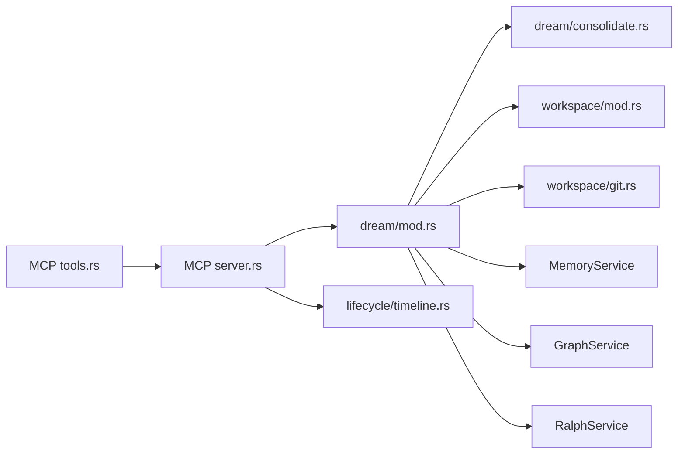

# Dream Processing Tools

<cite>
**Referenced Files in This Document**   
- [tools.rs](file://src/mcp/tools.rs)
- [server.rs](file://src/mcp/server.rs)
- [dream_mod.rs](file://src/dream/mod.rs)
- [consolidate.rs](file://src/dream/consolidate.rs)
- [git.rs](file://src/workspace/git.rs)
- [workspace_mod.rs](file://src/workspace/mod.rs)
- [timeline.rs](file://src/lifecycle/timeline.rs)
</cite>

## Table of Contents
1. [Introduction](#introduction)
2. [Project Structure](#project-structure)
3. [Core Components](#core-components)
4. [Architecture Overview](#architecture-overview)
5. [Detailed Component Analysis](#detailed-component-analysis)
6. [Dependency Analysis](#dependency-analysis)
7. [Performance Considerations](#performance-considerations)
8. [Troubleshooting Guide](#troubleshooting-guide)
9. [Conclusion](#conclusion)

## Introduction
This document describes the MCP protocol tools for automated dream processing: `dream_run`, `dream_status`, `dream_log`, and `dream_restore`. It explains how session logs feed into a daily pipeline, how the dream phase consolidates memory and workspace files, how git-backed versioning provides quality gates and rollback, and how to operate these tools end-to-end.

## Project Structure
The dream processing surface is exposed through MCP tools, implemented by the MCP server and backed by the dream subsystem, workspace layer, and git store.

**Diagram sources**
- [server.rs:1579-1637](file://src/mcp/server.rs#L1579-L1637)
- [dream_mod.rs:145-287](file://src/dream/mod.rs#L145-L287)
- [workspace_mod.rs:81-105](file://src/workspace/mod.rs#L81-L105)
- [git.rs:53-82](file://src/workspace/git.rs#L53-L82)

**Section sources**
- [server.rs:1579-1637](file://src/mcp/server.rs#L1579-L1637)
- [tools.rs:231-270](file://src/mcp/tools.rs#L231-L270)

## Core Components
- `dream_run`: Starts dream processing synchronously or in background; returns run metadata or a background launch message.
- `dream_status`: Returns the latest dream run record, including status, trigger, timestamps, and detailed stats.
- `dream_log`: Lists recent git commits authored by the dream process over tracked workspace files.
- `dream_restore`: Restores tracked workspace files to a previous commit SHA from `dream_log`.

These tools are declared with input schemas and annotations:
- Read-only hints: `dream_log`, `dream_status`.
- Destructive hint: `dream_restore`.

**Section sources**
- [tools.rs:9-53](file://src/mcp/tools.rs#L9-L53)
- [tools.rs:231-270](file://src/mcp/tools.rs#L231-L270)
- [server.rs:1579-1637](file://src/mcp/server.rs#L1579-L1637)

## Architecture Overview
The MCP server routes tool calls to handlers that coordinate the dream pipeline. The pipeline reads new history entries, performs analysis and edits, optionally extracts graph entities, revises memory trust, consolidates memory, revises stale Ralph findings, advances the dream cursor, compacts history, and commits changes via git.

**Diagram sources**
- [server.rs:1579-1612](file://src/mcp/server.rs#L1579-L1612)
- [dream_mod.rs:145-287](file://src/dream/mod.rs#L145-L287)
- [workspace_mod.rs:195-224](file://src/workspace/mod.rs#L195-L224)
- [git.rs:53-82](file://src/workspace/git.rs#L53-L82)

## Detailed Component Analysis

### Tool API Reference

#### dream_run
- Purpose: Start dream processing.
- Arguments:
  - `background` (boolean, default false): Run in background if true.
- Behavior:
  - Background mode spawns a task protected by a lock; returns a short confirmation.
  - Foreground mode waits for completion and returns a summary string with `run_id`, `processed`, `edits`, and `commit`.
  - Errors are returned as `[Error] ...`.
- Annotations: Not listed as read-only or destructive.

Example usage patterns:
- Trigger immediately: call `dream_run` with `background=false`.
- Trigger asynchronously: call `dream_run` with `background=true`, then poll `dream_status`.

**Section sources**
- [tools.rs:231-241](file://src/mcp/tools.rs#L231-L241)
- [server.rs:1579-1612](file://src/mcp/server.rs#L1579-L1612)

#### dream_status
- Purpose: Inspect the last dream run.
- Arguments: none.
- Behavior:
  - Returns pretty-printed JSON of the last run record, including `id`, `started_at`, `finished_at`, `status`, `trigger`, and `stats`.
  - If no runs exist, returns a human-readable line indicating no last run.
- Annotations: read-only.

Use cases:
- Poll after background `dream_run`.
- Inspect `stats` for `processed`, `edits`, `commit`, `graph_entities`, `graph_edges`, `memory_revision`, `ralph_revision`, `bench_gate`, `consolidation`, `note`, `error`.

**Section sources**
- [tools.rs:242-247](file://src/mcp/tools.rs#L242-L247)
- [server.rs:1614-1618](file://src/mcp/server.rs#L1614-L1618)
- [dream_mod.rs:618-645](file://src/dream/mod.rs#L618-L645)

#### dream_log
- Purpose: Show recent git commits made by the dream process.
- Arguments:
  - `limit` (integer, default 10).
- Behavior:
  - Reads git log for tracked workspace files.
  - Returns lines formatted as `sha date message`.
  - If no commits exist, returns a message indicating no commits.
- Annotations: read-only.

Use cases:
- Browse commit history to identify a restore point.
- Confirm that dream commits include edits and revisions.

**Section sources**
- [tools.rs:248-258](file://src/mcp/tools.rs#L248-L258)
- [server.rs:1619-1630](file://src/mcp/server.rs#L1619-L1630)
- [git.rs:84-109](file://src/workspace/git.rs#L84-L109)

#### dream_restore
- Purpose: Restore workspace files to a previous state.
- Arguments:
  - `commit` (string, required): Short SHA from `dream_log`.
- Behavior:
  - Restores tracked files (`SOUL.md`, `USER.md`, `MEMORY.md`) to the specified commit.
  - Returns a human-readable result such as `restored from <sha>` or an error prefix like `restore_failed:` or `git_unavailable`.
- Annotations: destructive.

Safety notes:
- Only tracked files are restored.
- If no tracked files exist, returns `nothing_to_restore`.

**Section sources**
- [tools.rs:259-270](file://src/mcp/tools.rs#L259-L270)
- [server.rs:1631-1637](file://src/mcp/server.rs#L1631-L1637)
- [git.rs:111-133](file://src/workspace/git.rs#L111-L133)

### Automated Memory Consolidation Workflow
Dream processing consolidates memory in two main ways:

1. Trust revision:
   - Selects low-trust memory records.
   - Uses LLM to classify them as confirmed, outdated, or contradicted.
   - Applies bounded trust adjustments and may create typed edges between related records.
   - Optionally proposes belief relationships between records.

2. Offline consolidation:
   - Processes merge candidates marked at save time.
   - For each pair, asks LLM to decide among merge, keep both, supersedes, or contradicts.
   - Merge uses the same unified engine as explicit memory merges.
   - Supersede/contradict create typed edges without deleting either record.
   - Compaction clusters weak, low-access records and creates summary nodes linked to members.

**Diagram sources**
- [consolidate.rs:70-85](file://src/dream/consolidate.rs#L70-L85)
- [consolidate.rs:89-190](file://src/dream/consolidate.rs#L89-L190)
- [consolidate.rs:252-335](file://src/dream/consolidate.rs#L252-L335)

**Section sources**
- [dream_mod.rs:418-543](file://src/dream/mod.rs#L418-L543)
- [consolidate.rs:1-16](file://src/dream/consolidate.rs#L1-L16)
- [consolidate.rs:70-190](file://src/dream/consolidate.rs#L70-L190)
- [consolidate.rs:252-335](file://src/dream/consolidate.rs#L252-L335)

### Git-Backed Workspace Versioning
The workspace tracks three key files:
- `SOUL.md`
- `USER.md`
- `memory/MEMORY.md`

After dream edits, the system attempts an automatic commit. If there are no tracked files or no changes, it does not create an empty commit. The commit message includes counts of edits and optional revision summaries.

Quality gates:
- File shrink detection can detect when a file lost more than a configured fraction of non-empty lines compared to a reference commit.
- Bench gate results can be appended to the last dream run’s stats, visible in `dream_status`.

**Diagram sources**
- [git.rs:53-82](file://src/workspace/git.rs#L53-L82)
- [git.rs:143-166](file://src/workspace/git.rs#L143-L166)
- [dream_mod.rs:545-566](file://src/dream/mod.rs#L545-L566)

**Section sources**
- [git.rs:7-14](file://src/workspace/git.rs#L7-L14)
- [git.rs:53-82](file://src/workspace/git.rs#L53-L82)
- [git.rs:143-166](file://src/workspace/git.rs#L143-L166)
- [dream_mod.rs:258-271](file://src/dream/mod.rs#L258-L271)

### Relationship Between Session Logging and Dream Processing
Session logging feeds the dream pipeline through two layers:

1. Daily logs:
   - `session_log` appends a structured entry to `daily/YYYY-MM-DD.jsonl`.
   - These logs are consumed by timeline utilities and can be summarized into long-term memory.

2. History cursor:
   - Dream reads new history entries from `history.jsonl` starting after the stored `.dream_cursor`.
   - After processing, dream advances the cursor and compacts the history file to a bounded size.

**Diagram sources**
- [workspace_mod.rs:81-105](file://src/workspace/mod.rs#L81-L105)
- [workspace_mod.rs:173-281](file://src/workspace/mod.rs#L173-L281)
- [dream_mod.rs:196-256](file://src/dream/mod.rs#L196-L256)
- [timeline.rs:57-115](file://src/lifecycle/timeline.rs#L57-L115)
- [timeline.rs:270-389](file://src/lifecycle/timeline.rs#L270-L389)

**Section sources**
- [workspace_mod.rs:81-105](file://src/workspace/mod.rs#L81-L105)
- [workspace_mod.rs:173-281](file://src/workspace/mod.rs#L173-L281)
- [dream_mod.rs:196-256](file://src/dream/mod.rs#L196-L256)
- [timeline.rs:57-115](file://src/lifecycle/timeline.rs#L57-L115)
- [timeline.rs:270-389](file://src/lifecycle/timeline.rs#L270-L389)

### Examples

#### Triggering dream processing
- Immediate execution:
  - Call `dream_run` with `background=false`.
  - Inspect the returned summary for `run_id`, `processed`, `edits`, and `commit`.
- Background execution:
  - Call `dream_run` with `background=true`.
  - Poll `dream_status` until `status` is `ok` or `error`.

#### Monitoring background jobs
- Use `dream_status` to inspect:
  - `status`: `running`, `ok`, or `error`.
  - `trigger`: e.g., `manual` or `manual-bg`.
  - `stats.processed`, `stats.edits`, `stats.commit`.
  - `stats.memory_revision`, `stats.ralph_revision`, `stats.consolidation`, `stats.bench_gate`, `stats.note`, `stats.error`.

#### Viewing commit history
- Call `dream_log` with an optional `limit`.
- Use the returned `sha` values to identify states for restoration.

#### Restoring previous states
- Call `dream_restore` with `commit` equal to a short SHA from `dream_log`.
- Verify restored files by reading workspace files or re-running `dream_log`.

**Section sources**
- [server.rs:1579-1637](file://src/mcp/server.rs#L1579-L1637)
- [dream_mod.rs:618-645](file://src/dream/mod.rs#L618-L645)
- [git.rs:84-109](file://src/workspace/git.rs#L84-L109)

## Dependency Analysis
The dream tools depend on several services:

**Diagram sources**
- [tools.rs:231-270](file://src/mcp/tools.rs#L231-L270)
- [server.rs:1579-1637](file://src/mcp/server.rs#L1579-L1637)
- [dream_mod.rs:145-287](file://src/dream/mod.rs#L145-L287)
- [consolidate.rs:70-190](file://src/dream/consolidate.rs#L70-L190)
- [workspace_mod.rs:195-281](file://src/workspace/mod.rs#L195-L281)
- [git.rs:53-109](file://src/workspace/git.rs#L53-L109)
- [timeline.rs:270-389](file://src/lifecycle/timeline.rs#L270-L389)

**Section sources**
- [dream_mod.rs:110-143](file://src/dream/mod.rs#L110-L143)
- [server.rs:27-52](file://src/mcp/server.rs#L27-L52)

## Performance Considerations
- Background mode avoids blocking the MCP transport while long dream runs execute.
- Dream processes only new history entries since the last `.dream_cursor`, reducing redundant work.
- History compaction keeps `history.jsonl` bounded.
- Consolidation limits groups per dream and throttles compaction to once per configured interval.
- Git operations are guarded by repository existence checks and change detection to avoid unnecessary commits.

[No sources needed since this section provides general guidance]

## Troubleshooting Guide
Common issues and diagnostics:

- No new records processed:
  - Check whether `session_log` has written daily logs and whether `history.jsonl` has been advanced.
  - Inspect `dream_status.stats.note` for messages indicating no new records.

- Background job not completing:
  - Poll `dream_status` repeatedly.
  - Look for `status=error` and inspect `stats.error`.

- Git unavailable or no commits:
  - `dream_log` returns a message indicating no commits.
  - `dream_restore` may return `git_unavailable` or `nothing_to_restore`.
  - Ensure the workspace root contains a git repository and tracked files exist.

- File degradation after dream:
  - Use the built-in file shrink detection logic conceptually: compare current file content against a known-good commit.
  - If a file shrank beyond threshold, consider restoring via `dream_restore`.

- Memory consolidation failures:
  - Consolidation errors are logged but do not abort the entire dream run.
  - Inspect `dream_status.stats.consolidation` for partial reports.

**Section sources**
- [server.rs:1579-1637](file://src/mcp/server.rs#L1579-L1637)
- [dream_mod.rs:196-216](file://src/dream/mod.rs#L196-L216)
- [git.rs:53-82](file://src/workspace/git.rs#L53-L82)
- [git.rs:111-133](file://src/workspace/git.rs#L111-L133)
- [consolidate.rs:70-85](file://src/dream/consolidate.rs#L70-L85)

## Conclusion
The dream processing tools provide a robust, git-backed automation loop for memory consolidation and workspace evolution. `dream_run` triggers analysis and edits, `dream_status` exposes run outcomes and rich stats, `dream_log` offers version history, and `dream_restore` enables safe rollback. Session logs feed daily archives and the consolidated history pipeline, enabling traceable, auditable memory evolution with clear quality gates.