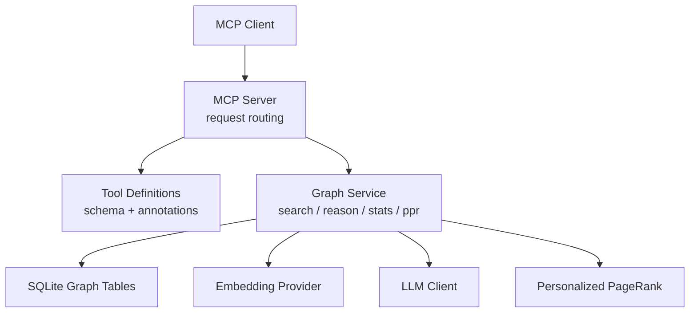
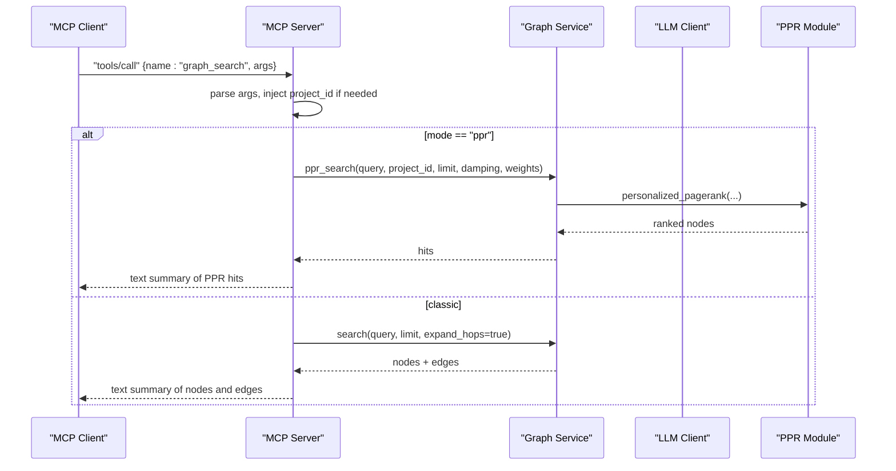
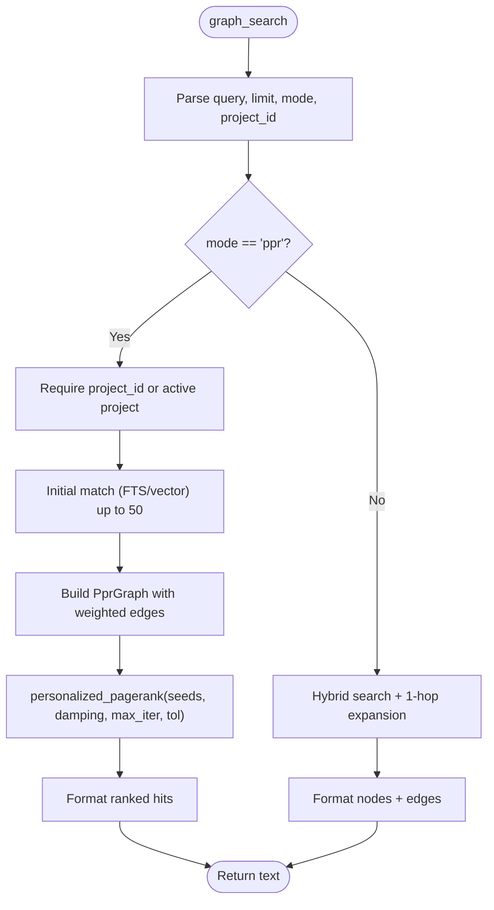
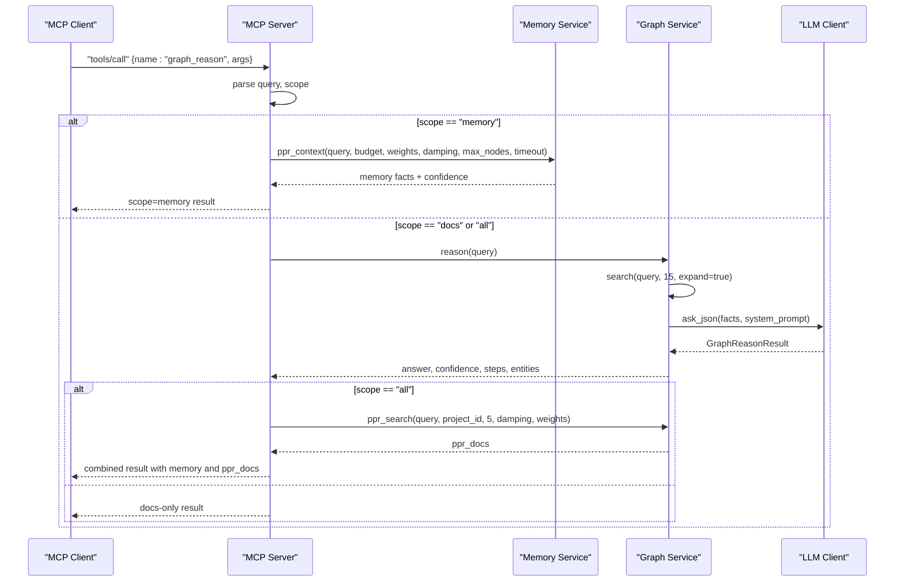
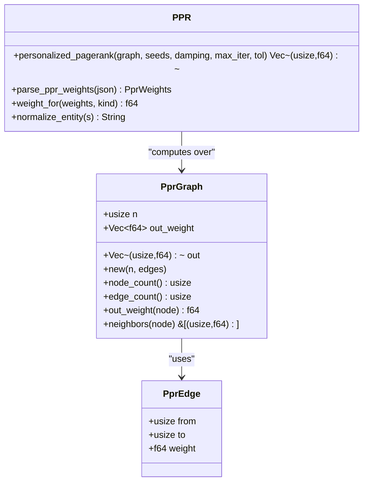
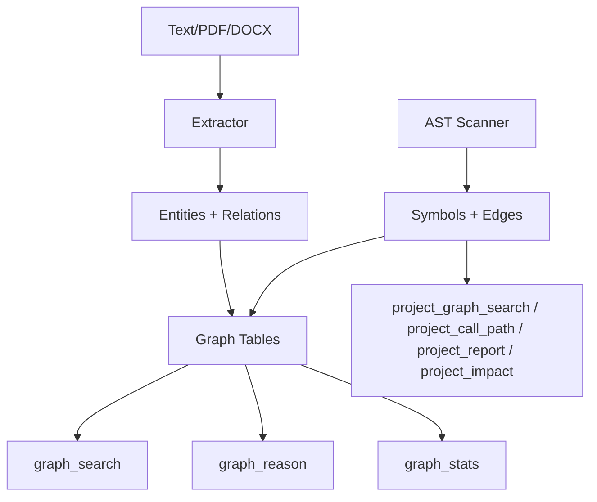
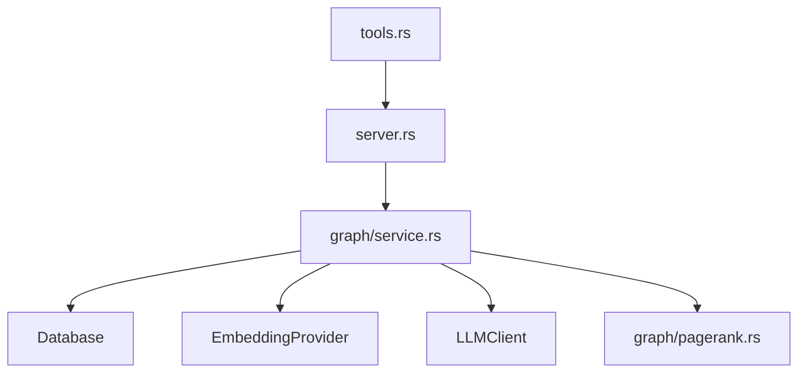

# Knowledge Graph Tools

<cite>
**Referenced Files in This Document**   
- [tools.rs](file://src/mcp/tools.rs)
- [server.rs](file://src/mcp/server.rs)
- [protocol.rs](file://src/mcp/protocol.rs)
- [service.rs](file://src/graph/service.rs)
- [pagerank.rs](file://src/graph/pagerank.rs)
- [mod.rs](file://src/graph/mod.rs)
</cite>

## Table of Contents
1. [Introduction](#introduction)
2. [Project Structure](#project-structure)
3. [Core Components](#core-components)
4. [Architecture Overview](#architecture-overview)
5. [Detailed Component Analysis](#detailed-component-analysis)
6. [Dependency Analysis](#dependency-analysis)
7. [Performance Considerations](#performance-considerations)
8. [Troubleshooting Guide](#troubleshooting-guide)
9. [Conclusion](#conclusion)
10. [Appendices](#appendices)

## Introduction
This document provides API documentation for the knowledge graph tools exposed through the MCP protocol: `graph_search`, `graph_reason`, and `graph_stats`. It explains query parameters, supported modes (classic vs PPR), scope filtering (`docs`, `memory`, `all`), response formats, Personalized PageRank implementation details, multi-hop reasoning capabilities, and integration with AST parsing results and project analysis tools.

## Project Structure
The knowledge graph tools are defined as MCP tool declarations and implemented by an MCP server that delegates to a graph service layer. The core components involved are:

- MCP tool definitions and annotations
- MCP server request routing and argument handling
- Graph service methods for search, reasoning, stats, and PPR
- Personalized PageRank algorithm module

**Diagram sources**
- [tools.rs:190-229](file://src/mcp/tools.rs#L190-L229)
- [server.rs:1384-1578](file://src/mcp/server.rs#L1384-L1578)
- [service.rs:236-524](file://src/graph/service.rs#L236-L524)
- [pagerank.rs:112-184](file://src/graph/pagerank.rs#L112-L184)

**Section sources**
- [tools.rs:190-229](file://src/mcp/tools.rs#L190-L229)
- [server.rs:1384-1578](file://src/mcp/server.rs#L1384-L1578)
- [service.rs:236-524](file://src/graph/service.rs#L236-L524)
- [pagerank.rs:112-184](file://src/graph/pagerank.rs#L112-L184)

## Core Components
- Tool definitions declare input schemas and descriptions for `graph_search`, `graph_reason`, and `graph_stats`. They also mark these tools as read-only.
- The MCP server parses JSON-RPC calls, injects active project context when needed, and routes to handlers that call the graph service.
- The graph service implements hybrid lexical/vector search, KAG-style reasoning via LLM, statistics aggregation, and PPR-based ranking over the knowledge graph.
- The PPR module provides a pure-Rust iterative algorithm with degree normalization, damping clamping, and edge-type-aware weights.

Key responsibilities:
- `graph_search`: classic mode returns top nodes and edges; PPR mode returns ranked nodes using seeds from initial matching.
- `graph_reason`: builds facts from search results, asks an LLM for answer, confidence, reasoning steps, and used entities/relations; supports scope filtering across docs, memory, or both.
- `graph_stats`: counts nodes, edges, documents, and chunks.

**Section sources**
- [tools.rs:190-229](file://src/mcp/tools.rs#L190-L229)
- [server.rs:1384-1578](file://src/mcp/server.rs#L1384-L1578)
- [service.rs:236-524](file://src/graph/service.rs#L236-L524)
- [pagerank.rs:112-184](file://src/graph/pagerank.rs#L112-L184)

## Architecture Overview
The MCP protocol is JSON-RPC 2.0 over stdio. Clients call `tools/call` with a tool name and arguments. The server resolves the tool, validates inputs, optionally injects `project_id`, executes the handler, truncates output, and returns structured content.

**Diagram sources**
- [server.rs:479-558](file://src/mcp/server.rs#L479-L558)
- [server.rs:1384-1473](file://src/mcp/server.rs#L1384-L1473)
- [service.rs:236-460](file://src/graph/service.rs#L236-L460)
- [pagerank.rs:112-184](file://src/graph/pagerank.rs#L112-L184)

## Detailed Component Analysis

### Tool: graph_search
Purpose: Search the knowledge graph for relevant nodes and edges. Supports two modes:
- `classic` (default): hybrid lexical + vector scoring, returns top nodes and their incident edges, with optional 1-hop neighbor expansion.
- `ppr`: Personalized PageRank over the project graph seeded by initial matches; requires a project context.

Parameters:
- `query` (required): natural language or symbol-like query.
- `limit` (optional, default 10): maximum number of top items to return.
- `project_id` (optional): filters PPR to a specific project; auto-injected if session has an active project.
- `provenance` (optional, enum `ast|llm|manual|all`): filters edges by source type in classic mode.
- `mode` (optional, enum `classic|ppr`): selects classic hybrid search or PPR ranking.

Response format:
- Classic mode: text listing node count, edge count, nodes with label/type/value/description, and edges with source/target labels and relation types.
- PPR mode: text listing ranked nodes with label, type, value, PPR score, and optional file path.

Behavior notes:
- In classic mode, the service performs FTS5 fallback to full scan if needed, then combines lexical and vector scores, sorts deterministically by score and id, and loads neighbors if requested.
- In PPR mode, seeds come from initial matching (no 1-hop expansion), edges are weighted by type, and the PPR algorithm runs with configured damping and iteration limits.

**Diagram sources**
- [server.rs:1384-1473](file://src/mcp/server.rs#L1384-L1473)
- [service.rs:546-674](file://src/graph/service.rs#L546-L674)
- [pagerank.rs:112-184](file://src/graph/pagerank.rs#L112-L184)

**Section sources**
- [tools.rs:190-204](file://src/mcp/tools.rs#L190-L204)
- [server.rs:1384-1473](file://src/mcp/server.rs#L1384-L1473)
- [service.rs:236-460](file://src/graph/service.rs#L236-L460)
- [service.rs:546-674](file://src/graph/service.rs#L546-L674)
- [pagerank.rs:112-184](file://src/graph/pagerank.rs#L112-L184)

### Tool: graph_reason
Purpose: Answer questions using the knowledge graph with confidence and reasoning steps (KAG). Supports scope filtering:
- `docs` (default): uses the knowledge graph only.
- `memory`: uses PPR-expanded memory context instead of the knowledge graph.
- `all`: combines knowledge graph reasoning with memory PPR context and appends PPR-ranked docs from the project graph.

Parameters:
- `query` (required): question to answer.
- `project_id` (optional): used implicitly for active project context when combining with PPR docs in `all` scope.
- `scope` (optional, enum `docs|memory|all`): controls which data sources are included.

Response format:
- Text containing fields such as answer, confidence, entities used, reasoning steps, and optional memory block and PPR docs block depending on scope.

Behavior notes:
- For `memory` or `all`, the server requests a PPR-based memory context with configurable node budget and timeout.
- For `docs` or `all`, it calls the graph service’s reason method, which builds facts from search results and asks the LLM for structured JSON output.
- For `all`, it additionally runs PPR over the project graph to append top doc-like nodes.

**Diagram sources**
- [server.rs:1475-1571](file://src/mcp/server.rs#L1475-L1571)
- [service.rs:462-509](file://src/graph/service.rs#L462-L509)

**Section sources**
- [tools.rs:206-219](file://src/mcp/tools.rs#L206-L219)
- [server.rs:1475-1571](file://src/mcp/server.rs#L1475-L1571)
- [service.rs:462-509](file://src/graph/service.rs#L462-L509)

### Tool: graph_stats
Purpose: Return basic statistics about the knowledge graph and related storage.

Parameters:
- `project_id` (optional): not used by stats; present in schema for consistency.

Response format:
- Text listing counts for nodes, edges, documents, and chunks.

Behavior notes:
- Counts exclude deleted records where applicable.

**Section sources**
- [tools.rs:220-229](file://src/mcp/tools.rs#L220-L229)
- [server.rs:1572-1578](file://src/mcp/server.rs#L1572-L1578)
- [service.rs:511-524](file://src/graph/service.rs#L511-L524)

### Personalized PageRank Implementation
The PPR module implements an iterative algorithm with the following characteristics:
- Damping factor clamped to `[0.5, 0.85]`.
- Iteration limit clamped to `[1, 20]`.
- Degree normalization prevents hub flooding by dividing edge weight by sum of outgoing edge weights per node.
- Dangling nodes return mass to personalization (teleport).
- Edge weights can be customized by type via configuration; unknown types use a default weight.
- Seed personalization is normalized into a probability distribution.

Complexity:
- Time complexity per iteration is proportional to the number of edges; total time is O(iterations × edges).
- Space complexity is O(nodes + edges) for adjacency lists and weight sums.

**Diagram sources**
- [pagerank.rs:51-103](file://src/graph/pagerank.rs#L51-L103)
- [pagerank.rs:112-184](file://src/graph/pagerank.rs#L112-L184)
- [pagerank.rs:187-214](file://src/graph/pagerank.rs#L187-L214)
- [pagerank.rs:216-241](file://src/graph/pagerank.rs#L216-L241)

**Section sources**
- [pagerank.rs:1-47](file://src/graph/pagerank.rs#L1-L47)
- [pagerank.rs:112-184](file://src/graph/pagerank.rs#L112-L184)
- [pagerank.rs:187-214](file://src/graph/pagerank.rs#L187-L214)
- [pagerank.rs:216-241](file://src/graph/pagerank.rs#L216-L241)

### Multi-Hop Reasoning Capabilities
- Classic search returns direct neighbors (1-hop) when expanding hops is enabled.
- PPR mode computes multi-hop reachability by propagating mass across edges up to the configured iteration limit, enabling discovery of nodes not directly connected to seeds.
- In `graph_reason(scope=all)`, PPR over the project graph adds additional context beyond immediate neighbors.

**Section sources**
- [service.rs:428-459](file://src/graph/service.rs#L428-L459)
- [service.rs:546-674](file://src/graph/service.rs#L546-L674)
- [pagerank.rs:112-184](file://src/graph/pagerank.rs#L112-L184)

### Scope Filtering (docs, memory, all)
- `docs`: uses knowledge graph facts and LLM reasoning.
- `memory`: uses PPR-expanded memory context with configurable node budget and timeout.
- `all`: combines knowledge graph reasoning with memory PPR context and appends PPR-ranked docs from the project graph.

**Section sources**
- [server.rs:1475-1571](file://src/mcp/server.rs#L1475-L1571)

### Integration with AST Parsing Results and Project Analysis Tools
- `knowledge_extract` ingests text or files, splits into chunks, embeds them, extracts entities and relations, and upserts them into the graph.
- Project analysis tools like `project_graph_search`, `project_call_path`, `project_report`, and `project_impact` operate over AST-derived symbols and relationships.
- `graph_search` and `graph_reason` complement these by querying the knowledge graph built from extracted entities/relations and embeddings.

**Diagram sources**
- [server.rs:1296-1383](file://src/mcp/server.rs#L1296-L1383)
- [server.rs:1868-2053](file://src/mcp/server.rs#L1868-L2053)
- [service.rs:106-216](file://src/graph/service.rs#L106-L216)

**Section sources**
- [server.rs:1296-1383](file://src/mcp/server.rs#L1296-L1383)
- [server.rs:1868-2053](file://src/mcp/server.rs#L1868-L2053)
- [service.rs:106-216](file://src/graph/service.rs#L106-L216)

## Dependency Analysis
- MCP server depends on tool definitions for schemas and annotations.
- MCP server delegates to GraphService for search, reasoning, stats, and PPR.
- GraphService depends on Database, EmbeddingProvider, and LLMClient.
- PPR module is independent and reusable by both graph and memory services.

**Diagram sources**
- [tools.rs:190-229](file://src/mcp/tools.rs#L190-L229)
- [server.rs:1384-1578](file://src/mcp/server.rs#L1384-L1578)
- [service.rs:236-524](file://src/graph/service.rs#L236-L524)
- [pagerank.rs:112-184](file://src/graph/pagerank.rs#L112-L184)

**Section sources**
- [tools.rs:190-229](file://src/mcp/tools.rs#L190-L229)
- [server.rs:1384-1578](file://src/mcp/server.rs#L1384-L1578)
- [service.rs:236-524](file://src/graph/service.rs#L236-L524)
- [pagerank.rs:112-184](file://src/graph/pagerank.rs#L112-L184)

## Performance Considerations
- Classic search uses FTS5 with fallback to full scan; vector search may use vec0 index if enabled.
- PPR iterations are bounded; damping and tolerance control convergence speed.
- Hub protection via degree normalization prevents high-degree nodes from dominating rankings.
- Output truncation ensures MCP responses stay within token budgets.

[No sources needed since this section provides general guidance]

## Troubleshooting Guide
Common issues and resolutions:
- Missing required parameters: ensure `query` is provided for `graph_search` and `graph_reason`.
- PPR requires project context: set `project_id` or activate a project so PPR can filter edges and nodes.
- Empty results: verify that the graph contains nodes/edges matching the query; check extraction pipeline and AST scanning status.
- LLM errors in reasoning: confirm LLM configuration and availability; the service returns error messages prefixed with `[Error]`.

**Section sources**
- [server.rs:1384-1578](file://src/mcp/server.rs#L1384-L1578)

## Conclusion
The knowledge graph tools provide flexible search, reasoning, and analytics over a unified graph built from AST parsing and text extraction. Classic mode offers fast lexical/vector retrieval with neighbor expansion, while PPR mode enables multi-hop ranking informed by edge types and project context. Scope filtering in `graph_reason` allows combining knowledge graph facts with memory insights and project-level PPR documents. These tools integrate seamlessly with project analysis utilities to support semantic search across code symbols, relationship extraction from text, and comprehensive graph analytics.

[No sources needed since this section summarizes without analyzing specific files]

## Appendices

### API Reference Summary

#### graph_search
- Purpose: Search knowledge graph nodes and edges; optional PPR ranking.
- Parameters:
  - `query` (string, required)
  - `limit` (integer, default 10)
  - `project_id` (string, optional)
  - `provenance` (enum `ast|llm|manual|all`)
  - `mode` (enum `classic|ppr`)
- Response:
  - Classic: text with node and edge summaries.
  - PPR: text with ranked nodes and scores.

**Section sources**
- [tools.rs:190-204](file://src/mcp/tools.rs#L190-L204)
- [server.rs:1384-1473](file://src/mcp/server.rs#L1384-L1473)

#### graph_reason
- Purpose: Answer questions with confidence and reasoning steps; supports scope filtering.
- Parameters:
  - `query` (string, required)
  - `project_id` (string, optional)
  - `scope` (enum `docs|memory|all`)
- Response:
  - Text including answer, confidence, entities, steps, and optional memory/PPR blocks.

**Section sources**
- [tools.rs:206-219](file://src/mcp/tools.rs#L206-L219)
- [server.rs:1475-1571](file://src/mcp/server.rs#L1475-L1571)

#### graph_stats
- Purpose: Count nodes, edges, documents, and chunks.
- Parameters:
  - `project_id` (string, optional)
- Response:
  - Text with counts.

**Section sources**
- [tools.rs:220-229](file://src/mcp/tools.rs#L220-L229)
- [server.rs:1572-1578](file://src/mcp/server.rs#L1572-L1578)