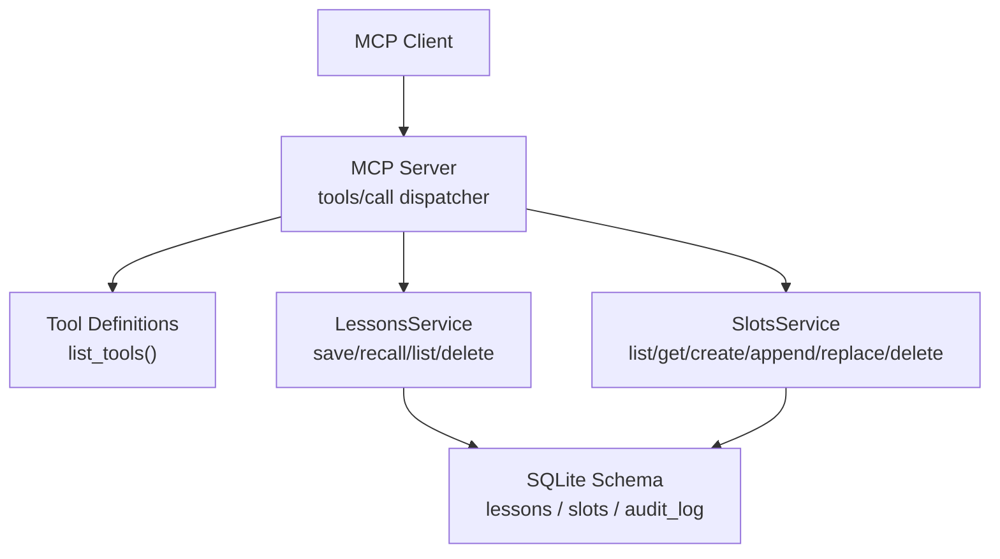
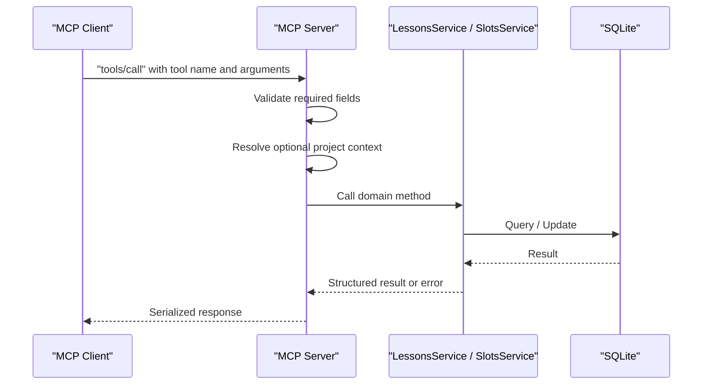
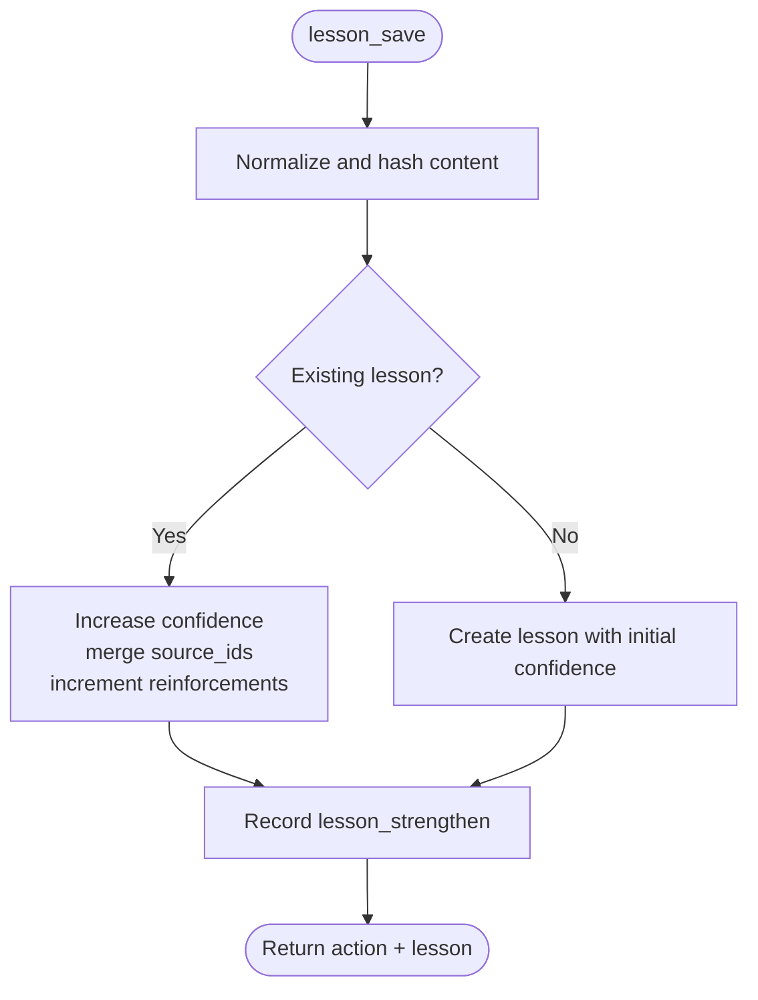
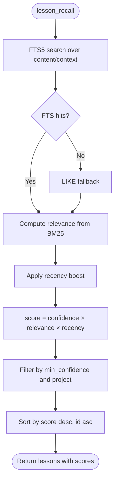
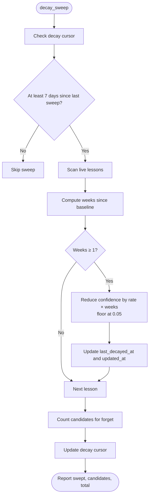
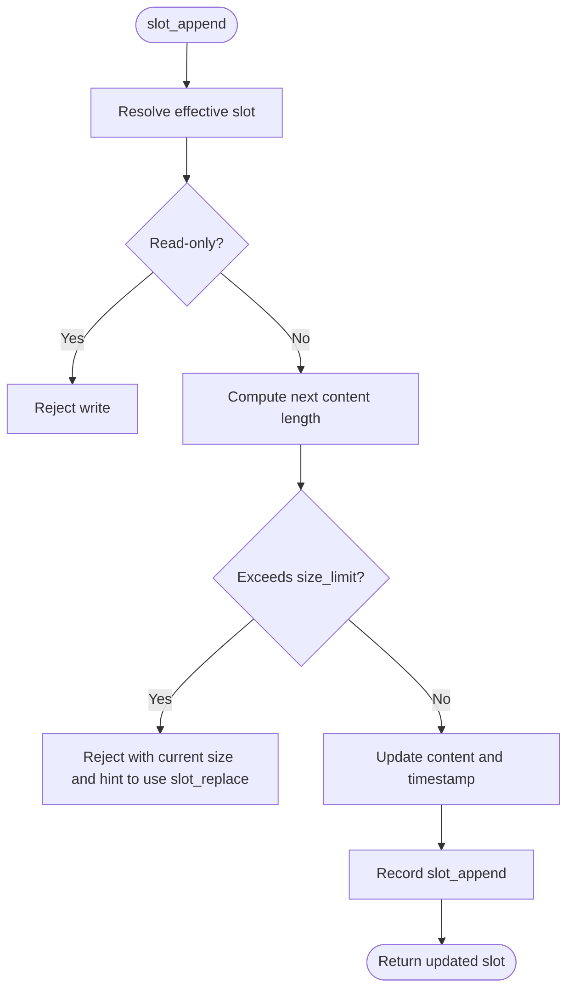
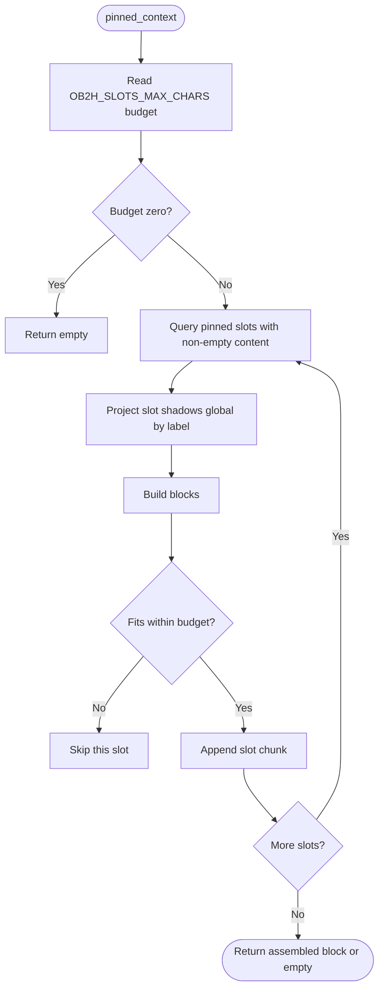
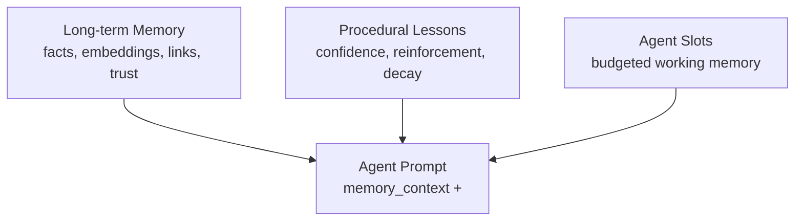
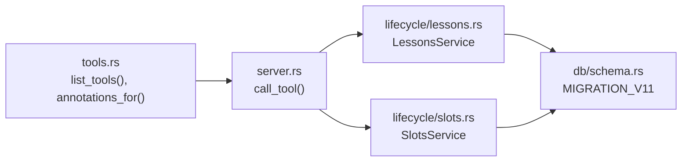

# Lessons and Slots Tools

<cite>
**Referenced Files in This Document**   
- [tools.rs](file://src/mcp/tools.rs)
- [server.rs](file://src/mcp/server.rs)
- [lessons.rs](file://src/lifecycle/lessons.rs)
- [slots.rs](file://src/lifecycle/slots.rs)
- [schema.rs](file://src/db/schema.rs)
</cite>

## Table of Contents
1. [Introduction](#introduction)
2. [Project Structure](#project-structure)
3. [Core Components](#core-components)
4. [Architecture Overview](#architecture-overview)
5. [Detailed Component Analysis](#detailed-component-analysis)
6. [Dependency Analysis](#dependency-analysis)
7. [Performance Considerations](#performance-considerations)
8. [Troubleshooting Guide](#troubleshooting-guide)
9. [Conclusion](#conclusion)

## Introduction
This document describes the MCP protocol tools for procedural experience and agent working memory: lessons and slots. It explains how to save, recall, list, and delete lessons with confidence scoring and decay; how to manage scoped slots with hard size budgets and pinned context injection; and how these features relate to long-term memory and agent prompts.

Lessons are durable procedural records such as “what worked”, “what to avoid”, and “when applicable”. They are deduplicated by content fingerprint, strengthened on repeated saves, and scored during recall using confidence, relevance, and recency. Slots are editable, budgeted context units that can be scoped per project or globally. Pinned slots are automatically injected into the agent prompt under a dedicated block, giving the agent a stable working memory across turns.

## Project Structure
The lesson and slot functionality is implemented in three layers:

- MCP tool definitions describe names, descriptions, input schemas, and read-only/destructive hints.
- The MCP server parses JSON-RPC `tools/call` requests, resolves optional active project context, and dispatches to domain services.
- Lifecycle services implement persistence, search, validation, auditing, and context injection.

**Diagram sources**
- [tools.rs:55-813](file://src/mcp/tools.rs#L55-L813)
- [server.rs:479-558](file://src/mcp/server.rs#L479-L558)
- [server.rs:2133-2301](file://src/mcp/server.rs#L2133-L2301)
- [lessons.rs:82-133](file://src/lifecycle/lessons.rs#L82-L133)
- [slots.rs:48-50](file://src/lifecycle/slots.rs#L48-L50)
- [schema.rs:384-449](file://src/db/schema.rs#L384-L449)

**Section sources**
- [tools.rs:55-813](file://src/mcp/tools.rs#L55-L813)
- [server.rs:479-558](file://src/mcp/server.rs#L479-L558)
- [server.rs:2133-2301](file://src/mcp/server.rs#L2133-L2301)
- [lessons.rs:82-133](file://src/lifecycle/lessons.rs#L82-L133)
- [slots.rs:48-50](file://src/lifecycle/slots.rs#L48-L50)
- [schema.rs:384-449](file://src/db/schema.rs#L384-L449)

## Core Components
This section documents the nine requested MCP tools. For each tool, the description, parameters, behavior, and example usage patterns are provided.

### Lesson Tools

#### `lesson_save`
- Purpose: Save a procedural lesson. Repeated saves of the same content strengthen the existing lesson rather than creating duplicates.
- Parameters:
  - `content`: Required. The lesson text describing what to do, what to avoid, or when it applies.
  - `context`: Optional. When or where the lesson applies.
  - `confidence`: Optional. Initial confidence from 0.0 to 1.0; defaults to 0.5.
  - `project`: Optional. Scope the lesson to a project.
  - `tags`: Optional. Array of labels.
  - `source`: Optional. One of `manual`, `consolidation`, `recap`, `dream`; defaults to `manual`.
- Behavior:
  - Content is normalized and hashed to produce a deterministic lesson ID prefixed with `lsn_`.
  - If an identical lesson exists, confidence increases using a saturation formula, reinforcement count increments, and source IDs are merged up to a cap.
  - Empty content, too-long content, invalid source, or out-of-range confidence are rejected.
  - A successful save returns whether the lesson was created or strengthened.
- Example usage:
  - Save a new lesson about avoiding a specific refactoring pattern.
  - Strengthen an existing lesson by saving the same content again after confirming it helped.
  - Attach project-scoped context so the lesson is only recalled for that project.

**Section sources**
- [tools.rs:622-637](file://src/mcp/tools.rs#L622-L637)
- [server.rs:2133-2164](file://src/mcp/server.rs#L2133-L2164)
- [lessons.rs:86-91](file://src/lifecycle/lessons.rs#L86-L91)
- [lessons.rs:165-279](file://src/lifecycle/lessons.rs#L165-L279)

#### `lesson_recall`
- Purpose: Search lessons before making decisions to avoid repeating known mistakes.
- Parameters:
  - `query`: Required. Natural-language query describing the situation or solution.
  - `project`: Optional. Filter by project.
  - `min_confidence`: Optional. Minimum confidence threshold; defaults to 0.1.
  - `limit`: Optional. Maximum results; defaults to 10, maximum 100.
- Behavior:
  - Uses FTS5 over lesson content and context, falling back to LIKE if no FTS hits occur.
  - Each hit receives a score combining confidence, relevance, and recency boost based on last reinforcement or creation time.
  - Results are filtered by `min_confidence` and optional project, then sorted deterministically by score and ID.
- Example usage:
  - Search for lessons relevant to a failing test with a high confidence threshold.
  - Recall project-specific lessons before starting a migration task.

**Section sources**
- [tools.rs:638-651](file://src/mcp/tools.rs#L638-L651)
- [server.rs:2166-2184](file://src/mcp/server.rs#L2166-L2184)
- [lessons.rs:281-354](file://src/lifecycle/lessons.rs#L281-L354)

#### `lesson_list`
- Purpose: List lessons sorted by confidence, hiding tombstones. Useful for reviewing procedural experience by project or source.
- Parameters:
  - `project`: Optional. Filter by project.
  - `source`: Optional. Filter by one of `manual`, `consolidation`, `recap`, `dream`.
  - `min_confidence`: Optional. Defaults to 0.
  - `limit`: Optional. Defaults to 50, maximum 200.
- Behavior:
  - Returns live lessons ordered by confidence descending, then updated time.
  - Tombstone lessons are excluded.
- Example usage:
  - Review all manual lessons above a confidence threshold.
  - Inspect lessons produced by consolidation or dream processes.

**Section sources**
- [tools.rs:652-664](file://src/mcp/tools.rs#L652-L664)
- [server.rs:2186-2198](file://src/mcp/server.rs#L2186-L2198)
- [lessons.rs:403-432](file://src/lifecycle/lessons.rs#L403-L432)

#### `lesson_delete`
- Purpose: Soft-delete a lesson by marking it as a tombstone. Records remain in the database until maintenance.
- Parameters:
  - `lesson_id`: Required. The lesson ID returned by recall or list, typically starting with `lsn_`.
- Behavior:
  - Sets `deleted_at` instead of removing the row.
  - Returns success if a lesson was marked deleted; otherwise indicates not found or already deleted.
- Example usage:
  - Remove a low-confidence lesson that is no longer relevant without losing its history.

**Section sources**
- [tools.rs:665-675](file://src/mcp/tools.rs#L665-L675)
- [server.rs:2200-2210](file://src/mcp/server.rs#L2200-L2210)
- [lessons.rs:434-455](file://src/lifecycle/lessons.rs#L434-L455)

### Slot Tools

#### `slot_list`
- Purpose: List slots. Project-scoped slots shadow global slots with the same label.
- Parameters:
  - `project`: Optional. Defaults to the active session project.
- Behavior:
  - Ensures default seed slots exist for the active project.
  - Returns global and project slots, with project entries taking precedence for duplicate labels.
- Example usage:
  - Inspect available working-memory slots before editing them.

**Section sources**
- [tools.rs:677-686](file://src/mcp/tools.rs#L677-L686)
- [server.rs:2212-2221](file://src/mcp/server.rs#L2212-L2221)
- [slots.rs:214-243](file://src/lifecycle/slots.rs#L214-L243)

#### `slot_get`
- Purpose: Read a slot by label. Project-scoped slots shadow global ones.
- Parameters:
  - `label`: Required. Lowercase identifier starting with a letter, allowing lowercase letters, digits, and underscores.
  - `project`: Optional. Defaults to the active session project.
- Behavior:
  - Validates label format.
  - Returns the effective slot (project first, then global).
- Example usage:
  - Read current pending items or session guidance before appending updates.

**Section sources**
- [tools.rs:687-698](file://src/mcp/tools.rs#L687-L698)
- [server.rs:2222-2232](file://src/mcp/server.rs#L2222-L2232)
- [slots.rs:52-67](file://src/lifecycle/slots.rs#L52-L67)
- [slots.rs:245-255](file://src/lifecycle/slots.rs#L245-L255)

#### `slot_create`
- Purpose: Create a new slot. Duplicate labels within the same scope are forbidden.
- Parameters:
  - `label`: Required. Identifier rules apply.
  - `content`: Optional. Initial content; defaults to empty.
  - `size_limit`: Optional. Maximum characters; defaults to 2000, ceiling 20000.
  - `description`: Optional. Human-readable purpose.
  - `pinned`: Optional. Whether the slot should be injected into agent context; defaults to true.
  - `scope`: Optional. Either `project` or `global`; defaults to `project`.
  - `project`: Optional. Required when scope is `project`; defaults to active session project.
- Behavior:
  - Validates label, size limit, initial content length, and scope/project combination.
  - Creates the slot and records the operation in the audit log.
- Example usage:
  - Create a project-scoped slot for build commands.
  - Create a global read-only rule slot that agents cannot overwrite.

**Section sources**
- [tools.rs:699-715](file://src/mcp/tools.rs#L699-L715)
- [server.rs:2233-2258](file://src/mcp/server.rs#L2233-L2258)
- [slots.rs:257-320](file://src/lifecycle/slots.rs#L257-L320)

#### `slot_append`
- Purpose: Append text to a slot. If appending would exceed `size_limit`, the operation fails with the current size and suggests compacting via `slot_replace`.
- Parameters:
  - `label`: Required.
  - `text`: Required.
  - `project`: Optional. Defaults to active session project.
- Behavior:
  - Resolves the effective slot.
  - Rejects writes to read-only slots.
  - Enforces `size_limit` and records audit details including added length and total length.
- Example usage:
  - Add a new TODO item to `pending_items`.
  - Append error summaries to a diagnostic slot, compacting periodically.

**Section sources**
- [tools.rs:716-728](file://src/mcp/tools.rs#L716-L728)
- [server.rs:2259-2272](file://src/mcp/server.rs#L2259-L2272)
- [slots.rs:322-369](file://src/lifecycle/slots.rs#L322-L369)

#### `slot_replace`
- Purpose: Replace the entire slot content. Use this for compacting large slots.
- Parameters:
  - `label`: Required.
  - `content`: Required.
  - `project`: Optional. Defaults to active session project.
- Behavior:
  - Resolves the effective slot.
  - Rejects writes to read-only slots.
  - Enforces `size_limit` and records audit details with before/after lengths.
- Example usage:
  - Compact a growing notes slot by summarizing older entries.

**Section sources**
- [tools.rs:729-741](file://src/mcp/tools.rs#L729-L741)
- [server.rs:2273-2290](file://src/mcp/server.rs#L2273-L2290)
- [slots.rs:371-414](file://src/lifecycle/slots.rs#L371-L414)

#### `slot_delete`
- Purpose: Delete a slot. Read-only slots are protected.
- Parameters:
  - `label`: Required.
  - `project`: Optional. Defaults to active session project.
- Behavior:
  - Resolves the effective slot.
  - Rejects deletion of read-only slots.
  - Records deletion in the audit log.
- Example usage:
  - Remove a temporary scratch slot after consolidating its contents elsewhere.

**Section sources**
- [tools.rs:742-753](file://src/mcp/tools.rs#L742-L753)
- [server.rs:2291-2302](file://src/mcp/server.rs#L2291-L2302)
- [slots.rs:416-449](file://src/lifecycle/slots.rs#L416-L449)

## Architecture Overview
The lesson and slot tools follow a consistent MCP flow:

1. The client calls `tools/call` with a tool name and arguments.
2. The server validates required fields and resolves optional project context.
3. The server delegates to `LessonsService` or `SlotsService`.
4. Services validate inputs, perform SQLite operations, and record audit events.
5. The server serializes results or wraps errors in a readable format.

**Diagram sources**
- [server.rs:479-558](file://src/mcp/server.rs#L479-L558)
- [server.rs:2133-2301](file://src/mcp/server.rs#L2133-L2301)
- [lessons.rs:165-279](file://src/lifecycle/lessons.rs#L165-L279)
- [slots.rs:257-320](file://src/lifecycle/slots.rs#L257-L320)

## Detailed Component Analysis

### Procedural Experience Storage with Confidence Scoring
Lessons represent durable procedural knowledge. Their lifecycle includes:

- Deterministic deduplication by content fingerprint.
- Reinforcement on repeated saves.
- Confidence decay over time through a scheduled sweep.
- Tombstone-based soft deletion.
- Audit logging for save, strengthen, recall, delete, and decay operations.

**Diagram sources**
- [lessons.rs:86-91](file://src/lifecycle/lessons.rs#L86-L91)
- [lessons.rs:165-279](file://src/lifecycle/lessons.rs#L165-L279)

Recall combines multiple signals:

**Diagram sources**
- [lessons.rs:281-354](file://src/lifecycle/lessons.rs#L281-L354)
- [lessons.rs:358-401](file://src/lifecycle/lessons.rs#L358-L401)

Decay is not automatic deletion; it reduces confidence for idle lessons while preserving records:

**Diagram sources**
- [lessons.rs:457-543](file://src/lifecycle/lessons.rs#L457-L457)

**Section sources**
- [lessons.rs:1-28](file://src/lifecycle/lessons.rs#L1-L28)
- [lessons.rs:86-91](file://src/lifecycle/lessons.rs#L86-L91)
- [lessons.rs:165-279](file://src/lifecycle/lessons.rs#L165-L279)
- [lessons.rs:281-354](file://src/lifecycle/lessons.rs#L281-L354)
- [lessons.rs:457-543](file://src/lifecycle/lessons.rs#L457-L543)

### Budgeted Context Buffers and Pinned Content Injection
Slots provide agent-editable working memory with strict size budgets:

- Default size limit is 2000 characters, with a hard ceiling of 20000.
- `slot_append` refuses writes that would exceed the limit, guiding the agent to compact via `slot_replace`.
- `slot_replace` allows full replacement while enforcing the limit.
- Pinned slots are injected into the agent prompt under a dedicated block.
- The injection budget is configurable via an environment variable and defaults to a small value to keep prompts concise.

**Diagram sources**
- [slots.rs:322-369](file://src/lifecycle/slots.rs#L322-L369)

Pinned context injection selects non-empty pinned slots, applies project scoping, orders alphabetically, and fills the budget without breaking slot boundaries:

**Diagram sources**
- [slots.rs:77-134](file://src/lifecycle/slots.rs#L77-L134)

**Section sources**
- [slots.rs:22-30](file://src/lifecycle/slots.rs#L22-L30)
- [slots.rs:77-134](file://src/lifecycle/slots.rs#L77-L134)
- [slots.rs:257-320](file://src/lifecycle/slots.rs#L257-L320)
- [slots.rs:322-414](file://src/lifecycle/slots.rs#L322-L414)

### Relationship Between Lessons and Long-Term Memory
Lessens and long-term memory serve different roles:

- Long-term memory stores facts, observations, and extracted knowledge. It supports hybrid search, vector similarity, graph expansion, provenance, and feedback-driven trust adjustments.
- Lessons store procedural experience with confidence scoring, reinforcement, and decay. They are not indexed for semantic vector search; they are searched via FTS and confidence/recency scoring.
- Both systems can be scoped to projects and are part of the broader OB2H lifecycle.
- Session recaps can persist summaries into long-term memory, while lessons capture reusable operational knowledge.

**Diagram sources**
- [tools.rs:57-133](file://src/mcp/tools.rs#L57-L133)
- [tools.rs:622-753](file://src/mcp/tools.rs#L622-L753)
- [slots.rs:77-134](file://src/lifecycle/slots.rs#L77-L134)

**Section sources**
- [tools.rs:57-133](file://src/mcp/tools.rs#L57-L133)
- [tools.rs:622-753](file://src/mcp/tools.rs#L622-L753)
- [slots.rs:77-134](file://src/lifecycle/slots.rs#L77-L134)

## Dependency Analysis
The following diagram shows how MCP tool definitions, server dispatch, lifecycle services, and schema interact.

**Diagram sources**
- [tools.rs:55-813](file://src/mcp/tools.rs#L55-L813)
- [server.rs:2133-2301](file://src/mcp/server.rs#L2133-L2301)
- [lessons.rs:82-133](file://src/lifecycle/lessons.rs#L82-L133)
- [slots.rs:48-50](file://src/lifecycle/slots.rs#L48-L50)
- [schema.rs:384-449](file://src/db/schema.rs#L384-L449)

**Section sources**
- [tools.rs:55-813](file://src/mcp/tools.rs#L55-L813)
- [server.rs:2133-2301](file://src/mcp/server.rs#L2133-L2301)
- [schema.rs:384-449](file://src/db/schema.rs#L384-L449)

## Performance Considerations
- Lesson recall uses FTS5 with a trigram tokenizer and falls back to LIKE when needed. Filtering by project or confidence threshold increases the fetch window to avoid post-filter starvation.
- Lesson list limits results to 200 rows and sorts by confidence and update time.
- Slot append and replace enforce character counts early, preventing oversized writes.
- Pinned context injection respects a configurable character budget and skips slots that would exceed it, ensuring prompt size remains bounded.
- Decay sweeps run at most once every seven days and track a cursor to avoid repeated work.

[No sources needed since this section provides general guidance]

## Troubleshooting Guide
Common issues and resolutions:

- `lesson_save` rejects empty content, overly long content, invalid source values, or confidence outside 0.0–1.0. Shorten the lesson, choose a valid source, or adjust confidence.
- `lesson_recall` returns no results for very short or unusual queries when FTS does not match; try rephrasing the query or lowering `min_confidence`.
- `lesson_delete` reports not found if the lesson ID is missing, malformed, or already tombstoned.
- `slot_create` fails if the label violates naming rules, the initial content exceeds `size_limit`, the scope is invalid, or a project-scoped slot lacks a project.
- `slot_append` fails with a budget error when the resulting content would exceed `size_limit`. Compact the slot with `slot_replace` before appending again.
- `slot_replace` fails if the new content exceeds `size_limit` or the slot is read-only.
- `slot_delete` fails for read-only slots. Use `slot_list` to identify protected slots.

**Section sources**
- [lessons.rs:165-183](file://src/lifecycle/lessons.rs#L165-L183)
- [lessons.rs:434-455](file://src/lifecycle/lessons.rs#L434-L455)
- [slots.rs:52-67](file://src/lifecycle/slots.rs#L52-L67)
- [slots.rs:271-305](file://src/lifecycle/slots.rs#L271-L305)
- [slots.rs:341-355](file://src/lifecycle/slots.rs#L341-L355)
- [slots.rs:389-399](file://src/lifecycle/slots.rs#L389-L399)
- [slots.rs:433-435](file://src/lifecycle/slots.rs#L433-L435)

## Conclusion
The lessons and slots tools extend the MCP protocol with durable procedural experience and budgeted agent working memory. Lessons capture repeatable operational knowledge with confidence scoring, reinforcement, and decay, while slots provide editable, scoped context buffers that can be pinned into every agent turn. Together with long-term memory, they form a layered system: memories store facts, lessons store procedures, and slots hold immediate working context. Proper use of confidence thresholds, project scoping, size budgets, and pinned injection helps maintain efficient, reliable agent reasoning across sessions.

[No sources needed since this section summarizes without analyzing specific files]