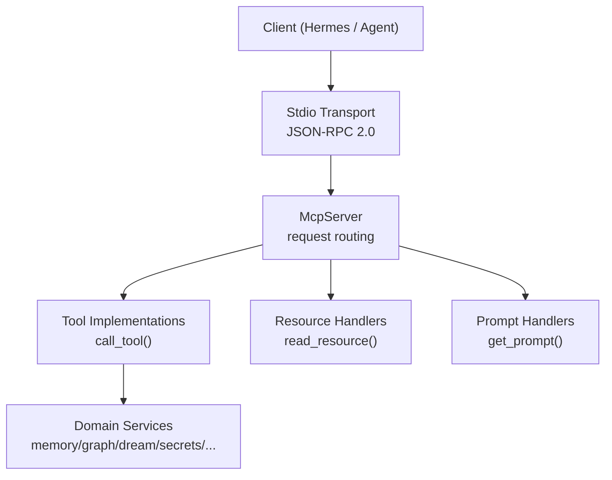
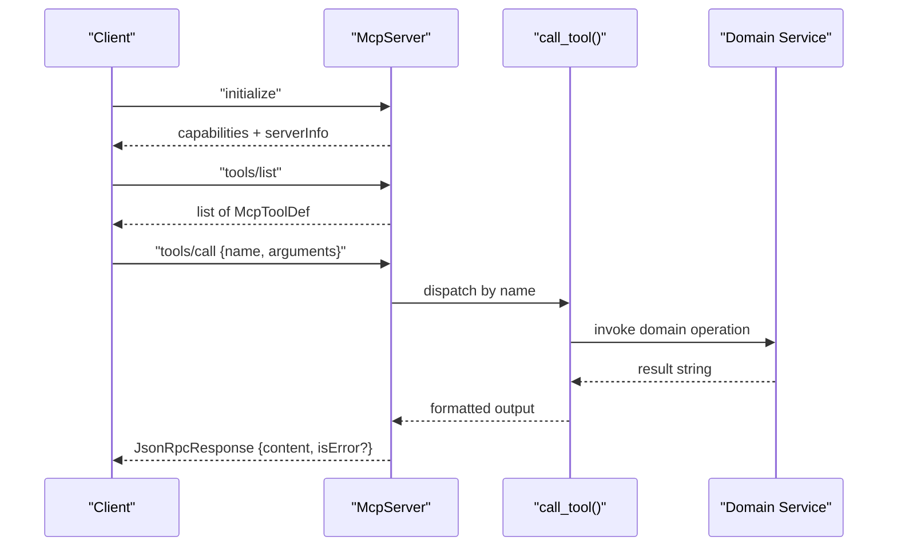
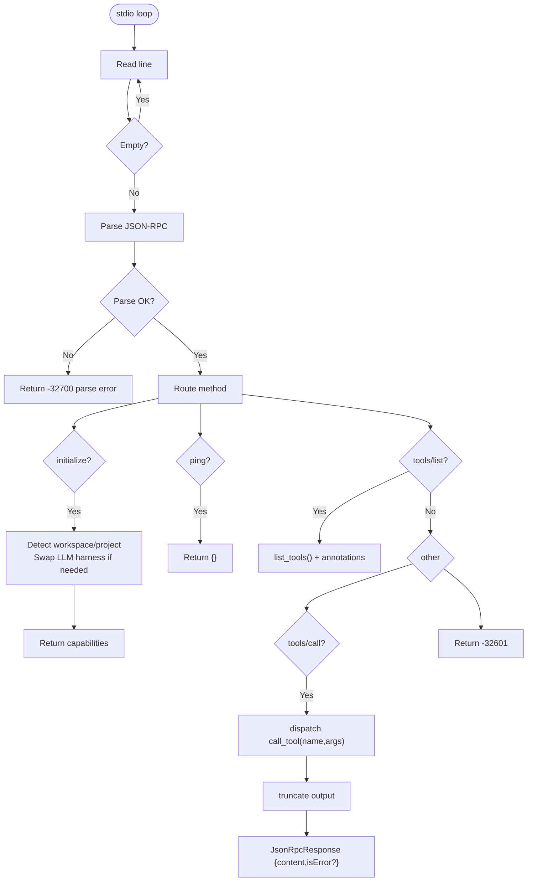
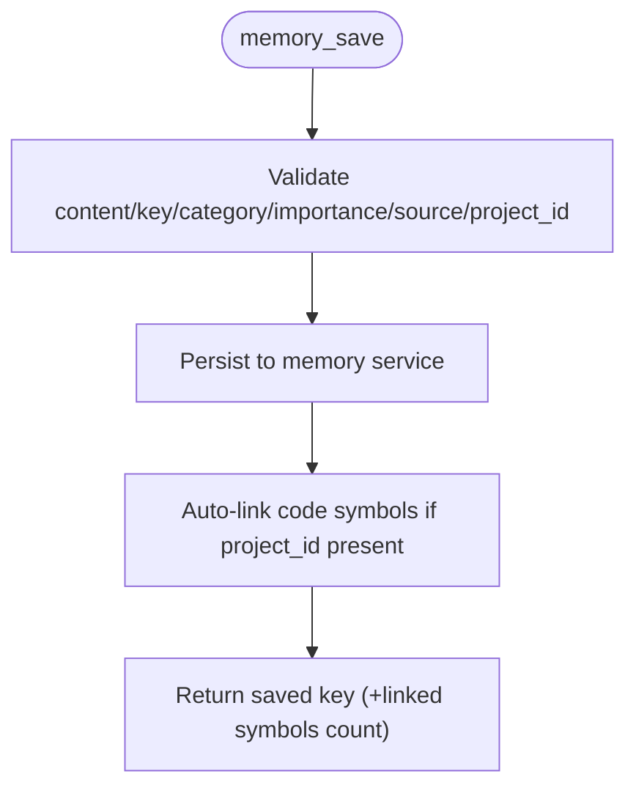
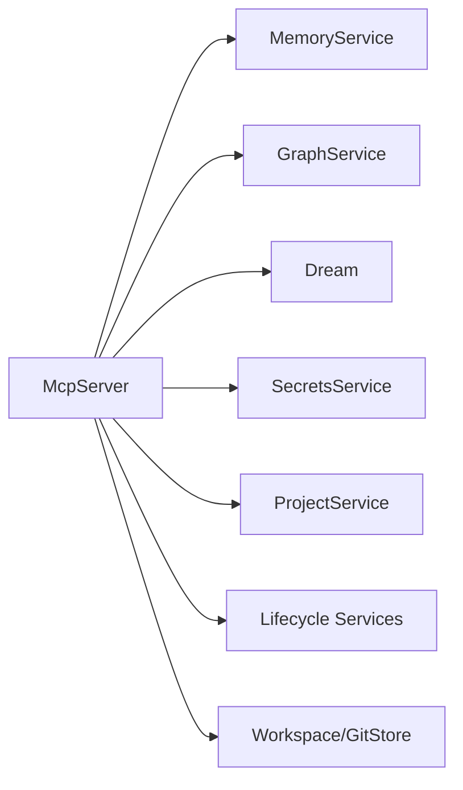

# MCP Protocol Reference

<cite>
**Referenced Files in This Document**
- [mod.rs](file://src/mcp/mod.rs)
- [protocol.rs](file://src/mcp/protocol.rs)
- [server.rs](file://src/mcp/server.rs)
- [tools.rs](file://src/mcp/tools.rs)
- [test_mcp.rs](file://tests/test_mcp.rs)
</cite>

## Table of Contents
1. [Introduction](#introduction)
2. [Project Structure](#project-structure)
3. [Core Components](#core-components)
4. [Architecture Overview](#architecture-overview)
5. [Detailed Component Analysis](#detailed-component-analysis)
6. [Dependency Analysis](#dependency-analysis)
7. [Performance Considerations](#performance-considerations)
8. [Troubleshooting Guide](#troubleshooting-guide)
9. [Conclusion](#conclusion)
10. [Appendices](#appendices)

## Introduction
This document is the API reference for the Model Context Protocol (MCP) implementation that exposes standardized tool interfaces for AI agent integration. The server communicates over JSON-RPC 2.0 via standard input/output, and exposes a fixed set of tools grouped by functional areas: memory operations, knowledge graph queries, project analysis, dream control, secrets management, lessons and slots, session chronology, provenance and audit, and viewer interactions.

The protocol supports:
- Tool discovery and invocation through `tools/list` and `tools/call`.
- Resource listing and reading through `resources/list` and `resources/read`.
- Prompt templates through `prompts/list` and `prompts/get`.
- Initialization handshake with automatic workspace/project detection and optional LLM harness auto-detection.

All tool responses are returned as text content inside a structured JSON-RPC response envelope. Errors are surfaced either as JSON-RPC-level errors or as tool output prefixed with `[Error]`, with optional `[Подсказка]` hints for remediation.

## Project Structure
The MCP subsystem is implemented in Rust under `src/mcp`:
- `mod.rs` exposes the module and re-exports core types.
- `protocol.rs` defines JSON-RPC message shapes and MCP-specific structures.
- `server.rs` implements the stdio transport, request routing, initialization, resource handling, prompt handling, and all tool implementations.
- `tools.rs` declares the complete contract of 56 MCP tools, including descriptions and input schemas.

**Diagram sources**
- [server.rs:138-206](file://src/mcp/server.rs#L138-L206)
- [server.rs:208-570](file://src/mcp/server.rs#L208-L570)
- [server.rs:572-2387](file://src/mcp/server.rs#L572-L2387)
- [tools.rs:55-813](file://src/mcp/tools.rs#L55-L813)

**Section sources**
- [mod.rs:1-8](file://src/mcp/mod.rs#L1-L8)
- [protocol.rs:1-53](file://src/mcp/protocol.rs#L1-L53)
- [server.rs:1-56](file://src/mcp/server.rs#L1-L56)
- [tools.rs:1-54](file://src/mcp/tools.rs#L1-L54)

## Core Components
- JSON-RPC Request/Response: Standard fields include `jsonrpc`, `id`, `method`, `params`; responses include `result` or `error`.
- MCP Tool Definition: Each tool has a name, description, and an `inputSchema` object describing parameters.
- Tool Call Result: A list of content blocks with type and text; an optional `isError` flag indicates error-like outputs.

Key behaviors:
- Unknown methods return JSON-RPC error code `-32601`.
- Parse failures return JSON-RPC error code `-32700`.
- Tool outputs are truncated to a configured maximum character budget.
- Some tools annotate read-only or destructive behavior via annotations injected during `tools/list`.

**Section sources**
- [protocol.rs:5-52](file://src/mcp/protocol.rs#L5-L52)
- [server.rs:156-176](file://src/mcp/server.rs#L156-L176)
- [server.rs:540-558](file://src/mcp/server.rs#L540-L558)
- [tools.rs:6-53](file://src/mcp/tools.rs#L6-L53)

## Architecture Overview
The MCP server runs as a stdio-based JSON-RPC endpoint. It initializes capabilities, detects active workspace/project, and routes requests to handlers. Tool calls are dispatched asynchronously to keep the server responsive to ping and other requests while long-running operations proceed.

**Diagram sources**
- [server.rs:208-324](file://src/mcp/server.rs#L208-L324)
- [server.rs:332-360](file://src/mcp/server.rs#L332-L360)
- [server.rs:479-558](file://src/mcp/server.rs#L479-L558)
- [server.rs:572-647](file://src/mcp/server.rs#L572-L647)

## Detailed Component Analysis

### Protocol Message Formats
- JSON-RPC Request:
  - Fields: `jsonrpc`, `id`, `method`, `params`.
- JSON-RPC Response:
  - Fields: `jsonrpc`, `id`, `result`, `error`.
- MCP Tool Definition:
  - Fields: `name`, `description`, `inputSchema`.
- MCP Content Block:
  - Fields: `type`, `text`.
- MCP Tool Call Result:
  - Fields: `content` (array of content blocks), `isError` (optional).

Validation rules:
- Missing required parameters per tool schema produce `[Error] ...` messages.
- Enum values must match declared options; otherwise, validation fails early.
- Numeric ranges are enforced where applicable (e.g., importance 0..1, limits clamped).

**Section sources**
- [protocol.rs:5-52](file://src/mcp/protocol.rs#L5-L52)
- [server.rs:156-176](file://src/mcp/server.rs#L156-L176)
- [server.rs:540-558](file://src/mcp/server.rs#L540-L558)

### Connection Handling and Real-Time Patterns
- Transport: stdio lines parsed as JSON-RPC messages.
- Concurrency: each request handled in a separate task; background tasks cleaned up periodically.
- Keepalive: `ping` returns empty result; server continues reading stdin even during long tool calls.
- Initialization:
  - Detects client info and optionally swaps LLM harness based on environment and client identity.
  - Auto-registers project from workspace folders, root URI/path, or current directory.
  - Activates file watcher if enabled.

**Diagram sources**
- [server.rs:138-206](file://src/mcp/server.rs#L138-L206)
- [server.rs:208-324](file://src/mcp/server.rs#L208-L324)
- [server.rs:326-360](file://src/mcp/server.rs#L326-L360)
- [server.rs:479-558](file://src/mcp/server.rs#L479-L558)

**Section sources**
- [server.rs:138-206](file://src/mcp/server.rs#L138-L206)
- [server.rs:208-324](file://src/mcp/server.rs#L208-L324)

### Authentication and Authorization
- No HTTP endpoints; authentication is not part of this transport.
- Secrets Vault requires explicit unlock before access; operations log only names, never values.
- Workspace writes commit to Git; audit entries record metadata without sensitive content.

**Section sources**
- [server.rs:2055-2131](file://src/mcp/server.rs#L2055-L2131)
- [server.rs:1088-1124](file://src/mcp/server.rs#L1088-L1124)

### Error Handling Strategy
- JSON-RPC level:
  - `-32700` for parse errors.
  - `-32601` for unknown methods.
- Tool level:
  - Output strings starting with `[Error]` indicate tool execution errors.
  - Optional `[Подсказка]` hints provide remediation guidance.
  - Some services degrade gracefully (e.g., embedding fallback warning).

**Section sources**
- [server.rs:156-176](file://src/mcp/server.rs#L156-L176)
- [server.rs:540-558](file://src/mcp/server.rs#L540-L558)
- [server.rs:800-809](file://src/mcp/server.rs#L800-L809)

### Rate Limiting and Concurrency
- No explicit rate limiting per tool; concurrency is managed by spawning tasks per request.
- Long-running tools do not block the server’s ability to respond to pings.
- Background jobs (e.g., AST scans, dream runs) are polled via status tools.

**Section sources**
- [server.rs:178-200](file://src/mcp/server.rs#L178-L200)
- [server.rs:1579-1612](file://src/mcp/server.rs#L1579-L1612)
- [server.rs:1737-1779](file://src/mcp/server.rs#L1737-L1779)

### Tool Contract Snapshot
The repository enforces a snapshot of exactly 56 tools. Any change must update the test assertion.

**Section sources**
- [test_mcp.rs:7-86](file://tests/test_mcp.rs#L7-L86)

## Detailed Component Analysis

### Memory Operations
Tools:
- `memory_save`: Save facts with optional key, category, importance, source, and project_id.
- `memory_search`: Hybrid search across FTS and vector embeddings; supports modes `hybrid`, `fts`, `vector`, `graph`; can include related nodes via `related=true` or `mode=graph`.
- `memory_update`: Update any field of a memory record by key.
- `memory_forget`: Soft-delete by key; reason recorded in audit ledger.
- `memory_context`: Build a compact context block for prompts with token/char budgets and author filtering.
- `memory_feedback`: Adjust trust score based on verdict (`helpful`, `unhelpful`, `outdated`).
- `memory_merge`: Explicitly merge near-duplicate records into a canonical entry.

Common patterns:
- Validation ensures required fields like `content` or `key`.
- Project scoping via `project_id` filters results and links.
- Audit logging for destructive operations.

**Diagram sources**
- [server.rs:572-647](file://src/mcp/server.rs#L572-L647)

**Section sources**
- [tools.rs:57-133](file://src/mcp/tools.rs#L57-L133)
- [server.rs:572-647](file://src/mcp/server.rs#L572-L647)
- [server.rs:810-909](file://src/mcp/server.rs#L810-L909)

### Knowledge Graph Queries
Tools:
- `graph_search`: Search nodes and edges; supports classic 1-hop neighbors and PPR mode for personalized ranking.
- `graph_reason`: Answer questions using reasoning steps, entities, confidence; scope can include memory via PPR subgraph.
- `graph_stats`: Report counts of nodes, edges, documents, chunks.

Behavior:
- PPR mode requires project context; active project auto-injected when missing.
- Results include labels, types, scores, and optional file paths.

**Section sources**
- [tools.rs:190-230](file://src/mcp/tools.rs#L190-L230)
- [server.rs:1384-1474](file://src/mcp/server.rs#L1384-L1474)
- [server.rs:1475-1578](file://src/mcp/server.rs#L1475-L1578)

### Project Analysis
Tools:
- `project_init`: Register/update a project with id, name, path, description, tech_stack.
- `project_scan`: Start deterministic AST scan; background job with optional wait.
- `project_scan_status`: Poll background scan status and DB stats.
- `project_context`: Generate compact project context or repo map under token budget.
- `project_graph_search`: Hybrid semantic search over project code graph; structural modes callers/callees.
- `project_call_path`: Explore call dependencies between symbols or neighbors.
- `project_report`: Architectural summary with God Nodes and components.
- `project_impact`: Blast radius analysis for refactoring risk.

Patterns:
- Active project auto-injection for many tools.
- Background scanning decouples long AST work from client timeouts.
- Repo map mode builds compact file-to-symbols maps.

**Section sources**
- [tools.rs:310-431](file://src/mcp/tools.rs#L310-L431)
- [server.rs:1700-1867](file://src/mcp/server.rs#L1700-L1867)
- [server.rs:1868-2054](file://src/mcp/server.rs#L1868-L2054)

### Dream Control
Tools:
- `dream_run`: Run dream analysis; background mode spawns a detached task.
- `dream_status`: Last run status and gate states.
- `dream_log`: Git commits history for dream changes.
- `dream_restore`: Restore workspace files to a specific commit.

Behavior:
- Mutex lock prevents concurrent dream runs.
- Background mode returns immediate acknowledgment.

**Section sources**
- [tools.rs:231-270](file://src/mcp/tools.rs#L231-L270)
- [server.rs:1579-1637](file://src/mcp/server.rs#L1579-L1637)

### Secrets Management
Tools:
- `secrets_status`: Check vault state, TTL, known secret names.
- `secrets_set`: Encrypt and store a secret with optional hint.
- `secrets_get`: Decrypt and retrieve secret value.
- `secrets_delete`: Remove secret by name.
- `secrets_lock`: Immediately lock vault and wipe master key from memory.

Security:
- Values are never logged; only names appear in audit entries.
- Unlock required for read/write/delete operations.

**Section sources**
- [tools.rs:569-620](file://src/mcp/tools.rs#L569-L620)
- [server.rs:2055-2131](file://src/mcp/server.rs#L2055-L2131)

### Lessons and Slots
Lessons:
- `lesson_save`: Persist procedural experience with confidence and tags.
- `lesson_recall`: Search lessons by query, confidence threshold, project filter.
- `lesson_list`: Browse lessons sorted by confidence.
- `lesson_delete`: Soft-delete lesson (tombstone).

Slots:
- `slot_list`: List global/project-scoped slots.
- `slot_get`: Read slot by label.
- `slot_create`: Create slot with size limit, pinned flag, scope.
- `slot_append`: Append text; enforce size limit.
- `slot_replace`: Replace entire content; compactify.
- `slot_delete`: Delete slot; protected read-only slots cannot be deleted.

Behavior:
- Active project auto-injection for slots.
- Size limits prevent unbounded growth; compactification recommended before appending.

**Section sources**
- [tools.rs:621-753](file://src/mcp/tools.rs#L621-L753)
- [server.rs:2132-2302](file://src/mcp/server.rs#L2132-L2302)

### Session Chronology, Provenance, and Audit
Tools:
- `memory_timeline`: Window around anchor date/text in daily logs.
- `session_recap`: Summarize session with incremental cursor; optionally save recap to memory.
- `memory_verify`: Trace provenance of a memory fact back to daily observations.
- `memory_audit`: View audit ledger entries for sensitive operations.

Behavior:
- Redaction applied before capturing secrets in logs.
- Audit entries capture actor, action, targets, and non-sensitive details.

**Section sources**
- [tools.rs:754-800](file://src/mcp/tools.rs#L754-L800)
- [server.rs:2303-2369](file://src/mcp/server.rs#L2303-L2369)

### Viewer Interactions
Tool:
- `viewer_open`: Launch detached viewer process; returns status opened/already_running/unavailable.

Behavior:
- Without GUI feature, returns a helpful error suggesting CLI usage.

**Section sources**
- [tools.rs:802-813](file://src/mcp/tools.rs#L802-L813)
- [server.rs:2370-2385](file://src/mcp/server.rs#L2370-L2385)

### Ralph Knowledge Layer
Tools:
- `ralph_start`: Start a development cycle with goal and autonomy settings.
- `ralph_iteration`: Record iteration hypothesis/plan/result/tests_summary; idempotent by (run, task, n).
- `ralph_verdict`: Change verdict for iteration or finding.
- `ralph_context`: Build context package for a task.
- `ralph_report`: Summary of progress, verdicts, debt ledger, gain metrics.
- `ast_diff`: Symbol-level diff between iterations.
- `ast_history`: Timeline of symbol changes across iterations.

Behavior:
- Iteration recording triggers AST rescans and staleness passes.
- Verdicts are objective-driven by tests and verification signals.

**Section sources**
- [tools.rs:446-550](file://src/mcp/tools.rs#L446-L550)
- [server.rs:910-1033](file://src/mcp/server.rs#L910-L1033)

### Workspace and Sessions
Tools:
- `workspace_read`: Read agent files (memory/soul/user/history).
- `workspace_write`: Overwrite agent files with optional git commit message.
- `session_log`: Log user/assistant turns; consolidate into history when budget exceeded.
- `session_ingest`: Batch ingest pairs with deduplication by session_id.

Behavior:
- Secret redaction before writing to daily logs.
- Pending session consolidation triggered automatically.

**Section sources**
- [tools.rs:134-189](file://src/mcp/tools.rs#L134-L189)
- [server.rs:1078-1295](file://src/mcp/server.rs#L1078-L1295)

### Resources and Prompts
Resources:
- `resources/list`: Exposes project overview, god nodes, schema, blast radius, and memory context resources.
- `resources/read`: Reads resource content by URI; MIME type included.

Prompts:
- `prompts/list`: Lists predefined prompts like component explanation and feature planning.
- `prompts/get`: Retrieves prompt template with arguments.

**Section sources**
- [server.rs:361-478](file://src/mcp/server.rs#L361-L478)

## Dependency Analysis
The MCP server composes multiple domain services:
- Memory service for persistent facts and relations.
- Graph service for knowledge graph operations and analytics.
- Dream service for automated workspace evolution.
- Secrets service for encrypted storage.
- Project service for registration and scanning.
- Lifecycle services for lessons, slots, timeline, and audit.
- Workspace and Git store for file operations and commits.

**Diagram sources**
- [server.rs:27-52](file://src/mcp/server.rs#L27-L52)
- [server.rs:572-2387](file://src/mcp/server.rs#L572-L2387)

**Section sources**
- [server.rs:27-52](file://src/mcp/server.rs#L27-L52)

## Performance Considerations
- Truncation: Tool outputs are truncated to a configurable max character budget to avoid oversized responses.
- Embedding fallback: When embedding backend degrades, warnings are appended to search results.
- Background jobs: Scans and dreams run asynchronously; clients should poll status tools.
- Token budgets: Repo map and context builders respect token limits to fit LLM windows.
- PPR computation: Personalized PageRank may be expensive; use appropriate limits and damping weights.

[No sources needed since this section provides general guidance]

## Troubleshooting Guide
Common issues and resolutions:
- Parse errors: Ensure JSON-RPC messages are valid single-line JSON objects.
- Unknown methods: Verify tool names against `tools/list`.
- Missing required parameters: Follow tool schemas; check `[Error]` messages for hints.
- Embedding degradation: Check configuration and provider availability; hybrid/vector modes may be unreliable.
- Secrets locked: Unlock vault before accessing secrets; verify status.
- Viewer unavailable: Rebuild with GUI feature or use CLI commands.

**Section sources**
- [server.rs:156-176](file://src/mcp/server.rs#L156-L176)
- [server.rs:800-809](file://src/mcp/server.rs#L800-L809)
- [server.rs:2370-2385](file://src/mcp/server.rs#L2370-L2385)

## Conclusion
The MCP implementation provides a robust, extensible interface for AI agents to interact with memory, knowledge graphs, projects, dreams, secrets, lessons, slots, sessions, and viewer tools. It emphasizes safety (audit logging, secret redaction), performance (background jobs, token budgets), and clarity (structured schemas, hints in errors). Clients should rely on `tools/list` for discovery, handle truncation and error prefixes, and use status tools for long-running operations.

[No sources needed since this section summarizes without analyzing specific files]

## Appendices

### Tool Index by Functional Area
- Memory: `memory_save`, `memory_search`, `memory_update`, `memory_forget`, `memory_context`, `memory_feedback`, `memory_merge`, `memory_timeline`, `memory_verify`, `memory_audit`.
- Workspace/Sessions: `workspace_read`, `workspace_write`, `session_log`, `session_ingest`, `session_recap`.
- Knowledge Graph: `knowledge_extract`, `graph_search`, `graph_reason`, `graph_stats`.
- Project Analysis: `project_init`, `project_scan`, `project_scan_status`, `project_context`, `project_graph_search`, `project_call_path`, `project_report`, `project_impact`.
- Dream Control: `dream_run`, `dream_status`, `dream_log`, `dream_restore`.
- Secrets: `secrets_status`, `secrets_set`, `secrets_get`, `secrets_delete`, `secrets_lock`.
- Lessons/Slots: `lesson_save`, `lesson_recall`, `lesson_list`, `lesson_delete`, `slot_list`, `slot_get`, `slot_create`, `slot_append`, `slot_replace`, `slot_delete`.
- Ralph: `ralph_start`, `ralph_iteration`, `ralph_verdict`, `ralph_context`, `ralph_report`, `ast_diff`, `ast_history`.
- Viewer: `viewer_open`.

**Section sources**
- [tools.rs:55-813](file://src/mcp/tools.rs#L55-L813)
- [test_mcp.rs:7-86](file://tests/test_mcp.rs#L7-L86)