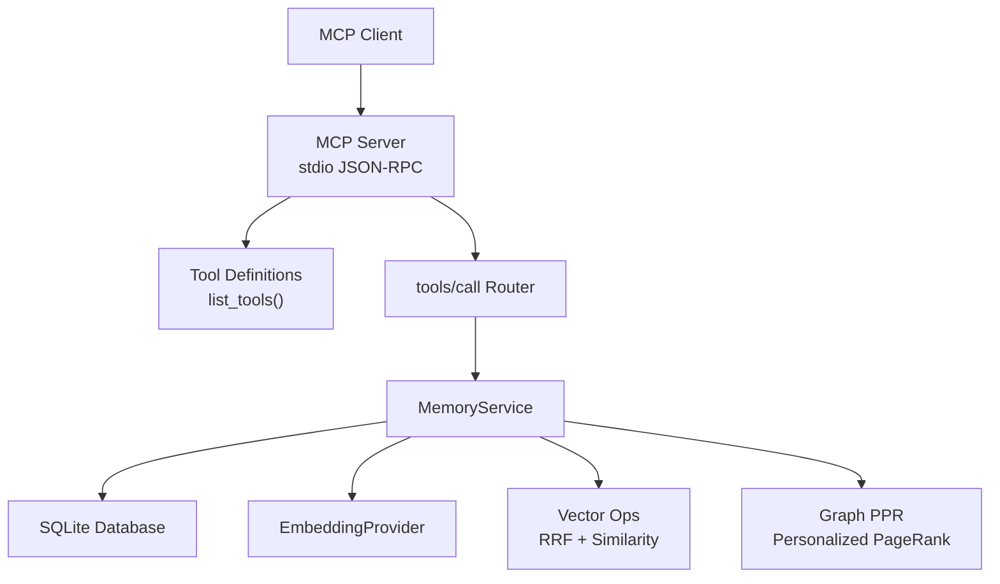
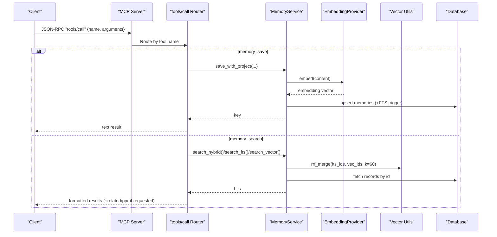
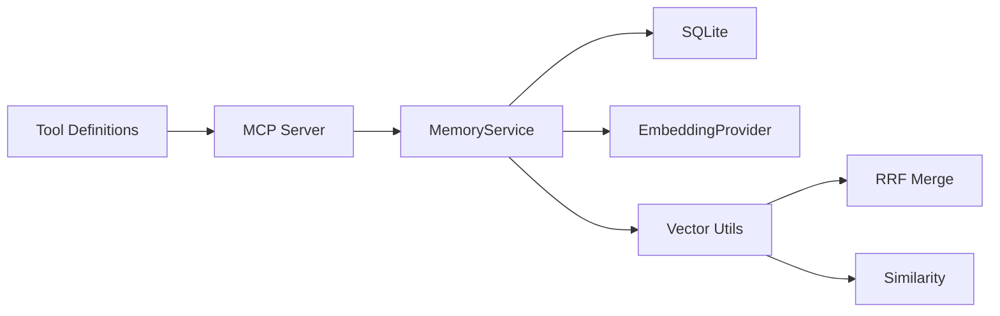

# Memory Tools

<cite>
**Referenced Files in This Document**   
- [tools.rs](file://src/mcp/tools.rs)
- [server.rs](file://src/mcp/server.rs)
- [protocol.rs](file://src/mcp/protocol.rs)
- [service.rs](file://src/memory/service.rs)
- [schema.rs](file://src/db/schema.rs)
- [rrf.rs](file://src/vector/rrf.rs)
- [similarity.rs](file://src/vector/similarity.rs)
</cite>

## Table of Contents
1. [Introduction](#introduction)
2. [Project Structure](#project-structure)
3. [Core Components](#core-components)
4. [Architecture Overview](#architecture-overview)
5. [Detailed Component Analysis](#detailed-component-analysis)
6. [Dependency Analysis](#dependency-analysis)
7. [Performance Considerations](#performance-considerations)
8. [Troubleshooting Guide](#troubleshooting-guide)
9. [Conclusion](#conclusion)

## Introduction
This document provides API documentation for memory management tools exposed through the MCP protocol. It covers all memory-related tools: `memory_save`, `memory_search`, `memory_update`, `memory_forget`, `memory_context`, `memory_feedback`, `memory_merge`, `memory_timeline`, `memory_verify`, and `memory_audit`. For each tool, it specifies the transport contract, request parameters, validation rules, response behavior, error handling, and integration with the underlying memory system, including FTS+vector hybrid search with RRF, graph-based search with PPR extension, context building for prompts, trust score adjustments, and provenance tracing.

The MCP transport is JSON-RPC 2.0 over stdio. There are no HTTP endpoints; clients invoke tools via the `tools/call` method with a tool name and arguments. Tool definitions (names, descriptions, input schemas) are published by `tools/list`.

## Project Structure
Memory tools are defined as MCP tool declarations and implemented in the MCP server layer, which delegates to domain services and the database.

**Diagram sources**
- [server.rs:479-558](file://src/mcp/server.rs#L479-L558)
- [tools.rs:55-800](file://src/mcp/tools.rs#L55-L800)
- [service.rs:30-167](file://src/memory/service.rs#L30-L167)
- [rrf.rs:1-50](file://src/vector/rrf.rs#L1-L50)
- [similarity.rs:1-126](file://src/vector/similarity.rs#L1-L126)

**Section sources**
- [protocol.rs:1-53](file://src/mcp/protocol.rs#L1-L53)
- [server.rs:138-206](file://src/mcp/server.rs#L138-L206)
- [tools.rs:55-800](file://src/mcp/tools.rs#L55-L800)

## Core Components
- MCP Protocol: JSON-RPC 2.0 request/response types and tool call result wrapper.
- MCP Server: stdio transport, request routing, tool dispatch, output truncation, audit logging helper.
- Tool Definitions: declarative schema for every tool, including memory tools.
- Memory Service: persistence, embeddings, hybrid search, feedback/trust, merge, related records, PPR expansion.
- Vector Utilities: RRF merging and similarity functions.
- Database Schema: migrations defining memories, memory_links, lessons, slots, audit_log, etc.

**Section sources**
- [protocol.rs:1-53](file://src/mcp/protocol.rs#L1-L53)
- [server.rs:1-52](file://src/mcp/server.rs#L1-L52)
- [tools.rs:1-53](file://src/mcp/tools.rs#L1-L53)
- [service.rs:1-38](file://src/memory/service.rs#L1-L38)
- [rrf.rs:1-50](file://src/vector/rrf.rs#L1-L50)
- [similarity.rs:1-126](file://src/vector/similarity.rs#L1-L126)
- [schema.rs:222-334](file://src/db/schema.rs#L222-L334)

## Architecture Overview
The MCP server receives JSON-RPC requests on stdio, parses them, and routes to tool handlers. Memory tools follow this flow:

**Diagram sources**
- [server.rs:479-558](file://src/mcp/server.rs#L479-L558)
- [server.rs:572-809](file://src/mcp/server.rs#L572-L809)
- [service.rs:48-167](file://src/memory/service.rs#L48-L167)
- [service.rs:489-636](file://src/memory/service.rs#L489-L636)
- [rrf.rs:13-50](file://src/vector/rrf.rs#L13-L50)

## Detailed Component Analysis

### Transport Contract
- Transport: JSON-RPC 2.0 over stdio.
- Methods:
  - `initialize`: client initialization and capability negotiation.
  - `tools/list`: returns tool definitions with annotations (`readOnlyHint`, `destructiveHint`).
  - `tools/call`: invokes a tool by name with arguments; returns structured content and optional `isError`.
- Error responses:
  - Parse errors: code `-32700`.
  - Unknown methods: code `-32601`.
  - Tool execution errors are surfaced as text prefixed with `[Error]` and marked `isError: true`.

**Section sources**
- [protocol.rs:1-53](file://src/mcp/protocol.rs#L1-L53)
- [server.rs:150-206](file://src/mcp/server.rs#L150-L206)
- [server.rs:479-558](file://src/mcp/server.rs#L479-L558)

### Tool Definition Model
Each tool is declared with:
- `name`: string identifier.
- `description`: human-readable explanation.
- `inputSchema`: JSON Schema describing required/optional parameters.

Annotations:
- Read-only tools include `"readOnlyHint": true`.
- Destructive tools include `"destructiveHint": true`.

**Section sources**
- [tools.rs:1-53](file://src/mcp/tools.rs#L1-L53)
- [tools.rs:55-800](file://src/mcp/tools.rs#L55-L800)

---

### memory_save
Purpose: Persist a fact into long-term memory with optional stable key, category, importance, source, and project binding.

Transport:
- Method: `tools/call`
- Name: `memory_save`
- Required parameters:
  - `content` (string): fact text.
- Optional parameters:
  - `key` (string): stable deduplication key; auto-generated if omitted.
  - `category` (string): default `general`.
  - `importance` (number): range 0.0–1.0; default 0.5.
  - `source` (string): e.g., `chat|dream|extract|manual`; default `chat`.
  - `project_id` (string): optional project filter/binding.

Validation:
- Empty content is rejected.
- Key is trimmed; empty keys fall back to deterministic generation from content hash.

Processing:
- Generates or uses provided key.
- Computes embedding via `EmbeddingProvider`.
- Performs identity-duplicate detection using cosine similarity against existing live records:
  - Identity duplicate (cos ≥ 0.98): updates existing record quietly.
  - Suspect duplicate (cos ∈ [0.75, 0.98)): marks new record with `meta.merge_candidate`.
- Upserts into `memories` table; triggers FTS index update.
- Creates deterministic auto-links after save (same project/category).
- Optionally links mentioned code symbols when `project_id` is present.

Response:
- Success: textual confirmation with generated/stable key.
- Error: `[Error] <message>`.

Audit:
- Not explicitly logged by this tool.

Database interactions:
- `memories` table upsert.
- `memories_fts` virtual table updated via triggers.
- `memory_links` may be created for deterministic relations.

**Section sources**
- [tools.rs:55-73](file://src/mcp/tools.rs#L55-L73)
- [server.rs:572-647](file://src/mcp/server.rs#L572-L647)
- [service.rs:48-167](file://src/memory/service.rs#L48-L167)
- [schema.rs:222-334](file://src/db/schema.rs#L222-L334)

---

### memory_search
Purpose: Search memory with multiple modes: hybrid (default), full-text search (FTS), vector semantic search, and graph-based search with Personalized PageRank (PPR) expansion.

Transport:
- Method: `tools/call`
- Name: `memory_search`
- Required parameters:
  - `query` (string).
- Optional parameters:
  - `limit` (integer): default 5.
  - `mode` (enum): `hybrid` | `fts` | `vector` | `graph`.
  - `project_id` (string): optional project filter.
  - `related` (boolean): include neighbors; when `mode=graph`, uses PPR subgraph; otherwise 1-hop neighbors.

Modes:
- `hybrid`: combines FTS and vector results using Reciprocal Rank Fusion (RRF) with k=60.
- `fts`: BM25-like ranking via SQLite FTS5 trigram index; fallback to LIKE if FTS unavailable.
- `vector`: semantic search using stored embeddings; cosine similarity top-k.
- `graph`: hybrid hits plus PPR expansion over `memory_links`; falls back to 1-hop neighbors if PPR unavailable.

Related nodes:
- When `related=true` or `mode=graph`, appends a separate block:
  - `[related]` for 1-hop neighbors.
  - `[ppr]` for PPR-expanded neighbors with scores.

Conflicts:
- If any hit pair has `kind=contradicts`, a `[conflicts]` block is appended showing both sides’ trust and dream verdict.

Embedding backend warning:
- If embedding backend degrades to fake while configured differently, a warning is appended.

Response:
- Textual list of hits with preview, key, category, importance, and score.
- Appended blocks for related/ppr and conflicts when applicable.
- Empty query or no matches yields “nothing found”.

Error handling:
- Missing `query` → error message.
- Errors wrapped as `[Error] <message>`.

Underlying algorithms:
- Hybrid search uses `rrf_merge(fts_ids, vec_ids, k=60)` and then fetches records by id.
- Vector search uses cosine similarity and top-k selection.
- Graph search integrates PPR weights and damping from settings.

**Section sources**
- [tools.rs:74-89](file://src/mcp/tools.rs#L74-L89)
- [server.rs:648-809](file://src/mcp/server.rs#L648-L809)
- [service.rs:489-636](file://src/memory/service.rs#L489-L636)
- [rrf.rs:1-50](file://src/vector/rrf.rs#L1-L50)
- [similarity.rs:76-126](file://src/vector/similarity.rs#L76-L126)

---

### memory_update
Purpose: Update an existing memory by key with optional fields.

Transport:
- Method: `tools/call`
- Name: `memory_update`
- Required parameters:
  - `key` (string).
- Optional parameters:
  - `content` (string).
  - `importance` (number).
  - `category` (string).

Validation:
- Missing `key` → error.

Processing:
- Fetches existing record; returns “not found” if absent.
- Updates fields; recomputes embedding only if `content` changed.
- Sets origin to local edit and updates timestamps.

Response:
- Success: `updated key=<key>`.
- Not found: `not found key=<key>`.
- Error: `[Error] <message>`.

**Section sources**
- [tools.rs:90-105](file://src/mcp/tools.rs#L90-L105)
- [server.rs:810-829](file://src/mcp/server.rs#L810-L829)
- [service.rs:414-452](file://src/memory/service.rs#L414-L452)

---

### memory_forget
Purpose: Soft-delete a memory by key (tombstone) and log governance reason.

Transport:
- Method: `tools/call`
- Name: `memory_forget`
- Required parameters:
  - `key` (string).
- Optional parameters:
  - `reason` (string): written to audit ledger.

Validation:
- Missing `key` → error.

Processing:
- Marks record deleted; also soft-deletes associated edges in `memory_links`.
- Writes audit entry with action `memory_forget`, target key, and reason.

Response:
- Success: `forgotten key=<key>`.
- Not found: `not found key=<key>`.
- Error: `[Error] <message>`.

**Section sources**
- [tools.rs:106-118](file://src/mcp/tools.rs#L106-L118)
- [server.rs:830-853](file://src/mcp/server.rs#L830-L853)
- [service.rs:454-487](file://src/memory/service.rs#L454-L487)
- [schema.rs:104-109](file://src/db/schema.rs#L104-L109)

---

### memory_context
Purpose: Build a compact `<agent_memory>` context block for prompt injection, selecting high-trust and relevant facts within token/character budgets.

Transport:
- Method: `tools/call`
- Name: `memory_context`
- Optional parameters:
  - `query` (string): relevance signal.
  - `max_tokens` (integer): token budget for selected records.
  - `max_chars` (integer): character budget; defaults to configuration.
  - `author` (string): exclude records authored by others.
  - `project_id` (string): project filter.

Processing:
- Builds context options with recency half-life, trust weighting, author exclusion, and project scope.
- Calls service to assemble context block respecting budgets.

Response:
- Context text suitable for prompt inclusion.
- Error: `[Error] <message>`.

**Section sources**
- [tools.rs:119-133](file://src/mcp/tools.rs#L119-L133)
- [server.rs:1034-1077](file://src/mcp/server.rs#L1034-L1077)

---

### memory_feedback
Purpose: Adjust trust score based on agent feedback.

Transport:
- Method: `tools/call`
- Name: `memory_feedback`
- Required parameters:
  - `key` (string).
  - `verdict` (enum): `helpful` | `unhelpful` | `outdated`.
- Optional parameters:
  - `note` (string).

Validation:
- Missing `key` or invalid `verdict` → error.

Processing:
- Applies delta to trust:
  - `helpful`: +0.15
  - `unhelpful`: −0.2
  - `outdated`: −0.3
- Records last feedback timestamp and recent feedback history in `meta.feedback`.
- Marks low-trust candidates for future forget/review.
- Audits operation with verdict and resulting trust.

Response:
- Success: `feedback recorded key=<key> trust=<trust>`.
- Not found: `not found key=<key>`.
- Error: `[Error] <message>`.

**Section sources**
- [tools.rs:432-445](file://src/mcp/tools.rs#L432-L445)
- [server.rs:854-880](file://src/mcp/server.rs#L854-L880)
- [service.rs:683-738](file://src/memory/service.rs#L683-L738)

---

### memory_merge
Purpose: Explicitly merge near-duplicate memories into a canonical record.

Transport:
- Method: `tools/call`
- Name: `memory_merge`
- Required parameters:
  - `keys` (array of strings): at least two live keys.
- Optional parameters:
  - `canonical_key` (string): defaults to highest trust/importance among keys.
  - `note` (string): reason written to meta of both sides.

Validation:
- Fewer than two keys → error with hint.

Processing:
- Validates all keys exist and are live.
- Chooses canonical record; merges metadata (union), sets max importance, sums access counts.
- Absorbed records become tombstones with `meta.merged_into` and optional note.
- Redirects edges from absorbed to canonical without duplicates.
- Audits merge operation.

Response:
- Success: report with canonical key, absorbed keys, and number of redirected links.
- Error: `[Error] <message>` with guidance to verify live keys.

**Section sources**
- [tools.rs:551-568](file://src/mcp/tools.rs#L551-L568)
- [server.rs:881-909](file://src/mcp/server.rs#L881-L909)
- [service.rs:215-383](file://src/memory/service.rs#L215-L383)

---

### memory_timeline
Purpose: Browse chronological entries from daily logs around an anchor date/text.

Transport:
- Method: `tools/call`
- Name: `memory_timeline`
- Optional parameters:
  - `anchor` (string): ISO date/time or substring match.
  - `before` (integer): entries before anchor; default 5, max 50.
  - `after` (integer): entries after anchor; default 5, max 50.

Behavior:
- Without anchor, returns most recent entries.
- Anchor can be date or text substring.

Response:
- Timeline text block.

**Section sources**
- [tools.rs:755-766](file://src/mcp/tools.rs#L755-L766)

---

### memory_verify
Purpose: Trace provenance of a memory record back to original daily-log observations.

Transport:
- Method: `tools/call`
- Name: `memory_verify`
- Required parameters:
  - `memory_id` (string): numeric id or key used in `memory_save`.

Behavior:
- Traces via `meta.source_ids` or session linkage.
- Returns quotes and count; tombstoned records are still verifiable.
- Honest reporting when metadata is missing.

Response:
- Provenance trace text.

**Section sources**
- [tools.rs:778-789](file://src/mcp/tools.rs#L778-L789)

---

### memory_audit
Purpose: Review the audit ledger for recent operations across memory, slots, lessons, secrets.

Transport:
- Method: `tools/call`
- Name: `memory_audit`
- Optional parameters:
  - `operation` (string): filter by action (e.g., `memory_forget`, `secrets_get`, `slot_append`).
  - `limit` (integer): default 50, max 200.

Behavior:
- Excludes secret values; only names are shown.

Response:
- Audit entries listing actor, action, targets, details.

**Section sources**
- [tools.rs:790-800](file://src/mcp/tools.rs#L790-L800)
- [schema.rs:440-450](file://src/db/schema.rs#L440-L450)

---

### Hybrid Search with FTS+Vector RRF
Hybrid search merges FTS and vector rankings using Reciprocal Rank Fusion with constant k=60.

Algorithm overview:
- Compute FTS ranking and vector ranking separately.
- Merge ranks into unified scores.
- Sort by descending RRF score.
- Fetch full records for top-k merged ids.

Complexity:
- FTS: O(n) scan over FTS index; rank returned by engine.
- Vector: O(m) cosine computations over candidate embeddings; top-k selection.
- RRF merge: O(u+v) where u,v are ranked list lengths; sorting O(w log w) for w unique ids.

Optimization opportunities:
- Pre-filter by project_id to reduce candidate set.
- Cache frequent queries for context building.
- Tune min_score threshold for vector search.

**Section sources**
- [service.rs:576-636](file://src/memory/service.rs#L576-L636)
- [rrf.rs:1-50](file://src/vector/rrf.rs#L1-L50)
- [similarity.rs:99-126](file://src/vector/similarity.rs#L99-L126)

---

### Graph-Based Search with PPR Extension
When `mode=graph` in `memory_search`, the tool expands results using Personalized PageRank over `memory_links`.

Flow:
- Seeds are primary hits with their scores.
- PPR computes node scores over memory graph using edge weights and damping factor.
- Returns expanded neighbors with PPR scores; falls back to 1-hop neighbors if PPR fails.

Configuration:
- Uses PPR weights and damping from server settings.
- Limits expanded nodes per configuration.

**Section sources**
- [server.rs:722-781](file://src/mcp/server.rs#L722-L781)
- [service.rs:1-16](file://src/memory/service.rs#L1-L16)

---

### Context Building for Prompts
`memory_context` builds a compact context block tailored for prompt injection.

Key behaviors:
- Respects token and character budgets.
- Applies recency decay and trust weighting.
- Excludes records authored by other agents when `author` is specified.
- Filters by project scope.

Output:
- A text block intended to be inserted into prompts as `<agent_memory>`.

**Section sources**
- [server.rs:1034-1077](file://src/mcp/server.rs#L1034-L1077)

---

### Trust Score Adjustments
Trust evolves through usage and explicit feedback:
- Access increases trust slightly and updates last accessed time.
- Feedback applies deltas and records recent feedback history.
- Low-trust records are flagged for future review or forgetting.

Rules:
- Access: +0.02 trust, clamped to 1.0.
- Feedback:
  - `helpful`: +0.15
  - `unhelpful`: −0.2
  - `outdated`: −0.3

**Section sources**
- [service.rs:665-681](file://src/memory/service.rs#L665-L681)
- [service.rs:683-738](file://src/memory/service.rs#L683-L738)

---

### Provenance Tracing
Provenance traces memory records back to daily logs:
- Uses `meta.source_ids` or session linkage.
- Provides quotes and counts.
- Handles tombstoned records gracefully.

**Section sources**
- [tools.rs:778-789](file://src/mcp/tools.rs#L778-L789)

## Dependency Analysis
Memory tools depend on:
- MCP server routing and JSON-RPC transport.
- Tool definitions declaring schemas and annotations.
- Memory service for persistence, embeddings, search, feedback, merge, and PPR.
- Vector utilities for RRF merging and similarity.
- Database schema for tables and indexes.

**Diagram sources**
- [tools.rs:55-800](file://src/mcp/tools.rs#L55-L800)
- [server.rs:479-558](file://src/mcp/server.rs#L479-L558)
- [service.rs:30-167](file://src/memory/service.rs#L30-L167)
- [rrf.rs:1-50](file://src/vector/rrf.rs#L1-L50)
- [similarity.rs:1-126](file://src/vector/similarity.rs#L1-L126)

**Section sources**
- [tools.rs:55-800](file://src/mcp/tools.rs#L55-L800)
- [server.rs:479-558](file://src/mcp/server.rs#L479-L558)
- [service.rs:30-167](file://src/memory/service.rs#L30-L167)

## Performance Considerations
- Hybrid search cost dominated by vector similarity over all embeddings; consider filtering by project and limiting limits.
- RRF merging is linear in combined ranked lists; sorting adds logarithmic overhead.
- Embedding provider performance affects latency; fake backend degrades semantic reliability.
- PPR computation depends on graph size and settings; tune damping and weights.
- Context building respects budgets to avoid oversized prompts.

[No sources needed since this section provides general guidance]

## Troubleshooting Guide
Common issues and resolutions:
- Missing required parameters: ensure `content` for save, `query` for search, `key` for update/forget/feedback.
- Empty content: rejected by save; trim and validate inputs.
- Embedding backend degradation: check configuration; semantic mode unreliable with fake backend.
- No results: adjust query, increase limit, or switch search mode.
- Merge failures: verify keys are live and not tombstones; use search to inspect.
- Audit visibility: confirm actions are being recorded; secret values are never logged.

**Section sources**
- [server.rs:572-809](file://src/mcp/server.rs#L572-L809)
- [service.rs:48-167](file://src/memory/service.rs#L48-L167)

## Conclusion
The memory tools provide a comprehensive interface for storing, searching, updating, and governing long-term knowledge within the MCP protocol. They integrate robust hybrid search with FTS and vector embeddings, support graph-based reasoning via PPR, enable trust-driven curation through feedback, and maintain clear provenance and audit trails. Proper parameter validation, budget-aware context building, and careful handling of embeddings and graph structures ensure reliable and efficient memory operations.

[No sources needed since this section summarizes without analyzing specific files]