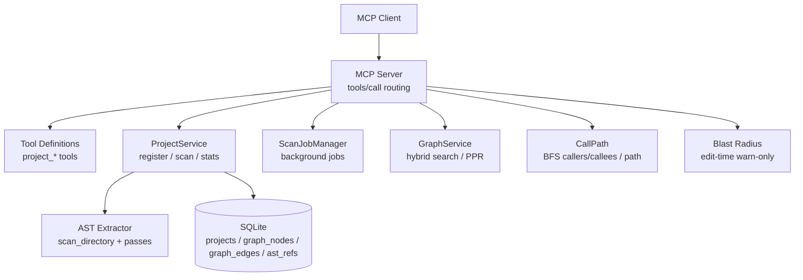
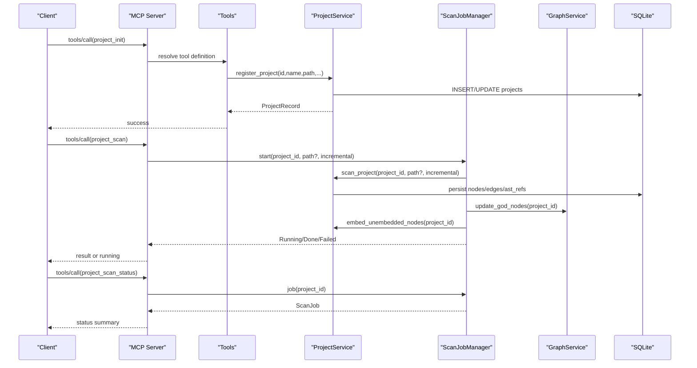
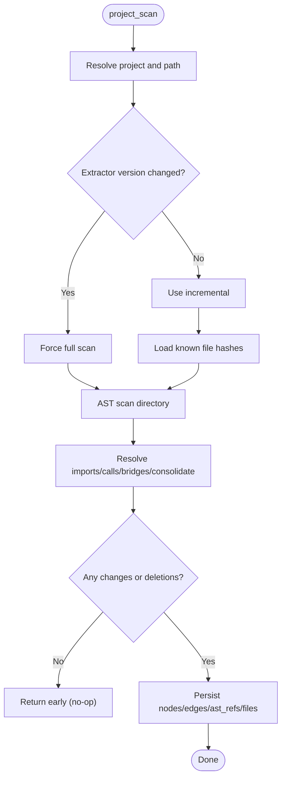
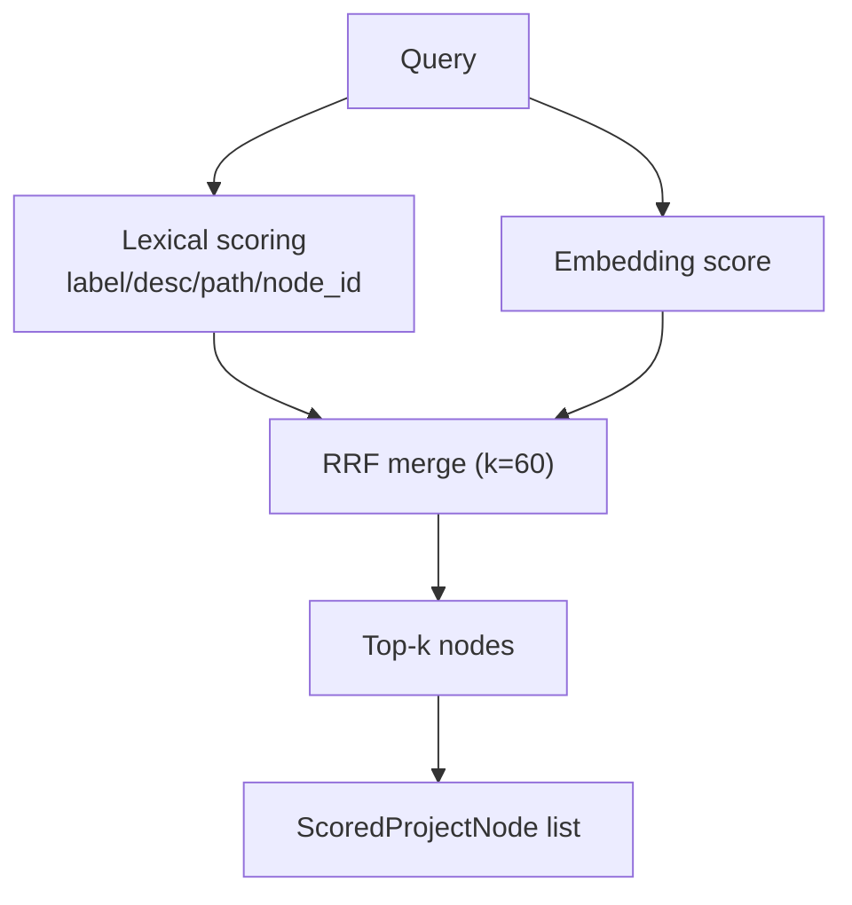
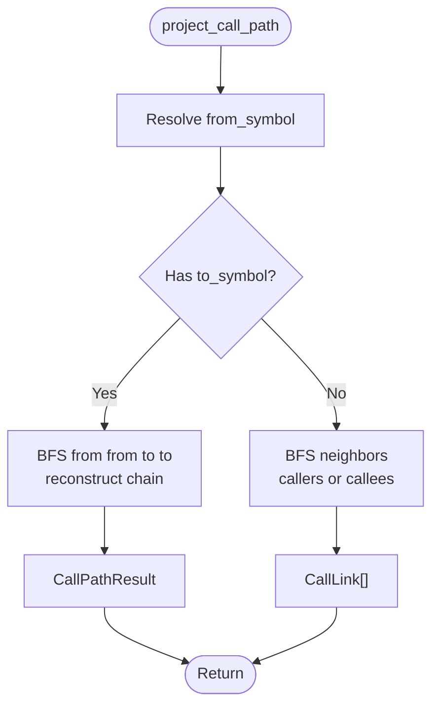
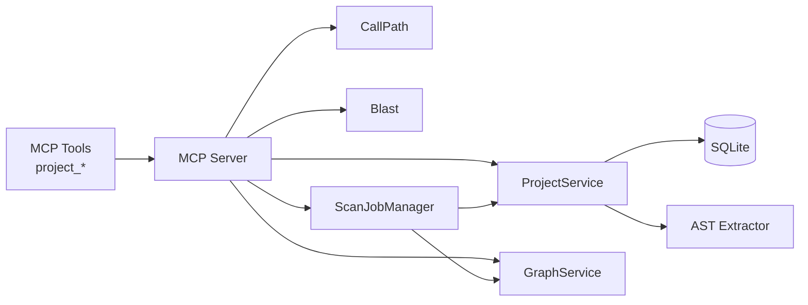

# Project Analysis Tools

<cite>
**Referenced Files in This Document**
- [tools.rs](file://src/mcp/tools.rs)
- [server.rs](file://src/mcp/server.rs)
- [mod.rs](file://src/project/mod.rs)
- [scanjob.rs](file://src/project/scanjob.rs)
- [service.rs](file://src/graph/service.rs)
- [callpath.rs](file://src/graph/callpath.rs)
- [blast.rs](file://src/graph/blast.rs)
</cite>

## Table of Contents
1. [Introduction](#introduction)
2. [Project Structure](#project-structure)
3. [Core Components](#core-components)
4. [Architecture Overview](#architecture-overview)
5. [Detailed Component Analysis](#detailed-component-analysis)
6. [Dependency Analysis](#dependency-analysis)
7. [Performance Considerations](#performance-considerations)
8. [Troubleshooting Guide](#troubleshooting-guide)
9. [Conclusion](#conclusion)

## Introduction
This document explains the project analysis tools exposed through the MCP protocol: `project_init`, `project_scan`, `project_scan_status`, `project_context`, `project_graph_search`, `project_call_path`, `project_report`, and `project_impact`. It covers how codebases are registered, how AST scanning works with incremental updates and background processing, how architectural context is generated for prompts, how call paths and blast radius are computed, and how these tools integrate with the project service and AST parsing engine.

The goal is to help users understand:
- How to register a repository and run deterministic AST scans without LLM token cost.
- How to poll scan status while long scans run in the background.
- How to generate compact project context or repository maps for prompt budgets.
- How to search the project graph semantically and structurally.
- How to trace explicit call chains and compute impact (blast radius).
- How reports summarize architecture hubs, components, and dependencies.

## Project Structure
The project analysis tools are defined as MCP tool declarations, routed by the MCP server, and implemented by the project and graph services backed by SQLite.

**Diagram sources**
- [server.rs:479-558](file://src/mcp/server.rs#L479-L558)
- [tools.rs:310-431](file://src/mcp/tools.rs#L310-L431)
- [mod.rs:165-447](file://src/project/mod.rs#L165-L447)
- [scanjob.rs:62-176](file://src/project/scanjob.rs#L62-L176)
- [service.rs:676-875](file://src/graph/service.rs#L676-L875)
- [callpath.rs:151-311](file://src/graph/callpath.rs#L151-L311)
- [blast.rs:146-196](file://src/graph/blast.rs#L146-L196)

**Section sources**
- [tools.rs:310-431](file://src/mcp/tools.rs#L310-L431)
- [server.rs:479-558](file://src/mcp/server.rs#L479-L558)

## Core Components
- Tool definitions: The project-related tools are declared with names, descriptions, and JSON schemas that define required and optional parameters.
- MCP server routing: The server automatically injects the active project ID when missing and routes `tools/call` requests to handlers.
- Project service: Registers projects, detects repositories, runs AST scans (incremental/full), persists nodes/edges/references, and computes statistics.
- Background scanning: A job manager launches AST scans off the request thread, recomputes God Nodes, and vectorizes unembedded nodes.
- Graph service: Provides hybrid semantic/textual search over project nodes and supports PPR ranking.
- Structural queries: Call path tracing and dead-code detection operate over usage edges (`CALLS`, `IMPORTS`, `IMPLEMENTS`, `DEPENDS_ON`).
- Blast radius: Edit-time warning hint based on recently updated symbols and their direct callers.

**Section sources**
- [tools.rs:310-431](file://src/mcp/tools.rs#L310-L431)
- [server.rs:479-558](file://src/mcp/server.rs#L479-L558)
- [mod.rs:165-447](file://src/project/mod.rs#L165-L447)
- [scanjob.rs:62-176](file://src/project/scanjob.rs#L62-L176)
- [service.rs:676-875](file://src/graph/service.rs#L676-L875)
- [callpath.rs:151-311](file://src/graph/callpath.rs#L151-L311)
- [blast.rs:146-196](file://src/graph/blast.rs#L146-L196)

## Architecture Overview
The end-to-end flow for project analysis starts with MCP client calls, which the server routes to tool handlers. Project tools delegate to `ProjectService` for registration and scanning, and to `GraphService` and structural query modules for search and analysis. Scans can run in the background via `ScanJobManager`, decoupling long-running work from MCP timeouts.

**Diagram sources**
- [server.rs:479-558](file://src/mcp/server.rs#L479-L558)
- [tools.rs:310-431](file://src/mcp/tools.rs#L310-L431)
- [mod.rs:165-447](file://src/project/mod.rs#L165-L447)
- [scanjob.rs:62-176](file://src/project/scanjob.rs#L62-L176)

## Detailed Component Analysis

### project_init
Registers or updates a project with an identifier, human-readable name, repository path, description, and tech stack. The project service normalizes the path, upserts the record, and logs registration. Zero-config auto-registration also occurs during MCP initialization if a workspace root is detected.

Key behaviors:
- Idempotent registration by project ID.
- Path canonicalization and cross-platform normalization.
- Optional metadata fields stored as JSON.

Usage example (conceptual):
- Register a Rust web app: provide id, name, absolute path, description, and tech_stack including rust and node.

**Section sources**
- [tools.rs:310-329](file://src/mcp/tools.rs#L310-L329)
- [mod.rs:165-214](file://src/project/mod.rs#L165-L214)
- [server.rs:281-304](file://src/mcp/server.rs#L281-L304)

### project_scan
Starts a deterministic AST scan of the project’s codebase. It extracts modules, functions, classes, structs, tables, and relationships without consuming LLM tokens. Scanning is performed in the background by default; the response may indicate running, and clients should poll `project_scan_status`.

Scanning workflow:
- Resolve project and path.
- Decide full vs incremental scan based on extractor version and known file hashes.
- Load unchanged symbols and references to preserve inter-file links.
- Resolve imports and calls, add inferred bridges, consolidate external imports.
- Persist nodes, edges, ast_refs, file hashes, and last-scanned timestamp.

Incremental update rules:
- If no files changed and no deletions occurred, returns early.
- Deleted files remove related nodes and references.
- Changed files replace old nodes before inserting new ones.

Background processing:
- `ScanJobManager.start` validates inputs synchronously and spawns a tokio task.
- After scan, it recomputes God Nodes and vectorizes unembedded nodes in batches until completion.

**Diagram sources**
- [mod.rs:419-847](file://src/project/mod.rs#L419-L847)
- [scanjob.rs:110-176](file://src/project/scanjob.rs#L110-L176)

**Section sources**
- [tools.rs:330-356](file://src/mcp/tools.rs#L330-L356)
- [mod.rs:419-847](file://src/project/mod.rs#L419-L847)
- [scanjob.rs:62-176](file://src/project/scanjob.rs#L62-L176)

### project_scan_status
Polls the current or last background scan job for a project. Returns whether the job is running, completed with counts (files scanned, nodes, edges, lines, embedded), or failed with an error message. It complements `project_scan` so clients do not rely on CLI or direct database reads.

Typical polling pattern:
- Call `project_scan` with `wait=false`.
- Repeatedly call `project_scan_status` until status is Done or Failed.

**Section sources**
- [tools.rs:345-356](file://src/mcp/tools.rs#L345-L356)
- [scanjob.rs:16-51](file://src/project/scanjob.rs#L16-L51)
- [scanjob.rs:186-204](file://src/project/scanjob.rs#L186-L204)

### project_context
Generates a compact `<project_context>` block for agent prompts. Two modes:
- `context`: architectural hubs (God Nodes), relevant subsystems, and metadata.
- `repo_map`: a “file → symbols” map optimized for token budgets. Can optionally include high-trust memory entries.

Parameters include project id, optional query to focus on relevant subsystems, mode selection, token budget, and whether to mix in high-trust memory.

Integration points:
- Uses project metadata and graph analytics to identify hubs.
- For repo_map, leverages project nodes and symbol lists within a token budget.

**Section sources**
- [tools.rs:357-372](file://src/mcp/tools.rs#L357-L372)
- [mod.rs:958-1000](file://src/project/mod.rs#L958-L1000)

### project_graph_search
Hybrid semantic search over the project’s code graph. Supports multiple modes:
- `hybrid`: combines lexical and vector scores using RRF with k=60.
- `text`: lexical matching across labels, descriptions, paths, and node ids.
- `vector`: semantic similarity using embeddings.
- `callers`/`callees`: structural neighbors of a symbol resolved from the query.

Provenance filtering allows restricting results to AST-derived data or all provenances.

**Diagram sources**
- [service.rs:676-875](file://src/graph/service.rs#L676-L875)

**Section sources**
- [tools.rs:373-388](file://src/mcp/tools.rs#L373-L388)
- [service.rs:676-875](file://src/graph/service.rs#L676-L875)

### project_call_path
Structural query over the code graph to find explicit call chains or neighbor sets:
- With `to_symbol`: BFS finds an explicit chain from `from_symbol` to `to_symbol`.
- Without `to_symbol`: returns callers or callees up to a depth limit.

Supported edge types for usage: CALLS, IMPORTS, IMPLEMENTS, DEPENDS_ON. Depth limits differ between path finding and neighbor enumeration.

**Diagram sources**
- [callpath.rs:151-311](file://src/graph/callpath.rs#L151-L311)

**Section sources**
- [tools.rs:389-405](file://src/mcp/tools.rs#L389-L405)
- [callpath.rs:151-311](file://src/graph/callpath.rs#L151-L311)

### project_report
Generates an architectural digest summarizing key hubs (God Nodes), components, and most-used dependencies. It relies on graph analytics and project statistics to produce a concise overview suitable for agents.

Typical use:
- After scanning, call `project_report` to get a high-level understanding of architecture and hotspots.

**Section sources**
- [tools.rs:406-417](file://src/mcp/tools.rs#L406-L417)
- [mod.rs:958-1000](file://src/project/mod.rs#L958-L1000)

### project_impact
Computes blast radius for a target symbol or file:
- Finds functions, structs, classes, and files depending on the target.
- Estimates refactoring risk by traversing reverse dependencies up to a configurable depth.

This tool uses structural queries and usage edges to determine affected areas, complementing edit-time warn-only hints.

**Section sources**
- [tools.rs:418-431](file://src/mcp/tools.rs#L418-L431)
- [blast.rs:146-196](file://src/graph/blast.rs#L146-L196)
- [callpath.rs:151-219](file://src/graph/callpath.rs#L151-L219)

## Dependency Analysis
The following diagram shows how MCP tools depend on project and graph services, background scanning, and structural analysis modules.

**Diagram sources**
- [tools.rs:310-431](file://src/mcp/tools.rs#L310-L431)
- [server.rs:479-558](file://src/mcp/server.rs#L479-L558)
- [mod.rs:165-447](file://src/project/mod.rs#L165-L447)
- [scanjob.rs:62-176](file://src/project/scanjob.rs#L62-L176)
- [service.rs:676-875](file://src/graph/service.rs#L676-L875)
- [callpath.rs:151-311](file://src/graph/callpath.rs#L151-L311)
- [blast.rs:146-196](file://src/graph/blast.rs#L146-L196)

**Section sources**
- [tools.rs:310-431](file://src/mcp/tools.rs#L310-L431)
- [server.rs:479-558](file://src/mcp/server.rs#L479-L558)

## Performance Considerations
- Incremental scans avoid rescanning unchanged files by comparing SHA256 hashes and preserving unchanged symbols and references.
- Background scanning prevents MCP client timeouts; long scans complete asynchronously and can be polled.
- Hybrid search merges lexical and vector rankings using RRF with k=60 to balance precision and recall.
- Vectorization of unembedded nodes happens in batches after scans to keep background jobs efficient.
- Edit-time blast radius hints are cached with TTL to reduce repeated computation.

[No sources needed since this section provides general guidance]

## Troubleshooting Guide
Common issues and resolutions:
- Project not found: Ensure `project_init` was called with a valid id and existing path.
- Path does not exist: Verify the provided path resolves correctly; Windows UNC prefixes are normalized.
- Scan never completes: Poll `project_scan_status`; check for Failed status and inspect error messages.
- No results in search: Confirm embeddings exist; vectorized nodes are created after scans.
- Unexpected dead code: Entry-point heuristics exclude main functions, migrations, tests, public APIs, and framework decorators.

Operational checks:
- Use `project_report` to verify hubs and components after scanning.
- Use `project_graph_search` with provenance filters to validate AST-derived data.
- Use `project_call_path` to confirm expected callers/callees for a symbol.

**Section sources**
- [mod.rs:419-847](file://src/project/mod.rs#L419-L847)
- [scanjob.rs:110-176](file://src/project/scanjob.rs#L110-L176)
- [callpath.rs:313-446](file://src/graph/callpath.rs#L313-L446)

## Conclusion
The project analysis tools provide a robust, deterministic pipeline for registering repositories, scanning code with AST extraction, and analyzing architecture through graph-based search, call path tracing, and blast radius estimation. Background scanning and incremental updates ensure scalability, while hybrid search and structured queries deliver precise insights for agents working with large codebases.

[No sources needed since this section summarizes without analyzing specific files]