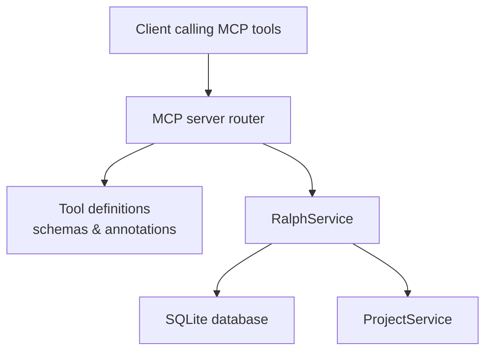
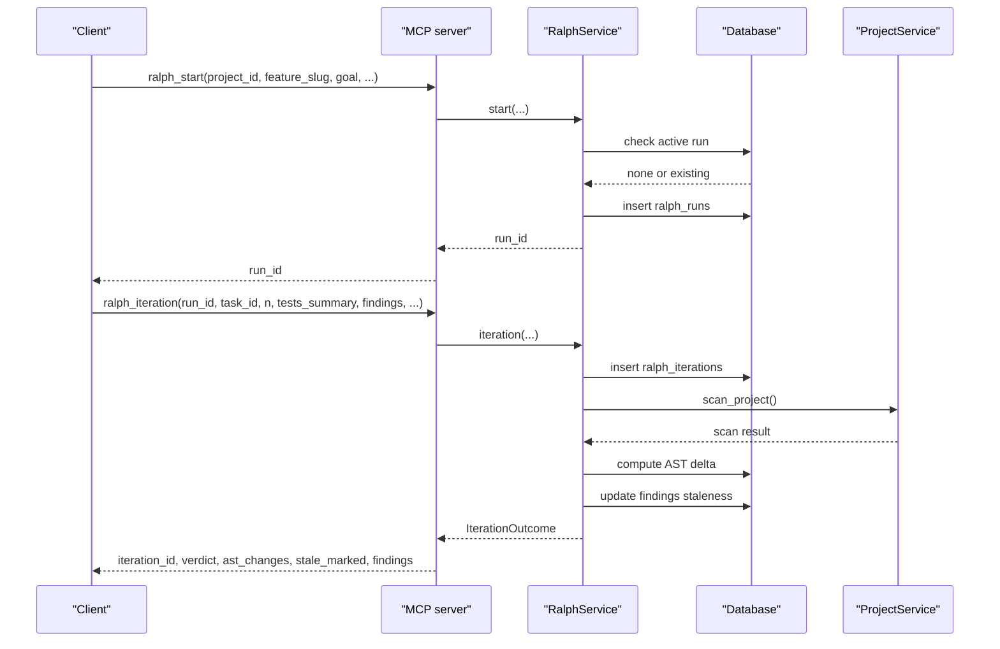
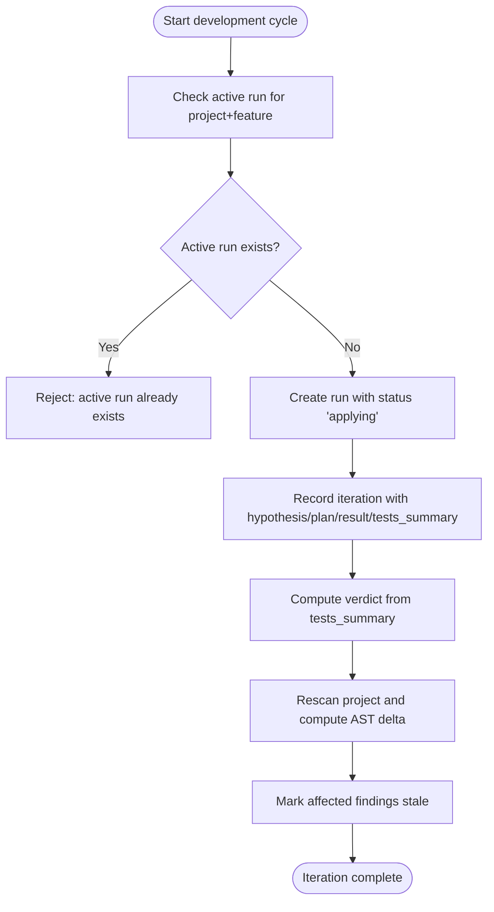
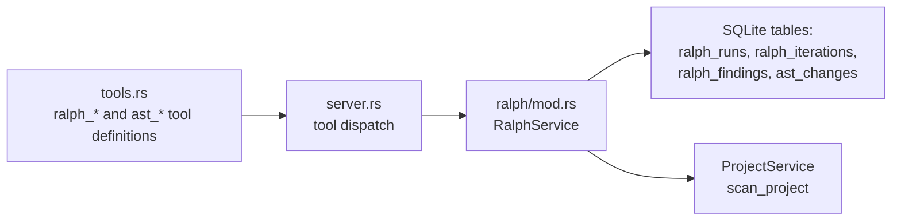

# Ralph Knowledge Layer Tools

<cite>
**Referenced Files in This Document**
- [tools.rs](file://src/mcp/tools.rs)
- [server.rs](file://src/mcp/server.rs)
- [mod.rs](file://src/ralph/mod.rs)
- [test_ralph.rs](file://tests/test_ralph.rs)
</cite>

## Table of Contents
1. [Introduction](#introduction)
2. [Project Structure](#project-structure)
3. [Core Components](#core-components)
4. [Architecture Overview](#architecture-overview)
5. [Detailed Component Analysis](#detailed-component-analysis)
6. [Dependency Analysis](#dependency-analysis)
7. [Performance Considerations](#performance-considerations)
8. [Troubleshooting Guide](#troubleshooting-guide)
9. [Conclusion](#conclusion)

## Introduction
This document describes the Ralph development cycle tools exposed through the MCP protocol. It covers `ralph_start`, `ralph_iteration`, `ralph_verdict`, `ralph_context`, `ralph_report`, `ast_diff`, and `ast_history`. The goal is to help agents and users run structured development cycles, record iteration progress, manage findings, generate context packages, and track code changes with symbol-level AST deltas.

The workflow centers on:
- **Runs**: one active development cycle per project and feature slug.
- **Tasks**: numbered tasks inside a run (for example, task identifiers from a task list).
- **Iterations**: ordered attempts for a task, each recording hypothesis, plan, result, test summary, and optional findings.
- **Verdicts**: objective-driven outcomes (`verified`, `failed`, `unconfirmed`, `overturned`, `stale`) applied to iterations or findings.

Ralph integrates with openspec specifications by reading feature specs from the repository and includes test-driven development practices by deriving automatic verdicts only from objective test summaries.

## Project Structure
Ralph functionality is split into three main layers:
- **MCP tool definitions**: declare tool names, descriptions, input schemas, and read-only/destructive annotations.
- **MCP server routing**: parse arguments, validate required fields, and call service methods.
- **Ralph service**: implements runs, iterations, verdicts, context packaging, reports, debt tracking, and AST diff/history.

**Diagram sources**
- [tools.rs:447-550](file://src/mcp/tools.rs#L447-L550)
- [server.rs:950-1033](file://src/mcp/server.rs#L950-L1033)
- [mod.rs:30-101](file://src/ralph/mod.rs#L30-L101)

**Section sources**
- [tools.rs:447-550](file://src/mcp/tools.rs#L447-L550)
- [server.rs:950-1033](file://src/mcp/server.rs#L950-L1033)
- [mod.rs:30-101](file://src/ralph/mod.rs#L30-L101)

## Core Components
The core components are:
- **RalphService**: manages runs, iterations, findings, verdicts, context packages, reports, debt ledger, and AST change tracking.
- **MCP tool definitions**: expose Ralph operations as MCP tools with typed input schemas.
- **MCP server handlers**: route MCP calls to RalphService methods.

Key responsibilities:
- Enforce one active run per project and feature slug.
- Compute automatic verdicts from test summaries without trusting self-assessment text.
- Record AST deltas between scans and mark stale findings when symbols change.
- Generate context packages that include spec fragments, negative experience, reuse candidates, invariants, and architecture zones.
- Provide reports with reuse-hit rate and repeat-failure detection.
- Track symbol-level changes via `ast_diff` and symbol history via `ast_history`.

**Section sources**
- [mod.rs:19-101](file://src/ralph/mod.rs#L19-L101)
- [tools.rs:447-550](file://src/mcp/tools.rs#L447-L550)
- [server.rs:950-1033](file://src/mcp/server.rs#L950-L1033)

## Architecture Overview
The end-to-end flow for starting a development cycle and recording an iteration looks like this:

**Diagram sources**
- [server.rs:950-958](file://src/mcp/server.rs#L950-L958)
- [mod.rs:103-148](file://src/ralph/mod.rs#L103-L148)
- [mod.rs:150-247](file://src/ralph/mod.rs#L150-L247)

## Detailed Component Analysis

### Development Workflow: Runs, Tasks, Iterations, Verdicts
A development cycle is modeled as:
- **Run**: created once per project and feature slug; prevents duplicate active runs.
- **Task**: logical unit of work within a run, typically referenced by an identifier such as `T-001`.
- **Iteration**: ordered attempt for a task, including hypothesis, plan, result, test summary, ladder rung, git snapshots, and optional findings.
- **Verdict**: outcome for an iteration or finding, either automatic (from tests) or manual/dream/agent-provided.

Important behaviors:
- Duplicate active runs for the same project and feature slug are rejected.
- Automatic verdicts are derived only from objective test summaries: failed tests produce `failed`; passed tests produce `verified`; otherwise `unconfirmed`.
- Iterations are idempotent by `(run_id, task_id, n)`; repeated insertion with the same key fails.
- Each iteration triggers an AST rescan and records symbol-level changes.
- Findings can be attached to iterations and may become stale if their associated symbols change.

**Diagram sources**
- [mod.rs:103-148](file://src/ralph/mod.rs#L103-L148)
- [mod.rs:150-247](file://src/ralph/mod.rs#L150-L247)
- [mod.rs:45-61](file://src/ralph/mod.rs#L45-L61)

**Section sources**
- [mod.rs:103-148](file://src/ralph/mod.rs#L103-L148)
- [mod.rs:150-247](file://src/ralph/mod.rs#L150-L247)
- [mod.rs:45-61](file://src/ralph/mod.rs#L45-L61)
- [test_ralph.rs:53-108](file://tests/test_ralph.rs#L53-L108)

### Tool: ralph_start
Purpose:
- Start a new development cycle (run) for a project and feature slug.
- Ensure only one active run exists per project and feature slug.

Inputs:
- `project_id`: project identifier.
- `feature_slug`: feature slug corresponding to `openspec/changes/<slug>`.
- `goal`: human-readable goal for the cycle.
- `autonomy`: informational autonomy level (default `L1`).
- `max_iterations_per_task`: maximum iterations per task (default 5).
- `max_total_iterations`: total iteration limit (default 60).
- `budget_tokens`: optional token budget.

Behavior:
- If an active run already exists for the same project and feature slug, the call fails.
- A new run is inserted with status `applying`.
- Returns the generated run identifier.

Example usage pattern:
1. Call `ralph_start` with `project_id`, `feature_slug`, and `goal`.
2. Use the returned `run_id` for subsequent iteration and report calls.

**Section sources**
- [tools.rs:447-463](file://src/mcp/tools.rs#L447-L463)
- [mod.rs:103-148](file://src/ralph/mod.rs#L103-L148)
- [test_ralph.rs:53-59](file://tests/test_ralph.rs#L53-L59)

### Tool: ralph_iteration
Purpose:
- Record an iteration for a task within a run.
- Compute an automatic verdict based on test results.
- Rescan the project and record AST deltas.
- Attach findings and propagate staleness when symbols change.

Inputs:
- `run_id`: run identifier.
- `task_id`: task identifier (for example, `T-001`).
- `n`: iteration number within the task.
- `hypothesis`: reasoning about why something failed or how it is being solved.
- `plan`: JSON describing steps.
- `result`: JSON describing outcome and errors; self-assessment does not affect verdict.
- `tests_summary`: JSON with `passed` and `failed` counts.
- `ladder_rung`: minimalism ladder step (reuse, stdlib, platform, dep, one-line, minimal).
- `git_before`: optional commit SHA before the iteration.
- `git_after`: optional commit SHA after the iteration.
- `findings`: array of findings with `kind`, `content`, optional `symbols`, optional `meta`.

Outputs:
- `iteration_id`
- `project_id`
- `verdict`
- `verdict_source`
- `ast_changes`
- `stale_marked`
- `findings` count added

Behavior:
- Inserts the iteration and updates run status to `verifying`.
- Computes verdict from `tests_summary`:
  - Any failures → `failed` with source `auto_tests`.
  - Any passes → `verified` with source `auto_tests`.
  - Otherwise → `unconfirmed`.
- Performs AST rescan and records symbol-level changes.
- Adds provided findings and marks related findings stale if their symbols changed.
- Idempotent by `(run_id, task_id, n)`.

Example usage pattern:
1. After starting a run, call `ralph_iteration` with `run_id`, `task_id`, and `n=1`.
2. Include `tests_summary` reflecting test execution results.
3. Optionally attach findings using `kind=hypothesis|gotcha|decision|constraint|deferred`.

**Section sources**
- [tools.rs:464-488](file://src/mcp/tools.rs#L464-L488)
- [mod.rs:150-247](file://src/ralph/mod.rs#L150-L247)
- [mod.rs:45-61](file://src/ralph/mod.rs#L45-L61)
- [test_ralph.rs:61-108](file://tests/test_ralph.rs#L61-L108)

### Tool: ralph_verdict
Purpose:
- Change the verdict of an iteration or a finding.
- Support human, dream, agent, or automated sources.

Inputs:
- `iteration_id`: iteration identifier.
- `finding_id`: finding identifier.
- `verdict`: one of `verified`, `failed`, `unconfirmed`, `overturned`, `stale`.
- `verdict_source`: who set the verdict (for example, `auto_tests`, `human`, `dream`).

Behavior:
- Validates allowed verdict values.
- Updates either a finding or an iteration.
- Returns a message indicating which entity was updated and its new verdict.

Example usage pattern:
1. Review iteration or finding details.
2. Call `ralph_verdict` with the appropriate ID and desired verdict.
3. Use `verdict_source` to record whether the decision came from tests, human review, or automation.

**Section sources**
- [tools.rs:489-501](file://src/mcp/tools.rs#L489-L501)
- [mod.rs:488-525](file://src/ralph/mod.rs#L488-L525)
- [server.rs:960-977](file://src/mcp/server.rs#L960-L977)

### Tool: ralph_context
Purpose:
- Generate a context package for a task within a run.
- Combine specification fragments, negative experience, reuse candidates, invariants, and architecture zone information.

Inputs:
- `run_id`: run identifier.
- `task_id`: task identifier.
- `max_tokens`: token budget for the context package (default 6000).
- `mode`: `full` or `lite`; lite mode omits the architecture zone and reduces invariant content.

Behavior:
- Reads the project root path and feature slug from the run.
- Reads spec files under `openspec/changes/<feature_slug>/proposal.md`, `design.md`, `tasks.md`.
- Collects negative experience from failed or overturned findings.
- Selects reuse candidates from AST graph nodes (functions, methods, structs, classes, interfaces, traits).
- Includes invariants from `openspec/specs` when available.
- Includes architecture zone entries for god nodes.
- Writes the context package to disk under `data_dir/ralph/contexts/<run_id>` and appends a context reference.

Example usage pattern:
1. After recording at least one iteration so AST symbols exist, call `ralph_context`.
2. Use `mode=lite` when you need a shorter context without architectural details.
3. Use the returned `<ralph_context>` block as prompt context for planning or implementation.

**Section sources**
- [tools.rs:502-515](file://src/mcp/tools.rs#L502-L515)
- [mod.rs:527-725](file://src/ralph/mod.rs#L527-L725)
- [test_ralph.rs:141-166](file://tests/test_ralph.rs#L141-L166)

### Tool: ralph_report
Purpose:
- Produce a summary of one or all runs.
- Show iteration counts, finding counts, reuse-hit rate, repeat-failure rate, and deferred debt markers.

Inputs:
- `run_id`: optional; if omitted, aggregates across all runs.

Behavior:
- Counts runs, iterations, and findings.
- Computes reuse-hit rate from iterations whose `ladder_rung` starts with `reuse:`.
- Detects repeat failures by comparing consecutive iterations for the same run and task using normalized test fingerprints.
- Lists deferred findings and highlights those without upgrade triggers.

Example usage pattern:
1. After several iterations, call `ralph_report` with the current `run_id`.
2. Inspect reuse-hit percentage and deferred debt markers.
3. Use repeat-failure metrics to detect loops where test output does not change.

**Section sources**
- [tools.rs:516-525](file://src/mcp/tools.rs#L516-L525)
- [mod.rs:727-821](file://src/ralph/mod.rs#L727-L821)
- [test_ralph.rs:168-203](file://tests/test_ralph.rs#L168-L203)

### Tool: ast_diff
Purpose:
- Show symbol-level code changes between iterations using AST deltas rather than git diffs.

Inputs:
- `project_id`: project identifier.
- `from`: iteration ID, commit, or timestamp marking the start boundary.
- `to`: optional iteration ID, commit, or timestamp marking the end boundary; defaults to now.

Behavior:
- Queries `ast_changes` for the project within the specified time window.
- Returns a list of symbol changes including path, label, node type, and change type (`added`, `modified`, `removed`).
- Returns a message indicating no symbol changes were found in the range if empty.

Example usage pattern:
1. After multiple iterations, call `ast_diff` with `from` set to the first relevant iteration ID.
2. Optionally set `to` to a later iteration ID to compare two points in time.
3. Use the output to understand which symbols changed during development.

**Section sources**
- [tools.rs:526-538](file://src/mcp/tools.rs#L526-L538)
- [mod.rs:892-923](file://src/ralph/mod.rs#L892-L923)
- [server.rs:1006-1020](file://src/mcp/server.rs#L1006-L1020)
- [test_ralph.rs:204-208](file://tests/test_ralph.rs#L204-L208)

### Tool: ast_history
Purpose:
- Show the chronological history of a symbol across iterations.

Inputs:
- `project_id`: project identifier.
- `symbol`: symbol name to trace.

Behavior:
- Searches AST changes by label containing the requested symbol.
- Returns entries sorted by creation time, showing change type, file path, node type, and timestamp.
- Returns a message indicating an empty history if no changes are found.

Example usage pattern:
1. Identify a symbol that was modified during development.
2. Call `ast_history` with the symbol name.
3. Review the timeline of additions, modifications, or removals.

**Section sources**
- [tools.rs:539-550](file://src/mcp/tools.rs#L539-L550)
- [mod.rs:925-954](file://src/ralph/mod.rs#L925-L954)
- [server.rs:1022-1032](file://src/mcp/server.rs#L1022-L1032)
- [test_ralph.rs:204-208](file://tests/test_ralph.rs#L204-L208)

## Dependency Analysis
The following diagram shows how MCP tool definitions, server routing, and Ralph service methods interact:

**Diagram sources**
- [tools.rs:447-550](file://src/mcp/tools.rs#L447-L550)
- [server.rs:950-1033](file://src/mcp/server.rs#L950-L1033)
- [mod.rs:30-101](file://src/ralph/mod.rs#L30-L101)

Coupling and cohesion:
- MCP tool definitions are declarative and separate from implementation logic.
- Server routing is thin: it validates inputs and delegates to RalphService.
- RalphService encapsulates business logic for runs, iterations, verdicts, context, reports, and AST analysis.
- External dependencies include SQLite for persistence and ProjectService for AST scanning.

Potential circular dependencies:
- None observed among the analyzed files; dependencies flow from MCP layer to service layer.

External integration points:
- Filesystem access for openspec specifications and context package storage.
- Git metadata via `git_before` and `git_after` parameters (informational; AST deltas are symbol-based).

**Section sources**
- [tools.rs:447-550](file://src/mcp/tools.rs#L447-L550)
- [server.rs:950-1033](file://src/mcp/server.rs#L950-L1033)
- [mod.rs:30-101](file://src/ralph/mod.rs#L30-L101)

## Performance Considerations
- **AST rescan cost**: Each iteration triggers a project rescan and AST delta computation. For large repositories, this can be expensive.
- **Context package generation**: Reading spec files, invariants, and querying AST graph nodes can add latency; use `mode=lite` when token budget or speed matters.
- **Repeat-failure detection**: Normalizing and hashing test summaries adds CPU overhead but helps detect loops efficiently.
- **Staleness pass**: Expands affected labels through AST references; consider limiting scope by focusing on specific projects or runs.
- **Report aggregation**: Counting runs, iterations, findings, and computing rates is generally lightweight, but deferred debt listing can grow with many findings.

Recommendations:
- Batch iteration recordings when possible.
- Prefer `lite` context mode for frequent prompts.
- Monitor `ast_changes` growth and clean up old runs if needed.
- Use `ralph_report` periodically rather than after every iteration.

[No sources needed since this section provides general guidance]

## Troubleshooting Guide
Common issues and resolutions:

- **Duplicate active run error**:
  - Cause: Trying to start another run for the same project and feature slug while one is still active.
  - Resolution: Finish or archive the existing run using `ralph_report` or equivalent lifecycle operation before starting a new one.

- **Invalid verdict value**:
  - Cause: Passing a verdict not in the allowed set.
  - Resolution: Use `verified`, `failed`, `unconfirmed`, `overturned`, or `stale`.

- **Missing required arguments**:
  - Cause: Omitting required MCP tool parameters.
  - Resolution: Provide `project_id`, `feature_slug`, and `goal` for `ralph_start`; provide `run_id`, `task_id`, and `n` for `ralph_iteration`; provide `project_id` and `from` for `ast_diff`; provide `project_id` and `symbol` for `ast_history`.

- **Empty AST diff or history**:
  - Cause: No AST changes recorded for the requested range or symbol.
  - Resolution: Ensure at least one iteration has been recorded and the project has been scanned.

- **Findings not becoming stale**:
  - Cause: Finding symbols do not match changed labels or the finding is already marked stale.
  - Resolution: Verify `symbols` field format and ensure the symbol name matches the changed AST label.

- **Context package missing spec or reuse candidates**:
  - Cause: Spec files not present under `openspec/changes/<feature_slug>/` or AST scan not yet populated.
  - Resolution: Add spec files and record at least one iteration to populate AST nodes.

**Section sources**
- [mod.rs:103-148](file://src/ralph/mod.rs#L103-L148)
- [mod.rs:488-525](file://src/ralph/mod.rs#L488-L525)
- [server.rs:950-1033](file://src/mcp/server.rs#L950-L1033)
- [test_ralph.rs:53-108](file://tests/test_ralph.rs#L53-L108)

## Conclusion
Ralph knowledge layer tools provide a structured development workflow over the MCP protocol. They enforce disciplined runs, objective verdicts, AST-based change tracking, and reusable context generation. By combining openspec specifications with test-driven iteration records, agents can maintain traceable development cycles, reduce repetition, and focus on meaningful symbol-level changes. Use `ralph_start` to begin, `ralph_iteration` to record progress, `ralph_verdict` to finalize outcomes, `ralph_context` to prepare focused prompts, `ralph_report` to assess cycle health, and `ast_diff`/`ast_history` to understand code evolution.

[No sources needed since this section summarizes without analyzing specific files]