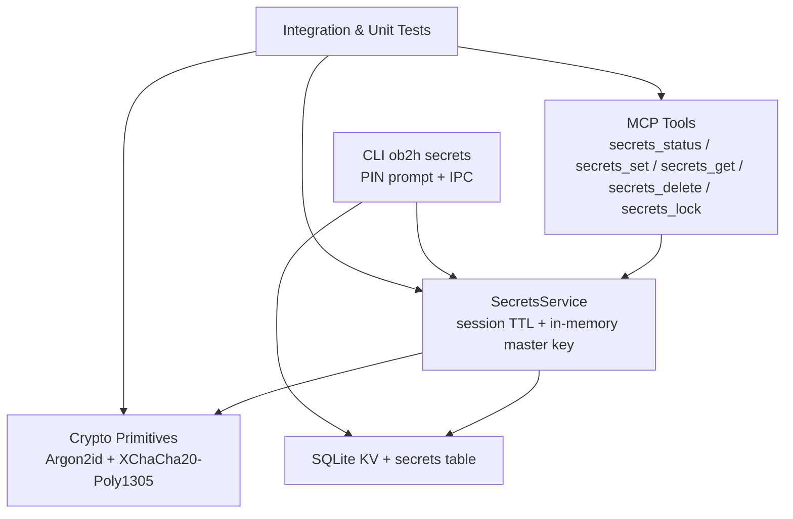
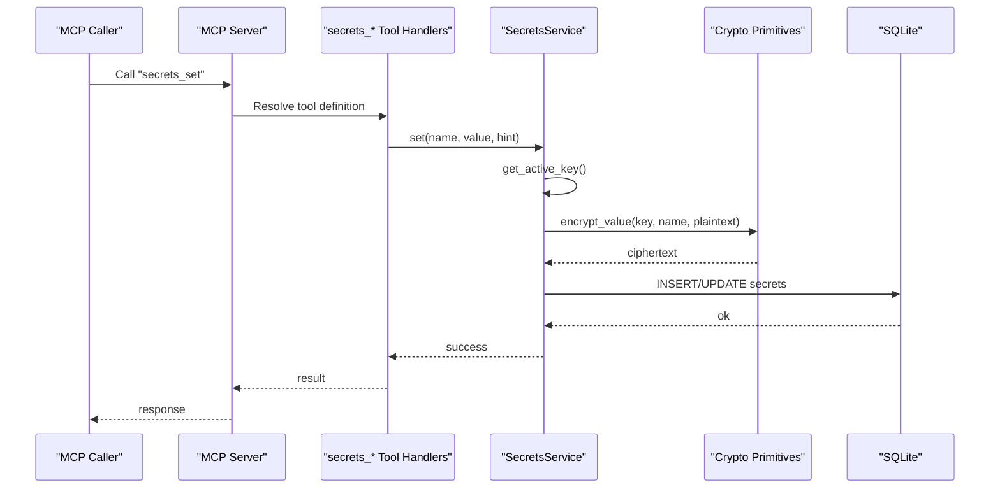
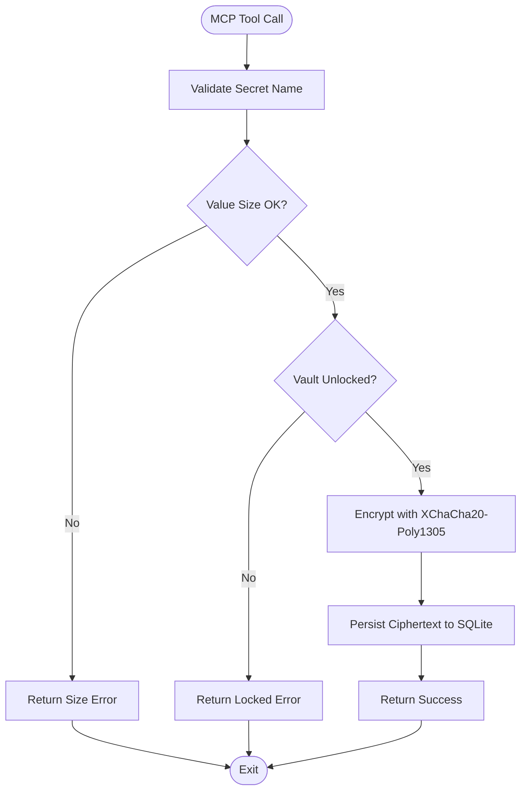
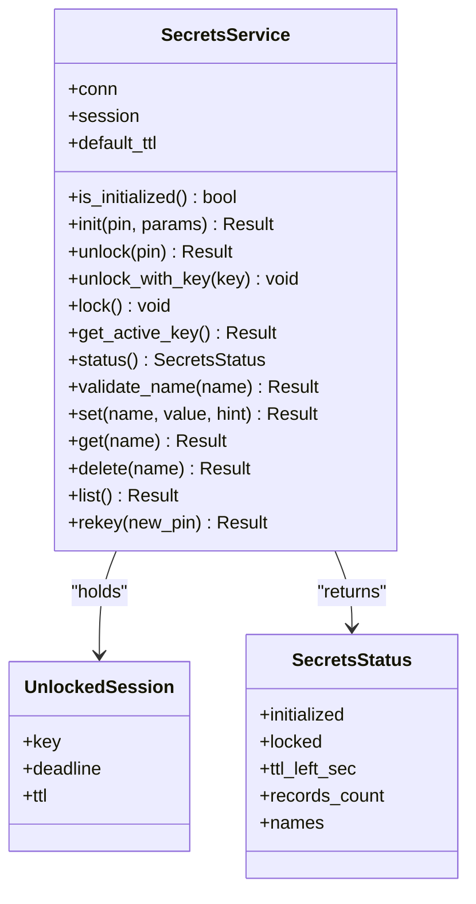
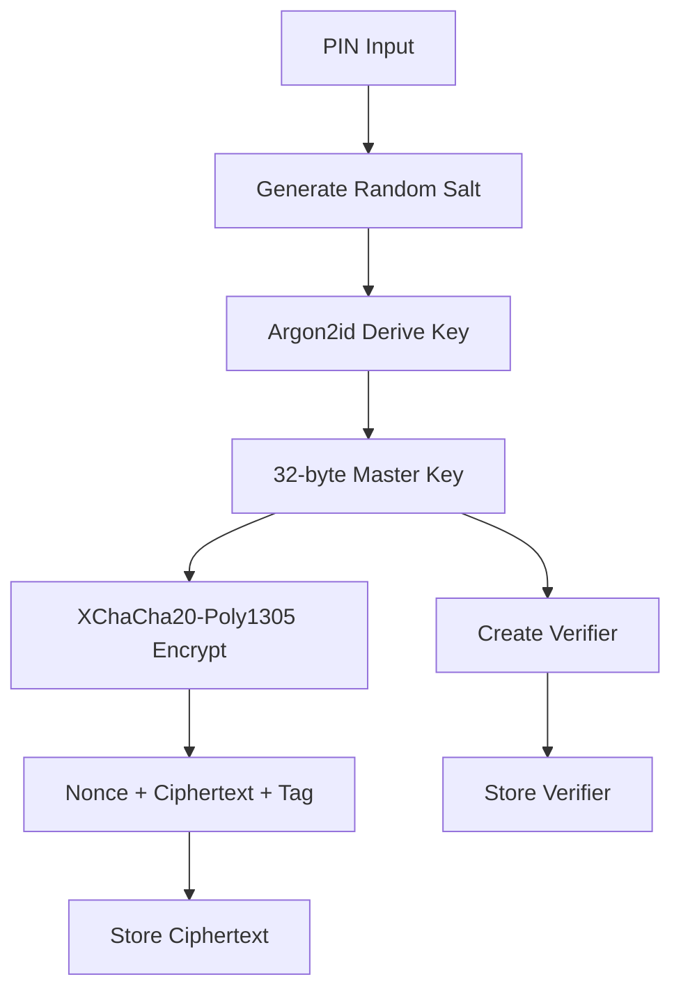
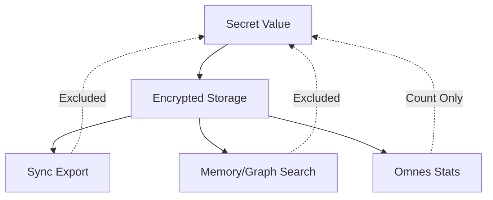
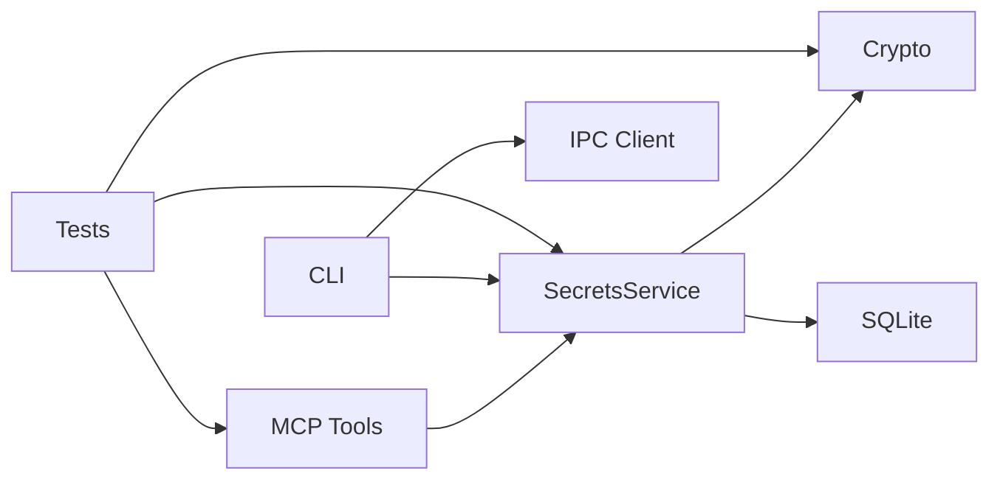

# Secrets Management Tools

<cite>
**Referenced Files in This Document**
- [tools.rs](file://src/mcp/tools.rs)
- [mod.rs](file://src/secrets/mod.rs)
- [crypto.rs](file://src/secrets/crypto.rs)
- [service.rs](file://src/secrets/service.rs)
- [secrets.rs (CLI)](file://src/cli/secrets.rs)
- [test_secrets_mcp.rs](file://tests/test_secrets_mcp.rs)
- [test_secrets_crypto.rs](file://tests/test_secrets_crypto.rs)
- [test_secrets_isolation.rs](file://tests/test_secrets_isolation.rs)
</cite>

## Table of Contents
1. [Introduction](#introduction)
2. [Project Structure](#project-structure)
3. [Core Components](#core-components)
4. [Architecture Overview](#architecture-overview)
5. [Detailed Component Analysis](#detailed-component-analysis)
6. [Dependency Analysis](#dependency-analysis)
7. [Performance Considerations](#performance-considerations)
8. [Troubleshooting Guide](#troubleshooting-guide)
9. [Conclusion](#conclusion)

## Introduction
This document describes the MCP protocol secrets management tools and their underlying security model:

- **Tools**: `secrets_status`, `secrets_set`, `secrets_get`, `secrets_delete`, and `secrets_lock`.
- **Security model**: PIN-based authentication, XChaCha20-Poly1305 authenticated encryption, Argon2id key derivation, zeroized master-key memory isolation, TTL-based session expiry, and strict separation between encrypted storage and plaintext access.
- **Operational scope**: Vault initialization, secret CRUD operations, lock/unlock cycles, audit logging, and isolation from sync exports and search contexts.

The goal is to help users safely initialize a vault, manage secrets through MCP tools, understand when unlocking is required, and follow secure operational practices.

## Project Structure
Secrets functionality is implemented as a layered system:

- **MCP tool definitions** expose the user-facing API surface.
- **Secrets service** implements stateful vault operations with in-memory master-key isolation.
- **Crypto primitives** implement Argon2id KDF, XChaCha20-Poly1305 AEAD, verifier generation, and zeroization.
- **CLI layer** provides interactive PIN input, server IPC notifications, and status reporting.
- **Tests** validate MCP flows, cryptographic round-trips, and isolation guarantees.

**Diagram sources**
- [tools.rs:569-620](file://src/mcp/tools.rs#L569-L620)
- [service.rs:43-47](file://src/secrets/service.rs#L43-L47)
- [crypto.rs:1-12](file://src/secrets/crypto.rs#L1-L12)
- [secrets.rs (CLI):12-31](file://src/cli/secrets.rs#L12-L31)
- [test_secrets_mcp.rs:9-84](file://tests/test_secrets_mcp.rs#L9-L84)

**Section sources**
- [tools.rs:569-620](file://src/mcp/tools.rs#L569-L620)
- [mod.rs:1-15](file://src/secrets/mod.rs#L1-L15)
- [service.rs:1-47](file://src/secrets/service.rs#L1-L47)
- [crypto.rs:1-12](file://src/secrets/crypto.rs#L1-L12)
- [secrets.rs (CLI):1-31](file://src/cli/secrets.rs#L1-L31)

## Core Components
The secrets subsystem consists of:

| Component | Responsibility | Security-relevant behavior |
|---|---|---|
| MCP tools | Define tool names, descriptions, and JSON schemas for `secrets_*` operations | Mark read-only or destructive hints; require unlocked vault for write/delete/get |
| SecretsService | Manage vault lifecycle, unlock/lock, TTL sessions, CRUD, rekey, list | Master key stored only in process memory; wiped on lock or TTL expiry |
| Crypto module | Derive keys, encrypt/decrypt values, create/check verifier | Argon2id KDF, XChaCha20-Poly1305 AEAD, AAD binding by secret name |
| CLI | Interactive PIN entry, server IPC notification, status display | Supports GUI PIN prompt or terminal fallback; notifies running server |
| Tests | Validate MCP flow, crypto correctness, isolation from sync/search | Ensure errors before init/unlock, correct lock/unlock behavior, no secret leakage |

**Section sources**
- [tools.rs:569-620](file://src/mcp/tools.rs#L569-L620)
- [service.rs:43-47](file://src/secrets/service.rs#L43-L47)
- [crypto.rs:13-32](file://src/secrets/crypto.rs#L13-L32)
- [secrets.rs (CLI):134-143](file://src/cli/secrets.rs#L134-L143)
- [test_secrets_mcp.rs:9-84](file://tests/test_secrets_mcp.rs#L9-L84)

## Architecture Overview
The secrets architecture enforces that plaintext secrets are never persisted and are only available while the vault is unlocked within a bounded TTL window.

**Diagram sources**
- [tools.rs:578-590](file://src/mcp/tools.rs#L578-L590)
- [service.rs:266-289](file://src/secrets/service.rs#L266-L289)
- [crypto.rs:54-75](file://src/secrets/crypto.rs#L54-L75)

## Detailed Component Analysis

### MCP Tool Definitions: `secrets_status`, `secrets_set`, `secrets_get`, `secrets_delete`, `secrets_lock`
The MCP tool definitions provide:

- `secrets_status`: Read-only status check without requiring an unlocked vault. Returns whether the vault is initialized, locked, remaining TTL seconds, record count, and secret names without values.
- `secrets_set`: Create or update an encrypted secret. Requires an unlocked vault. Validates secret name format and enforces a maximum value size.
- `secrets_get`: Decrypt and return a secret by name. Requires an unlocked vault. Never called automatically; intended for explicit user-directed retrieval.
- `secrets_delete`: Delete a secret by name. Requires an unlocked vault. Marked as destructive.
- `secrets_lock`: Immediately lock the vault and clear the master key from process memory.

Tool annotations classify:
- `secrets_status` and `secrets_get` as read-only.
- `secrets_delete` as destructive.

**Diagram sources**
- [tools.rs:578-620](file://src/mcp/tools.rs#L578-L620)
- [service.rs:252-289](file://src/secrets/service.rs#L252-L289)

**Section sources**
- [tools.rs:569-620](file://src/mcp/tools.rs#L569-L620)

### SecretsService: Session State, TTL, and Memory Isolation
`SecretsService` manages:

- Initialization state via a database flag.
- An in-memory unlocked session containing:
  - The master key wrapped in zeroizing memory.
  - A deadline timestamp.
  - The configured TTL duration.
- Automatic extension of the active session deadline on successful operations.
- Immediate clearing of the master key on lock.

Key behaviors:

- `init`: Validates PIN format, generates salt, derives master key, stores verifier, salt, and KDF parameters.
- `unlock`: Reads stored salt and KDF parameters, derives key, verifies PIN using verifier, then creates an unlocked session.
- `unlock_with_key`: Used internally after IPC unlock to establish a session without exposing PIN.
- `lock`: Clears the session, ensuring the master key is dropped from memory.
- `get_active_key`: Enforces initialization and unlocked state, checks TTL, extends activity, and returns the master key.
- `status`: Reports initialization, lock state, TTL left, record count, and secret names without values.
- `set`, `get`, `delete`, `list`: Require unlocked state and use crypto primitives for encryption/decryption.
- `rekey`: Decrypts all records with the old key, re-encrypts with a new key derived from a new PIN, atomically updates database metadata and records, and refreshes the session key.

**Diagram sources**
- [service.rs:18-47](file://src/secrets/service.rs#L18-L47)
- [service.rs:49-203](file://src/secrets/service.rs#L49-L203)
- [service.rs:205-250](file://src/secrets/service.rs#L205-L250)
- [service.rs:266-444](file://src/secrets/service.rs#L266-L444)

**Section sources**
- [service.rs:18-47](file://src/secrets/service.rs#L18-L47)
- [service.rs:49-203](file://src/secrets/service.rs#L49-L203)
- [service.rs:205-250](file://src/secrets/service.rs#L205-L250)
- [service.rs:266-444](file://src/secrets/service.rs#L266-L444)

### Cryptography: Argon2id, XChaCha20-Poly1305, Verifier, Zeroization
The crypto layer implements:

- **Argon2id key derivation**: Converts PIN plus salt into a 32-byte master key using configurable memory, time, and parallelism parameters.
- **Salt generation**: Uses a cryptographically secure random source.
- **XChaCha20-Poly1305 encryption**: Produces nonce-prefixed ciphertext with additional authenticated data bound to the secret name.
- **Decryption verification**: Rejects tampered ciphertext, wrong key, or mismatched secret name.
- **Verifier**: Stores an encrypted magic marker used to validate PIN-derived keys without exposing plaintext secrets.
- **Zeroization**: Uses zeroizing wrappers for sensitive in-memory buffers.

**Diagram sources**
- [crypto.rs:13-52](file://src/secrets/crypto.rs#L13-L52)
- [crypto.rs:54-98](file://src/secrets/crypto.rs#L54-L98)
- [crypto.rs:100-111](file://src/secrets/crypto.rs#L100-L111)

**Section sources**
- [crypto.rs:1-12](file://src/secrets/crypto.rs#L1-L12)
- [crypto.rs:13-52](file://src/secrets/crypto.rs#L13-L52)
- [crypto.rs:54-98](file://src/secrets/crypto.rs#L54-L98)
- [crypto.rs:100-111](file://src/secrets/crypto.rs#L100-L111)

### CLI Integration: PIN Prompting, IPC, and Status Reporting
The CLI provides:

- Commands: `init`, `unlock`, `lock`, `status`, `rekey`, `list`, `show`.
- Optional GUI PIN prompt with terminal fallback.
- Notification to a running `ob2h serve` process via IPC so the server can unlock its own vault session.
- User-friendly messages for missing initialization, invalid PIN, and successful operations.

Important behaviors:

- `init` validates new PIN format and confirms it.
- `unlock` derives the master key and optionally notifies the server.
- `lock` notifies the server if running.
- `status` shows local and server awareness.
- `rekey` unlocks with current PIN, prompts for new PIN, re-encrypts all records, updates metadata, and refreshes the server session.

**Section sources**
- [secrets.rs (CLI):12-31](file://src/cli/secrets.rs#L12-L31)
- [secrets.rs (CLI):47-132](file://src/cli/secrets.rs#L47-L132)
- [secrets.rs (CLI):134-311](file://src/cli/secrets.rs#L134-L311)

### MCP Flow Examples

#### Vault Initialization
Recommended sequence:

1. Run vault initialization through CLI or service initialization path.
2. Provide a strong PIN.
3. Confirm that the vault reports as initialized but locked.
4. Use `secrets_status` to verify readiness.

Expected outcomes:

- Vault is initialized.
- Vault remains locked until unlocked.
- No secrets exist yet.

**Section sources**
- [test_secrets_mcp.rs:19-33](file://tests/test_secrets_mcp.rs#L19-L33)
- [service.rs:71-111](file://src/secrets/service.rs#L71-L111)

#### Secret CRUD Operations
Recommended sequence:

1. Unlock the vault with the correct PIN.
2. Set a secret with a valid name, value, and optional hint.
3. Get the secret by name and receive the decrypted value.
4. List secrets to see metadata without values.
5. Delete a secret when no longer needed.

Constraints:

- Secret name must match allowed characters and length limits.
- Secret value must not exceed the configured maximum size.
- All operations except status require an unlocked vault.

**Section sources**
- [test_secrets_mcp.rs:42-81](file://tests/test_secrets_mcp.rs#L42-L81)
- [service.rs:252-333](file://src/secrets/service.rs#L252-L333)

#### Lock/Unlock Cycle
Recommended cycle:

1. Initialize vault.
2. Attempt `secrets_get` or `secrets_set` while locked → expect locked error.
3. Unlock with correct PIN.
4. Perform secret operations.
5. Call `secrets_lock` to immediately clear the master key.
6. Verify subsequent operations fail until re-unlocking.

TTL behavior:

- Successful operations extend the active session deadline.
- Expired TTL behaves like a locked vault.

**Section sources**
- [test_secrets_mcp.rs:35-73](file://tests/test_secrets_mcp.rs#L35-L73)
- [service.rs:185-203](file://src/secrets/service.rs#L185-L203)
- [service.rs:205-250](file://src/secrets/service.rs#L205-L250)

### Security Model and Access Controls

#### Authentication
- Vault initialization requires a PIN validated by format rules.
- Unlocking requires deriving the master key from PIN and stored salt, then verifying against the stored verifier.
- Wrong PIN results in a verification failure and does not grant access.

#### Encryption
- Secrets are stored as ciphertext.
- Plaintext values are never written to disk.
- Each encryption binds the secret name as additional authenticated data, preventing decryption under a different name.
- Tampering with ciphertext is rejected.

#### Memory Isolation
- The master key exists only in process memory.
- The key is wrapped in zeroizing memory where applicable.
- Locking clears the session, dropping the master key.
- TTL expiry automatically locks the vault.

#### Operational Access Control
- `secrets_status` can be called without unlocking.
- `secrets_set`, `secrets_get`, `secrets_delete`, and `secrets_list` require an unlocked vault.
- `secrets_lock` forces immediate termination of the unlocked session.

#### Audit Logging
- Sensitive operations log actions such as setting, getting, and deleting secrets.
- Audit logs do not store secret values; they record operation metadata such as actor, action, targets, and details.
- The MCP tool description for audit listing explicitly states that secret values are not included.

**Section sources**
- [crypto.rs:34-44](file://src/secrets/crypto.rs#L34-L44)
- [crypto.rs:54-98](file://src/secrets/crypto.rs#L54-L98)
- [service.rs:113-164](file://src/secrets/service.rs#L113-L164)
- [service.rs:178-203](file://src/secrets/service.rs#L178-L203)
- [tools.rs:790-800](file://src/mcp/tools.rs#L790-L800)

### Isolation Guarantees
Secrets are isolated from other OB2H subsystems:

- Secrets are not included in sync export bundles.
- Secrets are not returned by memory search, memory context, or graph search.
- Stats report secret record counts without leaking values.

**Diagram sources**
- [test_secrets_isolation.rs:14-58](file://tests/test_secrets_isolation.rs#L14-L58)

**Section sources**
- [test_secrets_isolation.rs:1-59](file://tests/test_secrets_isolation.rs#L1-L59)

## Dependency Analysis
The secrets subsystem has clear boundaries:

- MCP tools depend on `SecretsService` for business logic.
- `SecretsService` depends on crypto primitives and SQLite.
- CLI depends on both `SecretsService` and IPC for server coordination.
- Tests depend on MCP server, service, and crypto modules to validate end-to-end behavior.

**Diagram sources**
- [tools.rs:569-620](file://src/mcp/tools.rs#L569-L620)
- [service.rs:12-15](file://src/secrets/service.rs#L12-L15)
- [secrets.rs (CLI):6-10](file://src/cli/secrets.rs#L6-L10)
- [test_secrets_mcp.rs:3-7](file://tests/test_secrets_mcp.rs#L3-L7)

**Section sources**
- [tools.rs:569-620](file://src/mcp/tools.rs#L569-L620)
- [service.rs:12-15](file://src/secrets/service.rs#L12-L15)
- [secrets.rs (CLI):6-10](file://src/cli/secrets.rs#L6-L10)

## Performance Considerations
- **Argon2id KDF**: Tunable for security vs performance. Default parameters prioritize resistance against brute-force attacks; tests use reduced parameters for speed.
- **TTL session extension**: Frequent secret operations keep the vault unlocked longer, reducing repeated PIN prompts but increasing the window of exposure.
- **Encryption overhead**: Each secret operation performs AEAD encryption/decryption; large secrets increase CPU and memory usage.
- **Rekey cost**: Rekeying decrypts and re-encrypts all records, which can be expensive for large vaults.
- **Locking efficiency**: Locking is O(1) and immediately drops the master key reference.

Recommendations:

- Keep secret sizes small and avoid storing large binary blobs.
- Use reasonable TTL values based on workflow frequency.
- Avoid unnecessary repeated unlocks; batch operations while the vault is unlocked.
- Monitor rekey operations during low-traffic periods.

[No sources needed since this section provides general guidance]

## Troubleshooting Guide

| Symptom | Likely Cause | Resolution |
|---|---|---|
| `secrets_get` or `secrets_set` returns “not initialized” | Vault has not been initialized | Run vault initialization first |
| Operation returns “locked” | Vault is locked or TTL expired | Unlock with correct PIN or wait for TTL behavior |
| Unlock fails with invalid PIN | Wrong PIN or corrupted verifier | Verify PIN; if lost, consider reinitialization depending on policy |
| Decryption fails | Wrong key, wrong secret name, or corrupted ciphertext | Ensure correct PIN, correct secret name, and intact storage |
| Secret not found | Secret was deleted or never created | Check secret name and existence |
| Sync export contains no secrets | Expected isolation behavior | This is intentional; secrets are excluded from sync bundles |
| Search results do not include secrets | Expected isolation behavior | Secrets are intentionally excluded from memory/graph search |

**Section sources**
- [test_secrets_mcp.rs:25-40](file://tests/test_secrets_mcp.rs#L25-L40)
- [test_secrets_mcp.rs:67-81](file://tests/test_secrets_mcp.rs#L67-L81)
- [test_secrets_crypto.rs:8-38](file://tests/test_secrets_crypto.rs#L8-L38)
- [test_secrets_isolation.rs:29-55](file://tests/test_secrets_isolation.rs#L29-L55)

## Conclusion
The secrets management tools provide a secure, auditable, and isolated way to manage sensitive values within the MCP protocol:

- Use `secrets_status` to inspect vault state.
- Use `secrets_set` to store encrypted secrets.
- Use `secrets_get` to retrieve decrypted values only when explicitly required.
- Use `secrets_delete` to remove secrets when no longer needed.
- Use `secrets_lock` to immediately clear the master key from memory.

Follow best practices: protect your PIN, minimize plaintext exposure time, rely on TTL and locking, avoid including secrets in logs or exports, and treat secret retrieval as a deliberate, high-sensitivity operation.

[No sources needed since this section summarizes without analyzing specific files]