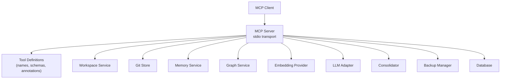
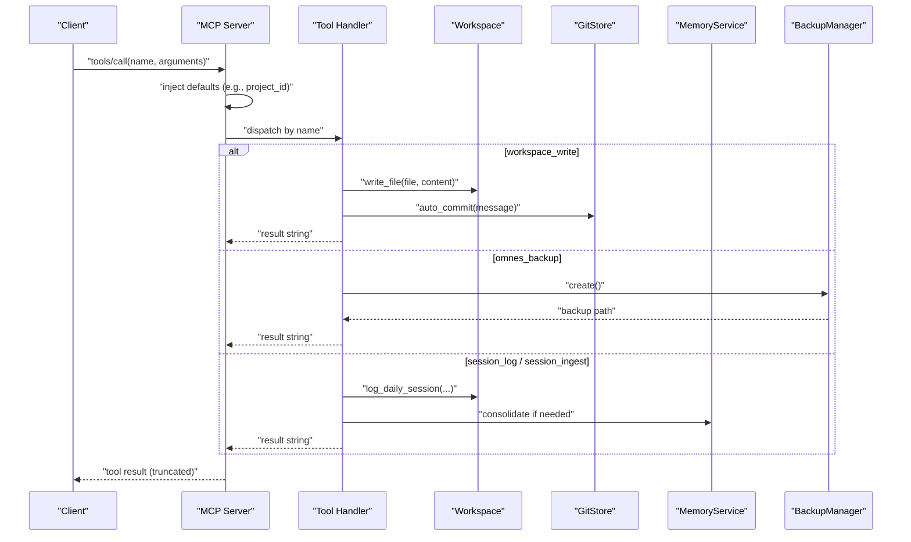
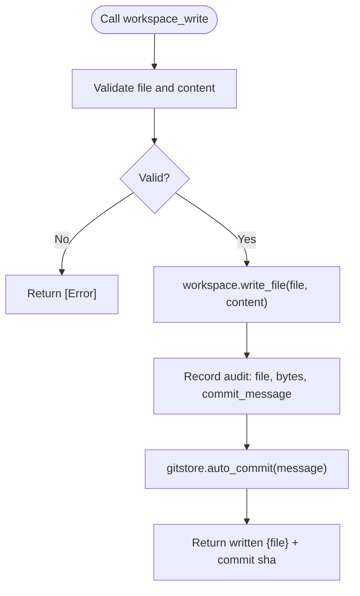
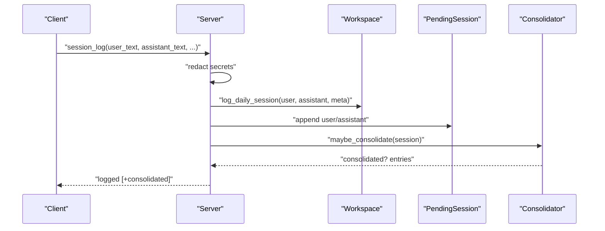
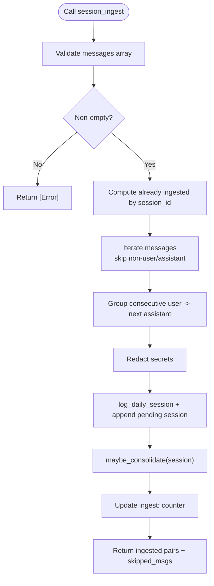
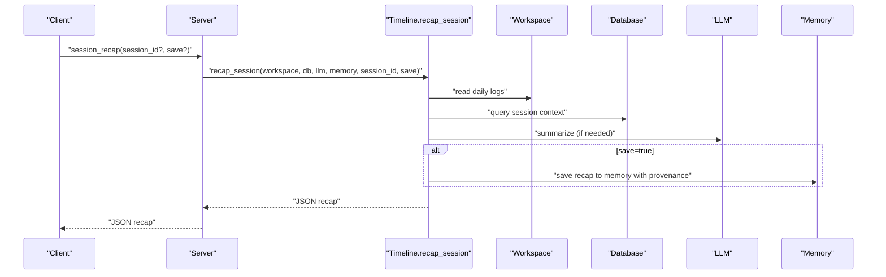
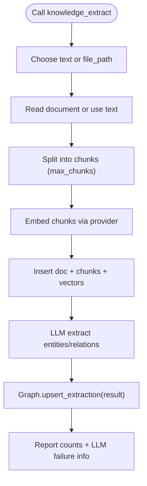
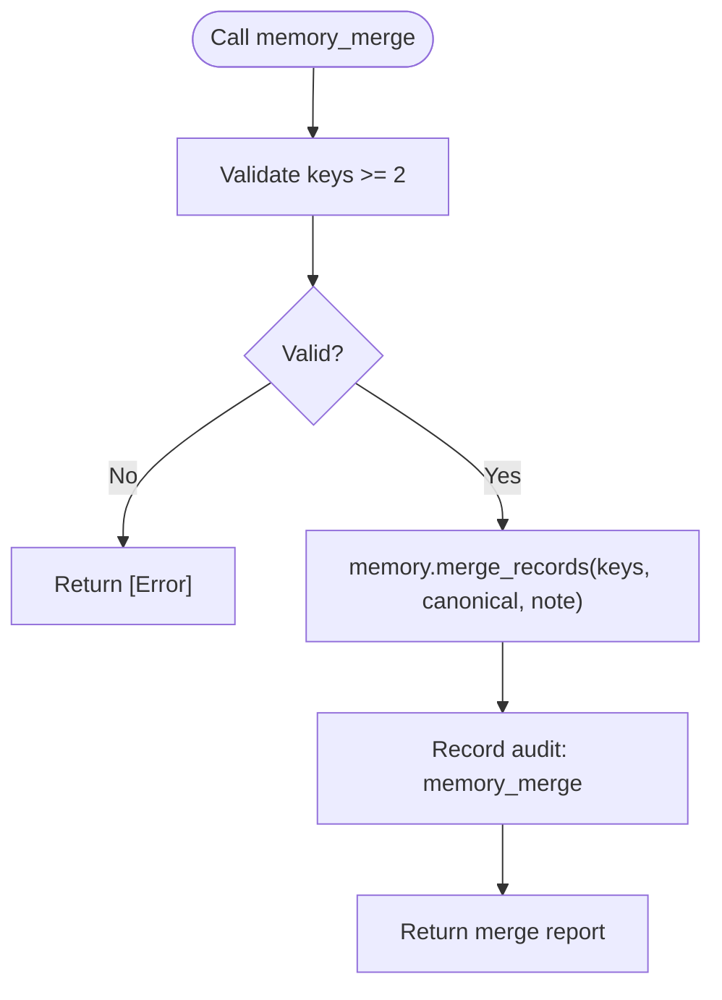
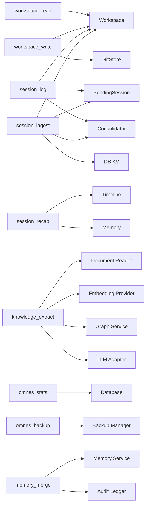

# Utility and System Tools

<cite>
**Referenced Files in This Document**
- [tools.rs](file://src/mcp/tools.rs)
- [server.rs](file://src/mcp/server.rs)
- [mod.rs](file://src/mcp/mod.rs)
- [test_mcp.rs](file://tests/test_mcp.rs)
- [test_phase25.rs](file://tests/test_phase25.rs)
</cite>

## Table of Contents
1. [Introduction](#introduction)
2. [Project Structure](#project-structure)
3. [Core Components](#core-components)
4. [Architecture Overview](#architecture-overview)
5. [Detailed Component Analysis](#detailed-component-analysis)
6. [Dependency Analysis](#dependency-analysis)
7. [Performance Considerations](#performance-considerations)
8. [Troubleshooting Guide](#troubleshooting-guide)
9. [Conclusion](#conclusion)

## Introduction
This document provides API documentation for utility and system tools exposed through the MCP protocol: workspace_read, workspace_write, session_log, session_ingest, session_recap, knowledge_extract, omnes_stats, omnes_backup, and memory_merge. It explains file operations, session management, batch ingestion, system statistics, backup procedures, and memory deduplication. It also documents integration points with other MCP tools and system services such as Git, embedding providers, graph storage, LLM extraction, consolidation, and audit logging.

## Project Structure
The MCP server exposes tools via a JSON-RPC interface over stdio. Tool definitions live in a dedicated module, while routing, argument injection, and execution logic are implemented in the server. Tests validate behavior for critical flows like session ingestion and author metadata.

**Diagram sources**
- [server.rs:1-52](file://src/mcp/server.rs#L1-L52)
- [tools.rs:1-53](file://src/mcp/tools.rs#L1-L53)

**Section sources**
- [mod.rs:1-8](file://src/mcp/mod.rs#L1-L8)
- [server.rs:138-206](file://src/mcp/server.rs#L138-L206)

## Core Components
- Tool registry and annotations: tool names, input schemas, and read-only/destructive hints.
- Server request pipeline: initialize, ping, tools/list, resources/prompts, and tools/call.
- Tool implementations: workspace I/O, session logging/ingestion, knowledge extraction, stats, backups, and memory merge.
- Integration services: workspace, gitstore, memory, graph, embedder, llm, consolidator, backup, database.

Key responsibilities:
- tools.rs declares tool contracts (name, description, schema).
- server.rs implements call_tool dispatch and integrates with subsystems.
- tests verify correctness of session ingestion and metadata handling.

**Section sources**
- [tools.rs:55-813](file://src/mcp/tools.rs#L55-L813)
- [server.rs:479-558](file://src/mcp/server.rs#L479-L558)

## Architecture Overview
The MCP server receives JSON-RPC requests, resolves tool calls, injects defaults (like active project), executes tool handlers, truncates output, and returns structured results. Many tools write to daily logs, update memory/graph, or interact with Git and backups.

**Diagram sources**
- [server.rs:479-558](file://src/mcp/server.rs#L479-L558)
- [server.rs:1088-1123](file://src/mcp/server.rs#L1088-L1123)
- [server.rs:1125-1165](file://src/mcp/server.rs#L1125-L1165)
- [server.rs:1167-1295](file://src/mcp/server.rs#L1167-L1295)
- [server.rs:1696-1699](file://src/mcp/server.rs#L1696-L1699)

## Detailed Component Analysis

### workspace_read
- Purpose: Read agent files from the workspace. Supported files include memory (MEMORY.md), soul (SOUL.md), user (USER.md), and history (consolidated history jsonl).
- Input parameters:
  - file: string — one of memory|soul|user|history
- Behavior:
  - Delegates to workspace service to read the requested file.
  - Returns file contents or an error message prefixed with [Error].
- Integration points:
  - Workspace service handles file resolution and reading.
- Error handling:
  - Missing file parameter returns a validation error.
  - File read errors are surfaced as [Error] messages.

Example usage:
- Read MEMORY.md: call workspace_read with file=memory.
- Read consolidated history: call workspace_read with file=history.

**Section sources**
- [tools.rs:134-145](file://src/mcp/tools.rs#L134-L145)
- [server.rs:1078-1086](file://src/mcp/server.rs#L1078-L1086)

### workspace_write
- Purpose: Overwrite agent files (memory|soul|user) and optionally commit changes to Git.
- Input parameters:
  - file: string — one of memory|soul|user
  - content: string — new file content
  - commit_message: string — optional Git commit message
- Behavior:
  - Writes content to the specified file via workspace service.
  - Records an audit entry with file name and byte size (content is not stored).
  - Creates a Git commit using auto-commit; returns the commit SHA if available.
- Integration points:
  - Workspace service writes the file.
  - Git store performs auto-commit.
  - Audit ledger records the operation.
- Error handling:
  - Missing file/content parameters return validation errors.
  - Write errors are returned as [Error] messages.

Example usage:
- Update MEMORY.md with new content and a commit message.

**Diagram sources**
- [server.rs:1088-1123](file://src/mcp/server.rs#L1088-L1123)

**Section sources**
- [tools.rs:146-159](file://src/mcp/tools.rs#L146-L159)
- [server.rs:1088-1123](file://src/mcp/server.rs#L1088-L1123)

### session_log
- Purpose: Log a conversation turn after the assistant responds. Writes to daily log and updates pending session; may consolidate when token budget is exceeded.
- Input parameters:
  - user_text: string
  - assistant_text: string
  - source: string — default hermes
  - author: string — optional turn_author written into daily meta
  - project_id: string — optional, auto-injected if active project exists
- Behavior:
  - Redacts secrets before writing to daily logs and pending session.
  - Appends user/assistant turns to pending session.
  - Attempts consolidation; returns logged or logged+consolidated status.
- Integration points:
  - Workspace daily logging.
  - Pending session manager.
  - Consolidator for budgeted summarization.
  - Audit logging for sensitive operations.
- Error handling:
  - Missing required fields return validation errors.
  - Consolidation errors are appended to the result.

Example usage:
- Log a user question and assistant answer with author metadata.

**Diagram sources**
- [server.rs:1125-1165](file://src/mcp/server.rs#L1125-L1165)

**Section sources**
- [tools.rs:160-175](file://src/mcp/tools.rs#L160-L175)
- [server.rs:1125-1165](file://src/mcp/server.rs#L1125-L1165)
- [test_phase25.rs:76-103](file://tests/test_phase25.rs#L76-L103)

### session_ingest
- Purpose: Batch ingest historical session transcripts (pairs of user/assistant) into daily logs. Supports idempotent re-ingestion via session_id-based dedup.
- Input parameters:
  - messages: array of {role: user|assistant, content: string}
  - source: string — default hermes
  - session_id: string — optional, enables dedup by position
  - author: string — optional, written into daily meta
  - project_id: string — optional, auto-injected if active project exists
- Behavior:
  - Validates non-empty messages array.
  - Deduplicates based on previously ingested count per session_id.
  - Skips roles other than user/assistant.
  - Redacts secrets before writing.
  - Groups consecutive user messages into a single pair with the last assistant response.
  - Writes pairs to daily logs and pending session; attempts consolidation.
  - Updates KV state to track already ingested message count for future incremental updates.
- Integration points:
  - Workspace daily logging.
  - Pending session manager.
  - Consolidator.
  - Database KV store for dedup counters.
- Error handling:
  - Empty or missing messages array returns a contract error.
  - Consolidation errors are appended to the result.

Example usage:
- Ingest a transcript with multiple user/assistant pairs and a session_id for dedup.

**Diagram sources**
- [server.rs:1167-1295](file://src/mcp/server.rs#L1167-L1295)

**Section sources**
- [tools.rs:283-309](file://src/mcp/tools.rs#L283-L309)
- [server.rs:1167-1295](file://src/mcp/server.rs#L1167-L1295)
- [test_mcp.rs:272-367](file://tests/test_mcp.rs#L272-L367)

### session_recap
- Purpose: Generate a session digest using LLM with an incremental cursor. Repeated calls on unchanged sessions return cached results without LLM invocation; growing sessions summarize only the tail. Optionally saves the recap into long-term memory with provenance links to daily entries.
- Input parameters:
  - session_id: string — optional, defaults to latest session in logs
  - save: boolean — optional, default false; persists recap to memory with category=recap and meta.source_ids
- Behavior:
  - Calls timeline recap function with workspace, database, LLM, and memory services.
  - Returns JSON-encoded recap object or error.
- Integration points:
  - Timeline service for recap generation and caching.
  - Memory service for saving recap entries.
  - LLM adapter for summarization.
- Error handling:
  - Errors from recap generation are returned as strings.

Example usage:
- Generate a recap for the current session and save it to memory.

**Diagram sources**
- [server.rs:2328-2343](file://src/mcp/server.rs#L2328-L2343)

**Section sources**
- [tools.rs:767-777](file://src/mcp/tools.rs#L767-L777)
- [server.rs:2328-2343](file://src/mcp/server.rs#L2328-L2343)

### knowledge_extract
- Purpose: Extract entities and relations from text or a file (txt/md/pdf/docx) into the knowledge graph. Chunks are embedded and indexed; LLM extraction populates nodes and edges.
- Input parameters:
  - text: string — optional, raw text to analyze
  - file_path: string — optional, path to document to read
  - max_chunks: integer — optional, default 200
  - project_id: string — optional, auto-injected if active project exists
- Behavior:
  - Reads document or uses provided text.
  - Splits text into chunks and generates embeddings via the configured provider.
  - Stores doc metadata and chunk embeddings in the database.
  - Runs LLM-based extractor to produce entities and relations; upserts into graph service.
  - Reports counts of processed chunks, skipped chunks, new/updated nodes, and new edges.
  - If LLM calls fail, reports partial success with guidance to check LLM configuration.
- Integration points:
  - Document reader for file ingestion.
  - Embedding provider for vectorization.
  - Graph service for node/edge upsert.
  - LLM adapter for entity/relation extraction.
- Error handling:
  - Missing both text and file_path returns a validation error.
  - Empty text returns an error.
  - LLM failures are reported with actionable hints.

Example usage:
- Extract knowledge from a PDF file and index its chunks.

**Diagram sources**
- [server.rs:1296-1383](file://src/mcp/server.rs#L1296-L1383)

**Section sources**
- [tools.rs:176-189](file://src/mcp/tools.rs#L176-L189)
- [server.rs:1296-1383](file://src/mcp/server.rs#L1296-L1383)

### omnes_stats
- Purpose: Provide system-wide storage statistics including memory records, relations, documents, chunks, graph nodes/edges, dream runs, database size, active embedding backend, Ralph metrics, and secrets record count.
- Input parameters: none
- Behavior:
  - Queries database for counts across key tables.
  - Computes database file size.
  - Reports active embedding backend.
  - Formats a summary string with all metrics.
- Integration points:
  - Database queries for counts.
  - Embedding provider status.
- Error handling:
  - Gracefully handles missing metadata or query failures by returning defaults.

Example usage:
- Get a snapshot of system health and storage usage.

**Section sources**
- [tools.rs:271-276](file://src/mcp/tools.rs#L271-L276)
- [server.rs:1638-1694](file://src/mcp/server.rs#L1638-L1694)

### omnes_backup
- Purpose: Create a database backup (VACUUM INTO) plus workspace backup under backups/. Rotates up to 14 copies.
- Input parameters: none
- Behavior:
  - Invokes backup manager to create a backup.
  - Returns path to the created backup or an error message.
- Integration points:
  - Backup manager orchestrates VACUUM INTO and workspace archival.
- Error handling:
  - Errors from backup creation are returned as [Error] messages.

Example usage:
- Trigger a full backup and receive the backup path.

**Section sources**
- [tools.rs:277-282](file://src/mcp/tools.rs#L277-L282)
- [server.rs:1696-1699](file://src/mcp/server.rs#L1696-L1699)

### memory_merge
- Purpose: Explicitly merge near-duplicate memories. The canonical record receives unioned metadata, maximum importance, and summed access counts; others become tombstones with merged_into metadata and link redirections. Automatic merging is prohibited; only explicit agent/dream verdict triggers merges.
- Input parameters:
  - keys: array of strings — at least two live keys to merge
  - canonical_key: string — optional; defaults to highest trust/importance
  - note: string — optional reason recorded in meta of both sides
- Behavior:
  - Validates that at least two keys are provided.
  - Calls memory service to perform merge_records.
  - Records an audit entry with targets and details.
  - Returns a report describing the merge outcome.
- Integration points:
  - Memory service for merging logic.
  - Audit ledger for governance tracking.
- Error handling:
  - Insufficient keys returns a validation error.
  - Merge errors surface with hints to verify keys are alive.

Example usage:
- Merge two similar memory keys and set a canonical key with a note.

**Diagram sources**
- [server.rs:881-908](file://src/mcp/server.rs#L881-L908)

**Section sources**
- [tools.rs:551-568](file://src/mcp/tools.rs#L551-L568)
- [server.rs:881-908](file://src/mcp/server.rs#L881-L908)

## Dependency Analysis
The following diagram shows how the listed tools depend on core services within the MCP server.

**Diagram sources**
- [server.rs:1078-1123](file://src/mcp/server.rs#L1078-L1123)
- [server.rs:1125-1295](file://src/mcp/server.rs#L1125-L1295)
- [server.rs:1296-1383](file://src/mcp/server.rs#L1296-L1383)
- [server.rs:1638-1699](file://src/mcp/server.rs#L1638-L1699)
- [server.rs:2328-2343](file://src/mcp/server.rs#L2328-L2343)
- [server.rs:881-908](file://src/mcp/server.rs#L881-L908)

**Section sources**
- [server.rs:1078-1383](file://src/mcp/server.rs#L1078-L1383)
- [server.rs:1638-1699](file://src/mcp/server.rs#L1638-L1699)
- [server.rs:2328-2343](file://src/mcp/server.rs#L2328-L2343)
- [server.rs:881-908](file://src/mcp/server.rs#L881-L908)

## Performance Considerations
- session_ingest:
  - Uses KV-based dedup to avoid reprocessing entire transcripts; only new tails are written.
  - Consolidation is attempted per pair to keep pending session size bounded.
- knowledge_extract:
  - Chunking limits and embedding provider throughput affect performance; adjust max_chunks accordingly.
  - LLM extraction can be slow; partial successes are reported with error counts and hints.
- omnes_stats:
  - Aggregates multiple table counts; consider caching if called frequently.
- workspace_write:
  - Git commits add overhead; batch multiple writes where possible.

[No sources needed since this section provides general guidance]

## Troubleshooting Guide
Common issues and resolutions:
- session_log missing fields:
  - Ensure user_text and assistant_text are provided.
  - Verify secret redaction does not remove required content.
- session_ingest empty messages:
  - Provide a non-empty messages array with role and content fields.
  - Use session_id for idempotent ingestion; repeated calls will skip already ingested messages.
- knowledge_extract LLM failures:
  - Check LLM configuration (API key and base URL).
  - Review chunk processing and embedding provider availability.
- omnes_backup errors:
  - Ensure sufficient disk space and permissions for backups directory.
- memory_merge invalid keys:
  - Confirm keys exist and are not tombstones; use memory_search to locate live keys.

**Section sources**
- [server.rs:1125-1165](file://src/mcp/server.rs#L1125-L1165)
- [server.rs:1167-1295](file://src/mcp/server.rs#L1167-L1295)
- [server.rs:1296-1383](file://src/mcp/server.rs#L1296-L1383)
- [server.rs:1696-1699](file://src/mcp/server.rs#L1696-L1699)
- [server.rs:881-908](file://src/mcp/server.rs#L881-L908)

## Conclusion
These MCP utility and system tools provide robust capabilities for workspace file operations, session logging and ingestion, knowledge extraction, system statistics, backups, and memory deduplication. They integrate tightly with Git, embedding providers, graph storage, LLM services, consolidation pipelines, and audit logging. Proper use of parameters like session_id, project_id, and author ensures reliable, auditable, and efficient workflows.

[No sources needed since this section summarizes without analyzing specific files]