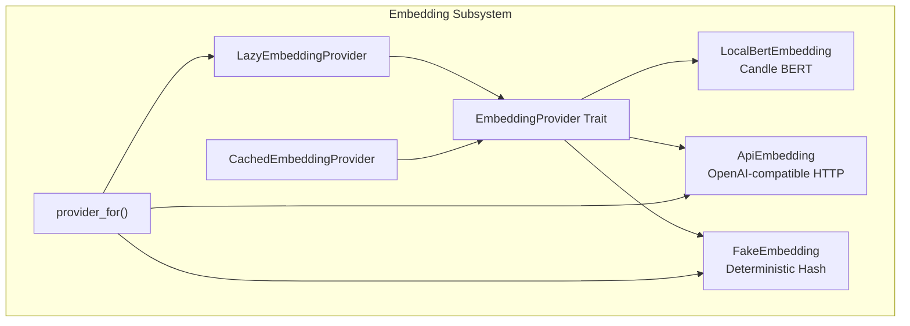
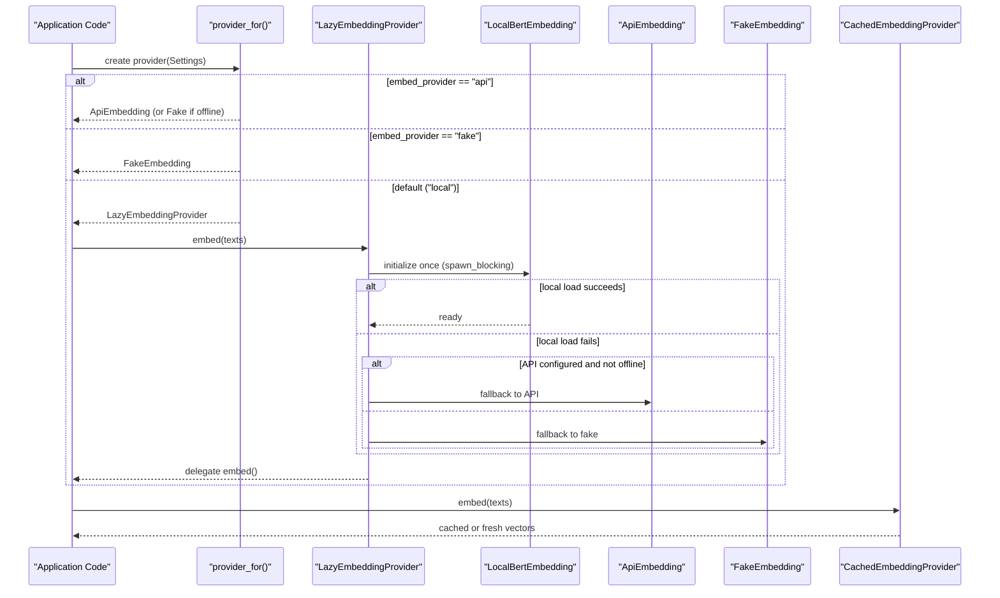
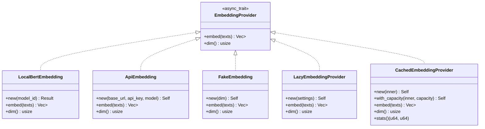
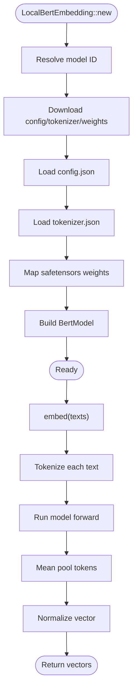
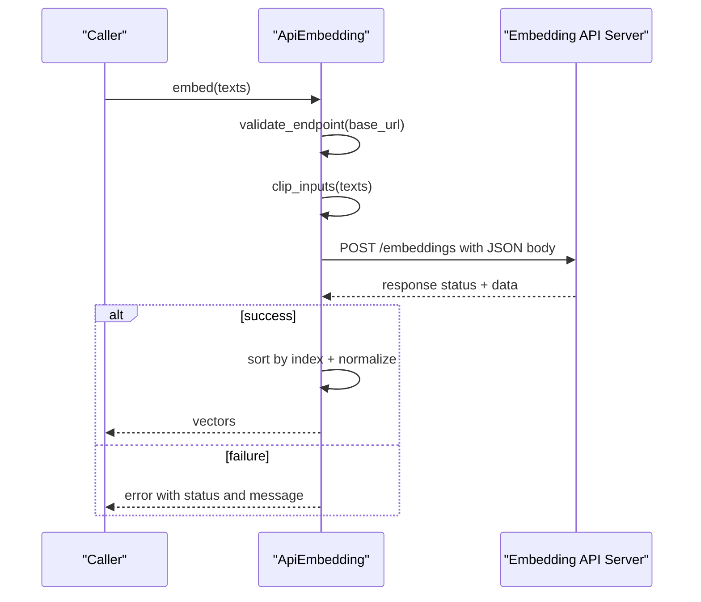
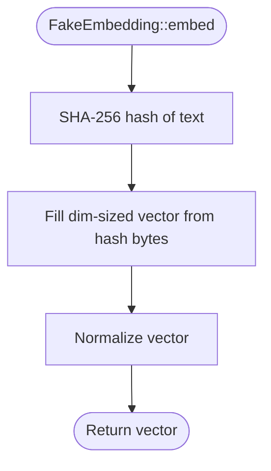
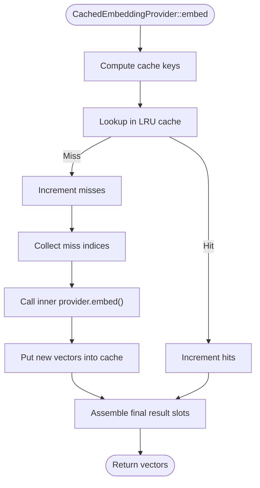
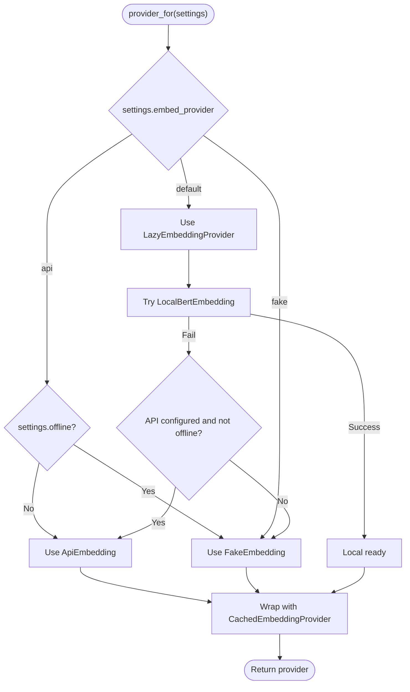
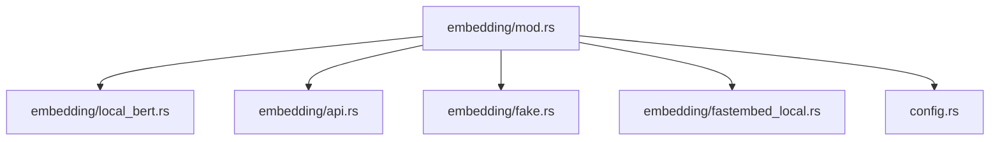

# Embedding Providers

<cite>
**Referenced Files in This Document**
- [mod.rs](file://src/embedding/mod.rs)
- [local_bert.rs](file://src/embedding/local_bert.rs)
- [api.rs](file://src/embedding/api.rs)
- [fake.rs](file://src/embedding/fake.rs)
- [fastembed_local.rs](file://src/embedding/fastembed_local.rs)
- [config.rs](file://src/config.rs)
- [test_embedding_local.rs](file://tests/test_embedding_local.rs)
</cite>

## Table of Contents
1. [Introduction](#introduction)
2. [Project Structure](#project-structure)
3. [Core Components](#core-components)
4. [Architecture Overview](#architecture-overview)
5. [Detailed Component Analysis](#detailed-component-analysis)
6. [Dependency Analysis](#dependency-analysis)
7. [Performance Considerations](#performance-considerations)
8. [Troubleshooting Guide](#troubleshooting-guide)
9. [Conclusion](#conclusion)

## Introduction
This document explains the embedding provider system that generates vector representations for text. It supports multiple backends:
- A local Candle-based BERT model running entirely on CPU.
- An external OpenAI-compatible embedding API.
- A deterministic fake provider used for testing and offline development.
- An additional ONNX Runtime fastembed local backend is present in the codebase, but it is not wired into the active provider selection logic.

The system exposes a single `EmbeddingProvider` trait so callers can switch backends without changing application code. Configuration is driven by environment variables with an `OB2H_` prefix. The default behavior prefers a local model, falls back to an API if available, and finally degrades to fake vectors when neither is usable.

## Project Structure
The embedding subsystem lives under `src/embedding`. The module exports three main providers and a lazy initialization wrapper:
- `LocalBertEmbedding`: Candle + Hugging Face Safetensors BERT inference.
- `ApiEmbedding`: HTTP client calling an OpenAI-compatible embeddings endpoint.
- `FakeEmbedding`: Deterministic hash-based vectors for tests and offline mode.
- `LazyEmbeddingProvider`: Defers heavy model loading until the first real embedding call.
- `CachedEmbeddingProvider`: Thread-safe LRU cache over any provider.
- `provider_for`: Factory that selects the active backend based on configuration.

**Diagram sources**
- [mod.rs:31-38](file://src/embedding/mod.rs#L31-L38)
- [mod.rs:68-107](file://src/embedding/mod.rs#L68-L107)
- [mod.rs:116-208](file://src/embedding/mod.rs#L116-L208)
- [mod.rs:210-239](file://src/embedding/mod.rs#L210-L239)
- [local_bert.rs:16-21](file://src/embedding/local_bert.rs#L16-L21)
- [api.rs:9-15](file://src/embedding/api.rs#L9-L15)
- [fake.rs:8-11](file://src/embedding/fake.rs#L8-L11)

**Section sources**
- [mod.rs:1-240](file://src/embedding/mod.rs#L1-L240)
- [local_bert.rs:1-106](file://src/embedding/local_bert.rs#L1-L106)
- [api.rs:1-184](file://src/embedding/api.rs#L1-L184)
- [fake.rs:1-67](file://src/embedding/fake.rs#L1-L67)
- [fastembed_local.rs:1-68](file://src/embedding/fastembed_local.rs#L1-L68)
- [config.rs:8-106](file://src/config.rs#L8-L106)

## Core Components
- `EmbeddingProvider` trait defines the contract:
  - `embed(texts)` returns normalized vectors for each input string.
  - `dim()` returns the vector dimensionality.
- `LocalBertEmbedding` loads a Hugging Face BERT model via Candle and computes mean-pooled embeddings on CPU.
- `ApiEmbedding` sends batched requests to an OpenAI-compatible `/embeddings` endpoint, normalizes returned vectors, and validates endpoints.
- `FakeEmbedding` produces deterministic vectors from SHA-256 hashes; useful for tests and offline scenarios.
- `LazyEmbeddingProvider` delays model loading until the first embedding call, using `spawn_blocking` to avoid blocking the async runtime.
- `CachedEmbeddingProvider` wraps any provider with an LRU cache keyed by normalized text (trimmed and lowercased).
- `provider_for(settings)` chooses the active backend:
  - `"api"` uses `ApiEmbedding`, unless `offline` is enabled, then it switches to `FakeEmbedding`.
  - `"fake"` always uses `FakeEmbedding`.
  - Any other value defaults to `LazyEmbeddingProvider`, which tries `LocalBertEmbedding` and falls back to API or fake depending on configuration.

Configuration fields relevant to embedding:
- `embed_provider`: `"local"`, `"api"`, or `"fake"`.
- `embed_model`: model identifier for local or API usage.
- `embed_base_url`: base URL for the embedding API.
- `embed_api_key`: bearer token for the embedding API.
- `offline`: forces offline behavior and disables network updates.

Environment variables:
- `OB2H_EMBED_PROVIDER`
- `OB2H_EMBED_MODEL`
- `OB2H_EMBED_BASE_URL`
- `OB2H_EMBED_API_KEY`
- `OB2H_OFFLINE`

**Section sources**
- [mod.rs:31-38](file://src/embedding/mod.rs#L31-L38)
- [mod.rs:41-64](file://src/embedding/mod.rs#L41-L64)
- [mod.rs:68-107](file://src/embedding/mod.rs#L68-L107)
- [mod.rs:116-208](file://src/embedding/mod.rs#L116-L208)
- [mod.rs:210-239](file://src/embedding/mod.rs#L210-L239)
- [config.rs:22-26](file://src/config.rs#L22-L26)
- [config.rs:201-206](file://src/config.rs#L201-L206)
- [config.rs:354-363](file://src/config.rs#L354-L363)

## Architecture Overview
The embedding layer abstracts away backend differences through a trait. Application code calls `embed()` on a provider instance without knowing whether it runs locally or remotely. The factory function wires configuration to concrete implementations and adds caching.

**Diagram sources**
- [mod.rs:41-64](file://src/embedding/mod.rs#L41-L64)
- [mod.rs:68-107](file://src/embedding/mod.rs#L68-L107)
- [mod.rs:210-239](file://src/embedding/mod.rs#L210-L239)

## Detailed Component Analysis

### Embedding Provider Abstraction
The abstraction is defined by a single async trait with two methods:
- `embed(texts)`: compute normalized vectors for a batch of strings.
- `dim()`: report the vector dimensionality.

All providers implement this trait, enabling uniform usage across local, remote, and fake backends.

**Diagram sources**
- [mod.rs:31-38](file://src/embedding/mod.rs#L31-L38)
- [mod.rs:68-107](file://src/embedding/mod.rs#L68-L107)
- [mod.rs:116-208](file://src/embedding/mod.rs#L116-L208)
- [local_bert.rs:16-21](file://src/embedding/local_bert.rs#L16-L21)
- [api.rs:9-15](file://src/embedding/api.rs#L9-L15)
- [fake.rs:8-11](file://src/embedding/fake.rs#L8-L11)

**Section sources**
- [mod.rs:31-38](file://src/embedding/mod.rs#L31-L38)

### Local Candle-Based BERT Provider
`LocalBertEmbedding` downloads and loads a Hugging Face model using Candle and safetensors:
- Model resolution: empty or `"local"` maps to a multilingual MiniLM model ID.
- Downloads `config.json`, `tokenizer.json`, and `model.safetensors`.
- Initializes the BERT model on CPU and stores tokenizer and hidden size.
- Embedding pipeline: tokenize, build tensors, run forward pass, apply mean pooling, normalize vectors.

Resource requirements:
- CPU-only inference.
- Network access required only during initial model download.
- Memory usage depends on model size and batch size.

**Diagram sources**
- [local_bert.rs:24-59](file://src/embedding/local_bert.rs#L24-L59)
- [local_bert.rs:63-105](file://src/embedding/local_bert.rs#L63-L105)

**Section sources**
- [local_bert.rs:1-106](file://src/embedding/local_bert.rs#L1-L106)

### External API Provider
`ApiEmbedding` implements an OpenAI-compatible client:
- Endpoint construction: ensures trailing slash handling and appends `/embeddings`.
- Endpoint validation: allows only `http`/`https`, requires a host, rejects userinfo in URLs.
- Input clipping: truncates inputs longer than a fixed character limit to keep payloads manageable.
- Authentication: optional bearer token from configuration.
- Response parsing: sorts data by index, normalizes vectors, and propagates errors.

Rate limiting:
- No built-in rate limiter is implemented in this provider.
- Applications should implement retries/backoff at higher layers if needed.

**Diagram sources**
- [api.rs:42-58](file://src/embedding/api.rs#L42-L58)
- [api.rs:69-83](file://src/embedding/api.rs#L69-L83)
- [api.rs:85-137](file://src/embedding/api.rs#L85-L137)

**Section sources**
- [api.rs:1-184](file://src/embedding/api.rs#L1-L184)

### Fake Provider for Testing and Offline Development
`FakeEmbedding` generates deterministic vectors:
- Uses SHA-256 hashing of input text.
- Maps hash bytes into a fixed-dimensional vector.
- Applies normalization to produce unit-length vectors.

Use cases:
- Unit tests and integration tests.
- Offline development when no local model or API is available.
- Degradation path when both local and API backends fail.

**Diagram sources**
- [fake.rs:25-47](file://src/embedding/fake.rs#L25-L47)

**Section sources**
- [fake.rs:1-67](file://src/embedding/fake.rs#L1-L67)

### Lazy Initialization and Caching
`LazyEmbeddingProvider` defers expensive local model loading until the first embedding call:
- Uses `tokio::sync::OnceCell` to ensure one-time initialization.
- Runs initialization in `spawn_blocking` to avoid blocking the async runtime.
- Falls back to API or fake if local model loading fails.

`CachedEmbeddingProvider` wraps any provider with an LRU cache:
- Normalizes keys by trimming and lowercasing text.
- Tracks hits and misses for diagnostics.
- Ensures result slots are filled consistently.

**Diagram sources**
- [mod.rs:81-90](file://src/embedding/mod.rs#L81-L90)
- [mod.rs:110-112](file://src/embedding/mod.rs#L110-L112)
- [mod.rs:155-208](file://src/embedding/mod.rs#L155-L208)

**Section sources**
- [mod.rs:68-107](file://src/embedding/mod.rs#L68-L107)
- [mod.rs:116-208](file://src/embedding/mod.rs#L116-L208)

### Provider Selection and Configuration
`provider_for(settings)` selects the active backend:
- `"api"`: constructs `ApiEmbedding`; if `offline` is true, switches to `FakeEmbedding`.
- `"fake"`: constructs `FakeEmbedding`.
- Default (`"local"`): constructs `LazyEmbeddingProvider`, which attempts local model loading and falls back to API or fake.

Configuration fields and environment variables:
- `embed_provider`: controls backend selection.
- `embed_model`: model identifier for local or API.
- `embed_base_url`: base URL for embedding API.
- `embed_api_key`: bearer token for embedding API.
- `offline`: forces offline behavior and disables network updates.

**Diagram sources**
- [mod.rs:41-64](file://src/embedding/mod.rs#L41-L64)
- [mod.rs:210-239](file://src/embedding/mod.rs#L210-L239)

**Section sources**
- [mod.rs:210-239](file://src/embedding/mod.rs#L210-L239)
- [config.rs:22-26](file://src/config.rs#L22-L26)
- [config.rs:201-206](file://src/config.rs#L201-L206)
- [config.rs:354-363](file://src/config.rs#L354-L363)

## Dependency Analysis
The embedding subsystem has clear boundaries:
- `mod.rs` orchestrates provider selection, lazy initialization, and caching.
- `local_bert.rs` depends on Candle, Hugging Face Hub, and tokenizers.
- `api.rs` depends on `reqwest` for HTTP requests.
- `fake.rs` depends on standard hashing utilities.
- `fastembed_local.rs` exists but is not selected by `provider_for`.

**Diagram sources**
- [mod.rs:3-17](file://src/embedding/mod.rs#L3-L17)
- [config.rs:22-26](file://src/config.rs#L22-L26)

**Section sources**
- [mod.rs:1-240](file://src/embedding/mod.rs#L1-L240)
- [config.rs:1-523](file://src/config.rs#L1-L523)

## Performance Considerations
- Local Candle BERT:
  - CPU-only inference; suitable for offline operation.
  - Initial model download occurs once; subsequent runs reuse cached weights.
  - Mean pooling and normalization add minimal overhead per text.
  - Memory usage scales with model size and batch processing.
- API Provider:
  - Latency depends on network conditions and server load.
  - No built-in rate limiting; applications should handle retries/backoff.
  - Input clipping prevents excessively large payloads.
- Fake Provider:
  - Very fast and deterministic; ideal for tests and offline fallback.
- Caching:
  - LRU cache reduces repeated computation for identical normalized text.
  - Useful when agents issue duplicate queries.

[No sources needed since this section provides general guidance]

## Troubleshooting Guide
Common issues and resolutions:
- Local model loading fails:
  - Check network connectivity for Hugging Face Hub downloads.
  - Verify model ID or use the default multilingual MiniLM model.
  - If local loading fails and API is configured and not offline, the system falls back to API automatically.
- API connectivity problems:
  - Ensure `OB2H_EMBED_BASE_URL` points to a valid `http`/`https` endpoint with a host.
  - Avoid embedding credentials in the URL; use `OB2H_EMBED_API_KEY` instead.
  - Inspect HTTP status codes and error messages returned by the API.
- Offline mode:
  - When `OB2H_OFFLINE=true`, the system disables network updates and may force fake embeddings even if API is configured.
  - Local model downloads are disabled in offline mode.
- Dimension mismatches:
  - Ensure consistency between provider dimensions and downstream components.
  - The fake provider defaults to 384 dimensions; local models expose their hidden size.

**Section sources**
- [local_bert.rs:24-59](file://src/embedding/local_bert.rs#L24-L59)
- [api.rs:42-58](file://src/embedding/api.rs#L42-L58)
- [api.rs:114-119](file://src/embedding/api.rs#L114-L119)
- [config.rs:354-363](file://src/config.rs#L354-L363)
- [mod.rs:41-64](file://src/embedding/mod.rs#L41-L64)

## Conclusion
The embedding provider system offers a flexible abstraction over multiple backends. By default, it prefers a local Candle-based BERT model, falls back to an external API when available, and degrades to deterministic fake vectors when necessary. Configuration is straightforward via environment variables, and caching improves performance for repeated queries. For production deployments, consider adding rate limiting and retry logic around the API provider, and monitor local model loading and network dependencies.

[No sources needed since this section summarizes without analyzing specific files]