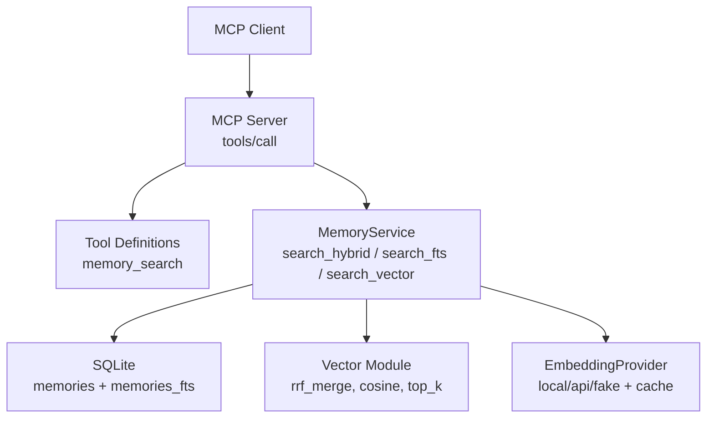
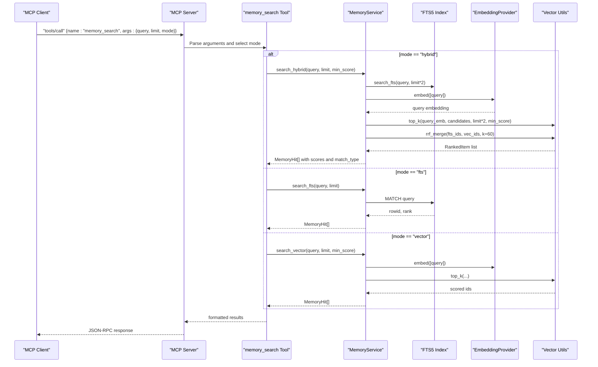
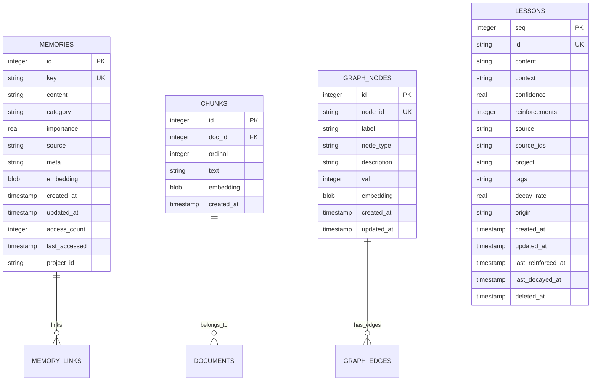
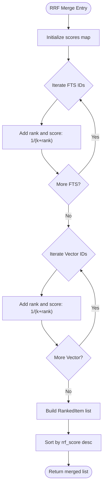
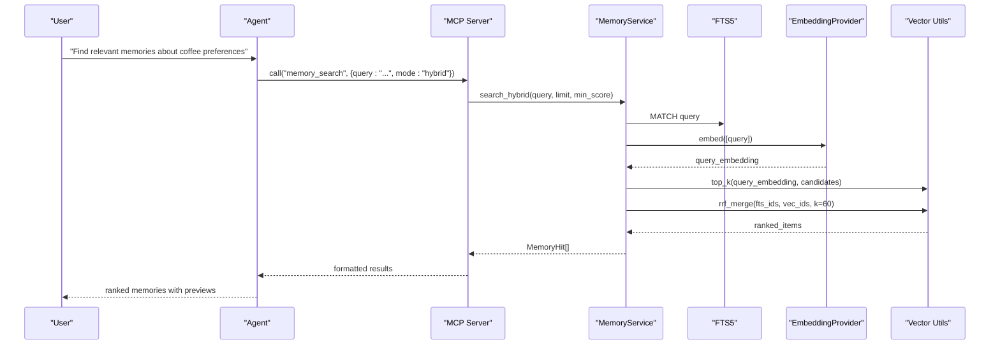
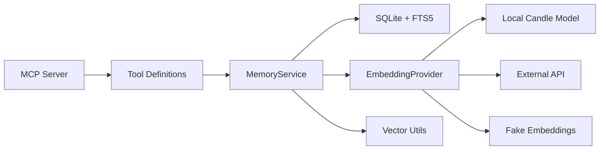

# Hybrid Search Engine

<cite>
**Referenced Files in This Document**
- [README.md](file://README.md)
- [schema.rs](file://src/db/schema.rs)
- [service.rs](file://src/memory/service.rs)
- [rrf.rs](file://src/vector/rrf.rs)
- [mod.rs](file://src/vector/mod.rs)
- [embedding_mod.rs](file://src/embedding/mod.rs)
- [tools.rs](file://src/mcp/tools.rs)
- [server.rs](file://src/mcp/server.rs)
</cite>

## Table of Contents
1. [Introduction](#introduction)
2. [Project Structure](#project-structure)
3. [Core Components](#core-components)
4. [Architecture Overview](#architecture-overview)
5. [Detailed Component Analysis](#detailed-component-analysis)
6. [Dependency Analysis](#dependency-analysis)
7. [Performance Considerations](#performance-considerations)
8. [Troubleshooting Guide](#troubleshooting-guide)
9. [Conclusion](#conclusion)

## Introduction
This document explains the hybrid search engine that combines SQLite FTS5 full-text search with vector embeddings for semantic similarity. It covers:
- Dual indexing: text content is indexed both in FTS5 tables and as vector embeddings.
- Reciprocal Rank Fusion (RRF) with a configurable `k=60` parameter to merge lexical and semantic results.
- The query processing pipeline from natural language input through MCP tools to ranked results, including embedding generation and result re-ranking.
- Examples of search queries via MCP tools and how hybrid search improves relevance compared to single-modality search.
- Performance optimizations such as query embedding caching and batch processing.
- Configuration options and tuning strategies for search parameters.

The system is part of OB2H, which exposes 56 MCP tools, including memory search, context building, graph search, and project-aware retrieval.

**Section sources**
- [README.md:38-52](file://README.md#L38-L52)
- [README.md:130-148](file://README.md#L130-L148)

## Project Structure
The hybrid search functionality spans several modules:
- Database schema defines FTS5 virtual tables and triggers for automatic index maintenance.
- Memory service implements lexical search, vector search, and hybrid merging.
- Vector module provides RRF merging and similarity utilities.
- Embedding provider supports local Candle models, external APIs, and fallbacks, plus an LRU cache for query embeddings.
- MCP server routes tool calls like `memory_search` into the appropriate search mode.

**Diagram sources**
- [server.rs:479-558](file://src/mcp/server.rs#L479-L558)
- [tools.rs:74-89](file://src/mcp/tools.rs#L74-L89)
- [service.rs:489-636](file://src/memory/service.rs#L489-L636)
- [mod.rs:1-9](file://src/vector/mod.rs#L1-L9)
- [embedding_mod.rs:210-239](file://src/embedding/mod.rs#L210-L239)

**Section sources**
- [schema.rs:305-333](file://src/db/schema.rs#L305-L333)
- [service.rs:489-636](file://src/memory/service.rs#L489-L636)
- [mod.rs:1-9](file://src/vector/mod.rs#L1-L9)
- [embedding_mod.rs:210-239](file://src/embedding/mod.rs#L210-L239)
- [tools.rs:74-89](file://src/mcp/tools.rs#L74-L89)
- [server.rs:648-699](file://src/mcp/server.rs#L648-L699)

## Core Components
- **FTS5 Indexing**: Virtual tables `memories_fts`, `chunks_fts`, `graph_nodes_fts`, and `lessons_fts` are created with trigram tokenization and synchronized via triggers on insert/update/delete.
- **Memory Service**: Implements `search_fts`, `search_vector`, and `search_hybrid`. Hybrid search merges FTS and vector candidate lists using RRF with `k=60`.
- **Vector Utilities**: Provide cosine similarity, serialization/deserialization, top-k selection, and RRF merging.
- **Embedding Provider**: Supports local Candle-based models, external API providers, and fake fallback; includes an LRU cache for query embeddings.
- **MCP Tools**: Expose `memory_search` with modes `hybrid`, `fts`, `vector`, and optional related/PPR expansion.

Key responsibilities:
- Lexical matching via FTS5 BM25-compatible ranking.
- Semantic matching via cosine similarity over stored embeddings.
- Result fusion via RRF to balance recall and precision across modalities.
- Access tracking and trust updates for frequently retrieved records.

**Section sources**
- [schema.rs:305-333](file://src/db/schema.rs#L305-L333)
- [schema.rs:350-374](file://src/db/schema.rs#L350-L374)
- [schema.rs:376-424](file://src/db/schema.rs#L376-L424)
- [service.rs:489-636](file://src/memory/service.rs#L489-L636)
- [mod.rs:1-9](file://src/vector/mod.rs#L1-L9)
- [embedding_mod.rs:210-239](file://src/embedding/mod.rs#L210-L239)
- [tools.rs:74-89](file://src/mcp/tools.rs#L74-L89)

## Architecture Overview
The hybrid search architecture integrates lexical and semantic retrieval within a unified pipeline:

**Diagram sources**
- [server.rs:648-699](file://src/mcp/server.rs#L648-L699)
- [service.rs:489-636](file://src/memory/service.rs#L489-L636)
- [rrf.rs:13-50](file://src/vector/rrf.rs#L13-L50)
- [embedding_mod.rs:155-208](file://src/embedding/mod.rs#L155-L208)

## Detailed Component Analysis

### Dual Indexing Architecture
The database schema creates FTS5 virtual tables for multiple content types:
- `memories_fts`: indexes `memories.content` with trigram tokenization and triggers for insert/update/delete.
- `chunks_fts`: indexes `chunks.text`.
- `graph_nodes_fts`: indexes `graph_nodes.label` and `description`.
- `lessons_fts`: indexes `lessons.content` and `lessons.context`.

These indexes enable fast lexical searches and BM25-like ranking. Triggers ensure consistency between base tables and FTS virtual tables.

**Diagram sources**
- [schema.rs:222-333](file://src/db/schema.rs#L222-L333)
- [schema.rs:350-424](file://src/db/schema.rs#L350-L424)

**Section sources**
- [schema.rs:305-333](file://src/db/schema.rs#L305-L333)
- [schema.rs:350-374](file://src/db/schema.rs#L350-L374)
- [schema.rs:376-424](file://src/db/schema.rs#L376-L424)

### Reciprocal Rank Fusion (RRF) Implementation
RRF merges two ranked lists (FTS and vector) by computing a fused score per item:
- For each position `rank` in a list, contribution is `1 / (k + rank)`.
- Items appearing in both lists receive higher fused scores.
- Final list is sorted descending by fused score.

The implementation uses a hash map to aggregate ranks and scores, then sorts results.

**Diagram sources**
- [rrf.rs:13-50](file://src/vector/rrf.rs#L13-L50)

**Section sources**
- [rrf.rs:1-68](file://src/vector/rrf.rs#L1-L68)

### Query Processing Pipeline
The pipeline transforms natural language queries into ranked results:
1. **Input Parsing**: MCP server parses `memory_search` arguments (`query`, `limit`, `mode`).
2. **Mode Selection**: Default mode is `hybrid`; alternatives are `fts` or `vector`.
3. **Lexical Search**: FTS5 MATCH returns rowids and BM25-like ranks.
4. **Embedding Generation**: Query text is embedded via the configured provider (local Candle model preferred, API fallback, or fake).
5. **Semantic Search**: Cosine similarity computes top-k candidates against stored embeddings.
6. **Fusion**: RRF merges FTS and vector candidate lists with `k=60`.
7. **Result Enrichment**: Hits are fetched with full record details, match type classification, and access counters updated.
8. **Optional Expansion**: Related records via 1-hop links or PPR expansion can be appended.

**Diagram sources**
- [server.rs:648-699](file://src/mcp/server.rs#L648-L699)
- [service.rs:576-636](file://src/memory/service.rs#L576-L636)
- [embedding_mod.rs:155-208](file://src/embedding/mod.rs#L155-L208)

**Section sources**
- [server.rs:648-699](file://src/mcp/server.rs#L648-L699)
- [service.rs:576-636](file://src/memory/service.rs#L576-L636)

### MCP Tool Integration
The `memory_search` tool supports:
- Modes: `hybrid` (default), `fts`, `vector`, `graph`.
- Filtering by `project_id`.
- Optional related records via 1-hop links or PPR expansion when `related=true` or `mode=graph`.

Tool annotations indicate read-only operations for safety hints to harness systems.

**Section sources**
- [tools.rs:74-89](file://src/mcp/tools.rs#L74-L89)
- [tools.rs:6-53](file://src/mcp/tools.rs#L6-L53)
- [server.rs:648-800](file://src/mcp/server.rs#L648-L800)

## Dependency Analysis
The hybrid search depends on:
- **Database Layer**: SQLite with FTS5 virtual tables and triggers.
- **Embedding Layer**: Local Candle models, external APIs, or fake providers, wrapped with lazy initialization and LRU caching.
- **Vector Math Layer**: Cosine similarity, serialization, top-k selection, and RRF merging.
- **MCP Layer**: Tool definitions and request routing.

**Diagram sources**
- [server.rs:27-52](file://src/mcp/server.rs#L27-L52)
- [embedding_mod.rs:210-239](file://src/embedding/mod.rs#L210-L239)
- [service.rs:1-16](file://src/memory/service.rs#L1-L16)

**Section sources**
- [embedding_mod.rs:210-239](file://src/embedding/mod.rs#L210-L239)
- [service.rs:1-16](file://src/memory/service.rs#L1-L16)
- [server.rs:27-52](file://src/mcp/server.rs#L27-L52)

## Performance Considerations
- **Query Embedding Cache**: An LRU cache stores normalized query embeddings to avoid repeated model calls. Capacity defaults to 1000 entries.
- **Batch Processing**: Embedding provider accepts batches of texts, reducing overhead.
- **Fallback Strategies**: If FTS5 is unavailable, LIKE fallback is used; if local model fails, API or fake providers are selected.
- **Access Tracking**: Frequent hits increment access counters and boost trust slightly, improving future relevance.
- **Configuration Options**:
  - `OB2H_EMBED_PROVIDER`: Selects embedding backend (`local`, `api`, `fake`).
  - `OB2H_OFFLINE`: Disables external API usage.
  - `OB2H_PREFETCH_MAX_CHARS`: Controls context block size.
  - `OB2H_VEC0`: Enables experimental sqlite-vec rescore.

Optimization recommendations:
- Tune `limit` in hybrid search to balance recall and latency.
- Use `min_score` thresholds to filter low-confidence semantic matches.
- Monitor cache hit rates to adjust capacity based on query patterns.

**Section sources**
- [embedding_mod.rs:114-208](file://src/embedding/mod.rs#L114-L208)
- [service.rs:489-538](file://src/memory/service.rs#L489-L538)
- [service.rs:665-681](file://src/memory/service.rs#L665-L681)
- [README.md:300-329](file://README.md#L300-L329)

## Troubleshooting Guide
Common issues and resolutions:
- **FTS5 Unavailable**: System falls back to LIKE search; verify FTS5 compilation and index integrity.
- **Embedding Provider Failures**: Local model load errors trigger API or fake fallback; check environment variables and offline mode.
- **Empty Results**: Adjust `limit`, `min_score`, or query phrasing; consider switching modes (`fts` vs `vector`).
- **Stale or Low-Trust Records**: Use feedback mechanisms (`helpful`, `unhelpful`, `outdated`) to adjust trust scores.

Diagnostic steps:
- Check active embedding backend via stats.
- Review audit log for operation history.
- Verify database schema version and migrations.

**Section sources**
- [service.rs:489-538](file://src/memory/service.rs#L489-L538)
- [embedding_mod.rs:40-64](file://src/embedding/mod.rs#L40-L64)
- [tools.rs:790-800](file://src/mcp/tools.rs#L790-L800)

## Conclusion
The hybrid search engine effectively combines lexical and semantic retrieval to improve relevance and robustness. By leveraging SQLite FTS5 for fast keyword matching and vector embeddings for semantic similarity, it delivers balanced results through RRF fusion. The MCP integration provides flexible querying modes, while performance optimizations like embedding caching and batch processing ensure efficient operation. Configuration options allow tuning for different environments and use cases, making the system adaptable to various agent workflows.