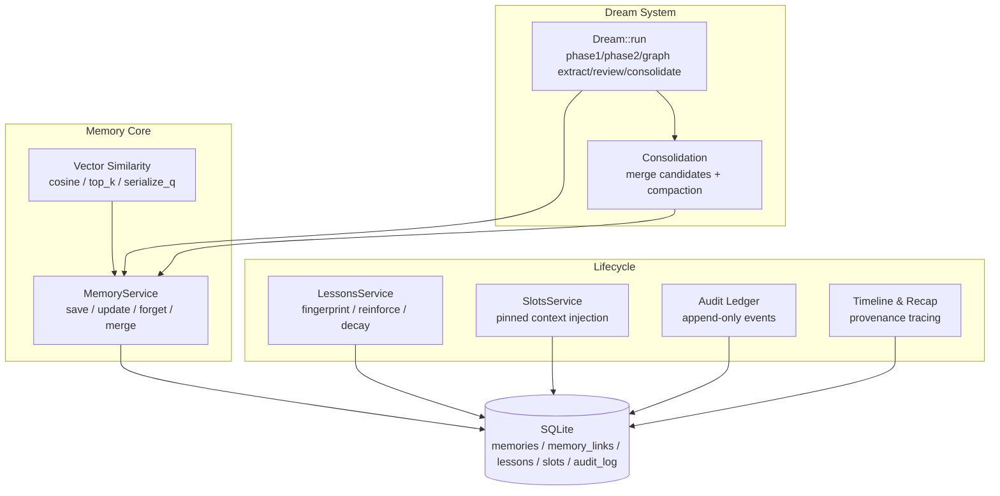
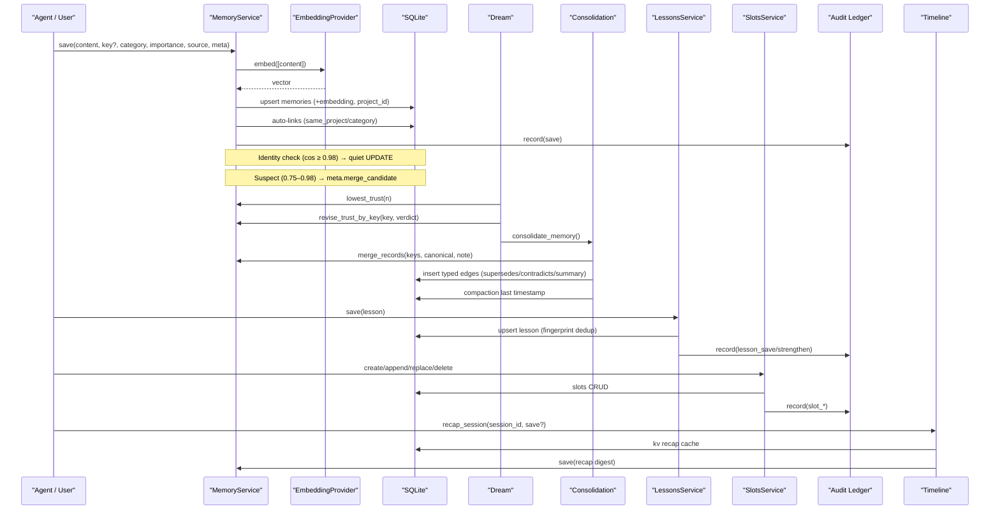
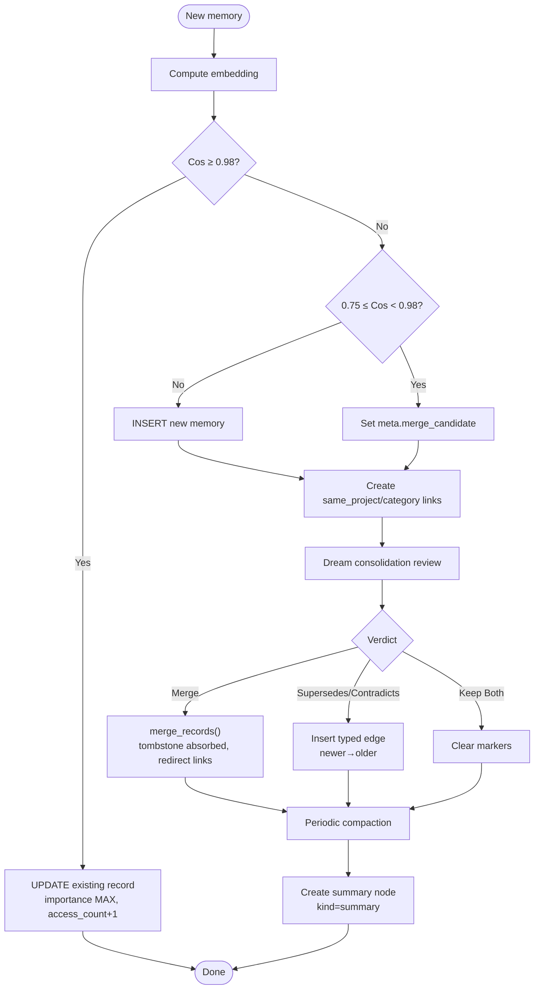
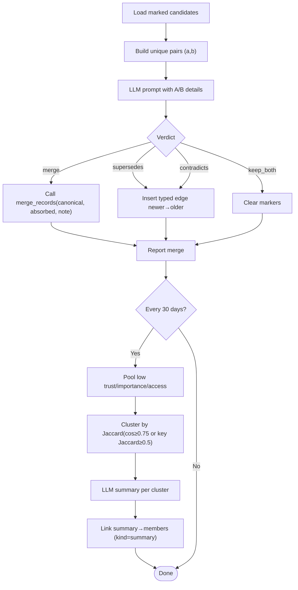
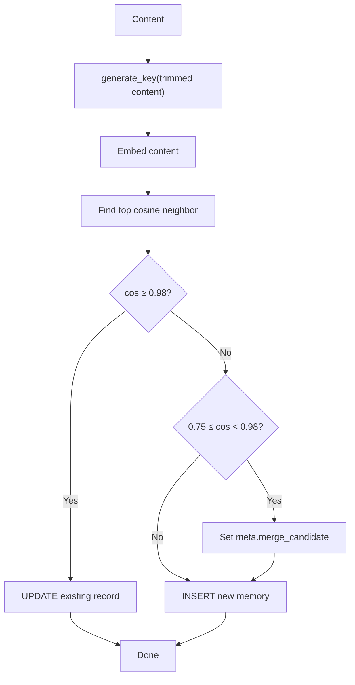
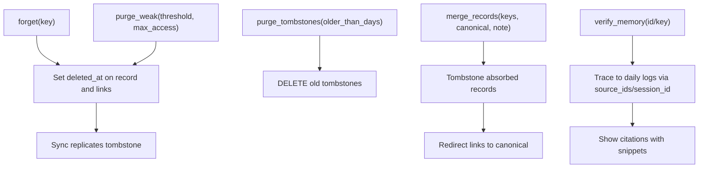
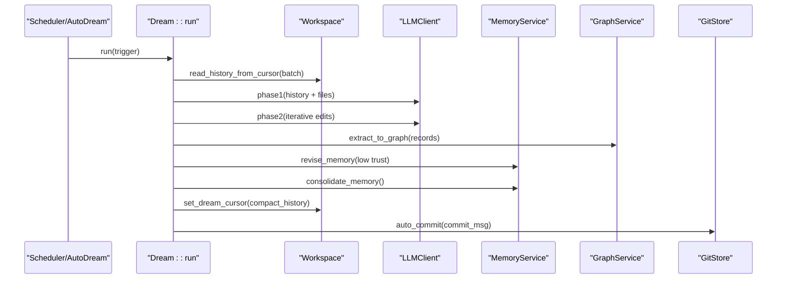
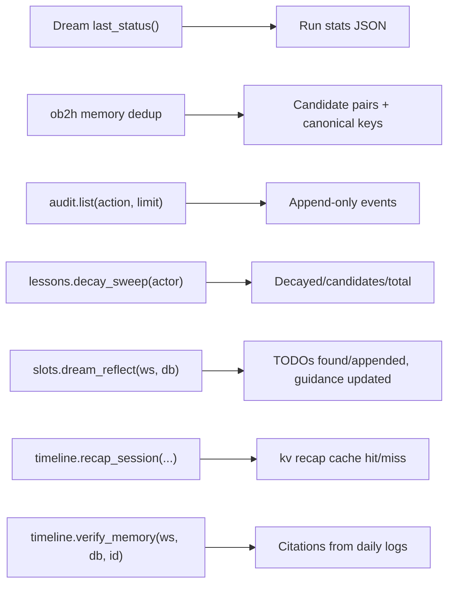
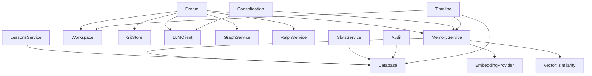

# Memory Lifecycle Management

<cite>
**Referenced Files in This Document**
- [README.md](file://README.md)
- [service.rs](file://src/memory/service.rs)
- [mod.rs](file://src/dream/mod.rs)
- [consolidate.rs](file://src/dream/consolidate.rs)
- [lessons.rs](file://src/lifecycle/lessons.rs)
- [slots.rs](file://src/lifecycle/slots.rs)
- [audit.rs](file://src/lifecycle/audit.rs)
- [timeline.rs](file://src/lifecycle/timeline.rs)
- [dedup.rs](file://src/cli/dedup.rs)
- [similarity.rs](file://src/vector/similarity.rs)
- [models.rs](file://src/db/models.rs)
- [schema.rs](file://src/db/schema.rs)
</cite>

## Table of Contents
1. [Introduction](#introduction)
2. [Project Structure](#project-structure)
3. [Core Components](#core-components)
4. [Architecture Overview](#architecture-overview)
5. [Detailed Component Analysis](#detailed-component-analysis)
6. [Dependency Analysis](#dependency-analysis)
7. [Performance Considerations](#performance-considerations)
8. [Troubleshooting Guide](#troubleshooting-guide)
9. [Conclusion](#conclusion)

## Introduction
This document explains the memory lifecycle management system: how raw conversation fragments become consolidated memories, how redundancy is removed, how trust and provenance are tracked, and how low-trust or outdated memories are archived and recovered. It also covers automated nightly consolidation via the dream system, monitoring/debugging tools, and integration points with lessons, slots, timeline recaps, and audit logging.

The lifecycle spans:
- Creation and embedding of memories
- Save-time deduplication (identity detection and suspect marking)
- Automated consolidation (merge decisions, typed edges, compaction digests)
- Trust evolution through feedback and dream revision
- Archival through tombstones and maintenance cleanup
- Recovery through explicit forget/merge operations, provenance tracing, and session recaps

**Section sources**
- [README.md:27-53](file://README.md#L27-L53)

## Project Structure
Memory lifecycle code is organized into focused modules:
- `memory::service` — core CRUD, hybrid search, trust updates, merge engine, PPR context, archival helpers
- `dream` — orchestrates nightly runs, phase analysis/editing, graph extraction, memory revision, consolidation
- `lifecycle` — lessons, slots, audit ledger, timeline/recap/provenance
- `cli::dedup` — offline candidate discovery for near-duplicates
- `vector::similarity` — vector serialization, cosine similarity, top-k scoring
- `db::models` and `db::schema` — data models and migrations including trust, links, lessons, slots, audit log

**Diagram sources**
- [service.rs:30-167](file://src/memory/service.rs#L30-L167)
- [mod.rs:145-287](file://src/dream/mod.rs#L145-L287)
- [consolidate.rs:68-85](file://src/dream/consolidate.rs#L68-L85)
- [lessons.rs:82-133](file://src/lifecycle/lessons.rs#L82-L133)
- [slots.rs:48-50](file://src/lifecycle/slots.rs#L48-L50)
- [audit.rs:18-53](file://src/lifecycle/audit.rs#L18-L53)
- [timeline.rs:270-389](file://src/lifecycle/timeline.rs#L270-L389)
- [similarity.rs:16-28](file://src/vector/similarity.rs#L16-L28)

**Section sources**
- [service.rs:30-167](file://src/memory/service.rs#L30-L167)
- [mod.rs:145-287](file://src/dream/mod.rs#L145-L287)
- [consolidate.rs:68-85](file://src/dream/consolidate.rs#L68-L85)
- [lessons.rs:82-133](file://src/lifecycle/lessons.rs#L82-L133)
- [slots.rs:48-50](file://src/lifecycle/slots.rs#L48-L50)
- [audit.rs:18-53](file://src/lifecycle/audit.rs#L18-L53)
- [timeline.rs:270-389](file://src/lifecycle/timeline.rs#L270-L389)
- [similarity.rs:16-28](file://src/vector/similarity.rs#L16-L28)

## Core Components
- MemoryService: save/update/forget, hybrid search (FTS5 + vector RRF), trust feedback, merge_records, link management, PPR context, weak-memory purge and tombstone cleanup.
- Dream: nightly run pipeline that analyzes history, edits memory files, extracts graph entities, revises trust, consolidates memories, and commits changes.
- Consolidation: LLM-driven decisions on merge vs keep_both vs contradicts vs supersedes; compaction clusters weak records into summary nodes.
- Lessons: procedural knowledge with fingerprint-based dedup, reinforcement, weekly decay, and candidate-for-get reporting.
- Slots: bounded-size editable context units with pinned injection into agent prompts.
- Audit: append-only ledger for lifecycle operations.
- Timeline: session recap with incremental caching and provenance verification back to daily logs.
- CLI Dedup: offline cosine-based candidate discovery and marker application.
- Vector Similarity: int8 quantized vectors, cosine scoring, top-k retrieval.

**Section sources**
- [service.rs:30-167](file://src/memory/service.rs#L30-L167)
- [service.rs:683-804](file://src/memory/service.rs#L683-L804)
- [service.rs:806-942](file://src/memory/service.rs#L806-L942)
- [service.rs:1312-1345](file://src/memory/service.rs#L1312-L1345)
- [mod.rs:145-287](file://src/dream/mod.rs#L145-L287)
- [consolidate.rs:68-85](file://src/dream/consolidate.rs#L68-L85)
- [consolidate.rs:250-336](file://src/dream/consolidate.rs#L250-L336)
- [lessons.rs:82-133](file://src/lifecycle/lessons.rs#L82-L133)
- [lessons.rs:457-543](file://src/lifecycle/lessons.rs#L457-L543)
- [slots.rs:77-134](file://src/lifecycle/slots.rs#L77-L134)
- [audit.rs:18-53](file://src/lifecycle/audit.rs#L18-L53)
- [timeline.rs:270-389](file://src/lifecycle/timeline.rs#L270-L389)
- [dedup.rs:44-135](file://src/cli/dedup.rs#L44-L135)
- [similarity.rs:16-28](file://src/vector/similarity.rs#L16-L28)

## Architecture Overview
The lifecycle integrates hot-path memory operations with cold-path consolidation and lifecycle utilities.

**Diagram sources**
- [service.rs:48-167](file://src/memory/service.rs#L48-L167)
- [service.rs:683-804](file://src/memory/service.rs#L683-L804)
- [mod.rs:145-287](file://src/dream/mod.rs#L145-L287)
- [consolidate.rs:68-85](file://src/dream/consolidate.rs#L68-L85)
- [consolidate.rs:215-231](file://src/dream/consolidate.rs#L215-L231)
- [consolidate.rs:317-327](file://src/dream/consolidate.rs#L317-L327)
- [lessons.rs:165-279](file://src/lifecycle/lessons.rs#L165-L279)
- [slots.rs:260-319](file://src/lifecycle/slots.rs#L260-L319)
- [timeline.rs:270-389](file://src/lifecycle/timeline.rs#L270-L389)
- [audit.rs:32-53](file://src/lifecycle/audit.rs#L32-L53)

## Detailed Component Analysis

### Creation and Provenance Tracking
- Memories are created with deterministic keys (SHA-256 based) when not provided, embeddings stored as int8-quantized blobs, and optional project linkage.
- Auto-links connect new memories to same-project and same-category peers.
- Provenance can be attached via meta fields; session recaps store source_ids pointing to daily logs for traceability.

Key behaviors:
- Deterministic key generation and content trimming
- Embedding storage using compact int8 format
- Automatic relation creation after save
- Source metadata propagation for later provenance verification

**Section sources**
- [service.rs:40-84](file://src/memory/service.rs#L40-L84)
- [service.rs:136-140](file://src/memory/service.rs#L136-L140)
- [timeline.rs:441-544](file://src/lifecycle/timeline.rs#L441-L544)
- [similarity.rs:16-28](file://src/vector/similarity.rs#L16-L28)

### State Transitions: Raw Fragments to Consolidated Memories
Raw conversation fragments enter as new memories. During save:
- Identity duplicates (cos ≥ 0.98) trigger a quiet UPDATE on the existing record.
- Suspect duplicates (0.75 ≤ cos < 0.98) mark the new record with `meta.merge_candidate`.
- Later, Dream consolidation evaluates marked pairs and decides:
  - Merge: absorb one into another, tombstone absorbed, redirect links
  - Supersedes/Contradicts: keep both, add typed edge from newer to older
  - Keep both: no change, clear markers

Compaction periodically clusters low-trust, low-importance, low-access memories and creates summary nodes linked by kind=summary.

**Diagram sources**
- [service.rs:86-167](file://src/memory/service.rs#L86-L167)
- [service.rs:215-335](file://src/memory/service.rs#L215-L335)
- [consolidate.rs:87-190](file://src/dream/consolidate.rs#L87-L190)
- [consolidate.rs:250-336](file://src/dream/consolidate.rs#L250-L336)

**Section sources**
- [service.rs:86-167](file://src/memory/service.rs#L86-L167)
- [service.rs:215-335](file://src/memory/service.rs#L215-L335)
- [consolidate.rs:87-190](file://src/dream/consolidate.rs#L87-L190)
- [consolidate.rs:250-336](file://src/dream/consolidate.rs#L250-L336)

### Consolidation Algorithms
- Candidate loading: queries memories with `meta.merge_candidate`, loads neighbor by target key, deduplicates unordered pairs.
- LLM verdicts: prompt includes both records’ keys, trust, content; returns JSON with verdict and optional canonical_key/note.
- Actions:
  - merge: call unified merge engine, report canonical/absorbed
  - supersedes/contradicts: insert typed edge (idempotent), clear markers
  - keep_both: clear markers, report pair
- Compaction:
  - Throttled every 30 days
  - Pool: low trust (<0.35), low importance (<0.35), low access (<20), excluding digest nodes
  - Clustering: Jaccard on tokenized keys ≥0.5 OR cosine ≥0.75; greedy cluster building capped at 8
  - Digest creation via LLM, saved as new memory with key prefix `hmem-digest/<date>[-seq]`, linked to members via kind=summary

**Diagram sources**
- [consolidate.rs:87-190](file://src/dream/consolidate.rs#L87-L190)
- [consolidate.rs:250-336](file://src/dream/consolidate.rs#L250-L336)

**Section sources**
- [consolidate.rs:87-190](file://src/dream/consolidate.rs#L87-L190)
- [consolidate.rs:250-336](file://src/dream/consolidate.rs#L250-L336)

### Deduplication Strategies
Two complementary strategies:
- Content hashing and identity detection:
  - Deterministic key generation via SHA-256 of trimmed content
  - Save-time pre-check finds top-1 cosine neighbor; if cos ≥ 0.98, perform quiet UPDATE on existing record
- Semantic similarity detection:
  - For 0.75 ≤ cos < 0.98, set `meta.merge_candidate` on the new record
  - Offline CLI tool scans live DB for near-duplicate pairs using cosine thresholds and proposes canonical keys based on trust/importance
  - CLI can apply markers without merging (rule: no auto-merge except via Dream or explicit merge)

**Diagram sources**
- [service.rs:40-46](file://src/memory/service.rs#L40-L46)
- [service.rs:86-167](file://src/memory/service.rs#L86-L167)
- [dedup.rs:44-135](file://src/cli/dedup.rs#L44-L135)
- [similarity.rs:76-97](file://src/vector/similarity.rs#L76-L97)

**Section sources**
- [service.rs:40-46](file://src/memory/service.rs#L40-L46)
- [service.rs:86-167](file://src/memory/service.rs#L86-L167)
- [dedup.rs:44-135](file://src/cli/dedup.rs#L44-L135)
- [similarity.rs:76-97](file://src/vector/similarity.rs#L76-L97)

### Archival and Recovery Mechanisms
Archival:
- Tombstone deletion: `forget` sets `deleted_at` and soft-deletes related links; tombstoned records remain for sync replication
- Weak memory purge: marks records with `trust < 0.15` as `candidate_for_forget`; explicit `purge_weak` tombstones low importance and low access
- Tombstone cleanup: physical delete of old tombstones after retention window (both memories and links)

Recovery:
- Explicit merge: `merge_records` merges multiple keys into a canonical record, redirects links, tombstones absorbed entries
- Forget recovery: tombstones can be reactivated by re-saving the same key (clears tombstone)
- Provenance verification: `verify_memory` traces back to daily logs via source_ids or session_id, showing citations

**Diagram sources**
- [service.rs:454-487](file://src/memory/service.rs#L454-L487)
- [service.rs:806-837](file://src/memory/service.rs#L806-L837)
- [service.rs:1312-1345](file://src/memory/service.rs#L1312-L1345)
- [timeline.rs:441-544](file://src/lifecycle/timeline.rs#L441-L544)

**Section sources**
- [service.rs:454-487](file://src/memory/service.rs#L454-L487)
- [service.rs:806-837](file://src/memory/service.rs#L806-L837)
- [service.rs:1312-1345](file://src/memory/service.rs#L1312-L1345)
- [timeline.rs:441-544](file://src/lifecycle/timeline.rs#L441-L544)

### Integration with the Dream System
Nightly Dream run orchestrates:
- Phase 1: analyze new history against current memory files
- Phase 2: iterative editor loop applying minimal edits to memory/soul/user files
- Graph extraction: extract entities/edges from recent history
- Memory revision: LLM verdicts on low-trust records (confirmed/outdated/contradicted), updating trust and creating typed edges
- Consolidation: evaluate merge candidates and run compaction
- Commit: auto-commit changes to Git

**Diagram sources**
- [mod.rs:145-287](file://src/dream/mod.rs#L145-L287)
- [mod.rs:290-395](file://src/dream/mod.rs#L290-L395)
- [mod.rs:397-416](file://src/dream/mod.rs#L397-L416)
- [mod.rs:418-543](file://src/dream/mod.rs#L418-L543)

**Section sources**
- [mod.rs:145-287](file://src/dream/mod.rs#L145-L287)
- [mod.rs:290-395](file://src/dream/mod.rs#L290-L395)
- [mod.rs:397-416](file://src/dream/mod.rs#L397-L416)
- [mod.rs:418-543](file://src/dream/mod.rs#L418-L543)

### Monitoring and Debugging Tools
- Dream status/log: query last run stats, status, trigger, and embedded consolidation/revision reports
- Memory dedup CLI: collect near-duplicate pairs, print report, optionally apply markers
- Audit ledger: list recent operations filtered by action, prune weekly
- Lessons decay sweep: report candidates for forget, track decayed count
- Slots reflection: summarize daily TODOs and error counts, update global slots
- Timeline recap: incremental caching of session summaries, provenance verification

**Diagram sources**
- [mod.rs:618-645](file://src/dream/mod.rs#L618-L645)
- [dedup.rs:178-217](file://src/cli/dedup.rs#L178-L217)
- [audit.rs:55-108](file://src/lifecycle/audit.rs#L55-L108)
- [lessons.rs:457-543](file://src/lifecycle/lessons.rs#L457-L543)
- [slots.rs:452-553](file://src/lifecycle/slots.rs#L452-L553)
- [timeline.rs:270-389](file://src/lifecycle/timeline.rs#L270-L389)
- [timeline.rs:441-544](file://src/lifecycle/timeline.rs#L441-L544)

**Section sources**
- [mod.rs:618-645](file://src/dream/mod.rs#L618-L645)
- [dedup.rs:178-217](file://src/cli/dedup.rs#L178-L217)
- [audit.rs:55-108](file://src/lifecycle/audit.rs#L55-L108)
- [lessons.rs:457-543](file://src/lifecycle/lessons.rs#L457-L543)
- [slots.rs:452-553](file://src/lifecycle/slots.rs#L452-L553)
- [timeline.rs:270-389](file://src/lifecycle/timeline.rs#L270-L389)
- [timeline.rs:441-544](file://src/lifecycle/timeline.rs#L441-L544)

## Dependency Analysis
Key dependencies and relationships:
- MemoryService depends on Database, EmbeddingProvider, and vector similarity utilities
- Dream depends on Workspace, GitStore, LLMClient, GraphService, MemoryService, RalphService
- Consolidation uses LLMClient and MemoryService for merge decisions and actions
- Lifecycle services (Lessons, Slots, Audit, Timeline) depend on Database and occasionally MemoryService/Workspace
- Schema migrations define tables for memories, memory_links, lessons, slots, audit_log, and FTS indexes

**Diagram sources**
- [service.rs:30-38](file://src/memory/service.rs#L30-L38)
- [mod.rs:110-143](file://src/dream/mod.rs#L110-L143)
- [consolidate.rs:68-85](file://src/dream/consolidate.rs#L68-L85)
- [lessons.rs:82-133](file://src/lifecycle/lessons.rs#L82-L133)
- [slots.rs:48-50](file://src/lifecycle/slots.rs#L48-L50)
- [audit.rs:18-53](file://src/lifecycle/audit.rs#L18-L53)
- [timeline.rs:270-389](file://src/lifecycle/timeline.rs#L270-L389)

**Section sources**
- [service.rs:30-38](file://src/memory/service.rs#L30-L38)
- [mod.rs:110-143](file://src/dream/mod.rs#L110-L143)
- [consolidate.rs:68-85](file://src/dream/consolidate.rs#L68-L85)
- [lessons.rs:82-133](file://src/lifecycle/lessons.rs#L82-L133)
- [slots.rs:48-50](file://src/lifecycle/slots.rs#L48-L50)
- [audit.rs:18-53](file://src/lifecycle/audit.rs#L18-L53)
- [timeline.rs:270-389](file://src/lifecycle/timeline.rs#L270-L389)

## Performance Considerations
- Vector storage uses int8 quantization to reduce size (~4× compact) while maintaining cosine accuracy within small distortion bounds
- Hybrid search combines FTS5 BM25 and vector similarity via Reciprocal Rank Fusion (RRF k=60) to balance lexical and semantic recall
- Context building applies MMR diversification and budget-aware truncation to fit symbol limits without cutting records mid-line
- PPR ranking limits node count and timeout, truncating results when necessary and suppressing superseded facts
- Consolidation throttles compaction to once per 30 days and caps cluster size to preserve specificity
- Tombstone cleanup runs with retention windows to avoid premature physical deletion before sync replication

**Section sources**
- [similarity.rs:16-28](file://src/vector/similarity.rs#L16-L28)
- [similarity.rs:141-153](file://src/vector/similarity.rs#L141-L153)
- [service.rs:576-636](file://src/memory/service.rs#L576-L636)
- [service.rs:1450-1576](file://src/memory/service.rs#L1450-L1576)
- [service.rs:1075-1166](file://src/memory/service.rs#L1075-L1166)
- [service.rs:1223-1309](file://src/memory/service.rs#L1223-L1309)
- [consolidate.rs:250-336](file://src/dream/consolidate.rs#L250-L336)
- [service.rs:1312-1345](file://src/memory/service.rs#L1312-L1345)

## Troubleshooting Guide
Common issues and diagnostics:
- Duplicate memories persist: verify cosine thresholds and whether identity vs suspect paths were taken; use CLI dedup to inspect pairs and markers
- Consolidation not merging: check Dream logs for LLM verdict errors; ensure merge candidates exist and neighbors are present
- Low-trust records not purged: confirm trust feedback loops ran; check candidate_for_forget markers; run explicit purge
- Provenance missing: ensure recap saved with source_ids or session_id; verify daily logs exist and references resolve
- Slots not injected: confirm pinned slots exist and budget allows inclusion; check environment variable for slot context budget
- Audit log growth: schedule weekly pruning; filter by action to find specific lifecycle events

Operational checks:
- Dream last_status shows run status, trigger, and embedded stats
- Audit list filters recent operations by action
- Lessons decay sweep reports decayed counts and candidates
- Timeline recap indicates cache hits and saves
- CLI dedup prints candidate pairs and whether markers were applied

**Section sources**
- [mod.rs:618-645](file://src/dream/mod.rs#L618-L645)
- [audit.rs:55-108](file://src/lifecycle/audit.rs#L55-L108)
- [lessons.rs:457-543](file://src/lifecycle/lessons.rs#L457-L543)
- [timeline.rs:270-389](file://src/lifecycle/timeline.rs#L270-L389)
- [slots.rs:77-134](file://src/lifecycle/slots.rs#L77-L134)
- [dedup.rs:178-217](file://src/cli/dedup.rs#L178-L217)

## Conclusion
The memory lifecycle system provides robust creation, consolidation, deduplication, and archival mechanisms with strong provenance tracking and trust evolution. The Dream system automates nightly consolidation, ensuring memories remain concise, accurate, and well-linked. Lifecycle utilities (lessons, slots, timeline, audit) complement core memory operations, enabling agents to operate with contextual awareness and operational transparency. Monitoring and debugging tools support observability and safe operation across distributed setups.