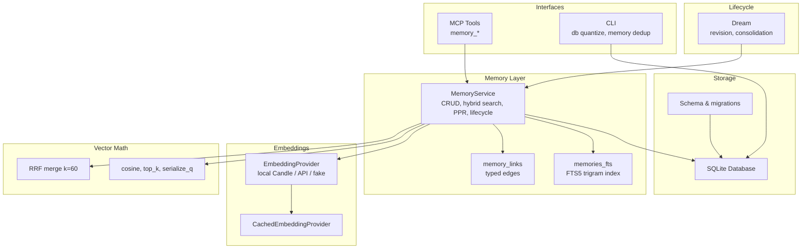
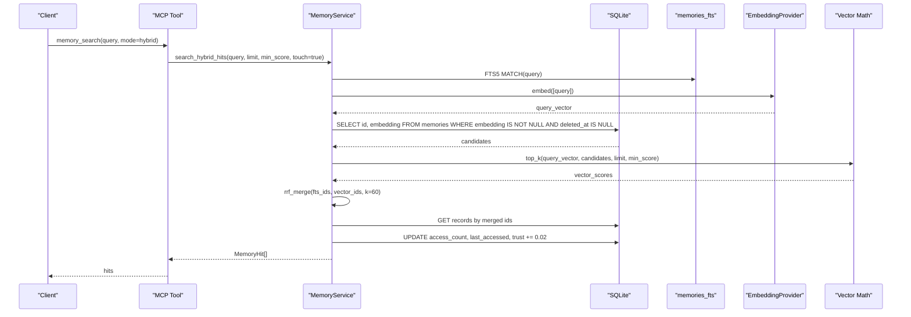
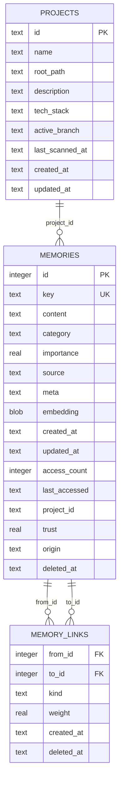
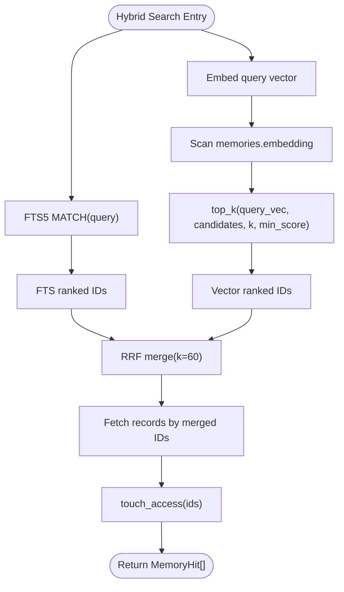
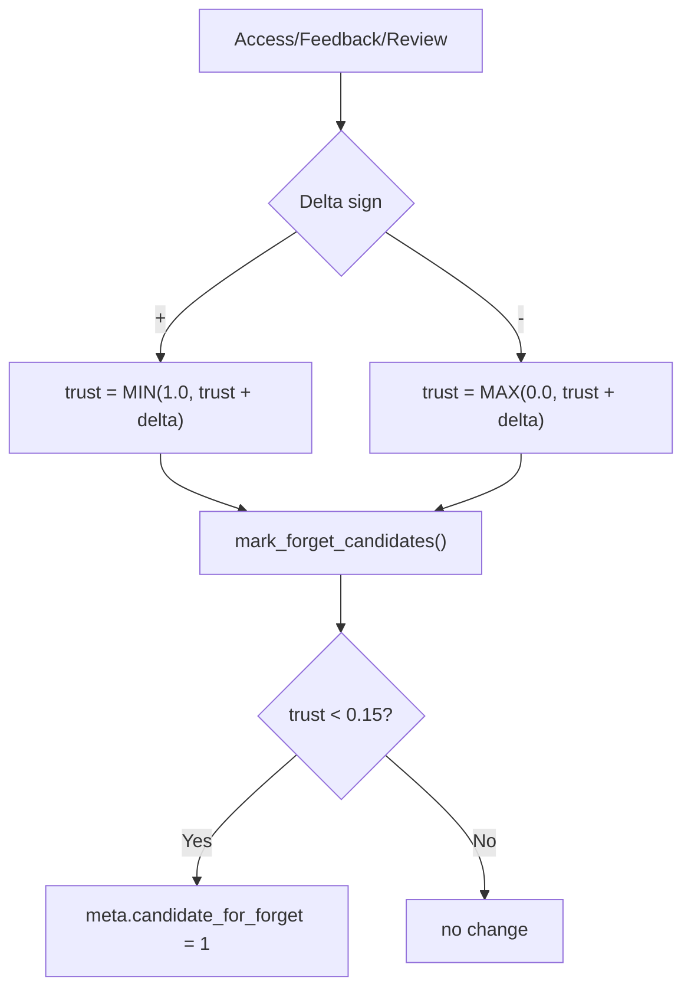
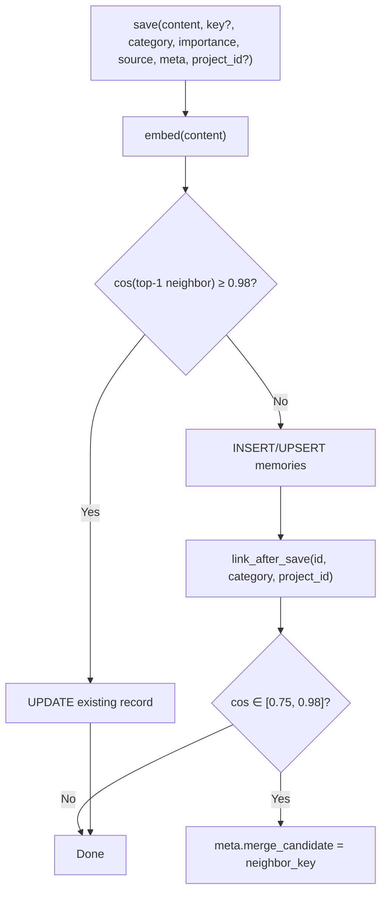
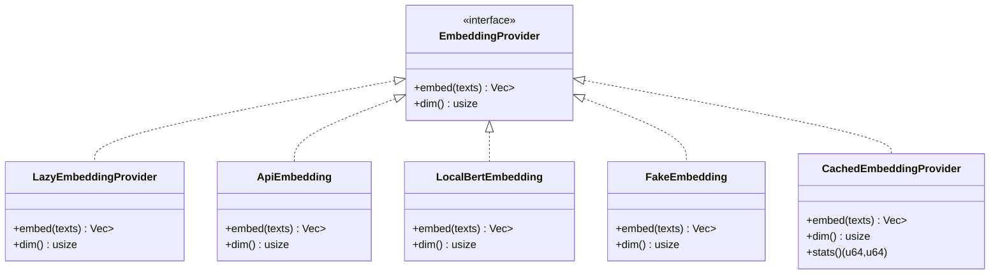
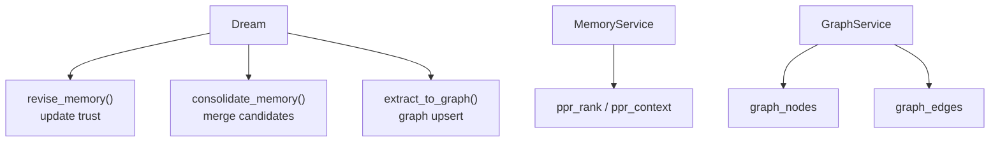
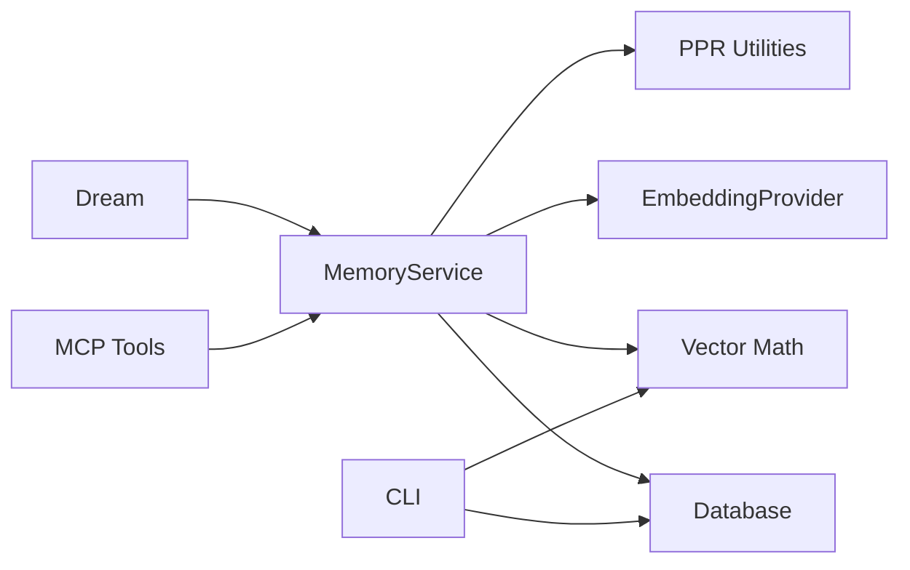

# Memory System

<cite>
**Referenced Files in This Document**
- [service.rs](file://src/memory/service.rs)
- [mod.rs](file://src/memory/mod.rs)
- [schema.rs](file://src/db/schema.rs)
- [models.rs](file://src/db/models.rs)
- [embedding_mod.rs](file://src/embedding/mod.rs)
- [vector_mod.rs](file://src/vector/mod.rs)
- [similarity.rs](file://src/vector/similarity.rs)
- [rrf.rs](file://src/vector/rrf.rs)
- [dream_mod.rs](file://src/dream/mod.rs)
- [tools.rs](file://src/mcp/tools.rs)
- [cli_db.rs](file://src/cli/db.rs)
- [cli_dedup.rs](file://src/cli/dedup.rs)
- [test_memory.rs](file://tests/test_memory.rs)
- [ADR_35.1_sqlite_vec.md](file://docs/ADR-35.1-sqlite-vec.md)
</cite>

## Table of Contents
1. [Introduction](#introduction)
2. [Project Structure](#project-structure)
3. [Core Components](#core-components)
4. [Architecture Overview](#architecture-overview)
5. [Detailed Component Analysis](#detailed-component-analysis)
6. [Dependency Analysis](#dependency-analysis)
7. [Performance Considerations](#performance-considerations)
8. [Troubleshooting Guide](#troubleshooting-guide)
9. [Conclusion](#conclusion)
10. [Appendices](#appendices)

## Introduction
This document explains the memory system sub-feature with a focus on persistent storage, hybrid search, lifecycle management, trust scoring, embedding providers, MCP tools and CLI usage, database schema, performance characteristics, and relationships to the dream system and knowledge graph. The memory subsystem provides long-term factual storage for an agent, combining SQLite FTS5 full-text search with vector embeddings for semantic similarity, and integrates with background consolidation (dream), graph reasoning, and lifecycle maintenance.

## Project Structure
The memory feature is implemented primarily under `src/memory`, backed by the shared SQLite schema and models in `src/db`, vector math utilities in `src/vector`, embedding providers in `src/embedding`, and exposed through MCP tools in `src/mcp`. Background lifecycle operations are coordinated by the dream system in `src/dream`.

**Diagram sources**
- [service.rs:30-38](file://src/memory/service.rs#L30-L38)
- [schema.rs:222-334](file://src/db/schema.rs#L222-L334)
- [embedding_mod.rs:31-38](file://src/embedding/mod.rs#L31-L38)
- [vector_mod.rs:1-9](file://src/vector/mod.rs#L1-L9)
- [dream_mod.rs:110-143](file://src/dream/mod.rs#L110-L143)
- [tools.rs:55-133](file://src/mcp/tools.rs#L55-L133)
- [cli_db.rs:1-13](file://src/cli/db.rs#L1-L13)
- [cli_dedup.rs:1-21](file://src/cli/dedup.rs#L1-L21)

**Section sources**
- [mod.rs:1-5](file://src/memory/mod.rs#L1-L5)
- [schema.rs:222-334](file://src/db/schema.rs#L222-L334)
- [embedding_mod.rs:210-239](file://src/embedding/mod.rs#L210-L239)
- [vector_mod.rs:1-9](file://src/vector/mod.rs#L1-L9)
- [dream_mod.rs:110-143](file://src/dream/mod.rs#L110-L143)
- [tools.rs:55-133](file://src/mcp/tools.rs#L55-L133)
- [cli_db.rs:1-13](file://src/cli/db.rs#L1-L13)
- [cli_dedup.rs:1-21](file://src/cli/dedup.rs#L1-L21)

## Core Components
- MemoryService: CRUD, hybrid search (FTS5 + vector RRF), trust feedback, decay, context building, PPR ranking, link management, tombstone-based deletion, and consolidation helpers.
- EmbeddingProvider abstraction: local Candle model, remote API, or fake provider; wrapped with a thread-safe LRU cache for query vectors.
- Vector math: cosine similarity, int8 quantized serialization, top-k brute-force search, and RRF merging.
- Dream integration: automated trust revision, consolidation of near-duplicates, and graph extraction from conversation history.
- MCP tools: user-facing operations for saving, searching, updating, forgetting, merging memories, and retrieving context.
- CLI utilities: embedding quantization migration and near-duplicate detection/reporting.

**Section sources**
- [service.rs:30-38](file://src/memory/service.rs#L30-L38)
- [embedding_mod.rs:31-38](file://src/embedding/mod.rs#L31-L38)
- [vector_mod.rs:1-9](file://src/vector/mod.rs#L1-L9)
- [dream_mod.rs:110-143](file://src/dream/mod.rs#L110-L143)
- [tools.rs:55-133](file://src/mcp/tools.rs#L55-L133)
- [cli_db.rs:1-13](file://src/cli/db.rs#L1-L13)
- [cli_dedup.rs:1-21](file://src/cli/dedup.rs#L1-L21)

## Architecture Overview
The memory system uses a dual-index approach:
- Full-text search via SQLite FTS5 trigram index over memory content.
- Semantic similarity via vector embeddings stored as BLOBs, computed by an EmbeddingProvider and searched with cosine similarity.

Hybrid search merges FTS5 and vector results using Reciprocal Rank Fusion (RRF) with k=60. Trust scoring evolves through usage feedback, agent feedback, and automated review cycles orchestrated by the dream system. Lifecycle management includes creation, soft-delete tombstones, decay, consolidation, deduplication, and archival.

**Diagram sources**
- [service.rs:489-636](file://src/memory/service.rs#L489-L636)
- [rrf.rs:13-50](file://src/vector/rrf.rs#L13-L50)
- [similarity.rs:99-126](file://src/vector/similarity.rs#L99-L126)
- [embedding_mod.rs:155-208](file://src/embedding/mod.rs#L155-L208)

## Detailed Component Analysis

### Persistent Storage and Schema
- Memories table stores key, content, category, importance, source, meta, embedding, timestamps, access counters, project linkage, trust, and tombstone fields.
- FTS5 virtual table indexes content with trigram tokenization and triggers keep it synchronized.
- memory_links table defines typed edges between memories (same_project, category, entity, manual, plus reserved kinds like contradicts/causes/supersedes).
- Additional tables support projects, documents/chunks, graph nodes/edges, lessons, slots, audit log, and sync state.

**Diagram sources**
- [schema.rs:222-334](file://src/db/schema.rs#L222-L334)
- [schema.rs:83-109](file://src/db/schema.rs#L83-L109)
- [schema.rs:30-67](file://src/db/schema.rs#L30-L67)

**Section sources**
- [schema.rs:222-334](file://src/db/schema.rs#L222-L334)
- [schema.rs:83-109](file://src/db/schema.rs#L83-L109)
- [schema.rs:30-67](file://src/db/schema.rs#L30-L67)
- [models.rs:18-33](file://src/db/models.rs#L18-L33)

### Dual-Indexing: FTS5 + Vector Embeddings
- FTS5 trigram index enables fast lexical matching; fallback to LIKE if needed.
- Vector embeddings are stored as BLOBs; legacy f32 format is supported alongside int8 quantized v2 format.
- Hybrid search merges FTS5 and vector rankings using RRF with k=60.
- Context building uses hybrid pool, scoring (relevance/importance/trust/recency/access), MMR diversification, and character budget trimming.

**Diagram sources**
- [service.rs:489-636](file://src/memory/service.rs#L489-L636)
- [rrf.rs:13-50](file://src/vector/rrf.rs#L13-L50)
- [similarity.rs:99-126](file://src/vector/similarity.rs#L99-L126)

**Section sources**
- [service.rs:489-636](file://src/memory/service.rs#L489-L636)
- [rrf.rs:13-50](file://src/vector/rrf.rs#L13-L50)
- [similarity.rs:99-126](file://src/vector/similarity.rs#L99-L126)

### Trust Scoring Algorithms
Trust reflects machine-evaluated reliability based on usage patterns, agent feedback, and automated review cycles:
- Usage feedback: each accessed record increments access_count, updates last_accessed, and increases trust by +0.02 (clamped to 1.0).
- Agent feedback: helpful (+0.15), unhelpful (-0.2), outdated (-0.3); recent feedback entries are retained up to 20.
- Automated review: dream system revises trust with confirmed (+0.1), outdated (-0.4), contradicted (-0.5).
- Decay: importance and trust decay multiplicatively; low-trust records are marked candidate_for_forget but not auto-deleted.
- Forget candidates: records with trust < 0.15 get a marker; actual deletion requires explicit forget or lifecycle purge.

**Diagram sources**
- [service.rs:665-681](file://src/memory/service.rs#L665-L681)
- [service.rs:683-738](file://src/memory/service.rs#L683-L738)
- [service.rs:740-757](file://src/memory/service.rs#L740-L757)
- [service.rs:806-837](file://src/memory/service.rs#L806-L837)
- [service.rs:912-925](file://src/memory/service.rs#L912-L925)

**Section sources**
- [service.rs:665-681](file://src/memory/service.rs#L665-L681)
- [service.rs:683-738](file://src/memory/service.rs#L683-L738)
- [service.rs:740-757](file://src/memory/service.rs#L740-L757)
- [service.rs:806-837](file://src/memory/service.rs#L806-L837)
- [service.rs:912-925](file://src/memory/service.rs#L912-L925)

### Lifecycle Management: Creation, Consolidation, Deduplication, Archival
- Creation: save generates deterministic keys when omitted, computes embeddings, performs cheap identity-duplicate check (cos ≥ 0.98 → quiet update), marks suspect duplicates (0.75–0.98) with merge_candidate, inserts/upserts record, and creates deterministic links (same_project/category).
- Consolidation: dream orchestrates offline consolidation, including LLM verdicts for merge candidates and compaction.
- Deduplication: CLI tool collects near-duplicate pairs via cosine similarity, proposes canonical keys, and optionally marks less trusted records with merge_candidate; actual merging requires explicit memory_merge.
- Archival: forget sets tombstone (deleted_at) and soft-deletes related links; periodic purge_tombstones removes old tombstones after retention window.

**Diagram sources**
- [service.rs:48-167](file://src/memory/service.rs#L48-L167)
- [service.rs:169-213](file://src/memory/service.rs#L169-L213)
- [service.rs:839-862](file://src/memory/service.rs#L839-L862)
- [cli_dedup.rs:43-135](file://src/cli/dedup.rs#L43-L135)

**Section sources**
- [service.rs:48-167](file://src/memory/service.rs#L48-L167)
- [service.rs:169-213](file://src/memory/service.rs#L169-L213)
- [service.rs:839-862](file://src/memory/service.rs#L839-L862)
- [cli_dedup.rs:43-135](file://src/cli/dedup.rs#L43-L135)

### Embedding Providers and Configuration
- Providers:
  - Local Candle model (lazy initialization, loads weights off main thread).
  - Remote API (base URL, API key, model name).
  - Fake provider (hash-like vectors for offline testing).
- Selection logic:
  - If settings.embed_provider == "api", use ApiEmbedding unless offline mode forces Fake.
  - Default path attempts local_bert; on failure falls back to API if configured, else Fake.
- Caching:
  - CachedEmbeddingProvider wraps any backend with an LRU cache keyed by normalized text (trim + lowercase).
  - Tracks hits/misses and enforces capacity defaults.

**Diagram sources**
- [embedding_mod.rs:31-38](file://src/embedding/mod.rs#L31-L38)
- [embedding_mod.rs:40-64](file://src/embedding/mod.rs#L40-L64)
- [embedding_mod.rs:66-107](file://src/embedding/mod.rs#L66-L107)
- [embedding_mod.rs:116-208](file://src/embedding/mod.rs#L116-L208)
- [embedding_mod.rs:210-239](file://src/embedding/mod.rs#L210-L239)

**Section sources**
- [embedding_mod.rs:31-38](file://src/embedding/mod.rs#L31-L38)
- [embedding_mod.rs:40-64](file://src/embedding/mod.rs#L40-L64)
- [embedding_mod.rs:66-107](file://src/embedding/mod.rs#L66-L107)
- [embedding_mod.rs:116-208](file://src/embedding/mod.rs#L116-L208)
- [embedding_mod.rs:210-239](file://src/embedding/mod.rs#L210-L239)

### MCP Tools and CLI Commands
- MCP tools:
  - memory_save: persist facts with optional key, category, importance, source, project_id.
  - memory_search: hybrid/fts/vector/graph modes; supports project filtering and related expansion.
  - memory_update: partial updates by key.
  - memory_forget: tombstone deletion with optional reason logged to audit.
  - memory_context: build `<agent_memory>` block with budgeted tokens/chars and author/project filters.
  - memory_feedback: adjust trust with helpful/unhelpful/outdated.
  - memory_merge: explicit merge of near-duplicates with canonical selection and link redirection.
- CLI commands:
  - ob2h db quantize-embeddings: migrate legacy f32 embeddings to int8 v2 format across tables.
  - ob2h memory dedup: report near-duplicate pairs and optionally mark merge candidates.

Examples:
- Save a fact: call memory_save with content="User prefers coffee without sugar", category="preferences", importance=0.9, source="chat".
- Search hybrid: call memory_search with query="coffee", mode="hybrid", limit=5.
- Build context: call memory_context with query="coffee", max_chars=8000, project_id optional.
- Quantize embeddings: run ob2h db quantize-embeddings [--dry-run].
- Detect duplicates: run ob2h memory dedup [--dry-run].

**Section sources**
- [tools.rs:55-133](file://src/mcp/tools.rs#L55-L133)
- [tools.rs:432-568](file://src/mcp/tools.rs#L432-L568)
- [cli_db.rs:15-91](file://src/cli/db.rs#L15-L91)
- [cli_dedup.rs:1-21](file://src/cli/dedup.rs#L1-L21)

### Relationships with Dream System and Knowledge Graph
- Dream system:
  - Revises memory trust based on minimal-trust records and recent conversation history.
  - Orchestrates consolidation of near-duplicates and may propose typed edges (contradicts/supersedes/causes).
  - Extracts entities/relations into the knowledge graph from conversation history.
- Knowledge graph:
  - Graph nodes and edges store structured knowledge; vec0 indexing is available opt-in for faster vector search on large graphs.
  - Memory PPR extends reasoning scope by ranking memories within the graph context.

**Diagram sources**
- [dream_mod.rs:418-543](file://src/dream/mod.rs#L418-L543)
- [dream_mod.rs:397-416](file://src/dream/mod.rs#L397-L416)
- [service.rs:1067-1309](file://src/memory/service.rs#L1067-L1309)

**Section sources**
- [dream_mod.rs:418-543](file://src/dream/mod.rs#L418-L543)
- [dream_mod.rs:397-416](file://src/dream/mod.rs#L397-L416)
- [service.rs:1067-1309](file://src/memory/service.rs#L1067-L1309)

## Dependency Analysis
- MemoryService depends on:
  - Database for persistence and queries.
  - EmbeddingProvider for vector generation.
  - Vector math utilities for cosine similarity, serialization, and RRF merging.
  - Graph pagerank utilities for PPR ranking over memory_links.
- EmbeddingProvider implementations depend on configuration and environment (offline/API/local).
- Dream depends on MemoryService for trust revision and consolidation.
- MCP tools depend on MemoryService for all memory operations.
- CLI tools depend on Database and vector utilities for maintenance tasks.

**Diagram sources**
- [service.rs:30-38](file://src/memory/service.rs#L30-L38)
- [embedding_mod.rs:210-239](file://src/embedding/mod.rs#L210-L239)
- [vector_mod.rs:1-9](file://src/vector/mod.rs#L1-L9)
- [dream_mod.rs:110-143](file://src/dream/mod.rs#L110-L143)
- [tools.rs:55-133](file://src/mcp/tools.rs#L55-L133)
- [cli_db.rs:1-13](file://src/cli/db.rs#L1-L13)

**Section sources**
- [service.rs:30-38](file://src/memory/service.rs#L30-L38)
- [embedding_mod.rs:210-239](file://src/embedding/mod.rs#L210-L239)
- [vector_mod.rs:1-9](file://src/vector/mod.rs#L1-L9)
- [dream_mod.rs:110-143](file://src/dream/mod.rs#L110-L143)
- [tools.rs:55-133](file://src/mcp/tools.rs#L55-L133)
- [cli_db.rs:1-13](file://src/cli/db.rs#L1-L13)

## Performance Considerations
- Embedding caching:
  - CachedEmbeddingProvider reduces repeated model calls with LRU cache keyed by normalized text; tracks hit/miss stats.
- Vector storage:
  - Int8 quantized v2 format (~4× smaller than f32) improves I/O and scan speed; legacy f32 still supported.
- Hybrid search:
  - FTS5 MATCH avoids full scans; vector search uses top_k over stored embeddings.
  - RRF merge with k=60 balances lexical and semantic relevance.
- Context building:
  - Uses hybrid pool, scoring components (relevance/importance/trust/recency/access), MMR diversification, and character budget trimming to fit prompt constraints.
- Large-scale vector search:
  - For graph nodes, vec0 indexing is opt-in and can accelerate vector scans; however, overall latency may be dominated by other stages (e.g., lexical scans).
- Maintenance:
  - Periodic VACUUM after bulk conversions; tombstone purging respects retention windows.

[No sources needed since this section provides general guidance]

## Troubleshooting Guide
- Empty content errors:
  - Saving empty content returns an error; ensure non-empty strings before calling save.
- Missing records:
  - get/forget operate on tombstoned rows; verify existence and status via memory_verify or audit_log.
- Feedback validation:
  - Invalid verdict values cause errors; use only helpful/unhelpful/outdated for agent feedback and confirmed/outdated/contradicted for dream revisions.
- Duplicate handling:
  - Near-duplicates are marked with merge_candidate; perform explicit memory_merge to consolidate.
- Embedding issues:
  - Offline mode forces fake embeddings; verify settings.embed_provider and OB2H_OFFLINE flag.
- Performance bottlenecks:
  - High latency in graph search may stem from lexical scans rather than vector scans; consider enabling vec0 opt-in and optimizing lexical indexing.

**Section sources**
- [service.rs:72-75](file://src/memory/service.rs#L72-L75)
- [service.rs:683-738](file://src/memory/service.rs#L683-L738)
- [service.rs:740-757](file://src/memory/service.rs#L740-L757)
- [cli_dedup.rs:137-176](file://src/cli/dedup.rs#L137-L176)
- [embedding_mod.rs:210-239](file://src/embedding/mod.rs#L210-L239)
- [ADR_35.1_sqlite_vec.md:59-84](file://docs/ADR-35.1-sqlite-vec.md#L59-L84)

## Conclusion
The memory system provides robust persistent storage with hybrid search, evolving trust scores, and comprehensive lifecycle management. It integrates tightly with the dream system for automated review and consolidation, exposes rich functionality via MCP tools, and offers CLI utilities for maintenance. With careful configuration of embedding providers, caching strategies, and vector formats, it achieves scalable performance while maintaining accuracy and governance through provenance and audit trails.

[No sources needed since this section summarizes without analyzing specific files]

## Appendices

### Example Operations Through MCP Tools and CLI
- Save a memory:
  - Call memory_save with content, category, importance, source, and optional project_id.
- Search hybrid:
  - Call memory_search with query, mode="hybrid", limit, and optional project_id.
- Build context:
  - Call memory_context with query, max_chars, author, and project_id.
- Provide feedback:
  - Call memory_feedback with key and verdict (helpful/unhelpful/outdated).
- Merge duplicates:
  - Call memory_merge with keys, optional canonical_key, and note.
- Quantize embeddings:
  - Run ob2h db quantize-embeddings [--dry-run].
- Detect duplicates:
  - Run ob2h memory dedup [--dry-run].

**Section sources**
- [tools.rs:55-133](file://src/mcp/tools.rs#L55-L133)
- [tools.rs:432-568](file://src/mcp/tools.rs#L432-L568)
- [cli_db.rs:15-91](file://src/cli/db.rs#L15-L91)
- [cli_dedup.rs:1-21](file://src/cli/dedup.rs#L1-L21)