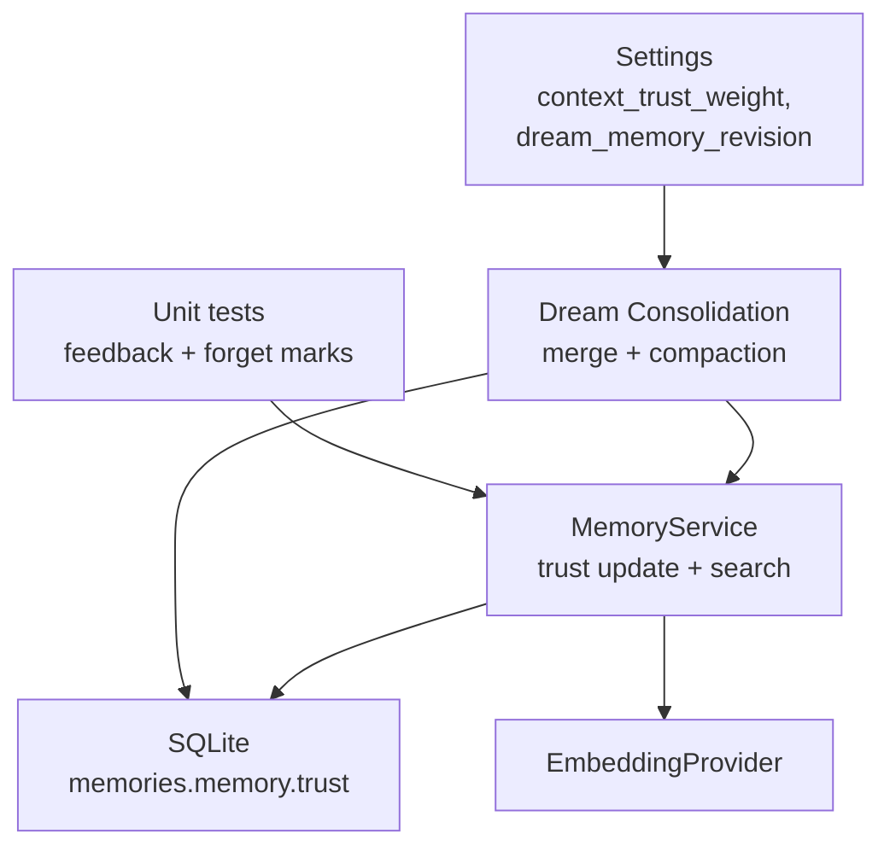
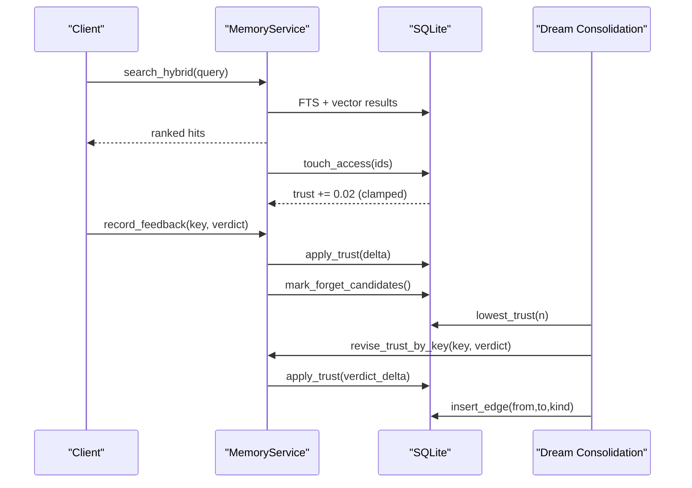
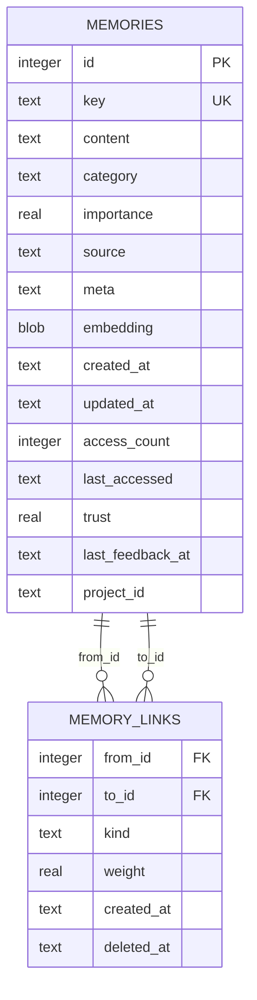
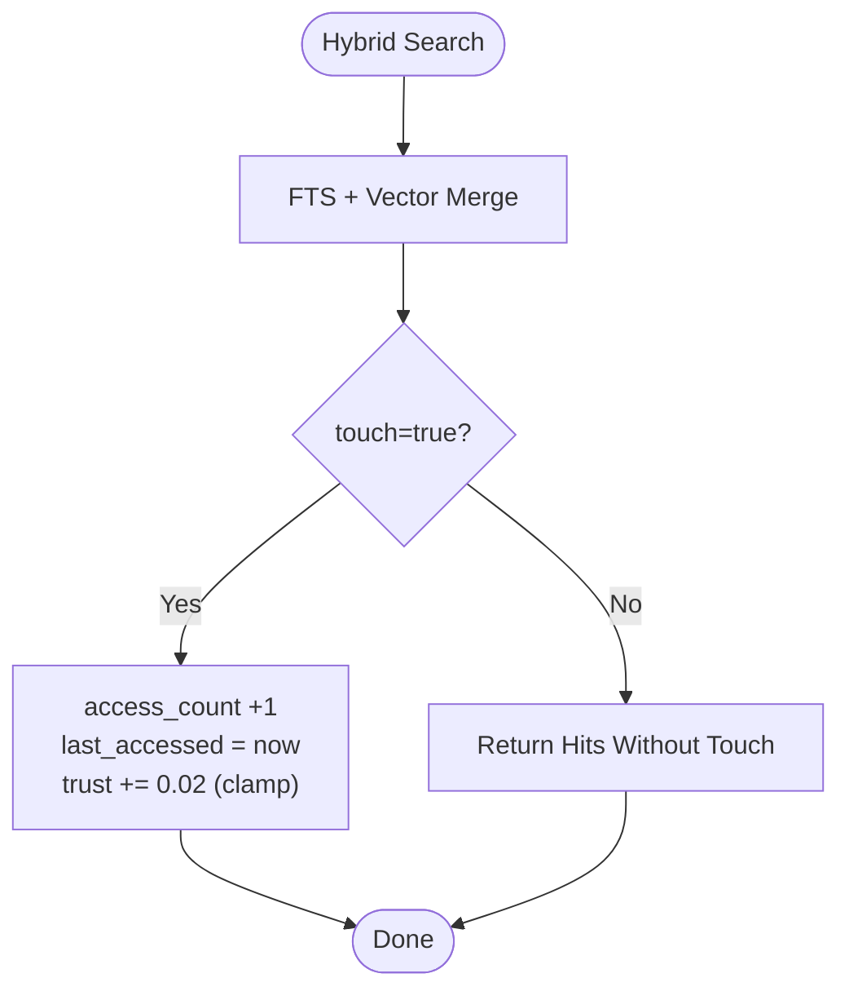
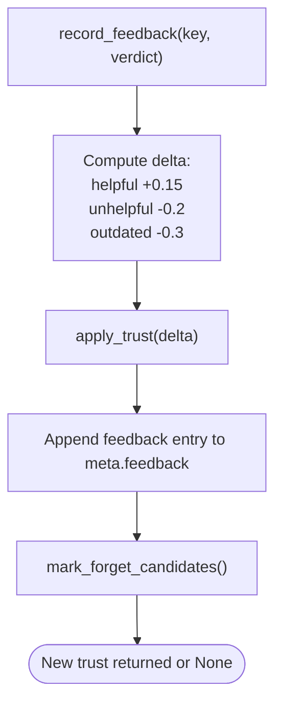
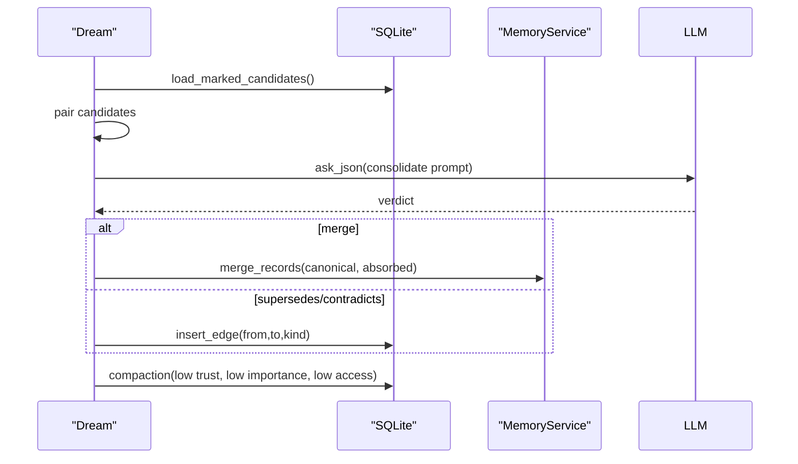
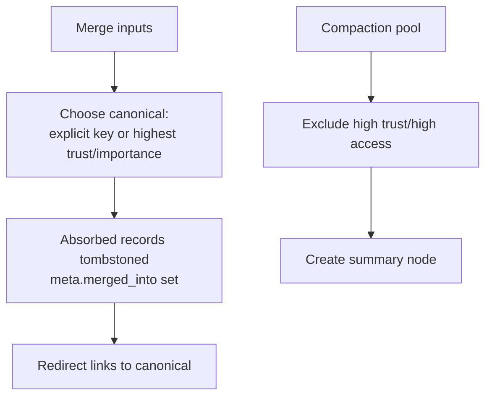
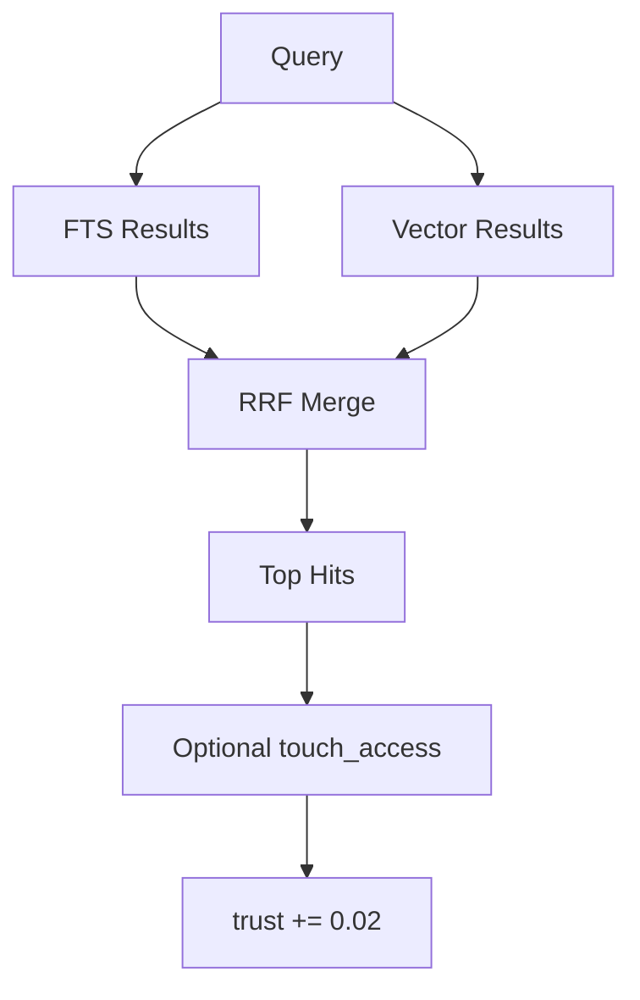
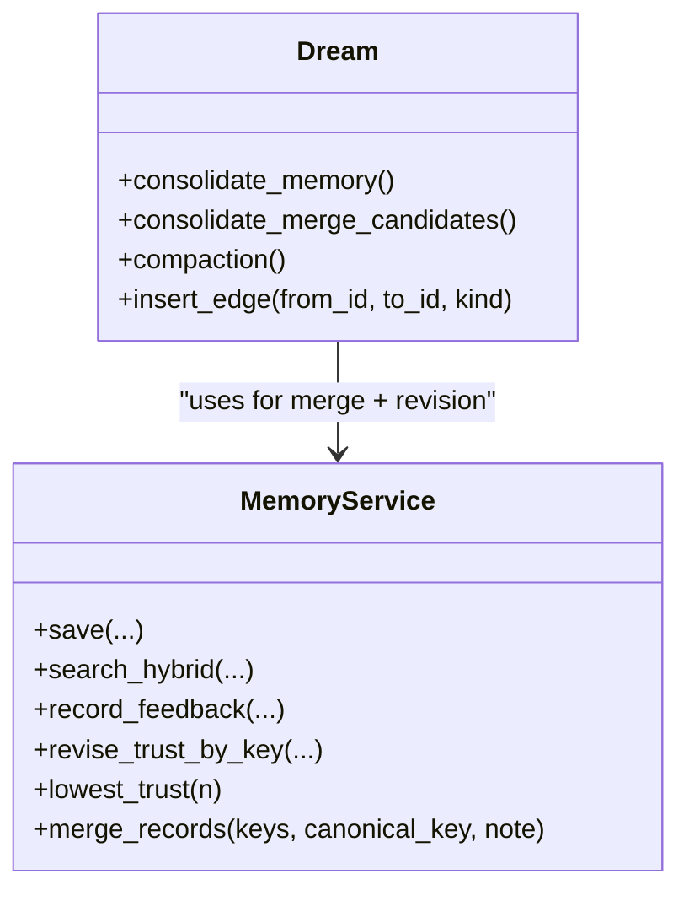
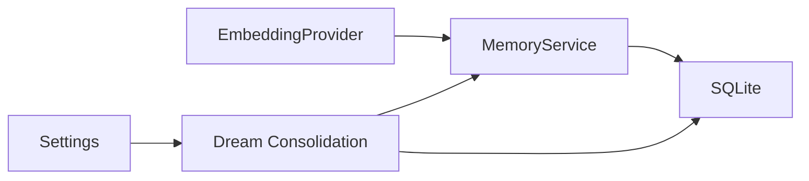

# Trust Scoring System

<cite>
**Referenced Files in This Document**   
- [service.rs](file://src/memory/service.rs)
- [consolidate.rs](file://src/dream/consolidate.rs)
- [schema.rs](file://src/db/schema.rs)
- [models.rs](file://src/db/models.rs)
- [config.rs](file://src/config.rs)
- [test_trust.rs](file://tests/test_trust.rs)
</cite>

## Table of Contents
1. [Introduction](#introduction)
2. [Project Structure](#project-structure)
3. [Core Components](#core-components)
4. [Architecture Overview](#architecture-overview)
5. [Detailed Component Analysis](#detailed-component-analysis)
6. [Dependency Analysis](#dependency-analysis)
7. [Performance Considerations](#performance-considerations)
8. [Troubleshooting Guide](#troubleshooting-guide)
9. [Conclusion](#conclusion)

## Introduction
This document explains the trust scoring system that evaluates memory relevance and reliability. It covers how trust is computed, updated, and consumed across memory operations, search ranking, consolidation, and lifecycle decisions. The system combines usage frequency, agent feedback, automated review cycles, recency signals, provenance metadata, and dream-driven consolidation into a bounded trust value used by multiple subsystems.

## Project Structure
The trust scoring system spans several modules:
- Memory service: stores, updates, and consumes trust during save, search, feedback, revision, and forget operations.
- Dream consolidation: uses trust to select candidates for merge review, compaction, and summary creation.
- Database schema: defines the trust column and related indexes.
- Configuration: exposes environment variables that influence context scoring and dream behavior.
- Tests: validate trust clamping, candidate-for-forget marking, ordering, and link cascades.

**Diagram sources**
- [service.rs:30-38](file://src/memory/service.rs#L30-L38)
- [consolidate.rs:68-85](file://src/dream/consolidate.rs#L68-L85)
- [schema.rs:83-102](file://src/db/schema.rs#L83-L102)
- [config.rs:47-50](file://src/config.rs#L47-L50)
- [test_trust.rs:16-44](file://tests/test_trust.rs#L16-L44)

**Section sources**
- [service.rs:30-38](file://src/memory/service.rs#L30-L38)
- [consolidate.rs:68-85](file://src/dream/consolidate.rs#L68-L85)
- [schema.rs:83-102](file://src/db/schema.rs#L83-L102)
- [config.rs:47-50](file://src/config.rs#L47-L50)
- [test_trust.rs:16-44](file://tests/test_trust.rs#L16-L44)

## Core Components
- MemoryService: owns trust mutation and consumption. It increments trust on access, applies feedback deltas, supports automated revision verdicts, and marks low-trust records as forget candidates without deleting them.
- Dream consolidation: selects low-trust memories for LLM-assisted merge decisions and compaction into summaries; it excludes high-trust and high-access records from compaction.
- Schema: persists trust with default 0.5 and an index for efficient queries.
- Settings: controls whether dream memory revision runs and how much trust influences prefetch/context scoring.

Key responsibilities:
- Compute trust deltas from usage and feedback.
- Clamp trust to [0, 1].
- Mark candidates for forget when trust falls below threshold.
- Use trust in consolidation selection and merge canonical choice.
- Expose configuration for tuning context scoring and dream revision.

**Section sources**
- [service.rs:665-681](file://src/memory/service.rs#L665-L681)
- [service.rs:683-738](file://src/memory/service.rs#L683-L738)
- [service.rs:740-757](file://src/memory/service.rs#L740-L757)
- [consolidate.rs:33-38](file://src/dream/consolidate.rs#L33-L38)
- [schema.rs:83-102](file://src/db/schema.rs#L83-L102)
- [config.rs:47-50](file://src/config.rs#L47-L50)

## Architecture Overview
Trust flows through three main paths:
1. Access path: hybrid search increments access_count and slightly increases trust.
2. Feedback path: explicit helpful/unhelpful/outdated feedback adjusts trust and records history.
3. Automated review path: dream revision applies verdict-based deltas and typed edges.

**Diagram sources**
- [service.rs:576-636](file://src/memory/service.rs#L576-L636)
- [service.rs:665-681](file://src/memory/service.rs#L665-L681)
- [service.rs:683-738](file://src/memory/service.rs#L683-L738)
- [service.rs:740-757](file://src/memory/service.rs#L740-L757)
- [consolidate.rs:192-231](file://src/dream/consolidate.rs#L192-L231)

## Detailed Component Analysis

### Trust Data Model and Persistence
- The `memories` table includes a `trust` REAL column with default 0.5 and an index for efficient ordering.
- Related fields include `access_count`, `last_accessed`, and `last_feedback_at`.
- Meta JSON stores feedback history and markers such as `candidate_for_forget`.

**Diagram sources**
- [schema.rs:222-238](file://src/db/schema.rs#L222-L238)
- [schema.rs:83-102](file://src/db/schema.rs#L83-L102)
- [schema.rs:104-109](file://src/db/schema.rs#L104-L109)

**Section sources**
- [schema.rs:83-102](file://src/db/schema.rs#L83-L102)
- [schema.rs:104-109](file://src/db/schema.rs#L104-L109)
- [models.rs:18-33](file://src/db/models.rs#L18-L33)

### Usage Frequency and Recency Bias
- Hybrid search touches matched records, incrementing `access_count` and increasing trust by a small delta.
- Recency bias is reflected via `last_accessed` and `access_count`; these are used indirectly by consolidation thresholds and future weighting strategies.

**Diagram sources**
- [service.rs:576-636](file://src/memory/service.rs#L576-L636)
- [service.rs:665-681](file://src/memory/service.rs#L665-L681)

**Section sources**
- [service.rs:576-636](file://src/memory/service.rs#L576-L636)
- [service.rs:665-681](file://src/memory/service.rs#L665-L681)

### Agent Feedback and Provenance Verification
- Explicit feedback applies fixed deltas:
  - helpful: +0.15
  - unhelpful: −0.2
  - outdated: −0.3
- Feedback entries are stored in `meta.feedback` with timestamps and optional notes.
- Automated review verdicts adjust trust differently:
  - confirmed: +0.1
  - outdated: −0.4
  - contradicted: −0.5
- These verdicts also create typed edges between related memories.

**Diagram sources**
- [service.rs:683-738](file://src/memory/service.rs#L683-L738)
- [service.rs:790-800](file://src/memory/service.rs#L790-L800)

**Section sources**
- [service.rs:683-738](file://src/memory/service.rs#L683-L738)
- [service.rs:740-757](file://src/memory/service.rs#L740-L757)
- [service.rs:790-800](file://src/memory/service.rs#L790-L800)

### Automated Review Cycles and Dream Consolidation
- Dream consolidation selects low-trust records for merge review and compaction:
  - Merge candidates are paired and sent to LLM for verdicts.
  - Compaction clusters low-trust, low-importance, and low-access records to produce summaries.
  - High-trust and high-access records are excluded from compaction.
- Automated review verdicts update trust and may create typed edges (`contradicts`, `supersedes`).

**Diagram sources**
- [consolidate.rs:87-190](file://src/dream/consolidate.rs#L87-L190)
- [consolidate.rs:250-336](file://src/dream/consolidate.rs#L250-L336)
- [consolidate.rs:192-231](file://src/dream/consolidate.rs#L192-L231)

**Section sources**
- [consolidate.rs:33-38](file://src/dream/consolidate.rs#L33-L38)
- [consolidate.rs:87-190](file://src/dream/consolidate.rs#L87-L190)
- [consolidate.rs:250-336](file://src/dream/consolidate.rs#L250-L336)

### Influence on Memory Consolidation Decisions
- Canonical selection in merge prefers higher trust when no explicit canonical key is provided.
- Compaction avoids high-trust records (threshold defined as constant).
- Low-trust records become candidates for forget marking but are not auto-deleted.

**Diagram sources**
- [service.rs:215-335](file://src/memory/service.rs#L215-L335)
- [consolidate.rs:250-336](file://src/dream/consolidate.rs#L250-L336)

**Section sources**
- [service.rs:215-335](file://src/memory/service.rs#L215-L335)
- [consolidate.rs:250-336](file://src/dream/consolidate.rs#L250-L336)

### Influence on Search Result Ranking
- Hybrid search merges FTS and vector results using reciprocal rank fusion.
- While hybrid ranking itself does not directly multiply by trust, trust affects downstream lifecycle:
  - Frequent access increases trust.
  - Feedback and automated review adjust trust.
  - Low-trust records are marked for forget and excluded from compaction.
- Context prefetch can optionally weigh trust based on configuration.

**Diagram sources**
- [service.rs:576-636](file://src/memory/service.rs#L576-L636)
- [service.rs:665-681](file://src/memory/service.rs#L665-L681)

**Section sources**
- [service.rs:576-636](file://src/memory/service.rs#L576-L636)
- [service.rs:665-681](file://src/memory/service.rs#L665-L681)
- [config.rs:47-50](file://src/config.rs#L47-L50)

### Relationship Between Trust Scores and the Dream System’s Consolidation Process
- Dream consolidation uses trust to:
  - Select merge candidates and decide canonical records.
  - Exclude high-trust records from compaction.
  - Order lowest-trust records for automated review.
- Automated review verdicts feed back into trust and create typed edges for conflict resolution.

**Diagram sources**
- [consolidate.rs:68-85](file://src/dream/consolidate.rs#L68-L85)
- [consolidate.rs:87-190](file://src/dream/consolidate.rs#L87-L190)
- [service.rs:215-335](file://src/memory/service.rs#L215-L335)
- [service.rs:740-757](file://src/memory/service.rs#L740-L757)

**Section sources**
- [consolidate.rs:68-85](file://src/dream/consolidate.rs#L68-L85)
- [consolidate.rs:87-190](file://src/dream/consolidate.rs#L87-L190)
- [service.rs:215-335](file://src/memory/service.rs#L215-L335)
- [service.rs:740-757](file://src/memory/service.rs#L740-L757)

### Examples of Trust Score Calculations and Lifecycle Impact
- Example 1: Initial trust 0.5 receives helpful feedback → new trust 0.65; repeated helpful feedback clamps at 1.0.
- Example 2: Two outdated feedbacks reduce trust to 0; record becomes `candidate_for_forget` but remains readable.
- Example 3: Contradicted revision lowers trust; record appears in lowest-trust ordering for automated review.

These behaviors are validated by unit tests covering clamping, forget marking, and ordering.

**Section sources**
- [test_trust.rs:16-44](file://tests/test_trust.rs#L16-L44)
- [test_trust.rs:46-67](file://tests/test_trust.rs#L46-L67)
- [test_trust.rs:69-86](file://tests/test_trust.rs#L69-L86)

### Configuration Options for Tuning Scoring Weights and Thresholds
- `OB2H_CONTEXT_TRUST_WEIGHT`: Controls trust contribution to context/prefetch scoring; default off to avoid recall degradation on young trust statistics.
- `OB2H_DREAM_MEMORY_REVISION`: Enables automated memory revision that applies verdict-based trust deltas.
- `OB2H_DREAM_BELIEF`: Allows belief-derivation lite to propose typed edges; disabled by default.
- Constants in consolidation code define thresholds:
  - High-trust exclusion for compaction.
  - High-access exclusion for compaction.
  - Compaction interval throttling.

Note: Current implementation uses fixed deltas and thresholds; weights are not exposed as runtime parameters beyond context trust weighting and dream feature flags.

**Section sources**
- [config.rs:47-50](file://src/config.rs#L47-L50)
- [config.rs:247-264](file://src/config.rs#L247-L264)
- [consolidate.rs:33-38](file://src/dream/consolidate.rs#L33-L38)

## Dependency Analysis
Trust depends on:
- Database persistence for trust values and feedback history.
- Embedding provider for identity-duplicate detection and suspect marking during save.
- Dream consolidation for automated review and typed edges.
- Settings for enabling dream revision and context trust weighting.

**Diagram sources**
- [config.rs:47-50](file://src/config.rs#L47-L50)
- [service.rs:30-38](file://src/memory/service.rs#L30-L38)
- [consolidate.rs:68-85](file://src/dream/consolidate.rs#L68-L85)

**Section sources**
- [config.rs:47-50](file://src/config.rs#L47-L50)
- [service.rs:30-38](file://src/memory/service.rs#L30-L38)
- [consolidate.rs:68-85](file://src/dream/consolidate.rs#L68-L85)

## Performance Considerations
- Trust updates are lightweight SQL operations with minimal overhead.
- Hybrid search touches only top hits when enabled; batching reduces write amplification.
- Feedback appends to meta JSON array capped at recent entries to limit growth.
- Compaction is throttled to once per configured interval and excludes high-trust/high-access records to minimize LLM calls.
- Context trust weighting is off by default due to benchmark findings indicating recall trade-offs on young trust statistics.

[No sources needed since this section provides general guidance]

## Troubleshooting Guide
Common issues and diagnostics:
- Trust not increasing after search: verify `touch_access` is invoked for explicit searches; check logs around hybrid search and DB updates.
- Feedback not affecting trust: ensure valid verdicts are used; inspect `meta.feedback` for appended entries.
- Low-trust records not marked for forget: confirm trust fell below threshold and `mark_forget_candidates` ran; inspect meta for marker.
- Dream revision not running: check `OB2H_DREAM_MEMORY_REVISION` setting; verify dream status and stats.
- Compaction not creating summaries: ensure compaction interval elapsed and records meet low-trust/low-importance/low-access criteria; check logs for LLM failures.

Use these checks to isolate whether trust computation, persistence, or dream automation is the bottleneck.

**Section sources**
- [service.rs:665-681](file://src/memory/service.rs#L665-L681)
- [service.rs:683-738](file://src/memory/service.rs#L683-L738)
- [consolidate.rs:250-336](file://src/dream/consolidate.rs#L250-L336)
- [config.rs:247-264](file://src/config.rs#L247-L264)

## Conclusion
The trust scoring system integrates usage frequency, agent feedback, and automated review to maintain a reliable measure of memory credibility. It influences consolidation decisions, lifecycle marking, and contextual scoring while preserving non-destructive semantics. Configuration allows tuning context trust weighting and enabling dream revision, while fixed thresholds and deltas provide stable behavior. Debugging focuses on access touches, feedback application, dream automation flags, and compaction eligibility.