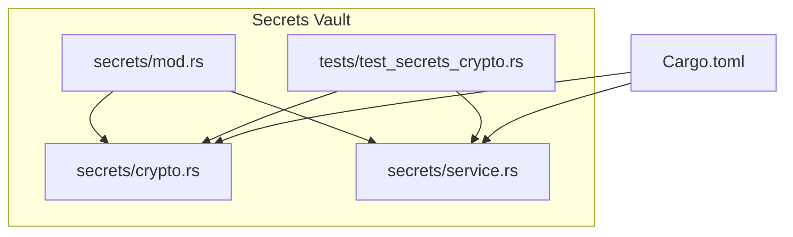
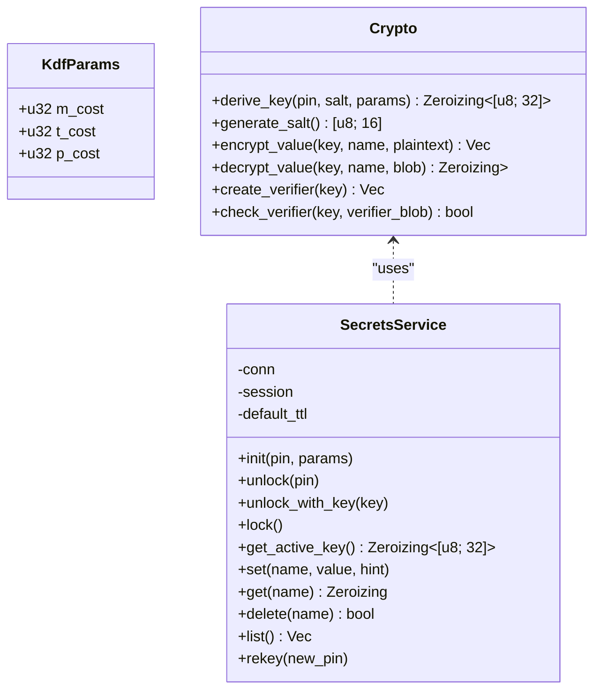
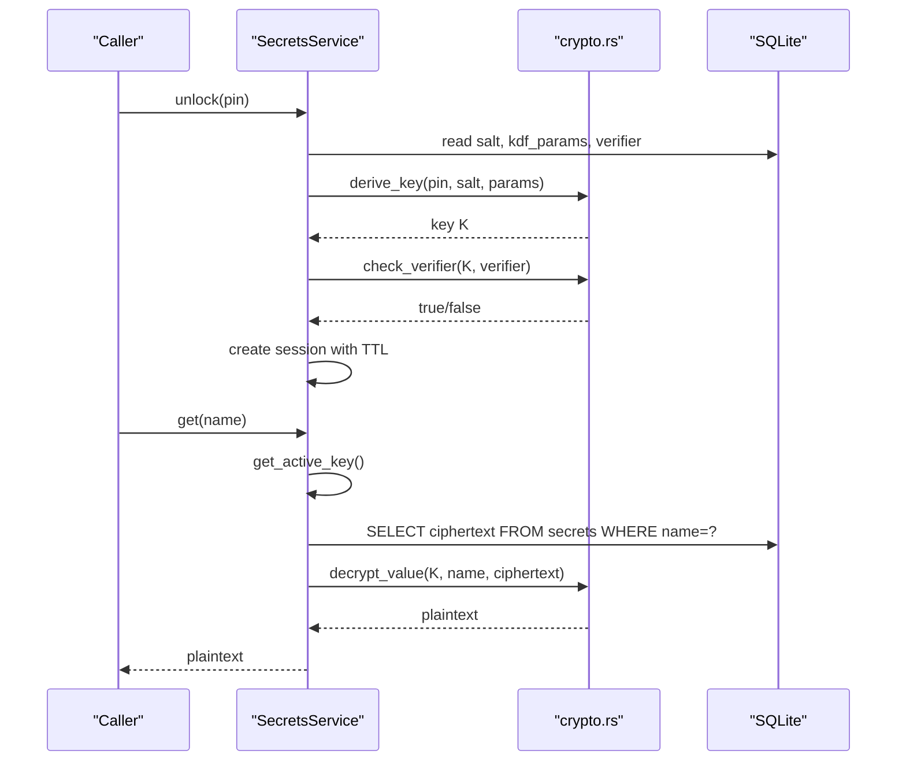
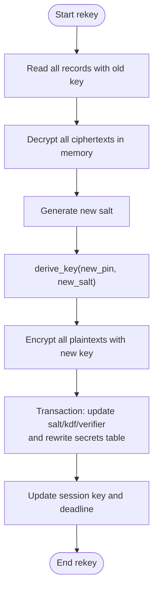
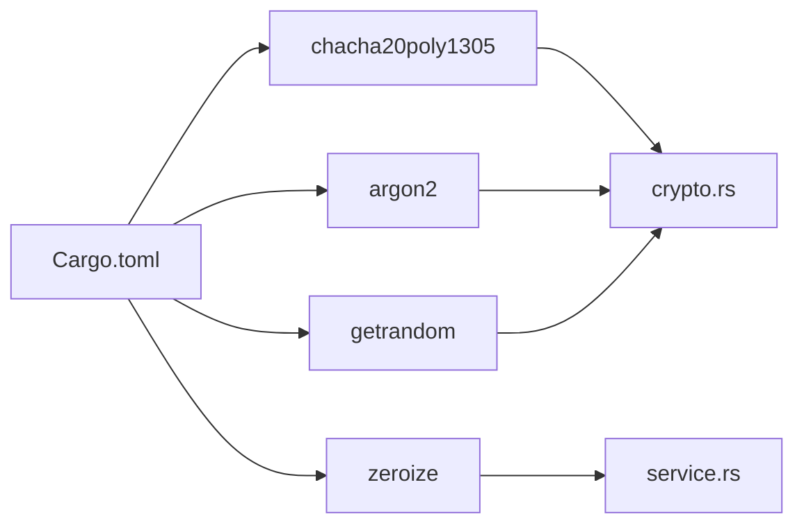

# Cryptographic Operations

<cite>
**Referenced Files in This Document**
- [crypto.rs](file://src/secrets/crypto.rs)
- [service.rs](file://src/secrets/service.rs)
- [mod.rs](file://src/secrets/mod.rs)
- [test_secrets_crypto.rs](file://tests/test_secrets_crypto.rs)
- [Cargo.toml](file://Cargo.toml)
</cite>

## Table of Contents
1. [Introduction](#introduction)
2. [Project Structure](#project-structure)
3. [Core Components](#core-components)
4. [Architecture Overview](#architecture-overview)
5. [Detailed Component Analysis](#detailed-component-analysis)
6. [Dependency Analysis](#dependency-analysis)
7. [Performance Considerations](#performance-considerations)
8. [Troubleshooting Guide](#troubleshooting-guide)
9. [Conclusion](#conclusion)

## Introduction
This document explains the cryptographic operations used by the secrets vault to protect secret data at rest and in use. It focuses on:
- XChaCha20-Poly1305 encryption for secret values
- Argon2id key derivation function (KDF) configuration
- Salt generation and uniqueness guarantees
- Nonce management and replay protection
- Key zeroization and memory cleanup
- Encryption/decryption workflows with code references
- Performance characteristics of different cryptographic parameters

The implementation is written in Rust and uses well-known, audited crates for cryptography and secure memory handling.

## Project Structure
The secrets vault is implemented under the secrets module. The core cryptographic primitives are isolated in a dedicated file, while the service layer manages lifecycle, persistence, and session state. Tests validate correctness and error behavior.

**Diagram sources**
- [mod.rs:1-15](file://src/secrets/mod.rs#L1-L15)
- [crypto.rs:1-168](file://src/secrets/crypto.rs#L1-L168)
- [service.rs:1-446](file://src/secrets/service.rs#L1-L446)
- [test_secrets_crypto.rs:1-131](file://tests/test_secrets_crypto.rs#L1-L131)
- [Cargo.toml:43-46](file://Cargo.toml#L43-L46)

**Section sources**
- [mod.rs:1-15](file://src/secrets/mod.rs#L1-L15)
- [Cargo.toml:43-46](file://Cargo.toml#L43-L46)

## Core Components
- KDF parameters and Argon2id-based master key derivation
- Random salt generation
- XChaCha20-Poly1305 AEAD encryption/decryption with name-bound AAD
- Verifier creation/checking for PIN validation
- SecretsService managing initialization, unlock/lock, TTL, and CRUD operations over encrypted records

Key responsibilities:
- crypto.rs: Implements all cryptographic primitives and constants.
- service.rs: Orchestrates KDF, encryption, storage, session TTL, and rekeying.
- tests: Validate round-trip encryption, AAD binding, wrong-key rejection, corruption detection, and service lifecycle.

**Section sources**
- [crypto.rs:13-111](file://src/secrets/crypto.rs#L13-L111)
- [service.rs:18-47](file://src/secrets/service.rs#L18-L47)
- [test_secrets_crypto.rs:7-38](file://tests/test_secrets_crypto.rs#L7-L38)

## Architecture Overview
The secrets vault architecture separates cryptographic primitives from service logic:

**Diagram sources**
- [crypto.rs:13-111](file://src/secrets/crypto.rs#L13-L111)
- [service.rs:18-47](file://src/secrets/service.rs#L18-L47)

## Detailed Component Analysis

### Argon2id Key Derivation Function (KDF)
- Purpose: Derive a 32-byte master key K from a user-provided PIN and a random salt using Argon2id.
- Configuration:
  - Memory cost (m_cost): default 65536 KiB (64 MiB)
  - Time cost (t_cost): default 3 iterations
  - Parallelism (p_cost): default 1 thread
- Output: Securely wrapped 32-byte key via Zeroizing to ensure automatic zeroization when dropped.

Security notes:
- Using Argon2id provides resistance against both side-channel and GPU/ASIC attacks.
- The salt ensures that identical PINs produce distinct keys.

Operational flow:
- During init, a new salt is generated and stored alongside serialized KDF parameters.
- On unlock, the stored salt and parameters are used to derive K and verify it against a verifier blob.

**Section sources**
- [crypto.rs:13-44](file://src/secrets/crypto.rs#L13-L44)
- [service.rs:71-111](file://src/secrets/service.rs#L71-L111)
- [service.rs:118-164](file://src/secrets/service.rs#L118-L164)

### Salt Generation and Uniqueness
- Implementation: Cryptographically secure random 16-byte salt via getrandom.
- Storage: Hex-encoded salt persisted in the database during initialization.
- Uniqueness: Each initialization generates a fresh salt, ensuring that even if two users choose the same PIN, their derived keys differ.

Impact:
- Prevents precomputation attacks across users.
- Ensures independent security per vault instance.

**Section sources**
- [crypto.rs:46-52](file://src/secrets/crypto.rs#L46-L52)
- [service.rs:80-107](file://src/secrets/service.rs#L80-L107)

### XChaCha20-Poly1305 Encryption and Decryption
- Algorithm: XChaCha20-Poly1305 AEAD for confidentiality and integrity.
- Nonce: 24-byte random nonce generated per encryption; prepended to ciphertext.
- AAD Binding: Secret name is bound as Additional Authenticated Data (AAD). Any mismatch causes decryption failure.
- Output format: nonce || ciphertext||tag.

Encryption workflow:
1. Initialize cipher with master key K.
2. Generate random nonce.
3. Encrypt plaintext with AAD set to secret name.
4. Prepend nonce to ciphertext and return.

Decryption workflow:
1. Split input into nonce and ciphertext.
2. Initialize cipher with master key K.
3. Decrypt with AAD set to secret name.
4. Return plaintext wrapped in Zeroizing.

Security properties:
- Replay protection: Random nonces prevent reuse; combined with AAD binding, this thwarts substitution and replay attacks.
- Integrity: AEAD tag validates ciphertext and AAD integrity.

**Section sources**
- [crypto.rs:54-98](file://src/secrets/crypto.rs#L54-L98)
- [test_secrets_crypto.rs:7-38](file://tests/test_secrets_crypto.rs#L7-L38)

### Verifier Creation and Check
- Purpose: Verify PIN correctness without exposing the master key.
- Mechanism: Encrypt a known magic string with a reserved AAD using the derived key; store the result. Unlock derives K and checks whether decrypting the stored verifier yields the expected magic.

Behavior:
- check_verifier returns true only if decryption succeeds and matches the magic.
- Wrong PIN leads to decryption failure or mismatched plaintext.

**Section sources**
- [crypto.rs:100-111](file://src/secrets/crypto.rs#L100-L111)
- [service.rs:149-152](file://src/secrets/service.rs#L149-L152)

### Session Management, TTL, and Locking
- Master key K is held in memory within an unlocked session object, wrapped in Zeroizing.
- TTL: Each unlock sets a deadline; active access refreshes the deadline. If expired, the session is cleared.
- Locking: Explicit lock clears the session immediately.

Memory safety:
- Zeroizing ensures sensitive buffers are overwritten before deallocation.
- Service methods require an active session; otherwise, they fail fast.

**Section sources**
- [service.rs:37-47](file://src/secrets/service.rs#L37-L47)
- [service.rs:178-203](file://src/secrets/service.rs#L178-L203)

### Secrets CRUD and Rekeying
- Set: Encrypts the value with name-bound AAD and stores it in the database.
- Get: Retrieves ciphertext, decrypts with name-bound AAD, updates access metadata.
- Delete: Removes the record.
- List: Returns metadata without exposing values.
- Rekey: Decrypts all records with the old key, re-encrypts with a new key derived from a new PIN and salt, atomically updates DB entries, and refreshes the session.

Atomicity and consistency:
- Rekey performs reads in memory, then writes in a single transaction to avoid partial states.

**Section sources**
- [service.rs:266-358](file://src/secrets/service.rs#L266-L358)
- [service.rs:360-444](file://src/secrets/service.rs#L360-L444)

### Code Examples (References)
- Derive key from PIN and salt: [crypto.rs:34-44](file://src/secrets/crypto.rs#L34-L44)
- Generate salt: [crypto.rs:46-52](file://src/secrets/crypto.rs#L46-L52)
- Encrypt secret value: [crypto.rs:54-75](file://src/secrets/crypto.rs#L54-L75)
- Decrypt secret value: [crypto.rs:77-98](file://src/secrets/crypto.rs#L77-L98)
- Create/check verifier: [crypto.rs:100-111](file://src/secrets/crypto.rs#L100-L111)
- Service init/unlock/set/get/delete/list/rekey: [service.rs:71-444](file://src/secrets/service.rs#L71-L444)
- Test roundtrip and error cases: [test_secrets_crypto.rs:7-38](file://tests/test_secrets_crypto.rs#L7-L38)

### Sequence Diagram: Unlock and Retrieve a Secret

**Diagram sources**
- [service.rs:118-164](file://src/secrets/service.rs#L118-L164)
- [service.rs:185-203](file://src/secrets/service.rs#L185-L203)
- [service.rs:291-322](file://src/secrets/service.rs#L291-L322)
- [crypto.rs:34-44](file://src/secrets/crypto.rs#L34-L44)
- [crypto.rs:77-98](file://src/secrets/crypto.rs#L77-L98)

### Flowchart: Rekey Workflow

**Diagram sources**
- [service.rs:360-444](file://src/secrets/service.rs#L360-L444)

## Dependency Analysis
External dependencies relevant to cryptography:
- argon2: Argon2id KDF implementation
- chacha20poly1305: XChaCha20-Poly1305 AEAD
- zeroize: Secure memory zeroization
- getrandom: Cryptographically secure random number generator

These are declared in the project manifest and imported by the cryptographic modules.

**Diagram sources**
- [Cargo.toml:43-46](file://Cargo.toml#L43-L46)
- [crypto.rs:1-8](file://src/secrets/crypto.rs#L1-L8)
- [service.rs:1-10](file://src/secrets/service.rs#L1-L10)

**Section sources**
- [Cargo.toml:43-46](file://Cargo.toml#L43-L46)

## Performance Considerations
Argon2id parameters directly impact performance and security:
- m_cost (memory usage in KiB): Higher values increase RAM consumption and resistance to hardware attacks. Default 65536 KiB (64 MiB) balances security and usability.
- t_cost (iterations): More iterations increase CPU time. Default 3 provides reasonable delay.
- p_cost (parallelism): Threads/workers; default 1 keeps resource usage predictable.

Observed behaviors:
- Initialization and unlock involve KDF computation; higher parameters increase latency.
- Encryption/decryption overhead is minimal compared to KDF; AEAD operations are efficient.

Recommendations:
- For interactive CLI usage, keep defaults or slightly reduce m_cost/t_cost for faster UX on constrained devices.
- For server-side or batch operations, consider increasing m_cost/t_cost to raise attack costs.
- Monitor system memory and CPU usage when tuning parameters.

Testing guidance:
- Unit tests use reduced parameters (e.g., m_cost=1024, t_cost=1, p_cost=1) to speed up execution while preserving correctness.

**Section sources**
- [crypto.rs:13-32](file://src/secrets/crypto.rs#L13-L32)
- [crypto.rs:117-124](file://src/secrets/crypto.rs#L117-L124)
- [test_secrets_crypto.rs:10-14](file://tests/test_secrets_crypto.rs#L10-L14)

## Troubleshooting Guide
Common issues and resolutions:
- Wrong PIN:
  - Symptom: unlock fails; status remains locked.
  - Cause: Derived key does not match stored verifier.
  - Resolution: Ensure correct PIN; verify verifier was created with the intended PIN.
- Corrupted ciphertext:
  - Symptom: decrypt_value fails with integrity error.
  - Cause: Tampering or partial write of stored ciphertext.
  - Resolution: Restore from backup; do not attempt manual fixes.
- AAD mismatch:
  - Symptom: decrypt_value fails when accessing a secret with a different name than originally encrypted.
  - Cause: Name-bound AAD prevents cross-name misuse.
  - Resolution: Use the exact secret name used during encryption.
- Expired session:
  - Symptom: get/set operations fail due to TTL expiration.
  - Cause: Inactivity beyond TTL.
  - Resolution: Re-run unlock; adjust default TTL if needed.
- Memory leaks concerns:
  - Mitigation: All sensitive buffers are wrapped in Zeroizing; sessions clear on lock/expiry.

Validation examples:
- Roundtrip encryption/decryption and AAD binding verified in tests.
- Wrong-key and corruption scenarios explicitly tested.

**Section sources**
- [crypto.rs:77-98](file://src/secrets/crypto.rs#L77-L98)
- [service.rs:185-203](file://src/secrets/service.rs#L185-L203)
- [test_secrets_crypto.rs:7-38](file://tests/test_secrets_crypto.rs#L7-L38)

## Conclusion
The secrets vault implements a robust cryptographic pipeline:
- Argon2id derives a strong master key from a PIN and unique salt.
- XChaCha20-Poly1305 encrypts secret values with per-operation nonces and name-bound AAD, providing confidentiality, integrity, and replay protection.
- Sensitive data is managed securely in memory with zeroization and TTL-based session control.
- Parameters are configurable, allowing trade-offs between security and performance.

For production deployments, prefer the default Argon2id parameters unless profiling indicates a need for adjustment, and ensure regular backups and secure PIN practices.