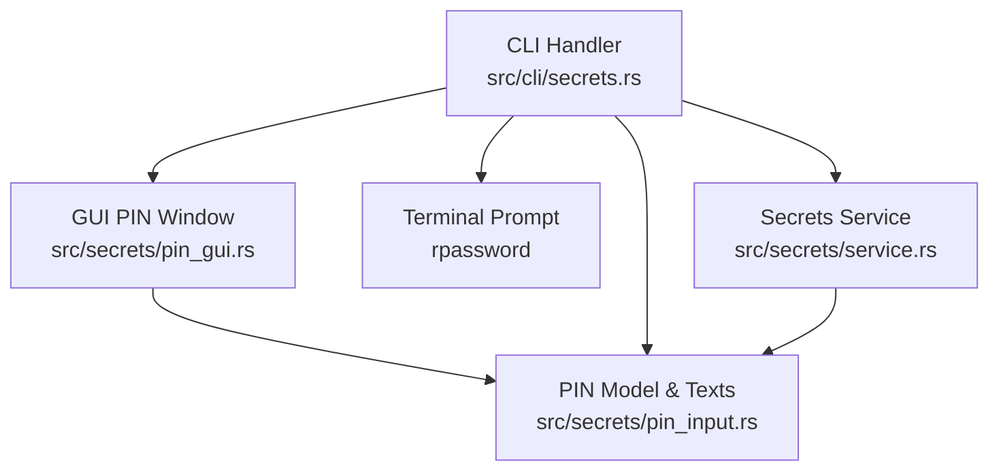
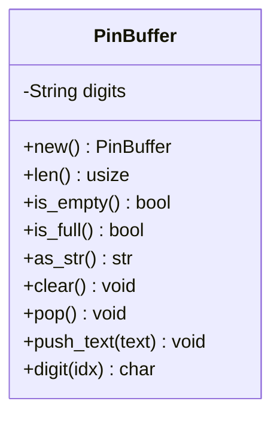
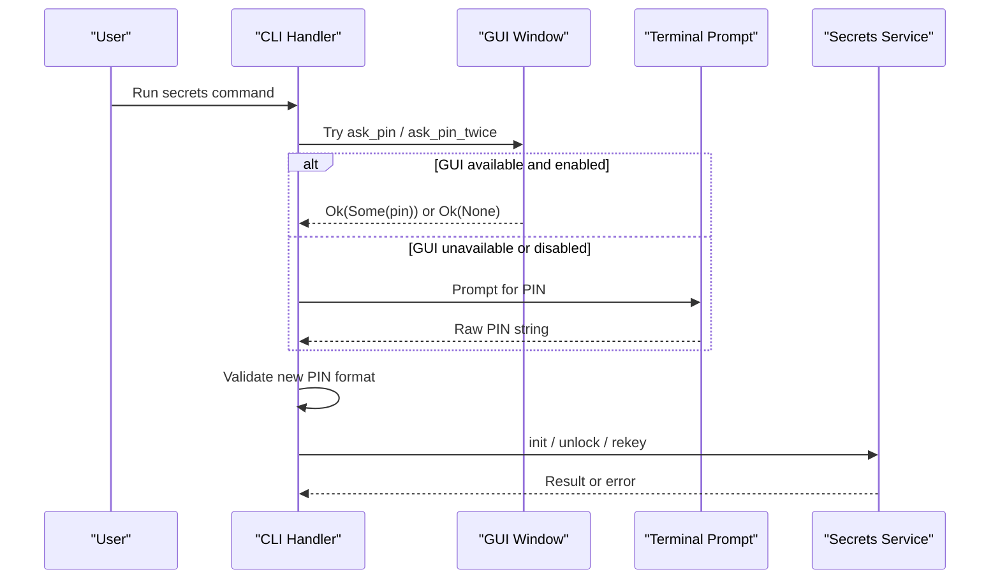
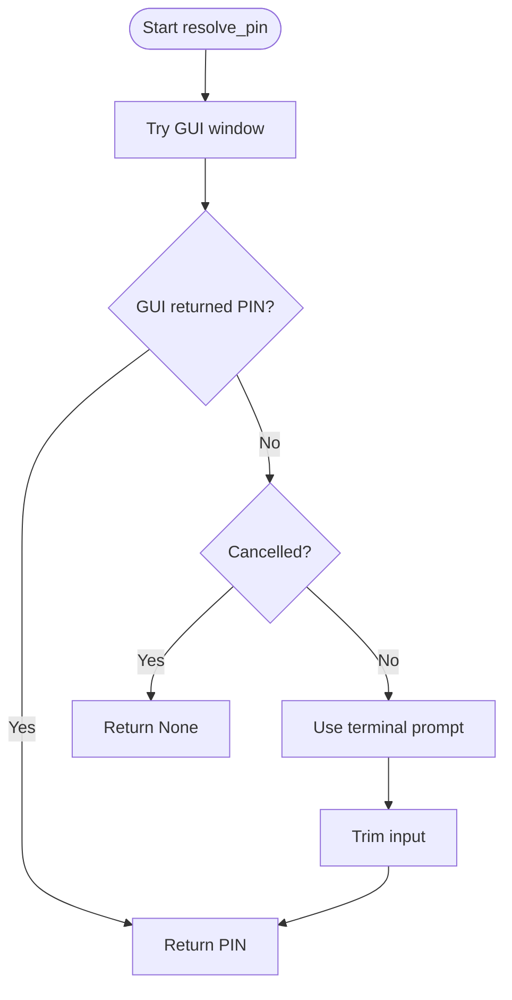
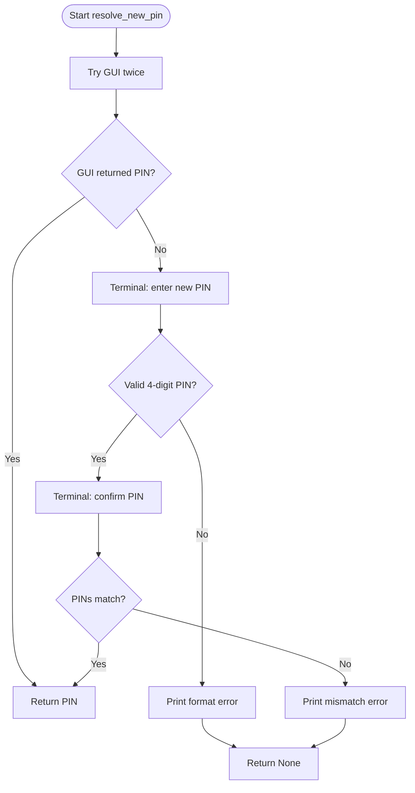
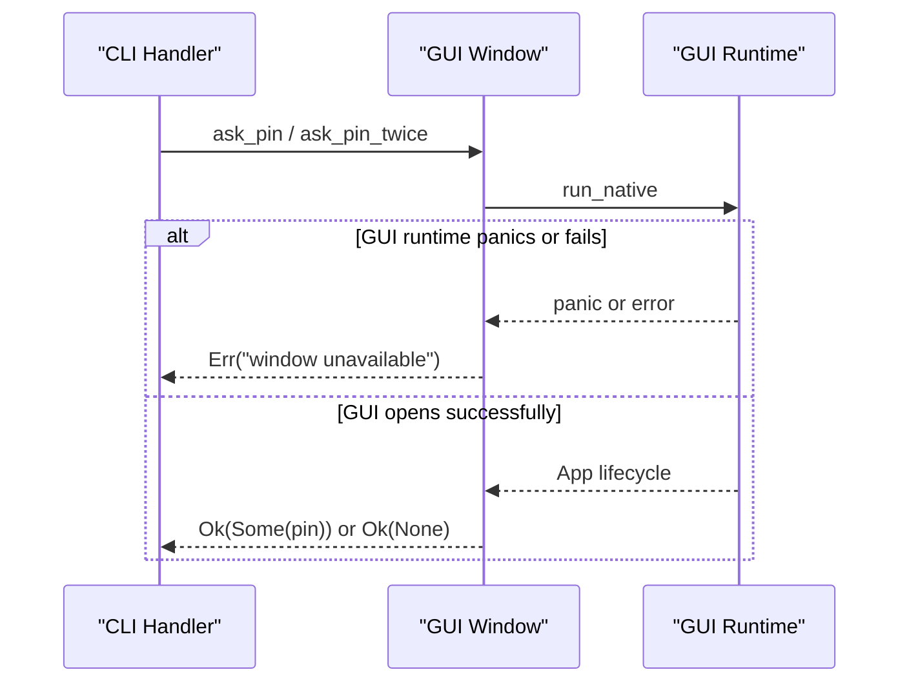
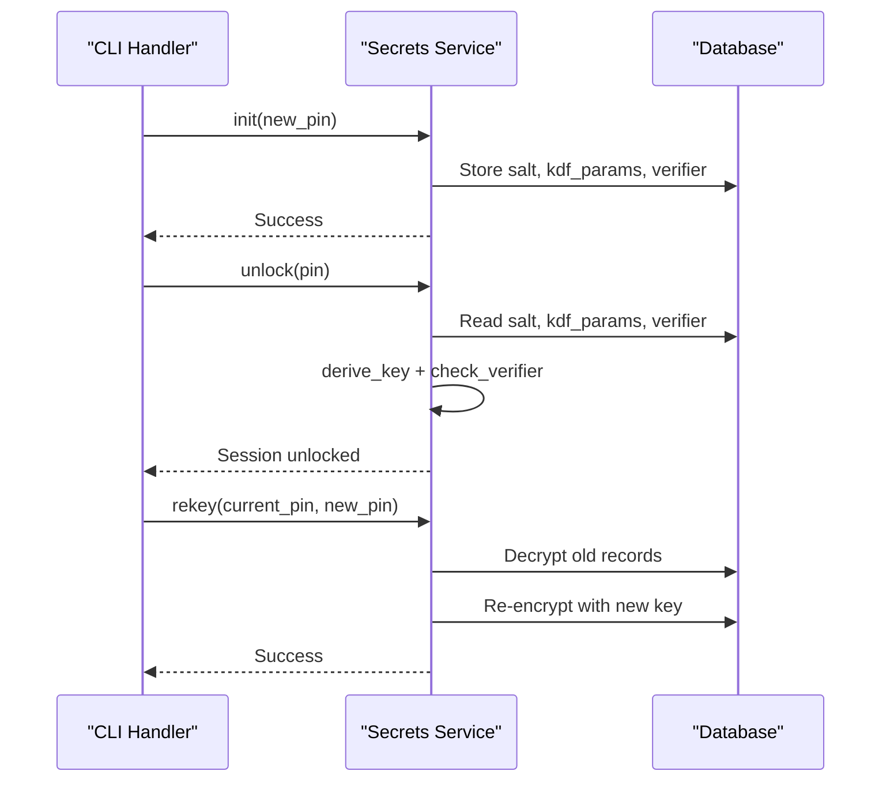
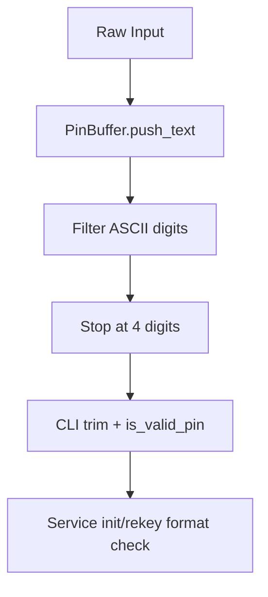
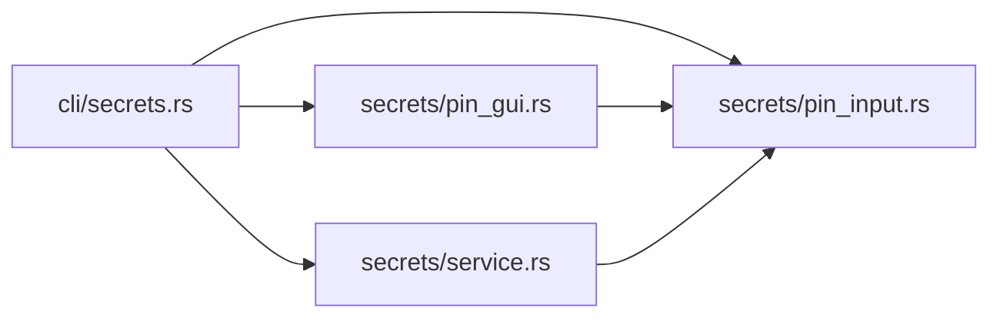

# CLI PIN Fallback Interface

<cite>
**Referenced Files in This Document**
- [pin_input.rs](file://src/secrets/pin_input.rs)
- [pin_gui.rs](file://src/secrets/pin_gui.rs)
- [secrets.rs](file://src/cli/secrets.rs)
- [service.rs](file://src/secrets/service.rs)
- [mod.rs](file://src/secrets/mod.rs)
</cite>

## Table of Contents
1. [Introduction](#introduction)
2. [Project Structure](#project-structure)
3. [Core Components](#core-components)
4. [Architecture Overview](#architecture-overview)
5. [Detailed Component Analysis](#detailed-component-analysis)
6. [Dependency Analysis](#dependency-analysis)
7. [Performance Considerations](#performance-considerations)
8. [Troubleshooting Guide](#troubleshooting-guide)
9. [Conclusion](#conclusion)

## Introduction
This document explains the terminal-based PIN input fallback used when a graphical PIN window is unavailable, such as in headless environments, SSH sessions, or CI/CD pipelines. It focuses on:

- The secure digit collection and validation model implemented by `PinBuffer`.
- The text-based prompt flow that falls back to the terminal when GUI input cannot be opened.
- Input sanitization ensuring only ASCII digits are accepted.
- Integration with the secrets service authentication flow.
- Error handling, cancellation behavior, and security considerations for terminal credential entry.
- Compatibility notes across terminals and operating systems.

The implementation uses a layered design: pure logic for language, prompts, and buffer lives in `pin_input`, while the optional GUI layer in `pin_gui` provides a local window. When the GUI is disabled or fails, the CLI layer falls back to a terminal password prompt.

## Project Structure
The PIN fallback mechanism spans four main files:

| File | Responsibility |
|---|---|
| `src/secrets/pin_input.rs` | Pure PIN logic: length constant, format validation, purpose enum, language resolution, localized texts, `PinBuffer`, and environment-driven GUI disable flag. |
| `src/secrets/pin_gui.rs` | Optional eframe/egui window for local PIN entry; returns errors when unavailable so the caller can fall back to the terminal. |
| `src/cli/secrets.rs` | CLI command handler that chooses GUI first and then terminal fallback; validates new PINs and coordinates unlock/rekey flows. |
| `src/secrets/service.rs` | Secrets vault service: initialization, unlocking, TTL-based session management, rekeying, and business rules around PIN format. |
| `src/secrets/mod.rs` | Module root exposing `pin_input`, `pin_gui` (feature-gated), and `SecretsService`. |

**Diagram sources**
- [secrets.rs:47-132](file://src/cli/secrets.rs#L47-L132)
- [pin_gui.rs:277-346](file://src/secrets/pin_gui.rs#L277-L346)
- [pin_input.rs:7-189](file://src/secrets/pin_input.rs#L7-L189)
- [service.rs:71-164](file://src/secrets/service.rs#L71-L164)

**Section sources**
- [mod.rs:1-15](file://src/secrets/mod.rs#L1-L15)
- [pin_input.rs:1-189](file://src/secrets/pin_input.rs#L1-L189)
- [pin_gui.rs:1-348](file://src/secrets/pin_gui.rs#L1-L348)
- [secrets.rs:1-311](file://src/cli/secrets.rs#L1-L311)
- [service.rs:1-446](file://src/secrets/service.rs#L1-L446)

## Core Components

### PIN Format and Validation
- Fixed PIN length: exactly 4 characters.
- Valid PIN: exactly 4 ASCII digits.
- Dedicated error messages distinguish between initial PIN creation and new PIN changes.

Key behaviors:
- `is_valid_pin` checks both length and character set.
- New PIN creation enforces this rule at both CLI and service layers.
- Unlock intentionally does not enforce the new format, allowing legacy PINs to be opened and migrated via rekey.

**Section sources**
- [pin_input.rs:7-19](file://src/secrets/pin_input.rs#L7-L19)
- [service.rs:71-78](file://src/secrets/service.rs#L71-L78)
- [service.rs:113-117](file://src/secrets/service.rs#L113-L117)

### PinPurpose and Localized Prompts
`PinPurpose` defines the context of a PIN request:

| Purpose | Meaning |
|---|---|
| `New` | Creating a new PIN during vault initialization. |
| `Confirm` | Confirming the newly entered PIN. |
| `Unlock` | Unlocking the vault for an operation. |
| `Current` | Entering the current PIN before changing it. |

`Texts` provides localized titles, hints, and mismatch messages for Russian and English. Language selection supports:

1. Explicit override via `OB2H_UI_LANG`.
2. System locale detection when the GUI feature is enabled.
3. Fallback to English.

**Section sources**
- [pin_input.rs:21-32](file://src/secrets/pin_input.rs#L21-L32)
- [pin_input.rs:34-70](file://src/secrets/pin_input.rs#L34-L70)
- [pin_input.rs:72-117](file://src/secrets/pin_input.rs#L72-L117)

### PinBuffer: Secure Digit Collection
`PinBuffer` is the core data structure for collecting PIN digits safely and predictably:

- Accepts only ASCII digits from any input source.
- Stops accepting after reaching the fixed length.
- Supports inspection (`len`, `as_str`, `digit`), mutation (`push_text`, `pop`, `clear`), and state queries (`is_empty`, `is_full`).

Complexity characteristics:
- `push_text` scans input characters once and appends at most `PIN_LEN` digits.
- Memory usage grows linearly with the number of accepted digits, bounded by 4.
- Accessors are constant time relative to stored digits.

**Diagram sources**
- [pin_input.rs:119-178](file://src/secrets/pin_input.rs#L119-L178)

**Section sources**
- [pin_input.rs:119-178](file://src/secrets/pin_input.rs#L119-L178)

### GUI Disable Flag
The system respects `OB2H_PIN_GUI` to force terminal-only PIN entry even when a GUI is available. Recognized disabling values include `0`, `false`, `off`, `no`, and `none`.

**Section sources**
- [pin_input.rs:180-189](file://src/secrets/pin_input.rs#L180-L189)

## Architecture Overview
The PIN input architecture follows a clear preference order:

1. Try the local GUI window if enabled and available.
2. If the GUI is disabled or fails, fall back to a terminal password prompt.
3. Validate new PINs against the strict 4-digit format.
4. Pass validated PINs to the secrets service for cryptographic operations.

**Diagram sources**
- [secrets.rs:47-132](file://src/cli/secrets.rs#L47-L132)
- [pin_gui.rs:277-346](file://src/secrets/pin_gui.rs#L277-L346)
- [service.rs:71-164](file://src/secrets/service.rs#L71-L164)

## Detailed Component Analysis

### Terminal-Based PIN Fallback Flow
When the GUI cannot be used, the CLI uses a terminal prompt to collect the PIN. The fallback path:

- Uses a secure terminal password prompt.
- Trims whitespace from the raw input.
- For new PIN creation, validates format and confirms the second entry matches.
- Returns `None` when the user cancels or enters invalid data, allowing the CLI to exit gracefully.

**Diagram sources**
- [secrets.rs:87-102](file://src/cli/secrets.rs#L87-L102)

**Section sources**
- [secrets.rs:87-102](file://src/cli/secrets.rs#L87-L102)

### New PIN Creation and Confirmation
New PIN creation requires two inputs and explicit validation:

1. First PIN entry.
2. Second confirmation entry.
3. Both entries must match.
4. Both must satisfy the 4-digit ASCII format.

If either step fails, the CLI prints an error and returns `None`, which stops the command without modifying the vault.

**Diagram sources**
- [secrets.rs:104-132](file://src/cli/secrets.rs#L104-L132)
- [pin_input.rs:7-19](file://src/secrets/pin_input.rs#L7-L19)

**Section sources**
- [secrets.rs:104-132](file://src/cli/secrets.rs#L104-L132)

### GUI Layer Behavior and Failure Handling
The GUI layer:

- Is compiled only when the `gui` feature is enabled.
- Respects `OB2H_PIN_GUI` and refuses to open when disabled.
- Catches panics from the underlying GUI runtime so failures become recoverable errors.
- Returns:
  - `Ok(Some(pin))` when the user submits a valid 4-digit PIN.
  - `Ok(None)` when the user cancels.
  - `Err(...)` when the window cannot be created.

**Diagram sources**
- [pin_gui.rs:291-346](file://src/secrets/pin_gui.rs#L291-L346)

**Section sources**
- [pin_gui.rs:1-348](file://src/secrets/pin_gui.rs#L1-L348)

### Integration with Authentication Flow
The CLI integrates PIN input with the secrets service:

- `init`: validates new PIN format, derives key material, stores salt, KDF parameters, and verifier.
- `unlock`: reads stored salt and verifier, derives key, verifies PIN, and creates an in-memory session with TTL.
- `rekey`: requires current PIN, unlocks, validates new PIN, re-encrypts all records, updates storage, and refreshes the active session.

**Diagram sources**
- [service.rs:71-111](file://src/secrets/service.rs#L71-L111)
- [service.rs:113-164](file://src/secrets/service.rs#L113-L164)
- [service.rs:360-444](file://src/secrets/service.rs#L360-L444)

**Section sources**
- [service.rs:71-164](file://src/secrets/service.rs#L71-L164)
- [service.rs:360-444](file://src/secrets/service.rs#L360-L444)

### Input Sanitization Strategy
Sanitization occurs at multiple layers:

| Layer | Behavior |
|---|---|
| `PinBuffer` | Accepts only ASCII digits; ignores other characters; stops at length 4. |
| GUI input | Uses `PinBuffer.push_text` for keyboard and paste events. |
| CLI terminal fallback | Trims whitespace from raw input before validation. |
| Service layer | Enforces format for `init` and `rekey`; allows legacy formats for `unlock`. |

**Diagram sources**
- [pin_input.rs:161-171](file://src/secrets/pin_input.rs#L161-L171)
- [secrets.rs:114-131](file://src/cli/secrets.rs#L114-L131)
- [service.rs:71-78](file://src/secrets/service.rs#L71-L78)

**Section sources**
- [pin_input.rs:161-171](file://src/secrets/pin_input.rs#L161-L171)
- [secrets.rs:114-131](file://src/cli/secrets.rs#L114-L131)
- [service.rs:71-78](file://src/secrets/service.rs#L71-L78)

### Programmatic PIN Entry Examples
While direct code snippets are omitted here, the following patterns describe how PIN entry is invoked programmatically:

- **Single PIN entry**: Call the GUI prompt function; if unavailable, use the terminal prompt.
- **New PIN with confirmation**: Call the double-entry GUI prompt; if unavailable, prompt twice in the terminal and validate equality.
- **Integration with commands**: Use the resolved PIN to call `SecretsService::init`, `SecretsService::unlock`, or `SecretsService::rekey`.

These patterns are implemented in the CLI handler and rely on shared validation constants and functions from the PIN model module.

**Section sources**
- [secrets.rs:47-132](file://src/cli/secrets.rs#L47-L132)
- [pin_input.rs:7-19](file://src/secrets/pin_input.rs#L7-L19)

### Timeout Mechanisms
The PIN input fallback itself does not implement a dedicated timeout:

- GUI availability is checked synchronously before attempting to open the window.
- Terminal password prompting waits for user input until cancellation or successful entry.
- Timeouts elsewhere in the application apply to LLM calls, benchmark gates, and database busy handling, but not directly to PIN entry.

Operational guidance:
- In automated environments, avoid interactive PIN prompts.
- Prefer pre-provisioned credentials or non-interactive workflows where possible.
- Use environment variables to control UI behavior and language explicitly.

**Section sources**
- [secrets.rs:87-132](file://src/cli/secrets.rs#L87-L132)
- [pin_gui.rs:291-346](file://src/secrets/pin_gui.rs#L291-L346)

### Security Considerations for Terminal-Based Credential Input
- The terminal prompt hides typed input through the underlying secure password API.
- PINs are kept in memory only as needed and validated against strict format rules for creation and rotation.
- The GUI is designed to run locally within the same process and is isolated from agent chat or MCP channels.
- Legacy PIN compatibility is preserved for unlock, but new PINs must follow the stricter 4-digit rule.
- Master keys are held in zeroizing memory and cleared on lock or session expiration.

**Section sources**
- [pin_gui.rs:1-9](file://src/secrets/pin_gui.rs#L1-L9)
- [service.rs:1-10](file://src/secrets/service.rs#L1-L10)
- [service.rs:113-117](file://src/secrets/service.rs#L113-L117)

### Compatibility Across Terminals and Operating Systems
- The GUI layer depends on a native GUI runtime and may fail in headless environments, SSH sessions, or CI runners without a display server.
- When GUI failure occurs, the CLI automatically falls back to terminal input.
- Environment variables allow deterministic behavior:
  - `OB2H_PIN_GUI`: forces terminal-only mode.
  - `OB2H_UI_LANG`: forces interface language.
- Terminal behavior depends on the underlying OS and terminal emulator, particularly regarding password hiding and input handling.

**Section sources**
- [pin_gui.rs:277-346](file://src/secrets/pin_gui.rs#L277-L346)
- [pin_input.rs:43-70](file://src/secrets/pin_input.rs#L43-L70)
- [pin_input.rs:180-189](file://src/secrets/pin_input.rs#L180-L189)

## Dependency Analysis
The PIN fallback components have clear boundaries:

- `cli/secrets.rs` depends on:
  - `secrets/pin_input` for validation, purpose, and GUI disable flag.
  - `secrets/pin_gui` for optional GUI prompts.
  - `secrets/service` for vault operations.
- `secrets/pin_gui.rs` depends on:
  - `secrets/pin_input` for model, language, and buffer.
- `secrets/service.rs` depends on:
  - `secrets/pin_input` for PIN format validation.
- `secrets/mod.rs` exposes the public surface and feature-gates the GUI module.

**Diagram sources**
- [secrets.rs:1-11](file://src/cli/secrets.rs#L1-L11)
- [pin_gui.rs:11-15](file://src/secrets/pin_gui.rs#L11-L15)
- [service.rs:12-16](file://src/secrets/service.rs#L12-L16)
- [mod.rs:1-15](file://src/secrets/mod.rs#L1-L15)

**Section sources**
- [secrets.rs:1-11](file://src/cli/secrets.rs#L1-L11)
- [pin_gui.rs:11-15](file://src/secrets/pin_gui.rs#L11-L15)
- [service.rs:12-16](file://src/secrets/service.rs#L12-L16)
- [mod.rs:1-15](file://src/secrets/mod.rs#L1-L15)

## Performance Considerations
- PIN validation and buffering operate on very small fixed-size data; performance impact is negligible.
- GUI opening may block the main thread and is intentionally called before asynchronous work to satisfy GUI runtime requirements.
- Terminal password prompting is synchronous and waits for user interaction; it should not be used in fully automated pipelines without external coordination.
- Secrets service operations involve cryptographic derivation and optional full-record re-encryption during rekey; these are CPU-bound and scale with record count.

[No sources needed since this section provides general guidance]

## Troubleshooting Guide

### GUI Cannot Open
Symptoms:
- Error indicating the PIN window is unavailable.
- Automatic fallback to terminal prompt.

Likely causes:
- Headless environment.
- No display server.
- `OB2H_PIN_GUI` set to a disabling value.
- GUI feature not enabled.

Actions:
- Check whether a GUI is expected in the environment.
- Set `OB2H_PIN_GUI=0` explicitly if terminal-only behavior is desired.
- Build with the GUI feature if a local window is required.

**Section sources**
- [pin_gui.rs:291-346](file://src/secrets/pin_gui.rs#L291-L346)
- [pin_input.rs:180-189](file://src/secrets/pin_input.rs#L180-L189)

### Invalid PIN Format
Symptoms:
- Error stating the PIN must be exactly 4 digits.
- New PIN creation or rekey aborts.

Likely causes:
- Non-digit characters.
- Wrong length.
- Whitespace or Unicode digits.

Actions:
- Enter exactly 4 ASCII digits.
- Avoid spaces, letters, or full-width digits.
- Use the GUI where digit filtering is automatic.

**Section sources**
- [pin_input.rs:7-19](file://src/secrets/pin_input.rs#L7-L19)
- [secrets.rs:114-131](file://src/cli/secrets.rs#L114-L131)
- [service.rs:71-78](file://src/secrets/service.rs#L71-L78)

### PIN Mismatch During Confirmation
Symptoms:
- Error indicating entered PINs do not match.
- Prompt repeats or aborts depending on the flow.

Likely causes:
- Two different PINs entered.
- Accidental extra keystrokes.

Actions:
- Re-enter the same 4-digit PIN twice.
- Clear the buffer and start again.

**Section sources**
- [secrets.rs:122-131](file://src/cli/secrets.rs#L122-L131)
- [pin_gui.rs:151-177](file://src/secrets/pin_gui.rs#L151-L177)

### Vault Not Initialized
Symptoms:
- Error instructing to initialize the secrets vault.

Likely causes:
- Running unlock or list before `ob2h secrets init`.

Actions:
- Run initialization and provide a valid new PIN.

**Section sources**
- [service.rs:118-121](file://src/secrets/service.rs#L118-L121)
- [secrets.rs:162-169](file://src/cli/secrets.rs#L162-L169)

### Session Expired or Locked
Symptoms:
- Error indicating the secrets vault is locked or session expired.

Likely causes:
- TTL elapsed.
- Manual lock.
- Missing unlock.

Actions:
- Run unlock again.
- Adjust TTL configuration if appropriate.
- Use lock/unlock commands to manage session state.

**Section sources**
- [service.rs:185-203](file://src/secrets/service.rs#L185-L203)
- [service.rs:205-250](file://src/secrets/service.rs#L205-L250)

## Conclusion
The terminal-based PIN fallback provides a robust, secure, and predictable way to collect credentials when a GUI is unavailable. Its design separates concerns cleanly:

- `PinBuffer` guarantees safe, sanitized digit collection.
- `PinPurpose` and `Texts` provide localized, context-aware prompts.
- The CLI layer prefers a local GUI but reliably falls back to terminal input.
- The secrets service enforces cryptographic integrity, session lifetime, and migration-friendly unlock behavior.

For headless and CI/CD environments, prefer explicit environment configuration and non-interactive workflows. For interactive use, the GUI offers a controlled local experience, while the terminal fallback ensures functionality across diverse terminals and operating systems.