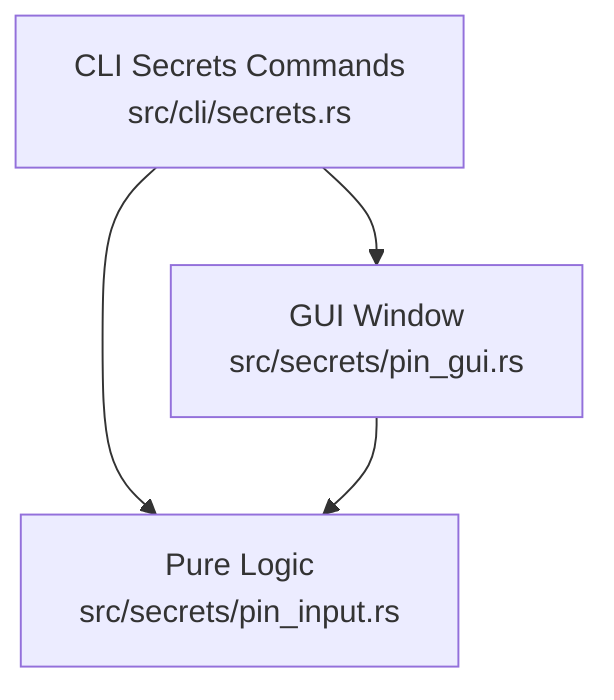
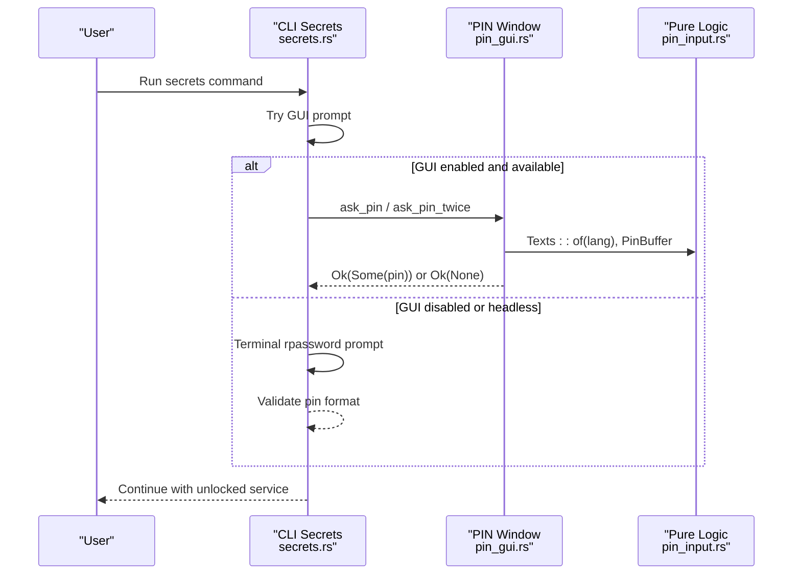
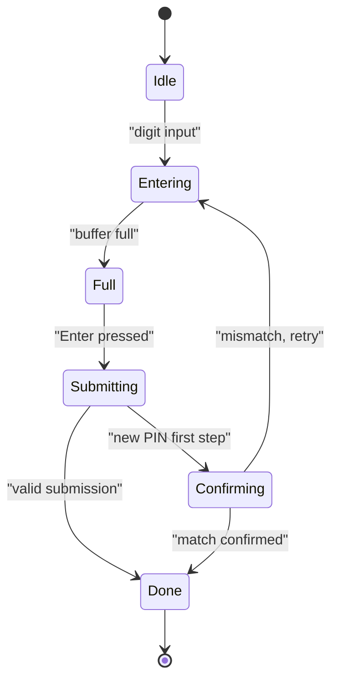
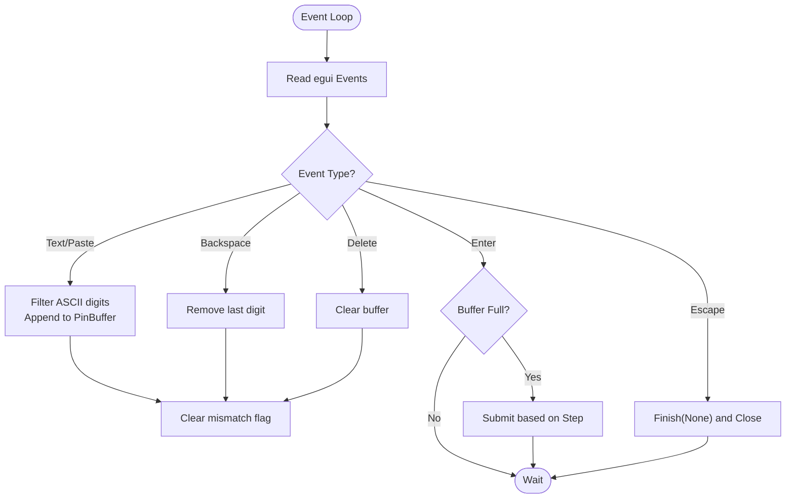
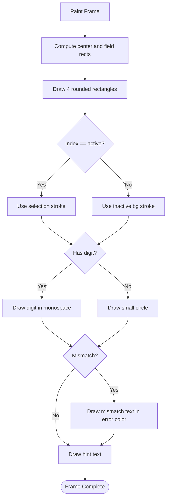
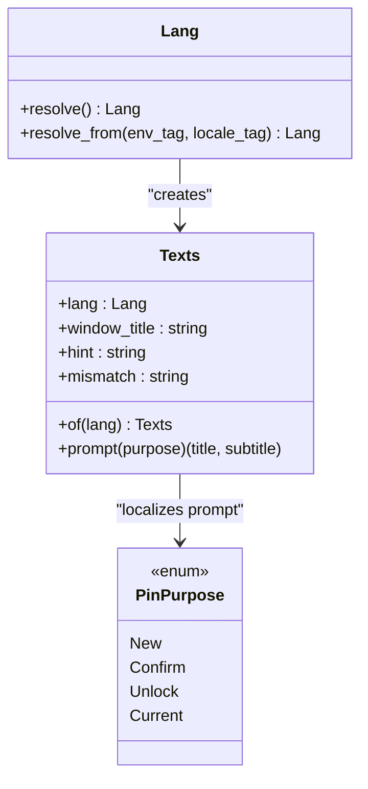
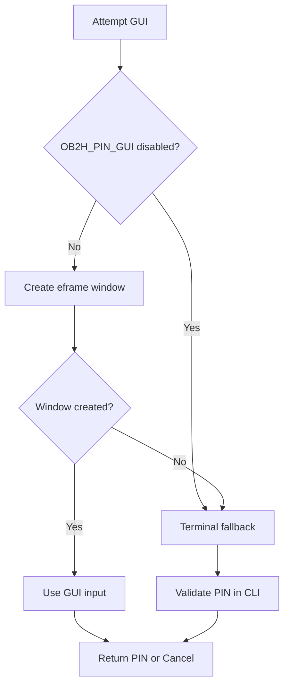
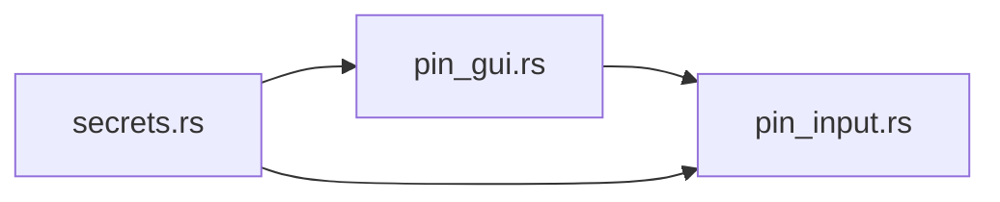

# GUI PIN Input Interface

<cite>
**Referenced Files in This Document**
- [pin_gui.rs](file://src/secrets/pin_gui.rs)
- [pin_input.rs](file://src/secrets/pin_input.rs)
- [secrets.rs](file://src/cli/secrets.rs)
- [README.md](file://README.md)
</cite>

## Table of Contents
1. [Introduction](#introduction)
2. [Project Structure](#project-structure)
3. [Core Components](#core-components)
4. [Architecture Overview](#architecture-overview)
5. [Detailed Component Analysis](#detailed-component-analysis)
6. [Dependency Analysis](#dependency-analysis)
7. [Performance Considerations](#performance-considerations)
8. [Troubleshooting Guide](#troubleshooting-guide)
9. [Conclusion](#conclusion)

## Introduction
This document explains the graphical PIN input interface used by the OB2H secrets vault. It is a compact, harness-independent window built with `eframe`/`egui`, designed to collect exactly four digits locally and never expose the PIN through MCP, LLM, or chat channels. The implementation separates pure logic (language, validation, buffer) from the GUI runtime so that unit tests can run without a display.

The user experience supports:
- Single PIN entry for unlock or current-PIN operations.
- New PIN creation with on-screen confirmation and mismatch feedback.
- Keyboard-driven input: digit text events, paste, backspace, delete, Enter, and Escape.
- Visual feedback: active field highlighting, dot indicators for entered digits, and mismatch error text.
- Localization via `Texts::of(lang)` with Russian and English strings.
- Environment control through `OB2H_PIN_GUI` and `OB2H_UI_LANG`.
- Headless fallback: when no GUI is available, the CLI falls back to terminal input.

## Project Structure
The PIN GUI lives under the secrets module and integrates with the CLI secrets commands:

**Diagram sources**
- [secrets.rs:47-132](file://src/cli/secrets.rs#L47-L132)
- [pin_gui.rs:11-15](file://src/secrets/pin_gui.rs#L11-L15)
- [pin_input.rs:1-10](file://src/secrets/pin_input.rs#L1-L10)

**Section sources**
- [pin_gui.rs:1-15](file://src/secrets/pin_gui.rs#L1-L15)
- [pin_input.rs:1-10](file://src/secrets/pin_input.rs#L1-L10)
- [secrets.rs:1-10](file://src/cli/secrets.rs#L1-L10)

## Core Components
- **PinApp**: eframe application state machine handling single PIN and new PIN confirmation workflows.
- **Step**: internal workflow mode (`Single` vs `NewWithConfirm`).
- **PinPurpose**: semantic purpose of the PIN request (`New`, `Confirm`, `Unlock`, `Current`).
- **Lang**: language selection (`ru`/`en`) resolved from environment and system locale.
- **Texts**: localized UI strings and prompts per purpose.
- **PinBuffer**: strict 4-digit ASCII buffer accepting only digits, supporting push/pop/clear/digit access.
- **CLI integration**: prefers GUI; if unavailable, uses terminal password prompt with the same validation rules.

Key responsibilities:
- GUI-only path: `ask_pin` and `ask_pin_twice` open a non-resizable, always-on-top window and return either a 4-digit PIN or cancellation.
- Pure logic path: `is_valid_pin`, `gui_disabled_by_env`, `Lang::resolve`, and `Texts::prompt` are testable without graphics.
- CLI fallback: `resolve_pin` and `resolve_new_pin` coordinate GUI attempts and terminal fallback.

**Section sources**
- [pin_gui.rs:33-58](file://src/secrets/pin_gui.rs#L33-L58)
- [pin_gui.rs:269-289](file://src/secrets/pin_gui.rs#L269-L289)
- [pin_input.rs:16-32](file://src/secrets/pin_input.rs#L16-L32)
- [pin_input.rs:34-70](file://src/secrets/pin_input.rs#L34-L70)
- [pin_input.rs:72-117](file://src/secrets/pin_input.rs#L72-L117)
- [pin_input.rs:119-178](file://src/secrets/pin_input.rs#L119-L178)
- [secrets.rs:47-132](file://src/cli/secrets.rs#L47-L132)

## Architecture Overview
The secrets flow starts at the CLI, which tries to open the GUI. If successful, the PIN is returned directly; otherwise, the CLI falls back to terminal input. The GUI itself delegates all localization and buffer logic to the pure module.

**Diagram sources**
- [secrets.rs:47-132](file://src/cli/secrets.rs#L47-L132)
- [pin_gui.rs:269-347](file://src/secrets/pin_gui.rs#L269-L347)
- [pin_input.rs:43-70](file://src/secrets/pin_input.rs#L43-L70)

## Detailed Component Analysis

### PinApp State Machine
`PinApp` implements the eframe `App` trait and manages two workflows:
- Single PIN entry: submit immediately when the buffer reaches four digits.
- New PIN with confirmation: first entry stored, then second entry compared; mismatch clears buffer and shows an error message.

- **Idle**: waiting for input.
- **Entering**: collecting digits; Backspace/Delete clear mismatch state.
- **Full**: buffer has four digits; Enter triggers submission.
- **Submitting**: for single mode, returns PIN; for new PIN, stores first value and switches to confirmation.
- **Confirming**: compares second entry; mismatch resets buffer and shows error; match finishes.
- **Done**: writes result into shared slot and closes viewport.

**Diagram sources**
- [pin_gui.rs:33-58](file://src/secrets/pin_gui.rs#L33-L58)
- [pin_gui.rs:101-177](file://src/secrets/pin_gui.rs#L101-L177)

**Section sources**
- [pin_gui.rs:33-58](file://src/secrets/pin_gui.rs#L33-L58)
- [pin_gui.rs:101-177](file://src/secrets/pin_gui.rs#L101-L177)

### Keyboard Event Handling System
The GUI listens to `egui::Event` stream:
- Text events and paste: accepted digits are appended to `PinBuffer`; mismatch cleared.
- Key events:
  - Backspace: removes last digit.
  - Delete: clears entire buffer.
  - Enter: submits once (repeat suppressed).
  - Escape: cancels and closes the window.

**Diagram sources**
- [pin_gui.rs:101-149](file://src/secrets/pin_gui.rs#L101-L149)
- [pin_gui.rs:151-177](file://src/secrets/pin_gui.rs#L151-L177)

**Section sources**
- [pin_gui.rs:101-149](file://src/secrets/pin_gui.rs#L101-L149)

### Visual Feedback System
The window paints:
- Background panel fill.
- Title and prompt using localized `Texts::prompt(current_purpose)`.
- Four square fields centered horizontally, spaced by a fixed gap.
- Active field highlight: the next expected digit position uses selection stroke; filled positions use inactive background stroke.
- Dot indicators: empty fields show a small circle; filled fields show the digit in monospace font.
- Mismatch error: shown below fields in error color when confirmation fails.
- Hint text: keyboard guidance at the bottom.

**Diagram sources**
- [pin_gui.rs:179-259](file://src/secrets/pin_gui.rs#L179-L259)

**Section sources**
- [pin_gui.rs:179-259](file://src/secrets/pin_gui.rs#L179-L259)

### Window Configuration Options
The native window is configured with:
- Fixed logical size: 380×240 points.
- Non-resizable: min/max inner sizes equal to the fixed size.
- Always on top.
- Centered viewport.
- Localized title via `Texts::of(lang).window_title`.

These options ensure a compact, focused PIN entry dialog that does not interfere with other windows.

**Section sources**
- [pin_gui.rs:17-28](file://src/secrets/pin_gui.rs#L17-L28)
- [pin_gui.rs:305-315](file://src/secrets/pin_gui.rs#L305-L315)

### Localization Support
Language resolution priority:
1. `OB2H_UI_LANG` environment variable override.
2. System locale (when GUI feature is enabled).
3. Fallback to English.

Localized strings include:
- Window title.
- Hint text.
- Mismatch message.
- Per-purpose prompts for New, Confirm, Unlock, Current.

**Diagram sources**
- [pin_input.rs:34-70](file://src/secrets/pin_input.rs#L34-L70)
- [pin_input.rs:72-117](file://src/secrets/pin_input.rs#L72-L117)

**Section sources**
- [pin_input.rs:43-70](file://src/secrets/pin_input.rs#L43-L70)
- [pin_input.rs:72-117](file://src/secrets/pin_input.rs#L72-L117)

### Environment Variable Control
- `OB2H_PIN_GUI`: disables the GUI when set to `0`, `false`, `off`, `no`, or `none`. When disabled, CLI falls back to terminal input.
- `OB2H_UI_LANG`: forces UI language to `ru` or `en`; otherwise uses system locale.

Behavior:
- `gui_disabled_by_env()` checks the environment before attempting to open the window.
- `Lang::resolve()` reads `OB2H_UI_LANG` and system locale.

**Section sources**
- [pin_input.rs:180-189](file://src/secrets/pin_input.rs#L180-L189)
- [pin_gui.rs:297-301](file://src/secrets/pin_gui.rs#L297-L301)
- [README.md:300-329](file://README.md#L300-L329)

### Headless Environment Detection and Graceful Fallback
When the GUI cannot be created (no display, wrong thread, CI/SSH headless session, or GUI disabled):
- `run_window` wraps `eframe::run_native` in `catch_unwind` to convert panics into errors.
- Errors propagate to CLI as failures to open the PIN window.
- CLI logs a warning and falls back to `rpassword` terminal input with the same validation rules.

**Diagram sources**
- [pin_gui.rs:297-347](file://src/secrets/pin_gui.rs#L297-L347)
- [secrets.rs:47-132](file://src/cli/secrets.rs#L47-L132)

**Section sources**
- [pin_gui.rs:317-347](file://src/secrets/pin_gui.rs#L317-L347)
- [secrets.rs:47-132](file://src/cli/secrets.rs#L47-L132)

## Dependency Analysis
The components have clear separation:
- `pin_gui.rs` depends on `pin_input.rs` for language, buffer, and purposes.
- `secrets.rs` coordinates both modules and provides fallback behavior.
- No circular dependencies exist between GUI and pure logic.

**Diagram sources**
- [pin_gui.rs:11-15](file://src/secrets/pin_gui.rs#L11-L15)
- [secrets.rs:47-132](file://src/cli/secrets.rs#L47-L132)

**Section sources**
- [pin_gui.rs:11-15](file://src/secrets/pin_gui.rs#L11-L15)
- [secrets.rs:47-132](file://src/cli/secrets.rs#L47-L132)

## Performance Considerations
- The window is minimal: four rectangles, text draws, and simple event handling.
- Buffer operations are O(1) for append/pop/clear due to fixed maximum length (4 digits).
- Language resolution and text lookup are constant-time operations.
- GUI creation is guarded by environment checks to avoid unnecessary overhead in headless environments.

[No sources needed since this section provides general guidance]

## Troubleshooting Guide
Common issues and resolutions:
- GUI disabled by environment:
  - Symptom: CLI warns that the PIN window is unavailable and falls back to terminal.
  - Cause: `OB2H_PIN_GUI=0|false|off|no|none`.
  - Resolution: unset or change the variable to enable GUI, or continue with terminal input.
- Headless environment:
  - Symptom: Opening the window panics or returns an error.
  - Cause: No display server, SSH/CI session, or wrong thread.
  - Resolution: rely on terminal fallback; ensure the process runs on the main OS thread if GUI is required.
- Wrong language:
  - Symptom: UI appears in unexpected language.
  - Cause: `OB2H_UI_LANG` not set or system locale not recognized.
  - Resolution: set `OB2H_UI_LANG=ru` or `OB2H_UI_LANG=en`.
- Mismatch during new PIN:
  - Symptom: Error message displayed and buffer cleared.
  - Cause: Second PIN entry does not match the first.
  - Resolution: re-enter the PIN twice ensuring they match.

**Section sources**
- [pin_gui.rs:297-347](file://src/secrets/pin_gui.rs#L297-L347)
- [pin_input.rs:180-189](file://src/secrets/pin_input.rs#L180-L189)
- [secrets.rs:47-132](file://src/cli/secrets.rs#L47-L132)

## Conclusion
The OB2H GUI PIN input interface provides a secure, localized, and accessible way to enter a 4-digit PIN locally. It cleanly separates pure logic from the GUI runtime, supports both single PIN and new PIN confirmation workflows, and gracefully falls back to terminal input when the GUI is unavailable. Environment variables allow fine control over GUI availability and language, while visual feedback ensures users understand their progress and errors.

[No sources needed since this section summarizes without analyzing specific files]