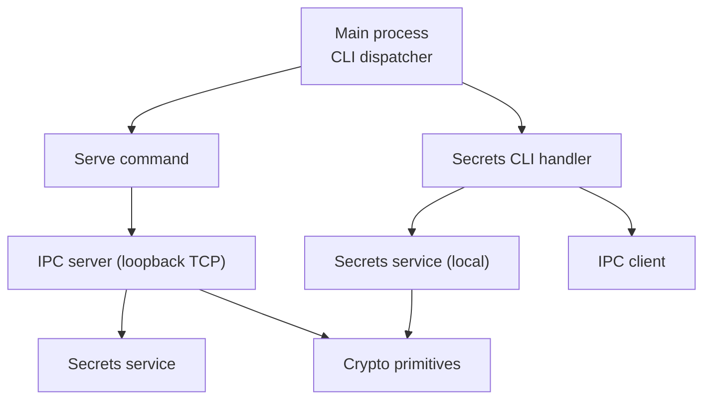
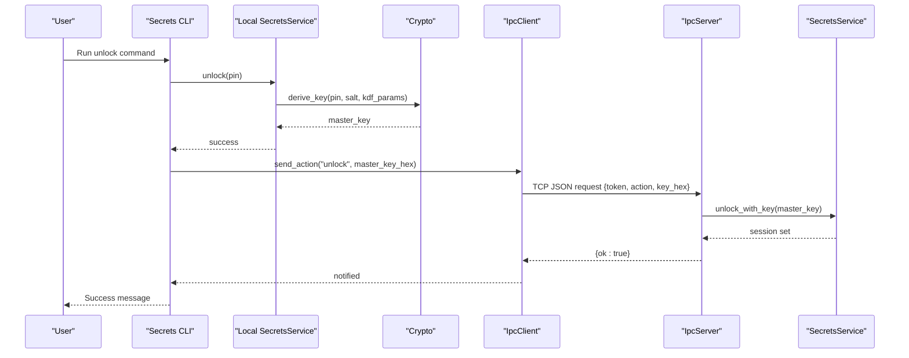
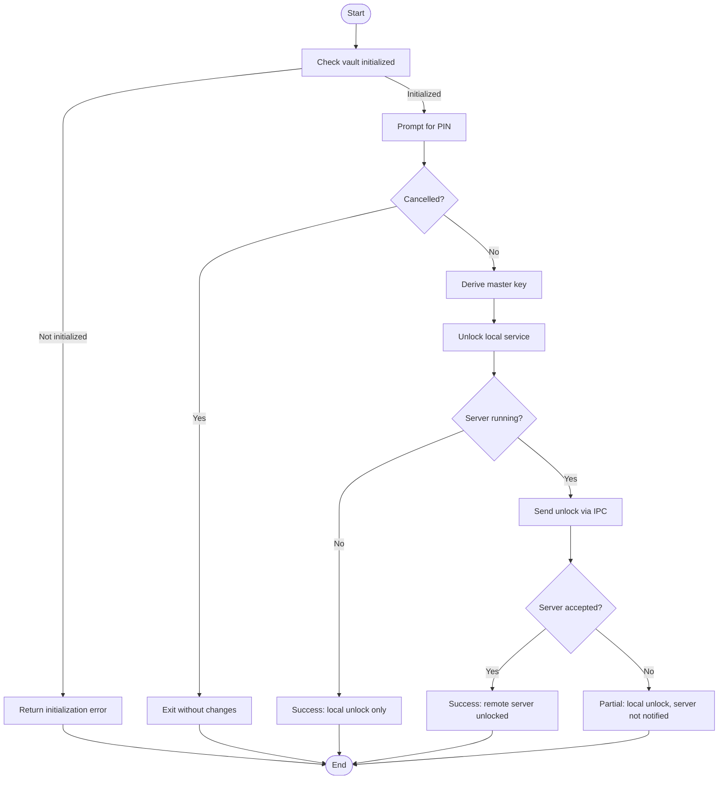
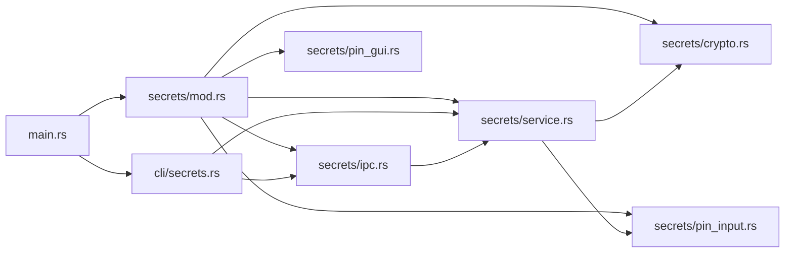

# IPC Authentication Protocol

<cite>
**Referenced Files in This Document**
- [main.rs](file://src/main.rs)
- [secrets_mod.rs](file://src/secrets/mod.rs)
- [ipc.rs](file://src/secrets/ipc.rs)
- [service.rs](file://src/secrets/service.rs)
- [crypto.rs](file://src/secrets/crypto.rs)
- [pin_input.rs](file://src/secrets/pin_input.rs)
- [pin_gui.rs](file://src/secrets/pin_gui.rs)
- [cli_secrets.rs](file://src/cli/secrets.rs)
</cite>

## Table of Contents
1. [Introduction](#introduction)
2. [Project Structure](#project-structure)
3. [Core Components](#core-components)
4. [Architecture Overview](#architecture-overview)
5. [Detailed Component Analysis](#detailed-component-analysis)
6. [Dependency Analysis](#dependency-analysis)
7. [Performance Considerations](#performance-considerations)
8. [Troubleshooting Guide](#troubleshooting-guide)
9. [Conclusion](#conclusion)

## Introduction
This document describes the inter-process communication protocol used by the application to securely verify a PIN and establish an in-memory unlocked session for the secrets vault. The design separates sensitive input handling from long-running server processes:

- A short-lived CLI process collects or derives the master key.
- A long-running `ob2h serve` process exposes a local loopback TCP service that can unlock or lock the vault without exposing the PIN over the network.
- The master key is never persisted; it lives only in memory inside the server process and is cleared on lock, TTL expiry, or process termination.

The protocol supports two main actions:

| Action | Client payload | Server behavior | Security purpose |
|---|---|---|---|
| `unlock` | Token, action, 32-byte key as hex | Validates token, decodes key, sets unlocked session with TTL | Avoids sending PIN over IPC |
| `lock` | Token, action, no key | Clears unlocked session and drops master key | Ensures memory isolation after use |

The security model relies on:

- Loopback-only TCP binding.
- Per-server random token stored in a small JSON file under the data directory.
- Argon2id-based key derivation and XChaCha20-Poly1305 encryption for secret values.
- Zeroizing wrappers for sensitive in-memory buffers.
- TTL-based session expiration.

## Project Structure
The secrets subsystem is implemented under `src/secrets`, with CLI integration under `src/cli`. The entry point starts the secrets IPC server when running `serve`.

**Diagram sources**
- [main.rs:62-90](file://src/main.rs#L62-L90)
- [cli_secrets.rs:136-143](file://src/cli/secrets.rs#L136-L143)
- [ipc.rs:35-43](file://src/secrets/ipc.rs#L35-L43)
- [service.rs:43-56](file://src/secrets/service.rs#L43-L56)
- [crypto.rs:14-32](file://src/secrets/crypto.rs#L14-L32)

**Section sources**
- [main.rs:62-90](file://src/main.rs#L62-L90)
- [secrets_mod.rs:1-15](file://src/secrets/mod.rs#L1-L15)
- [cli_secrets.rs:136-143](file://src/cli/secrets.rs#L136-L143)

## Core Components
The IPC authentication flow involves these components:

| Component | Responsibility | Key behaviors |
|---|---|---|
| `IpcServer` | Starts a loopback TCP listener, writes connection metadata, handles requests | Generates random token, validates token, dispatches `unlock`/`lock`, responds via JSON |
| `IpcClient` | Connects to the running server, sends actions | Reads server info from disk, encodes key as hex, sends request, reads response |
| `SecretsService` | Manages vault state, encryption, TTL sessions | Derives keys, verifies PIN verifier, stores/retrieves encrypted records, enforces TTL |
| `Crypto` | Implements KDF and AEAD primitives | Argon2id key derivation, salt generation, XChaCha20-Poly1305 encrypt/decrypt, verifier creation/check |
| `PinInput` | Defines PIN format and UI language logic | Enforces 4-digit ASCII PIN, provides localized prompts |
| `PinGui` | Optional GUI PIN prompt | Opens egui window, accepts digits, returns result or error |
| `SecretsCli` | Orchestrates user interaction and IPC | Prompts for PIN, derives key, notifies server, prints status |

**Section sources**
- [ipc.rs:15-33](file://src/secrets/ipc.rs#L15-L33)
- [ipc.rs:35-43](file://src/secrets/ipc.rs#L35-L43)
- [ipc.rs:154-195](file://src/secrets/ipc.rs#L154-L195)
- [service.rs:43-56](file://src/secrets/service.rs#L43-L56)
- [crypto.rs:14-32](file://src/secrets/crypto.rs#L14-L32)
- [pin_input.rs:7-19](file://src/secrets/pin_input.rs#L7-L19)
- [pin_gui.rs:269-289](file://src/secrets/pin_gui.rs#L269-L289)
- [cli_secrets.rs:136-143](file://src/cli/secrets.rs#L136-L143)

## Architecture Overview
The end-to-end lifecycle begins with the CLI unlocking locally and then notifying the long-running server if present.

**Diagram sources**
- [cli_secrets.rs:162-190](file://src/cli/secrets.rs#L162-L190)
- [service.rs:118-164](file://src/secrets/service.rs#L118-L164)
- [crypto.rs:34-44](file://src/secrets/crypto.rs#L34-L44)
- [ipc.rs:163-195](file://src/secrets/ipc.rs#L163-L195)
- [ipc.rs:74-139](file://src/secrets/ipc.rs#L74-L139)
- [service.rs:167-176](file://src/secrets/service.rs#L167-L176)

## Detailed Component Analysis

### IPC Message Format and Serialization
The IPC layer uses JSON over TCP. Messages are serialized using serde.

| Field | Type | Required | Description |
|---|---|---:|---|
| `token` | String | Yes | Random per-server token read from `server.json` |
| `action` | String | Yes | One of `unlock`, `lock` |
| `key_hex` | String | Conditional | Hex-encoded 32-byte master key for `unlock`; omitted for `lock` |

Response fields:

| Field | Type | Description |
|---|---|---|
| `ok` | Boolean | Whether the action succeeded |
| `message` | String | Human-readable status or error |

Serialization details:

- Request serialization: `serde_json::to_vec(&req)` before writing to socket.
- Response serialization: `serde_json::to_vec(&resp)` before writing back.
- Key encoding: 32-byte key encoded as hex string for transport.
- Buffer sizes: Server reads up to 4096 bytes; client reads up to 1024 bytes.

Security implications:

- Token validation prevents unauthorized clients from controlling the server.
- Key size validation ensures only valid 32-byte keys unlock the vault.
- Unknown actions are rejected.

**Section sources**
- [ipc.rs:15-33](file://src/secrets/ipc.rs#L15-L33)
- [ipc.rs:74-139](file://src/secrets/ipc.rs#L74-L139)
- [ipc.rs:163-195](file://src/secrets/ipc.rs#L163-L195)

### Connection Management and Lifecycle
The server binds to `127.0.0.1:0`, meaning a random available port on the loopback interface. It writes connection metadata to `data_dir/run/server.json`:

| Field | Type | Purpose |
|---|---|---|
| `port` | u16 | Port number for client connection |
| `pid` | u32 | Server process ID |
| `token` | String | Random token for request authorization |

Lifecycle steps:

1. Server starts and creates `run` directory.
2. Binds loopback TCP listener.
3. Generates random token.
4. Writes `server.json`.
5. Accepts connections asynchronously.
6. On drop, removes `server.json`.

Client steps:

1. Reads `server.json`.
2. Connects to `127.0.0.1:<port>`.
3. Sends JSON request.
4. Reads JSON response.
5. Returns boolean success indicator.

Error handling:

- If server info cannot be read, client returns success false.
- If connection fails, client returns success false.
- If response length is zero, client returns success false.

**Section sources**
- [ipc.rs:39-61](file://src/secrets/ipc.rs#L39-L61)
- [ipc.rs:148-151](file://src/secrets/ipc.rs#L148-L151)
- [ipc.rs:156-195](file://src/secrets/ipc.rs#L156-L195)

### PIN Prompt Initiation and Input Handling
PIN input is intentionally isolated from IPC:

- GUI mode: optional egui window collects exactly four ASCII digits.
- Terminal fallback: password prompt via terminal when GUI is unavailable.
- PIN format validation: exactly four ASCII digits.

GUI behavior:

- Window title and hints are localized.
- Only digits are accepted.
- Enter submits; Escape cancels.
- New PIN flow requires confirmation within the window.

Terminal fallback:

- Uses secure password prompting.
- Validates PIN format.
- Handles mismatch for new PIN setup.

Environment controls:

- `OB2H_PIN_GUI` disables GUI input.
- `OB2H_UI_LANG` overrides UI language.

**Section sources**
- [pin_input.rs:7-19](file://src/secrets/pin_input.rs#L7-L19)
- [pin_input.rs:43-70](file://src/secrets/pin_input.rs#L43-L70)
- [pin_input.rs:180-189](file://src/secrets/pin_input.rs#L180-L189)
- [pin_gui.rs:269-347](file://src/secrets/pin_gui.rs#L269-L347)
- [cli_secrets.rs:47-132](file://src/cli/secrets.rs#L47-L132)

### Key Derivation and Session Establishment
Key derivation uses Argon2id with configurable parameters:

| Parameter | Default | Meaning |
|---|---:|---|
| `m_cost` | 65536 KiB | Memory usage |
| `t_cost` | 3 | Iteration count |
| `p_cost` | 1 | Parallelism |

Derivation flow:

1. Read stored salt and KDF parameters.
2. Derive 32-byte master key from PIN.
3. Verify derived key against stored verifier.
4. Create unlocked session with TTL.
5. Extend TTL on successful access.

Session model:

- Master key stored in `Zeroizing<[u8; 32]>`.
- Session includes deadline and TTL.
- Accessing secrets extends TTL.
- Lock clears session immediately.
- Status reports remaining TTL.

**Section sources**
- [crypto.rs:14-32](file://src/secrets/crypto.rs#L14-L32)
- [crypto.rs:34-44](file://src/secrets/crypto.rs#L34-L44)
- [service.rs:37-47](file://src/secrets/service.rs#L37-L47)
- [service.rs:118-176](file://src/secrets/service.rs#L118-L176)
- [service.rs:185-203](file://src/secrets/service.rs#L185-L203)
- [service.rs:205-250](file://src/secrets/service.rs#L205-L250)

### Request-Response Lifecycle
The complete lifecycle from PIN prompt to session establishment:

**Diagram sources**
- [cli_secrets.rs:162-190](file://src/cli/secrets.rs#L162-L190)
- [service.rs:118-164](file://src/secrets/service.rs#L118-L164)
- [ipc.rs:163-195](file://src/secrets/ipc.rs#L163-L195)

### Security Model
The security model ensures:

- PIN never crosses process boundaries.
- Master key is transmitted only as hex-encoded bytes over loopback.
- Token prevents unauthorized IPC control.
- Sensitive data is zeroized.
- Vault operations require active unlocked session.
- Session expires automatically.

Threat mitigations:

| Threat | Mitigation |
|---|---|
| Unauthorized IPC access | Random token validation |
| Network exposure | Loopback-only binding |
| PIN leakage | PIN stays in CLI process |
| Key persistence | Key stored only in memory |
| Memory leaks | Zeroizing wrapper |
| Stale sessions | TTL enforcement |
| Wrong PIN | Verifier check |
| Corrupted ciphertext | AEAD integrity check |

**Section sources**
- [ipc.rs:52-61](file://src/secrets/ipc.rs#L52-L61)
- [ipc.rs:83-139](file://src/secrets/ipc.rs#L83-L139)
- [service.rs:37-47](file://src/secrets/service.rs#L37-L47)
- [service.rs:185-203](file://src/secrets/service.rs#L185-L203)
- [crypto.rs:54-98](file://src/secrets/crypto.rs#L54-L98)

### Error Handling Strategies
IPC errors are handled gracefully:

| Failure type | Behavior |
|---|---|
| Server info missing | Client returns false; CLI treats as server not running |
| TCP connection failure | Client returns false; CLI continues with local state |
| Invalid token | Server rejects request |
| Invalid key size | Server rejects unlock |
| Missing key for unlock | Server rejects request |
| Unknown action | Server rejects request |
| JSON parse error | Server returns parse error response |
| TTL expired | Service returns locked error |
| Process crash | Session lost; next operation requires re-authentication |

CLI behavior:

- IPC notification failures do not fail local unlock.
- Status command shows whether server is running.
- Lock command works even if server is not running.

**Section sources**
- [ipc.rs:163-195](file://src/secrets/ipc.rs#L163-L195)
- [ipc.rs:83-139](file://src/secrets/ipc.rs#L83-L139)
- [service.rs:185-203](file://src/secrets/service.rs#L185-L203)
- [cli_secrets.rs:185-200](file://src/cli/secrets.rs#L185-L200)

### Client-Server Communication Patterns
Common patterns:

| Pattern | Use case | Notes |
|---|---|---|
| Unlock with key | CLI unlocks server after verifying PIN locally | Key sent as hex |
| Lock without key | CLI tells server to clear session | No secret material sent |
| Read server info | CLI checks if server is running | Disk-based discovery |
| Status query | CLI displays local and server state | Does not require unlock |

Connection management:

- One request per connection in current implementation.
- No persistent connection pooling.
- No retry logic in client.
- No timeout configuration.

**Section sources**
- [cli_secrets.rs:185-200](file://src/cli/secrets.rs#L185-L200)
- [cli_secrets.rs:202-220](file://src/cli/secrets.rs#L202-L220)
- [ipc.rs:156-195](file://src/secrets/ipc.rs#L156-L195)

### Debugging Approaches
Recommended debugging steps:

1. Check logs for IPC server startup message.
2. Verify `server.json` exists and contains valid JSON.
3. Confirm loopback port is reachable.
4. Validate token matches between client and server.
5. Inspect JSON request/response payloads.
6. Check TTL settings and session state.
7. Use status command to see local and server state.

Logging:

- Server logs start message with port and PID.
- Service logs unlock/lock events.
- Tracing is configured for both file and stderr depending on mode.

**Section sources**
- [ipc.rs:143-144](file://src/secrets/ipc.rs#L143-L144)
- [service.rs:162-163](file://src/secrets/service.rs#L162-L163)
- [service.rs:175-176](file://src/secrets/service.rs#L175-L176)
- [service.rs:182-183](file://src/secrets/service.rs#L182-L183)
- [main.rs:40-58](file://src/main.rs#L40-L58)

## Dependency Analysis
The dependencies form a layered architecture:

Coupling analysis:

- `IpcServer` depends on `SecretsService` to apply unlock/lock.
- `IpcClient` is independent of service internals; only communicates via JSON.
- `SecretsService` depends on `Crypto` for all cryptographic operations.
- `SecretsCli` orchestrates both local service and IPC client.
- `PinGui` depends on `PinInput` for shared logic.

Potential issues:

- No explicit dependency cycles detected.
- IPC layer is thin and focused on transport.
- Service encapsulates business logic and state.
- Crypto module is pure and testable.

**Diagram sources**
- [main.rs:62-90](file://src/main.rs#L62-L90)
- [secrets_mod.rs:1-15](file://src/secrets/mod.rs#L1-L15)
- [cli_secrets.rs:1-10](file://src/cli/secrets.rs#L1-L10)

**Section sources**
- [secrets_mod.rs:1-15](file://src/secrets/mod.rs#L1-L15)
- [cli_secrets.rs:1-10](file://src/cli/secrets.rs#L1-L10)
- [ipc.rs:13](file://src/secrets/ipc.rs#L13)
- [service.rs:12-16](file://src/secrets/service.rs#L12-L16)

## Performance Considerations
Key performance characteristics:

- Argon2id key derivation is intentionally slow to resist brute force attacks.
- Default parameters use 64 MiB memory and multiple iterations.
- Session TTL reduces need for repeated PIN entry during short workflows.
- Each IPC request opens a new TCP connection.
- JSON serialization adds overhead but keeps messages simple.

Optimization opportunities:

- Consider connection reuse for high-frequency IPC calls.
- Add timeouts to prevent hanging connections.
- Batch operations if future IPC endpoints require it.
- Tune Argon2 parameters based on deployment environment.
- Monitor memory usage during bulk rekey operations.

Resource cleanup:

- `IpcServer::drop` removes `server.json`.
- `Zeroizing` ensures sensitive buffers are overwritten.
- Session TTL automatically clears master key.
- Database transactions ensure atomic updates.

**Section sources**
- [crypto.rs:24-32](file://src/secrets/crypto.rs#L24-L32)
- [service.rs:185-203](file://src/secrets/service.rs#L185-L203)
- [service.rs:406-443](file://src/secrets/service.rs#L406-L443)
- [ipc.rs:148-151](file://src/secrets/ipc.rs#L148-L151)

## Troubleshooting Guide
Common issues and resolutions:

| Symptom | Likely cause | Resolution |
|---|---|---|
| `server.json` missing | Server not started or crashed | Start `ob2h serve` or restart server |
| IPC unlock fails | Invalid token or wrong port | Verify server is running and token matches |
| Key size error | Malformed hex or wrong key length | Ensure 32-byte key is correctly derived |
| Vault locked | TTL expired or manual lock | Re-enter PIN or run unlock command |
| PIN invalid | Wrong PIN or format issue | Verify PIN format and correctness |
| GUI unavailable | Headless environment or disabled | Use terminal fallback |
| JSON parse error | Corrupted IPC message | Restart server and retry |
| Connection refused | Server not listening | Check firewall and loopback access |

Debug commands:

- `ob2h secrets status` to inspect local and server state.
- Check log files for tracing output.
- Verify `data_dir/run/server.json` contents.
- Test loopback connectivity manually.

Recovery procedures:

- If server crashes, next operation will detect missing server info.
- If session expires, re-run unlock command.
- If vault is corrupted, reinitialize after backup.
- If PIN is forgotten, vault cannot be recovered without backup.

**Section sources**
- [cli_secrets.rs:202-220](file://src/cli/secrets.rs#L202-L220)
- [ipc.rs:163-195](file://src/secrets/ipc.rs#L163-L195)
- [service.rs:185-203](file://src/secrets/service.rs#L185-L203)
- [pin_gui.rs:317-347](file://src/secrets/pin_gui.rs#L317-L347)

## Conclusion
The IPC authentication protocol provides a secure boundary between PIN collection and vault access. By keeping PINs out of IPC traffic and transmitting only pre-derived master keys over loopback, the system minimizes exposure surface. The design emphasizes memory safety through zeroization, TTL-based session management, and strict validation. While the current implementation is simple and effective, production deployments should consider adding timeouts, connection reuse, and enhanced monitoring for long-running applications.