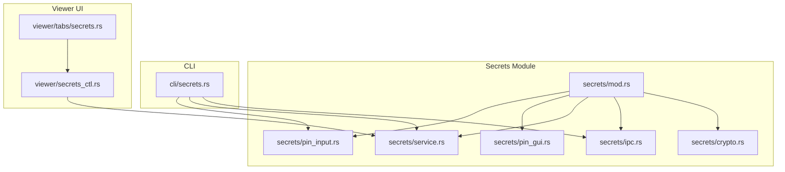
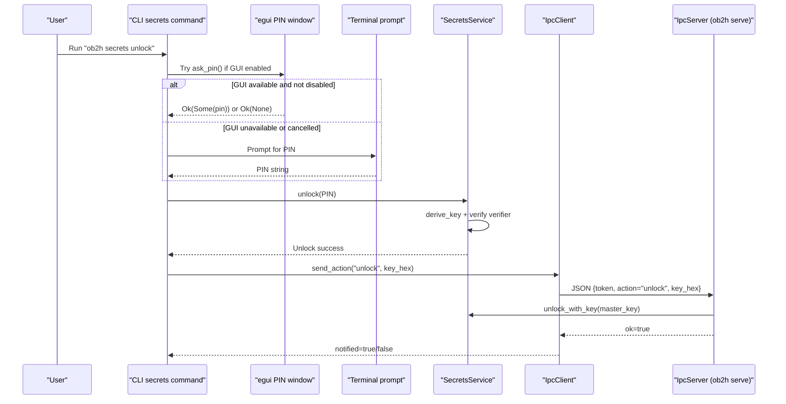
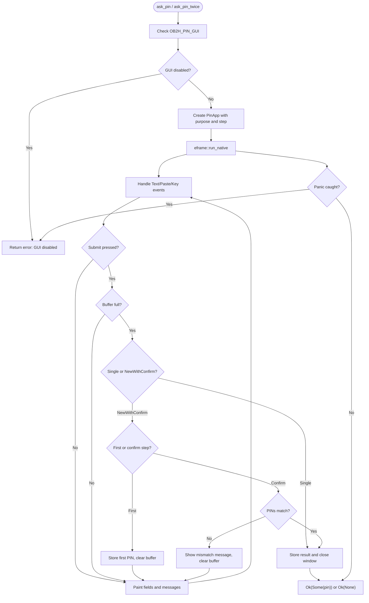
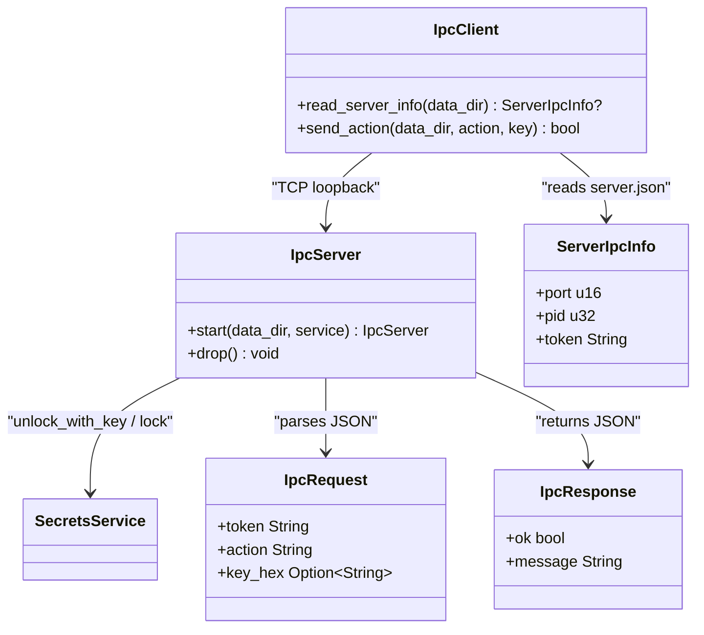
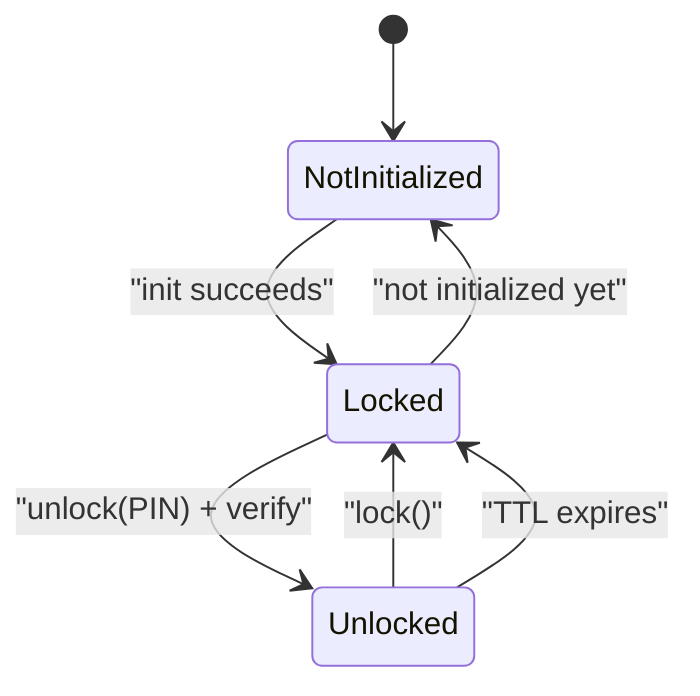
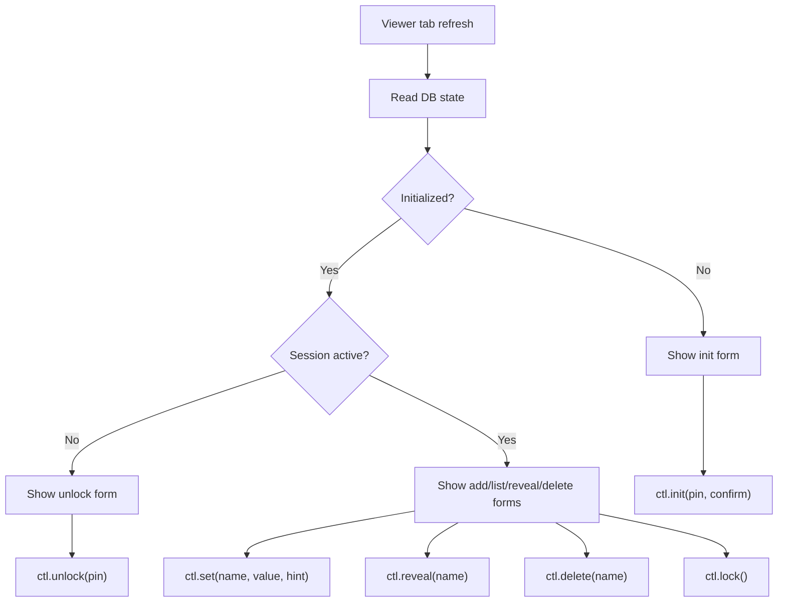
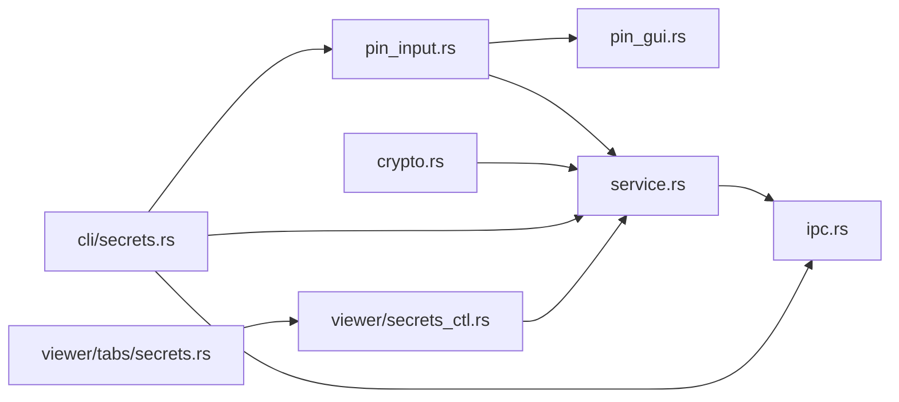

# PIN Authentication System

<cite>
**Referenced Files in This Document**
- [mod.rs](file://src/secrets/mod.rs)
- [pin_input.rs](file://src/secrets/pin_input.rs)
- [pin_gui.rs](file://src/secrets/pin_gui.rs)
- [service.rs](file://src/secrets/service.rs)
- [ipc.rs](file://src/secrets/ipc.rs)
- [crypto.rs](file://src/secrets/crypto.rs)
- [secrets.rs (CLI)](file://src/cli/secrets.rs)
- [secrets.rs (Viewer Tab)](file://src/viewer/tabs/secrets.rs)
- [secrets_ctl.rs](file://src/viewer/secrets_ctl.rs)
</cite>

## Table of Contents
1. [Introduction](#introduction)
2. [Project Structure](#project-structure)
3. [Core Components](#core-components)
4. [Architecture Overview](#architecture-overview)
5. [Detailed Component Analysis](#detailed-component-analysis)
6. [Dependency Analysis](#dependency-analysis)
7. [Performance Considerations](#performance-considerations)
8. [Troubleshooting Guide](#troubleshooting-guide)
9. [Conclusion](#conclusion)

## Introduction
This document explains the PIN authentication system used by the secrets vault. It covers:
- The graphical PIN input interface built with eframe/egui.
- The terminal-based fallback for headless environments and CI/CD pipelines.
- The local IPC protocol that synchronizes unlock state between a CLI invocation and a long-running `ob2h serve` process.
- The full authentication lifecycle from PIN prompt to key derivation, session establishment, TTL expiration, and lock.
- Programmatic usage patterns, error scenarios, timeouts, and security considerations for PIN handling and in-memory master-key protection.

The implementation is designed so that PIN entry never leaves the user’s process unless it is explicitly sent over the loopback IPC as a derived 32-byte master key. The PIN itself is only used locally to derive that key.

## Project Structure
The PIN authentication logic lives under the `secrets` module and integrates with both the CLI and the viewer UI.

**Diagram sources**
- [mod.rs:1-15](file://src/secrets/mod.rs#L1-L15)
- [pin_input.rs:1-20](file://src/secrets/pin_input.rs#L1-L20)
- [pin_gui.rs:1-16](file://src/secrets/pin_gui.rs#L1-L16)
- [service.rs:1-17](file://src/secrets/service.rs#L1-L17)
- [ipc.rs:1-14](file://src/secrets/ipc.rs#L1-L14)
- [crypto.rs:1-10](file://src/secrets/crypto.rs#L1-L10)
- [secrets.rs (CLI):1-11](file://src/cli/secrets.rs#L1-L11)
- [secrets.rs (Viewer Tab):1-16](file://src/viewer/tabs/secrets.rs#L1-L16)
- [secrets_ctl.rs:1-20](file://src/viewer/secrets_ctl.rs#L1-L20)

**Section sources**
- [mod.rs:1-15](file://src/secrets/mod.rs#L1-L15)
- [secrets.rs (CLI):1-11](file://src/cli/secrets.rs#L1-L11)
- [secrets.rs (Viewer Tab):1-16](file://src/viewer/tabs/secrets.rs#L1-L16)

## Core Components
- **PIN input model**: Pure logic for PIN length, format validation, language selection, localized strings, and a digit-only buffer.
- **Graphical PIN window**: A compact egui/eframe window that accepts exactly four digits, supports Enter/Esc, and can request a new PIN with confirmation.
- **Secrets service**: In-process secrets vault manager that derives keys, stores encrypted values, manages unlocked sessions with TTL, and exposes CRUD operations.
- **IPC layer**: Local TCP server and client on loopback that allow a CLI process to notify a running `ob2h serve` process about unlock or lock events using a per-run token.
- **Crypto primitives**: Argon2id KDF, XChaCha20-Poly1305 AEAD encryption, verifier creation/checking, and zeroize-safe memory handling.
- **CLI integration**: Commands for init, unlock, lock, status, rekey, list, and show; they prefer GUI input when available and fall back to terminal prompts otherwise.
- **Viewer integration**: A tab with its own state machine (`NotInitialized`, `Locked`, `Unlocked`) and controller that wraps `SecretsService` while auditing actions without leaking secret values.

**Section sources**
- [pin_input.rs:7-32](file://src/secrets/pin_input.rs#L7-L32)
- [pin_gui.rs:30-58](file://src/secrets/pin_gui.rs#L30-L58)
- [service.rs:18-47](file://src/secrets/service.rs#L18-L47)
- [ipc.rs:15-37](file://src/secrets/ipc.rs#L15-L37)
- [crypto.rs:13-32](file://src/secrets/crypto.rs#L13-L32)
- [secrets.rs (CLI):12-31](file://src/cli/secrets.rs#L12-L31)
- [secrets_ctl.rs:21-35](file://src/viewer/secrets_ctl.rs#L21-L35)

## Architecture Overview
The authentication architecture separates three concerns:
1. **User input**: Either a graphical PIN window or a terminal prompt.
2. **Key derivation and session management**: Performed inside `SecretsService`.
3. **Cross-process synchronization**: Achieved via a loopback IPC server and client.

**Diagram sources**
- [secrets.rs (CLI):47-101](file://src/cli/secrets.rs#L47-L101)
- [secrets.rs (CLI):162-190](file://src/cli/secrets.rs#L162-L190)
- [service.rs:113-176](file://src/secrets/service.rs#L113-L176)
- [ipc.rs:39-145](file://src/secrets/ipc.rs#L39-L145)
- [ipc.rs:156-195](file://src/secrets/ipc.rs#L156-L195)

## Detailed Component Analysis

### Graphical PIN Input Interface (eframe/egui)
The graphical PIN interface provides:
- A fixed-size, non-resizable window with centered title and prompt text.
- Four square fields representing the four-digit PIN.
- Digit-only input handling, including keyboard text, paste, Backspace, Delete, Enter, and Escape.
- Two modes:
  - Single PIN entry for unlock or current PIN verification.
  - New PIN with immediate confirmation, including mismatch feedback.
- Localization through `Lang` and `Texts`, supporting Russian and English.
- Environment override to disable the GUI via `OB2H_PIN_GUI=0|false|off|no|none`.

User experience design highlights:
- Clear visual distinction between filled and empty digit slots.
- Immediate feedback on mismatch during new PIN confirmation.
- Keyboard shortcuts: Enter confirms, Escape cancels.
- Window always stays on top and uses a consistent size to reduce layout confusion.

Accessibility considerations:
- Large monospace digits improve readability.
- High-contrast strokes and background colors follow egui visuals.
- Simple, predictable interaction model reduces cognitive load.
- Language selection respects environment variables and system locale, falling back to English.

Error handling:
- If the GUI cannot be created (headless, no display, wrong thread), the function returns an error instead of panicking, allowing the caller to fall back to terminal input.
- User cancellation via Escape or closing the window returns `None`, which the CLI treats as a graceful abort.

**Diagram sources**
- [pin_gui.rs:269-347](file://src/secrets/pin_gui.rs#L269-L347)
- [pin_gui.rs:101-177](file://src/secrets/pin_gui.rs#L101-L177)
- [pin_gui.rs:179-259](file://src/secrets/pin_gui.rs#L179-L259)
- [pin_input.rs:179-189](file://src/secrets/pin_input.rs#L179-L189)

**Section sources**
- [pin_gui.rs:1-16](file://src/secrets/pin_gui.rs#L1-L16)
- [pin_gui.rs:30-58](file://src/secrets/pin_gui.rs#L30-L58)
- [pin_gui.rs:101-177](file://src/secrets/pin_gui.rs#L101-L177)
- [pin_gui.rs:269-347](file://src/secrets/pin_gui.rs#L269-L347)
- [pin_input.rs:21-32](file://src/secrets/pin_input.rs#L21-L32)
- [pin_input.rs:34-70](file://src/secrets/pin_input.rs#L34-L70)
- [pin_input.rs:72-117](file://src/secrets/pin_input.rs#L72-L117)
- [pin_input.rs:119-178](file://src/secrets/pin_input.rs#L119-L178)
- [pin_input.rs:179-189](file://src/secrets/pin_input.rs#L179-L189)

### Terminal-Based PIN Entry Fallback
When the GUI is unavailable or disabled, the CLI falls back to terminal input:
- `resolve_pin` tries the GUI first; if unavailable or cancelled, it uses `rpassword` to prompt securely.
- `resolve_new_pin` handles two-step new PIN entry with format validation and mismatch checking.
- Errors are printed to stderr, and `None` results indicate user cancellation.

Programmatic examples:
- Init flow: resolve new PIN twice, validate format, then call `service.init`.
- Unlock flow: resolve single PIN, call `service.unlock`, optionally notify the running server via IPC.
- Rekey flow: unlock with current PIN, resolve new PIN twice, call `service.rekey`, then notify the server.

CI/CD and headless environments:
- Set `OB2H_PIN_GUI=0` to force terminal mode.
- Use non-interactive scripts to pipe PINs into stdin where appropriate, or pre-initialize the vault and rely on automation-friendly commands.

Timeout mechanisms:
- The GUI does not implement a global timeout; cancellation is explicit via Escape or window closure.
- The terminal fallback relies on the underlying prompt behavior; there is no built-in timeout in the CLI code shown here.
- Session TTL is enforced by `SecretsService`, not by the input layer.

**Section sources**
- [secrets.rs (CLI):33-45](file://src/cli/secrets.rs#L33-L45)
- [secrets.rs (CLI):47-101](file://src/cli/secrets.rs#L47-L101)
- [secrets.rs (CLI):104-132](file://src/cli/secrets.rs#L104-L132)
- [secrets.rs (CLI):146-190](file://src/cli/secrets.rs#L146-L190)
- [secrets.rs (CLI):223-257](file://src/cli/secrets.rs#L223-L257)

### IPC Communication Protocol Between Main Application and Secrets Service
The IPC layer enables a short-lived CLI process to synchronize unlock state with a long-running `ob2h serve` process:
- The server binds to a random port on `127.0.0.1`, writes a `server.json` file containing port, PID, and a random token.
- The client reads `server.json`, connects via TCP, sends a JSON request with token, action, and optional hex-encoded 32-byte key.
- Actions supported:
  - `unlock`: Requires a valid 32-byte key; sets the in-memory session.
  - `lock`: Clears the in-memory session.
- Responses include `ok` and a human-readable message.

Security properties:
- Loopback-only TCP binding prevents remote access.
- Random per-run token protects against unauthorized clients.
- Key size validation ensures only 32-byte keys are accepted.
- Keys are transmitted as hex strings over the loopback connection; they are not stored on disk beyond the ephemeral JSON metadata.

**Diagram sources**
- [ipc.rs:15-37](file://src/secrets/ipc.rs#L15-L37)
- [ipc.rs:39-145](file://src/secrets/ipc.rs#L39-L145)
- [ipc.rs:154-195](file://src/secrets/ipc.rs#L154-L195)

**Section sources**
- [ipc.rs:1-14](file://src/secrets/ipc.rs#L1-L14)
- [ipc.rs:39-145](file://src/secrets/ipc.rs#L39-L145)
- [ipc.rs:154-195](file://src/secrets/ipc.rs#L154-L195)

### Authentication Lifecycle: From PIN Prompt to Session Establishment
The lifecycle spans input, derivation, verification, session creation, and TTL enforcement:

1. **PIN collection**: GUI or terminal.
2. **Key derivation**: Argon2id derives a 32-byte master key from PIN and salt.
3. **Verifier check**: Decrypt stored verifier with derived key; compare magic payload.
4. **Session creation**: Store master key in `Zeroizing<[u8; 32]>` with deadline based on TTL.
5. **Operation gating**: All sensitive operations require an active session; expired sessions are cleared automatically.
6. **Locking**: Explicit lock clears the session; TTL expiry also clears it.
7. **IPC sync**: CLI notifies running server with derived key; server updates its own session.

**Diagram sources**
- [service.rs:58-111](file://src/secrets/service.rs#L58-L111)
- [service.rs:113-176](file://src/secrets/service.rs#L113-L176)
- [service.rs:185-203](file://src/secrets/service.rs#L185-L203)

**Section sources**
- [service.rs:58-111](file://src/secrets/service.rs#L58-L111)
- [service.rs:113-176](file://src/secrets/service.rs#L113-L176)
- [service.rs:185-203](file://src/secrets/service.rs#L185-L203)

### Viewer Integration and State Machine
The viewer tab implements a state machine over `SecretsState`:
- `NotInitialized`: Prompts user to initialize with a new PIN and confirmation.
- `Locked`: Prompts for PIN to unlock.
- `Unlocked`: Allows adding, revealing, copying, deleting secrets, and locking again.

The controller:
- Lazily opens a writeable database connection and creates a `SecretsService`.
- Audits actions without logging secret values.
- Ensures incorrect PIN attempts do not write audit entries.

Auto-hide behavior:
- Revealed values are stored with timestamps and automatically hidden after a configured TTL.
- Copying requires an explicit action and shows a warning.

**Diagram sources**
- [secrets.rs (Viewer Tab):21-47](file://src/viewer/tabs/secrets.rs#L21-L47)
- [secrets.rs (Viewer Tab):57-73](file://src/viewer/tabs/secrets.rs#L57-L73)
- [secrets.rs (Viewer Tab):75-132](file://src/viewer/tabs/secrets.rs#L75-L132)
- [secrets.rs (Viewer Tab):134-267](file://src/viewer/tabs/secrets.rs#L134-L267)
- [secrets_ctl.rs:37-84](file://src/viewer/secrets_ctl.rs#L37-L84)
- [secrets_ctl.rs:94-165](file://src/viewer/secrets_ctl.rs#L94-L165)

**Section sources**
- [secrets.rs (Viewer Tab):1-16](file://src/viewer/tabs/secrets.rs#L1-L16)
- [secrets.rs (Viewer Tab):21-47](file://src/viewer/tabs/secrets.rs#L21-L47)
- [secrets.rs (Viewer Tab):57-73](file://src/viewer/tabs/secrets.rs#L57-L73)
- [secrets.rs (Viewer Tab):75-132](file://src/viewer/tabs/secrets.rs#L75-L132)
- [secrets.rs (Viewer Tab):134-267](file://src/viewer/tabs/secrets.rs#L134-L267)
- [secrets_ctl.rs:21-35](file://src/viewer/secrets_ctl.rs#L21-L35)
- [secrets_ctl.rs:37-84](file://src/viewer/secrets_ctl.rs#L37-L84)
- [secrets_ctl.rs:94-165](file://src/viewer/secrets_ctl.rs#L94-L165)

## Dependency Analysis
The dependencies reflect a layered design:
- `pin_input` is pure logic and has no runtime GUI dependency.
- `pin_gui` depends on `pin_input` and eframe/egui.
- `service` depends on `crypto` and `pin_input`.
- `ipc` depends on `service` and standard async networking.
- CLI and viewer depend on `service`, `ipc`, and `pin_input`.

**Diagram sources**
- [pin_input.rs:1-20](file://src/secrets/pin_input.rs#L1-L20)
- [pin_gui.rs:1-16](file://src/secrets/pin_gui.rs#L1-L16)
- [service.rs:1-17](file://src/secrets/service.rs#L1-L17)
- [ipc.rs:1-14](file://src/secrets/ipc.rs#L1-L14)
- [secrets.rs (CLI):1-11](file://src/cli/secrets.rs#L1-L11)
- [secrets.rs (Viewer Tab):1-16](file://src/viewer/tabs/secrets.rs#L1-L16)
- [secrets_ctl.rs:1-20](file://src/viewer/secrets_ctl.rs#L1-L20)

**Section sources**
- [mod.rs:1-15](file://src/secrets/mod.rs#L1-L15)
- [pin_input.rs:1-20](file://src/secrets/pin_input.rs#L1-L20)
- [pin_gui.rs:1-16](file://src/secrets/pin_gui.rs#L1-L16)
- [service.rs:1-17](file://src/secrets/service.rs#L1-L17)
- [ipc.rs:1-14](file://src/secrets/ipc.rs#L1-L14)
- [secrets.rs (CLI):1-11](file://src/cli/secrets.rs#L1-L11)
- [secrets.rs (Viewer Tab):1-16](file://src/viewer/tabs/secrets.rs#L1-L16)
- [secrets_ctl.rs:1-20](file://src/viewer/secrets_ctl.rs#L1-L20)

## Performance Considerations
- **Argon2id parameters**: Default memory cost is high (64 MiB), making brute-force attacks expensive but increasing unlock time. Adjust `KdfParams` carefully for constrained environments.
- **Session TTL**: Short TTL reduces exposure of the master key in memory; longer TTL improves UX but increases risk.
- **IPC overhead**: Loopback TCP is fast, but unnecessary repeated unlocks should be avoided; prefer keeping the server unlocked within the intended TTL.
- **Database access**: The viewer controller lazily opens a writeable connection to avoid holding locks unnecessarily; read-only status checks use a separate read-only connection.
- **Memory safety**: Master keys and decrypted values are wrapped in `Zeroizing` to minimize accidental retention.

[No sources needed since this section provides general guidance]

## Troubleshooting Guide
Common issues and resolutions:
- **GUI unavailable**:
  - Cause: Headless environment, SSH without X forwarding, or `OB2H_PIN_GUI=0`.
  - Resolution: Use terminal fallback or set up a display environment.
- **Wrong PIN**:
  - Cause: Incorrect PIN entered.
  - Resolution: Re-enter PIN; note that wrong PIN attempts do not write audit logs in the viewer controller.
- **Session expired**:
  - Cause: TTL elapsed before operation.
  - Resolution: Unlock again; consider adjusting TTL based on workflow needs.
- **IPC notification failed**:
  - Cause: No running `ob2h serve` process or token mismatch.
  - Resolution: Start the server; the CLI will still succeed locally even if IPC notification fails.
- **Invalid PIN format**:
  - Cause: PIN is not exactly four ASCII digits.
  - Resolution: Ensure PIN contains only digits and has length four.

Operational tips:
- Use `status` to inspect initialization, lock state, TTL remaining, and record count.
- Use `list` and `show` to verify secrets after unlocking.
- Use `rekey` to rotate PINs; existing records are re-encrypted atomically.

**Section sources**
- [pin_gui.rs:269-347](file://src/secrets/pin_gui.rs#L269-L347)
- [secrets.rs (CLI):162-190](file://src/cli/secrets.rs#L162-L190)
- [secrets.rs (CLI):202-221](file://src/cli/secrets.rs#L202-L221)
- [service.rs:185-203](file://src/secrets/service.rs#L185-L203)
- [secrets_ctl.rs:244-253](file://src/viewer/secrets_ctl.rs#L244-L253)

## Conclusion
The PIN authentication system provides a secure, flexible approach to secrets management:
- A polished GUI for interactive users, with robust fallback to terminal input for headless and automated environments.
- Strong cryptographic foundations using Argon2id and XChaCha20-Poly1305, with verifier-based PIN validation and zeroize-safe memory handling.
- A local IPC mechanism to synchronize unlock state across processes without exposing PINs.
- Clear lifecycle management with TTL-based session expiration and explicit locking.
- Comprehensive integration with both CLI and viewer UI, including auditing and user-friendly error handling.

For production deployments, tune Argon2id parameters and TTL according to performance and security requirements, and ensure proper environment configuration for GUI availability and language localization.

[No sources needed since this section summarizes without analyzing specific files]