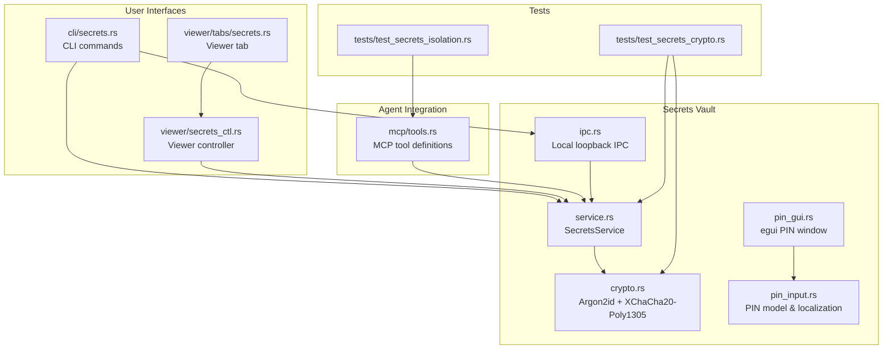
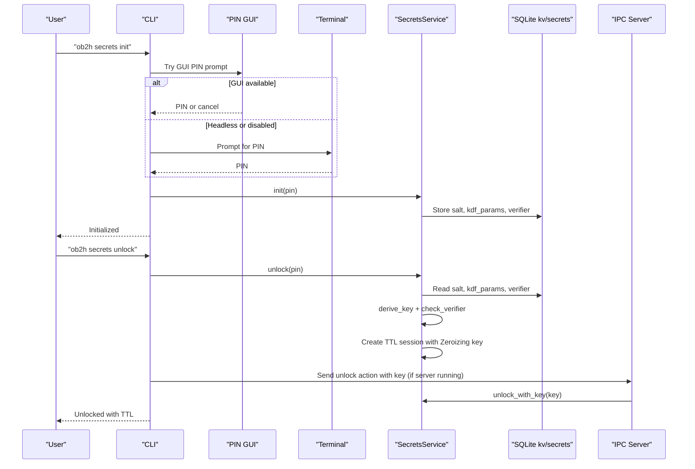
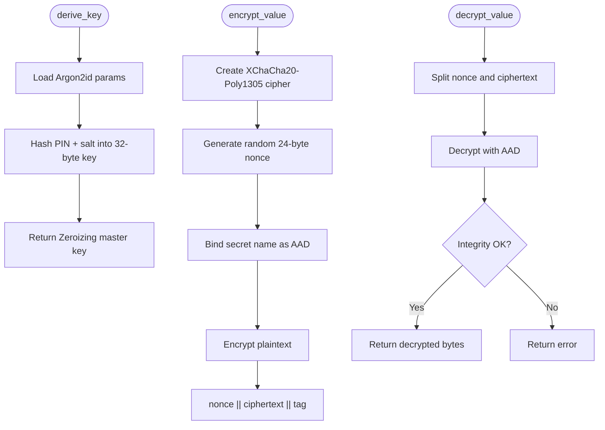
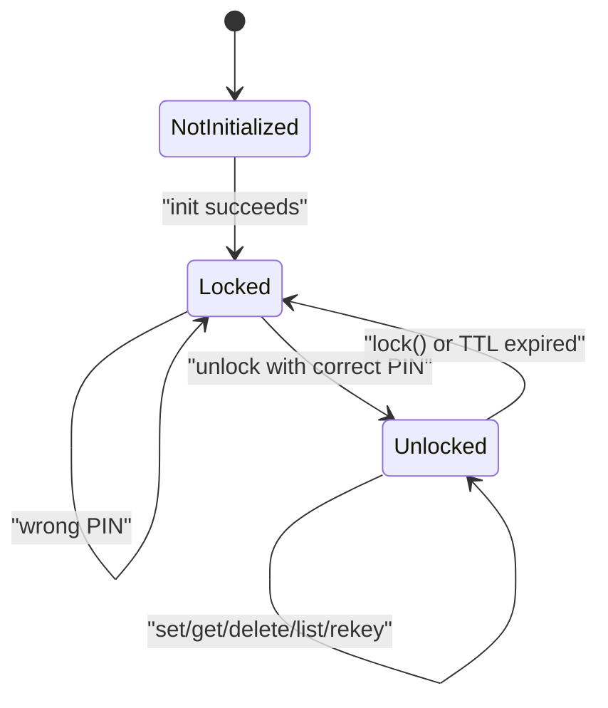
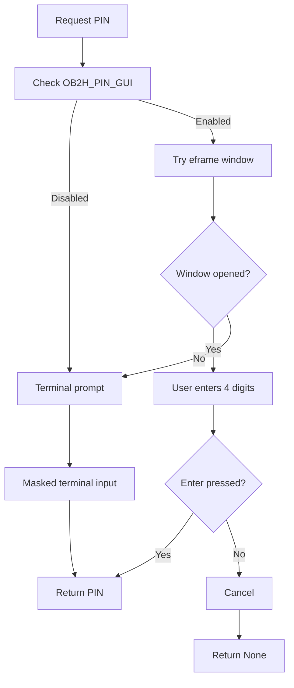
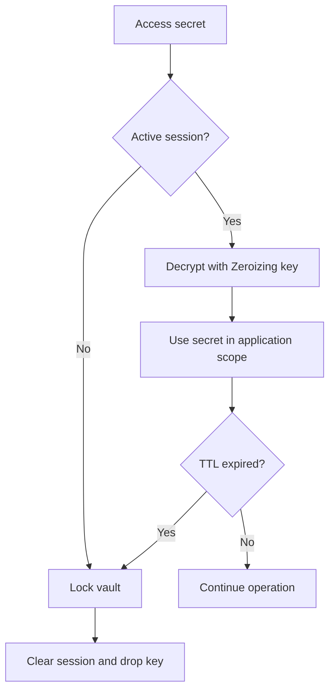
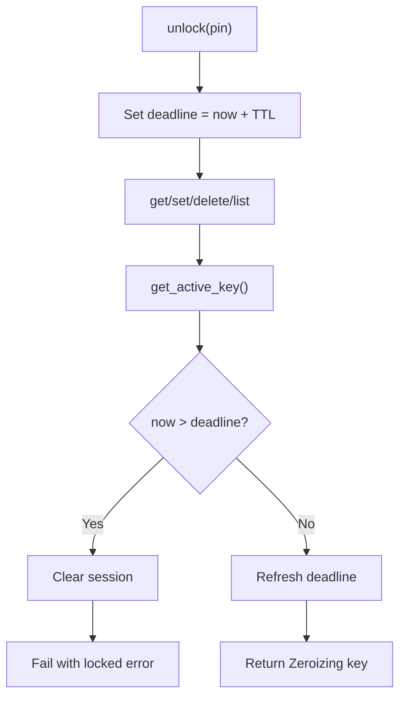
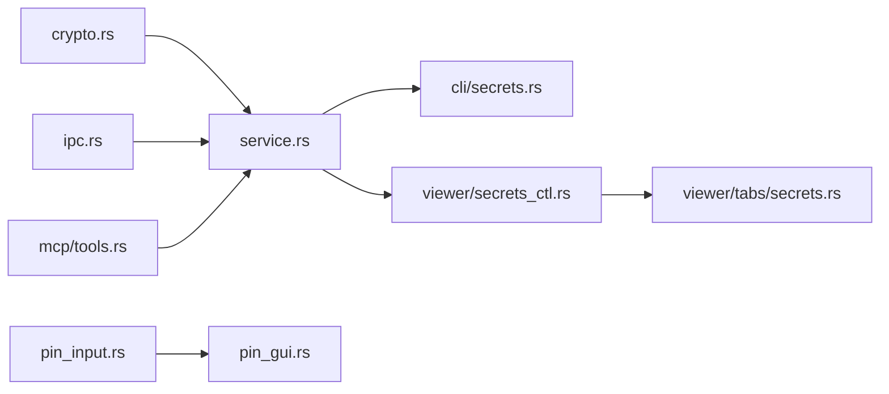

# Secrets Management

<cite>
**Referenced Files in This Document**
- [mod.rs](file://src/secrets/mod.rs)
- [crypto.rs](file://src/secrets/crypto.rs)
- [service.rs](file://src/secrets/service.rs)
- [pin_input.rs](file://src/secrets/pin_input.rs)
- [pin_gui.rs](file://src/secrets/pin_gui.rs)
- [ipc.rs](file://src/secrets/ipc.rs)
- [secrets.rs](file://src/cli/secrets.rs)
- [tools.rs](file://src/mcp/tools.rs)
- [secrets_tab.rs](file://src/viewer/tabs/secrets.rs)
- [secrets_ctl.rs](file://src/viewer/secrets_ctl.rs)
- [test_secrets_crypto.rs](file://tests/test_secrets_crypto.rs)
- [test_secrets_isolation.rs](file://tests/test_secrets_isolation.rs)
</cite>

## Table of Contents
1. [Introduction](#introduction)
2. [Project Structure](#project-structure)
3. [Core Components](#core-components)
4. [Architecture Overview](#architecture-overview)
5. [Detailed Component Analysis](#detailed-component-analysis)
6. [Dependency Analysis](#dependency-analysis)
7. [Performance Considerations](#performance-considerations)
8. [Troubleshooting Guide](#troubleshooting-guide)
9. [Conclusion](#conclusion)
10. [Appendices](#appendices)

## Introduction
This document explains the secrets vault sub-feature: encrypted credential storage, PIN-based authentication, memory isolation, TTL-based key expiration, and integration with the CLI, graphical viewer, and MCP tools. It focuses on how the system derives a master key from a four-digit PIN using Argon2id, encrypts secret values with XChaCha20-Poly1305, keeps the master key only in process memory, and prevents secrets from leaking into LLM contexts, dream processing, or sync bundles.

The vault is designed for operators who need to store API keys, tokens, and passwords securely while still allowing controlled access through a graphical interface, terminal commands, or MCP tool calls.

## Project Structure
The secrets vault is implemented under `src/secrets/` and integrated across several layers:

- Cryptographic primitives: key derivation, encryption, decryption, verifier.
- Service layer: session management, TTL, CRUD operations, rekeying.
- PIN input model and GUI window.
- IPC channel between CLI and background server.
- CLI commands for initialization, unlock, lock, status, list, show, and rekey.
- MCP tool definitions exposing vault operations to agents.
- Viewer tab and controller for interactive use.
- Tests validating crypto behavior and isolation guarantees.

**Diagram sources**
- [crypto.rs:1-168](file://src/secrets/crypto.rs#L1-L168)
- [service.rs:1-446](file://src/secrets/service.rs#L1-L446)
- [pin_input.rs:1-257](file://src/secrets/pin_input.rs#L1-L257)
- [pin_gui.rs:1-348](file://src/secrets/pin_gui.rs#L1-L348)
- [ipc.rs:1-196](file://src/secrets/ipc.rs#L1-L196)
- [secrets.rs:1-311](file://src/cli/secrets.rs#L1-L311)
- [secrets_tab.rs:1-267](file://src/viewer/tabs/secrets.rs#L1-L267)
- [secrets_ctl.rs:1-305](file://src/viewer/secrets_ctl.rs#L1-L305)
- [tools.rs:569-620](file://src/mcp/tools.rs#L569-L620)
- [test_secrets_crypto.rs:1-131](file://tests/test_secrets_crypto.rs#L1-L131)
- [test_secrets_isolation.rs:1-59](file://tests/test_secrets_isolation.rs#L1-L59)

**Section sources**
- [mod.rs:1-15](file://src/secrets/mod.rs#L1-L15)
- [crypto.rs:1-168](file://src/secrets/crypto.rs#L1-L168)
- [service.rs:1-446](file://src/secrets/service.rs#L1-L446)
- [pin_input.rs:1-257](file://src/secrets/pin_input.rs#L1-L257)
- [pin_gui.rs:1-348](file://src/secrets/pin_gui.rs#L1-L348)
- [ipc.rs:1-196](file://src/secrets/ipc.rs#L1-L196)
- [secrets.rs:1-311](file://src/cli/secrets.rs#L1-L311)
- [tools.rs:569-620](file://src/mcp/tools.rs#L569-L620)
- [secrets_tab.rs:1-267](file://src/viewer/tabs/secrets.rs#L1-L267)
- [secrets_ctl.rs:1-305](file://src/viewer/secrets_ctl.rs#L1-L305)
- [test_secrets_crypto.rs:1-131](file://tests/test_secrets_crypto.rs#L1-L131)
- [test_secrets_isolation.rs:1-59](file://tests/test_secrets_isolation.rs#L1-L59)

## Core Components
The secrets vault consists of five core components:

| Component | Responsibility | Security Property |
|---|---|---|
| `crypto.rs` | Argon2id master key derivation, salt generation, XChaCha20-Poly1305 encryption/decryption, PIN verifier creation/checking | Uses zeroizing buffers; AAD binds ciphertext to secret name |
| `service.rs` | Vault lifecycle, PIN validation, unlock/lock, TTL session, CRUD, metadata listing, rekey | Master key stored as `Zeroizing<[u8; 32]>`; TTL expires session; lock clears session |
| `pin_input.rs` | Four-digit PIN format, language selection, localized prompts, digit buffer | Pure logic without GUI; validates exactly four ASCII digits |
| `pin_gui.rs` | Compact egui window for PIN entry, single or confirm flow, headless fallback | Runs only when GUI is available; returns error otherwise |
| `ipc.rs` | Local TCP IPC between CLI and running server; token-authenticated unlock/lock | Loopback-only; key passed in-memory over local socket |

**Section sources**
- [crypto.rs:13-111](file://src/secrets/crypto.rs#L13-L111)
- [service.rs:18-47](file://src/secrets/service.rs#L18-L47)
- [pin_input.rs:7-19](file://src/secrets/pin_input.rs#L7-L19)
- [pin_gui.rs:1-10](file://src/secrets/pin_gui.rs#L1-L10)
- [ipc.rs:1-27](file://src/secrets/ipc.rs#L1-L27)

## Architecture Overview
The vault separates cryptographic state from user interfaces and agent integrations. The master key never touches disk; only salt, KDF parameters, and an encrypted verifier are persisted. Secret values are stored encrypted with a per-name AAD binding.

**Diagram sources**
- [secrets.rs:146-190](file://src/cli/secrets.rs#L146-L190)
- [pin_gui.rs:277-347](file://src/secrets/pin_gui.rs#L277-L347)
- [pin_input.rs:17-19](file://src/secrets/pin_input.rs#L17-L19)
- [service.rs:72-176](file://src/secrets/service.rs#L72-L176)
- [ipc.rs:91-122](file://src/secrets/ipc.rs#L91-L122)

## Detailed Component Analysis

### Encryption and Key Derivation
The cryptographic layer implements:

- **Argon2id master key derivation**: A PIN and random salt produce a 32-byte master key. Parameters include memory cost, time cost, and parallelism.
- **Salt generation**: Cryptographically secure random 16-byte salt.
- **XChaCha20-Poly1305 encryption**: Each secret value is encrypted with a random nonce; the output is `nonce || ciphertext || tag`. The secret name is used as Additional Authenticated Data so changing the name breaks decryption.
- **Verifier**: An encrypted magic string bound by the same AAD allows checking whether a derived key matches the stored vault.

**Diagram sources**
- [crypto.rs:34-44](file://src/secrets/crypto.rs#L34-L44)
- [crypto.rs:54-98](file://src/secrets/crypto.rs#L54-L98)
- [crypto.rs:100-111](file://src/secrets/crypto.rs#L100-L111)

**Section sources**
- [crypto.rs:13-111](file://src/secrets/crypto.rs#L13-L111)
- [test_secrets_crypto.rs:7-38](file://tests/test_secrets_crypto.rs#L7-L38)

### SecretsService Lifecycle
`SecretsService` manages:

- Initialization with PIN, salt, KDF parameters, and verifier.
- Unlocking via PIN verification.
- Locking by clearing the in-memory session.
- TTL-based session expiration that automatically locks the vault.
- CRUD operations that require an active unlocked session.
- Rekeying that decrypts all records with the old key, re-encrypts them with the new key, and atomically updates persistence.

**Diagram sources**
- [service.rs:37-47](file://src/secrets/service.rs#L37-L47)
- [service.rs:58-176](file://src/secrets/service.rs#L58-L176)
- [service.rs:185-203](file://src/secrets/service.rs#L185-L203)
- [service.rs:266-358](file://src/secrets/service.rs#L266-L358)
- [service.rs:360-444](file://src/secrets/service.rs#L360-L444)

**Section sources**
- [service.rs:18-47](file://src/secrets/service.rs#L18-L47)
- [service.rs:58-176](file://src/secrets/service.rs#L58-L176)
- [service.rs:185-203](file://src/secrets/service.rs#L185-L203)
- [service.rs:266-358](file://src/secrets/service.rs#L266-L358)
- [service.rs:360-444](file://src/secrets/service.rs#L360-L444)
- [test_secrets_crypto.rs:61-130](file://tests/test_secrets_crypto.rs#L61-L130)

### PIN Authentication Flow
PIN input supports two paths:

1. **Graphical PIN window**: Available when the `gui` feature is enabled and not disabled by environment variables. It accepts exactly four digits, supports Enter to confirm and Escape to cancel, and handles mismatch confirmation for new PIN setup.
2. **Terminal fallback**: When GUI is unavailable, disabled, or fails, the CLI falls back to masked terminal input.

**Diagram sources**
- [pin_gui.rs:277-347](file://src/secrets/pin_gui.rs#L277-L347)
- [pin_input.rs:17-19](file://src/secrets/pin_input.rs#L17-L19)
- [pin_input.rs:180-189](file://src/secrets/pin_input.rs#L180-L189)
- [secrets.rs:50-101](file://src/cli/secrets.rs#L50-L101)

**Section sources**
- [pin_input.rs:7-19](file://src/secrets/pin_input.rs#L7-L19)
- [pin_input.rs:180-189](file://src/secrets/pin_input.rs#L180-L189)
- [pin_gui.rs:1-10](file://src/secrets/pin_gui.rs#L1-L10)
- [pin_gui.rs:277-347](file://src/secrets/pin_gui.rs#L277-L347)
- [secrets.rs:50-101](file://src/cli/secrets.rs#L50-L101)

### Memory Isolation and Threat Mitigation
The vault enforces strict isolation:

- The master key is stored only in process memory as `Zeroizing<[u8; 32]>`.
- On lock, the session is cleared, causing the key to be dropped and zeroized.
- TTL expiration invalidates the session and treats the vault as locked.
- Secret values are never included in audit details; only names and sizes are recorded.
- MCP tools expose read-only hints for status and get operations, and destructive hints for delete operations.
- Tests verify that secrets do not leak into search results, context blocks, graph search, stats, or sync export bundles.

**Diagram sources**
- [service.rs:37-47](file://src/secrets/service.rs#L37-L47)
- [service.rs:178-203](file://src/secrets/service.rs#L178-L203)
- [secrets_ctl.rs:86-92](file://src/viewer/secrets_ctl.rs#L86-L92)
- [test_secrets_isolation.rs:14-57](file://tests/test_secrets_isolation.rs#L14-L57)

**Section sources**
- [service.rs:178-203](file://src/secrets/service.rs#L178-L203)
- [secrets_ctl.rs:86-92](file://src/viewer/secrets_ctl.rs#L86-L92)
- [test_secrets_isolation.rs:14-57](file://tests/test_secrets_isolation.rs#L14-L57)

### TTL-Based Expiration and Immediate Key Zeroization
Key expiration works as follows:

- On unlock, a deadline is set based on the configured TTL.
- Every successful key acquisition refreshes the deadline.
- If the current time exceeds the deadline, the session is cleared and subsequent operations fail until re-unlocking.
- Explicit lock clears the session immediately.
- Viewer controller shutdown also locks and drops the service connection.

**Diagram sources**
- [service.rs:154-163](file://src/secrets/service.rs#L154-L163)
- [service.rs:185-203](file://src/secrets/service.rs#L185-L203)
- [secrets_ctl.rs:160-173](file://src/viewer/secrets_ctl.rs#L160-L173)

**Section sources**
- [service.rs:154-163](file://src/secrets/service.rs#L154-L163)
- [service.rs:185-203](file://src/secrets/service.rs#L185-L203)
- [secrets_ctl.rs:160-173](file://src/viewer/secrets_ctl.rs#L160-L173)

### CLI Commands and Terminal Fallback
The CLI exposes:

- `init`: Initialize vault with a four-digit PIN.
- `unlock`: Unlock vault and optionally notify a running server.
- `lock`: Lock vault locally or remotely via IPC.
- `status`: Show initialization state, lock state, TTL, record count, and secret names.
- `list`: Show metadata without values.
- `show <name>`: Print decrypted value after unlock.
- `rekey`: Change PIN and re-encrypt all records.

GUI input is attempted first; if unavailable, masked terminal input is used.

**Section sources**
- [secrets.rs:12-31](file://src/cli/secrets.rs#L12-L31)
- [secrets.rs:50-101](file://src/cli/secrets.rs#L50-L101)
- [secrets.rs:136-309](file://src/cli/secrets.rs#L136-L309)

### MCP Tool Integration
MCP tools expose vault operations to agents:

| Tool | Behavior | Security Note |
|---|---|---|
| `secrets_status` | Returns initialized, locked, TTL, and secret names | Read-only hint |
| `secrets_set` | Stores encrypted secret with optional hint | Requires unlocked vault |
| `secrets_get` | Decrypts and returns secret value | Read-only hint; requires unlocked vault |
| `secrets_delete` | Deletes secret by name | Destructive hint; requires unlocked vault |
| `secrets_lock` | Immediately locks vault and zeroes master key | No arguments |

These tools are defined in the MCP tool registry and annotated with read-only or destructive hints.

**Section sources**
- [tools.rs:9-53](file://src/mcp/tools.rs#L9-L53)
- [tools.rs:569-620](file://src/mcp/tools.rs#L569-L620)

### Graphical Viewer Tab
The viewer tab provides:

- State machine: not initialized → locked → unlocked.
- PIN entry fields with password masking.
- Auto-hide of revealed values after a short TTL.
- Copy-to-clipboard with explicit warning.
- Confirmation dialog before deletion.
- Audit recording through the viewer controller.

**Section sources**
- [secrets_tab.rs:1-35](file://src/viewer/tabs/secrets.rs#L1-L35)
- [secrets_tab.rs:37-73](file://src/viewer/tabs/secrets.rs#L37-L73)
- [secrets_tab.rs:75-108](file://src/viewer/tabs/secrets.rs#L75-L108)
- [secrets_tab.rs:110-132](file://src/viewer/tabs/secrets.rs#L110-L132)
- [secrets_tab.rs:134-267](file://src/viewer/tabs/secrets.rs#L134-L267)

### Viewer Controller
The viewer controller wraps `SecretsService` and adds:

- Lazy RW database connection.
- State inspection without opening RW connection.
- Audit recording with actor `user`, source tool `viewer`, and no secret values.
- Shutdown that locks and drops the service and connection.

**Section sources**
- [secrets_ctl.rs:1-9](file://src/viewer/secrets_ctl.rs#L1-L9)
- [secrets_ctl.rs:37-57](file://src/viewer/secrets_ctl.rs#L37-L57)
- [secrets_ctl.rs:59-84](file://src/viewer/secrets_ctl.rs#L59-L84)
- [secrets_ctl.rs:86-165](file://src/viewer/secrets_ctl.rs#L86-L165)
- [secrets_ctl.rs:168-173](file://src/viewer/secrets_ctl.rs#L168-L173)

### IPC Between CLI and Server
The IPC layer enables:

- CLI unlocking a running server process.
- CLI locking a running server process.
- Token-authenticated requests over loopback TCP.
- In-memory key transfer without writing to disk.

**Section sources**
- [ipc.rs:1-27](file://src/secrets/ipc.rs#L1-L27)
- [ipc.rs:39-145](file://src/secrets/ipc.rs#L39-L145)
- [ipc.rs:154-195](file://src/secrets/ipc.rs#L154-L195)
- [secrets.rs:183-190](file://src/cli/secrets.rs#L183-L190)

## Dependency Analysis
The secrets subsystem has clear boundaries:

- `crypto.rs` has no dependency on UI, CLI, or IPC.
- `service.rs` depends on `crypto.rs`, SQLite, and PIN validation.
- `pin_gui.rs` depends on `pin_input.rs` and the egui runtime.
- `ipc.rs` depends on `service.rs` and Tokio networking.
- CLI and viewer depend on `service.rs` but not directly on `crypto.rs`.
- MCP tools reference vault operations through the service layer.

**Diagram sources**
- [crypto.rs:1-168](file://src/secrets/crypto.rs#L1-L168)
- [service.rs:1-446](file://src/secrets/service.rs#L1-L446)
- [pin_input.rs:1-257](file://src/secrets/pin_input.rs#L1-L257)
- [pin_gui.rs:1-348](file://src/secrets/pin_gui.rs#L1-L348)
- [ipc.rs:1-196](file://src/secrets/ipc.rs#L1-L196)
- [secrets.rs:1-311](file://src/cli/secrets.rs#L1-L311)
- [secrets_ctl.rs:1-305](file://src/viewer/secrets_ctl.rs#L1-L305)
- [secrets_tab.rs:1-267](file://src/viewer/tabs/secrets.rs#L1-L267)
- [tools.rs:569-620](file://src/mcp/tools.rs#L569-L620)

**Section sources**
- [mod.rs:1-15](file://src/secrets/mod.rs#L1-L15)
- [crypto.rs:1-168](file://src/secrets/crypto.rs#L1-L168)
- [service.rs:1-446](file://src/secrets/service.rs#L1-L446)
- [pin_input.rs:1-257](file://src/secrets/pin_input.rs#L1-L257)
- [pin_gui.rs:1-348](file://src/secrets/pin_gui.rs#L1-L348)
- [ipc.rs:1-196](file://src/secrets/ipc.rs#L1-L196)
- [secrets.rs:1-311](file://src/cli/secrets.rs#L1-L311)
- [secrets_ctl.rs:1-305](file://src/viewer/secrets_ctl.rs#L1-L305)
- [secrets_tab.rs:1-267](file://src/viewer/tabs/secrets.rs#L1-L267)
- [tools.rs:569-620](file://src/mcp/tools.rs#L569-L620)

## Performance Considerations
- Argon2id is intentionally slow to resist brute-force attacks. Default parameters use significant memory; tests reduce costs for speed.
- TTL reduces the window where the master key exists in memory.
- Viewer controller opens RW database connections lazily to avoid unnecessary overhead.
- IPC uses small JSON payloads and loopback TCP, minimizing network exposure.
- Secret values are limited to 64 KB to prevent excessive in-memory encryption workloads.

[No sources needed since this section provides general guidance]

## Troubleshooting Guide
Common issues and resolutions:

| Symptom | Likely Cause | Resolution |
|---|---|---|
| Vault reports not initialized | `secrets.initialized` flag missing | Run `ob2h secrets init` |
| Wrong PIN error | Incorrect PIN or corrupted verifier | Re-enter correct PIN; if lost, vault cannot be recovered |
| GUI PIN window unavailable | Headless environment, SSH, CI, or `OB2H_PIN_GUI=0` | Use terminal fallback |
| Secrets locked after operation | TTL expired | Run `ob2h secrets unlock` |
| MCP `secrets_get` fails | Vault locked or wrong PIN | Unlock via CLI or MCP `secrets_lock` then unlock again |
| Sync bundle contains secrets | Misconfiguration or implementation regression | Verify isolation tests and ensure secrets are excluded from export |

**Section sources**
- [secrets.rs:146-190](file://src/cli/secrets.rs#L146-L190)
- [pin_gui.rs:297-347](file://src/secrets/pin_gui.rs#L297-L347)
- [service.rs:118-163](file://src/secrets/service.rs#L118-L163)
- [test_secrets_isolation.rs:47-57](file://tests/test_secrets_isolation.rs#L47-L57)

## Conclusion
The secrets vault provides strong encryption, PIN-based authentication, memory isolation, and controlled access through CLI, GUI, and MCP tools. Its design minimizes secret exposure by keeping master keys in memory, enforcing TTL expiration, zeroizing keys on lock, and preventing leaks into LLM contexts, dreams, and sync bundles. For compliance, it avoids storing secret values in audit logs, restricts MCP tool annotations, and isolates sensitive data from broader system exports.

[No sources needed since this section summarizes without analyzing specific files]

## Appendices

### Concrete Examples

#### Secrets Initialization
- CLI: initialize vault with a four-digit PIN.
- GUI: enter PIN twice during initialization.
- Service: stores salt, KDF parameters, and encrypted verifier.

**Section sources**
- [secrets.rs:146-160](file://src/cli/secrets.rs#L146-L160)
- [service.rs:72-111](file://src/secrets/service.rs#L72-L111)
- [secrets_ctl.rs:94-110](file://src/viewer/secrets_ctl.rs#L94-L110)

#### CRUD Operations
- Set: encrypt value with name-bound AAD and persist ciphertext.
- Get: decrypt value, update access statistics, return zeroized string.
- Delete: remove record by name.
- List: return metadata without values.

**Section sources**
- [service.rs:266-358](file://src/secrets/service.rs#L266-L358)
- [secrets_ctl.rs:128-158](file://src/viewer/secrets_ctl.rs#L128-L158)

#### MCP Tool Usage
- Call `secrets_status` to check vault state.
- Call `secrets_set` to store a secret.
- Call `secrets_get` to retrieve a secret after unlocking.
- Call `secrets_delete` to remove a secret.
- Call `secrets_lock` to immediately lock the vault.

**Section sources**
- [tools.rs:569-620](file://src/mcp/tools.rs#L569-L620)

### Security Model Summary
- **Threat model**: Protects against unauthorized access to stored credentials, accidental leakage into agent contexts, and exposure through backups or sync bundles.
- **Mitigations**: Argon2id KDF, XChaCha20-Poly1305 AEAD with AAD, zeroizing memory, TTL sessions, immediate key zeroization on lock, restricted IPC, audit without values, MCP annotations.
- **Compliance considerations**: Avoids persistent secret storage, limits secret size, excludes secrets from search and sync exports, and records only non-sensitive audit metadata.

**Section sources**
- [crypto.rs:1-111](file://src/secrets/crypto.rs#L1-L111)
- [service.rs:178-203](file://src/secrets/service.rs#L178-L203)
- [secrets_ctl.rs:86-92](file://src/viewer/secrets_ctl.rs#L86-L92)
- [test_secrets_isolation.rs:14-57](file://tests/test_secrets_isolation.rs#L14-L57)