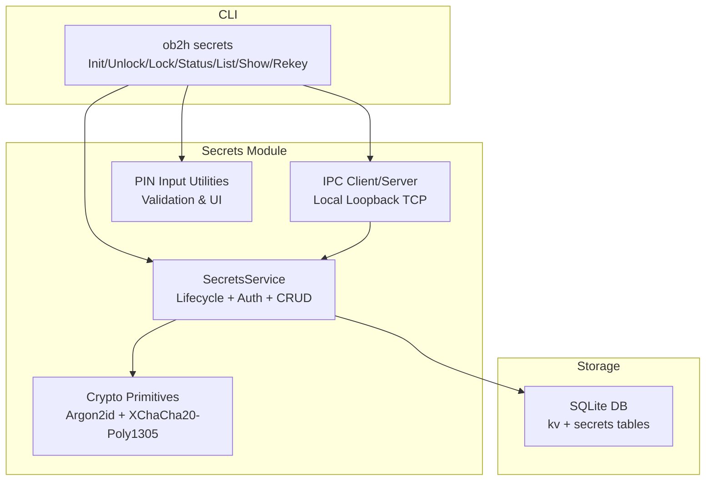
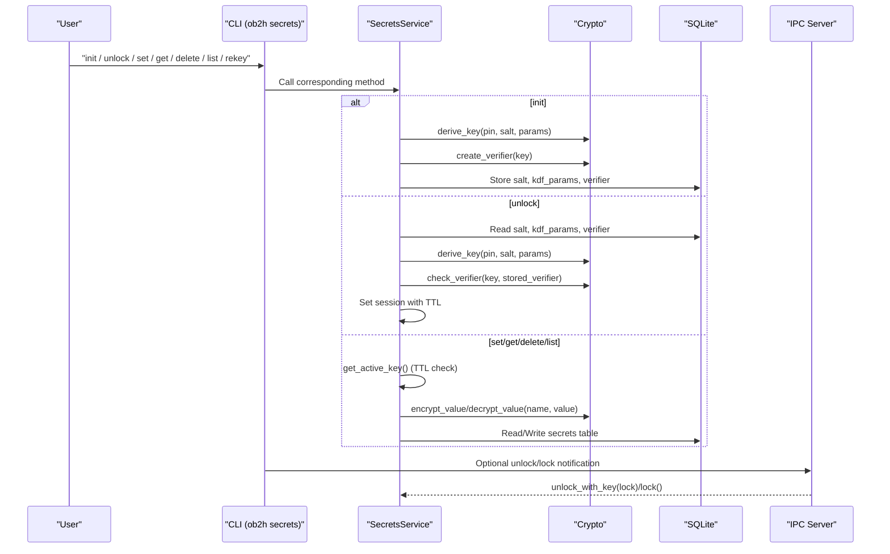
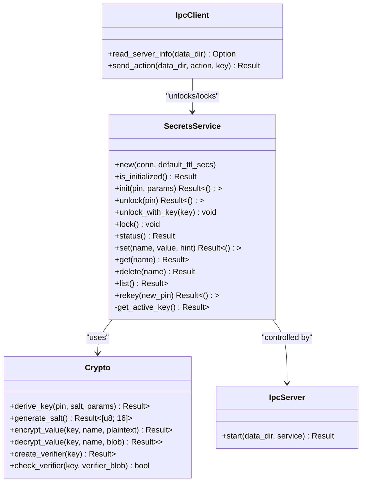

# Core API Methods

<cite>
**Referenced Files in This Document**
- [service.rs](file://src/secrets/service.rs)
- [mod.rs](file://src/secrets/mod.rs)
- [crypto.rs](file://src/secrets/crypto.rs)
- [ipc.rs](file://src/secrets/ipc.rs)
- [pin_input.rs](file://src/secrets/pin_input.rs)
- [secrets.rs](file://src/cli/secrets.rs)
- [schema.rs](file://src/db/schema.rs)
</cite>

## Table of Contents
1. [Introduction](#introduction)
2. [Project Structure](#project-structure)
3. [Core Components](#core-components)
4. [Architecture Overview](#architecture-overview)
5. [Detailed Component Analysis](#detailed-component-analysis)
6. [Dependency Analysis](#dependency-analysis)
7. [Performance Considerations](#performance-considerations)
8. [Troubleshooting Guide](#troubleshooting-guide)
9. [Conclusion](#conclusion)

## Introduction
This document describes the core SecretsService API methods used to manage encrypted secrets in the project. It covers initialization, authentication, lifecycle management, and CRUD operations, including TTL-based session expiration, validation rules, size limits, data integrity constraints, and security implications. The documentation is intended for both developers integrating with the service and operators using the CLI.

## Project Structure
The Secrets feature is implemented as a Rust module under src/secrets with:
- Service layer: SecretsService (lifecycle, auth, CRUD, TTL)
- Cryptography primitives: Argon2id KDF, XChaCha20-Poly1305 AEAD, zeroization
- IPC channel: local loopback TCP between CLI and serve process
- PIN input utilities: validation and UI helpers
- CLI commands: ob2h secrets subcommands that drive the service
- Database schema: SQLite tables for secrets and metadata

**Diagram sources**
- [service.rs:43-47](file://src/secrets/service.rs#L43-L47)
- [crypto.rs:14-32](file://src/secrets/crypto.rs#L14-L32)
- [ipc.rs:35-43](file://src/secrets/ipc.rs#L35-L43)
- [pin_input.rs:17-19](file://src/secrets/pin_input.rs#L17-L19)
- [secrets.rs:12-31](file://src/cli/secrets.rs#L12-L31)
- [schema.rs:337-348](file://src/db/schema.rs#L337-L348)

**Section sources**
- [mod.rs:1-15](file://src/secrets/mod.rs#L1-L15)
- [schema.rs:337-348](file://src/db/schema.rs#L337-L348)

## Core Components
- SecretsService: Central API for initializing, unlocking, locking, status checks, and secret CRUD. Manages an in-memory master key with TTL.
- Crypto: Provides secure key derivation (Argon2id), encryption/decryption (XChaCha20-Poly1305), salt generation, and verifier creation/checking.
- IPC: Enables secure local communication between CLI and a running server process to unlock or lock the vault without exposing keys across processes.
- PIN Input: Validates PIN format (exactly 4 digits) and provides UI text localization.
- CLI: Exposes user-facing commands that orchestrate service calls and optional IPC notifications.

Key responsibilities:
- Initialization stores salt, KDF parameters, and verifier; never stores the master key.
- Authentication derives the master key from PIN and validates it via verifier; sets TTL-bound session.
- Lifecycle ensures the master key is only in memory and wiped on lock or TTL expiry.
- CRUD encrypts/decrypts values with name bound as AAD to prevent cross-name misuse.

**Section sources**
- [service.rs:43-47](file://src/secrets/service.rs#L43-L47)
- [crypto.rs:34-44](file://src/secrets/crypto.rs#L34-L44)
- [ipc.rs:35-43](file://src/secrets/ipc.rs#L35-L43)
- [pin_input.rs:17-19](file://src/secrets/pin_input.rs#L17-L19)
- [secrets.rs:12-31](file://src/cli/secrets.rs#L12-L31)

## Architecture Overview
The SecretsService sits between the CLI and SQLite storage, with optional IPC integration for background server synchronization. All sensitive keys are held in zeroized memory and protected by TTL.

**Diagram sources**
- [service.rs:72-111](file://src/secrets/service.rs#L72-L111)
- [service.rs:118-176](file://src/secrets/service.rs#L118-L176)
- [service.rs:186-203](file://src/secrets/service.rs#L186-L203)
- [service.rs:267-358](file://src/secrets/service.rs#L267-L358)
- [crypto.rs:34-44](file://src/secrets/crypto.rs#L34-L44)
- [crypto.rs:54-98](file://src/secrets/crypto.rs#L54-L98)
- [ipc.rs:91-127](file://src/secrets/ipc.rs#L91-L127)

## Detailed Component Analysis

### Initialization (init)
Purpose:
- Initialize the secrets vault for the first time.
- Generate cryptographic salt and store KDF parameters, salt, and verifier.
- Enforce PIN format validation.

Parameters:
- pin: String. Must be exactly 4 ASCII digits when validated by the caller (e.g., CLI).
- params: Optional KdfParams. If omitted, defaults are used (memory cost, iterations, parallelism).

Return value:
- Ok(()) on success.
- Err(anyhow::Error) if PIN format is invalid or vault already initialized.

Error conditions:
- Invalid PIN format.
- Vault already initialized.

Security implications:
- Master key is derived but not persisted; only salt, KDF parameters, and verifier are stored.
- Uses Argon2id with configurable parameters to resist brute-force attacks.

Usage example (conceptual):
- CLI command triggers PIN prompt, then calls init with provided PIN and default KDF parameters.

**Section sources**
- [service.rs:72-111](file://src/secrets/service.rs#L72-L111)
- [crypto.rs:14-32](file://src/secrets/crypto.rs#L14-L32)
- [pin_input.rs:17-19](file://src/secrets/pin_input.rs#L17-L19)
- [secrets.rs:146-160](file://src/cli/secrets.rs#L146-L160)

### Authentication (unlock)
Purpose:
- Unlock the vault using a PIN-derived master key.
- Validate the PIN against the stored verifier.
- Establish an in-memory session with TTL.

Parameters:
- pin: String. Accepts legacy formats during unlock to allow migration via rekey; verifier validates correctness.

Return value:
- Ok(()) on success.
- Err(anyhow::Error) if vault not initialized or PIN is incorrect.

Error conditions:
- Vault not initialized.
- Incorrect PIN (verifier mismatch).

Security implications:
- Master key exists only in memory and is zeroized on lock or TTL expiry.
- Verifier prevents offline brute-force without access to stored salt and verifier.

Usage example (conceptual):
- CLI prompts for PIN, calls unlock, optionally notifies server via IPC.

**Section sources**
- [service.rs:118-164](file://src/secrets/service.rs#L118-L164)
- [crypto.rs:100-111](file://src/secrets/crypto.rs#L100-L111)
- [secrets.rs:162-191](file://src/cli/secrets.rs#L162-L191)

### Authentication (unlock_with_key)
Purpose:
- Unlock the vault directly with a pre-derived master key (used by IPC).

Parameters:
- key: Zeroizing<[u8; 32]>. The 32-byte master key derived from PIN.

Return value:
- None (sets session state).

Security implications:
- Only called internally after successful IPC token verification and key size validation.
- Key remains in zeroized memory until TTL expires or lock is invoked.

Usage example (conceptual):
- IPC server receives unlock request with hex-encoded key, decodes, and calls unlock_with_key.

**Section sources**
- [service.rs:167-176](file://src/secrets/service.rs#L167-L176)
- [ipc.rs:91-114](file://src/secrets/ipc.rs#L91-L114)

### Lifecycle Management (lock)
Purpose:
- Lock the vault immediately and wipe the master key from memory.

Parameters:
- None.

Return value:
- None.

Security implications:
- Ensures no residual master key remains in process memory.

Usage example (conceptual):
- CLI invokes lock; may notify server via IPC to also lock the background process.

**Section sources**
- [service.rs:179-183](file://src/secrets/service.rs#L179-L183)
- [ipc.rs:116-122](file://src/secrets/ipc.rs#L116-L122)
- [secrets.rs:193-200](file://src/cli/secrets.rs#L193-L200)

### Lifecycle Management (status)
Purpose:
- Retrieve current vault status without requiring unlock.

Return value:
- SecretsStatus object containing:
  - initialized: bool
  - locked: bool
  - ttl_left_sec: Option<u64>
  - records_count: usize
  - names: Vec<String>

Security implications:
- Does not require master key; safe to call at any time.

Usage example (conceptual):
- CLI prints initialization state, lock state, TTL remaining, record count, and available secret names.

**Section sources**
- [service.rs:19-25](file://src/secrets/service.rs#L19-L25)
- [service.rs:206-250](file://src/secrets/service.rs#L206-L250)
- [secrets.rs:202-221](file://src/cli/secrets.rs#L202-L221)

### CRUD Operations (set)
Purpose:
- Create or update an encrypted secret entry.

Parameters:
- name: String. Must match allowed pattern and length.
- value: String. Max size limit enforced.
- hint: Optional<String>. Display hint for the secret.

Return value:
- Ok(()) on success.
- Err(anyhow::Error) if validation fails, vault locked, or encryption fails.

Validation rules:
- Name must be 1–128 characters, composed of ASCII alphanumeric plus dot, underscore, hyphen.
- Value must not exceed 64 KiB.

Data integrity:
- Encryption uses XChaCha20-Poly1305 with name as AAD to bind ciphertext to the secret name.

Usage example (conceptual):
- CLI prompts for PIN, unlocks, then calls set with name, value, and optional hint.

**Section sources**
- [service.rs:252-289](file://src/secrets/service.rs#L252-L289)
- [crypto.rs:54-75](file://src/secrets/crypto.rs#L54-L75)
- [secrets.rs:287-305](file://src/cli/secrets.rs#L287-L305)

### CRUD Operations (get)
Purpose:
- Decrypt and return the value of a secret by name.

Parameters:
- name: String. Must match allowed pattern and length.

Return value:
- Zeroizing<String> containing the decrypted value.
- Err(anyhow::Error) if validation fails, vault locked, secret not found, or decryption fails.

Data integrity:
- Decryption verifies integrity and authenticity using AEAD tag and AAD binding to name.

Usage example (conceptual):
- CLI prompts for PIN, unlocks, retrieves value, and prints to stdout.

**Section sources**
- [service.rs:291-322](file://src/secrets/service.rs#L291-L322)
- [crypto.rs:77-98](file://src/secrets/crypto.rs#L77-L98)
- [secrets.rs:287-305](file://src/cli/secrets.rs#L287-L305)

### CRUD Operations (delete)
Purpose:
- Delete a secret by name.

Parameters:
- name: String. Must match allowed pattern and length.

Return value:
- bool indicating whether a row was deleted.
- Err(anyhow::Error) if validation fails or vault locked.

Usage example (conceptual):
- CLI prompts for PIN, unlocks, deletes the named secret, and reports result.

**Section sources**
- [service.rs:324-333](file://src/secrets/service.rs#L324-L333)

### CRUD Operations (list)
Purpose:
- List metadata for all secrets without exposing values.

Return value:
- Vec<SecretRecordMeta> containing name, hint, created_at, updated_at, last_accessed, access_count.

Security implications:
- Requires unlocked session; returns only metadata, not ciphertext or plaintext.

Usage example (conceptual):
- CLI prompts for PIN, unlocks, lists entries, and prints formatted table.

**Section sources**
- [service.rs:27-35](file://src/secrets/service.rs#L27-L35)
- [service.rs:335-358](file://src/secrets/service.rs#L335-L358)
- [secrets.rs:259-285](file://src/cli/secrets.rs#L259-L285)

### Rekey (change PIN and re-encrypt all records)
Purpose:
- Change the PIN and transparently re-encrypt all existing secrets with a new master key.

Parameters:
- new_pin: String. Must pass PIN format validation.

Return value:
- Ok(()) on success.
- Err(anyhow::Error) if PIN format invalid, vault locked, or re-encryption fails.

Process overview:
- Reads all records, decrypts with old key, generates new salt/key/verifier, re-encrypts all records, atomically updates kv and secrets tables, and refreshes session key.

Security implications:
- Old and new keys exist only in memory during operation; database updates are transactional.

Usage example (conceptual):
- CLI prompts for current PIN and new PIN twice, unlocks, calls rekey, and notifies server.

**Section sources**
- [service.rs:360-444](file://src/secrets/service.rs#L360-L444)
- [secrets.rs:223-257](file://src/cli/secrets.rs#L223-L257)

### TTL (Time-To-Live) Mechanism
Purpose:
- Automatically expire unlocked sessions to minimize exposure of the master key in memory.

Behavior:
- On unlock/unlock_with_key, a deadline is set based on default_ttl.
- get_active_key checks TTL; if expired, clears session and returns error.
- Successful access extends the deadline by TTL duration.
- status reports remaining TTL seconds when unlocked.

Security implications:
- Limits window of vulnerability; even if process memory is inspected, the key is short-lived.

Operational notes:
- Default TTL is configured when constructing SecretsService (passed from CLI).

**Section sources**
- [service.rs:37-41](file://src/secrets/service.rs#L37-L41)
- [service.rs:154-160](file://src/secrets/service.rs#L154-L160)
- [service.rs:186-203](file://src/secrets/service.rs#L186-L203)
- [service.rs:218-232](file://src/secrets/service.rs#L218-L232)

### Validation Rules and Constraints
Name validation:
- Allowed characters: ASCII alphanumeric plus dot, underscore, hyphen.
- Length: 1–128 characters.

Value constraints:
- Maximum size: 64 KiB.

PIN validation:
- Exactly 4 ASCII digits.

Data integrity:
- Ciphertext includes nonce and AEAD tag; decryption verifies integrity and authenticates using name as AAD.

**Section sources**
- [service.rs:252-271](file://src/secrets/service.rs#L252-L271)
- [crypto.rs:54-98](file://src/secrets/crypto.rs#L54-L98)
- [pin_input.rs:17-19](file://src/secrets/pin_input.rs#L17-L19)

## Dependency Analysis
SecretsService depends on:
- Crypto primitives for key derivation, encryption, decryption, and verifier operations.
- SQLite via rusqlite for persistence of secrets and KV metadata.
- IPC for coordinating unlock/lock state with a background server process.
- CLI for user interaction and orchestrating service calls.

**Diagram sources**
- [service.rs:43-47](file://src/secrets/service.rs#L43-L47)
- [service.rs:72-111](file://src/secrets/service.rs#L72-L111)
- [service.rs:118-176](file://src/secrets/service.rs#L118-L176)
- [service.rs:267-358](file://src/secrets/service.rs#L267-L358)
- [service.rs:360-444](file://src/secrets/service.rs#L360-L444)
- [crypto.rs:34-44](file://src/secrets/crypto.rs#L34-L44)
- [crypto.rs:54-98](file://src/secrets/crypto.rs#L54-L98)
- [ipc.rs:35-43](file://src/secrets/ipc.rs#L35-L43)
- [ipc.rs:154-195](file://src/secrets/ipc.rs#L154-L195)

**Section sources**
- [service.rs:43-47](file://src/secrets/service.rs#L43-L47)
- [crypto.rs:34-44](file://src/secrets/crypto.rs#L34-L44)
- [ipc.rs:35-43](file://src/secrets/ipc.rs#L35-L43)

## Performance Considerations
- KDF parameters (Argon2id) impact performance and security; defaults balance resistance to brute force with usability.
- Large secret values increase encryption/decryption overhead; enforce 64 KiB limit to avoid excessive memory usage.
- Rekey operation decrypts and re-encrypts all records; perform during low-traffic periods.
- TTL extension on each successful access reduces lock frequency but keeps keys in memory longer; tune default_ttl based on workload.

[No sources needed since this section provides general guidance]

## Troubleshooting Guide
Common errors and resolutions:
- “Vault not initialized”: Run initialization before unlocking or performing CRUD operations.
- “Invalid PIN”: Ensure PIN is exactly 4 digits; verify via CLI prompts.
- “Secret not found”: Confirm the secret name matches exactly and passes validation rules.
- “Session expired”: Unlock again; consider adjusting TTL if frequent access causes repeated unlocks.
- “Decryption failed”: Indicates corrupted ciphertext or wrong key; ensure correct PIN and intact storage.

Operational tips:
- Use status to inspect initialization and lock state, TTL remaining, and available secret names.
- Use list to audit metadata without exposing values.
- Use IPC to synchronize lock/unlock state between CLI and background server.

**Section sources**
- [service.rs:59-69](file://src/secrets/service.rs#L59-L69)
- [service.rs:118-164](file://src/secrets/service.rs#L118-L164)
- [service.rs:186-203](file://src/secrets/service.rs#L186-L203)
- [service.rs:206-250](file://src/secrets/service.rs#L206-L250)
- [service.rs:291-322](file://src/secrets/service.rs#L291-L322)

## Conclusion
The SecretsService provides a secure, TTL-managed interface for managing encrypted secrets. It enforces strict validation, leverages strong cryptography, and integrates with CLI and IPC for practical workflows. Operators should configure appropriate KDF parameters and TTL, validate inputs rigorously, and use status/list to monitor vault health and contents safely.

[No sources needed since this section summarizes without analyzing specific files]