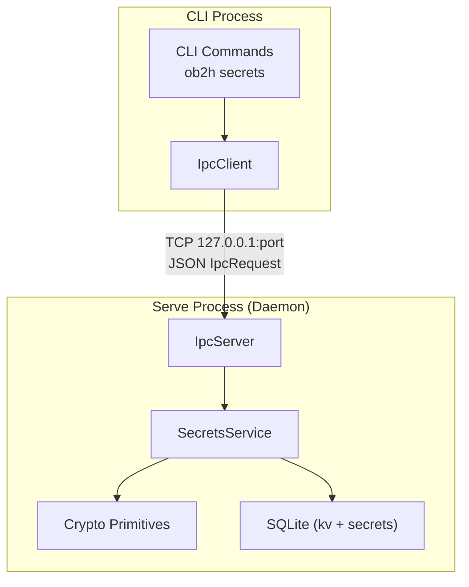
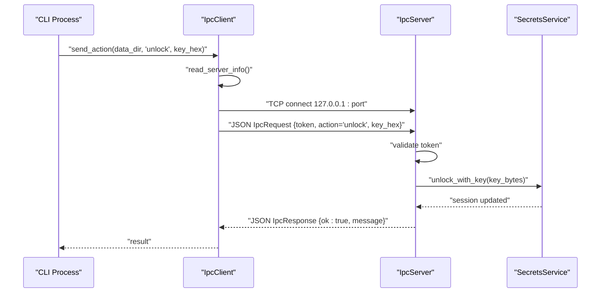
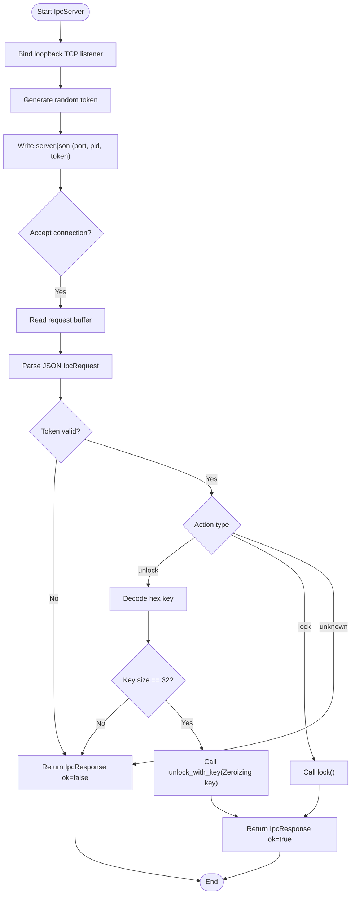
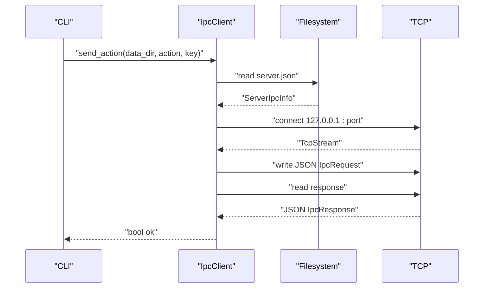
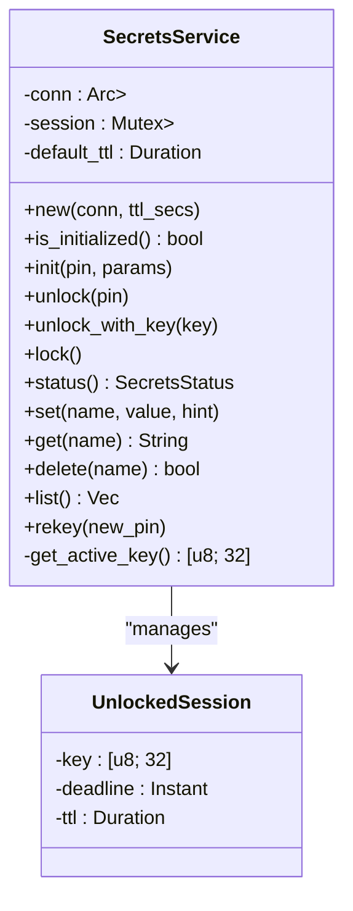
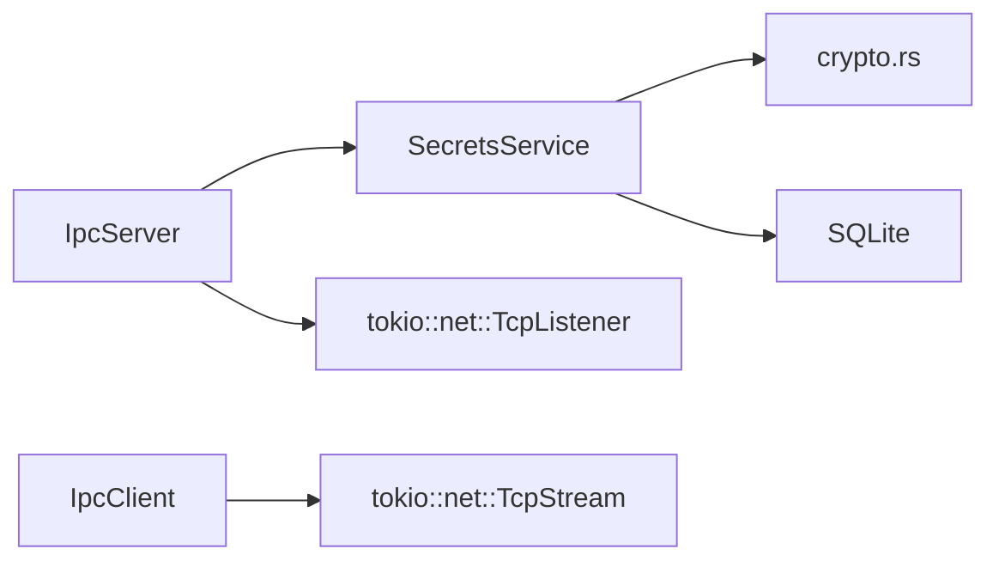

# IPC Communication Layer

<cite>
**Referenced Files in This Document**
- [ipc.rs](file://src/secrets/ipc.rs)
- [service.rs](file://src/secrets/service.rs)
- [crypto.rs](file://src/secrets/crypto.rs)
- [mod.rs](file://src/secrets/mod.rs)
- [secrets.rs](file://src/cli/secrets.rs)
- [main.rs](file://src/main.rs)
- [test_secrets_isolation.rs](file://tests/test_secrets_isolation.rs)
</cite>

## Table of Contents
1. [Introduction](#introduction)
2. [Project Structure](#project-structure)
3. [Core Components](#core-components)
4. [Architecture Overview](#architecture-overview)
5. [Detailed Component Analysis](#detailed-component-analysis)
6. [Dependency Analysis](#dependency-analysis)
7. [Performance Considerations](#performance-considerations)
8. [Troubleshooting Guide](#troubleshooting-guide)
9. [Conclusion](#conclusion)

## Introduction
This document explains the Inter-Process Communication (IPC) layer that enables secure, cross-process communication with the secrets service. The main process runs a dedicated secrets daemon that holds master keys exclusively in protected memory. CLI commands and other processes communicate with this daemon over a loopback TCP connection using JSON messages. The design ensures that plaintext PINs never leave the calling process and that master keys never leave the protected process memory space.

Key goals:
- Secure IPC between the CLI and the secrets daemon
- Token-based authentication for each IPC request
- Safe transfer of 32-byte master keys without exposing plaintext PINs
- TTL-based session management for unlocked state
- Clear error handling and connection management patterns

## Project Structure
The IPC implementation is part of the secrets subsystem and integrates with the CLI and the main serve process.

**Diagram sources**
- [ipc.rs:15-33](file://src/secrets/ipc.rs#L15-L33)
- [ipc.rs:35-152](file://src/secrets/ipc.rs#L35-L152)
- [service.rs:43-47](file://src/secrets/service.rs#L43-L47)
- [crypto.rs:1-111](file://src/secrets/crypto.rs#L1-L111)

**Section sources**
- [ipc.rs:1-196](file://src/secrets/ipc.rs#L1-L196)
- [service.rs:1-446](file://src/secrets/service.rs#L1-L446)
- [crypto.rs:1-168](file://src/secrets/crypto.rs#L1-L168)
- [mod.rs:1-15](file://src/secrets/mod.rs#L1-L15)
- [secrets.rs:1-311](file://src/cli/secrets.rs#L1-L311)
- [main.rs:62-90](file://src/main.rs#L62-L90)

## Core Components
- IpcServer: Starts a local TCP server on loopback, generates a random token, writes server metadata to disk, and handles unlock/lock requests.
- IpcClient: Reads server metadata from disk, connects to the daemon, sends JSON requests, and parses responses.
- SecretsService: Manages vault initialization, unlocking via PIN or key, locking, TTL sessions, and CRUD operations on encrypted secrets.
- Crypto: Provides Argon2id key derivation, XChaCha20-Poly1305 encryption/decryption, salt generation, and verifier creation/checking.

Security highlights:
- Master keys are held in Zeroizing buffers inside SecretsService.
- Tokens are generated per server instance and required for every IPC request.
- Keys are transferred as hex-encoded bytes over loopback only when needed by the daemon.
- PINs are never sent over IPC; instead, the CLI derives the master key locally and sends it to the daemon.

**Section sources**
- [ipc.rs:15-33](file://src/secrets/ipc.rs#L15-L33)
- [ipc.rs:35-152](file://src/secrets/ipc.rs#L35-L152)
- [ipc.rs:154-196](file://src/secrets/ipc.rs#L154-L196)
- [service.rs:43-47](file://src/secrets/service.rs#L43-L47)
- [service.rs:166-176](file://src/secrets/service.rs#L166-L176)
- [crypto.rs:34-44](file://src/secrets/crypto.rs#L34-L44)
- [crypto.rs:54-98](file://src/secrets/crypto.rs#L54-L98)

## Architecture Overview
The architecture follows a client-server model where:
- The serve process starts IpcServer and exposes an endpoint on 127.0.0.1.
- The CLI uses IpcClient to send actions like unlock and lock.
- SecretsService manages the vault state and enforces TTL-based sessions.

**Diagram sources**
- [ipc.rs:163-194](file://src/secrets/ipc.rs#L163-L194)
- [ipc.rs:66-141](file://src/secrets/ipc.rs#L66-L141)
- [service.rs:166-176](file://src/secrets/service.rs#L166-L176)

## Detailed Component Analysis

### IpcServer
Responsibilities:
- Bind to loopback address and pick a free port.
- Generate a random token and write server info (port, pid, token) to a run file.
- Accept connections and handle JSON requests.
- Validate tokens and dispatch actions ("unlock", "lock").
- For "unlock", decode hex key and call SecretsService.unlock_with_key with a Zeroizing buffer.
- For "lock", call SecretsService.lock.

Error handling:
- Invalid token returns a failure response.
- Missing or invalid key size returns a failure response.
- Unknown action returns a failure response.
- Parse errors return a failure response.

Connection lifecycle:
- Each accepted connection spawns a task to read one request and write one response.
- On Drop, the server removes the run file.

**Diagram sources**
- [ipc.rs:39-145](file://src/secrets/ipc.rs#L39-L145)
- [ipc.rs:148-152](file://src/secrets/ipc.rs#L148-L152)

**Section sources**
- [ipc.rs:35-152](file://src/secrets/ipc.rs#L35-L152)

### IpcClient
Responsibilities:
- Read server metadata from the run file.
- Connect to the daemon via TCP.
- Serialize IpcRequest and send it.
- Read and parse IpcResponse.

Behavior:
- If server info is missing, returns success false (server not running).
- If connection fails, returns success false.
- Otherwise, returns the boolean ok field from the response.

**Diagram sources**
- [ipc.rs:157-194](file://src/secrets/ipc.rs#L157-L194)

**Section sources**
- [ipc.rs:154-196](file://src/secrets/ipc.rs#L154-L196)

### SecretsService
Responsibilities:
- Initialize the vault with a PIN and KDF parameters.
- Unlock via PIN (derives key and verifies against stored verifier).
- Unlock via IPC using a pre-derived master key.
- Lock and clear the in-memory key.
- Manage TTL-based sessions and extend activity on access.
- Provide status, list, get, set, delete, and rekey operations.

Security:
- Master key is stored in Zeroizing<[u8; 32]> within UnlockedSession.
- Session expiry enforced via Instant deadline.
- Rekey operation decrypts all records in memory and re-encrypts with a new key atomically.

Concurrency:
- Uses Arc<Mutex<Connection>> for SQLite access.
- Uses Mutex<Option<UnlockedSession>> for session state.

**Diagram sources**
- [service.rs:18-47](file://src/secrets/service.rs#L18-L47)
- [service.rs:49-203](file://src/secrets/service.rs#L49-L203)
- [service.rs:205-444](file://src/secrets/service.rs#L205-L444)

**Section sources**
- [service.rs:1-446](file://src/secrets/service.rs#L1-L446)

### Crypto Primitives
Responsibilities:
- Derive a 32-byte master key from PIN and salt using Argon2id.
- Generate cryptographically secure salts.
- Encrypt/decrypt secret values using XChaCha20-Poly1305 with AAD binding to secret name.
- Create and check verifiers to validate PIN-derived keys.

Security:
- All sensitive buffers use Zeroizing to ensure memory is wiped.
- Nonces are randomly generated for each encryption.
- Verifier uses AEAD to prevent brute-force PIN guessing without storing raw keys.

**Section sources**
- [crypto.rs:1-111](file://src/secrets/crypto.rs#L1-L111)

### CLI Integration
Responsibilities:
- Handle secrets commands: init, unlock, lock, status, rekey, list, show.
- For unlock, derive the master key locally and notify the daemon via IPC if running.
- For lock, notify the daemon if running.
- Display status including whether the daemon is active.

Security:
- PIN input is handled via GUI or terminal prompt, never sent over IPC.
- Master key is derived locally and passed to the daemon only for unlock.

**Section sources**
- [secrets.rs:12-31](file://src/cli/secrets.rs#L12-L31)
- [secrets.rs:137-309](file://src/cli/secrets.rs#L137-L309)

### Main Process Integration
Responsibilities:
- Start the serve command path which initializes the app and starts IpcServer.
- Ensure background workers and MCP server are running alongside the IPC server.

**Section sources**
- [main.rs:62-90](file://src/main.rs#L62-L90)

## Dependency Analysis
The IPC layer depends on:
- Tokio for async TCP networking.
- serde_json for serialization/deserialization.
- zeroize for secure memory handling.
- getrandom for secure randomness.
- hex for encoding/decoding keys.
- SecretsService for vault operations.

**Diagram sources**
- [ipc.rs:8-11](file://src/secrets/ipc.rs#L8-L11)
- [service.rs:1-16](file://src/secrets/service.rs#L1-L16)
- [crypto.rs:1-11](file://src/secrets/crypto.rs#L1-L11)

**Section sources**
- [ipc.rs:1-196](file://src/secrets/ipc.rs#L1-L196)
- [service.rs:1-446](file://src/secrets/service.rs#L1-L446)
- [crypto.rs:1-168](file://src/secrets/crypto.rs#L1-L168)

## Performance Considerations
- Network overhead: Each IPC request involves JSON serialization and a single TCP round-trip. Keep payloads small (e.g., only send 32-byte keys for unlock).
- Concurrency: IpcServer spawns a task per connection; ensure the number of concurrent clients is bounded by application usage.
- Memory safety: Use Zeroizing for master keys to avoid accidental leaks; avoid logging sensitive data.
- TTL management: SecretsService extends TTL on successful access; tune default_ttl to balance security and usability.
- Database access: SecretsService uses mutex-protected SQLite connections; batch operations where possible to reduce contention.

[No sources needed since this section provides general guidance]

## Troubleshooting Guide
Common issues and resolutions:
- Server not running: IpcClient.read_server_info returns None; ensure the serve process started successfully and the run file exists.
- Invalid token: Verify that the token in server.json matches the expected token; restart the daemon if necessary.
- Connection refused: Check that the port is available and not blocked by firewall; ensure the daemon is listening on 127.0.0.1.
- Invalid key size: Ensure the key is exactly 32 bytes before sending; verify hex encoding/decoding logic.
- Parse errors: Validate JSON structure of IpcRequest and IpcResponse; check for truncation or corruption in network buffers.

**Section sources**
- [ipc.rs:83-133](file://src/secrets/ipc.rs#L83-L133)
- [ipc.rs:163-194](file://src/secrets/ipc.rs#L163-L194)

## Conclusion
The IPC layer provides a secure, efficient mechanism for cross-process communication with the secrets service. By keeping master keys in protected memory and using token-based authentication over loopback TCP, it minimizes exposure of sensitive data. The design supports safe key transfer without exposing plaintext PINs, enforces TTL-based sessions, and includes robust error handling. Proper configuration of TTL, concurrency limits, and memory safety practices ensures both security and performance.

[No sources needed since this section summarizes without analyzing specific files]