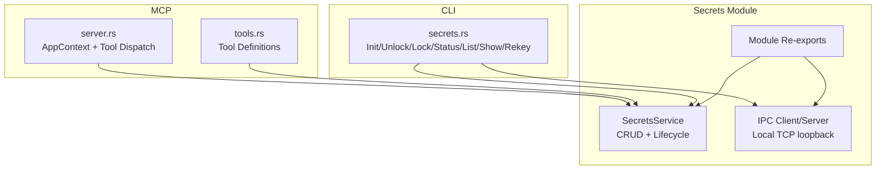
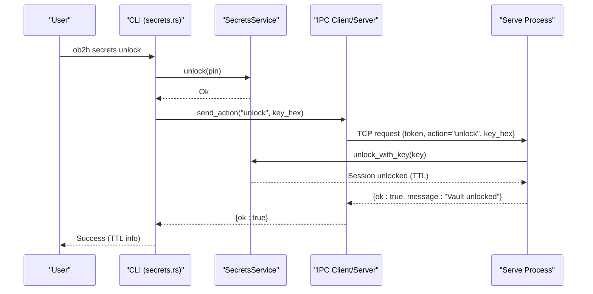
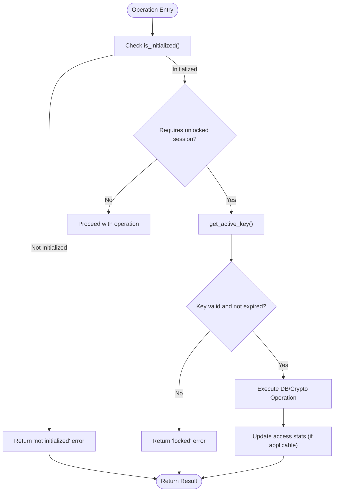
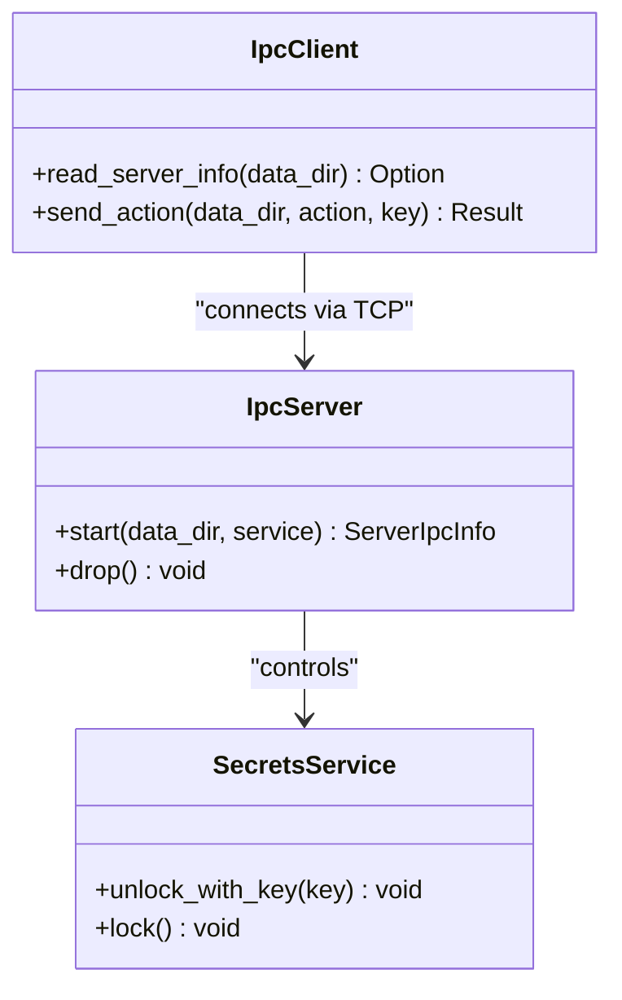
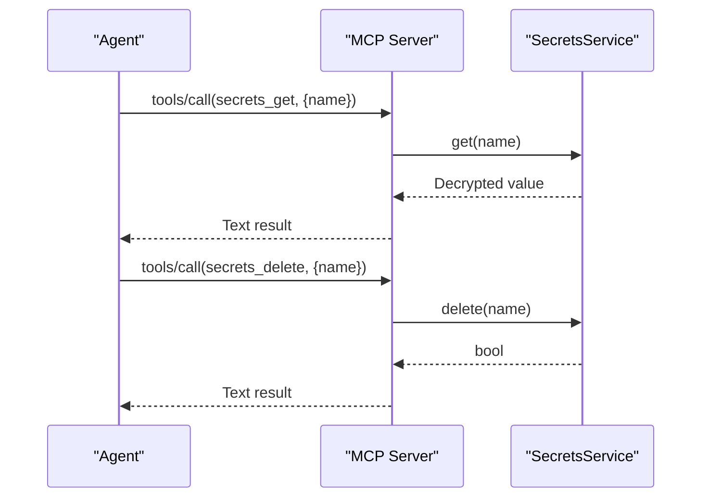
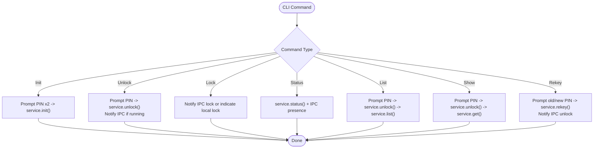
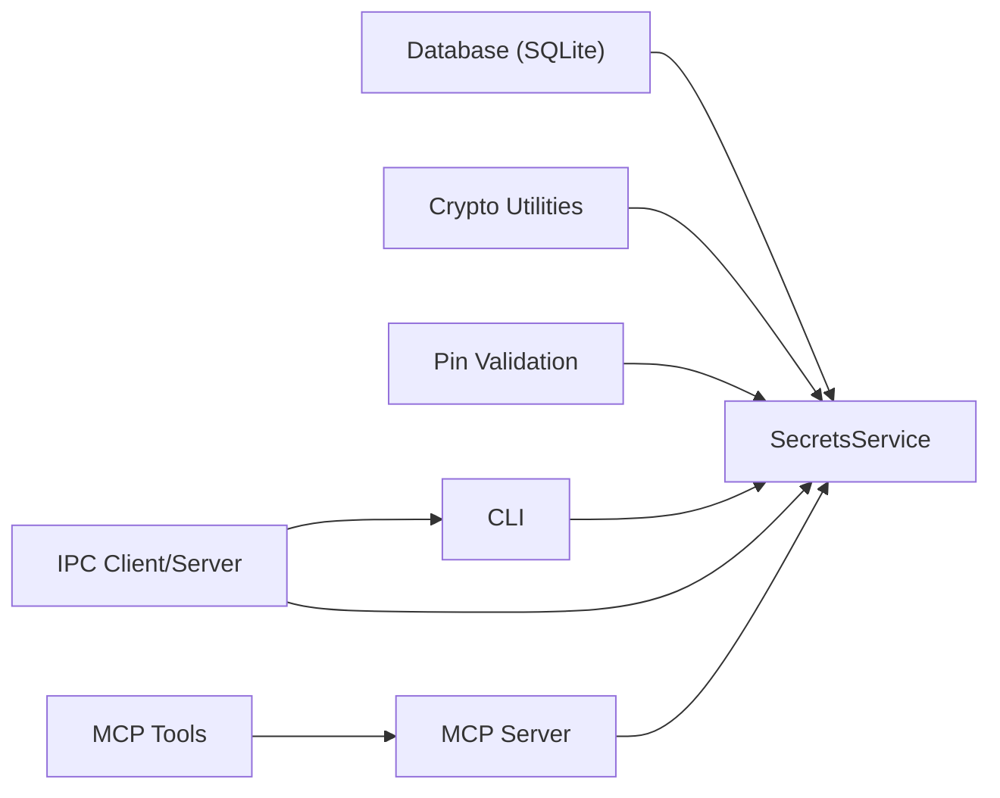

# Secrets Service API

<cite>
**Referenced Files in This Document**
- [service.rs](file://src/secrets/service.rs)
- [ipc.rs](file://src/secrets/ipc.rs)
- [mod.rs](file://src/secrets/mod.rs)
- [secrets.rs](file://src/cli/secrets.rs)
- [tools.rs](file://src/mcp/tools.rs)
- [server.rs](file://src/mcp/server.rs)
</cite>

## Table of Contents
1. [Introduction](#introduction)
2. [Project Structure](#project-structure)
3. [Core Components](#core-components)
4. [Architecture Overview](#architecture-overview)
5. [Detailed Component Analysis](#detailed-component-analysis)
6. [Dependency Analysis](#dependency-analysis)
7. [Performance Considerations](#performance-considerations)
8. [Troubleshooting Guide](#troubleshooting-guide)
9. [Conclusion](#conclusion)

## Introduction
This document provides comprehensive API documentation for the SecretsService interface and its surrounding integration points. It covers initialization, lifecycle management (unlock/lock/TTL), CRUD operations for secrets, cross-process IPC, MCP tool integration, thread-safety guarantees, and performance characteristics. The goal is to make the Secrets Vault usable by CLI users, MCP clients, and other OB2H components while preserving security through in-memory master-key zeroization and TTL-based session expiration.

## Project Structure
The Secrets Vault implementation lives under the secrets module and integrates with:
- CLI commands for interactive PIN entry and vault operations
- An MCP server that exposes secrets tools to agents
- A local IPC mechanism for synchronizing unlock state between a foreground CLI and a background serve process

**Diagram sources**
- [service.rs:43-47](file://src/secrets/service.rs#L43-L47)
- [ipc.rs:35-145](file://src/secrets/ipc.rs#L35-L145)
- [mod.rs:1-15](file://src/secrets/mod.rs#L1-L15)
- [secrets.rs:134-309](file://src/cli/secrets.rs#L134-L309)
- [tools.rs:569-620](file://src/mcp/tools.rs#L569-L620)
- [server.rs:27-52](file://src/mcp/server.rs#L27-L52)

**Section sources**
- [mod.rs:1-15](file://src/secrets/mod.rs#L1-L15)
- [service.rs:43-47](file://src/secrets/service.rs#L43-L47)
- [ipc.rs:35-145](file://src/secrets/ipc.rs#L35-L145)
- [secrets.rs:134-309](file://src/cli/secrets.rs#L134-L309)
- [tools.rs:569-620](file://src/mcp/tools.rs#L569-L620)
- [server.rs:27-52](file://src/mcp/server.rs#L27-L52)

## Core Components
- SecretsService: In-process encrypted secrets store with PIN-derived master key held only in memory; supports init, unlock, lock, status, set/get/delete/list/rekey.
- IPC: Local TCP loopback server/client exchanging JSON requests with a per-run token to synchronize unlock/lock across processes.
- CLI: Interactive commands for PIN input, vault lifecycle, and secret CRUD.
- MCP: Tool definitions and dispatch for secrets_status, secrets_set, secrets_get, secrets_delete, secrets_lock.

Key responsibilities:
- SecretsService encapsulates all cryptographic operations, DB persistence, and session TTL enforcement.
- IPC ensures that when a CLI unlocks locally, the long-running serve process also unlocks without exposing the master key outside the process boundary except over loopback.
- CLI abstracts user interaction and orchestrates service calls and IPC notifications.
- MCP exposes secrets operations as agent-callable tools with annotations indicating read-only or destructive behavior.

**Section sources**
- [service.rs:43-47](file://src/secrets/service.rs#L43-L47)
- [ipc.rs:15-33](file://src/secrets/ipc.rs#L15-L33)
- [secrets.rs:12-31](file://src/cli/secrets.rs#L12-L31)
- [tools.rs:569-620](file://src/mcp/tools.rs#L569-L620)

## Architecture Overview
The system uses a client-server IPC model:
- CLI acts as a client that can unlock the vault using a PIN and optionally notify a running serve process via IPC.
- Serve process runs an IPC server that accepts unlock/lock actions from authenticated clients and updates the shared SecretsService instance.
- MCP tools call into the same SecretsService instance within the serve process.

**Diagram sources**
- [secrets.rs:162-190](file://src/cli/secrets.rs#L162-L190)
- [ipc.rs:157-194](file://src/secrets/ipc.rs#L157-L194)
- [ipc.rs:39-145](file://src/secrets/ipc.rs#L39-L145)
- [service.rs:118-176](file://src/secrets/service.rs#L118-L176)

## Detailed Component Analysis

### SecretsService API
SecretsService provides the following public methods:

- Initialization
  - is_initialized() -> Result<bool>
    - Returns whether the secrets vault has been initialized in the database.
  - init(pin, params?) -> Result<()>
    - Initializes the vault with a PIN and optional KDF parameters. Validates PIN format and prevents double initialization. Stores salt, KDF params, and verifier in the database.

- Lifecycle
  - unlock(pin) -> Result<()>
    - Derives the master key from PIN, verifies it against stored verifier, and creates an in-memory session with TTL.
  - unlock_with_key(key)
    - Internal method used by IPC to unlock the vault with a pre-derived master key. Sets session TTL.
  - lock()
    - Immediately clears the in-memory master key, transitioning the vault to locked state.
  - status() -> Result<SecretsStatus>
    - Returns initialization state, lock state, remaining TTL seconds, record count, and secret names.

- CRUD
  - validate_name(name) -> Result<()>
    - Enforces allowed characters and length constraints for secret names.
  - set(name, value, hint?) -> Result<()>
    - Encrypts and upserts a secret. Validates name and value size. Updates created_at/updated_at timestamps.
  - get(name) -> Result<String>
    - Decrypts and returns the secret value. Updates access statistics.
  - delete(name) -> Result<bool>
    - Deletes a secret by name. Returns true if a row was removed.
  - list() -> Result<Vec<SecretRecordMeta>>
    - Lists metadata for all secrets without returning values.

- Key Rotation
  - rekey(new_pin) -> Result<()>
    - Reads all records, decrypts them with the old key, derives a new key from new_pin, re-encrypts all records, atomically persists new salt/KDF/verifier and re-inserted records, and refreshes the active session key.

Data models:
- SecretsStatus: initialized, locked, ttl_left_sec, records_count, names
- SecretRecordMeta: name, hint, created_at, updated_at, last_accessed, access_count

Error conditions:
- Not initialized errors when attempting operations requiring initialization.
- Locked errors when accessing secrets without an active unlocked session or after TTL expiry.
- Invalid PIN errors on unlock attempts.
- Name validation errors for invalid characters or length.
- Value size limit exceeded (>64KB).
- Decryption failures due to corrupted ciphertext or wrong key.

Thread safety and concurrency:
- All mutable state is protected by std::sync::Mutex:
  - Database connection wrapped in Arc<Mutex<Connection>>
  - Active session wrapped in Mutex<Option<UnlockedSession>>
- Methods acquire locks around critical sections to ensure atomicity and prevent data races.

TTL mechanism:
- Each unlock sets a deadline based on default_ttl.
- get_active_key() checks current time against deadline and extends TTL on successful access.
- If expired, the session is cleared and subsequent operations fail with a locked error.

Immediate key zeroization:
- Master key is stored in Zeroizing<[u8; 32]> and dropped when the session is cleared (lock or TTL expiry), ensuring immediate memory zeroization.

Common operation examples:
- Create a new secret:
  - Initialize vault once with init.
  - Unlock with unlock.
  - Call set(name, value, hint?).
- Retrieve credentials:
  - Ensure vault is unlocked.
  - Call get(name) to obtain decrypted value.
- Update existing entries:
  - Call set(name, newValue, hint?) to upsert.
- Delete a secret:
  - Call delete(name).
- Rotate PIN:
  - Call rekey(new_pin) to re-encrypt all records with a new key.

**Diagram sources**
- [service.rs:58-69](file://src/secrets/service.rs#L58-L69)
- [service.rs:186-203](file://src/secrets/service.rs#L186-L203)
- [service.rs:267-358](file://src/secrets/service.rs#L267-L358)

**Section sources**
- [service.rs:18-47](file://src/secrets/service.rs#L18-L47)
- [service.rs:58-203](file://src/secrets/service.rs#L58-L203)
- [service.rs:252-358](file://src/secrets/service.rs#L252-L358)
- [service.rs:360-444](file://src/secrets/service.rs#L360-L444)

### IPC Client-Server Architecture
The IPC layer enables secure cross-process communication:
- ServerIpcServer:
  - Starts a local TCP listener bound to 127.0.0.1 on a random port.
  - Generates a per-run token and writes server.json with port, pid, and token.
  - Accepts connections and spawns tasks per request.
  - Validates token and action ("unlock"/"lock").
  - For "unlock", decodes hex key, validates length (32 bytes), and calls SecretsService.unlock_with_key().
  - For "lock", calls SecretsService.lock().
  - Responds with JSON {ok, message}.

- IpcClient:
  - Reads server.json to discover running server.
  - Sends JSON request {token, action, key_hex?} over TCP.
  - Parses response and returns boolean success.

Security considerations:
- Loopback-only binding limits exposure to localhost.
- Token-based authentication prevents unauthorized control.
- Master key is transmitted only as hex-encoded bytes over the loopback socket and never persisted.

**Diagram sources**
- [ipc.rs:35-145](file://src/secrets/ipc.rs#L35-L145)
- [ipc.rs:154-194](file://src/secrets/ipc.rs#L154-L194)
- [service.rs:166-183](file://src/secrets/service.rs#L166-L183)

**Section sources**
- [ipc.rs:15-33](file://src/secrets/ipc.rs#L15-L33)
- [ipc.rs:39-145](file://src/secrets/ipc.rs#L39-L145)
- [ipc.rs:157-194](file://src/secrets/ipc.rs#L157-L194)

### MCP Integration
MCP tools expose secrets operations to agents:
- secrets_status: Read-only tool to check initialization, lock state, TTL, and secret names.
- secrets_set: Write tool to create/update encrypted secrets.
- secrets_get: Read tool to retrieve decrypted secret values.
- secrets_delete: Destructive tool to remove secrets.
- secrets_lock: Immediate lock tool to clear master key from memory.

Annotations:
- readOnlyHint: true for secrets_status and secrets_get.
- destructiveHint: true for secrets_delete.

Dispatch:
- The MCP server holds an Arc<SecretsService> in AppContext and routes tool calls accordingly.

**Diagram sources**
- [tools.rs:569-620](file://src/mcp/tools.rs#L569-L620)
- [server.rs:27-52](file://src/mcp/server.rs#L27-L52)
- [service.rs:291-333](file://src/secrets/service.rs#L291-L333)

**Section sources**
- [tools.rs:569-620](file://src/mcp/tools.rs#L569-L620)
- [server.rs:27-52](file://src/mcp/server.rs#L27-L52)

### CLI Integration
The CLI provides interactive commands:
- Init: Prompts for PIN twice and initializes the vault.
- Unlock: Prompts for PIN, unlocks locally, and notifies the serve process via IPC if available.
- Lock: Notifies the serve process to lock; otherwise indicates local lock.
- Status: Displays initialization, lock state, TTL, record count, and names.
- List: Requires PIN, unlocks, and lists metadata.
- Show: Requires PIN, unlocks, and prints decrypted value.
- Rekey: Requires current PIN and new PIN, performs re-encryption, and re-notifies IPC.

**Diagram sources**
- [secrets.rs:134-309](file://src/cli/secrets.rs#L134-L309)
- [service.rs:71-111](file://src/secrets/service.rs#L71-L111)
- [service.rs:118-176](file://src/secrets/service.rs#L118-L176)
- [service.rs:360-444](file://src/secrets/service.rs#L360-L444)

**Section sources**
- [secrets.rs:12-31](file://src/cli/secrets.rs#L12-L31)
- [secrets.rs:134-309](file://src/cli/secrets.rs#L134-L309)

## Dependency Analysis
SecretsService depends on:
- Database connection (SQLite) for storing salt, KDF params, verifier, and encrypted records.
- Crypto utilities for deriving keys, generating salts, creating/verifying verifiers, encrypting/decrypting values.
- Pin validation helpers for enforcing PIN format rules.
- IPC for cross-process synchronization.

MCP tools depend on:
- Tool definitions listing and annotations.
- MCP server context holding Arc<SecretsService>.

CLI depends on:
- SecretsService for all vault operations.
- IPC client for notifying serve process.
- Pin input utilities for GUI/terminal prompts.

**Diagram sources**
- [service.rs:12-16](file://src/secrets/service.rs#L12-L16)
- [service.rs:43-47](file://src/secrets/service.rs#L43-L47)
- [ipc.rs:35-145](file://src/secrets/ipc.rs#L35-L145)
- [tools.rs:569-620](file://src/mcp/tools.rs#L569-L620)
- [server.rs:27-52](file://src/mcp/server.rs#L27-L52)
- [secrets.rs:134-309](file://src/cli/secrets.rs#L134-L309)

**Section sources**
- [service.rs:12-16](file://src/secrets/service.rs#L12-L16)
- [service.rs:43-47](file://src/secrets/service.rs#L43-L47)
- [ipc.rs:35-145](file://src/secrets/ipc.rs#L35-L145)
- [tools.rs:569-620](file://src/mcp/tools.rs#L569-L620)
- [server.rs:27-52](file://src/mcp/server.rs#L27-L52)
- [secrets.rs:134-309](file://src/cli/secrets.rs#L134-L309)

## Performance Considerations
- Unlock cost dominated by KDF (Argon2id) with configurable parameters; plan for initial unlock latency.
- Subsequent get/set operations are fast since the master key remains in memory during the TTL window.
- TTL extension on successful access reduces unnecessary re-unlocks during bursts of activity.
- Avoid frequent rekey operations; they require decrypting and re-encrypting all records.
- IPC adds minimal overhead but requires a running serve process for cross-process synchronization.

[No sources needed since this section provides general guidance]

## Troubleshooting Guide
Common issues and resolutions:
- "Secrets not initialized": Run initialization via CLI before any other operations.
- "Secrets locked": Unlock with correct PIN or wait for TTL expiry handling; use lock to immediately clear the master key.
- "Invalid PIN": Verify PIN format and correctness; use rekey to change PIN after successful unlock.
- "Name validation failed": Ensure secret names match allowed character set and length constraints.
- "Value exceeds maximum size": Keep secret values under 64KB.
- "Decryption failed": Check for data corruption or mismatched keys; reinitialize or rekey as appropriate.
- IPC not responding: Ensure the serve process is running and server.json exists; verify token and port.

Operational tips:
- Use status to inspect initialization and lock state along with TTL remaining.
- Prefer list for auditing secret names without exposing values.
- Use lock after sensitive operations to minimize exposure window.

**Section sources**
- [service.rs:58-69](file://src/secrets/service.rs#L58-L69)
- [service.rs:118-176](file://src/secrets/service.rs#L118-L176)
- [service.rs:252-264](file://src/secrets/service.rs#L252-L264)
- [service.rs:267-358](file://src/secrets/service.rs#L267-L358)
- [ipc.rs:157-194](file://src/secrets/ipc.rs#L157-L194)

## Conclusion
SecretsService provides a secure, thread-safe, and TTL-managed interface for managing encrypted secrets within OB2H. Its design emphasizes in-memory master key protection, immediate zeroization on lock, and robust validation. Integration points include CLI for interactive operations, IPC for cross-process synchronization, and MCP tools for agent-driven workflows. By adhering to the documented API and operational guidelines, developers and agents can safely handle secrets throughout their lifecycle.

[No sources needed since this section summarizes without analyzing specific files]