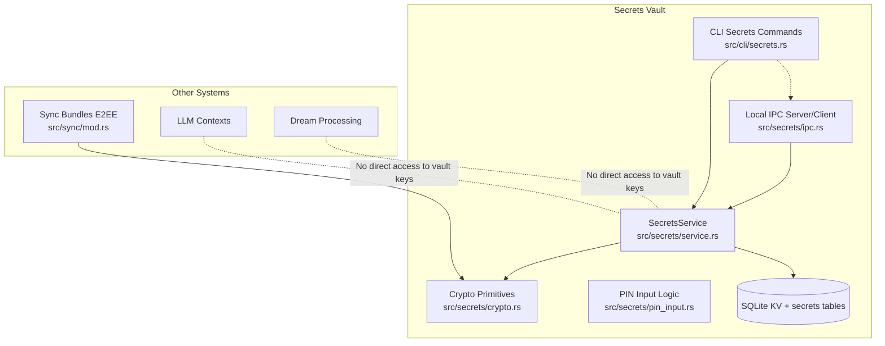
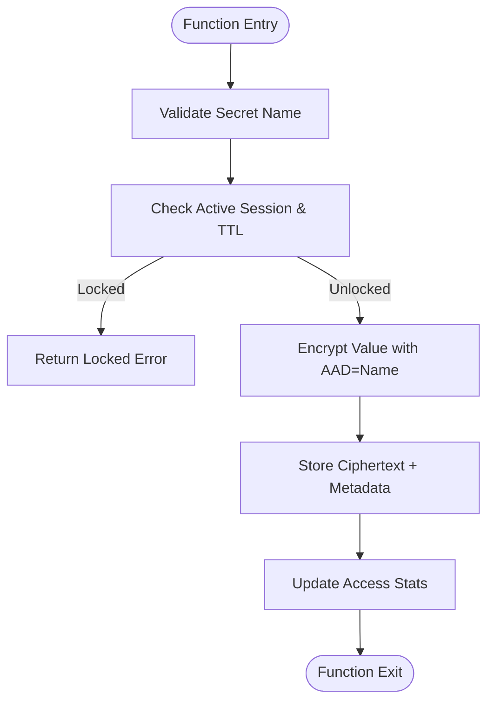
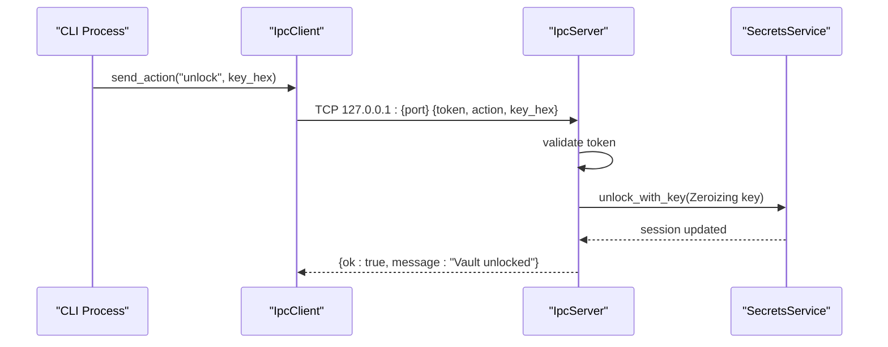
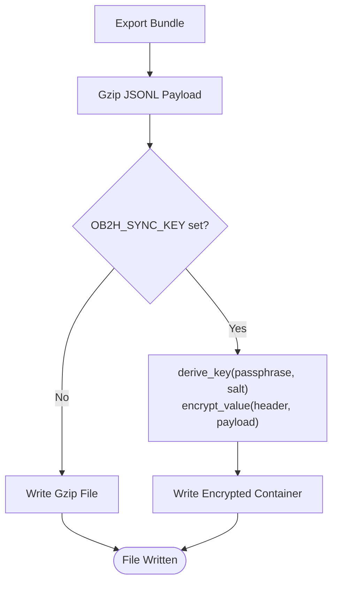
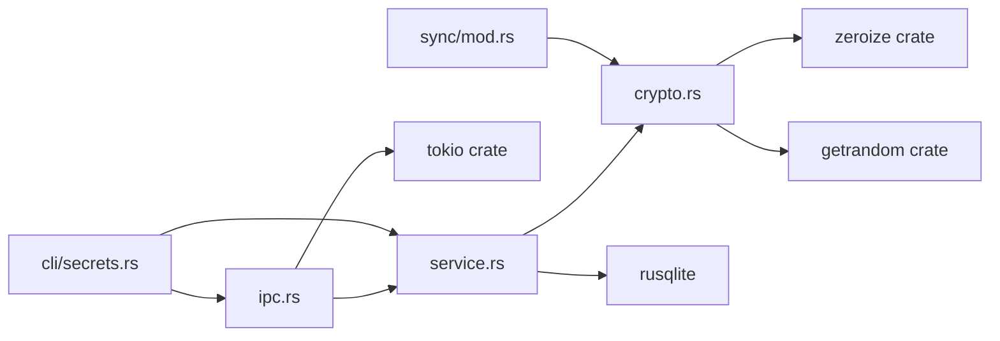

# Security Model and Architecture

<cite>
**Referenced Files in This Document**
- [mod.rs](file://src/secrets/mod.rs)
- [crypto.rs](file://src/secrets/crypto.rs)
- [service.rs](file://src/secrets/service.rs)
- [ipc.rs](file://src/secrets/ipc.rs)
- [pin_input.rs](file://src/secrets/pin_input.rs)
- [secrets.rs](file://src/cli/secrets.rs)
- [mod.rs](file://src/sync/mod.rs)
- [test_secrets_crypto.rs](file://tests/test_secrets_crypto.rs)
</cite>

## Table of Contents
1. [Introduction](#introduction)
2. [Project Structure](#project-structure)
3. [Core Components](#core-components)
4. [Architecture Overview](#architecture-overview)
5. [Detailed Component Analysis](#detailed-component-analysis)
6. [Dependency Analysis](#dependency-analysis)
7. [Performance Considerations](#performance-considerations)
8. [Troubleshooting Guide](#troubleshooting-guide)
9. [Conclusion](#conclusion)

## Introduction
This document describes the security model and architecture of the secrets vault system. It explains how secrets are derived, encrypted, stored, accessed, and protected across process boundaries. It also documents the threat model, security boundaries with other components such as LLM contexts, dream processing, and sync bundles, and the design choices behind the cryptographic primitives.

The vault uses:
- Argon2id for key derivation from a PIN to a 32-byte master key.
- XChaCha20-Poly1305 for authenticated encryption of secret values.
- In-process memory isolation with zeroization and TTL-based session expiry.
- A local loopback IPC channel for securely notifying a long-running server process about unlock/lock state.

## Project Structure
The secrets subsystem is implemented under `src/secrets` and exposed through CLI commands and an optional IPC interface. The sync subsystem reuses the same cryptographic primitives for optional end-to-end encryption of sync bundles.



**Diagram sources**
- [secrets.rs:137-309](file://src/cli/secrets.rs#L137-L309)
- [service.rs:43-47](file://src/secrets/service.rs#L43-L47)
- [crypto.rs:1-168](file://src/secrets/crypto.rs#L1-L168)
- [ipc.rs:35-145](file://src/secrets/ipc.rs#L35-L145)
- [mod.rs:127-192](file://src/sync/mod.rs#L127-L192)

**Section sources**
- [mod.rs:1-15](file://src/secrets/mod.rs#L1-L15)
- [secrets.rs:1-311](file://src/cli/secrets.rs#L1-L311)
- [service.rs:1-446](file://src/secrets/service.rs#L1-L446)
- [crypto.rs:1-168](file://src/secrets/crypto.rs#L1-L168)
- [ipc.rs:1-196](file://src/secrets/ipc.rs#L1-L196)
- [pin_input.rs:1-257](file://src/secrets/pin_input.rs#L1-L257)
- [mod.rs:127-192](file://src/sync/mod.rs#L127-L192)

## Core Components
- **SecretsService**: Manages initialization, unlocking, locking, TTL-based sessions, CRUD operations on encrypted secrets, and PIN rekeying.
- **Crypto Module**: Implements Argon2id key derivation, salt generation, XChaCha20-Poly1305 encryption/decryption, and verifier creation/checking.
- **IPC Layer**: Provides a local TCP loopback server and client that allow a CLI process to notify a running server process to unlock or lock the vault without exposing the master key outside the process.
- **PIN Input Logic**: Validates PIN format (exactly four ASCII digits), supports GUI or terminal input, and provides localized prompts.
- **Sync Bundle Encryption**: Reuses the vault’s crypto module to optionally encrypt sync bundles using a passphrase from environment variables.

Key security properties:
- Master key K never persists to disk; it exists only in process memory during an unlocked session.
- Secret values are encrypted per name using XChaCha20-Poly1305 with AAD binding to prevent cross-name misuse.
- Verifier blob protects against incorrect PIN attempts without leaking information.
- Session TTL automatically expires and clears the active key.
- IPC token authentication prevents unauthorized control of the server process.

**Section sources**
- [service.rs:43-47](file://src/secrets/service.rs#L43-L47)
- [crypto.rs:13-52](file://src/secrets/crypto.rs#L13-L52)
- [ipc.rs:15-33](file://src/secrets/ipc.rs#L15-L33)
- [pin_input.rs:7-19](file://src/secrets/pin_input.rs#L7-L19)
- [mod.rs:127-192](file://src/sync/mod.rs#L127-L192)

## Architecture Overview
The vault operates within a single process. The CLI may interact directly with the service or notify a background server via IPC. All sensitive data flows through the service, which enforces validation, TTL checks, and memory-safe handling.

```mermaid
sequenceDiagram
participant User as "User"
participant CLI as "CLI Secrets Command"
participant Service as "SecretsService"
participant Crypto as "Crypto Module"
participant IPC as "IPC Client/Server"
participant DB as "SQLite"
User->>CLI : "ob2h secrets init/unlock/show/list/rekey"
CLI->>Service : init()/unlock()/get()/list()/rekey()
Service->>Crypto : derive_key()/encrypt_value()/decrypt_value()
Crypto-->>Service : Zeroizing<[u8; 32]> / ciphertext
Service->>DB : read/write secrets and metadata
CLI->>IPC : send_action("unlock"/"lock", key_hex?)
IPC->>Service : unlock_with_key()/lock()
Service-->>CLI : status/results/errors
```

**Diagram sources**
- [secrets.rs:137-309](file://src/cli/secrets.rs#L137-L309)
- [service.rs:72-176](file://src/secrets/service.rs#L72-L176)
- [crypto.rs:34-98](file://src/secrets/crypto.rs#L34-L98)
- [ipc.rs:163-195](file://src/secrets/ipc.rs#L163-L195)

## Detailed Component Analysis

### Cryptographic Design and Algorithm Choice
- **Argon2id Key Derivation**:
  - Produces a 32-byte master key K from a PIN and random salt.
  - Default parameters: memory cost 65536 KiB (64 MiB), time cost 3 iterations, parallelism 1.
  - Memory-hard property increases brute-force cost by requiring significant RAM per attempt.
  - Salt is generated cryptographically randomly and stored in plaintext alongside metadata; uniqueness ensures identical PINs produce different keys.
- **XChaCha20-Poly1305 Encryption**:
  - Each secret value is encrypted with a unique 24-byte nonce prepended to ciphertext plus tag.
  - Additional Authenticated Data (AAD) binds the secret name to the ciphertext, preventing reuse across names and detecting tampering.
  - Decryption fails if AAD mismatches, key is wrong, or ciphertext is corrupted.
- **Verifier Mechanism**:
  - A verifier blob encrypts a known magic string under the master key with a dedicated AAD.
  - Used to validate PIN correctness without storing or comparing raw keys.

Why these algorithms:
- Argon2id is widely recommended for password-based key derivation due to resistance against GPU/ASIC attacks and configurable memory hardness.
- XChaCha20-Poly1305 provides strong AEAD security with large nonces, reducing nonce collision risk and simplifying implementation compared to ChaCha20-Poly1305.

**Section sources**
- [crypto.rs:13-52](file://src/secrets/crypto.rs#L13-L52)
- [crypto.rs:54-98](file://src/secrets/crypto.rs#L54-L98)
- [crypto.rs:100-111](file://src/secrets/crypto.rs#L100-L111)
- [test_secrets_crypto.rs:8-38](file://tests/test_secrets_crypto.rs#L8-L38)

### SecretsService Lifecycle and Memory Isolation
- **Initialization**:
  - Validates PIN format (four digits).
  - Generates salt, derives key, creates verifier, stores salt, KDF params, and verifier in SQLite KV table.
- **Unlock**:
  - Reads salt, KDF params, and verifier from DB.
  - Derives key and verifies PIN via verifier check.
  - Stores Zeroizing-wrapped master key with TTL deadline in an in-memory session.
- **Lock**:
  - Clears the session, effectively dropping the master key from memory.
- **TTL Expiry**:
  - Active key retrieval checks current time against deadline; expired sessions are cleared automatically.
- **CRUD Operations**:
  - All operations require an active session.
  - Values are encrypted/decrypted with AAD bound to secret name.
  - Access statistics updated after successful reads.
- **Rekey**:
  - Decrypts all records with old key, generates new salt/key/verifier, re-encrypts records, and atomically updates DB and session.

Memory protection:
- Master key wrapped in Zeroizing to ensure overwrite on drop.
- No persistence of master key; only verifier and metadata stored.
- TTL limits exposure window.



**Diagram sources**
- [service.rs:252-322](file://src/secrets/service.rs#L252-L322)

**Section sources**
- [service.rs:58-111](file://src/secrets/service.rs#L58-L111)
- [service.rs:113-203](file://src/secrets/service.rs#L113-L203)
- [service.rs:266-358](file://src/secrets/service.rs#L266-L358)
- [service.rs:360-444](file://src/secrets/service.rs#L360-L444)

### Local IPC Security Boundary
- **Server**:
  - Binds to loopback address `127.0.0.1` on a random port.
  - Writes server info (port, PID, token) to a file under `data/run/server.json`.
  - Accepts JSON requests containing token, action, and optional hex-encoded key.
  - Validates token before executing actions (`unlock`, `lock`).
  - On `unlock`, decodes hex key into 32 bytes and calls `unlock_with_key`, wrapping key in Zeroizing.
- **Client**:
  - Reads server info from file.
  - Connects to loopback address and sends request with token.
  - Receives response indicating success/failure.

Security considerations:
- Loopback-only binding reduces exposure to local network.
- Random token prevents unauthorized clients from controlling the server.
- Key is passed only over loopback and never written to disk.
- Drop handler removes server info file on shutdown.



**Diagram sources**
- [ipc.rs:40-145](file://src/secrets/ipc.rs#L40-L145)
- [ipc.rs:163-195](file://src/secrets/ipc.rs#L163-L195)
- [service.rs:166-176](file://src/secrets/service.rs#L166-L176)

**Section sources**
- [ipc.rs:35-145](file://src/secrets/ipc.rs#L35-L145)
- [ipc.rs:154-195](file://src/secrets/ipc.rs#L154-L195)

### PIN Input and Validation
- PIN must be exactly four ASCII digits.
- GUI input can be disabled via environment variable; fallback to terminal prompt.
- Localized prompts support Russian and English.
- Buffer restricts input to digits and caps at length four.

Threat mitigation:
- Strict format validation prevents injection or overflow.
- Environment override allows disabling GUI to avoid potential UI-side risks.

**Section sources**
- [pin_input.rs:7-19](file://src/secrets/pin_input.rs#L7-L19)
- [pin_input.rs:180-189](file://src/secrets/pin_input.rs#L180-L189)
- [secrets.rs:47-132](file://src/cli/secrets.rs#L47-L132)

### Sync Bundle Encryption and Security Boundaries
- Sync bundles are gzip-compressed JSONL files containing memories, graph nodes/edges, lessons, slots, etc.
- Optional E2EE wrapper:
  - Magic header identifies encrypted bundles.
  - Passphrase provided via environment variable `OB2H_SYNC_KEY`.
  - Uses same Argon2id + XChaCha20-Poly1305 primitives with header-bound AAD.
- Explicitly excludes audit logs and secrets from bundles (local/private data).

Security boundary:
- Sync bundles do not include secrets; they contain operational data only.
- E2EE protects bundle contents during transit/storage when enabled.



**Diagram sources**
- [mod.rs:127-192](file://src/sync/mod.rs#L127-L192)
- [mod.rs:441-449](file://src/sync/mod.rs#L441-L449)

**Section sources**
- [mod.rs:127-192](file://src/sync/mod.rs#L127-L192)
- [mod.rs:441-449](file://src/sync/mod.rs#L441-L449)

### Trust Model and Attack Vectors
- **Trust Model**:
  - SecretsService is the sole owner of master key K.
  - CLI and IPC are trusted interfaces within the same host OS user context.
  - External systems (LLM contexts, dream processing, sync bundles) do not have direct access to K or decrypted values.
- **Attack Vectors Considered**:
  - Brute force against PIN: mitigated by Argon2id memory-hardness and default parameters.
  - Key leakage from memory: mitigated by Zeroizing and TTL expiration.
  - Unauthorized IPC access: mitigated by loopback binding and token verification.
  - Ciphertext tampering: mitigated by AEAD with AAD binding to secret name.
  - Cross-name misuse: prevented by AAD binding.
  - Cold boot attacks: partial mitigation via short TTL and immediate key zeroization on lock/expiry; full mitigation requires OS-level protections.
- **Compliance with Best Practices**:
  - Use of modern AEAD cipher (XChaCha20-Poly1305).
  - Memory-hard KDF (Argon2id) with configurable parameters.
  - Unique salts and nonces.
  - Minimal exposure of secrets in memory.
  - Separation of concerns between storage, computation, and transport.

**Section sources**
- [crypto.rs:34-98](file://src/secrets/crypto.rs#L34-L98)
- [service.rs:185-203](file://src/secrets/service.rs#L185-L203)
- [ipc.rs:48-61](file://src/secrets/ipc.rs#L48-L61)
- [mod.rs:349-350](file://src/sync/mod.rs#L349-L350)

## Dependency Analysis
The secrets subsystem depends on:
- SQLite for persistent storage of metadata and ciphertexts.
- getrandom for secure salt and nonce generation.
- zeroize for memory-safe handling of sensitive data.
- tokio for async IPC networking.
- serde for serialization of IPC messages and KDF parameters.



**Diagram sources**
- [crypto.rs:1-8](file://src/secrets/crypto.rs#L1-L8)
- [service.rs:5-15](file://src/secrets/service.rs#L5-L15)
- [ipc.rs:5-13](file://src/secrets/ipc.rs#L5-L13)
- [secrets.rs:3-10](file://src/cli/secrets.rs#L3-L10)
- [mod.rs:145-149](file://src/sync/mod.rs#L145-L149)

**Section sources**
- [crypto.rs:1-8](file://src/secrets/crypto.rs#L1-L8)
- [service.rs:5-15](file://src/secrets/service.rs#L5-L15)
- [ipc.rs:5-13](file://src/secrets/ipc.rs#L5-L13)
- [secrets.rs:3-10](file://src/cli/secrets.rs#L3-L10)
- [mod.rs:145-149](file://src/sync/mod.rs#L145-L149)

## Performance Considerations
- Argon2id default parameters (64 MiB memory, 3 iterations) provide strong security but increase unlock latency; consider tuning for constrained environments while maintaining adequate hardness.
- XChaCha20-Poly1305 is fast and suitable for high-throughput encryption/decryption.
- TTL-based session management balances usability and security; shorter TTL reduces exposure but increases unlock frequency.
- IPC overhead is minimal due to local loopback communication.

[No sources needed since this section provides general guidance]

## Troubleshooting Guide
Common issues and resolutions:
- **Invalid PIN format**: Ensure PIN is exactly four ASCII digits.
- **Vault locked**: Unlock with correct PIN or wait for TTL expiry; check status command output.
- **Ciphertext decryption errors**: Verify secret name matches original AAD; check for corruption.
- **IPC connection failed**: Ensure server process is running and server.json exists; verify token matches.
- **Sync bundle decryption failure**: Set `OB2H_SYNC_KEY` environment variable correctly.

**Section sources**
- [pin_input.rs:7-19](file://src/secrets/pin_input.rs#L7-L19)
- [service.rs:185-203](file://src/secrets/service.rs#L185-L203)
- [crypto.rs:77-98](file://src/secrets/crypto.rs#L77-L98)
- [ipc.rs:163-195](file://src/secrets/ipc.rs#L163-L195)
- [mod.rs:513-520](file://src/sync/mod.rs#L513-L520)

## Conclusion
The secrets vault system implements a robust security model centered around memory-isolated master keys, modern cryptographic primitives, and strict access controls. Argon2id and XChaCha20-Poly1305 provide strong protection against brute force and tampering. The IPC layer ensures safe inter-process coordination without exposing sensitive material. Sync bundles exclude secrets and offer optional E2EE for operational data. While threats like cold boot attacks are partially mitigated, additional OS-level protections are recommended for high-security environments.

[No sources needed since this section summarizes without analyzing specific files]