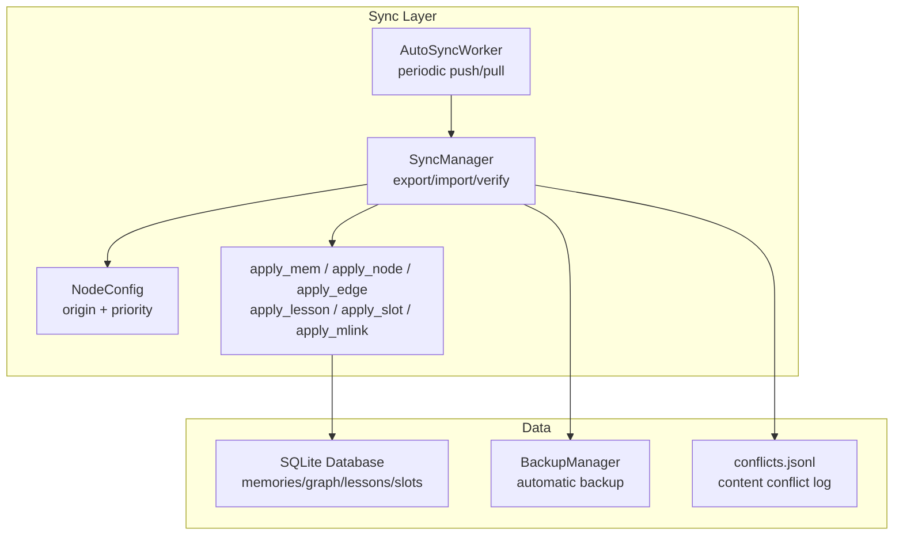
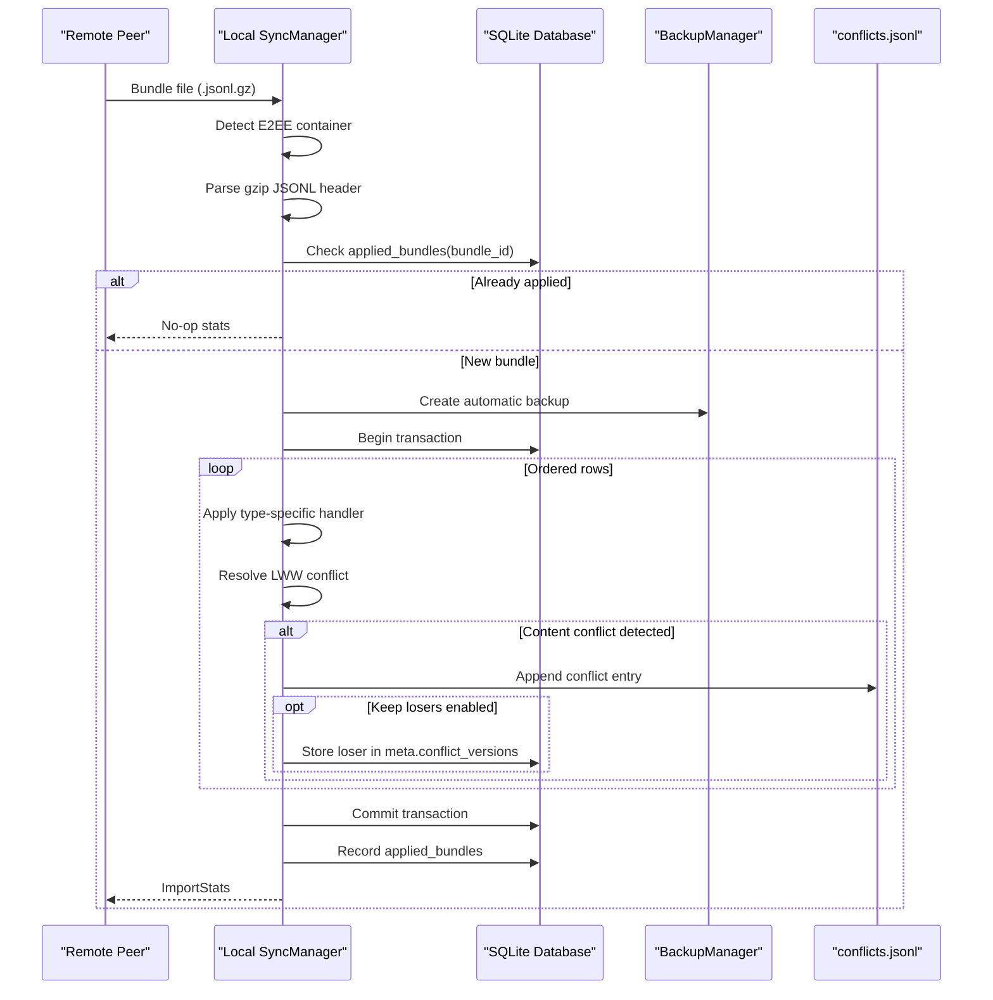
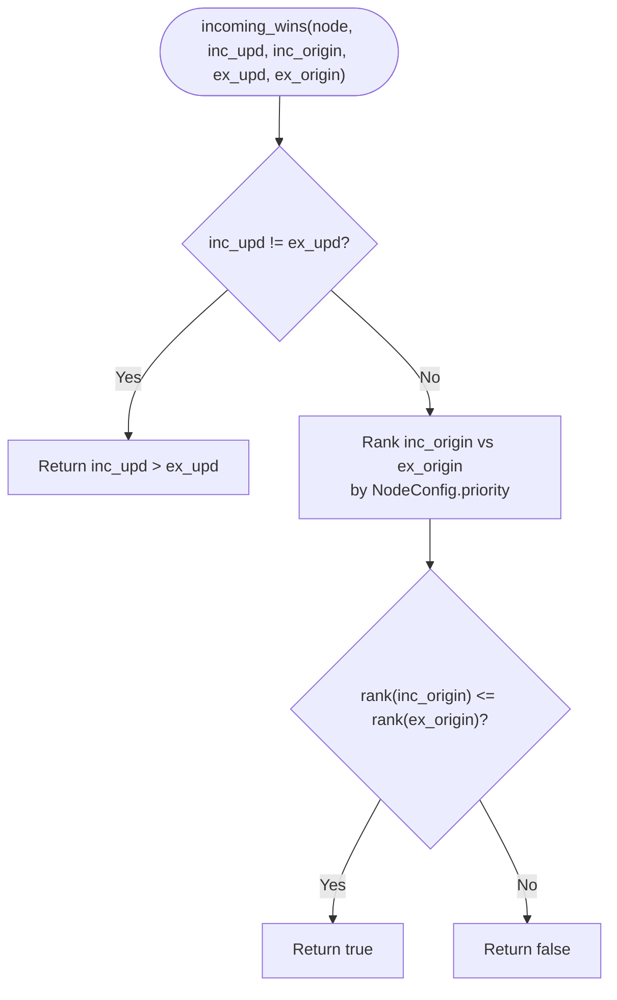
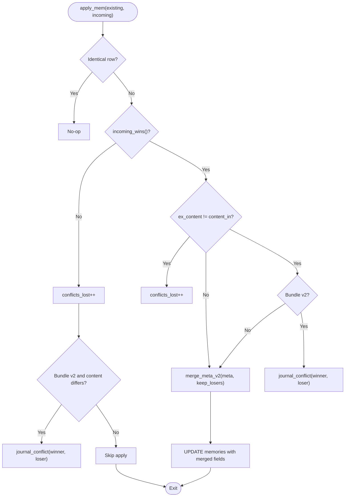
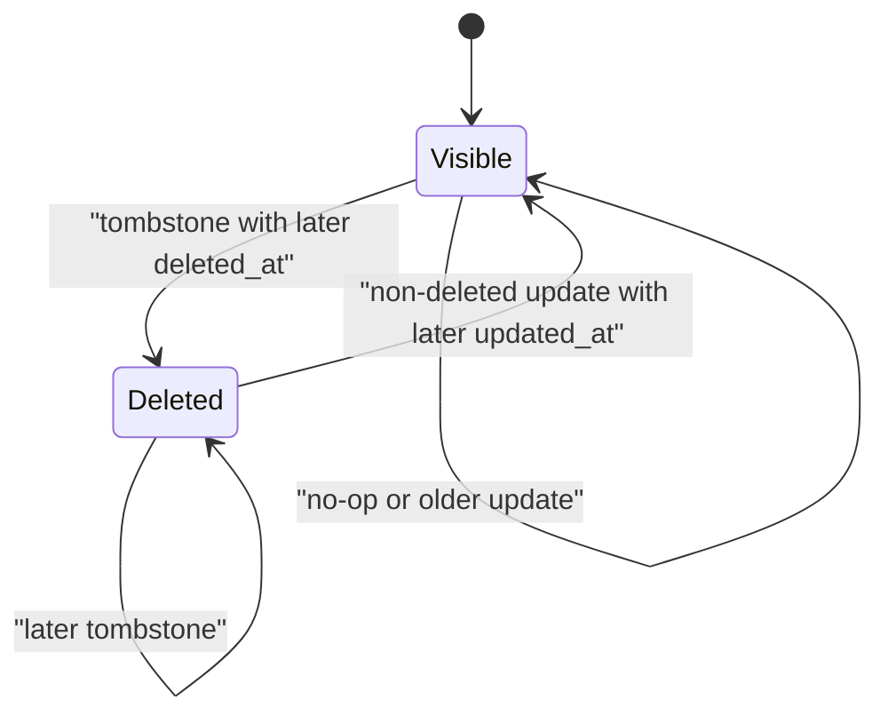
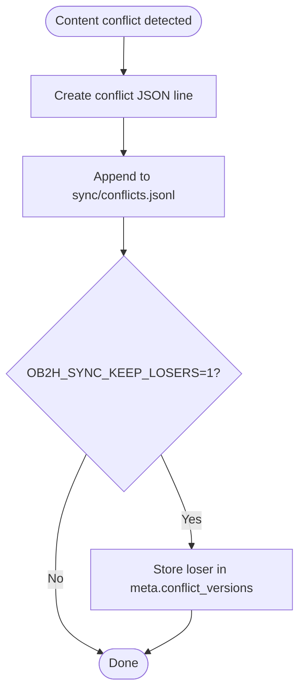
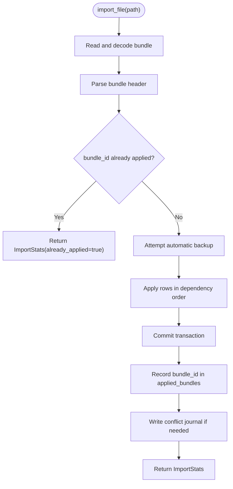
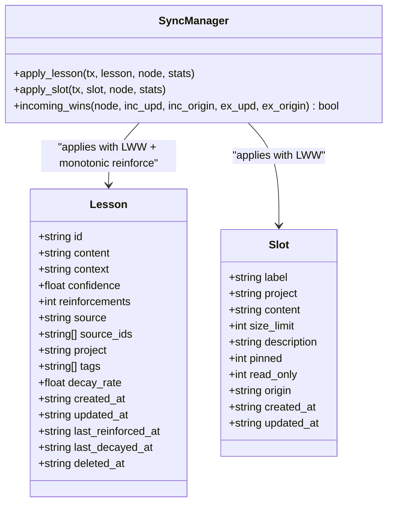
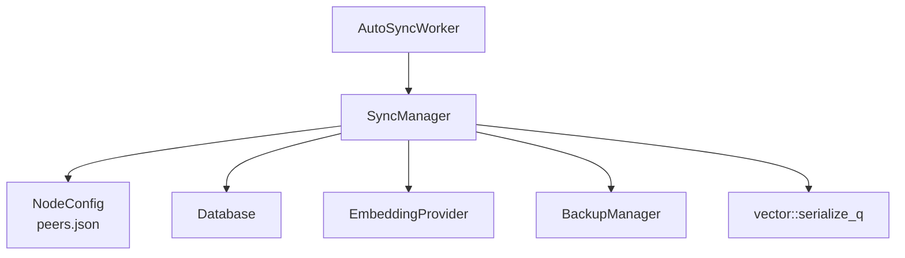

# Conflict Resolution

<cite>
**Referenced Files in This Document**
- [src/sync/mod.rs](file://src/sync/mod.rs)
- [src/sync/worker.rs](file://src/sync/worker.rs)
- [docs/SYNC.md](file://docs/SYNC.md)
- [PLAN_v1.9.9.md](file://PLAN_v1.9.9.md)
</cite>

## Table of Contents
1. [Introduction](#introduction)
2. [Project Structure](#project-structure)
3. [Core Components](#core-components)
4. [Architecture Overview](#architecture-overview)
5. [Detailed Component Analysis](#detailed-component-analysis)
6. [Dependency Analysis](#dependency-analysis)
7. [Performance Considerations](#performance-considerations)
8. [Troubleshooting Guide](#troubleshooting-guide)
9. [Conclusion](#conclusion)
10. [Appendices](#appendices)

## Introduction
This document explains the conflict resolution system used by the OB2H synchronization layer. It focuses on Last-Write-Wins (LWW) semantics with origin-based tie-breaking, field-level merge strategy for memories, tombstone handling for soft deletes, and the conflict journaling mechanism that records content conflicts to `sync/conflicts.jsonl` when `OB2H_SYNC_KEEP_LOSERS` is enabled. It also covers idempotent import, automatic backup creation before imports, drift verification, performance considerations for large datasets, and common conflict resolution patterns.

The synchronization subsystem exchanges gzipped JSONL bundles between two OB2H instances (for example, PC and VPS). Each row carries an `updated_at` timestamp and an `origin` label. When both sides modify the same entity independently, LWW resolves the winner; when timestamps are equal, peer priority from `peers.json` breaks the tie.

## Project Structure
The conflict resolution logic lives primarily in the sync module, with supporting documentation in the sync guide and the v1.9.9 plan. The background worker periodically triggers push/pull operations over SSH.



**Diagram sources**
- [src/sync/mod.rs:196-229](file://src/sync/mod.rs#L196-L229)
- [src/sync/mod.rs:509-733](file://src/sync/mod.rs#L509-L733)
- [src/sync/worker.rs:9-63](file://src/sync/worker.rs#L9-L63)

**Section sources**
- [src/sync/mod.rs:1-27](file://src/sync/mod.rs#L1-L27)
- [src/sync/worker.rs:1-65](file://src/sync/worker.rs#L1-L65)
- [docs/SYNC.md:32-67](file://docs/SYNC.md#L32-L67)

## Core Components
- **Last-Write-Wins comparator**: compares `updated_at` strings lexicographically; if equal, uses peer priority ranking derived from `NodeConfig.priority`.
- **Field-level merge for memories**: deep merges `meta`, takes maximum `access_count`, sums trust/feedback metadata, and optionally preserves the losing content version under `meta.conflict_versions`.
- **Tombstone semantics**: `deleted_at` participates in LWW comparisons and export watermarks; a later tombstone hides a record, while a later non-deleted update can resurrect it.
- **Conflict journaling**: every content conflict is appended to `data/sync/conflicts.jsonl`; when `OB2H_SYNC_KEEP_LOSERS=1`, the loser’s content is also stored in `meta.conflict_versions`.
- **Idempotent import**: bundles are identified by `bundle_id`; repeated application is a no-op tracked in `applied_bundles`.
- **Automatic backup**: before applying a new bundle, the system attempts to create a database backup.
- **Drift verification**: `sync verify` compares counts, average trust, and checksums without transferring data.

**Section sources**
- [src/sync/mod.rs:92-105](file://src/sync/mod.rs#L92-L105)
- [src/sync/mod.rs:747-754](file://src/sync/mod.rs#L747-L754)
- [src/sync/mod.rs:893-1002](file://src/sync/mod.rs#L893-L1002)
- [src/sync/mod.rs:541-547](file://src/sync/mod.rs#L541-L547)
- [src/sync/mod.rs:702-724](file://src/sync/mod.rs#L702-L724)
- [src/sync/mod.rs:549-560](file://src/sync/mod.rs#L549-L560)
- [docs/SYNC.md:274-276](file://docs/SYNC.md#L274-L276)

## Architecture Overview
The sync architecture separates export, transport, import, and conflict resolution. Export builds incremental or full bundles with a header containing bundle identity, version, watermark range, and per-type counts. Import orders rows so dependencies (projects, nodes) are applied first, then applies each type through dedicated handlers. Conflict resolution is centralized in a shared LWW comparator and specialized merge logic per entity type.



**Diagram sources**
- [src/sync/mod.rs:509-733](file://src/sync/mod.rs#L509-L733)
- [src/sync/mod.rs:747-754](file://src/sync/mod.rs#L747-L754)
- [src/sync/mod.rs:826-901](file://src/sync/mod.rs#L826-L901)
- [src/sync/mod.rs:965-1002](file://src/sync/mod.rs#L965-L1002)

## Detailed Component Analysis

### Last-Write-Wins Comparator and Origin Priority
The core decision function compares incoming and existing timestamps. If they differ, the larger timestamp wins. If they are equal, the node ranks origins using the configured priority list; earlier entries have higher priority. Empty origin values are normalized to the local node’s origin before ranking.



**Diagram sources**
- [src/sync/mod.rs:92-105](file://src/sync/mod.rs#L92-L105)
- [src/sync/mod.rs:747-754](file://src/sync/mod.rs#L747-L754)

**Section sources**
- [src/sync/mod.rs:92-105](file://src/sync/mod.rs#L92-L105)
- [src/sync/mod.rs:747-754](file://src/sync/mod.rs#L747-L754)

### Field-Level Merge Strategy for Memories
For memory entities, the importer performs a field-level merge rather than blindly replacing all fields:

- `meta`: deep merge where incoming keys win over existing keys.
- `access_count`: maximum of local and incoming values.
- Trust and feedback metadata are summed according to the implementation.
- When a content conflict occurs and `OB2H_SYNC_KEEP_LOSERS=1`, the losing content version is appended to `meta.conflict_versions`, capped at five entries to prevent unbounded growth.



**Diagram sources**
- [src/sync/mod.rs:815-824](file://src/sync/mod.rs#L815-L824)
- [src/sync/mod.rs:853-937](file://src/sync/mod.rs#L853-L937)
- [src/sync/mod.rs:965-1002](file://src/sync/mod.rs#L965-L1002)

**Section sources**
- [src/sync/mod.rs:815-963](file://src/sync/mod.rs#L815-L963)
- [src/sync/mod.rs:965-1002](file://src/sync/mod.rs#L965-L1002)

### Tombstone Mechanism and Soft Deletes
Soft deletes use a `deleted_at` timestamp instead of a boolean flag. Tombstones participate in:

- Export watermark calculation: rows are included if their effective change time (`updated_at` or `deleted_at`) is after the watermark.
- LWW comparison: a newer tombstone hides a previously visible row; a newer non-deleted update can resurrect it.
- Memory links: deletion and creation are compared by state time (`MAX(created_at, deleted_at)`), allowing edges to be re-enabled by a later creation.



**Diagram sources**
- [src/sync/mod.rs:376-395](file://src/sync/mod.rs#L376-L395)
- [src/sync/mod.rs:1232-1243](file://src/sync/mod.rs#L1232-L1243)

**Section sources**
- [src/sync/mod.rs:376-395](file://src/sync/mod.rs#L376-L395)
- [src/sync/mod.rs:1232-1243](file://src/sync/mod.rs#L1232-L1243)
- [docs/SYNC.md:58-67](file://docs/SYNC.md#L58-L67)

### Conflict Journaling System
When a content conflict is detected during import, the system appends a structured JSON line to `data/sync/conflicts.jsonl`. Each entry includes:

- Timestamp of the conflict event.
- Bundle identifier.
- Entity key.
- Field name (`content`).
- Winner side: origin, `updated_at`, and content.
- Loser side: origin, `updated_at`, and content.

If `OB2H_SYNC_KEEP_LOSERS=1`, the losing content is also persisted in `meta.conflict_versions` for the winning row.



**Diagram sources**
- [src/sync/mod.rs:541-547](file://src/sync/mod.rs#L541-L547)
- [src/sync/mod.rs:702-724](file://src/sync/mod.rs#L702-L724)
- [src/sync/mod.rs:826-901](file://src/sync/mod.rs#L826-L901)
- [src/sync/mod.rs:893-1002](file://src/sync/mod.rs#L893-L1002)

**Section sources**
- [src/sync/mod.rs:541-547](file://src/sync/mod.rs#L541-L547)
- [src/sync/mod.rs:702-724](file://src/sync/mod.rs#L702-L724)
- [src/sync/mod.rs:826-901](file://src/sync/mod.rs#L826-L901)
- [src/sync/mod.rs:893-1002](file://src/sync/mod.rs#L893-L1002)
- [docs/SYNC.md:58-67](file://docs/SYNC.md#L58-L67)

### Idempotent Import and Automatic Backup
Import is idempotent by `bundle_id`. Before applying a new bundle, the system attempts to create an automatic backup. If the bundle has already been applied, import returns early with `already_applied=true`. Applied bundle identifiers are tracked in `sync_state.applied_bundles`, with a retention limit to avoid unbounded growth.



**Diagram sources**
- [src/sync/mod.rs:509-560](file://src/sync/mod.rs#L509-L560)
- [src/sync/mod.rs:664-686](file://src/sync/mod.rs#L664-L686)
- [src/sync/mod.rs:735-745](file://src/sync/mod.rs#L735-L745)

**Section sources**
- [src/sync/mod.rs:509-560](file://src/sync/mod.rs#L509-L560)
- [src/sync/mod.rs:664-686](file://src/sync/mod.rs#L664-L686)
- [src/sync/mod.rs:735-745](file://src/sync/mod.rs#L735-L745)
- [docs/SYNC.md:63-67](file://docs/SYNC.md#L63-L67)

### Drift Verification Capabilities
Drift verification compares local and remote statistics without transferring data. It checks:

- Counts for memories, links, lessons, slots, and graph entities.
- Average trust values.
- Checksums based on entity keys and timestamps.

This enables operators to detect divergence between peers and investigate conflicts or missing updates.

**Section sources**
- [docs/SYNC.md:274-276](file://docs/SYNC.md#L274-L276)

### Lessons and Slots Conflict Semantics
Lessons and slots extend LWW semantics with additional rules:

- Lessons: LWW by `updated_at`/`origin`; `reinforcements` is monotonic maximum across peers; no-op guard compares significant fields to avoid swallowing identical reinforcements.
- Slots: LWW by `updated_at`/`origin`; identity is `(label, project)`; protected fields such as `read_only` are preserved during updates.



**Diagram sources**
- [src/sync/mod.rs:1004-1107](file://src/sync/mod.rs#L1004-L1107)
- [src/sync/mod.rs:1109-1184](file://src/sync/mod.rs#L1109-L1184)
- [src/sync/mod.rs:747-754](file://src/sync/mod.rs#L747-L754)

**Section sources**
- [src/sync/mod.rs:1004-1107](file://src/sync/mod.rs#L1004-L1107)
- [src/sync/mod.rs:1109-1184](file://src/sync/mod.rs#L1109-L1184)
- [PLAN_v1.9.9.md:278-290](file://PLAN_v1.9.9.md#L278-L290)

## Dependency Analysis
The sync module depends on configuration, database access, embedding providers, backup management, and vector serialization utilities. The background worker depends on the sync manager to perform periodic push/pull cycles.



**Diagram sources**
- [src/sync/worker.rs:9-63](file://src/sync/worker.rs#L9-L63)
- [src/sync/mod.rs:196-229](file://src/sync/mod.rs#L196-L229)
- [src/sync/mod.rs:22-27](file://src/sync/mod.rs#L22-L27)

**Section sources**
- [src/sync/worker.rs:1-65](file://src/sync/worker.rs#L1-L65)
- [src/sync/mod.rs:196-229](file://src/sync/mod.rs#L196-L229)

## Performance Considerations
- **Incremental exports**: Watermarks track the latest change time per peer, reducing bundle size for routine syncs. Full exports are available when needed.
- **Row ordering during import**: Projects and nodes are applied before memories and edges to minimize reference resolution failures.
- **Missing references**: Edges and memory links skip rows when referenced entities are absent, incrementing a counter rather than failing the entire import.
- **Embedding regeneration**: Missing embeddings are regenerated locally using the configured embedding provider, avoiding network calls during import.
- **Conflict counters**: Lost conflicts are accumulated and persisted as a global metric, enabling monitoring without heavy logging overhead.
- **Large datasets**: Tombstones and watermark filtering reduce unnecessary transfers; however, frequent conflicts increase journal growth and may require periodic cleanup or archival of `conflicts.jsonl`.

[No sources needed since this section provides general guidance]

## Troubleshooting Guide
Common issues and resolutions related to conflict resolution:

- **Conflicts lost count increases**: Indicates local changes were older than incoming changes. Verify clock synchronization across machines and review `conflicts.jsonl` for manual reconciliation.
- **Same fact jumps between machines**: Suggests inconsistent timestamps; ensure NTP synchronization and consistent UTC formatting.
- **Bundle not applied repeatedly**: Expected behavior due to idempotency; remove or rename the bundle if reapplication is required.
- **Sync disabled until peers.json fixed**: Corrupted or malformed `peers.json` disables sync but leaves memory functional; fix the configuration file.
- **Conflict journal unavailable**: If `conflicts.jsonl` cannot be written, conflicts are still resolved; check directory permissions and disk space.

**Section sources**
- [docs/SYNC.md:211-222](file://docs/SYNC.md#L211-L222)
- [src/sync/mod.rs:702-724](file://src/sync/mod.rs#L702-L724)

## Conclusion
The OB2H conflict resolution system combines deterministic LWW semantics with configurable origin-based tie-breaking, field-level merging for rich metadata, and explicit tombstone handling for soft deletes. The conflict journaling system provides transparency into content disagreements, while optional preservation of losing versions supports manual reconciliation. Idempotent imports and automatic backups protect data integrity, and drift verification helps maintain consistency across peers. For large-scale deployments, careful attention to timestamps, peer priorities, and conflict analysis workflows ensures predictable and auditable synchronization outcomes.

[No sources needed since this section summarizes without analyzing specific files]

## Appendices

### Priority Configuration Example
A typical `peers.json` defines the local origin, priority order, and peer endpoints. The priority array determines which origin wins when timestamps are equal.

```json
{
  "origin": "pc",
  "priority": ["pc", "vps"],
  "after_dream": true,
  "peers": {
    "vps": {
      "method": "ssh",
      "host": "my-vps",
      "push_to": "/root/ob2h_data/sync/inbox",
      "pull_from": "/root/ob2h_data/sync/outbox"
    }
  }
}
```

**Section sources**
- [docs/SYNC.md:100-137](file://docs/SYNC.md#L100-L137)

### Conflict Scenario Examples
- **Scenario A**: Both sides edit the same memory within the same second. The origin with higher priority in `priority` wins; the loser’s content is journaled and optionally stored in `meta.conflict_versions`.
- **Scenario B**: One side deletes a memory while the other edits it. The later `deleted_at` or `updated_at` decides visibility; tombstones propagate across peers.
- **Scenario C**: Lessons reinforced on both peers. Reinforcement counts are merged monotonically; the latest content and metadata follow LWW.
- **Scenario D**: Slots edited concurrently. The winner replaces content; protected flags like `read_only` remain enforced.

**Section sources**
- [src/sync/mod.rs:853-937](file://src/sync/mod.rs#L853-L937)
- [src/sync/mod.rs:1035-1078](file://src/sync/mod.rs#L1035-L1078)
- [src/sync/mod.rs:1133-1159](file://src/sync/mod.rs#L1133-L1159)
- [docs/SYNC.md:58-67](file://docs/SYNC.md#L58-L67)