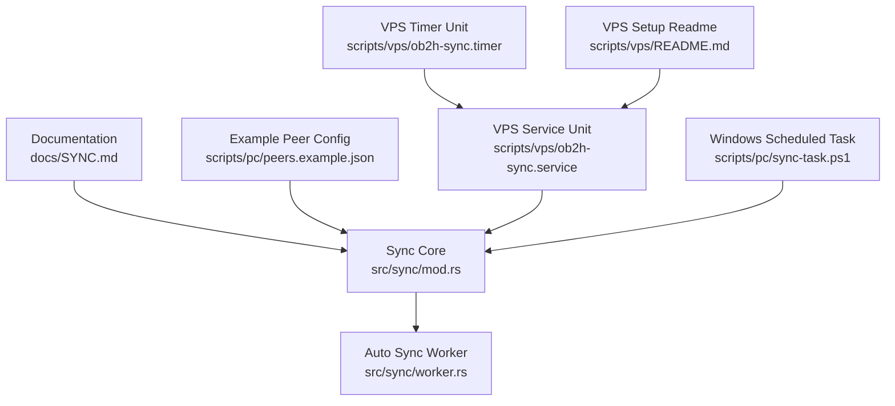
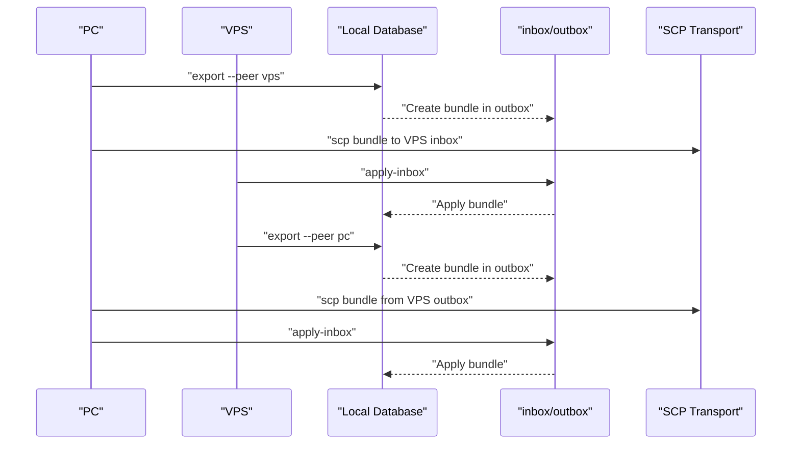
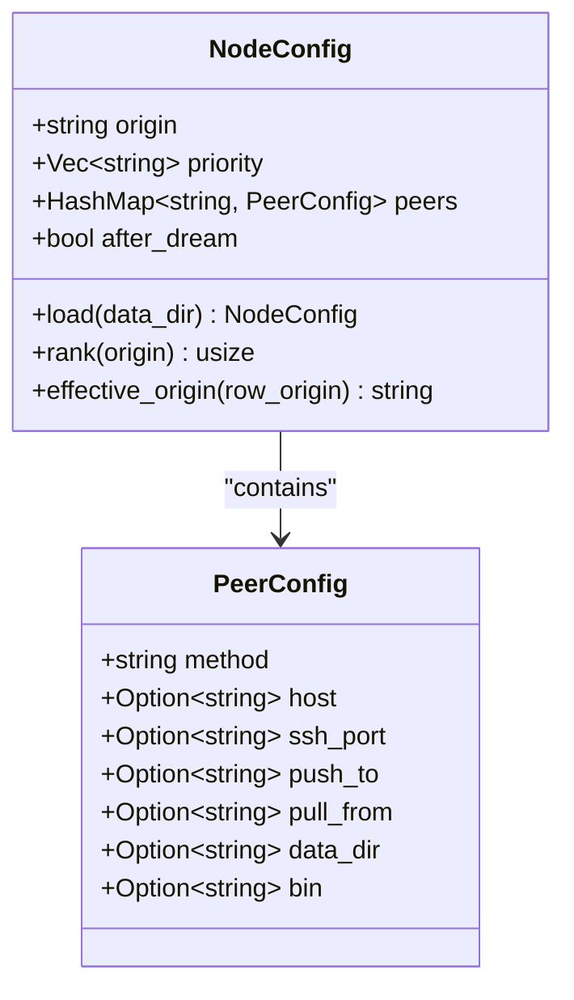
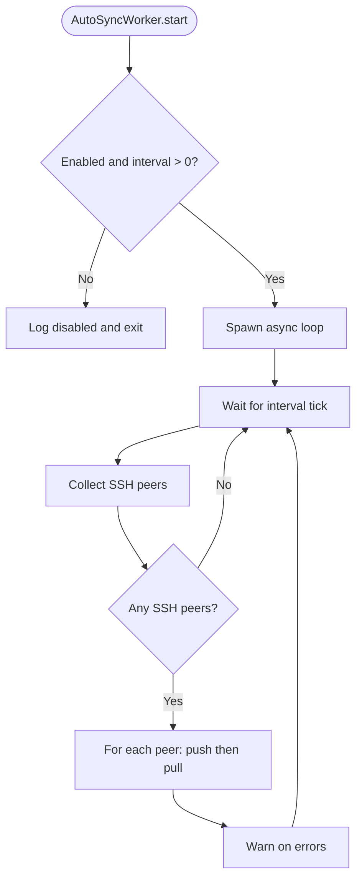
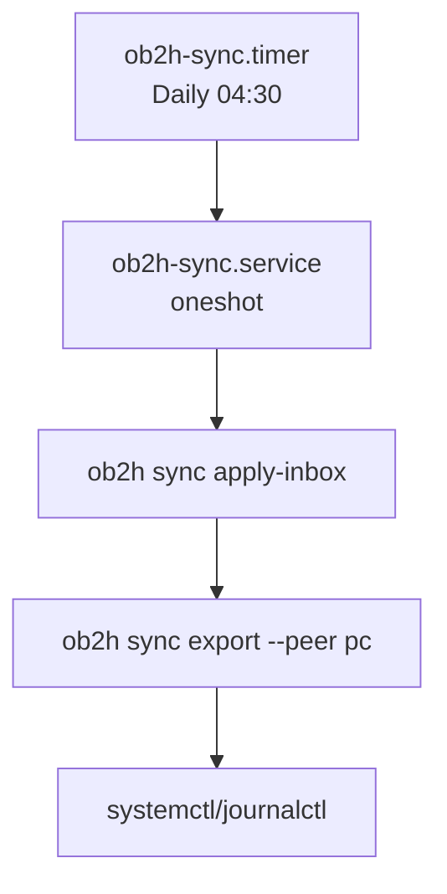
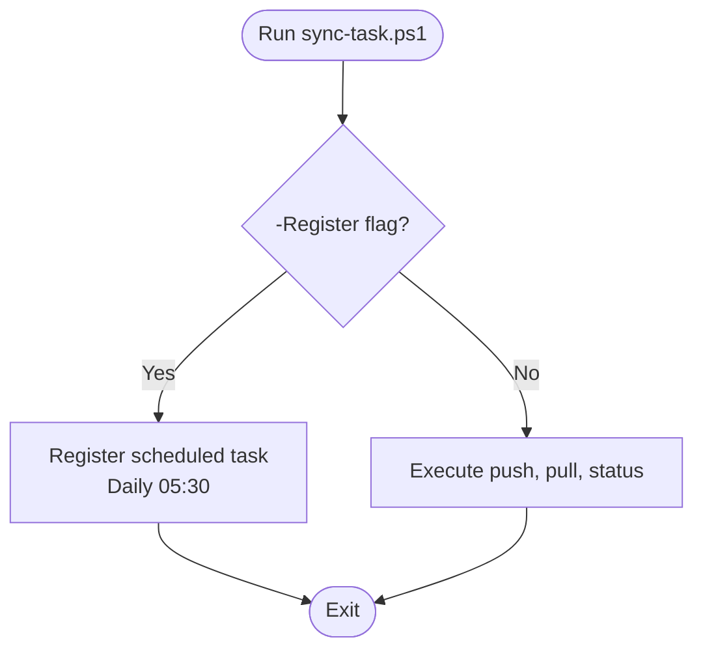
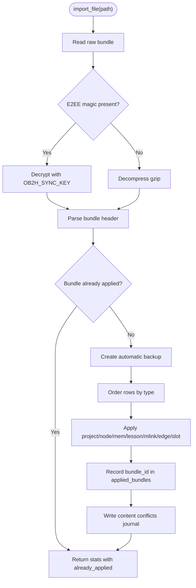
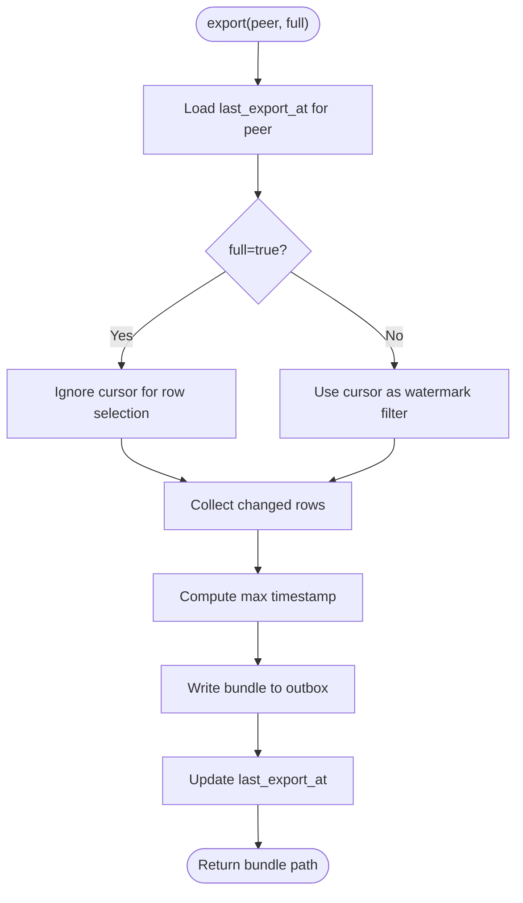
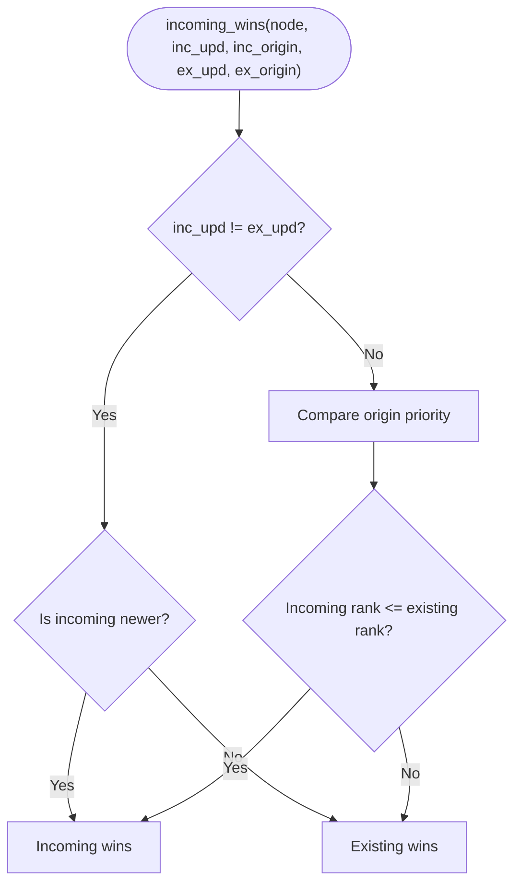
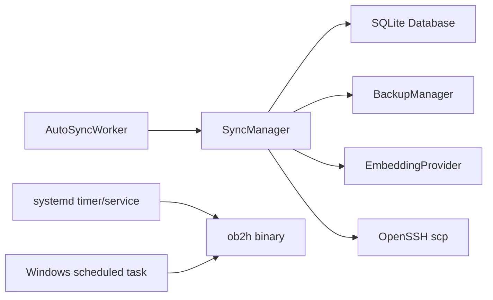

# Operational Procedures

<cite>
**Referenced Files in This Document**
- [SYNC.md](file://docs/SYNC.md)
- [peers.example.json](file://scripts/pc/peers.example.json)
- [mod.rs](file://src/sync/mod.rs)
- [worker.rs](file://src/sync/worker.rs)
- [ob2h-sync.service](file://scripts/vps/ob2h-sync.service)
- [ob2h-sync.timer](file://scripts/vps/ob2h-sync.timer)
- [README.md](file://scripts/vps/README.md)
- [sync-task.ps1](file://scripts/pc/sync-task.ps1)
</cite>

## Table of Contents
1. [Introduction](#introduction)
2. [Project Structure](#project-structure)
3. [Core Components](#core-components)
4. [Architecture Overview](#architecture-overview)
5. [Detailed Component Analysis](#detailed-component-analysis)
6. [Dependency Analysis](#dependency-analysis)
7. [Performance Considerations](#performance-considerations)
8. [Troubleshooting Guide](#troubleshooting-guide)
9. [Conclusion](#conclusion)
10. [Appendices](#appendices)

## Introduction
This document provides operational procedures for administering the ob2h synchronization system between a personal computer and a Linux VPS. It covers peer configuration, automated synchronization, manual workflows, delta bundle export/import, watermark tracking, full exports, SSH setup, monitoring, troubleshooting, and regular health verification.

The sync mechanism exchanges incremental data bundles rather than live database files. Each machine maintains its own SQLite database; only compressed JSONL bundles are moved across machines through SSH or manual transfer. Conflicts are resolved using a later-write-wins strategy with priority-based tie-breaking, and important metadata is merged at the field level where supported.

## Project Structure
The synchronization feature spans documentation, example configuration, core implementation, automation scripts, and systemd service definitions:

- Documentation explains the overall design, conflict resolution, commands, security, and troubleshooting.
- Example peer configuration shows the expected structure for PC-to-VPS synchronization.
- Core implementation defines peer configuration models, export/import logic, transport helpers, and status reporting.
- The automatic worker runs periodic push/pull cycles for configured peers.
- Systemd units schedule inbox application and outbox preparation on the VPS.
- PowerShell script registers and executes scheduled sync tasks on Windows.

**Diagram sources**
- [SYNC.md:1-296](file://docs/SYNC.md#L1-L296)
- [peers.example.json:1-14](file://scripts/pc/peers.example.json#L1-L14)
- [mod.rs:1-800](file://src/sync/mod.rs#L1-L800)
- [worker.rs:1-65](file://src/sync/worker.rs#L1-L65)
- [ob2h-sync.service:1-10](file://scripts/vps/ob2h-sync.service#L1-L10)
- [ob2h-sync.timer:1-10](file://scripts/vps/ob2h-sync.timer#L1-L10)
- [README.md:1-34](file://scripts/vps/README.md#L1-L34)
- [sync-task.ps1:1-26](file://scripts/pc/sync-task.ps1#L1-L26)

**Section sources**
- [SYNC.md:1-296](file://docs/SYNC.md#L1-L296)
- [peers.example.json:1-14](file://scripts/pc/peers.example.json#L1-L14)
- [mod.rs:1-800](file://src/sync/mod.rs#L1-L800)
- [worker.rs:1-65](file://src/sync/worker.rs#L1-L65)
- [ob2h-sync.service:1-10](file://scripts/vps/ob2h-sync.service#L1-L10)
- [ob2h-sync.timer:1-10](file://scripts/vps/ob2h-sync.timer#L1-L10)
- [README.md:1-34](file://scripts/vps/README.md#L1-L34)
- [sync-task.ps1:1-26](file://scripts/pc/sync-task.ps1#L1-L26)

## Core Components
The synchronization system is built around these primary components:

| Component | Responsibility | Key Behaviors |
|---|---|---|
| Peer configuration model | Defines node identity, priority, peer entries, and automatic exchange behavior | Loads `data/sync/peers.json`, supports `ssh` and `manual` methods, tracks `after_dream` |
| Sync manager | Handles export, import, inbox processing, SCP transport, and status operations | Creates bundles, updates watermarks, applies bundles idempotently, resolves conflicts |
| Automatic sync worker | Runs periodic background synchronization | Iterates over SSH peers and performs push/pull on interval |
| Systemd timer and service | Schedules VPS-side inbox application and outbox export | Runs daily at a fixed time, executes apply-inbox then export |
| Windows scheduled task | Registers and runs PC-side push/pull | Uses PowerShell to register a daily task and execute sync commands |

**Section sources**
- [mod.rs:31-105](file://src/sync/mod.rs#L31-L105)
- [mod.rs:194-245](file://src/sync/mod.rs#L194-L245)
- [worker.rs:9-65](file://src/sync/worker.rs#L9-L65)
- [ob2h-sync.service:1-10](file://scripts/vps/ob2h-sync.service#L1-L10)
- [ob2h-sync.timer:1-10](file://scripts/vps/ob2h-sync.timer#L1-L10)
- [sync-task.ps1:1-26](file://scripts/pc/sync-task.ps1#L1-L26)

## Architecture Overview
The operational architecture separates responsibilities by machine type:

- The PC initiates synchronization because it typically sits behind NAT.
- The VPS does not initiate connections back to the PC; it only applies incoming bundles and prepares outgoing bundles.
- Bundles are gzip-compressed JSONL files containing typed rows such as memories, graph nodes, edges, memory links, lessons, slots, and projects.
- Watermarks track per-peer export cursors so that subsequent exports include only changes since the last successful export.
- Conflict resolution uses later-write-wins with origin priority from `peers.json`.
- Manual mode allows file transfer without direct SSH connectivity.

**Diagram sources**
- [SYNC.md:32-56](file://docs/SYNC.md#L32-L56)
- [mod.rs:247-469](file://src/sync/mod.rs#L247-L469)
- [mod.rs:1498-1574](file://src/sync/mod.rs#L1498-L1574)

## Detailed Component Analysis

### Peer Configuration Format
Peer configuration is stored under `data/sync/peers.json`. The configuration includes:

| Field | Meaning |
|---|---|
| `origin` | Machine identifier used for conflict resolution and bundle naming |
| `priority` | Tie-break order for later-write-wins; earlier entries have higher priority |
| `after_dream` | Enables automatic push/pull after dream processing when true |
| `peers.<name>.method` | Transfer method: `ssh` for automatic SCP, `manual` for manual file movement |
| `peers.<name>.host` | SSH alias or `user@host` |
| `peers.<name>.ssh_port` | Optional SSH port when alias is not defined |
| `peers.<name>.push_to` | Remote directory where this machine sends its bundles |
| `peers.<name>.pull_from` | Remote directory from which this machine receives bundles |
| `peers.<name>.data_dir` | Optional remote data directory used by verification |
| `peers.<name>.bin` | Optional remote binary path used by verification |

The example configuration demonstrates a PC peer named `vps` using SSH with explicit `push_to` and `pull_from` directories.

**Diagram sources**
- [mod.rs:31-105](file://src/sync/mod.rs#L31-L105)
- [peers.example.json:1-14](file://scripts/pc/peers.example.json#L1-L14)

**Section sources**
- [mod.rs:31-105](file://src/sync/mod.rs#L31-L105)
- [peers.example.json:1-14](file://scripts/pc/peers.example.json#L1-L14)
- [SYNC.md:100-137](file://docs/SYNC.md#L100-L137)

### Automated Sync Worker
The automatic sync worker runs periodically inside the application process. It:

- Skips execution if disabled or interval is zero.
- Spawns an asynchronous loop that ticks at the configured interval.
- Collects all peers with `method = ssh`.
- Performs push followed by pull for each peer.
- Logs warnings for individual failures without stopping the loop.

**Diagram sources**
- [worker.rs:9-65](file://src/sync/worker.rs#L9-L65)

**Section sources**
- [worker.rs:1-65](file://src/sync/worker.rs#L1-L65)

### Systemd Service and Timer (Linux VPS)
On the VPS, synchronization is scheduled through two systemd units:

- **Timer**: Triggers daily at 04:30 and persists missed runs.
- **Service**: Applies all bundles in the inbox and then exports bundles for the PC peer.

The service sets `OB2H_DATA_DIR` and runs the ob2h binary through a login shell. The README documents one-time installation, expected `peers.json` content, and manual verification steps.

**Diagram sources**
- [ob2h-sync.timer:1-10](file://scripts/vps/ob2h-sync.timer#L1-L10)
- [ob2h-sync.service:1-10](file://scripts/vps/ob2h-sync.service#L1-L10)
- [README.md:1-34](file://scripts/vps/README.md#L1-L34)

**Section sources**
- [ob2h-sync.service:1-10](file://scripts/vps/ob2h-sync.service#L1-L10)
- [ob2h-sync.timer:1-10](file://scripts/vps/ob2h-sync.timer#L1-L10)
- [README.md:1-34](file://scripts/vps/README.md#L1-L34)

### Windows Scheduled Task
The PowerShell script configures a scheduled task and executes synchronization commands:

- Sets `OB2H_DATA_DIR` to the Windows data directory.
- Registers a daily task at 05:30 when invoked with `-Register`.
- Executes push, pull, and status commands during normal runs.
- Targets the release binary path by default.

**Diagram sources**
- [sync-task.ps1:1-26](file://scripts/pc/sync-task.ps1#L1-L26)

**Section sources**
- [sync-task.ps1:1-26](file://scripts/pc/sync-task.ps1#L1-L26)

### Delta Bundle Export and Import
Export creates a bundle containing changed rows since the last watermark. The watermark is stored per peer in `sync_state.last_export_at`. Full exports ignore the watermark cursor but still update the watermark afterward.

Import processes bundles in a deterministic order:

1. Projects
2. Graph nodes
3. Memories
4. Lessons
5. Memory links
6. Graph edges
7. Slots

Before applying a new bundle, the system creates an automatic backup. Imported bundles are tracked in `applied_bundles` to ensure idempotence. Missing embeddings are recomputed locally when needed.

**Diagram sources**
- [mod.rs:506-733](file://src/sync/mod.rs#L506-L733)
- [mod.rs:735-754](file://src/sync/mod.rs#L735-L754)

**Section sources**
- [mod.rs:247-469](file://src/sync/mod.rs#L247-L469)
- [mod.rs:506-733](file://src/sync/mod.rs#L506-L733)
- [mod.rs:735-754](file://src/sync/mod.rs#L735-L754)

### Watermark Tracking
Watermarks are timestamps representing the maximum change time seen during export. They are stored per peer in `sync_state.last_export_at`. The export logic computes the watermark from:

- `updated_at` and `deleted_at` for most row types
- `created_at` and `deleted_at` for memory links

Full exports bypass watermark filtering but still advance the watermark after successful write.

**Diagram sources**
- [mod.rs:247-469](file://src/sync/mod.rs#L247-L469)

**Section sources**
- [mod.rs:247-469](file://src/sync/mod.rs#L247-L469)

### Conflict Resolution and Metadata Merge
Conflict resolution follows these rules:

- Later-write-wins based on `updated_at`.
- Equal timestamps are broken by origin priority from `peers.json`.
- Content conflicts are logged to `data/sync/conflicts.jsonl`.
- When `OB2H_SYNC_KEEP_LOSERS=1`, losing content versions can be preserved in `meta.conflict_versions`.
- For version 2 bundles, `meta` is deep-merged with incoming keys winning.
- `access_count` uses the maximum of local and incoming values.
- Tombstones (`deleted_at`) hide deleted facts across machines.

**Diagram sources**
- [mod.rs:747-754](file://src/sync/mod.rs#L747-L754)
- [mod.rs:965-1002](file://src/sync/mod.rs#L965-L1002)

**Section sources**
- [mod.rs:747-754](file://src/sync/mod.rs#L747-L754)
- [mod.rs:826-901](file://src/sync/mod.rs#L826-L901)
- [mod.rs:965-1002](file://src/sync/mod.rs#L965-L1002)
- [SYNC.md:58-68](file://docs/SYNC.md#L58-L68)

### Manual File Transfer Workflow
When both machines cannot connect directly, use manual mode:

1. Set `method = manual` in `peers.json`.
2. Generate bundles with `ob2h sync export --peer <name>`.
3. Transfer bundle files manually using your preferred mechanism.
4. Place received bundles into `data/sync/inbox/`.
5. Apply them with `ob2h sync apply-inbox`.

Manual mode avoids direct network access and relies on operator-controlled transport.

**Section sources**
- [SYNC.md:177-188](file://docs/SYNC.md#L177-L188)
- [mod.rs:1538-1574](file://src/sync/mod.rs#L1538-L1574)

### Step-by-Step PC-to-VPS Synchronization Setup
Follow these steps to establish synchronization:

1. Install ob2h on both machines and enable the required plugin.
2. Configure SSH access from PC to VPS using `~/.ssh/config`.
3. Create `data/sync/peers.json` on the PC with `origin`, `priority`, `after_dream`, and peer entry.
4. Create `data/sync/peers.json` on the VPS with `origin`, `priority`, and empty peers.
5. Create `inbox` and `outbox` directories on the VPS.
6. Install the systemd timer and service on the VPS.
7. Register the Windows scheduled task on the PC.
8. Perform the first manual exchange.
9. Verify status and drift.

**Section sources**
- [SYNC.md:76-175](file://docs/SYNC.md#L76-L175)
- [README.md:6-25](file://scripts/vps/README.md#L6-L25)
- [sync-task.ps1:6-25](file://scripts/pc/sync-task.ps1#L6-L25)

### Monitoring Sync Status
Use the following operational checks:

| Operation | Command or Location | Purpose |
|---|---|---|
| Sync status | `ob2h sync status` | Shows origin, priorities, watermarks, bundle counts, and accumulated conflict counters |
| VPS logs | `journalctl -u ob2h-sync.service -n 30` | Reviews recent systemd service output |
| Conflict journal | `data/sync/conflicts.jsonl` | Inspects detailed content conflict records |
| Applied bundles | `sync_state.applied_bundles` | Tracks recently imported bundle IDs |
| Export watermark | `sync_state.last_export_at` | Verifies incremental export progress |

**Section sources**
- [SYNC.md:190-200](file://docs/SYNC.md#L190-L200)
- [README.md:27-33](file://scripts/vps/README.md#L27-L33)
- [mod.rs:664-700](file://src/sync/mod.rs#L664-L700)
- [mod.rs:702-724](file://src/sync/mod.rs#L702-L724)

### Troubleshooting Connection Issues
Common issues and resolutions include:

| Symptom | Likely Cause | Resolution |
|---|---|---|
| SCP destination open failure | Remote `push_to` directory missing | Create the directory on the remote machine |
| Peer not found | Typo in peer name or missing `peers.json` | Verify peer name and configuration file location |
| Push/pull appears silent | `after_dream` disabled and no scheduler running | Run commands manually or configure a scheduler |
| Conflict counter increases | Local edits older than incoming edits | Review timestamps and NTP synchronization |
| Same fact moves between machines | Clock skew across machines | Synchronize time using NTP |
| Bundle not reapplied | Bundle ID already in `applied_bundles` | This is expected idempotent behavior |
| Sync disabled due to bad config | Invalid `peers.json` | Fix JSON syntax and reload |

**Section sources**
- [SYNC.md:211-222](file://docs/SYNC.md#L211-L222)
- [mod.rs:1519-1574](file://src/sync/mod.rs#L1519-L1574)

### Maintaining Sync Health Through Regular Verification
Regular verification should include:

1. Confirming that both machines report consistent counts for memories, links, lessons, and slots.
2. Checking average trust values.
3. Comparing checksums derived from stable identifiers and timestamps.
4. Reviewing conflict journals for unexpected content disputes.
5. Validating that watermarks advance after successful exports.
6. Ensuring systemd timers and Windows scheduled tasks are active.
7. Verifying that automatic backups exist before major imports.

**Section sources**
- [SYNC.md:274-276](file://docs/SYNC.md#L274-L276)
- [mod.rs:1599-1600](file://src/sync/mod.rs#L1599-L1600)

## Dependency Analysis
The synchronization subsystem has clear internal dependencies:

- The sync module defines configuration structures, export/import logic, transport helpers, and status utilities.
- The worker depends on the sync manager to perform push/pull operations.
- Systemd units depend on the ob2h binary and environment variables.
- The PowerShell script depends on the Windows task scheduler and the ob2h executable.

**Diagram sources**
- [worker.rs:1-65](file://src/sync/worker.rs#L1-L65)
- [mod.rs:194-245](file://src/sync/mod.rs#L194-L245)
- [mod.rs:1519-1574](file://src/sync/mod.rs#L1519-L1574)

**Section sources**
- [worker.rs:1-65](file://src/sync/worker.rs#L1-L65)
- [mod.rs:194-245](file://src/sync/mod.rs#L194-L245)
- [mod.rs:1519-1574](file://src/sync/mod.rs#L1519-L1574)

## Performance Considerations
Operational performance considerations include:

- Incremental exports reduce bandwidth by sending only changed rows since the last watermark.
- Full exports should be used sparingly, such as monthly or on demand.
- Bundle compression reduces transfer size.
- Reembedding missing vectors occurs locally during import and may add CPU overhead.
- Conflict journaling adds small append-only file writes.
- Automatic backups protect state but consume disk space.
- Avoid transferring live SQLite databases; only bundle files should move between machines.

[No sources needed since this section provides general guidance]

## Troubleshooting Guide
This guide consolidates operational diagnostics:

1. **Validate configuration**  
   Ensure `peers.json` is valid JSON and contains required fields.

2. **Test SSH connectivity**  
   Confirm that `ssh` and `scp` work without password prompts.

3. **Check directories**  
   Verify that `inbox` and `outbox` exist on both machines.

4. **Inspect schedules**  
   On Linux, check systemd timer and service status.  
   On Windows, verify the scheduled task exists and is enabled.

5. **Review logs**  
   Use `journalctl` on Linux and Windows event logs or PowerShell output for scheduling issues.

6. **Analyze conflicts**  
   Examine `data/sync/conflicts.jsonl` for content disputes and review `updated_at` timestamps.

7. **Verify watermarks**  
   Confirm that `last_export_at` advances after successful exports.

8. **Run verification**  
   Use `ob2h sync verify` to compare machine state without moving data.

**Section sources**
- [SYNC.md:202-222](file://docs/SYNC.md#L202-L222)
- [README.md:27-33](file://scripts/vps/README.md#L27-L33)

## Conclusion
The ob2h synchronization system provides reliable, incremental replication between a PC and a VPS. Administrators should configure peers carefully, rely on SSH or manual transfer depending on network topology, schedule synchronization appropriately, and monitor watermarks, conflict journals, and verification outputs. Keeping clocks synchronized, avoiding live database transfers, and preserving backups ensures predictable conflict resolution and recoverability.

[No sources needed since this section summarizes without analyzing specific files]

## Appendices

### A. Commands Reference
| Command | Description |
|---|---|
| `ob2h sync status` | Display origin, priorities, watermarks, bundle counts, and conflict totals |
| `ob2h sync export --peer <name>` | Export delta bundle to `data/sync/outbox` |
| `ob2h sync push --peer <name>` | Export and SCP bundle to peer |
| `ob2h sync pull --peer <name>` | SCP bundle from peer and apply inbox |
| `ob2h sync apply-inbox` | Apply all bundles in `data/sync/inbox` |
| `ob2h sync import <file...>` | Apply specific bundle files |
| `ob2h sync verify [--peer <name>]` | Compare machine state without transferring data |

**Section sources**
- [SYNC.md:190-200](file://docs/SYNC.md#L190-L200)

### B. Data Tables Included in Bundles
Bundles may contain the following table types:

| Type | Purpose |
|---|---|
| `mem` | Memory facts with trust, feedback, and embedding support |
| `node` | Knowledge graph nodes |
| `edge` | Knowledge graph edges |
| `mlink` | Typed memory links with soft-delete support |
| `lesson` | Procedural experience with reinforcement tracking |
| `slot` | Working context slots with read-only protection |
| `proj` | Project metadata |

**Section sources**
- [mod.rs:276-374](file://src/sync/mod.rs#L276-L374)
- [SYNC.md:257-290](file://docs/SYNC.md#L257-L290)