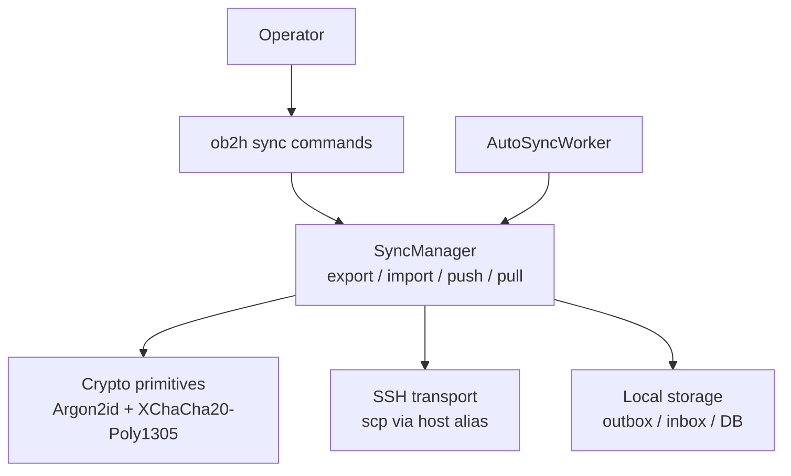
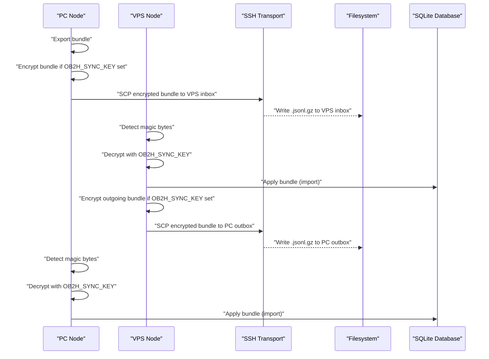
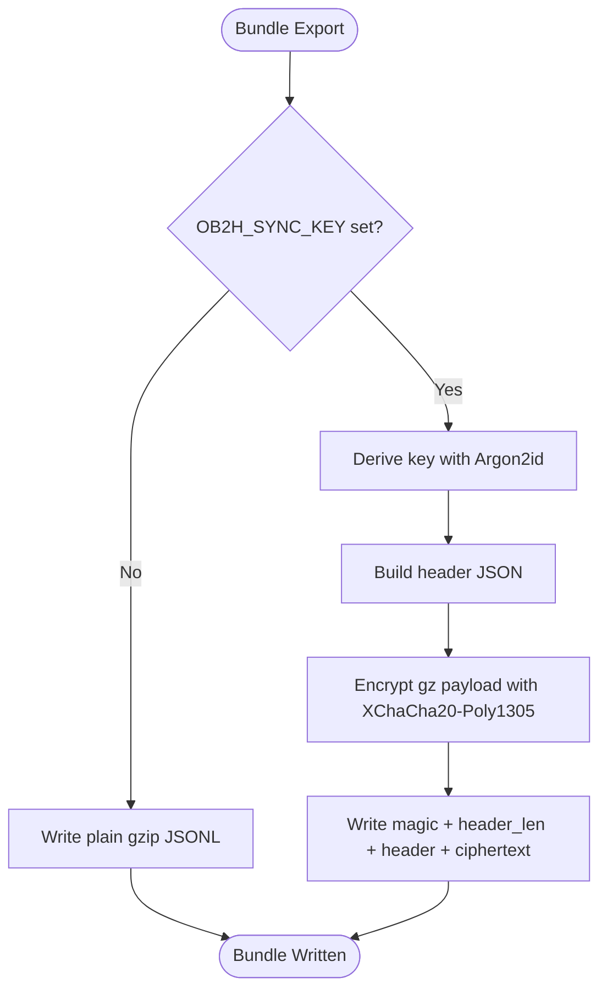
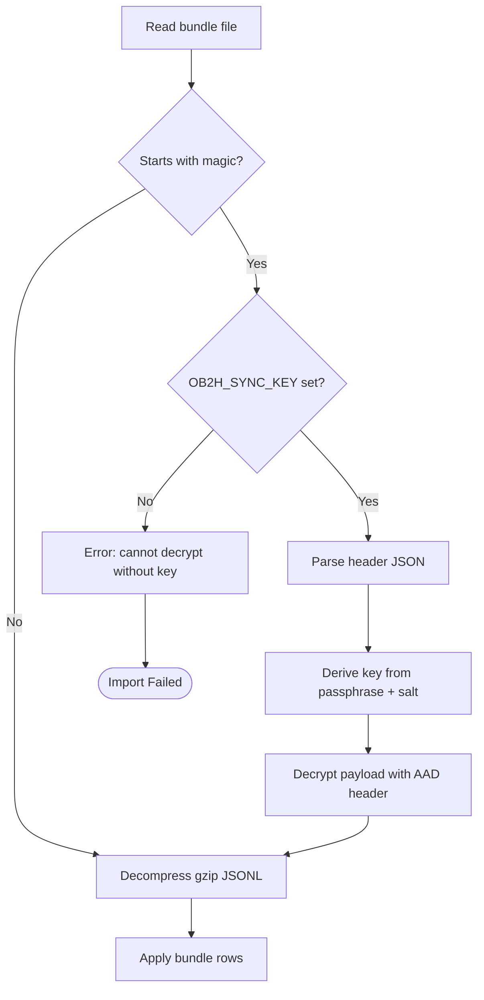
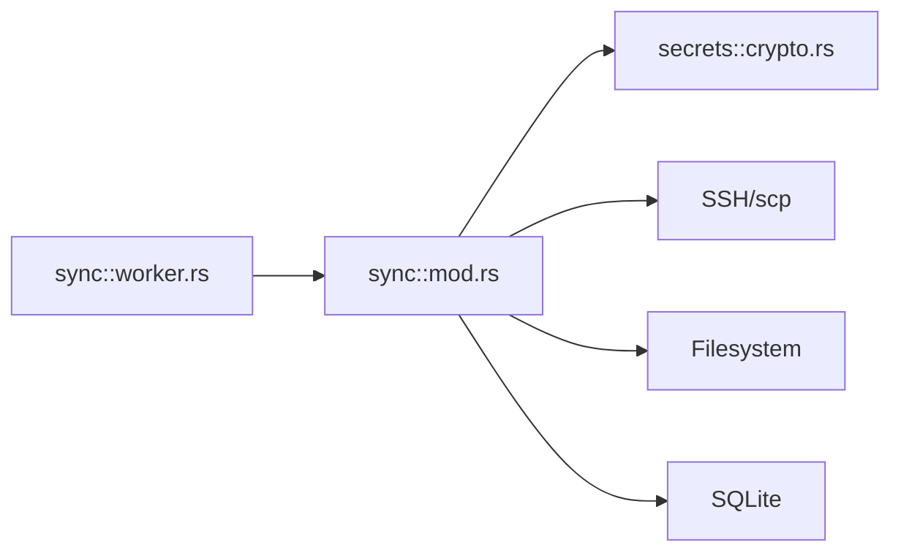

# Security Model

<cite>
**Referenced Files in This Document**
- [SYNC.md](file://docs/SYNC.md)
- [README.md](file://README.md)
- [mod.rs](file://src/sync/mod.rs)
- [worker.rs](file://src/sync/worker.rs)
- [crypto.rs](file://src/secrets/crypto.rs)
- [test_sync_e2ee.rs](file://tests/test_sync_e2ee.rs)
</cite>

## Table of Contents
1. [Introduction](#introduction)
2. [Project Structure](#project-structure)
3. [Core Components](#core-components)
4. [Architecture Overview](#architecture-overview)
5. [Detailed Component Analysis](#detailed-component-analysis)
6. [Dependency Analysis](#dependency-analysis)
7. [Performance Considerations](#performance-considerations)
8. [Troubleshooting Guide](#troubleshooting-guide)
9. [Conclusion](#conclusion)
10. [Appendices](#appendices)

## Introduction
This document explains the security model of the ob2h synchronization system with a focus on end-to-end encryption and peer authentication. It covers:

- How sync bundles are protected using key derivation, authenticated encryption, and header integrity checks.
- The role of the `OB2H_SYNC_KEY` environment variable.
- Magic byte detection for encrypted bundle containers.
- Authenticated encryption with associated data (AAD) for header protection.
- Peer identity configuration and SSH-based transfer mechanisms.
- Manual transfer mode security considerations.
- Practical configuration examples, setup guidance, and decryption troubleshooting.
- Security best practices, key management strategies, and vulnerability mitigation approaches.

The documentation is grounded in the repository’s sync implementation, cryptographic primitives, user-facing documentation, and dedicated end-to-end encryption tests.

**Section sources**
- [SYNC.md:1-296](file://docs/SYNC.md#L1-L296)
- [README.md:300-376](file://README.md#L300-L376)

## Project Structure
The sync security model spans several modules:

- Sync orchestration and bundle export/import logic live in the sync module.
- Cryptographic primitives for key derivation and authenticated encryption are implemented in the secrets crypto module.
- Automated background synchronization uses a worker that triggers push/pull operations.
- Documentation describes peer configuration, manual mode, and operational security notes.
- Tests validate E2EE behavior, including magic detection, correct-key round-trip, missing-key failure, and wrong-key AEAD failure.

**Diagram sources**
- [mod.rs:127-192](file://src/sync/mod.rs#L127-L192)
- [mod.rs:247-469](file://src/sync/mod.rs#L247-L469)
- [mod.rs:506-733](file://src/sync/mod.rs#L506-L733)
- [mod.rs:1532-1574](file://src/sync/mod.rs#L1532-L1574)
- [worker.rs:9-63](file://src/sync/worker.rs#L9-L63)
- [crypto.rs:1-111](file://src/secrets/crypto.rs#L1-L111)

**Section sources**
- [mod.rs:127-192](file://src/sync/mod.rs#L127-L192)
- [mod.rs:247-469](file://src/sync/mod.rs#L247-L469)
- [mod.rs:506-733](file://src/sync/mod.rs#L506-L733)
- [mod.rs:1532-1574](file://src/sync/mod.rs#L1532-L1574)
- [worker.rs:9-63](file://src/sync/worker.rs#L9-L63)
- [crypto.rs:1-111](file://src/secrets/crypto.rs#L1-L111)

## Core Components
This section summarizes the core security-related components and their responsibilities.

### End-to-End Encryption Wrapper
- Encrypted bundle container format starts with a magic marker to distinguish it from plain gzip payloads.
- When `OB2H_SYNC_KEY` is set, exported bundles are wrapped in an encrypted container; otherwise, they remain as plain gzip JSONL.
- Decryption requires the same passphrase and validates both ciphertext integrity and header authenticity through AAD.

Key behaviors:
- Export path: if passphrase present, encrypt gzipped bundle payload and write encrypted container.
- Import path: detect magic bytes; if present, require passphrase and decrypt before decompression.
- Header integrity: header JSON is bound as AAD so any modification fails decryption.

**Section sources**
- [mod.rs:127-192](file://src/sync/mod.rs#L127-L192)
- [mod.rs:441-449](file://src/sync/mod.rs#L441-L449)
- [mod.rs:510-528](file://src/sync/mod.rs#L510-L528)

### Cryptographic Primitives
- Key derivation uses Argon2id with configurable memory, time, and parallelism parameters.
- Encryption uses XChaCha20-Poly1305 AEAD with random nonce per encryption.
- AAD binds metadata such as secret names or headers to ciphertext, preventing substitution attacks.
- Salt and nonce generation rely on secure randomness.

Security properties:
- Strong KDF resists brute-force and GPU acceleration compared to simple hashing.
- AEAD ensures confidentiality and integrity; tampering or wrong keys fail verification.
- Random salt prevents precomputation; random nonce prevents reuse across encryptions.

**Section sources**
- [crypto.rs:13-52](file://src/secrets/crypto.rs#L13-L52)
- [crypto.rs:54-98](file://src/secrets/crypto.rs#L54-L98)

### Peer Identity and Configuration
- Each node has an `origin` identity used for conflict resolution and bundle attribution.
- `peers.json` defines peer connection details, including method (`ssh` or `manual`), host alias, and directories for push/pull.
- Priority ordering resolves tie-breaks when timestamps are equal during LWW conflict resolution.

Operational implications:
- Origin normalization ensures consistent attribution across machines.
- Peer misconfiguration disables automatic push/pull but does not break local memory/graph functionality.

**Section sources**
- [mod.rs:31-105](file://src/sync/mod.rs#L31-L105)
- [SYNC.md:100-137](file://docs/SYNC.md#L100-L137)

### SSH-Based Transfer Mechanisms
- Push exports a bundle and copies it to the remote peer’s inbox directory via `scp`.
- Pull downloads matching bundle files from the remote outbox into the local inbox and applies them.
- Automatic worker schedules periodic push/pull for all SSH peers when enabled.

Security posture:
- Transport encryption is provided by SSH; ob2h does not open ports or store passwords.
- Bundle contents may still be visible at rest on intermediate directories unless E2EE is enabled.

**Section sources**
- [mod.rs:1532-1574](file://src/sync/mod.rs#L1532-L1574)
- [worker.rs:24-63](file://src/sync/worker.rs#L24-L63)
- [SYNC.md:202-209](file://docs/SYNC.md#L202-L209)

### Manual Transfer Mode
- When peers use `method: "manual"`, bundles must be moved manually or via external tools.
- Only bundle files should be transferred; never the live SQLite database.
- For additional protection, bundles can be encrypted externally (e.g., age/gpg) since built-in E2EE depends on shared passphrase handling.

Security considerations:
- Manual channels must be private and trusted.
- External encryption adds defense-in-depth but requires careful key management.

**Section sources**
- [SYNC.md:177-188](file://docs/SYNC.md#L177-L188)

## Architecture Overview
The sync security architecture combines transport security, optional end-to-end encryption, and strict bundle validation.

**Diagram sources**
- [mod.rs:441-449](file://src/sync/mod.rs#L441-L449)
- [mod.rs:510-528](file://src/sync/mod.rs#L510-L528)
- [mod.rs:1532-1574](file://src/sync/mod.rs#L1532-L1574)

## Detailed Component Analysis

### AES-GCM vs XChaCha20-Poly1305 Clarification
The README mentions AES-GCM in relation to `OB2H_SYNC_KEY`; however, the implementation uses XChaCha20-Poly1305 for authenticated encryption and Argon2id for key derivation. Users should treat the documented primitive as XChaCha20-Poly1305 rather than AES-GCM.

Recommendation:
- Align documentation references to XChaCha20-Poly1305 to avoid confusion.
- Keep `OB2H_SYNC_KEY` as the shared passphrase controlling E2EE behavior.

**Section sources**
- [README.md:323-323](file://README.md#L323-L323)
- [crypto.rs:1-111](file://src/secrets/crypto.rs#L1-L111)
- [mod.rs:141-192](file://src/sync/mod.rs#L141-L192)

### Bundle Encryption Format and Header Integrity
Encrypted bundles follow this structure:

- Magic marker: 8-byte identifier indicating an encrypted container.
- Header length: 4-byte big-endian integer specifying JSON header size.
- Header JSON: metadata including version, KDF type, parameters, salt, and bundle ID.
- Ciphertext: AEAD-encrypted payload containing the original gzipped JSONL bundle.

Header integrity is ensured by binding the header JSON as AAD during encryption. Any change to the header invalidates decryption.

**Diagram sources**
- [mod.rs:141-192](file://src/sync/mod.rs#L141-L192)
- [crypto.rs:34-52](file://src/secrets/crypto.rs#L34-L52)
- [crypto.rs:54-98](file://src/secrets/crypto.rs#L54-L98)

**Section sources**
- [mod.rs:127-192](file://src/sync/mod.rs#L127-L192)
- [crypto.rs:13-98](file://src/secrets/crypto.rs#L13-L98)

### Magic Byte Detection and Decryption Flow
On import, the system detects whether a file is an encrypted container by checking the magic marker. If detected, it requires `OB2H_SYNC_KEY`, parses the header, derives the key, and decrypts the payload. Failure occurs if:

- The passphrase is missing.
- The header is malformed or not UTF-8.
- The salt is missing or invalid.
- The AEAD decryption fails due to wrong key or corrupted ciphertext.

**Diagram sources**
- [mod.rs:510-528](file://src/sync/mod.rs#L510-L528)
- [mod.rs:168-192](file://src/sync/mod.rs#L168-L192)

**Section sources**
- [mod.rs:510-528](file://src/sync/mod.rs#L510-L528)
- [mod.rs:168-192](file://src/sync/mod.rs#L168-L192)

### Peer Authentication and SSH Security
Peer authentication relies on SSH configuration:

- Host aliases are defined in SSH config.
- Passwordless SSH access is required for automated push/pull.
- ob2h invokes `scp` over SSH; no credentials are stored in ob2h configuration.

Security implications:

- Trust boundary includes SSH keys and host trust settings.
- Compromised SSH keys allow unauthorized access to peer directories.
- Intermediate directories (inbox/outbox) contain either plaintext or ciphertext depending on E2EE status.

Best practices:

- Restrict SSH key permissions and use strong passphrases for keys.
- Limit filesystem permissions on inbox/outbox directories.
- Prefer E2EE when bundles traverse untrusted storage or networks.

**Section sources**
- [SYNC.md:81-98](file://docs/SYNC.md#L81-L98)
- [mod.rs:1532-1574](file://src/sync/mod.rs#L1532-L1574)
- [SYNC.md:202-209](file://docs/SYNC.md#L202-L209)

### Manual Transfer Mode Security Considerations
Manual mode shifts transport responsibility to the operator:

- Bundles are placed in `data/sync/outbox` and moved to the peer’s `data/sync/inbox`.
- Only bundle files should be transferred; never copy the live SQLite database.
- External encryption (age/gpg) can protect bundles if E2EE is not used.

Risks:

- Unencrypted bundles expose sensitive data if transferred over insecure channels.
- Accidental database transfer risks corruption and privacy leaks.

Mitigations:

- Use private, audited transfer channels.
- Enable `OB2H_SYNC_KEY` for built-in E2EE whenever possible.
- Validate bundle integrity after transfer.

**Section sources**
- [SYNC.md:177-188](file://docs/SYNC.md#L177-L188)

### Practical Secure Peer Configuration Examples
Below are concise examples derived from repository documentation and code.

#### SSH Peer Configuration (PC → VPS)
- Define SSH alias and identity in SSH config.
- Create `data/sync/peers.json` on PC with peer entry using `method: "ssh"`.
- Ensure `push_to` and `pull_from` directories exist on VPS.

Example structure:
- PC `peers.json`:
  - `origin`: machine name
  - `priority`: tie-break order
  - `peers.vps.method`: `"ssh"`
  - `peers.vps.host`: SSH alias
  - `peers.vps.push_to`: remote inbox path
  - `peers.vps.pull_from`: remote outbox path

- VPS `peers.json`:
  - `origin`: machine name
  - `priority`: tie-break order
  - No peer entry needed if VPS does not initiate connections.

**Section sources**
- [SYNC.md:100-137](file://docs/SYNC.md#L100-L137)

#### E2EE Setup Using `OB2H_SYNC_KEY`
- Set `OB2H_SYNC_KEY` on both machines before exporting/importing bundles.
- Exported bundles will start with the encrypted container magic marker.
- Importing without the key fails; importing with a wrong key fails AEAD verification.

Validation:
- Test round-trip export/import with the same key.
- Confirm plaintext is not visible in bundle bytes.
- Confirm missing/wrong key produces errors.

**Section sources**
- [README.md:323-323](file://README.md#L323-L323)
- [test_sync_e2ee.rs:24-70](file://tests/test_sync_e2ee.rs#L24-L70)
- [mod.rs:441-449](file://src/sync/mod.rs#L441-L449)
- [mod.rs:510-528](file://src/sync/mod.rs#L510-L528)

### Troubleshooting Decryption Failures
Common causes and resolutions:

| Symptom | Likely Cause | Resolution |
|---|---|---|
| Import fails because key is missing | `OB2H_SYNC_KEY` not set on receiving side | Set the same passphrase on both nodes |
| AEAD decryption error | Wrong passphrase or corrupted ciphertext | Verify key correctness and file integrity |
| Header parsing error | Malformed or non-UTF-8 header | Re-export bundle with correct key |
| Bundle appears as plain gzip | `OB2H_SYNC_KEY` was not set during export | Re-export with passphrase configured |
| SCP destination open failure | Remote directory missing | Create `push_to` directory on peer |
| Peer not found | Typo or missing `peers.json` | Fix peer name and ensure file exists |

**Section sources**
- [test_sync_e2ee.rs:51-67](file://tests/test_sync_e2ee.rs#L51-L67)
- [SYNC.md:211-221](file://docs/SYNC.md#L211-L221)
- [mod.rs:510-528](file://src/sync/mod.rs#L510-L528)

## Dependency Analysis
The sync security model depends on:

- Sync manager for orchestration and file I/O.
- Secrets crypto module for KDF and AEAD.
- SSH transport for peer connectivity.
- Local filesystem for bundle staging.
- SQLite database for watermarking, applied-bundle tracking, and data application.

**Diagram sources**
- [mod.rs:127-192](file://src/sync/mod.rs#L127-L192)
- [mod.rs:247-469](file://src/sync/mod.rs#L247-L469)
- [mod.rs:506-733](file://src/sync/mod.rs#L506-L733)
- [mod.rs:1532-1574](file://src/sync/mod.rs#L1532-L1574)
- [worker.rs:9-63](file://src/sync/worker.rs#L9-L63)
- [crypto.rs:1-111](file://src/secrets/crypto.rs#L1-L111)

**Section sources**
- [mod.rs:127-192](file://src/sync/mod.rs#L127-L192)
- [worker.rs:9-63](file://src/sync/worker.rs#L9-L63)
- [crypto.rs:1-111](file://src/secrets/crypto.rs#L1-L111)

## Performance Considerations
- Argon2id parameters affect key derivation cost; higher values increase resistance to brute force but slow down export/import.
- XChaCha20-Poly1305 AEAD encryption/decryption is efficient and suitable for large bundles.
- E2EE adds CPU overhead during export and import; consider enabling it only when necessary or when bundles traverse untrusted storage.
- Watermark-based delta exports reduce bundle size and network/filesystem load.

[No sources needed since this section provides general guidance]

## Troubleshooting Guide
Use this checklist when diagnosing sync security issues:

1. Verify SSH connectivity and key permissions.
2. Confirm `peers.json` entries are correct and accessible.
3. Ensure `OB2H_SYNC_KEY` is set consistently on both sides if E2EE is expected.
4. Check bundle magic bytes to determine encryption state.
5. Validate header integrity and salt presence for encrypted bundles.
6. Review applied-bundle tracking to avoid accidental re-imports.
7. Inspect conflict logs when content conflicts occur.

**Section sources**
- [SYNC.md:211-221](file://docs/SYNC.md#L211-L221)
- [mod.rs:510-528](file://src/sync/mod.rs#L510-L528)
- [mod.rs:670-724](file://src/sync/mod.rs#L670-L724)

## Conclusion
The ob2h sync security model provides:

- Transport encryption via SSH for peer communication.
- Optional end-to-end encryption using Argon2id key derivation and XChaCha20-Poly1305 authenticated encryption.
- Robust bundle validation through magic detection, header binding as AAD, and AEAD integrity checks.
- Clear peer identity and conflict resolution mechanisms.
- Flexible transfer modes supporting both automated SSH and manual operations.

For production deployments, enable `OB2H_SYNC_KEY`, restrict SSH key access, limit filesystem permissions, and prefer E2EE when bundles cross untrusted boundaries.

[No sources needed since this section summarizes without analyzing specific files]

## Appendices

### Security Best Practices
- Use strong, unique passphrases for `OB2H_SYNC_KEY`.
- Store passphrases securely and rotate them periodically.
- Restrict SSH key usage to required hosts and disable password login where possible.
- Limit read/write access to `data/sync/inbox` and `data/sync/outbox`.
- Monitor conflict logs and reconcile discrepancies promptly.
- Avoid transferring live SQLite databases; only move bundle files.

[No sources needed since this section provides general guidance]

### Key Management Strategies
- Treat `OB2H_SYNC_KEY` as a shared secret between peers.
- Rotate keys by re-exporting bundles with the new key and updating peers.
- Back up keys securely alongside other critical credentials.
- Audit who has access to keys and SSH configurations.

[No sources needed since this section provides general guidance]

### Vulnerability Mitigation Approaches
- Prevent header substitution by relying on AAD-bound headers.
- Reject bundles without proper magic markers when E2EE is expected.
- Validate salts and header fields before attempting decryption.
- Fail fast on AEAD errors to avoid partial application of corrupted data.
- Keep Argon2id parameters tuned for your threat model and performance budget.

[No sources needed since this section provides general guidance]